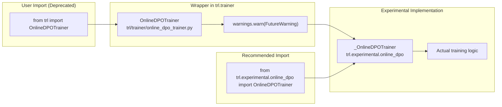
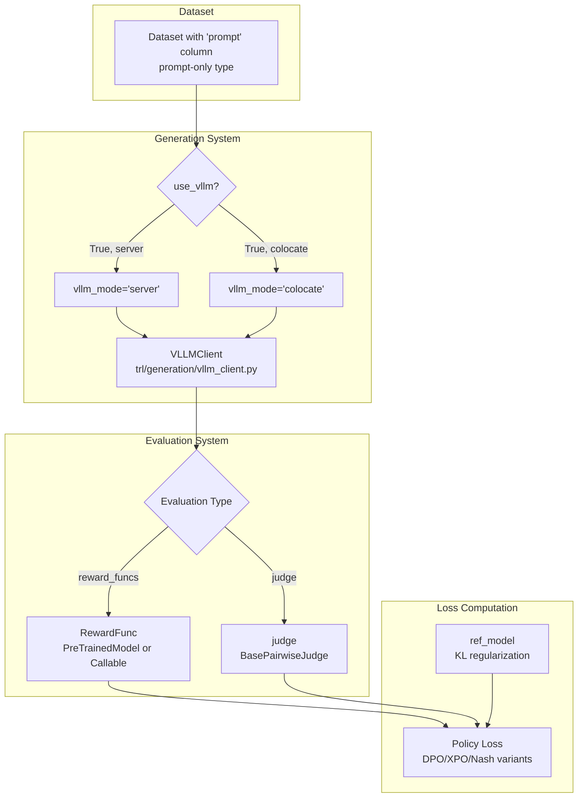
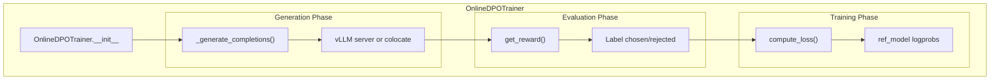
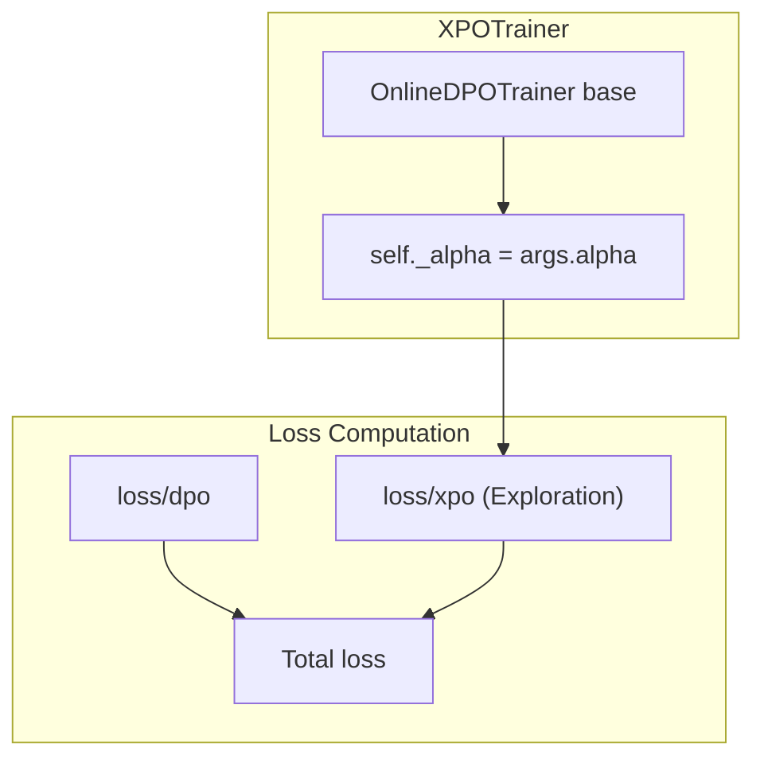
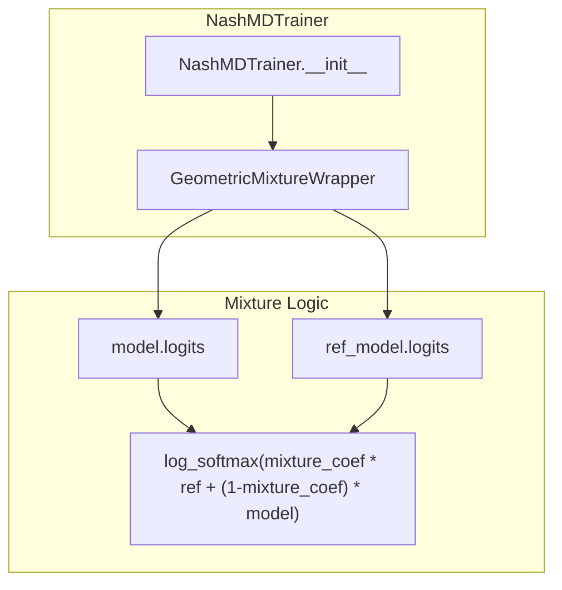

<!-- source: DeepWiki mcp.deepwiki.com · repo huggingface/trl · page 7.2 Online and Multi-Agent Methods · fetched 2026-10-26 -->

# Online and Multi-Agent Methods

<details>
<summary>Relevant source files</summary>

The following files were used as context for generating this wiki page:

- [examples/scripts/gkd.py](examples/scripts/gkd.py)
- [examples/scripts/nash_md.py](examples/scripts/nash_md.py)
- [examples/scripts/xpo.py](examples/scripts/xpo.py)
- [tests/experimental/test_utils.py](tests/experimental/test_utils.py)
- [trl/experimental/nash_md/nash_md_trainer.py](trl/experimental/nash_md/nash_md_trainer.py)
- [trl/experimental/online_dpo/online_dpo_trainer.py](trl/experimental/online_dpo/online_dpo_trainer.py)
- [trl/experimental/openenv/utils.py](trl/experimental/openenv/utils.py)
- [trl/experimental/utils.py](trl/experimental/utils.py)
- [trl/experimental/xpo/xpo_trainer.py](trl/experimental/xpo/xpo_trainer.py)

</details>


This page documents online and multi-agent training methods in TRL. These trainers generate completions dynamically during training and use reward models, judges, or other evaluation mechanisms.

The trainers covered on this page are:
- `OnlineDPOTrainer` - Online Direct Preference Optimization with dynamic preference generation
- `NashMDTrainer` - Nash equilibrium learning with mixture models
- `XPOTrainer` - Exploratory Preference Optimization with exploration bonus
- `GKDTrainer` - Generalized Knowledge Distillation from teacher models
- `BCOTrainer` - Binary Classifier Optimization using best-of-N sampling

The first three trainers (`OnlineDPOTrainer`, `NashMDTrainer`, `XPOTrainer`) are experimental and located in `trl.experimental` with their APIs subject to change. `GKDTrainer` and `BCOTrainer` have stable implementations.

For other online RL methods, see [`GRPOTrainer`](page 5) and [`RLOOTrainer`](page 6).

## Experimental Status and Import Pattern

All trainers documented on this page are experimental and their APIs may change without notice. The trainers are implemented in `trl.experimental` but wrapper classes exist in `trl.trainer` for backward compatibility.

**Wrapper Pattern**

Each trainer has a thin wrapper in `trl.trainer` that emits a `FutureWarning` and delegates to the experimental implementation:



Sources: [trl/experimental/online_dpo/online_dpo_trainer.py:95-96](), [trl/experimental/nash_md/nash_md_trainer.py:106-107](), [trl/experimental/xpo/xpo_trainer.py:47-48]()

## Shared Architecture Patterns

Experimental online trainers share common architectural patterns with stable online RL methods. They utilize `vLLM` for high-throughput generation and flexible reward functions.

**Common Online RL Architecture**



Sources: [trl/experimental/online_dpo/online_dpo_trainer.py:53-54](), [trl/experimental/online_dpo/online_dpo_trainer.py:88-92](), [trl/experimental/openenv/utils.py:108-113]()

All experimental online trainers support:
- **Prompt-only datasets**: Only prompts are required; completions are generated during training.
- **vLLM integration**: Both server and colocate modes for fast generation.
- **Flexible evaluation**: Judge-based or reward function-based scoring.
- **PEFT support**: Parameter-efficient fine-tuning via `prepare_peft_model`.

Sources: [trl/experimental/online_dpo/online_dpo_trainer.py:125-128](), [trl/experimental/online_dpo/online_dpo_trainer.py:141-142](), [trl/experimental/utils.py:44-46]()

## OnlineDPOTrainer

The `OnlineDPOTrainer` implements online Direct Preference Optimization. The model generates two completions per prompt and uses a judge or reward model to determine preferences in real-time.

### Architecture

**OnlineDPOTrainer Components**



Sources: [trl/experimental/online_dpo/online_dpo_trainer.py:95-125](), [trl/experimental/online_dpo/online_dpo_trainer.py:112-118]()

### Evaluation Methods

The `OnlineDPOTrainer` requires an evaluation method to determine preferences. It uses `DPODataCollatorWithPadding` to handle batching of the generated pairs.

| Evaluation Method | Type | Description |
|-------------------|------|-------------|
| `reward_funcs` | `RewardFunc` | Reward models or custom callables returning floats |
| `data_collator` | `DataCollator` | Defaults to `DPODataCollatorWithPadding` |

Sources: [trl/experimental/online_dpo/online_dpo_trainer.py:88-92](), [trl/experimental/online_dpo/online_dpo_trainer.py:121-124](), [trl/experimental/utils.py:50-59]()

### Configuration Parameters

Key configuration options in `OnlineDPOConfig`:

| Parameter | Type | Default | Description |
|-----------|------|---------|-------------|
| `beta` | `float` | `0.1` | KL penalty coefficient |
| `loss_type` | `str` | `"sigmoid"` | DPO loss variant |
| `use_vllm` | `bool` | `False` | Enable vLLM for generation |

Sources: [trl/experimental/online_dpo/online_dpo_trainer.py:119-120](), [trl/experimental/online_dpo/online_dpo_config.py]()

## XPOTrainer

The `XPOTrainer` (Exploratory Preference Optimization) extends `OnlineDPOTrainer` with an exploration bonus term. It generates completions and optimizes based on both preference judgments and an exploration signal.

### Architecture

**XPOTrainer Loss Formulation**

XPOTrainer overrides the statistics tracking to include XPO-specific metrics like `loss/xpo` and uses an `alpha` parameter for exploration weighting.



Sources: [trl/experimental/xpo/xpo_trainer.py:47-51](), [trl/experimental/xpo/xpo_trainer.py:143-150](), [examples/scripts/xpo.py:53-54]()

### Configuration

| Parameter | Type | Default | Description |
|-----------|------|---------|-------------|
| `alpha` | `float` | `0.1` | Exploration bonus weight |

Sources: [trl/experimental/xpo/xpo_trainer.py:143-143](), [examples/scripts/xpo.py:57-58]()

## NashMDTrainer

The `NashMDTrainer` implements Nash equilibrium learning using mirror descent. It utilizes a `GeometricMixtureWrapper` to sample from a mixture of the policy and reference models.

### Architecture

**NashMDTrainer Mixture Generation**



Sources: [trl/experimental/nash_md/nash_md_trainer.py:48-64](), [trl/experimental/nash_md/nash_md_trainer.py:85-87](), [trl/experimental/nash_md/nash_md_trainer.py:106-110]()

### Geometric Mixture Model

The `GeometricMixtureWrapper` implements the `GenerationMixin` to allow the trainer to sample from the interpolated distribution during the rollout phase.

Sources: [trl/experimental/nash_md/nash_md_trainer.py:48-52](), [trl/experimental/nash_md/nash_md_trainer.py:79-83]()

## GKDTrainer (Generalized Knowledge Distillation)

The `GKDTrainer` implements generalized knowledge distillation. It generates completions from a student model and uses a teacher model to provide supervision signals.

### GKD Training Loop

1. **Initialization**: Loads student and teacher models.
2. **Rollout**: Student model generates completions for the training prompts.
3. **Distillation**: Student is trained to match the teacher's distribution on these completions.

Sources: [examples/scripts/gkd.py:64-65](), [examples/scripts/gkd.py:120-128]()

### Example Usage

```python
from trl.experimental.gkd import GKDConfig, GKDTrainer

trainer = GKDTrainer(
    model="student-model-id",
    teacher_model="teacher-model-id",
    args=GKDConfig(output_dir="gkd-model"),
    train_dataset=dataset,
    processing_class=tokenizer,
)
trainer.train()
```

Sources: [examples/scripts/gkd.py:120-128]()

## BCOTrainer (Binary Classifier Optimization)

The `BCOTrainer` implements training through best-of-N sampling and binary classification. It is often used for self-improvement where the model learns from its own high-scoring generations.

### BCO Workflow

1. **Generation**: Sample multiple completions per prompt.
2. **Scoring**: Use a reward model to score each completion.
3. **Optimization**: Optimize the model to favor higher-scoring completions using a binary classification objective.

Sources: [examples/scripts/xpo.py:23-39]() (Pattern similar to other online preference methods)

## Common Integration Utilities

### Data Collators
Experimental trainers use specialized data collators like `DPODataCollatorWithPadding` for preference pairs and `DataCollatorForChatML` for conversational data.

Sources: [trl/experimental/utils.py:50-60](), [trl/experimental/utils.py:131-141]()

### vLLM Rollouts
Custom rollouts are handled via `generate_rollout_completions`, which supports both `server` and `colocate` modes.

Sources: [trl/experimental/openenv/utils.py:88-100](), [trl/experimental/openenv/utils.py:108-113]()

### PEFT and Reference Models
Trainers use `prepare_peft_model` to wrap models and `create_reference_model` to handle KL-divergence targets when a reference model is not explicitly provided.

Sources: [trl/experimental/online_dpo/online_dpo_trainer.py:58-59](), [trl/experimental/utils.py:44-46]()

---

