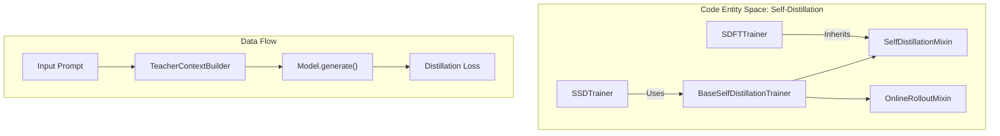
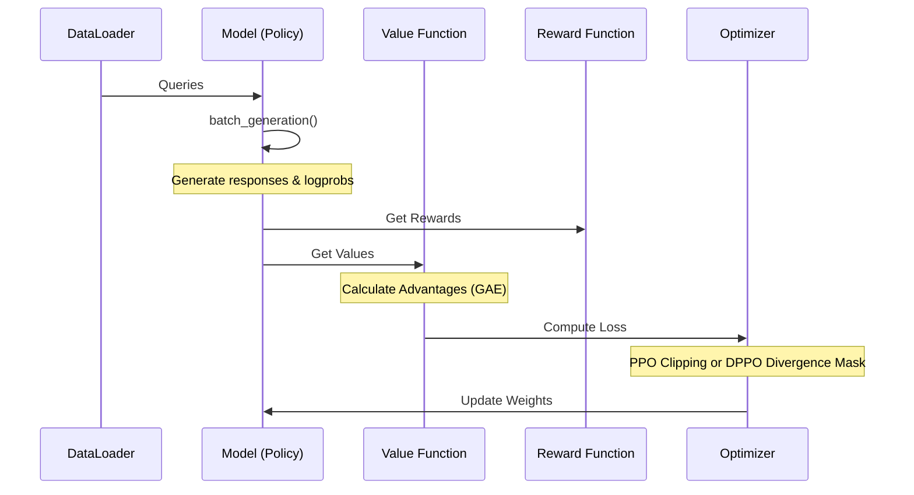

<!-- source: DeepWiki mcp.deepwiki.com · repo huggingface/trl · page 7.3 Distillation and Experimental Trainers · fetched 2026-10-26 -->

# Distillation and Experimental Trainers

Relevant source files

The following files were used as context for generating this wiki page:

- [docs/source/distillation_trainer.md](docs/source/distillation_trainer.md)
- [docs/source/gold_trainer.md](docs/source/gold_trainer.md)
- [docs/source/sdft_trainer.md](docs/source/sdft_trainer.md)
- [docs/source/sdpo_trainer.md](docs/source/sdpo_trainer.md)
- [docs/source/ssd_trainer.md](docs/source/ssd_trainer.md)
- [tests/experimental/test_gold_trainer.py](tests/experimental/test_gold_trainer.py)
- [tests/experimental/test_sdft_trainer.py](tests/experimental/test_sdft_trainer.py)
- [tests/experimental/test_ssd_trainer.py](tests/experimental/test_ssd_trainer.py)
- [trl/experimental/distillation/__init__.py](trl/experimental/distillation/__init__.py)
- [trl/experimental/distillation/distillation.py](trl/experimental/distillation/distillation.py)
- [trl/experimental/distillation/distillation_config.py](trl/experimental/distillation/distillation_config.py)
- [trl/experimental/distillation/distillation_trainer.py](trl/experimental/distillation/distillation_trainer.py)
- [trl/experimental/dppo/dppo_config.py](trl/experimental/dppo/dppo_config.py)
- [trl/experimental/gkd/gkd_config.py](trl/experimental/gkd/gkd_config.py)
- [trl/experimental/gkd/gkd_trainer.py](trl/experimental/gkd/gkd_trainer.py)
- [trl/experimental/gold/gold_config.py](trl/experimental/gold/gold_config.py)
- [trl/experimental/gold/gold_trainer.py](trl/experimental/gold/gold_trainer.py)
- [trl/experimental/minillm/minillm_config.py](trl/experimental/minillm/minillm_config.py)
- [trl/experimental/minillm/minillm_trainer.py](trl/experimental/minillm/minillm_trainer.py)
- [trl/experimental/ppo/ppo_config.py](trl/experimental/ppo/ppo_config.py)
- [trl/experimental/ppo/ppo_trainer.py](trl/experimental/ppo/ppo_trainer.py)
- [trl/experimental/sdft/__init__.py](trl/experimental/sdft/__init__.py)
- [trl/experimental/sdft/sdft_config.py](trl/experimental/sdft/sdft_config.py)
- [trl/experimental/sdft/sdft_trainer.py](trl/experimental/sdft/sdft_trainer.py)
- [trl/experimental/sdpo/__init__.py](trl/experimental/sdpo/__init__.py)
- [trl/experimental/self_distillation/base_self_distillation_trainer.py](trl/experimental/self_distillation/base_self_distillation_trainer.py)
- [trl/experimental/ssd/__init__.py](trl/experimental/ssd/__init__.py)
- [trl/experimental/ssd/ssd.py](trl/experimental/ssd/ssd.py)
- [trl/experimental/ssd/ssd_config.py](trl/experimental/ssd/ssd_config.py)
- [trl/experimental/ssd/ssd_eval.py](trl/experimental/ssd/ssd_eval.py)
- [trl/experimental/ssd/ssd_trainer.py](trl/experimental/ssd/ssd_trainer.py)

The `trl.experimental` namespace serves as a staging ground for research-stage algorithms and advanced distillation methods. This section documents trainers focused on knowledge distillation (MiniLLM, GKD, GOLD), self-distillation (SDFT, SSD, SDPO), and experimental reinforcement learning implementations like the revised PPO and DPPO.

## Knowledge Distillation Trainers

TRL provides several trainers for transferring knowledge from a large teacher model to a smaller student model. These methods typically involve aligning the student's output distribution with the teacher's.

### MiniLLMTrainer (Reverse KLD Distillation)
`MiniLLMTrainer` implements the MiniLLM algorithm, which focuses on **Reverse Kullback-Leibler Divergence (KLD)**. Unlike standard KLD (which can lead to mode-seeking behavior), Reverse KLD encourages the student to cover the teacher's distribution more effectively in the context of language generation.

*   **Key Feature**: Uses a reinforcement learning-style advantage calculation where the reward is derived from the log-probability difference between student and teacher [trl/experimental/minillm/minillm_config.py:36-39]().
*   **Implementation**: Inherits from `GRPOConfig` but overrides the reward scaling logic to support single-generation distillation [trl/experimental/minillm/minillm_config.py:23-29]().

### GKDTrainer and GOLDTrainer
`GKDTrainer` (Generalized Knowledge Distillation) and its extension `GOLDTrainer` (General Online Logit Distillation) support cross-tokenizer distillation.

*   **GKD**: Controls the "on-policy" fraction of student-generated data via the `lmbda` parameter [trl/experimental/gkd/gkd_config.py:32-35](). It uses Generalized Jensen-Shannon Divergence (JSD) controlled by `beta` [trl/experimental/gkd/gkd_config.py:36-38]().
*   **GOLD**: Specifically designed for **cross-tokenizer alignment**. It aligns textual spans produced by different tokenizers and merges logits so that a student (e.g., Llama) can learn from a teacher with a different vocabulary (e.g., Qwen) [docs/source/gold_trainer.md:7-12]().

#### GOLD Token Merging Logic
When token boundaries differ, GOLD groups tokens that represent the same string and merges teacher probabilities using the chain rule [docs/source/gold_trainer.md:128-134]().

| Feature | Description |
| :--- | :--- |
| **Probability Merging** | $P_{merged}(y) = P(y|ctx) \times \prod P(token_i | ...)$ [docs/source/gold_trainer.md:129-133]() |
| **Hybrid ULD Loss** | Combines exact vocabulary matches with sorted-probability ULD loss [docs/source/gold_trainer.md:15-16]() |
| **Teacher Alignment** | `_build_alignment_groups_from_ids` maps student token indices to teacher token indices [tests/experimental/test_gold_trainer.py:87-89]() |

**Sources**: [trl/experimental/gold/gold_trainer.py](), [trl/experimental/gold/gold_config.py](), [docs/source/gold_trainer.md](), [trl/experimental/gkd/gkd_config.py]().

## Self-Distillation Methods

Self-distillation allows a model to improve by learning from its own generated outputs or from "privileged" versions of its own prompts.

### Simple Self-Distillation (SSD)
SSD samples completions at a specific training-time temperature and fine-tunes on them using standard cross-entropy loss [docs/source/ssd_trainer.md:3-5]().
*   **Mechanism**: Uses `SSDTrainer` to generate completions and filter empty/stub outputs via `filter_empty=True` [docs/source/ssd_trainer.md:12-14]().
*   **Hyperparameters**: `temperature` (T_train) and truncation (`top_k`, `top_p`) are critical for suppressing low-probability noise during synthesis [docs/source/ssd_trainer.md:59-64]().

### SDFT (Self-Distillation Fine-Tuning)
`SDFTTrainer` uses a **DemonstrationTeacherContextBuilder** to construct "teacher" prompts that include privileged context (e.g., ground truth hints or chain-of-thought) which is hidden from the student during training [trl/experimental/sdft/sdft_trainer.py:71-73]().

### Self-Distillation Architecture
The following diagram illustrates the relationship between the base self-distillation logic and specific implementations.

**Sources**: [trl/experimental/self_distillation/base_self_distillation_trainer.py:70-71](), [trl/experimental/sdft/sdft_trainer.py:141-142](), [docs/source/ssd_trainer.md]().

## Experimental RL Trainers (PPO and DPPO)

TRL maintains experimental versions of Proximal Policy Optimization (PPO) and its variants to test new stability techniques.

### PPOTrainer (Experimental)
The experimental `PPOTrainer` provides a streamlined implementation of the PPO algorithm for LLMs.
*   **Generation**: Uses `batch_generation` to handle per-rank forward passes during the rollout phase [trl/experimental/ppo/ppo_trainer.py:123-129]().
*   **Optimization**: Implements a standard PPO loss with `cliprange` and `vf_coef` for the value function [trl/experimental/ppo/ppo_config.py:100-103]().

### DPPO (Divergence PPO)
`DPPOTrainer` replaces the standard heuristic ratio-clipping with a trust region based on direct policy divergence estimates [trl/experimental/dppo/dppo_config.py:24-29]().
*   **Divergence Types**: Supports `binary_tv`, `binary_kl`, `topk_tv`, and `topk_kl` [trl/experimental/dppo/dppo_config.py:32-35]().
*   **Trust Region**: Uses `epsilon` (δ_low) and `epsilon_high` (δ_high) as divergence thresholds to mask tokens where the policy moves too far from the reference [trl/experimental/dppo/dppo_config.py:43-51]().

### Reinforcement Learning Data Flow
The interaction between the rollout phase and the optimization phase in these experimental trainers is detailed below:

**Sources**: [trl/experimental/ppo/ppo_trainer.py:123-152](), [trl/experimental/dppo/dppo_config.py:24-52]().

## Experimental Namespace Summary

| Trainer | Algorithm | Primary File |
| :--- | :--- | :--- |
| `MiniLLMTrainer` | Reverse KLD Distillation | `trl/experimental/minillm/minillm_trainer.py` |
| `GKDTrainer` | Generalized Knowledge Distillation | `trl/experimental/gkd/gkd_trainer.py` |
| `GOLDTrainer` | Cross-Tokenizer Distillation | `trl/experimental/gold/gold_trainer.py` |
| `SSDTrainer` | Simple Self-Distillation | `trl/experimental/ssd/ssd_trainer.py` |
| `SDFTTrainer` | Self-Distillation with Privileged Context | `trl/experimental/sdft/sdft_trainer.py` |
| `PPOTrainer` | Experimental PPO | `trl/experimental/ppo/ppo_trainer.py` |
| `DPPOTrainer` | Divergence PPO | `trl/experimental/dppo/dppo_config.py` |

**Sources**: [trl/experimental/minillm/minillm_config.py](), [trl/experimental/gold/gold_config.py](), [trl/experimental/dppo/dppo_config.py]().

---

