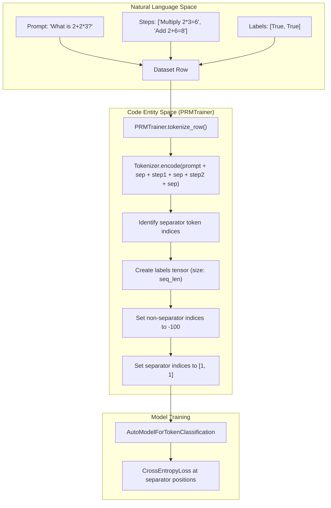
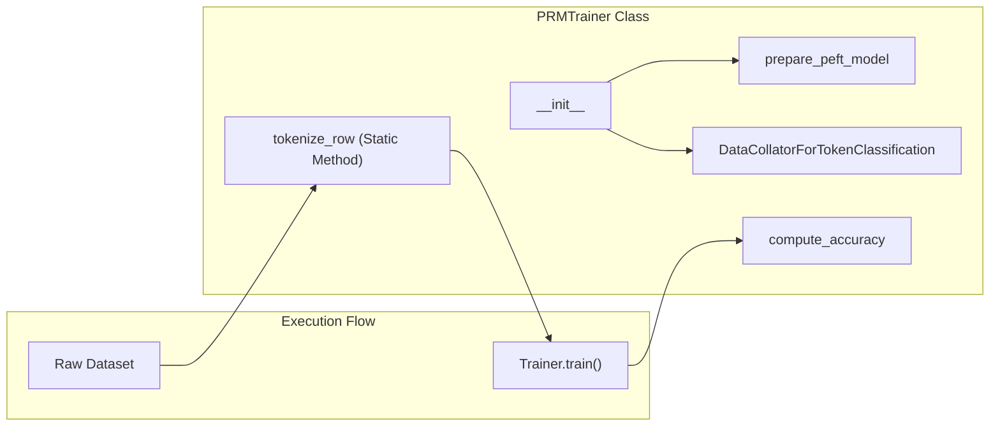

<!-- source: DeepWiki mcp.deepwiki.com · repo huggingface/trl · page 7.4 Process Reward Modeling (PRM) · fetched 2026-10-26 -->

# Process Reward Modeling (PRM)

Relevant source files

The following files were used as context for generating this wiki page:

- [docs/source/prm_trainer.md](docs/source/prm_trainer.md)
- [tests/experimental/test_prm_trainer.py](tests/experimental/test_prm_trainer.py)
- [trl/experimental/prm/prm_config.py](trl/experimental/prm/prm_config.py)
- [trl/experimental/prm/prm_trainer.py](trl/experimental/prm/prm_trainer.py)

Process-supervised Reward Models (PRM) are designed to provide feedback on individual reasoning steps rather than just the final outcome of a sequence. This approach is particularly effective for complex reasoning tasks like mathematics, where a correct final answer might be reached through flawed logic, or an early error might derail an otherwise sound process.

The `PRMTrainer` in TRL implements process-level supervision by treating the reward modeling task as a token classification problem, where specific tokens (typically step separators) are used as the prediction targets for step-level correctness.

> [!WARNING]
> `PRMTrainer` is currently an experimental API and is subject to change.

## Architecture and Data Flow

The `PRMTrainer` transforms a dataset of reasoning steps into a token classification task. It identifies "step separators" within the text and aligns the provided labels with the positions of these separators in the tokenized sequence.

### Step-Level Supervision Logic
The trainer expects a dataset where each row contains a `prompt`, a list of `completions` (steps), and a corresponding list of `labels` (True/False or floats). During tokenization, the `PRMTrainer.tokenize_row` method:
1. Concatenates the prompt and steps using a `step_separator`.
2. Identifies the indices of the tokens corresponding to the `step_separator`.
3. Assigns the process labels to these specific token indices while setting all other tokens to `-100` (ignored by the loss function).

### Data Flow Diagram
This diagram illustrates how raw reasoning steps are converted into a format suitable for an `AutoModelForTokenClassification`.

**PRM Data Transformation Pipeline**

Sources: [trl/experimental/prm/prm_trainer.py:134-194](), [docs/source/prm_trainer.md:92-98]()

## Configuration (PRMConfig)

`PRMConfig` inherits from `_BaseConfig` and `TrainingArguments`, providing specific parameters for process-level supervision.

| Parameter | Type | Default | Description |
| :--- | :--- | :--- | :--- |
| `step_separator` | `str` | `"\n"` | The string used to delimit reasoning steps. |
| `train_on_last_step_only` | `bool` | `False` | If True, only the label for the final reasoning step is used for training. |
| `max_length` | `int` | `1024` | Maximum total sequence length (prompt + completions). |
| `max_completion_length` | `int` | `None` | Maximum length specifically for the reasoning steps. |
| `disable_dropout` | `bool` | `True` | Whether to disable dropout during training. |

Sources: [trl/experimental/prm/prm_config.py:21-88]()

## Implementation Details

### PRMTrainer Class
The `PRMTrainer` is defined in `trl/experimental/prm/prm_trainer.py`. It extends `_BaseTrainer` and automates the setup of token classification for reward modeling.

**Key Components:**
*   **Model Requirements:** It is designed to work with `AutoModelForTokenClassification` with `num_labels=2` (representing Correct/Incorrect).
*   **Accuracy Computation:** The `compute_accuracy` function handles two modes: token classification (step-level) and reward comparison (sequence-level). For PRM, it flattens the predictions and labels, filtering out the `-100` tokens to calculate the mean accuracy of step predictions.

**PRMTrainer Structure and Call Graph**

Sources: [trl/experimental/prm/prm_trainer.py:97-150](), [trl/experimental/prm/prm_trainer.py:52-94]()

### Dataset Format
PRM requires a specific "Stepwise Supervision" format. Unlike standard preference data (which compares two full completions), PRM data looks inside a single reasoning chain.

| Column | Type | Example |
| :--- | :--- | :--- |
| `prompt` | `str` | `"Solve for x: 2x + 4 = 10"` |
| `completions` | `list[str]` | `["Subtract 4 from both sides: 2x = 6", "Divide by 2: x = 3"]` |
| `labels` | `list[bool/float]` | `[True, True]` |

Sources: [docs/source/prm_trainer.md:92-98](), [tests/experimental/test_prm_trainer.py:127-131]()

## Integration with GRPO

Process Reward Models are critical for "Verifiable Reasoning" in algorithms like **Group Relative Policy Optimization (GRPO)**. While GRPO often uses programmatic verifiers (like math kernels), a trained PRM can act as a "neural verifier" that provides dense, stepwise rewards.

In a GRPO loop:
1.  The policy generates a full reasoning chain.
2.  The PRM identifies the step separators in the generated text.
3.  The PRM provides a score for every step.
4.  These scores are used as the reward signal for the policy, allowing the model to learn which specific steps in a long chain were incorrect.

Sources: [docs/source/prm_trainer.md:56-88](), [trl/experimental/prm/prm_trainer.py:135-148]()

---

