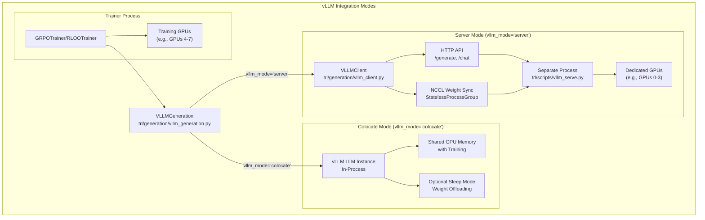
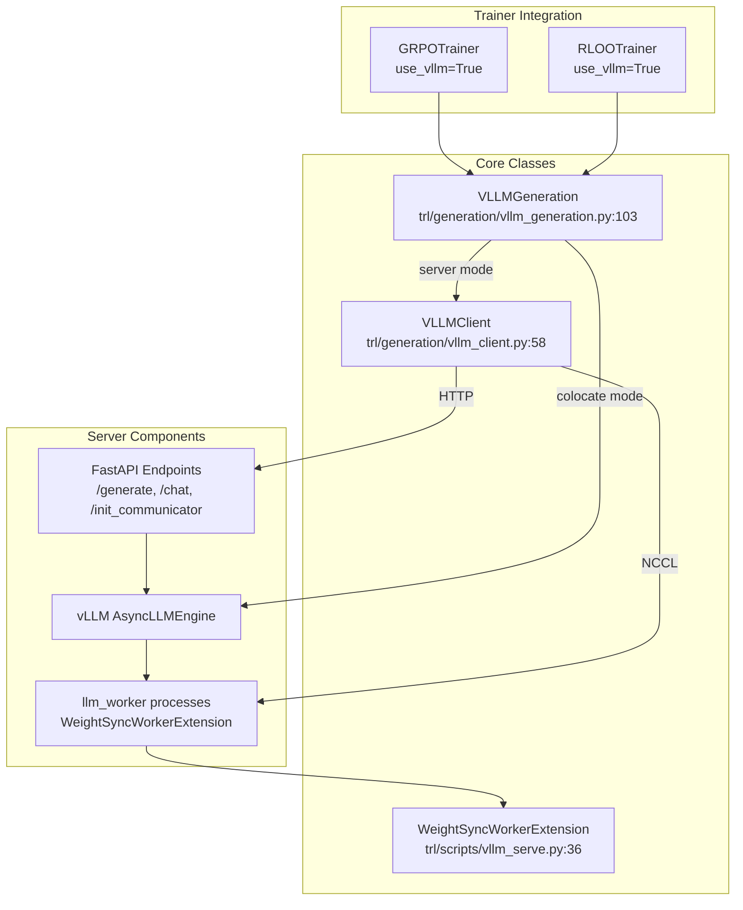

<!-- source: DeepWiki mcp.deepwiki.com · repo huggingface/trl · page 8 vLLM Integration · fetched 2026-10-26 -->

# vLLM Integration

Relevant source files

The following files were used as context for generating this wiki page:

- [docs/source/speeding_up_training.md](docs/source/speeding_up_training.md)
- [docs/source/vllm_integration.md](docs/source/vllm_integration.md)
- [pyproject.toml](pyproject.toml)
- [tests/test_vllm_client_server.py](tests/test_vllm_client_server.py)
- [tests/testing_utils.py](tests/testing_utils.py)
- [trl/_compat.py](trl/_compat.py)
- [trl/generation/vllm_client.py](trl/generation/vllm_client.py)
- [trl/generation/vllm_generation.py](trl/generation/vllm_generation.py)
- [trl/import_utils.py](trl/import_utils.py)
- [trl/scripts/vllm_serve.py](trl/scripts/vllm_serve.py)

## Purpose and Scope

The vLLM integration provides accelerated generation for online reinforcement learning methods in TRL. By leveraging vLLM's PagedAttention and optimized inference kernels, it enables significant speedups over standard transformers generation during training. This integration is critical for making online methods like GRPO and RLOO practical at scale.

**Supported vLLM Versions**: `0.12.0` to `0.18.0` ([trl/import_utils.py:108]())

**Supported Trainers**:
- `GRPOTrainer` ([trl/trainer/grpo_trainer.py:129]())
- `RLOOTrainer` ([trl/trainer/rloo_trainer.py:39]())
- `NashMDTrainer` (experimental)
- `OnlineDPOTrainer` (experimental)
- `XPOTrainer` (experimental)

Sources: [trl/generation/vllm_generation.py:1-28](), [pyproject.toml:81-88](), [docs/source/vllm_integration.md:1-16]()

## Architecture Overview

vLLM can operate in two distinct modes during training, each with different resource allocation strategies:

Sources: [trl/generation/vllm_generation.py:105-206](), [docs/source/vllm_integration.md:162-230]()

### Mode Comparison

| Aspect | Server Mode | Colocate Mode |
|--------|-------------|---------------|
| **Process** | Separate vLLM process | Same process as trainer |
| **GPUs** | Dedicated GPUs (separate from training) | Shared GPUs with training |
| **Communication** | HTTP + NCCL | Direct in-process calls |
| **Memory** | Independent allocation | Shared allocation (via `vllm_gpu_memory_utilization`) |
| **Setup** | Requires `trl vllm-serve` command | Automatic initialization |
| **Use Case** | Multi-node, dedicated inference GPUs | Single node, resource-constrained |
| **Sleep Mode** | Not applicable | Optional weight offloading |

Sources: [docs/source/vllm_integration.md:17-155](), [trl/generation/vllm_generation.py:121-128]()

## Core Components

The vLLM integration consists of three primary classes that work together to provide accelerated generation:

Sources: [trl/generation/vllm_generation.py:103](), [trl/generation/vllm_client.py:58](), [trl/scripts/vllm_serve.py:36]()

### VLLMGeneration
`VLLMGeneration` is the main abstraction layer that handles both server and colocate modes. It provides a unified interface for trainers to generate completions regardless of the underlying mode. For details, see [vLLM Colocate Mode and Memory Management](#8.2).

Sources: [trl/generation/vllm_generation.py:103-585]()

### VLLMClient
`VLLMClient` handles communication with the vLLM server in server mode. It manages both HTTP requests for generation and NCCL communication for weight synchronization. For details, see [vLLM Server Mode and Weight Synchronization](#8.1).

Sources: [trl/generation/vllm_client.py:58-462]()

### WeightSyncWorkerExtension
`WeightSyncWorkerExtension` is a vLLM worker extension that enables weight synchronization from the client. It is loaded on each vLLM worker process and receives weight updates via NCCL broadcast. For details, see [vLLM Server Mode and Weight Synchronization](#8.1).

Sources: [trl/scripts/vllm_serve.py:36-159]()

## Server Mode Architecture

Server mode runs vLLM in a separate process on dedicated GPUs, communicating with the trainer via HTTP for generation requests and NCCL for weight updates. This is the recommended mode for multi-GPU or multi-node setups to avoid resource contention.

For details, see [vLLM Server Mode and Weight Synchronization](#8.1).

Sources: [trl/scripts/vllm_serve.py:1-160](), [docs/source/vllm_integration.md:164-200]()

## Colocate Mode Architecture

Colocate mode runs vLLM in the same process as the trainer, sharing GPU memory. This is useful when dedicated inference GPUs are not available. It includes a specialized "Sleep Mode" to offload vLLM weights to CPU during the trainer's backward pass.

For details, see [vLLM Colocate Mode and Memory Management](#8.2).

Sources: [trl/generation/vllm_generation.py:444-486](), [docs/source/vllm_integration.md:202-230]()

## Async GRPO and Decoupled Generation

TRL includes an experimental architecture for decoupling generation from training. The `AsyncGRPOTrainer` uses `AsyncRolloutWorker` processes to generate completions asynchronously while the main trainer process performs gradient updates.

For details, see [Async GRPO and Decoupled Generation](#8.3).

Sources: [trl/trainer/grpo_trainer.py:129-150]() (referenced via trainer architecture).

## Importance Sampling Correction

vLLM and standard Transformers generation can produce slightly different token probabilities due to numerical precision and kernel optimizations. TRL implements Importance Sampling (IS) correction to mitigate this training-inference mismatch.

**Correction Modes**:
- `token_truncate`: Per-token clipping.
- `token_mask`: Per-token masking.
- `sequence_truncate`: Per-sequence clipping.
- `sequence_mask`: Per-sequence masking.

The sequence-level ratio is computed as the geometric mean of token ratios to remain theoretically sound for autoregressive models.

Sources: [trl/generation/vllm_generation.py:85-91](), [trl/trainer/grpo_trainer.py:1751-1830]()

## Troubleshooting

### NCCL Errors: "Same Device Used for Multiple Ranks"
**Error**: `RuntimeError: Attempting to use the same CUDA device (UUID: ...) for multiple distinct roles/ranks`
**Cause**: Server and trainer processes are sharing the same GPU ID.
**Solution**: Ensure separate GPUs are assigned via `CUDA_VISIBLE_DEVICES` for the server and trainer.

Sources: [trl/scripts/vllm_serve.py:82-92](), [docs/source/vllm_integration.md:21-24]()

### OOM in Colocate Mode
**Error**: `torch.cuda.OutOfMemoryError` during generation.
**Cause**: `vllm_gpu_memory_utilization` is set too high, leaving insufficient memory for training activations.
**Solution**: Lower the utilization ratio or enable `vllm_enable_sleep_mode`.

Sources: [trl/generation/vllm_generation.py:154-159](), [docs/source/vllm_integration.md:225-230]()

### Compatibility Patches
TRL applies internal patches to vLLM to ensure smooth integration, such as `_patch_vllm_logging` to reduce noise.

Sources: [trl/_compat.py:78-85]()

---

