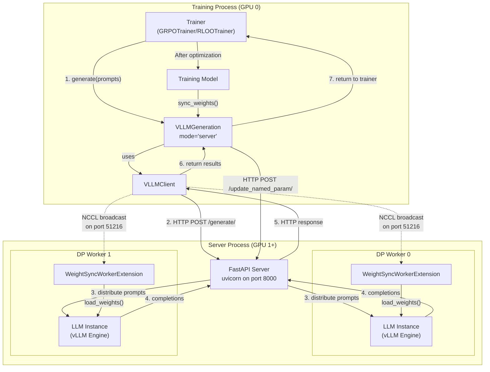
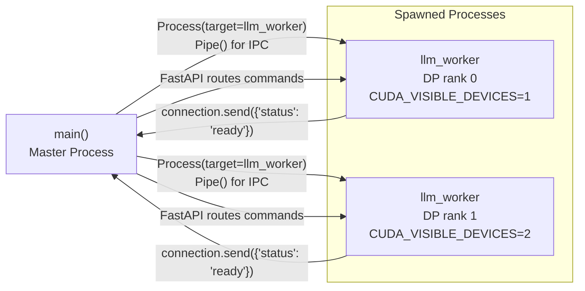
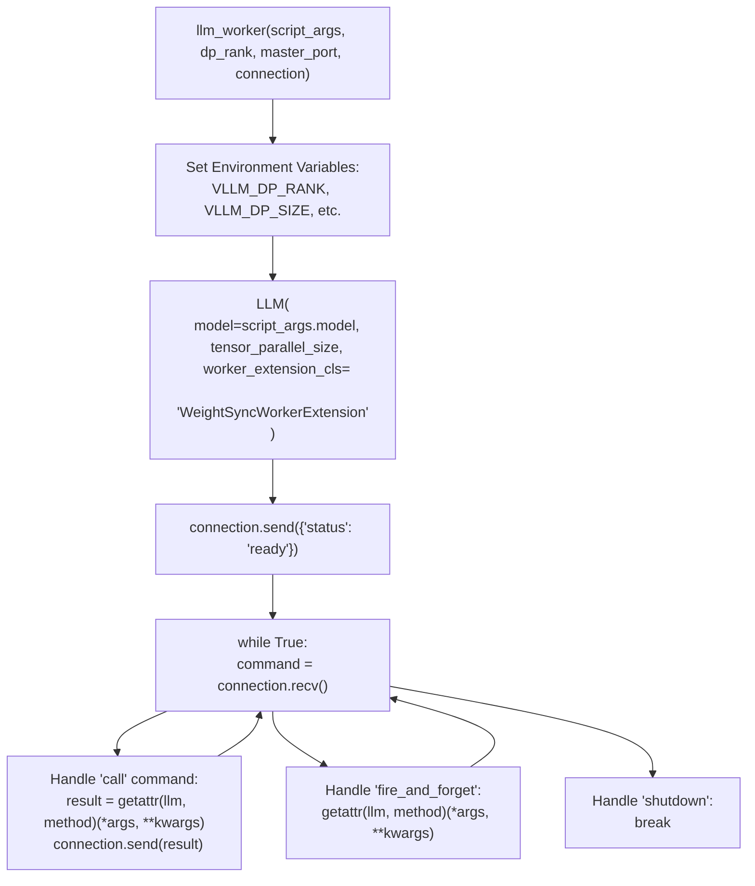
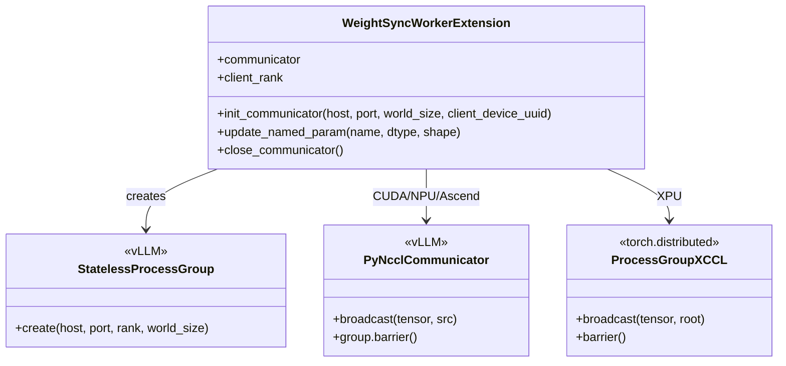
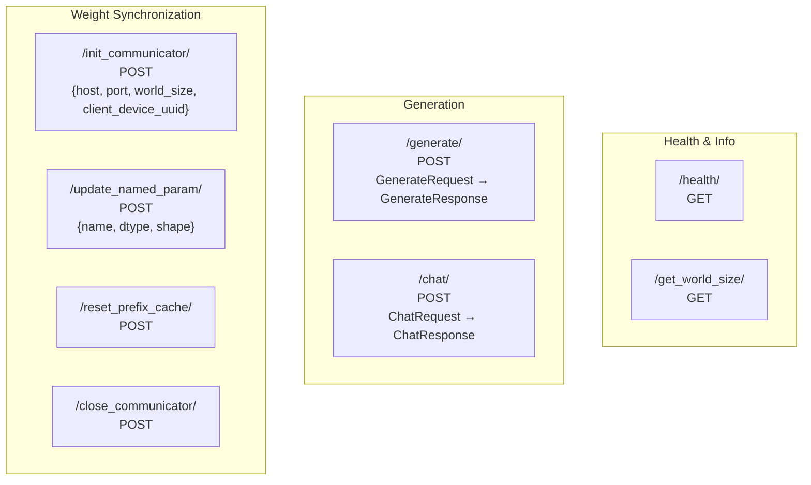
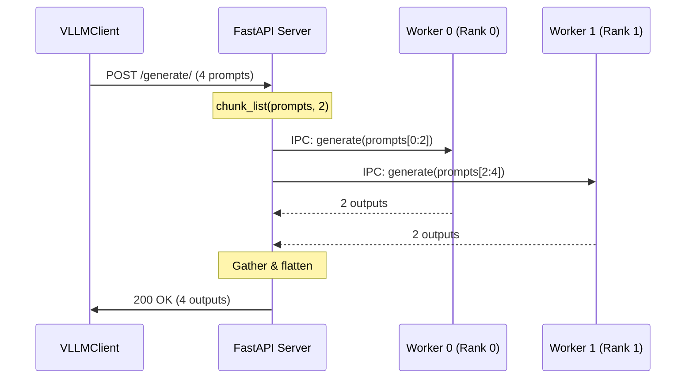

<!-- source: DeepWiki mcp.deepwiki.com · repo huggingface/trl · page 8.1 vLLM Server Mode and Weight Synchronization · fetched 2026-10-26 -->

# vLLM Server Mode and Weight Synchronization

<details>
<summary>Relevant source files</summary>

The following files were used as context for generating this wiki page:

- [docs/source/speeding_up_training.md](docs/source/speeding_up_training.md)
- [docs/source/vllm_integration.md](docs/source/vllm_integration.md)
- [pyproject.toml](pyproject.toml)
- [tests/test_vllm_client_server.py](tests/test_vllm_client_server.py)
- [tests/testing_utils.py](tests/testing_utils.py)
- [trl/_compat.py](trl/_compat.py)
- [trl/generation/vllm_client.py](trl/generation/vllm_client.py)
- [trl/generation/vllm_generation.py](trl/generation/vllm_generation.py)
- [trl/import_utils.py](trl/import_utils.py)
- [trl/scripts/vllm_serve.py](trl/scripts/vllm_serve.py)

</details>


## Purpose and Scope

This document details the vLLM server mode architecture in TRL, which enables efficient online reinforcement learning by running generation on separate GPUs from training. Server mode provides a dual-channel communication system: HTTP for generation requests and NCCL for weight synchronization, allowing the training process to dynamically update the inference server's model weights without restarting.

For general vLLM integration concepts and comparison with colocate mode, see [vLLM Integration](#8). For colocate mode specifics, see [vLLM Colocate Mode and Memory Management](#8.2).

## Architecture Overview

The server mode architecture separates training and inference across distinct processes and devices. The training process acts as a client that sends generation requests and weight updates to the server.



**Sources:** [trl/scripts/vllm_serve.py:310-362](), [trl/generation/vllm_client.py:58-118](), [trl/generation/vllm_generation.py:103-165]()

## Starting the Server

### Command Line Interface

The server is started using the `trl vllm-serve` command with model and configuration parameters. This CLI entry point is defined in `pyproject.toml` and mapped to `trl.cli:main`.

```bash
trl vllm-serve \
  --model Qwen/Qwen2.5-7B \
  --tensor_parallel_size 2 \
  --data_parallel_size 2 \
  --gpu_memory_utilization 0.9 \
  --port 8000
```

**Key Parameters defined in `ScriptArguments`:**

| Parameter | Default | Description |
|-----------|---------|-------------|
| `--model` | Required | Model name or path [trl/scripts/vllm_serve.py:164]() |
| `--tensor_parallel_size` | 1 | Number of GPUs for tensor parallelism [trl/scripts/vllm_serve.py:221]() |
| `--data_parallel_size` | 1 | Number of data parallel workers [trl/scripts/vllm_serve.py:225]() |
| `--host` | `"0.0.0.0"` | Server host address [trl/scripts/vllm_serve.py:238]() |
| `--port` | 8000 | HTTP server port [trl/scripts/vllm_serve.py:242]() |
| `--gpu_memory_utilization` | 0.9 | GPU memory ratio for vLLM [trl/scripts/vllm_serve.py:182]() |
| `--max_model_len` | None | Maximum context length [trl/scripts/vllm_serve.py:190]() |
| `--enable_prefix_caching` | None | Enable prefix caching for KV reuse [trl/scripts/vllm_serve.py:328]() |

**Sources:** [trl/scripts/vllm_serve.py:162-308](), [pyproject.toml:43-44]()

### Process Spawning and Worker Management

The `main` function spawns data parallel workers as separate processes using the `spawn` start method to avoid CUDA re-initialization errors.



- Sets `VLLM_WORKER_MULTIPROC_METHOD=spawn` at [trl/scripts/vllm_serve.py:33]().
- Creates `Pipe()` for IPC and spawns processes targeting `llm_worker` at [trl/scripts/vllm_serve.py:440-444]().
- Waits for ready signals from all workers at [trl/scripts/vllm_serve.py:448-454]().

**Sources:** [trl/scripts/vllm_serve.py:30-33](), [trl/scripts/vllm_serve.py:435-465]()

### llm_worker Function

Each data parallel worker runs the `llm_worker` function, which initializes the vLLM engine with the `WeightSyncWorkerExtension`.



The worker:
1. Sets DP environment variables at [trl/scripts/vllm_serve.py:316-319]().
2. Creates the `vllm.LLM` instance, injecting `WeightSyncWorkerExtension` at [trl/scripts/vllm_serve.py:321-339]().
3. Signals readiness to the master process at [trl/scripts/vllm_serve.py:342]().
4. Enters a command loop to process generation or synchronization tasks at [trl/scripts/vllm_serve.py:344-361]().

**Sources:** [trl/scripts/vllm_serve.py:310-362]()

## WeightSyncWorkerExtension

The `WeightSyncWorkerExtension` class enables efficient GPU-to-GPU weight synchronization using NCCL or XCCL.

### Class Structure



**Sources:** [trl/scripts/vllm_serve.py:36-160]()

### init_communicator Method

Initializes the weight update communicator using a `StatelessProcessGroup` to avoid interference with global torch distributed groups.

- **XPU (Intel):** Uses `torch.distributed.TCPStore` and `c10d.ProcessGroupXCCL` at [trl/scripts/vllm_serve.py:97-107]().
- **CUDA/NPU/Ascend:** Uses `StatelessProcessGroup.create` and `PyNcclCommunicator` at [trl/scripts/vllm_serve.py:111-112]().
- **Rank Assignment:** The client process (trainer) is assigned the highest rank (`world_size - 1`) at [trl/scripts/vllm_serve.py:115]().

**Sources:** [trl/scripts/vllm_serve.py:50-116]()

### update_named_param Method

Receives updated weights from the client process and loads them into the model.

1. Allocates an empty tensor of the correct shape and dtype on the worker device at [trl/scripts/vllm_serve.py:137]().
2. Performs a `broadcast` from the `client_rank` at [trl/scripts/vllm_serve.py:141-145]().
3. Loads the received weights using `self.model_runner.model.load_weights` at [trl/scripts/vllm_serve.py:149]().

**Sources:** [trl/scripts/vllm_serve.py:117-150]()

## FastAPI Endpoints

The server uses FastAPI to handle HTTP requests from the `VLLMClient`.

### Endpoint Overview



**Sources:** [trl/scripts/vllm_serve.py:469-898]()

### Generation Logic

The `/generate/` endpoint distributes prompts across DP workers using `chunk_list`.

- **Chunking:** `chunk_list` splits the list of prompts into `n` evenly distributed sublists at [trl/scripts/vllm_serve.py:364-381]().
- **Worker Execution:** The server sends the `generate` command to each worker via their respective IPC `connection` at [trl/scripts/vllm_serve.py:635]().
- **Logprob Extraction:** `extract_logprobs` processes `RequestOutput` objects to extract and sort logprobs by rank at [trl/generation/vllm_generation.py:62-91]().

**Sources:** [trl/scripts/vllm_serve.py:492-655](), [trl/generation/vllm_generation.py:62-91]()

## VLLMClient Class

The `VLLMClient` is the primary interface used by trainers to communicate with the server.

### Weight Synchronization Protocol

The client manages the lifecycle of the weight update group:

1. **Initialization:** `init_communicator` fetches the world size from the server and creates its own `StatelessProcessGroup` at [trl/generation/vllm_client.py:419-490]().
2. **Param Update:** `update_named_param` notifies the server of an incoming parameter and then broadcasts the tensor data via NCCL/XCCL at [trl/generation/vllm_client.py:492-515]().
3. **Full Model Sync:** `update_model_params` iterates over all model parameters and syncs them at [trl/generation/vllm_client.py:517-527]().

**Sources:** [trl/generation/vllm_client.py:419-527]()

## Dual-Channel Communication

The architecture relies on two distinct communication channels to balance metadata control and high-bandwidth data transfer.

| Channel | Protocol | Implementation | Role |
| :--- | :--- | :--- | :--- |
| **Control** | HTTP | FastAPI + `requests` | Metadata, prompt submission, status checks |
| **Data** | NCCL/XCCL | `StatelessProcessGroup` | High-speed weight tensor broadcasting |

**Sources:** [trl/scripts/vllm_serve.py:828-884](), [trl/generation/vllm_client.py:492-515]()

## Dynamic Weight Updates

Weight synchronization allows trainers to update the inference model without restarting the server. This is handled by `VLLMGeneration.sync_weights`.

- **PEFT Support:** If the model is a `PeftModel`, adapters are merged before syncing and unmerged afterward at [trl/generation/vllm_generation.py:468-505]().
- **FSDP/DeepSpeed:** Parameters are gathered across shards before being sent to the client at [trl/generation/vllm_generation.py:387-466]().
- **Name Fixing:** Parameter names are cleaned (e.g., removing `_checkpoint_wrapped_module.`) to match the vLLM model structure at [trl/generation/vllm_generation.py:379-385]().

**Sources:** [trl/generation/vllm_generation.py:379-523]()

## Data Parallelism

Data parallelism in the vLLM server allows scaling generation across multiple GPUs.



**Sources:** [trl/scripts/vllm_serve.py:364-381](), [trl/scripts/vllm_serve.py:625-655]()

---

