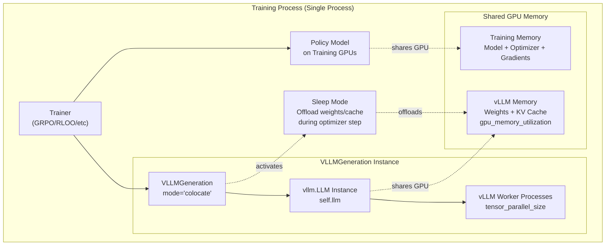
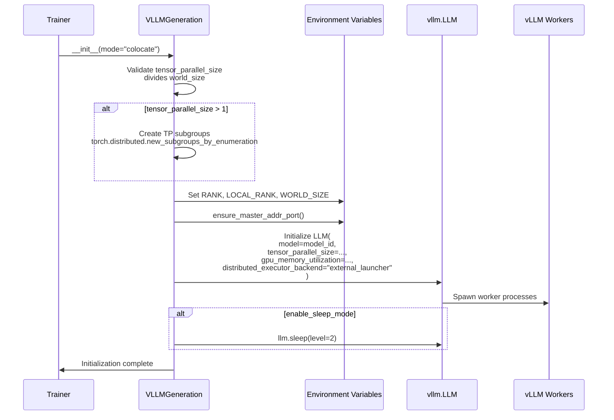
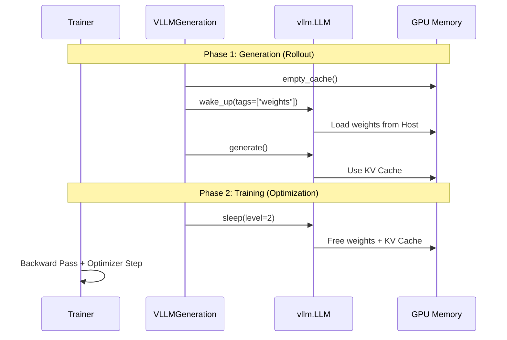
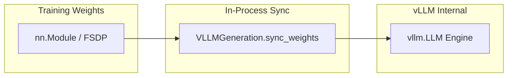

<!-- source: DeepWiki mcp.deepwiki.com · repo huggingface/trl · page 8.2 vLLM Colocate Mode and Memory Management · fetched 2026-10-26 -->

# vLLM Colocate Mode and Memory Management

Relevant source files

The following files were used as context for generating this wiki page:

- [tests/test_vllm_client_server.py](tests/test_vllm_client_server.py)
- [tests/testing_utils.py](tests/testing_utils.py)
- [trl/generation/vllm_client.py](trl/generation/vllm_client.py)
- [trl/generation/vllm_generation.py](trl/generation/vllm_generation.py)
- [trl/scripts/vllm_serve.py](trl/scripts/vllm_serve.py)
- [trl/trainer/grpo_trainer.py](trl/trainer/grpo_trainer.py)
- [trl/trainer/rloo_trainer.py](trl/trainer/rloo_trainer.py)

## Purpose and Scope

This page documents vLLM's **colocate mode**, where vLLM runs in the same process as the training code and shares GPU memory with the training model. This mode eliminates the need for a separate vLLM server process but requires careful memory management to avoid resource contention between training and generation phases.

**Key Topics Covered:**
- In-process vLLM initialization and configuration
- Shared GPU memory allocation between training and generation
- Sleep mode for weight offloading during optimization
- Memory tuning via `vllm_gpu_memory_utilization`
- Trade-offs between colocate and server modes

## Colocate Mode Architecture

In colocate mode, the `VLLMGeneration` class manages an in-process instance of `vllm.LLM`. This setup is designed for environments where extra GPUs for a dedicated server are unavailable.

**Colocate Mode Characteristics:**
- vLLM runs **in-process** via the `vllm.LLM` class [trl/generation/vllm_generation.py:103-107]().
- Training and generation share the **same GPU devices** [trl/generation/vllm_generation.py:123-125]().
- No HTTP communication overhead (unlike server mode) [trl/generation/vllm_generation.py:125-126]().
- Requires careful memory tuning via `gpu_memory_utilization` to avoid OOM errors [trl/generation/vllm_generation.py:155-159]().

**Sources:** [trl/generation/vllm_generation.py:103-161](), [trl/generation/vllm_generation.py:352-368]()

## Initialization Process

### Environment Setup and Distributed Configuration

When colocate mode is selected, `VLLMGeneration` initializes vLLM within the training process by setting up the distributed environment and instantiating the engine.

**Key Steps:**

1. **Tensor Parallelism Validation**: Ensures `tensor_parallel_size` evenly divides the total number of processes [trl/generation/vllm_generation.py:318-323]().
2. **Subgroup Creation**: For TP > 1, creates rank subgroups using `new_subgroups_by_enumeration` to ensure vLLM workers communicate correctly within their TP groups [trl/generation/vllm_generation.py:326-333]().
3. **Environment Variables**: Sets `RANK`, `LOCAL_RANK`, and `WORLD_SIZE` to allow vLLM to identify its position in the distributed cluster [trl/generation/vllm_generation.py:336-340]().
4. **LLM Instantiation**: Creates the `vllm.LLM` instance using the `external_launcher` backend, which prevents vLLM from trying to manage the entire distributed setup itself [trl/generation/vllm_generation.py:352-368]().
5. **Initial Sleep**: If `enable_sleep_mode` is True, vLLM is immediately put to sleep to free memory for the initial training steps [trl/generation/vllm_generation.py:369-370]().

**Sources:** [trl/generation/vllm_generation.py:316-377](), [trl/trainer/utils.py:101-112]()

## Memory Management: Shared GPU Resources

### GPU Memory Allocation

In colocate mode, the GPU memory is a shared resource between the training framework (PyTorch/DeepSpeed/FSDP) and the inference engine (vLLM).

| Component | Role | Control Mechanism |
|-----------|------|-------------------|
| **Training Model** | Policy weights, gradients, and activations | `gradient_checkpointing`, `per_device_train_batch_size` |
| **Optimizer States** | Adam moments (2x model size) | DeepSpeed/FSDP offloading |
| **vLLM Weights** | Read-only copy of weights for inference | `model_impl` (vLLM vs Transformers) |
| **vLLM KV Cache** | Memory for generation tokens | `vllm_gpu_memory_utilization` |

**The `vllm_gpu_memory_utilization` Parameter:**
This parameter (default `0.9`) controls the fraction of **available** GPU memory that vLLM reserves. In colocate mode, "available" means memory not already held by the training process. 

- **Calculation**: vLLM checks the free memory on the device and takes the specified fraction [trl/generation/vllm_generation.py:155-159]().
- **Tuning**: If set too high (e.g., 0.9), training may OOM when it tries to allocate activations during the forward pass. For colocate mode, values between `0.4` and `0.6` are typically safer.

**Sources:** [trl/generation/vllm_generation.py:155-161](), [trl/scripts/vllm_serve.py:241-249]()

## Sleep Mode: Weight Offloading

Sleep mode is a critical feature for colocate mode that allows vLLM to release GPU memory during the training phase.

### Sleep Mode Mechanism

When `enable_sleep_mode=True`, `VLLMGeneration` coordinates the state of the vLLM engine with the training loop phases.

**Implementation Details:**
- **Wake Up**: Before generation, `empty_cache()` is called to ensure PyTorch releases any fragmented memory, followed by `llm.wake_up()` [trl/generation/vllm_generation.py:447-452]().
- **Sleep**: After generation is complete, `llm.sleep(level=2)` is called. Level 2 offloads both the model weights and the KV cache to host memory [trl/generation/vllm_generation.py:166-168]().
- **Cache Management**: `trl.generation.vllm_generation.empty_cache` handles multi-backend support (CUDA, XPU, MLU, NPU) to ensure the device is ready for vLLM [trl/generation/vllm_generation.py:44-60]().

**Sources:** [trl/generation/vllm_generation.py:44-60](), [trl/generation/vllm_generation.py:166-168](), [trl/generation/vllm_generation.py:447-452]()

## Weight Synchronization in Colocate Mode

In colocate mode, the training model and the vLLM model reside in the same process, but vLLM maintains its own optimized internal representation of the weights.

**Synchronization Workflow:**
1. **Parameter Gathering**: The trainer extracts parameters from the model. If using FSDP, it handles `summon_full_params` to collect shards [trl/generation/vllm_generation.py:387-415]().
2. **Name Mapping**: Parameter names are cleaned to remove framework-specific prefixes like `_fsdp_wrapped_module` or `_checkpoint_wrapped_module` [trl/generation/vllm_generation.py:379-385]().
3. **Direct Loading**: The weights are passed directly to the vLLM model runner using `load_weights` [trl/generation/vllm_generation.py:413-414](). Unlike server mode, no NCCL communication is required because the data is already in the process memory.

**Sources:** [trl/generation/vllm_generation.py:379-415](), [trl/generation/vllm_generation.py:438-440]()

## Trade-offs: Server Mode vs Colocate Mode

| Feature | Colocate Mode | Server Mode |
|---------|---------------|-------------|
| **GPU Isolation** | Shared: Risk of OOM during training | Isolated: Training and Inference on different GPUs |
| **Communication** | In-process: Fast, no network latency | HTTP/NCCL: Network overhead [trl/generation/vllm_client.py:141-153]() |
| **Complexity** | Low: Single command to launch | High: Requires `trl vllm-serve` [trl/scripts/vllm_serve.py:15-28]() |
| **Memory Efficiency**| High: Uses `sleep` to offload [trl/generation/vllm_generation.py:166]() | Low: Weights reside on server GPUs permanently |
| **Scalability** | Limited by single node resources | High: Can scale inference to separate nodes |

**Sources:** [trl/generation/vllm_generation.py:122-131](), [trl/generation/vllm_client.py:141-153](), [trl/scripts/vllm_serve.py:15-28]()

---

