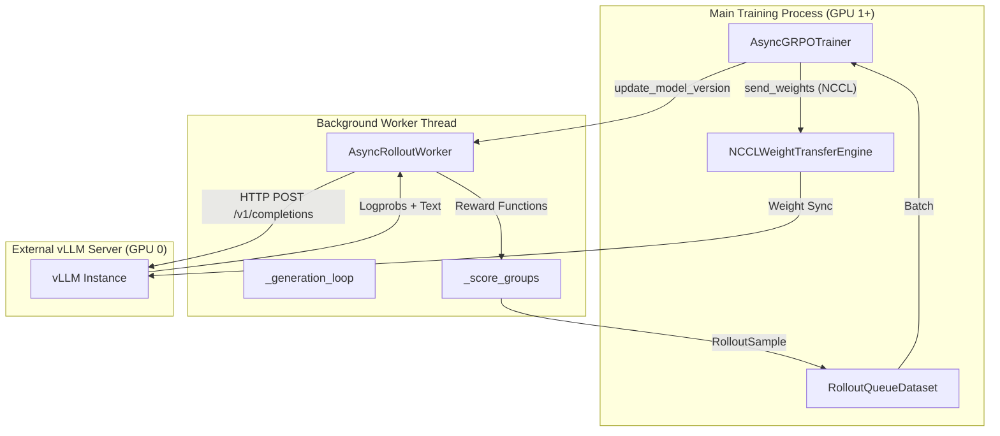
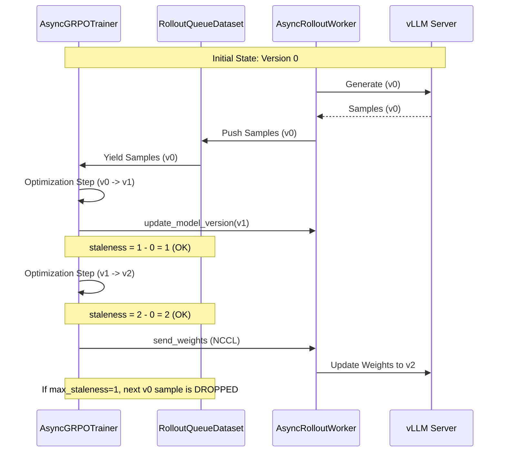

<!-- source: DeepWiki mcp.deepwiki.com · repo huggingface/trl · page 8.3 Async GRPO and Decoupled Generation · fetched 2026-10-26 -->

# Async GRPO and Decoupled Generation

Relevant source files

The following files were used as context for generating this wiki page:

- [docs/source/async_grpo_trainer.md](docs/source/async_grpo_trainer.md)
- [examples/scripts/async_grpo.py](examples/scripts/async_grpo.py)
- [tests/experimental/test_async_grpo_trainer.py](tests/experimental/test_async_grpo_trainer.py)
- [tests/test_chat_template_utils.py](tests/test_chat_template_utils.py)
- [trl/chat_template_utils.py](trl/chat_template_utils.py)
- [trl/chat_templates/README.md](trl/chat_templates/README.md)
- [trl/chat_templates/phi3.jinja](trl/chat_templates/phi3.jinja)
- [trl/chat_templates/phi3_training.jinja](trl/chat_templates/phi3_training.jinja)
- [trl/experimental/async_grpo/__init__.py](trl/experimental/async_grpo/__init__.py)
- [trl/experimental/async_grpo/async_grpo_config.py](trl/experimental/async_grpo/async_grpo_config.py)
- [trl/experimental/async_grpo/async_grpo_trainer.py](trl/experimental/async_grpo/async_grpo_trainer.py)
- [trl/experimental/async_grpo/async_rollout_worker.py](trl/experimental/async_grpo/async_rollout_worker.py)

The `AsyncGRPOTrainer` is an experimental implementation of the Group Relative Policy Optimization (GRPO) algorithm that decouples rollout generation from the training loop. Unlike the standard `GRPOTrainer` where generation and optimization happen sequentially, the async variant utilizes a background worker to stream completions from an external vLLM server while the trainer concurrently performs gradient updates.

### Overview and Architecture

The core design of Async GRPO separates the RL loop into two distinct, overlapping pipelines:
1.  **The Rollout Pipeline**: Managed by `AsyncRolloutWorker`, this pipeline continuously fetches prompts from the dataset, requests generations from a vLLM server, scores them using reward functions, and calculates advantages [trl/experimental/async_grpo/async_rollout_worker.py:80-86]().
2.  **The Training Pipeline**: Managed by `AsyncGRPOTrainer`, this pipeline pulls processed samples from a `RolloutQueueDataset` and performs standard GRPO loss computation and weight updates [trl/experimental/async_grpo/async_grpo_trainer.py:169-176]().

#### System Data Flow

The following diagram illustrates the interaction between the trainer, the background worker, and the external vLLM server.

**Async GRPO Architecture and Data Flow**

Sources: [trl/experimental/async_grpo/async_grpo_trainer.py:169-176](), [trl/experimental/async_grpo/async_rollout_worker.py:80-86](), [docs/source/async_grpo_trainer.md:23-28]()

---

### Decoupled Generation: AsyncRolloutWorker

The `AsyncRolloutWorker` acts as the bridge between the dataset and the vLLM server. It maintains an internal `asyncio` event loop to handle concurrent network I/O and reward computation.

#### Key Components
-   **Generation Loop**: The `_generation_loop` method manages "in-flight" tasks. It uses `max_inflight_tasks` to bound the number of concurrent requests to the vLLM server [trl/experimental/async_grpo/async_rollout_worker.py:228-245]().
-   **Scoring and Advantages**: Once a group of `num_generations` is completed, the worker scores them. Advantages are calculated by normalizing rewards within the group (subtracting the mean and dividing by the standard deviation) [trl/experimental/async_grpo/async_rollout_worker.py:440-443]().
-   **RolloutSample**: The worker packages the data into `RolloutSample` objects, which include the `input_ids`, `completion_mask`, `old_log_probs`, and the calculated `advantage` [trl/experimental/async_grpo/async_rollout_worker.py:69-78]().

#### Async Tool-Calling Loop
For agentic tasks, the worker implements an asynchronous tool-calling loop. If `tools` or an `environment_factory` are provided, the worker parses the model's response for tool calls using `parse_response`, executes the tools, and appends the results back to the prompt for subsequent generation turns [trl/experimental/async_grpo/async_rollout_worker.py:326-364]().

Sources: [trl/experimental/async_grpo/async_rollout_worker.py:80-111](), [trl/experimental/async_grpo/async_rollout_worker.py:326-364](), [trl/experimental/async_grpo/async_rollout_worker.py:440-443]()

---

### Training Loop and Staleness Filtering

The `AsyncGRPOTrainer` consumes samples through the `RolloutQueueDataset`. Because generation happens in the background, the weights of the model used for generation may be older than the current training weights.

#### RolloutQueueDataset and Staleness
The `RolloutQueueDataset` implements a filtering mechanism based on `model_version`.
-   **Staleness Calculation**: `staleness = current_version - sample.model_version` [trl/experimental/async_grpo/async_grpo_trainer.py:102]().
-   **Filtering**: If `staleness` exceeds `max_staleness` (defined in `AsyncGRPOConfig`), the sample is discarded to prevent high-variance updates from extremely off-policy data [trl/experimental/async_grpo/async_grpo_trainer.py:103-105]().

#### Weight Synchronization
To keep the generator up-to-date, the trainer synchronizes weights every `weight_sync_steps`. It uses the `NCCLWeightTransferEngine` (from vLLM) to transfer weights directly between GPUs over NCCL, avoiding slow CPU/HTTP bottlenecks [trl/experimental/async_grpo/async_rollout_worker.py:41-43](), [trl/experimental/async_grpo/async_grpo_trainer.py:62]().

**Weight Update and Staleness Logic**

Sources: [trl/experimental/async_grpo/async_grpo_trainer.py:80-114](), [trl/experimental/async_grpo/async_grpo_config.py:69-71](), [docs/source/async_grpo_trainer.md:28-30]()

---

### Configuration and Setup

The `AsyncGRPOConfig` extends the base training arguments with parameters specific to the decoupled architecture.

| Parameter | Default | Description |
| :--- | :--- | :--- |
| `max_staleness` | `4` | Max steps a sample can lag before being discarded. |
| `max_inflight_tasks` | `-1` | Max concurrent requests to vLLM (auto-calculated). |
| `weight_sync_steps` | `1` | Steps between weight transfers to the vLLM server. |
| `vllm_server_base_url` | `"http://localhost:8000"` | Endpoint for the vLLM server. |
| `max_tool_calling_iterations` | `None` | Limit for agentic tool-use loops. |

#### vLLM Server Requirements
The external vLLM server must be started with specific flags to support the async trainer:
-   `VLLM_SERVER_DEV_MODE=1`: Enables the weight transfer endpoints.
-   `--weight-transfer-config '{"backend":"nccl"}'`: Configures the NCCL backend for fast weight updates.
-   `--logprobs-mode processed_logprobs`: Required for GRPO importance sampling.

Sources: [trl/experimental/async_grpo/async_grpo_config.py:21-75](), [docs/source/async_grpo_trainer.md:55-60](), [examples/scripts/async_grpo.py:27-30]()

---

### Chat Templates and Prefix Preservation

In the async rollout loop, especially for tool-calling, the chat template must be **prefix-preserving**. This means that appending new messages (like tool results) must not change the tokenization or rendering of previous messages.

If the detected template is not prefix-preserving (e.g., it has conditional logic that changes based on whether a message is the last in the list), the `AsyncRolloutWorker` automatically swaps it for a "training" variant via `get_training_chat_template` [trl/experimental/async_grpo/async_rollout_worker.py:173-174](). This is critical for the `_get_tool_suffix_ids` logic, which extracts formatting tokens by comparing different message states [trl/chat_templates/README.md:8-9]().

Sources: [trl/chat_template_utils.py:27-32](), [trl/chat_templates/README.md:1-11](), [trl/experimental/async_grpo/async_rollout_worker.py:171-176]()

---

