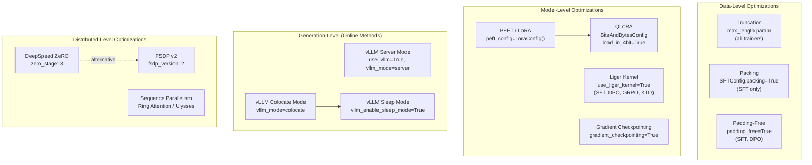
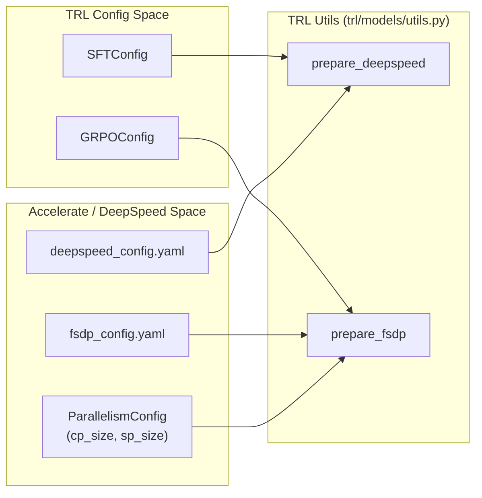

<!-- source: DeepWiki mcp.deepwiki.com · repo huggingface/trl · page 9 Memory Optimization and Distributed Training · fetched 2026-10-26 -->

# Memory Optimization and Distributed Training

Relevant source files

The following files were used as context for generating this wiki page:

- [README.md](README.md)
- [docs/source/customization.md](docs/source/customization.md)
- [docs/source/dataset_formats.md](docs/source/dataset_formats.md)
- [docs/source/deepspeed_integration.md](docs/source/deepspeed_integration.md)
- [docs/source/distributing_training.md](docs/source/distributing_training.md)
- [docs/source/index.md](docs/source/index.md)
- [docs/source/installation.md](docs/source/installation.md)
- [docs/source/kernels_hub.md](docs/source/kernels_hub.md)
- [docs/source/minillm_trainer.md](docs/source/minillm_trainer.md)
- [docs/source/peft_integration.md](docs/source/peft_integration.md)
- [docs/source/quickstart.md](docs/source/quickstart.md)
- [docs/source/reducing_memory_usage.md](docs/source/reducing_memory_usage.md)
- [examples/accelerate_configs/alst_ulysses_4gpu.yaml](examples/accelerate_configs/alst_ulysses_4gpu.yaml)
- [examples/accelerate_configs/context_parallel_2gpu.yaml](examples/accelerate_configs/context_parallel_2gpu.yaml)

This page provides an overview of techniques to reduce memory usage and increase training speed across TRL. Performance optimization is critical for training large foundation models efficiently, especially when working with limited hardware resources or extremely long context lengths.

**Scope**: This document covers high-level optimization strategies. For detailed implementation guides, see the child pages:
- [PEFT and Quantization](#9.1) — Document PEFT integration (LoRA, QLoRA, DoRA, RSLoRA), quantization (4-bit, 8-bit), and adapter management.
- [Distributed Training Strategies](#9.2) — Explain DeepSpeed ZeRO-3, FSDP (v1 and v2), DDP, and sequence parallelism (Ring Attention/Ulysses).
- [Memory Optimization Techniques](#9.3) — Cover gradient checkpointing, Liger kernels, padding-free mode, and dataset packing.

## Optimization Strategy Overview

TRL provides a comprehensive stack of optimization techniques that operate at different levels of the training pipeline:

1.  **Data-Level**: Optimizing how sequences are batched (truncation, packing, padding-free).
2.  **Model-Level**: Reducing trainable parameters and memory footprint (PEFT, quantization, fused kernels).
3.  **Generation-Level**: Accelerating completion generation in online methods like GRPO (vLLM, buffered generation).
4.  **Distributed-Level**: Scaling across multiple GPUs and nodes (DeepSpeed, FSDP, Sequence Parallelism).

**Optimization Techniques by Level**

Sources: [docs/source/reducing_memory_usage.md:1-134](), [docs/source/distributing_training.md:1-107](), [README.md:31-41]()

## Data-Level Optimizations

Data-level optimizations focus on reducing the computational waste caused by padding and long outlier sequences.

### Truncation and Sequence Profiling
TRL trainers truncate sequences by default to prevent memory spikes. Parameters like `max_length` in `SFTConfig` [docs/source/reducing_memory_usage.md:47-50]() or `max_prompt_length` in `DPOConfig` control this behavior. TRL provides a sequence length distribution utility to help users choose optimal values [docs/source/reducing_memory_usage.md:59-61]().

### Packing
Packing groups multiple short sequences into a single training row up to `max_length`, using the **Best-Fit Decreasing (BFD)** algorithm [docs/source/reducing_memory_usage.md:73-86](). This is available for `SFTTrainer` when using FlashAttention.

### Padding-Free Mode
Padding-free training flattens batches into a single sequence without padding tokens, further increasing efficiency for supported trainers like `SFTTrainer` and `DPOTrainer`.

Sources: [docs/source/reducing_memory_usage.md:11-100](), [docs/source/dataset_formats.md:1-133]()

## Model-Level Optimizations

Model-level optimizations reduce the number of trainable parameters or use optimized kernels to lower the memory footprint of activations and gradients.

### PEFT and LoRA
Parameter-Efficient Fine-Tuning (PEFT) methods like LoRA are natively supported across all TRL trainers via the `peft_config` argument [docs/source/peft_integration.md:23-42](). This allows training models with significantly fewer parameters, typically requiring a 10x higher learning rate than full fine-tuning [docs/source/peft_integration.md:153-168]().

### Liger Kernel
The Liger Kernel integration provides Triton-based fused operations (e.g., fused cross-entropy) that can reduce peak memory usage by up to 60% [docs/source/reducing_memory_usage.md:127-134](). It is enabled via `use_liger_kernel=True` in `SFTConfig`, `DPOConfig`, or `GRPOConfig`.

### Kernels Hub
TRL supports loading optimized attention kernels (like Flash Attention 2) directly from the Hugging Face Hub using the `attn_implementation` parameter, avoiding manual compilation [docs/source/kernels_hub.md:18-32]().

Sources: [docs/source/peft_integration.md:1-168](), [docs/source/reducing_memory_usage.md:101-134](), [docs/source/kernels_hub.md:1-97]()

## Distributed Training and Scaling

TRL leverages 🤗 Accelerate to scale from a single GPU to multi-node clusters using DDP, DeepSpeed, or FSDP [README.md:35-37]().

### DeepSpeed and FSDP
TRL integrates DeepSpeed ZeRO (Stages 1, 2, and 3) to shard model states and offload parameters to CPU/NVMe [docs/source/deepspeed_integration.md:6-11](). FSDP v2 is also supported, particularly for context parallelism.

### Sequence Parallelism
For extremely long sequences (>32k tokens), TRL supports:
*   **Ring Attention (FSDP2)**: Best for 1M+ tokens and models with few heads [docs/source/distributing_training.md:108-113]().
*   **ALST/Ulysses (DeepSpeed)**: Faster for moderate lengths on high-bandwidth interconnects [docs/source/distributing_training.md:114-119]().

**Distributed Entity Mapping**

Sources: [docs/source/distributing_training.md:1-125](), [docs/source/deepspeed_integration.md:1-37](), [examples/accelerate_configs/alst_ulysses_4gpu.yaml:1-46]()

## Online Method Generation Optimizations

Online methods (GRPO, RLOO) require a generation loop that can be a bottleneck.

*   **vLLM Integration**: Supports "server mode" (separate GPUs) and "colocate mode" (shared GPUs) [docs/source/index.md:94-98]().
*   **Sleep Mode**: In colocate mode, vLLM can be "put to sleep" (offloaded to CPU) during the training step to free up VRAM for gradients and optimizer states.
*   **Importance Sampling**: Corrects the distribution mismatch between vLLM generation and the training model.

For details, see [Distributed Training Strategies](#9.2) and [Memory Optimization Techniques](#9.3).

Sources: [docs/source/reducing_memory_usage.md:290-331](), [docs/source/index.md:19-56]()

---

