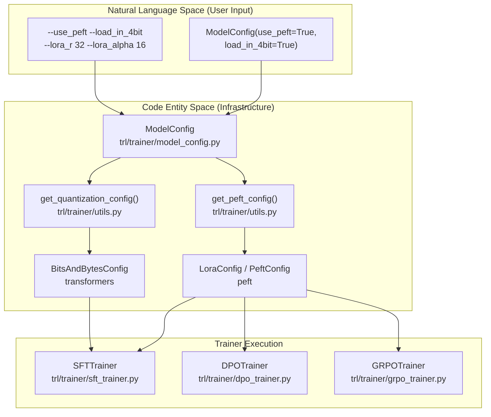
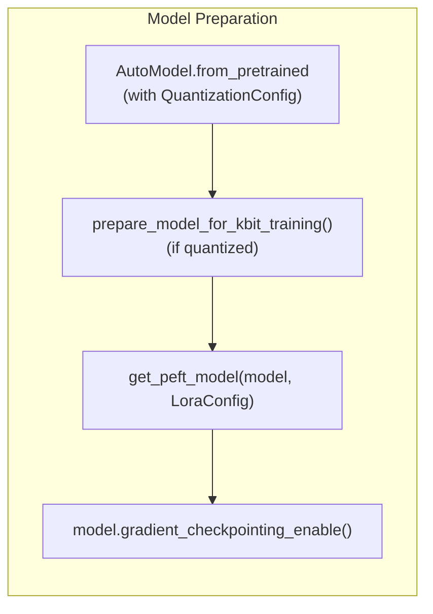

<!-- source: DeepWiki mcp.deepwiki.com · repo huggingface/trl · page 9.1 PEFT and Quantization · fetched 2026-10-26 -->

# PEFT and Quantization

<details>
<summary>Relevant source files</summary>

The following files were used as context for generating this wiki page:

- [docs/source/customization.md](docs/source/customization.md)
- [docs/source/deepspeed_integration.md](docs/source/deepspeed_integration.md)
- [docs/source/distributing_training.md](docs/source/distributing_training.md)
- [docs/source/installation.md](docs/source/installation.md)
- [docs/source/kernels_hub.md](docs/source/kernels_hub.md)
- [docs/source/lora_without_regret.md](docs/source/lora_without_regret.md)
- [docs/source/peft_integration.md](docs/source/peft_integration.md)
- [docs/source/quickstart.md](docs/source/quickstart.md)
- [examples/accelerate_configs/alst_ulysses_4gpu.yaml](examples/accelerate_configs/alst_ulysses_4gpu.yaml)
- [examples/accelerate_configs/context_parallel_2gpu.yaml](examples/accelerate_configs/context_parallel_2gpu.yaml)
- [tests/test_utils.py](tests/test_utils.py)
- [trl/trainer/utils.py](trl/trainer/utils.py)

</details>


This page documents parameter-efficient fine-tuning (PEFT) methods and quantization techniques supported in TRL. PEFT methods like LoRA train only a small subset of model parameters, significantly reducing memory requirements and enabling fine-tuning of larger models on limited hardware. Quantization further reduces memory by loading model weights in lower precision (4-bit or 8-bit).

## Overview

TRL provides two primary mechanisms for configuring PEFT and quantization:

1.  **Direct PEFT configuration**: Pass a `peft_config` object directly to trainers.
2.  **ModelConfig integration**: Use the `ModelConfig` class for unified configuration via CLI or Python API.

Both approaches support LoRA and its variants (RSLoRA, DoRA), as well as 4-bit and 8-bit quantization through the `bitsandbytes` library. When combined, these techniques enable QLoRA (Quantized LoRA), allowing efficient fine-tuning of very large models. Recent research suggests that LoRA can match full fine-tuning performance when configured with high ranks (e.g., $r=256$) and appropriate scaling [docs/source/lora_without_regret.md:1-14]().

## Configuration Architecture

The following diagram illustrates how PEFT and quantization parameters flow through the TRL configuration system, bridging the natural language arguments to the internal code entities.

### Configuration Flow Diagram


**Sources**: [trl/trainer/model_config.py:18-189](), [trl/trainer/utils.py:184-220]()

## ModelConfig: Central Configuration Class

The `ModelConfig` class centralizes all model loading, PEFT, and quantization parameters [trl/trainer/model_config.py:18-189](). It is used by the `TrlParser` to merge CLI arguments and YAML configs into a unified model setup.

### Core PEFT and Quantization Parameters

| Parameter | Type | Default | Description |
| :--- | :--- | :--- | :--- |
| `use_peft` | `bool` | `False` | Whether to use PEFT for training [trl/trainer/model_config.py:113]() |
| `lora_r` | `int` | `16` | LoRA rank [trl/trainer/model_config.py:117]() |
| `lora_alpha` | `int` | `32` | LoRA alpha scaling [trl/trainer/model_config.py:121]() |
| `lora_target_modules` | `list[str]` | `None` | Modules to apply LoRA to (e.g., `["all-linear"]`) [trl/trainer/model_config.py:129]() |
| `load_in_4bit` | `bool` | `False` | Use 4-bit quantization [trl/trainer/model_config.py:166]() |
| `load_in_8bit` | `bool` | `False` | Use 8-bit quantization [trl/trainer/model_config.py:162]() |
| `use_rslora` | `bool` | `False` | Use Rank-Stabilized LoRA [trl/trainer/model_config.py:145]() |
| `use_dora` | `bool` | `False` | Use Weight-Decomposed LoRA [trl/trainer/model_config.py:152]() |

**Sources**: [trl/trainer/model_config.py:113-177]()

## LoRA and QLoRA Implementation

TRL integrates with `peft` and `bitsandbytes` to handle the model transformation logic.

### Quantization Config Generation
The utility function `get_quantization_config` converts `ModelConfig` attributes into a `BitsAndBytesConfig` object used by `transformers` during model loading [trl/trainer/utils.py:184-201]().

```python
def get_quantization_config(model_args: ModelConfig) -> BitsAndBytesConfig | None:
    if model_args.load_in_4bit:
        return BitsAndBytesConfig(
            load_in_4bit=True,
            bnb_4bit_compute_dtype=model_args.dtype,
            bnb_4bit_quant_type=model_args.bnb_4bit_quant_type,
            bnb_4bit_use_double_quant=model_args.use_bnb_nested_quant,
            bnb_4bit_quant_storage=model_args.bnb_4bit_quant_storage,
        )
    # ... 8-bit logic ...
```
**Sources**: [trl/trainer/utils.py:184-201]()

### Adapter Management
TRL provides a context manager `use_adapter` to temporarily switch or disable adapters in a `PeftModel`. This is particularly useful during preference optimization (DPO) when the same model serves as both the policy and the reference model (by disabling adapters) [tests/test_utils.py:59-110]().

### Learning Rate Considerations
When using LoRA, it is recommended to use a higher learning rate (typically 10x) compared to full fine-tuning. For example, if full fine-tuning uses `2.0e-5`, LoRA should use `2.0e-4` [docs/source/peft_integration.md:153-168]().

## Gradient Checkpointing and BF16

To further optimize memory, TRL supports gradient checkpointing with PEFT.

### Weight Conversion to BF16
For QLoRA, the `bnb_4bit_compute_dtype` is typically set to `bfloat16` via `ModelConfig.dtype` to ensure compatibility with modern hardware and improved stability during training [trl/trainer/utils.py:188]().

### PEFT Model Setup Logic
The system uses `get_peft_config` to instantiate the correct `PeftConfig` (usually `LoraConfig`) based on `ModelConfig` flags [trl/trainer/utils.py:210-220]().


**Sources**: [docs/source/peft_integration.md:118-152](), [trl/trainer/utils.py:184-220]()

## CLI Examples

### QLoRA with SFT
```bash
trl sft \
    --model_name_or_path Qwen/Qwen2-0.5B \
    --use_peft \
    --load_in_4bit \
    --lora_r 32 \
    --lora_alpha 16 \
    --output_dir Qwen2-0.5B-QLoRA
```
**Sources**: [docs/source/peft_integration.md:25-35]()

### LoRA with GRPO (High Rank)
Recent findings suggest using `all-linear` target modules and higher ranks for reinforcement learning [docs/source/lora_without_regret.md:141-155]().
```bash
trl grpo \
    --model_name_or_path Qwen/Qwen3-0.6B \
    --use_peft \
    --lora_r 256 \
    --lora_alpha 16 \
    --lora_target_modules all-linear \
    --output_dir Qwen-GRPO-LoRA
```
**Sources**: [docs/source/lora_without_regret.md:183-205]()

## Key Classes and Functions

| Entity | Location | Role |
| :--- | :--- | :--- |
| `ModelConfig` | [trl/trainer/model_config.py:18]() | Dataclass defining PEFT/Quantization CLI arguments. |
| `get_quantization_config` | [trl/trainer/utils.py:184]() | Maps `ModelConfig` to `BitsAndBytesConfig`. |
| `get_peft_config` | [trl/trainer/utils.py:210]() | Maps `ModelConfig` to `LoraConfig`. |
| `use_adapter` | [trl/trainer/utils.py:1001]() | Context manager for switching adapters. |
| `disable_dropout_in_model` | [trl/trainer/utils.py:178]() | Utility to freeze dropout layers during PEFT. |

**Sources**: [trl/trainer/model_config.py:18-189](), [trl/trainer/utils.py:178-220]()

---

