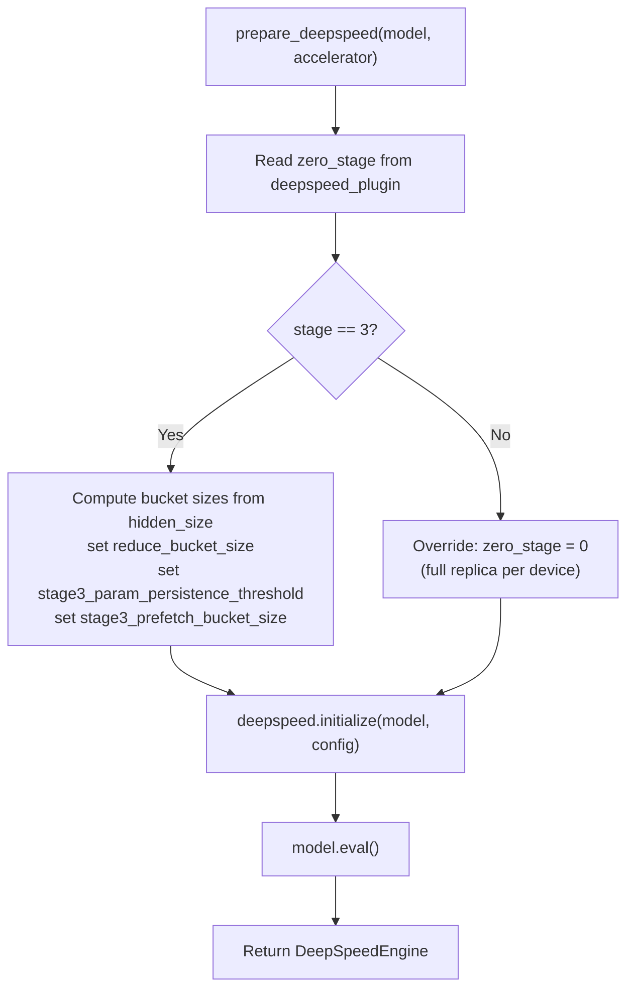
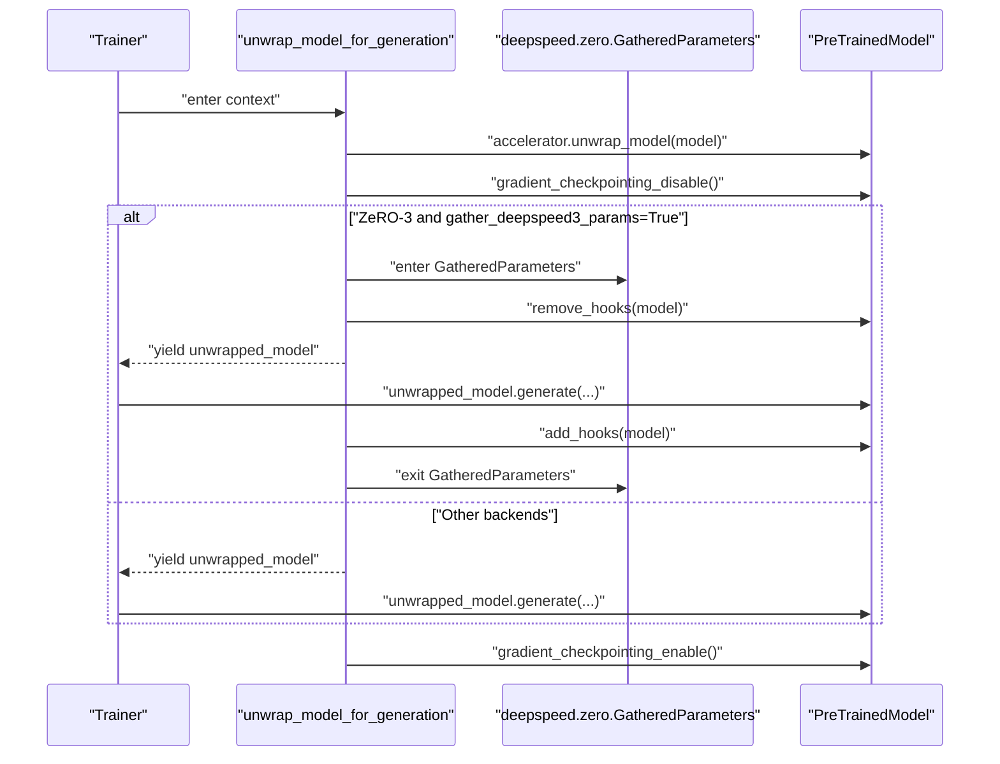
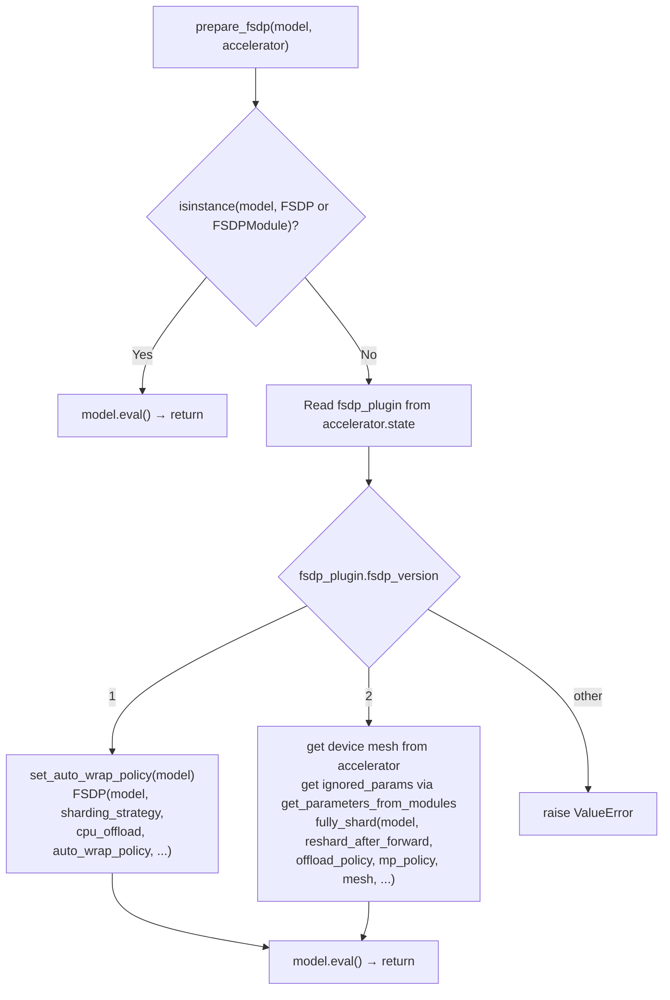

<!-- source: DeepWiki mcp.deepwiki.com · repo huggingface/trl · page 9.2 Distributed Training Strategies · fetched 2026-10-26 -->

# Distributed Training Strategies

Relevant source files

The following files were used as context for generating this wiki page:

- [docs/source/_toctree.yml](docs/source/_toctree.yml)
- [docs/source/customization.md](docs/source/customization.md)
- [docs/source/deepspeed_integration.md](docs/source/deepspeed_integration.md)
- [docs/source/distributing_training.md](docs/source/distributing_training.md)
- [docs/source/installation.md](docs/source/installation.md)
- [docs/source/kernels_hub.md](docs/source/kernels_hub.md)
- [docs/source/peft_integration.md](docs/source/peft_integration.md)
- [docs/source/quickstart.md](docs/source/quickstart.md)
- [examples/accelerate_configs/alst_ulysses_4gpu.yaml](examples/accelerate_configs/alst_ulysses_4gpu.yaml)
- [examples/accelerate_configs/context_parallel_2gpu.yaml](examples/accelerate_configs/context_parallel_2gpu.yaml)
- [examples/accelerate_configs/deepspeed_zero1.yaml](examples/accelerate_configs/deepspeed_zero1.yaml)
- [examples/accelerate_configs/deepspeed_zero2.yaml](examples/accelerate_configs/deepspeed_zero2.yaml)
- [examples/accelerate_configs/deepspeed_zero3.yaml](examples/accelerate_configs/deepspeed_zero3.yaml)
- [examples/accelerate_configs/multi_gpu.yaml](examples/accelerate_configs/multi_gpu.yaml)
- [tests/distributed/test_distributed.py](tests/distributed/test_distributed.py)
- [trl/__init__.py](trl/__init__.py)
- [trl/models/__init__.py](trl/models/__init__.py)
- [trl/models/utils.py](trl/models/utils.py)
- [trl/trainer/__init__.py](trl/trainer/__init__.py)

This page documents TRL's support for running trainers across multiple GPUs and nodes using DeepSpeed ZeRO and PyTorch FSDP. It covers the utility functions used internally by all trainers to prepare reference models and policy models for generation under distributed backends, as well as support for sequence parallelism and weight synchronization.

---

## Supported Backends

TRL supports several distributed training modes, all managed through the `accelerate` library:

| Backend | Description | Use Case |
|---|---|---|
| DeepSpeed ZeRO-0 | Full model replica per device | Reference model on non-ZeRO-3 runs |
| DeepSpeed ZeRO-1/2 | Optimizer state/gradient sharding | Standard sharding for medium models |
| DeepSpeed ZeRO-3 | Fully sharded parameters, gradients, optimizer states | Large models that don't fit on a single GPU |
| FSDP v1 | `FullyShardedDataParallel` wrapping | PyTorch-native sharding, FSDP v1 API |
| FSDP v2 | `fully_shard` (FSDP2) | FSDP v2 API with optional device mesh and Ring Attention |
| DDP (default) | `DistributedDataParallel` | Standard multi-GPU, no sharding |

All backends are accessed through the `Accelerator` object from the `accelerate` library. TRL reads the backend configuration from `accelerator.state.deepspeed_plugin` or `accelerator.state.fsdp_plugin`.

---

## Public API

The following functions are exported from `trl.models`:

[trl/models/__init__.py:20-23]()

| Function | Purpose |
|---|---|
| `prepare_deepspeed` | Wrap a model (typically a reference model) with DeepSpeed for inference |
| `prepare_fsdp` | Wrap a model with FSDP for inference |
| `unwrap_model_for_generation` | Context manager: unwrap a distributed model to run `.generate()` |
| `create_reference_model` | Utility to create a frozen copy of a model for preference alignment |

---

## DeepSpeed ZeRO Integration

### `prepare_deepspeed`

[trl/models/utils.py:225-262]()

Used by trainers to initialize a secondary model (typically the reference model) under DeepSpeed. This function:

1. Reads the active DeepSpeed config from `accelerator.state.deepspeed_plugin`.
2. If the active ZeRO stage is 3, it sets `reduce_bucket_size`, `stage3_param_persistence_threshold`, and `stage3_prefetch_bucket_size` based on the model's `hidden_size`.
3. If the active stage is **not** 3, it overrides the stage to **0** before calling `deepspeed.initialize`. This ensures reference models on ZeRO-1/2 runs get a full unsharded copy on every device for faster inference.
4. Calls `deepspeed.initialize(model=model, config=config_kwargs)` and sets the model to `eval()`.

**Diagram: `prepare_deepspeed` ZeRO stage decision**

Sources: [trl/models/utils.py:225-262]()

---

### `unwrap_model_for_generation`

[trl/models/utils.py:186-222]()

This public context manager is called by all trainers that run `.generate()` on a policy model (e.g., `GRPOTrainer`, `RLOOTrainer`, `OnlineDPOTrainer`). It composes two inner context managers:

- `_unwrap_model_for_generation` — handles distributed unwrapping and ZeRO-3 parameter gathering.
- `_override_model_generation_config` — temporarily patches the model's `generation_config` to avoid configuration merging conflicts.

#### `_unwrap_model_for_generation`

[trl/models/utils.py:97-141]()

Steps taken:
1. `accelerator.unwrap_model(model)` to get the raw `PreTrainedModel`.
2. Gradient checkpointing is **disabled** via `unwrapped_model.gradient_checkpointing_disable()` (required because generation does not need it and it can cause issues in `no_grad` mode).
3. **If ZeRO-3**: Enters `deepspeed.zero.GatheredParameters(model.parameters())`, calls `remove_hooks(model)` before yielding, and `add_hooks(model)` on exit.
4. **Otherwise**: Yields the unwrapped model directly.
5. On exit, re-enables gradient checkpointing if it was previously active.

The `gather_deepspeed3_params` argument (default `True`) controls whether ZeRO-3 parameter gathering occurs.

**Diagram: `unwrap_model_for_generation` state transitions**

Sources: [trl/models/utils.py:97-222]()

---

### Hook Management for ZeRO-3

[trl/models/utils.py:47-94]()

Under DeepSpeed ZeRO-3, the optimizer registers forward and backward hooks on model parameters that manage parameter fetching and offloading. These hooks interfere with generation because they assume a training loop context.

| Function | What it does |
|---|---|
| `remove_hooks(model)` | Clears `param.ds_active_sub_modules`, removes all `forward_hooks` and `backward_hooks` from the optimizer offload object [trl/models/utils.py:47-69]() |
| `add_hooks(model)` | Re-registers hooks via `_register_deepspeed_module` (DeepSpeed ≥ 0.16.4) or `_register_hooks_recursively` [trl/models/utils.py:78-94]() |

Sources: [trl/models/utils.py:47-94]()

---

## FSDP Integration

### `prepare_fsdp`

[trl/models/utils.py:265-310]()

Used by trainers to wrap a secondary model (e.g., reference model) with FSDP. It checks `fsdp_plugin.fsdp_version` to select between FSDP v1 and v2.

**FSDP v1 path** (`fsdp_version == 1`):
- Calls `fsdp_plugin.set_auto_wrap_policy(model)`.
- Instantiates `torch.distributed.fsdp.FullyShardedDataParallel` with kwargs drawn from `fsdp_plugin` (e.g., `sharding_strategy`, `cpu_offload`, `mixed_precision_policy`).

**FSDP v2 path** (`fsdp_version == 2`):
- Calls `torch.distributed.fsdp.fully_shard(model, ...)` in place.
- Supports an optional `torch_device_mesh` from the accelerator for tensor-parallel or hybrid-sharding setups.
- Uses `get_parameters_from_modules` (Accelerate >= 1.11.0) to correctly handle `ignored_modules` [trl/models/utils.py:38-39]().

**Diagram: `prepare_fsdp` version routing**

Sources: [trl/models/utils.py:265-310]()

---

## Sequence Parallelism

TRL supports two forms of sequence parallelism to enable training with extremely long contexts by splitting the sequence dimension across multiple GPUs.

### Available Implementations

| Feature | Ring Attention (FSDP2) | ALST/Ulysses (DeepSpeed) |
|---|---|---|
| **Backend** | PyTorch FSDP2 | DeepSpeed ZeRO |
| **Method** | Ring Self-Attention | Attention Head Parallelism |
| **Key Config** | `cp_size` | `sp_size` |
| **Best For** | Extremely long sequences (1M+), low head counts | High-bandwidth interconnects (NVLink), many heads |

In TRL, `max_seq_length` refers to the **global sequence length**. The framework automatically handles splitting into micro sequences based on `cp_size` or `sp_size`.

Sources: [docs/source/distributing_training.md:76-125](), [examples/accelerate_configs/alst_ulysses_4gpu.yaml:38-46]()

---

## vLLM Weight Synchronization

For trainers that use vLLM for generation (like `GRPOTrainer` in certain modes), TRL provides a weight synchronization protocol.

- **vLLM Server Mode**: Weights are updated via HTTP and NCCL. The `WeightSyncWorkerExtension` in vLLM handles receiving updates from the training process [docs/source/_toctree.yml:64-65]().
- **Weight Transfer Engine**: Uses a dual-channel communication (HTTP for metadata, NCCL for raw weights) to update vLLM worker weights without restarting the inference engine.

---

## Distributed Testing

Distributed smoke tests are defined in `tests/distributed/test_distributed.py` and cover various configurations including DDP, ZeRO-2, ZeRO-3, and FSDP2 for SFT and DPO [tests/distributed/test_distributed.py:43-134]().

These tests are executed in CI via the `distributed_smoke` job:
- **Runner**: `aws-g5-12xlarge-cache`
- **GPUs**: 2 (configured via `CUDA_VISIBLE_DEVICES`)
- **Backends**: DeepSpeed ZeRO-2/3, FSDP v2, DDP.

Sources: [tests/distributed/test_distributed.py:1-134]()

---

