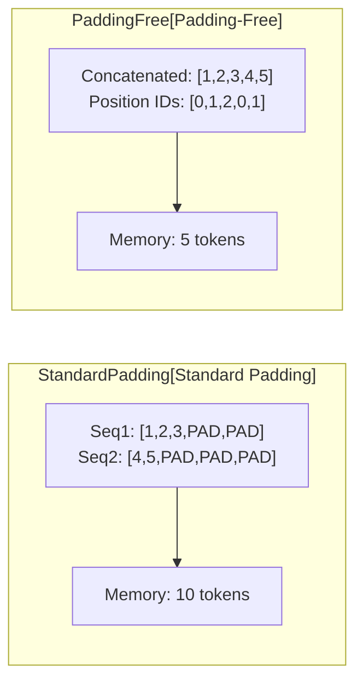

<!-- source: DeepWiki mcp.deepwiki.com · repo huggingface/trl · page 9.3 Memory Optimization Techniques · fetched 2026-10-26 -->

# Memory Optimization Techniques

<details>
<summary>Relevant source files</summary>

The following files were used as context for generating this wiki page:

- [README.md](README.md)
- [docs/source/dataset_formats.md](docs/source/dataset_formats.md)
- [docs/source/index.md](docs/source/index.md)
- [docs/source/liger_kernel_integration.md](docs/source/liger_kernel_integration.md)
- [docs/source/minillm_trainer.md](docs/source/minillm_trainer.md)
- [docs/source/reducing_memory_usage.md](docs/source/reducing_memory_usage.md)
- [docs/source/unsloth_integration.md](docs/source/unsloth_integration.md)
- [tests/test_activation_offloading.py](tests/test_activation_offloading.py)
- [trl/models/activation_offloading.py](trl/models/activation_offloading.py)

</details>


This page documents memory optimization techniques available in TRL to reduce GPU memory consumption during training. These techniques can be combined to enable training larger models on limited hardware.

For information about distributed training strategies (DeepSpeed, FSDP, DDP), see [Distributed Training Strategies](#9.2). For PEFT and quantization setup details, see [PEFT and Quantization](#9.1).

## Overview of Memory Optimization Stack

```mermaid
graph TB
    subgraph "TrainingProcess[Training Process]"
        Model["Model Forward/Backward"]
        Optim["Optimizer Step"]
        Gen["Generation (Online Methods)"]
    end
    
    subgraph "DataLevelOptimizations[Data-Level Optimizations]"
        Trunc["Truncation: max_length"]
        Pack["Dataset Packing: pack_dataset()"]
        PadFree["Padding-Free Mode: padding_free=True"]
    end
    
    subgraph "ModelLevelOptimizations[Model-Level Optimizations]"
        GradCheck["Gradient Checkpointing: gradient_checkpointing=True"]
        PEFT["PEFT (LoRA/QLoRA): peft_config"]
        Quant["Quantization (4-bit/8-bit): load_in_4bit/8bit"]
        CastFP32["Cast LM Head to FP32: cast_lm_head_to_fp32"]
    end
    
    subgraph "ComputationOptimizations[Computation Optimizations]"
        Liger["Liger Kernel: use_liger_kernel=True"]
        ActOff["Activation Offloading: OffloadActivations"]
    end
    
    subgraph "GenerationOptimizations[Generation Optimizations]"
        VLLMSleep["vLLM Sleep Mode: vllm_enable_sleep_mode"]
        VLLMMemUtil["vLLM GPU Memory: vllm_gpu_memory_utilization"]
    end
    
    Model --> GradCheck
    Model --> PEFT
    Model --> Quant
    Model --> CastFP32
    Model --> Liger
    Model --> ActOff
    
    Model --> Trunc
    Model --> Pack
    Model --> PadFree
    
    Gen --> VLLMSleep
    Gen --> VLLMMemUtil
```



Sources: [trl/trainer/grpo_trainer.py:282-705](), [trl/trainer/sft_trainer.py:609-850](), [docs/source/reducing_memory_usage.md:1-120]()

## Gradient Checkpointing

Gradient checkpointing trades computation for memory by recomputing activations during the backward pass instead of storing them. This significantly reduces memory usage at the cost of ~20-30% slower training.

### Configuration

Gradient checkpointing is controlled via `TrainingArguments`:

| Parameter | Type | Default | Description |
|-----------|------|---------|-------------|
| `gradient_checkpointing` | `bool` | `False` | Enable gradient checkpointing |
| `gradient_checkpointing_kwargs` | `dict` | `None` | Additional kwargs for checkpointing |

```python
from trl import SFTConfig

training_args = SFTConfig(
    gradient_checkpointing=True,
    gradient_checkpointing_kwargs={"use_reentrant": False},
)
```

### Implementation Details

TRL sets `use_reentrant=False` by default for GRPO when using transformers < 5.0.0, as this is the PyTorch-recommended setting [trl/trainer/grpo_trainer.py:593-597]().

For PEFT models, gradient checkpointing requires enabling input gradients due to a transformers bug [trl/trainer/grpo_trainer.py:352-355]().

Sources: [trl/trainer/grpo_trainer.py:352-355](), [trl/trainer/grpo_trainer.py:593-597](), [trl/trainer/sft_trainer.py:680-684]()

## Activation Offloading

Activation offloading moves activations to CPU during the forward pass and brings them back for the backward pass. TRL provides the `OffloadActivations` context manager for this purpose.

### Implementation: OffloadActivations

The `OffloadActivations` class [trl/models/activation_offloading.py:79-118]() is a context manager that uses `saved_tensors_hooks` to intercept activations.

- **Storage Deduplication**: It uses `_get_unique_tensor_key` [trl/models/activation_offloading.py:49-76]() to identify tensors sharing the same underlying storage (e.g., views) to avoid redundant offloading.
- **Streaming**: It can use an additional CUDA/NPU/XPU stream (`self.s1`) to overlap communication between device and host with computation on the default stream (`self.s0`) [trl/models/activation_offloading.py:157-166]().
- **Filtering**: Tensors smaller than `min_offload_size` are not offloaded to avoid bandwidth waste [trl/models/activation_offloading.py:129]().

```python
from trl.models.activation_offloading import OffloadActivations

with OffloadActivations(min_offload_size=1024):
    outputs = model(inputs)
    loss = outputs.loss
loss.backward()
```

Sources: [trl/models/activation_offloading.py:79-166](), [trl/models/activation_offloading.py:49-76](), [docs/source/reducing_memory_usage.md:127-131]()

## Liger Kernel Fused Operations

[Liger Kernel](https://github.com/linkedin/Liger-Kernel) is a collection of Triton kernels that increase throughput and reduce memory by up to 60% by fusing operations like `RMSNorm`, `RoPE`, and `CrossEntropy` [docs/source/liger_kernel_integration.md:1-9]().

### Integration in TRL

Liger Kernel is supported in `SFTTrainer`, `DPOTrainer`, `GRPOTrainer`, `KTOTrainer`, and `GKDTrainer` [docs/source/liger_kernel_integration.md:11-19](). It is enabled by setting `use_liger_kernel=True` in the trainer config.

For `GRPOTrainer`, TRL uses `LigerFusedLinearGRPOLoss` to fuse the final linear layer with the GRPO loss calculation [trl/trainer/grpo_trainer.py:667-685]().

### Constraints

When `use_liger_kernel=True` in GRPO:
- `off_policy_mask_threshold` must be `None` [trl/trainer/grpo_trainer.py:544-546]().
- `top_entropy_quantile` must be `1.0` [trl/trainer/grpo_trainer.py:548-551]().
- `importance_sampling_level` must be "token" or "sequence" [trl/trainer/grpo_trainer.py:553-556]().

Sources: [docs/source/liger_kernel_integration.md:1-76](), [trl/trainer/grpo_trainer.py:538-685]()

## Padding-Free Mode and FlashAttention

Padding-free mode eliminates padding tokens by concatenating sequences, which significantly reduces memory and compute waste.



### DataCollatorForLanguageModeling

The `DataCollatorForLanguageModeling` handles padding-free collation [trl/trainer/sft_trainer.py:90-256](). When `padding_free=True`:
- It concatenates `input_ids` and `labels`.
- It generates `position_ids` based on sequence lengths to ensure the model treats them as separate sequences [trl/trainer/sft_trainer.py:114-155]().
- It returns an `attention_mask` that is essentially a block-diagonal matrix (handled by FlashAttention).

Sources: [trl/trainer/sft_trainer.py:90-256](), [docs/source/reducing_memory_usage.md:64-98]()

## Dataset Packing

Packing groups multiple short sequences into a single row up to `max_length`. TRL supports three strategies via `SFTConfig`:

- **"bfd"**: Best-Fit Decreasing. Efficiently packs sequences; overflows are truncated [docs/source/reducing_memory_usage.md:81]().
- **"bfd_split"**: Best-Fit Decreasing but splits long sequences into chunks instead of truncating [docs/source/reducing_memory_usage.md:83-84]().
- **"wrapped"**: Concatenates all tokens into a stream and splits into fixed blocks [docs/source/reducing_memory_usage.md:85]().

```python
from trl import SFTConfig

training_args = SFTConfig(
    packing=True,
    packing_strategy="bfd",
    max_length=2048,
)
```

Sources: [docs/source/reducing_memory_usage.md:64-99](), [trl/trainer/sft_config.py:contains packing parameters]()

## vLLM Memory Management

For online RL methods (GRPO, RLOO), vLLM generation can be optimized to coexist with training memory requirements.

### vLLM Sleep Mode

Sleep mode [trl/trainer/grpo_config.py:161-163]() allows offloading vLLM weights during the optimization step. This is critical in "colocate" mode where training and generation share the same GPU.

1. **Generation Phase**: vLLM weights are on GPU.
2. **Training Phase**: `vllm_enable_sleep_mode=True` triggers offloading vLLM weights to CPU, freeing VRAM for gradients and optimizer states [trl/trainer/grpo_trainer.py:532-534]().

### Memory Utilization

`vllm_gpu_memory_utilization` [trl/trainer/grpo_config.py:150-153]() defines the fraction of GPU memory reserved for vLLM. Setting this to a lower value (e.g., `0.3`) reserves the majority of VRAM for the training process.

Sources: [trl/trainer/grpo_config.py:150-163](), [trl/trainer/grpo_trainer.py:532-534]()

## Truncation

Truncation is the simplest way to limit memory usage by discarding tokens beyond a certain length.

- **DPO**: Controlled via `max_length` [docs/source/reducing_memory_usage.md:22-32]().
- **SFT**: Controlled via `max_length` [docs/source/reducing_memory_usage.md:40-50]().
- **GRPO**: Controlled via `max_prompt_length` and `max_completion_length` [trl/trainer/grpo_config.py:contains length parameters]().

Sources: [docs/source/reducing_memory_usage.md:11-62](), [trl/trainer/grpo_config.py:entire file]()

---

