# Page: Overview

# Overview

<details>
<summary>Relevant source files</summary>

The following files were used as context for generating this wiki page:

- [.ai/AGENTS.md](.ai/AGENTS.md)
- [.cursor/BUGBOT.md](.cursor/BUGBOT.md)
- [.gitignore](.gitignore)
- [AGENTS.md](AGENTS.md)
- [CLAUDE.md](CLAUDE.md)
- [README.md](README.md)
- [docs/source/_toctree.yml](docs/source/_toctree.yml)
- [docs/source/dataset_formats.md](docs/source/dataset_formats.md)
- [docs/source/index.md](docs/source/index.md)
- [docs/source/minillm_trainer.md](docs/source/minillm_trainer.md)
- [docs/source/reducing_memory_usage.md](docs/source/reducing_memory_usage.md)
- [trl/__init__.py](trl/__init__.py)
- [trl/models/__init__.py](trl/models/__init__.py)
- [trl/models/utils.py](trl/models/utils.py)
- [trl/trainer/__init__.py](trl/trainer/__init__.py)

</details>


TRL (Transformer Reinforcement Learning) is a comprehensive library for post-training foundation models using methods such as Supervised Fine-Tuning (SFT), Group Relative Policy Optimization (GRPO), Direct Preference Optimization (DPO), and Reward Modeling. Built on top of the [Hugging Face Transformers](https://github.com/huggingface/transformers) ecosystem, TRL supports various model architectures and modalities while scaling across diverse hardware setups via [Accelerate](https://github.com/huggingface/accelerate).

The library is organized as a Python package at [trl/__init__.py:1-125]() with a primary subpackage [trl/trainer/__init__.py:1-82]() containing the core training algorithms. All trainers extend `transformers.Trainer` and inherit its integration with the Hugging Face ecosystem.

This page provides a high-level introduction to TRL's architecture, major components, and their relationships. For detailed information about specific components:
- [Package Structure and Lazy Loading](#1.1)
- [Built-in Reward Functions](#1.2)
- Shared Infrastructure: see page **2**
- Individual training methods: SFT (page **3**), DPO (page **4**), GRPO (page **5**), RLOO (page **6**), Additional Methods (page **7**)
- vLLM Integration: see page **8**
- Memory Optimization: see page **9**
- Command-Line Interface: see page **10**

**Sources:** [trl/__init__.py:1-125](), [trl/trainer/__init__.py:1-82](), [README.md:1-203]()

## Core System Architecture

TRL's architecture bridges the gap between high-level training algorithms and low-level infrastructure components. The library values simplicity and leanness, preferring straightforward inline code over deep abstractions [AGENTS.md:41-49]().

### Component Relationship Diagram
This diagram shows how user-facing Trainers interact with infrastructure components and external libraries.

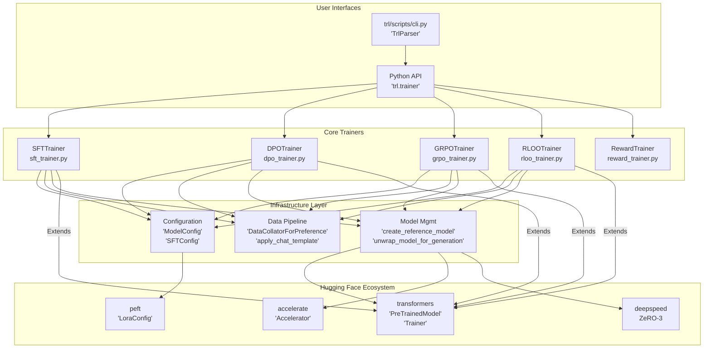

**Sources:** [trl/__init__.py:28-74](), [trl/trainer/__init__.py:20-49](), [trl/models/utils.py:97-142](), [README.md:28-41]()

## Post-Training Methods

TRL categorizes its trainers into three primary post-training paradigms. Each trainer is designed to be self-contained, often duplicating logic for generation or reward computation to ensure individual trainers are readable and modifiable in isolation [AGENTS.md:22-25]().

### Method Taxonomy

| Paradigm | Trainer | Description |
| :--- | :--- | :--- |
| **Supervised** | `SFTTrainer` | Fine-tunes models on instruction-response pairs using standard NLL or DFT loss. Supports dataset packing and vision-language models. |
| **Preference** | `DPOTrainer` | Directly optimizes a policy to prefer "chosen" over "rejected" completions without a separate reward model. |
| **Online RL** | `GRPOTrainer` | Implements Group Relative Policy Optimization, normalizing rewards across a group of completions to calculate advantages. |
| **Online RL** | `RLOOTrainer` | Implements REINFORCE Leave-One-Out, using a baseline derived from other samples in the same batch. |
| **Scoring** | `RewardTrainer` | Trains reward models (ORMs) on preference data to score completions for RL trainers. |

**Sources:** [README.md:28-33](), [docs/source/index.md:17-56](), [docs/source/dataset_formats.md:1-92]()

## Infrastructure and Ecosystem

TRL acts as a glue layer for the post-training ecosystem, integrating specialized kernels and inference engines.

### Infrastructure Mapping
This diagram maps system-level requirements to specific code entities and external integrations.

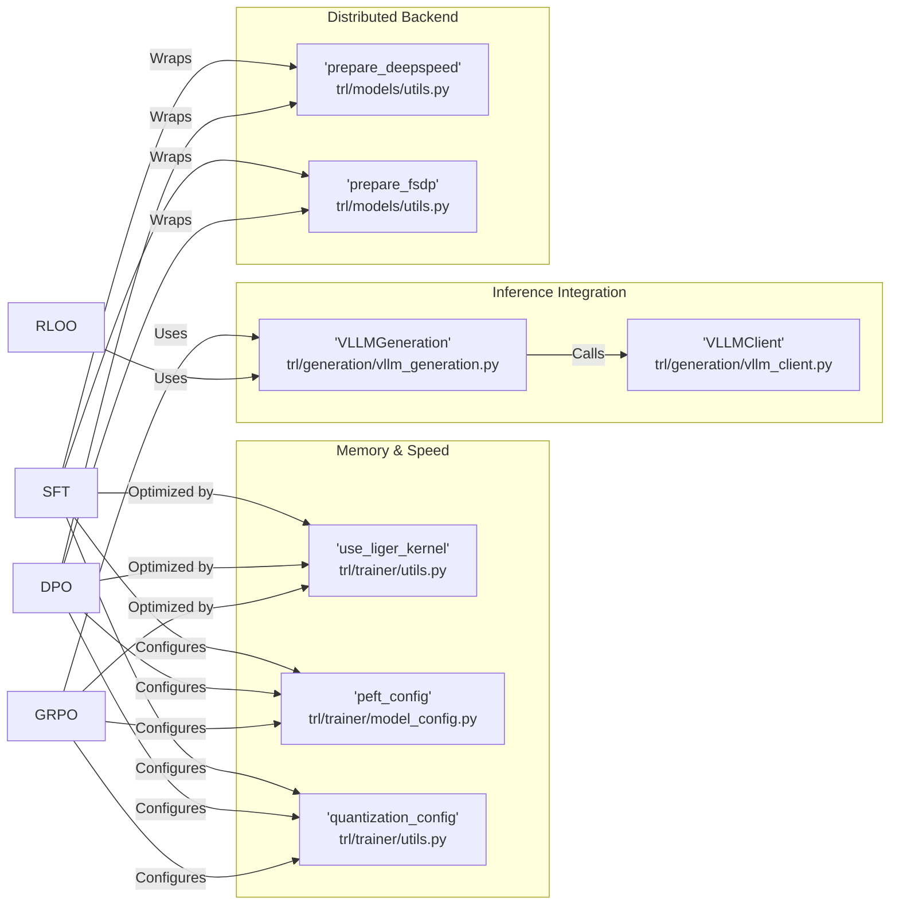

**Sources:** [trl/trainer/utils.py:41-48](), [trl/models/utils.py:183-200](), [docs/source/reducing_memory_usage.md:101-166](), [README.md:35-38]()

## Child Pages

For deep technical details on specific TRL subsystems, refer to the following pages:

### 1.1 Package Structure and Lazy Loading
TRL uses a specialized two-tier lazy loading architecture to keep import times low while maintaining a clean public API. This page covers module organization under `trl/`, the trainer subpackage structure, and the experimental namespace design pattern.
For details, see [Package Structure and Lazy Loading](#1.1).

### 1.2 Built-in Reward Functions
The `trl/rewards/` module provides a suite of pre-defined reward functions used primarily with `GRPOTrainer` and `RLOOTrainer`. This includes `accuracy_reward` for math verification, `think_format_reward` for reasoning models, and various punishment functions for length control.
For details, see [Built-in Reward Functions](#1.2).

**Sources:** [trl/__init__.py:15-132](), [trl/trainer/__init__.py:15-84](), [README.md:177-186]()

---

# Page: Package Structure and Lazy Loading

# Package Structure and Lazy Loading

<details>
<summary>Relevant source files</summary>

The following files were used as context for generating this wiki page:

- [docs/source/_toctree.yml](docs/source/_toctree.yml)
- [docs/source/speeding_up_training.md](docs/source/speeding_up_training.md)
- [docs/source/vllm_integration.md](docs/source/vllm_integration.md)
- [pyproject.toml](pyproject.toml)
- [trl/__init__.py](trl/__init__.py)
- [trl/_compat.py](trl/_compat.py)
- [trl/import_utils.py](trl/import_utils.py)
- [trl/models/__init__.py](trl/models/__init__.py)
- [trl/models/utils.py](trl/models/utils.py)
- [trl/trainer/__init__.py](trl/trainer/__init__.py)

</details>


## Purpose and Scope

This document explains the package structure and lazy loading architecture of the TRL library. It covers the two-tier `_LazyModule` implementation that optimizes import performance, the organization of modules under the `trl/` namespace, the trainer subpackage structure, and the experimental namespace pattern. TRL is designed to facilitate post-training foundation models through various algorithms like SFT, DPO, and GRPO, while maintaining a lightweight footprint at import time.

## Two-Tier Lazy Loading Architecture

TRL implements a two-tier lazy loading system to minimize import time and reduce memory footprint. The architecture defers module imports until they are actually accessed by user code.

### Architecture Overview

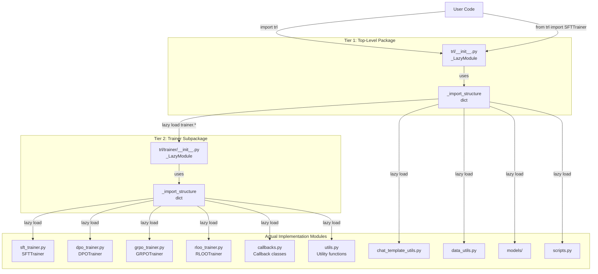

**Diagram: Two-tier lazy loading architecture showing deferred imports**

Sources: [trl/__init__.py:28-74](), [trl/trainer/__init__.py:20-49]()

### Import Structure Pattern

Each lazy module level defines an `_import_structure` dictionary that maps module names to their exported symbols:

**Top-Level Import Structure (`trl/__init__.py`)**

| Module | Exported Symbols | Purpose |
|--------|------------------|---------|
| `chat_template_utils` | `add_response_schema`, `clone_chat_template`, `get_training_chat_template`, `supports_tool_calling` | Chat template manipulation [trl/__init__.py:29-34]() |
| `data_utils` | `apply_chat_template`, `extract_prompt`, `is_conversational`, `pack_dataset`, `prepare_multimodal_messages`, etc. | Dataset processing utilities [trl/__init__.py:35-48]() |
| `models` | `create_reference_model` | Model management and reference model creation [trl/__init__.py:49]() |
| `scripts` | `DatasetMixtureConfig`, `ScriptArguments`, `TrlParser`, `get_dataset`, `init_zero_verbose` | CLI and script utilities [trl/__init__.py:50]() |
| `trainer` | All trainer classes, configs, and callbacks | Training algorithms (re-exports from trainer subpackage) [trl/__init__.py:51-73]() |

**Trainer Subpackage Import Structure (`trl/trainer/__init__.py`)**

| Module | Exported Symbols | Purpose |
|--------|------------------|---------|
| `callbacks` | `BEMACallback`, `LogCompletionsCallback`, `RichProgressCallback`, `SyncRefModelCallback`, `WeaveCallback` | Training callbacks [trl/trainer/__init__.py:21-27]() |
| `dpo_config` | `DPOConfig` | DPO configuration [trl/trainer/__init__.py:28]() |
| `dpo_trainer` | `DPOTrainer` | DPO trainer implementation [trl/trainer/__init__.py:29]() |
| `grpo_config` | `GRPOConfig` | GRPO configuration [trl/trainer/__init__.py:30]() |
| `grpo_trainer` | `GRPOTrainer` | GRPO trainer implementation [trl/trainer/__init__.py:31]() |
| `kto_config` | `KTOConfig` | KTO configuration [trl/trainer/__init__.py:32]() |
| `kto_trainer` | `KTOTrainer` | KTO trainer implementation [trl/trainer/__init__.py:33]() |
| `model_config` | `ModelConfig` | Model initialization configuration [trl/trainer/__init__.py:34]() |
| `reward_config` | `RewardConfig` | Reward model configuration [trl/trainer/__init__.py:35]() |
| `reward_trainer` | `RewardTrainer` | Reward model trainer [trl/trainer/__init__.py:36]() |
| `rloo_config` | `RLOOConfig` | RLOO configuration [trl/trainer/__init__.py:37]() |
| `rloo_trainer` | `RLOOTrainer` | RLOO trainer implementation [trl/trainer/__init__.py:38]() |
| `sft_config` | `SFTConfig` | SFT configuration [trl/trainer/__init__.py:39]() |
| `sft_trainer` | `SFTTrainer` | SFT trainer implementation [trl/trainer/__init__.py:40]() |
| `utils` | `disable_dropout_in_model`, `get_kbit_device_map`, `get_peft_config`, `get_quantization_config` | Trainer utilities [trl/trainer/__init__.py:41-48]() |

Sources: [trl/__init__.py:28-74](), [trl/trainer/__init__.py:20-49]()

## Lazy Module Implementation

### TYPE_CHECKING Pattern

The lazy loading implementation uses the `TYPE_CHECKING` constant from Python's `typing` module to provide IDE support without triggering actual imports at runtime:

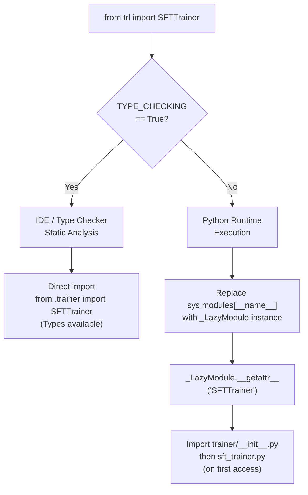

**Diagram: TYPE_CHECKING pattern flow for IDE support and lazy loading**

When `TYPE_CHECKING` is `True` (during static analysis), the actual imports are executed:
[trl/__init__.py:76-121]()

When `TYPE_CHECKING` is `False` (at runtime), the module replaces itself with a `_LazyModule` instance:
[trl/__init__.py:123-132]()

The same pattern is used in the trainer subpackage:
[trl/trainer/__init__.py:51-83]()

Sources: [trl/__init__.py:76-132](), [trl/trainer/__init__.py:51-83]()

### _LazyModule Behavior

The `_LazyModule` class (defined in `trl/_lazy_module.py`) intercepts attribute access and performs just-in-time imports. When a user accesses an attribute like `trl.SFTTrainer`:

1. `_LazyModule.__getattr__("SFTTrainer")` is called.
2. The module checks `_import_structure` to find that `SFTTrainer` comes from the `"trainer"` module [trl/__init__.py:67]().
3. The trainer subpackage is imported (which itself is a `_LazyModule` [trl/trainer/__init__.py:83]()).
4. The trainer's `_LazyModule` then imports `sft_trainer.py` [trl/trainer/__init__.py:40]().
5. The `SFTTrainer` class is returned to the caller.
6. Subsequent accesses use the cached import.

Sources: [trl/__init__.py:126-132](), [trl/trainer/__init__.py:83]()

## Top-Level Package Organization

### Module Categories

The top-level `trl` package exposes five categories of functionality:

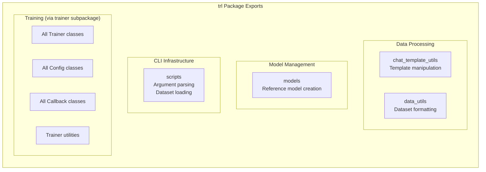

**Diagram: Top-level package organization by functional category**

Sources: [trl/__init__.py:28-74]()

### Namespace Design

All symbols exposed at the top level can be imported directly:

```python
from trl import SFTTrainer, SFTConfig
from trl import apply_chat_template
from trl import create_reference_model
```

This flat namespace design simplifies the user API while maintaining internal organization through the subpackage structure. The `trainer` subpackage is not directly visible to users; its contents are re-exported at the top level [trl/__init__.py:51-73]().

## Trainer Subpackage Structure

### File Organization

The trainer subpackage follows a consistent pattern where each trainer has paired files:

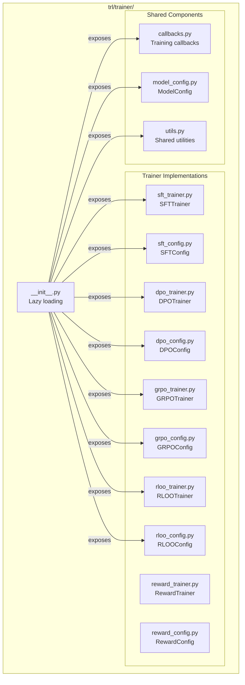

**Diagram: Trainer subpackage structure showing paired trainer/config files and shared components**

### Naming Convention

Each training algorithm follows this naming pattern:
- **Trainer file**: `{algorithm}_trainer.py` containing the `{Algorithm}Trainer` class.
- **Config file**: `{algorithm}_config.py` containing the `{Algorithm}Config` class.

The only exception is `model_config.py`, which contains `ModelConfig` used across all trainers for model initialization parameters [trl/trainer/__init__.py:34]().

Sources: [trl/trainer/__init__.py:20-49]()

### Callback System

The `callbacks.py` module contains all training callbacks, such as `BEMACallback`, `LogCompletionsCallback`, and `SyncRefModelCallback` [trl/trainer/__init__.py:22-25](). These are exposed at the top level [trl/__init__.py:52-69]().

### Utility Functions

The `utils.py` module provides shared utilities for trainers, including `get_kbit_device_map`, `get_peft_config`, and `get_quantization_config` [trl/trainer/__init__.py:44-46]().

## Experimental Namespace

The TRL library maintains an `experimental/` namespace for unstable or research-stage features. These features are excluded from stable CI testing but available for advanced users.

Experimental features include:
- **Algorithms**: BCO, CPO, GKD, GOLD, Nash-MD, Online DPO, ORPO, PPO, etc. [docs/source/_toctree.yml:96-141]()
- **Specialized Trainers**: `MiniLLMTrainer` (distillation), `PRMTrainer` (step-level reward modeling) [docs/source/_toctree.yml:117, 131]()
- **Research Implementations**: BEMA for reference models, GRPO with replay buffer, and self-distillation methods (SDFT, SDPO, SSD) [docs/source/_toctree.yml:94, 108, 132-137]()

These features are intentionally kept separate to allow rapid iteration. Using them may trigger a `TRLExperimentalWarning` [trl/import_utils.py:127-130]().

Sources: [docs/source/_toctree.yml:90-142](), [trl/import_utils.py:127-142]()

## Compatibility and Dependencies

TRL manages version incompatibilities through `trl/_compat.py`. This module applies temporary patches for:
- **vLLM**: Setting logging levels to reduce noise [_patch_vllm_logging] [trl/_compat.py:78-84]().
- **Transformers/PEFT**: Fixing `HybridCache` imports for transformers v5 compatibility [_patch_transformers_hybrid_cache] [trl/_compat.py:86-128]().
- **Accelerate**: Ensuring `ParallelismConfig` is defined for `typing.get_type_hints` compatibility [_patch_transformers_parallelism_config] [trl/_compat.py:130-157]().

Optional dependencies like `vllm`, `deepspeed`, and `peft` are managed through feature flags in `trl/import_utils.py` [trl/import_utils.py:60-125]().

Sources: [trl/_compat.py:15-157](), [trl/import_utils.py:60-125](), [pyproject.toml:46-96]()

---

# Page: Built-in Reward Functions

# Built-in Reward Functions

<details>
<summary>Relevant source files</summary>

The following files were used as context for generating this wiki page:

- [docs/source/rewards.md](docs/source/rewards.md)
- [tests/test_rewards.py](tests/test_rewards.py)
- [trl/rewards/__init__.py](trl/rewards/__init__.py)
- [trl/rewards/accuracy_rewards.py](trl/rewards/accuracy_rewards.py)
- [trl/rewards/other_rewards.py](trl/rewards/other_rewards.py)
- [trl/trainer/grpo_trainer.py](trl/trainer/grpo_trainer.py)
- [trl/trainer/rloo_trainer.py](trl/trainer/rloo_trainer.py)

</details>


The `trl/rewards/` module provides a suite of built-in reward callables designed for use with reinforcement learning trainers, specifically `GRPOTrainer` and `RLOOTrainer`. These functions allow for verifiable reasoning, format enforcement, and length control without requiring a separate reward model.

## Overview

In TRL, a `RewardFunc` can be a string (model ID), a `PreTrainedModel` (sequence classifier), or a custom `Callable` [trl/trainer/grpo_trainer.py:118](). The built-in functions in this module are specialized callables that process completions and return a list of floating-point rewards.

### Reward Function Data Flow

The following diagram illustrates how reward functions interact with the trainer's generation output.

**Reward Processing Pipeline**
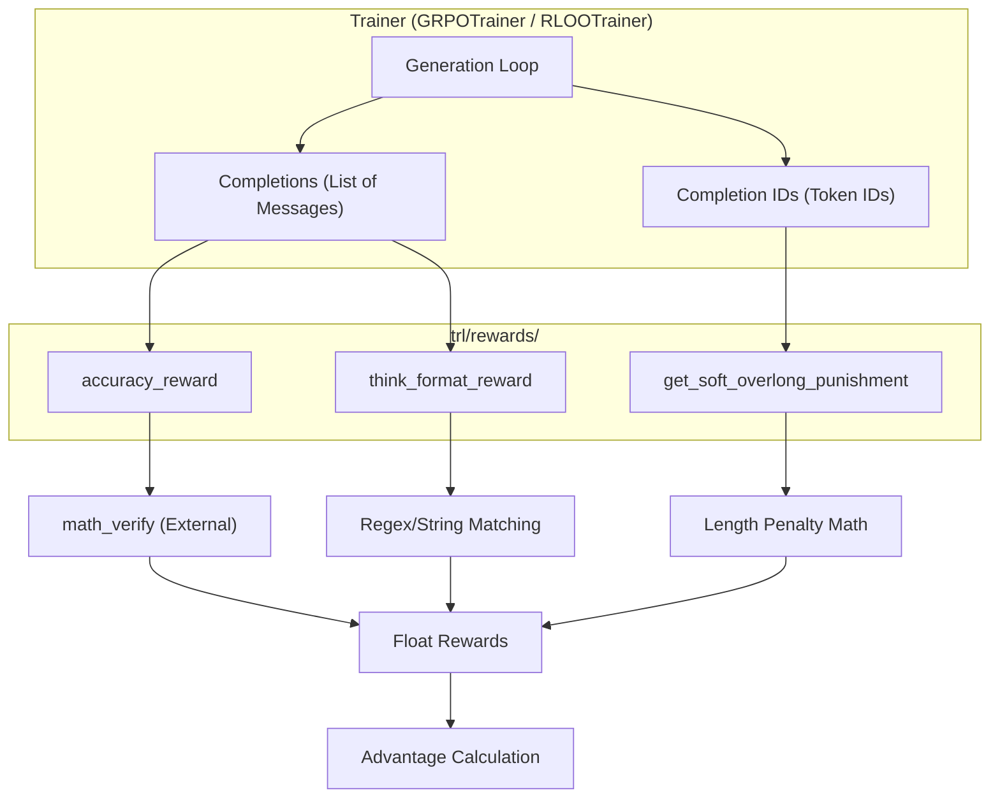
Sources: [trl/trainer/grpo_trainer.py:118-123](), [trl/rewards/accuracy_rewards.py:27-32](), [trl/rewards/other_rewards.py:49-60]()

---

## Accuracy and Reasoning Rewards

These functions are designed for mathematical and logical tasks where a ground-truth solution is available. They utilize the `math_verify` library for robust verification of mathematical expressions, including LaTeX.

### `accuracy_reward`
This function compares the model's generated content against a provided solution [trl/rewards/accuracy_rewards.py:27-32](). 

- **Mechanism**: It extracts the answer from the completion (prioritizing `\boxed{}` tags) and uses `math_verify.verify` to check equivalence with the gold solution [trl/rewards/accuracy_rewards.py:86-99]().
- **Thread Safety**: It detects if it is running in a non-main thread (common in distributed training) and disables `signal.alarm()` timeouts to prevent `ValueError` [trl/rewards/accuracy_rewards.py:71-76]().
- **Handling Failures**: If the gold solution cannot be parsed, it returns `None`, signaling the trainer to skip that specific example [trl/rewards/accuracy_rewards.py:103-107]().

### `reasoning_accuracy_reward`
A variant of the accuracy reward specifically for "Chain-of-Thought" models that use delimiters like ``. It strips the reasoning section before attempting to parse the final answer [trl/rewards/accuracy_rewards.py:117-123]().

Sources: [trl/rewards/accuracy_rewards.py:27-114](), [trl/rewards/accuracy_rewards.py:117-140]()

---

## Format Enforcement

### `think_format_reward`
Used primarily for models trained to perform internal reasoning. It validates that the model output follows a strict XML-like structure for thinking [trl/rewards/format_rewards.py]().

- **Validation Criteria**:
    - Must start with `` tag [tests/test_rewards.py:38]().
    - Does not allow nested `<think>` tags [tests/test_rewards.py:45]().
- **Reward**: Returns `1.0` for valid format and `0.0` otherwise [tests/test_rewards.py:32-49]().

Sources: [trl/rewards/format_rewards.py](), [tests/test_rewards.py:22-64]()

---

## Length Control

### `get_soft_overlong_punishment`
This is a factory function that returns a reward callable based on Equation 13 from the DAPO paper [trl/rewards/other_rewards.py:18-30](). It implements a "soft" penalty that gradually increases as the completion approaches the maximum length.

**Reward Calculation Logic**
| Condition | Reward Formula |
| :--- | :--- |
| $|y| \le L_{max} - L_{cache}$ | `0.0` (No penalty) |
| $L_{max} - L_{cache} < |y| \le L_{max}$ | $\frac{(L_{max} - L_{cache}) - |y|}{L_{cache}}$ |
| $|y| > L_{max}$ | `-1.0` (Maximum penalty) |

This function uses `completion_ids` (token counts) rather than raw text to ensure precision relative to the model's context window [trl/rewards/other_rewards.py:52-53]().

Sources: [trl/rewards/other_rewards.py:18-62](), [tests/test_rewards.py:66-89]()

---

## Integration with Trainers

Built-in rewards are passed to the `reward_funcs` argument of `GRPOTrainer` or `RLOOTrainer`. The trainers automatically handle the distribution of prompts and completions to these functions.

**Entity Association: Reward Callables to Trainers**
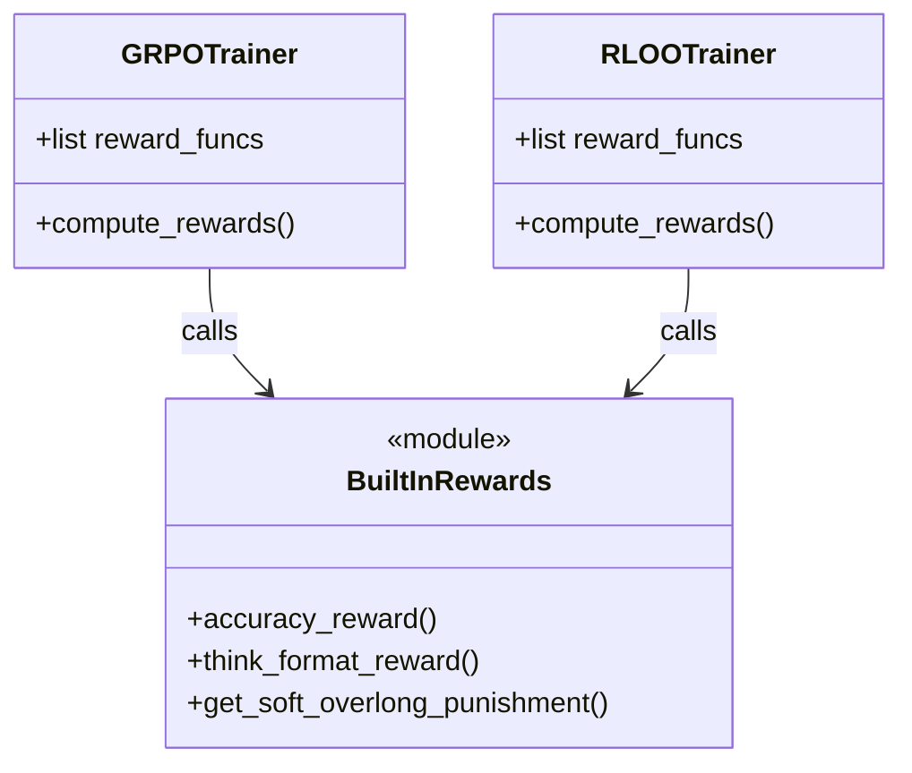

### Multi-Task Reward Handling
If a reward function returns `None` for a specific sample, the trainer excludes that function's contribution for that sample. This allows mixing different types of tasks (e.g., math and creative writing) in the same batch, where `accuracy_reward` only applies to the math samples [trl/trainer/grpo_trainer.py:180-182](), [trl/trainer/rloo_trainer.py:153-157]().

Sources: [trl/trainer/grpo_trainer.py:133-154](), [trl/trainer/rloo_trainer.py:105-126](), [trl/rewards/__init__.py:21-25]()

---

# Page: Core Infrastructure

# Core Infrastructure

<details>
<summary>Relevant source files</summary>

The following files were used as context for generating this wiki page:

- [docs/source/_toctree.yml](docs/source/_toctree.yml)
- [tests/test_utils.py](tests/test_utils.py)
- [trl/__init__.py](trl/__init__.py)
- [trl/models/__init__.py](trl/models/__init__.py)
- [trl/models/utils.py](trl/models/utils.py)
- [trl/trainer/__init__.py](trl/trainer/__init__.py)
- [trl/trainer/utils.py](trl/trainer/utils.py)

</details>


This page provides an overview of the shared infrastructure components used across all trainers in TRL. These components enable consistent model management, data processing, configuration, and training utilities across different training paradigms including supervised fine-tuning, preference optimization, and reinforcement learning.

The core infrastructure is organized into five main subsystems:
- **Model Loading and Management** (see [Model Loading and Management](#2.1)): Functions for loading models, creating reference models, managing distributed training wrappers, and handling gradient checkpointing.
- **Data Processing Pipeline** (see [Data Processing Pipeline](#2.2)): Data collators, dataset format detection, tokenization, packing/truncation, and multimodal data handling.
- **Configuration System** (see [Configuration System](#2.3)): Configuration class hierarchy extending `TrainingArguments`, `ModelConfig` dataclass for PEFT/quantization settings.
- **Training Callbacks** (see [Training Callbacks](#2.4)): Callback implementations for BEMA, reference model synchronization, completion logging, and progress tracking.
- **Chat Templates and Dataset Formatting** (see [Chat Templates and Dataset Formatting](#2.5)): Utilities for conversational data, chat template application, and dataset format conversion.

## Architecture Overview

The core infrastructure provides a layered architecture that separates concerns into functional domains. Each layer provides abstractions used by multiple trainers to avoid code duplication.

### Infrastructure Layers and Trainer Integration

```mermaid
graph TB
    subgraph "Trainer Layer"
        SFTTrainer["SFTTrainer"]
        DPOTrainer["DPOTrainer"]
        GRPOTrainer["GRPOTrainer"]
        RLOOTrainer["RLOOTrainer"]
        RewardTrainer["RewardTrainer"]
    end

    subgraph "Configuration Layer"
        SFTConfig["SFTConfig"]
        DPOConfig["DPOConfig"]
        GRPOConfig["GRPOConfig"]
        RLOOConfig["RLOOConfig"]
        RewardConfig["RewardConfig"]
        ModelConfig["ModelConfig"]
    end

    subgraph "Model Management Layer"
        UnwrapGen["unwrap_model_for_generation()"]
        CreateRef["create_reference_model()"]
        PrepareDS["prepare_deepspeed()"]
        PrepareFSDP["prepare_fsdp()"]
    end

    subgraph "Data Processing Layer"
        IsConv["is_conversational()"]
        ApplyChat["apply_chat_template()"]
        PackData["pack_dataset()"]
        LMCollator["DataCollatorForLanguageModeling"]
        VLMCollator["DataCollatorForVisionLanguageModeling"]
        PrefCollator["DataCollatorForPreference"]
    end

    subgraph "Training Utilities Layer"
        Pad["pad()"]
        GetPeft["get_peft_config()"]
        GetQuant["get_quantization_config()"]
        RepeatSampler["RepeatSampler"]
    end

    subgraph "Callbacks Layer"
        BEMACallback["BEMACallback"]
        SyncRefCallback["SyncRefModelCallback"]
        LogCompletions["LogCompletionsCallback"]
        RichProgress["RichProgressCallback"]
    end

    SFTTrainer --> SFTConfig
    DPOTrainer --> DPOConfig
    GRPOTrainer --> GRPOConfig
    RLOOTrainer --> RLOOConfig
    RewardTrainer --> RewardConfig
    
    SFTTrainer --> ModelConfig
    DPOTrainer --> ModelConfig
    GRPOTrainer --> ModelConfig
    
    SFTTrainer --> CreateRef
    DPOTrainer --> CreateRef
    GRPOTrainer --> UnwrapGen
    RLOOTrainer --> UnwrapGen
    RewardTrainer --> PrepareDS
    
    SFTTrainer --> IsConv
    SFTTrainer --> ApplyChat
    SFTTrainer --> PackData
    SFTTrainer --> LMCollator
    SFTTrainer --> VLMCollator
    DPOTrainer --> PrefCollator
    RewardTrainer --> PrefCollator
    
    SFTTrainer --> Pad
    SFTTrainer --> GetPeft
    RLOOTrainer --> RepeatSampler
    
    GRPOTrainer --> BEMACallback
    DPOTrainer --> SyncRefCallback
    GRPOTrainer --> LogCompletions
    SFTTrainer --> RichProgress
```

**Sources:** [trl/trainer/__init__.py:20-49](), [trl/trainer/utils.py:112-175](), [trl/models/utils.py:97-142](), [trl/__init__.py:28-74](), [trl/trainer/model_config.py:18-189]()

## Model Loading and Management (Page 2.1)

The model management layer provides utilities for loading models with various configurations, creating reference models for preference optimization, and managing distributed training wrappers. These functions are used during trainer initialization and generation phases.

### Key Model Management Functions

| Function | Purpose | Used By |
|----------|---------|---------|
| `get_quantization_config()` | Build `BitsAndBytesConfig` from `ModelConfig` | Trainer initialization |
| `unwrap_model_for_generation()` | Context manager for generation from distributed models | `GRPOTrainer`, `RLOOTrainer` |
| `create_reference_model()` | Create frozen reference model with optional layer sharing | `DPOTrainer`, offline preference methods |
| `prepare_deepspeed()` | Initialize model for DeepSpeed ZeRO-2/3 | Trainers with DeepSpeed |
| `prepare_fsdp()` | Initialize model for FSDP v1/v2 | Trainers with FSDP |
| `disable_dropout_in_model()` | Set all dropout layers to `p=0` | Reference models |

The `get_quantization_config()` function in [trl/trainer/utils.py:184-200]() handles 4-bit and 8-bit quantization settings via `BitsAndBytesConfig`. The `unwrap_model_for_generation()` function in [trl/models/utils.py:97-142]() manages gradient checkpointing state and DeepSpeed ZeRO-3 parameter gathering. Reference models are typically created via `create_reference_model` in [trl/models/utils.py:34-35](), which is a re-export of experimental utilities.

For detailed documentation, see [Model Loading and Management](#2.1).

**Sources:** [trl/trainer/utils.py:184-200](), [trl/models/utils.py:97-142](), [trl/models/utils.py:34-35](), [trl/trainer/utils.py:178-182]()

## Data Processing Pipeline (Page 2.2)

The data processing layer handles dataset format detection, tokenization, sequence optimization, and batch collation. It supports language modeling, preference, and multimodal datasets.

### Data Collators by Use Case

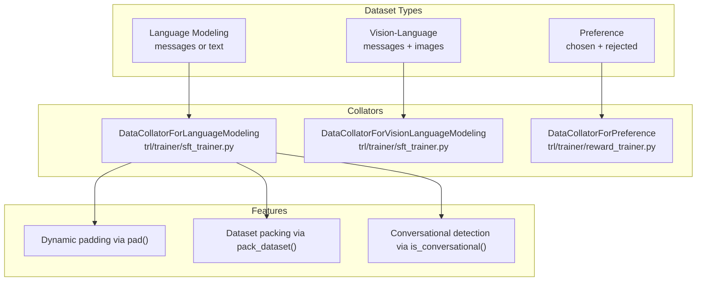

The infrastructure provides standardized padding via `pad()` in [trl/trainer/utils.py:112-175](), which supports left/right padding and `pad_to_multiple_of`. Dataset packing is handled by `pack_dataset()` in [trl/__init__.py:44](). Conversational data is detected using `is_conversational()` in [trl/data_utils.py:159-197](), which validates the structure of messages.

For detailed documentation including packing strategies and multimodal preparation, see [Data Processing Pipeline](#2.2).

**Sources:** [trl/trainer/utils.py:112-175](), [trl/data_utils.py:159-197](), [trl/__init__.py:28-48]()

## Configuration System (Page 2.3)

The configuration system extends `transformers.TrainingArguments` with trainer-specific parameters and provides the `ModelConfig` dataclass for PEFT and quantization settings.

### Configuration Class Hierarchy

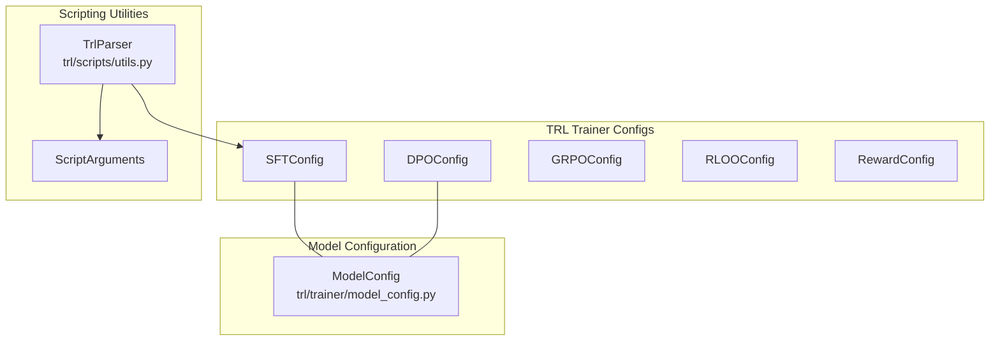

Trainer configs like `SFTConfig`, `DPOConfig`, and `GRPOConfig` are exported in [trl/trainer/__init__.py:28-40](). The `ModelConfig` dataclass in [trl/trainer/model_config.py:18-189]() centralizes PEFT settings (e.g., `use_peft`, `lora_r`) and quantization parameters. Command-line parsing is facilitated by `TrlParser` in [trl/scripts/utils.py](), which merges CLI arguments with configuration files.

For detailed parameter documentation and validation logic, see [Configuration System](#2.3).

**Sources:** [trl/trainer/__init__.py:28-40](), [trl/trainer/model_config.py:18-189](), [trl/__init__.py:50]()

## Training Callbacks (Page 2.4)

The callback system provides hooks for custom behavior during training. TRL includes several specialized callbacks for online RL methods and logging.

### Available Callbacks

| Callback | Purpose | Key File |
|----------|---------|----------|
| `BEMACallback` | Exponential moving average of reference model | [trl/trainer/callbacks.py]() |
| `SyncRefModelCallback` | Synchronize reference model from policy | [trl/trainer/callbacks.py]() |
| `LogCompletionsCallback` | Log sample completions to console | [trl/trainer/callbacks.py]() |
| `RichProgressCallback` | Enhanced progress bar with `rich` | [trl/trainer/callbacks.py]() |
| `WeaveCallback` | Log metrics to Weights & Biases Weave | [trl/trainer/callbacks.py]() |

These callbacks are integrated into the trainers via the standard `transformers` callback mechanism. For example, `BEMACallback` is used in reinforcement learning trainers to maintain a stable reference point.

For callback implementation details and custom callback creation, see [Training Callbacks](#2.4).

**Sources:** [trl/trainer/__init__.py:21-27](), [trl/trainer/callbacks.py:1-150]()

## Chat Templates and Dataset Formatting (Page 2.5)

The chat template utilities handle conversational data detection, format conversion, and tokenizer chat template application.

### Chat Template Utilities

The library provides high-level utilities for managing templates:
- `apply_chat_template()`: Applies a chat template to a dataset [trl/data_utils.py:200-316]().
- `get_training_chat_template()`: Retrieves a template optimized for training [trl/chat_template_utils.py:32]().
- `clone_chat_template()`: Copies a template from one tokenizer to another [trl/chat_template_utils.py:31]().
- `is_conversational()`: Detects if a dataset follows the conversational format [trl/data_utils.py:159-197]().

For detailed documentation including `FORMAT_MAPPING` and response schema handling, see [Chat Templates and Dataset Formatting](#2.5).

**Sources:** [trl/__init__.py:29-48](), [trl/data_utils.py:159-316](), [trl/chat_template_utils.py:1-200]()

## Integration with Training Framework

The core components integrate with all TRL trainers through standardized interfaces and lazy loading in `trl/__init__.py` [trl/__init__.py:126-132](). This architecture ensures that shared logic for model loading, data collation, and distributed training is maintained in a single place while remaining accessible to all training algorithms.

**Sources:** [trl/__init__.py:126-132](), [trl/trainer/__init__.py:1-84]()

---

# Page: Model Loading and Management

# Model Loading and Management

<details>
<summary>Relevant source files</summary>

The following files were used as context for generating this wiki page:

- [docs/source/_toctree.yml](docs/source/_toctree.yml)
- [tests/test_activation_offloading.py](tests/test_activation_offloading.py)
- [trl/__init__.py](trl/__init__.py)
- [trl/models/__init__.py](trl/models/__init__.py)
- [trl/models/activation_offloading.py](trl/models/activation_offloading.py)
- [trl/models/utils.py](trl/models/utils.py)
- [trl/trainer/__init__.py](trl/trainer/__init__.py)

</details>


This document covers TRL's model infrastructure layer, which provides wrapper classes and utilities for managing transformer models in post-training scenarios. The core components include `PreTrainedModelWrapper` (base wrapper), `AutoModelForCausalLMWithValueHead` (models with value heads for RL), `create_reference_model` (frozen reference copies), and utilities for distributed training setup including DeepSpeed and FSDP.

## Overview

TRL wraps `transformers.PreTrainedModel` instances to support reinforcement learning training paradigms. The wrapper infrastructure handles value head attachment for computing scalar values (PPO, RLOO), reference model management for KL-divergence penalties (DPO, PPO), and distributed training compatibility.

### Module Organization

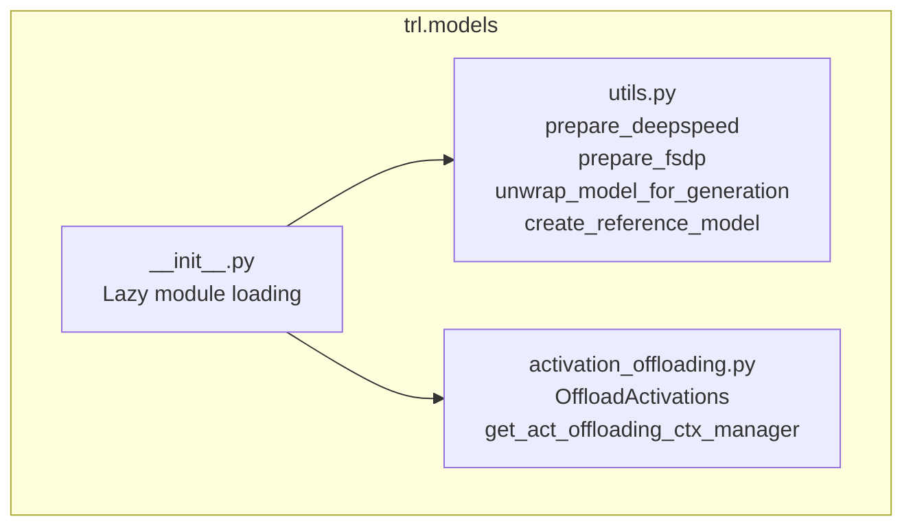

**Sources:** [trl/models/__init__.py:20-23](), [trl/models/utils.py:1-150](), [trl/models/activation_offloading.py:79-118]()

## Model Generation Utilities

TRL provides specialized context managers to handle model state transitions during generation phases, particularly in distributed environments.

### unwrap_model_for_generation

This context manager is used to temporarily unwrap a model from distributed containers (DDP or DeepSpeed) and disable gradient checkpointing to allow for efficient generation.

```python
with _unwrap_model_for_generation(model, accelerator) as unwrapped_model:
    generated_outputs = unwrapped_model.generate(input_ids)
```

**Key behaviors:**
- **Gradient Checkpointing:** Automatically disables it if active and re-enables it upon exit [trl/models/utils.py:125-142]().
- **DeepSpeed ZeRO-3:** If stage 3 is detected, it handles parameter gathering using `deepspeed.zero.GatheredParameters` [trl/models/utils.py:128-137]().
- **Hook Management:** Temporarily removes DeepSpeed optimizer hooks during generation to prevent unnecessary overhead [trl/models/utils.py:135-137]().

**Sources:** [trl/models/utils.py:98-143]()

### override_model_generation_config

A utility to temporarily override a model's `generation_config` with training-specific parameters. This circumvents issues in `transformers < 5.0.0` where merging logic might overwrite specific values with global defaults [trl/models/utils.py:145-161]().

**Sources:** [trl/models/utils.py:145-184]()

## Distributed Training Preparation

TRL includes utilities to prepare models for distributed training or inference, specifically targeting DeepSpeed and FSDP.

### DeepSpeed Preparation

The `prepare_deepspeed` utility configures a model for DeepSpeed inference, with specific optimizations for ZeRO-3 stage.

| Optimization Parameter | Logic |
|-----------------------|-------|
| `reduce_bucket_size` | `hidden_size * hidden_size` [trl/models/utils.py:377]() |
| `stage3_param_persistence_threshold` | `10 * hidden_size` [trl/models/utils.py:378]() |
| `stage3_prefetch_bucket_size` | `0.9 * hidden_size * hidden_size` [trl/models/utils.py:379]() |

If the DeepSpeed stage is not 3, ZeRO optimization is disabled for the model to save resources [trl/models/utils.py:383-384]().

**Sources:** [trl/models/utils.py:355-392]()

### FSDP Preparation

The `prepare_fsdp` utility wraps models in PyTorch's `FullyShardedDataParallel`. It supports both FSDP v1 and v2, using `get_parameters_from_modules` for newer `accelerate` versions to handle sharded parameters correctly [trl/models/utils.py:403-415]().

**Sources:** [trl/models/utils.py:395-416]()

## Reference Model Management

Many TRL trainers (DPO, PPO) require a reference model to compute KL-divergence penalties.

### create_reference_model

Creates a frozen copy of a model. If the input model is a PEFT model, it uses the base model as the reference [trl/models/utils.py:35]().

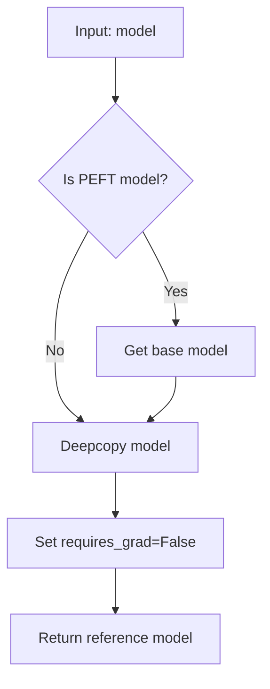

**Sources:** [trl/models/utils.py:35](), [trl/__init__.py:49]()

## Memory Optimization: Activation Offloading

TRL provides an `OffloadActivations` context manager to reduce VRAM usage by offloading activation tensors to CPU during the forward pass and bringing them back for the backward pass.

### Implementation Details

- **Deduplication:** Uses storage pointers and dtypes to avoid offloading the same underlying storage multiple times [trl/models/activation_offloading.py:49-76]().
- **Streaming:** Supports asynchronous communication between GPU and CPU using dedicated CUDA streams to overlap compute and transfer [trl/models/activation_offloading.py:158-166]().
- **Thresholding:** Only offloads tensors larger than `min_offload_size` (default 1024 bytes) to avoid overhead for small tensors [trl/models/activation_offloading.py:98-100]().

### Usage

```python
from trl.models.activation_offloading import OffloadActivations

with OffloadActivations(min_offload_size=1024):
    outputs = model(inputs)
    loss = outputs.loss
loss.backward()
```

**Sources:** [trl/models/activation_offloading.py:79-118](), [tests/test_activation_offloading.py:66-68]()

## Model Infrastructure Entity Mapping

This diagram maps natural language concepts to the specific code entities in the `trl.models` subpackage.

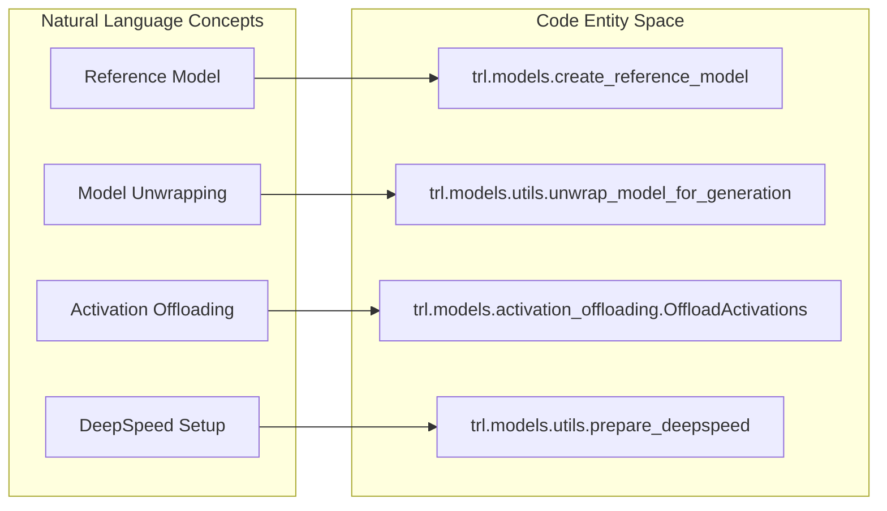

**Sources:** [trl/models/__init__.py:20-23](), [trl/models/activation_offloading.py:79](), [trl/models/utils.py:98]()

## Class Summary

| Class/Function | Purpose | File |
|----------------|---------|------|
| `unwrap_model_for_generation` | Disables GC and unwraps distributed models for inference. | [trl/models/utils.py:98]() |
| `prepare_deepspeed` | Configures DeepSpeed ZeRO-3 parameters based on model hidden size. | [trl/models/utils.py:355]() |
| `OffloadActivations` | Context manager for CPU offloading of forward activations. | [trl/models/activation_offloading.py:79]() |
| `create_reference_model` | Utility to create a frozen copy of a model for KL penalties. | [trl/models/utils.py:35]() |
| `remove_hooks` / `add_hooks` | Manages DeepSpeed ZeRO-3 optimizer hooks during unwrapping. | [trl/models/utils.py:47-95]() |

**Sources:** [trl/models/utils.py:1-416](), [trl/models/activation_offloading.py:1-118]()

---

# Page: Data Processing Pipeline

# Data Processing Pipeline

<details>
<summary>Relevant source files</summary>

The following files were used as context for generating this wiki page:

- [docs/source/data_utils.md](docs/source/data_utils.md)
- [scripts/generate_tiny_models.py](scripts/generate_tiny_models.py)
- [tests/experimental/test_ppo_trainer.py](tests/experimental/test_ppo_trainer.py)
- [tests/test_cli.py](tests/test_cli.py)
- [tests/test_data_utils.py](tests/test_data_utils.py)
- [tests/test_reward_trainer.py](tests/test_reward_trainer.py)
- [tests/test_sft_trainer.py](tests/test_sft_trainer.py)
- [trl/data_utils.py](trl/data_utils.py)
- [trl/trainer/sft_trainer.py](trl/trainer/sft_trainer.py)

</details>


TRL's data processing system transforms raw datasets into trainer-ready batched inputs through data collators and preprocessing utilities. The system consists of three main components:

1.  **Data Collators**: Batch preparation classes that handle padding, masking, and tensor creation.
2.  **Dataset Preprocessing**: Utilities for chat template application, format detection, and sequence transformations.
3.  **Advanced Processing**: Packing, truncation, and multimodal data handling.

The core collators are implemented in trainer modules ([trl/trainer/sft_trainer.py:89-463](), [trl/trainer/reward_trainer.py:25-108](), [trl/trainer/utils.py:79-211]()), while preprocessing utilities are primarily in [trl/data_utils.py:1-747]().

## Dataset Formats and Types

TRL supports multiple dataset formats that feed into trainer-specific data collators. Understanding these formats is essential for proper dataset preparation.

### Dataset Type Taxonomy

Title: Dataset Format to Collator Mapping
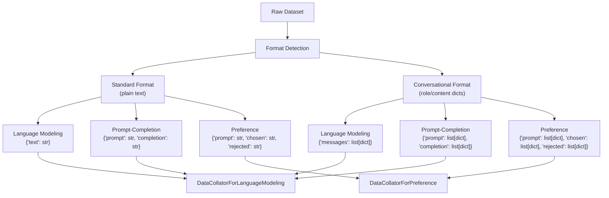
Sources: [trl/trainer/sft_trainer.py:89-251](), [trl/trainer/reward_trainer.py:25-108](), [trl/data_utils.py:103-117]()

### Format Detection

The `is_conversational` function at [trl/data_utils.py:103-117]() detects conversational format by checking for lists of dictionaries with `role` and `content` keys in supported fields: `messages`, `prompt`, `chosen`, `rejected`, `completion`.

| Dataset Type | Standard Format | Conversational Format | Trainer Usage |
|--------------|-----------------|----------------------|---------------|
| Language modeling | `{"text": "The sky is blue."}` | `{"messages": [{"role": "user", "content": "Hi"}, {"role": "assistant", "content": "Hello"}]}` | `SFTTrainer` |
| Prompt-completion | `{"prompt": "The sky is", "completion": " blue."}` | `{"prompt": [{"role": "user", "content": "What color?"}], "completion": [{"role": "assistant", "content": "Blue"}]}` | `SFTTrainer` |
| Preference | `{"prompt": "The sky is", "chosen": " blue.", "rejected": " green."}` | `{"prompt": [{"role": "user", "content": "What color?"}], "chosen": [{"role": "assistant", "content": "Blue"}], "rejected": [{"role": "assistant", "content": "Green"}]}` | `DPOTrainer`, `RewardTrainer` |

Sources: [trl/data_utils.py:103-117](), [tests/test_data_utils.py:151-257]()

## Data Collators

Data collators are the final step in data processing, transforming tokenized examples into batched tensors ready for model input.

### DataCollatorForLanguageModeling

The `DataCollatorForLanguageModeling` class at [trl/trainer/sft_trainer.py:89-251]() handles SFT training data batching with support for completion-only loss, padding-free training, and sequence packing.

Title: DataCollatorForLanguageModeling Processing Flow
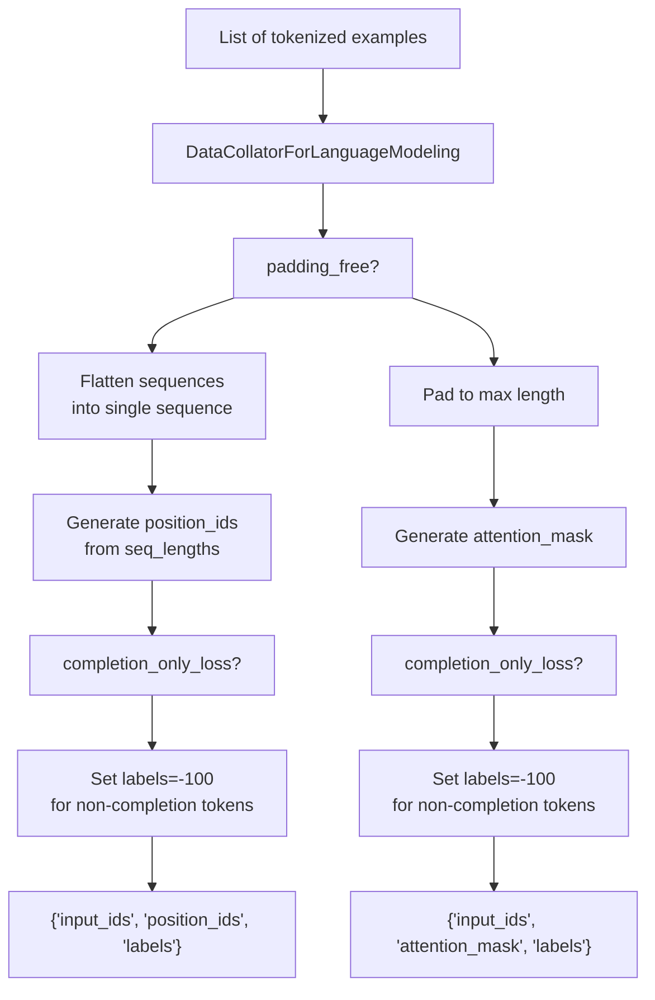
Sources: [trl/trainer/sft_trainer.py:89-251](), [tests/test_sft_trainer.py:85-265]()

#### Padding-Free Mode
When `padding_free=True`, the collator flattens sequences into a single sequence and generates `position_ids` that reset at sequence boundaries [trl/trainer/sft_trainer.py:118-120](). This eliminates padding overhead but requires FlashAttention. The static method `get_position_ids_from_packed_seq_lengths` at [trl/trainer/sft_trainer.py:225-250]() generates these IDs.

#### Completion-Only Loss
When `completion_only_loss=True` and examples contain a `completion_mask`, labels are set to `-100` for prompt tokens [trl/trainer/sft_trainer.py:94-95](). It also supports `assistant_masks` to mask non-assistant parts of conversational sequences [trl/trainer/sft_trainer.py:95-96]().

### DataCollatorForVisionLanguageModeling

The `DataCollatorForVisionLanguageModeling` class at [trl/trainer/sft_trainer.py:254-463]() handles vision-language model training by tokenizing text and processing images on-the-fly.

Title: DataCollatorForVisionLanguageModeling Processing Paths
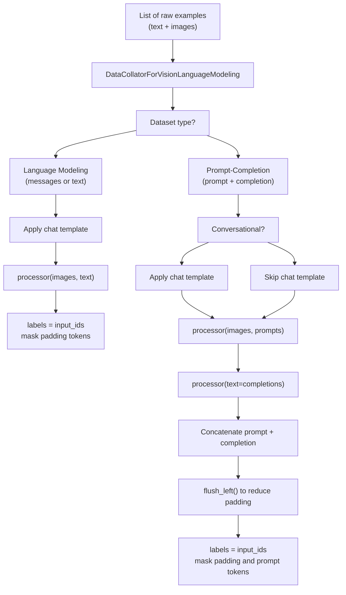
Sources: [trl/trainer/sft_trainer.py:254-463](), [trl/trainer/sft_trainer.py:351-462]()

### DataCollatorForPreference

The `DataCollatorForPreference` class at [trl/trainer/reward_trainer.py:25-108]() (and similar logic in `DPOTrainer`) batches preference data, handling chosen and rejected sequences.

Title: DataCollatorForPreference Batching Logic
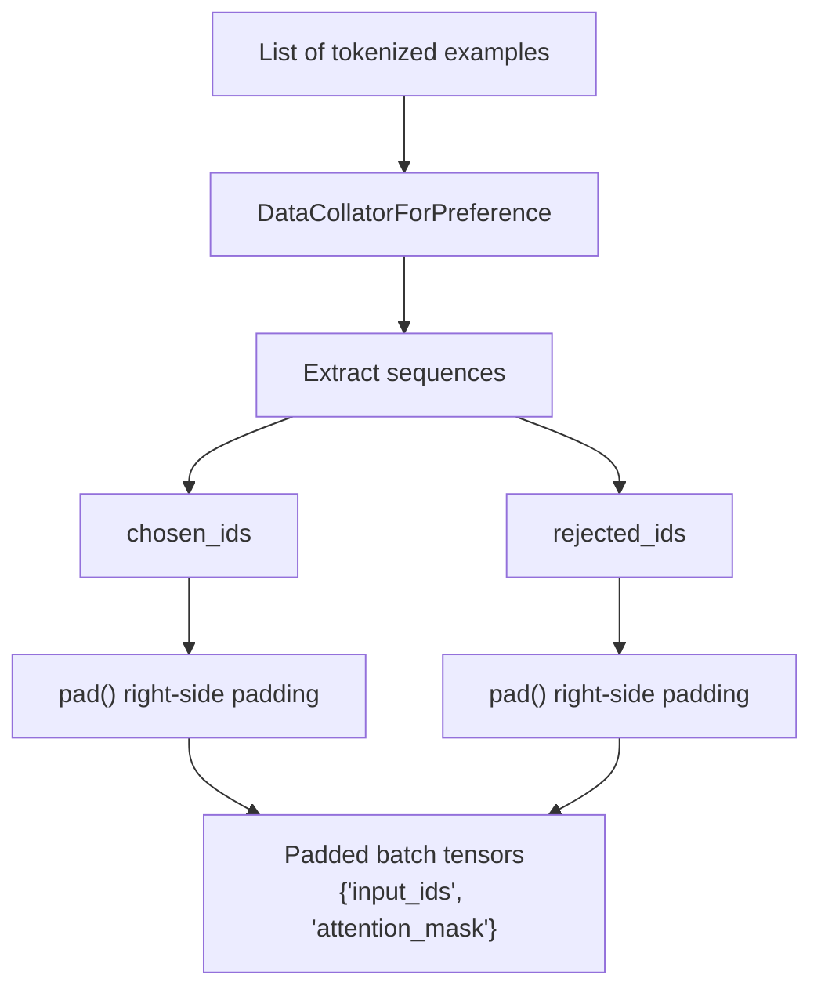
Sources: [trl/trainer/reward_trainer.py:25-108](), [tests/test_reward_trainer.py:34-108]()

## Dataset Preprocessing

### Chat Template Application

The `apply_chat_template` and `maybe_apply_chat_template` functions at [trl/data_utils.py:120-279]() convert conversational datasets to text format.

Title: Chat Template Application Logic
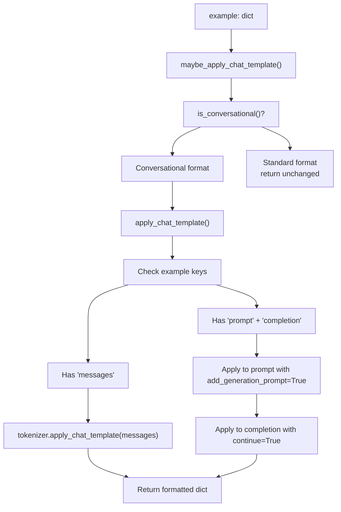
Sources: [trl/data_utils.py:120-279](), [tests/test_data_utils.py:400-430]()

### Multimodal Message Preparation

The `prepare_multimodal_messages` function at [trl/data_utils.py:33-124]() converts string content in conversational messages to structured multimodal format.

Title: Multimodal Message Structure Creation
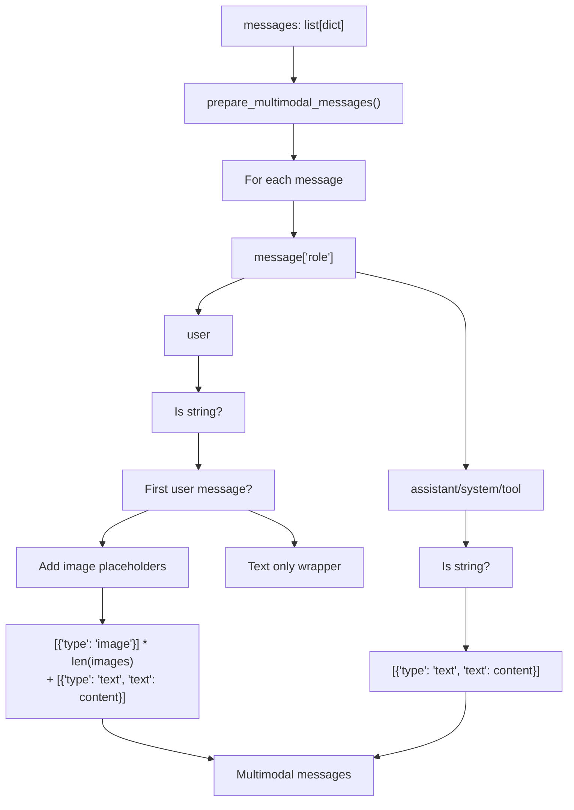
Sources: [trl/data_utils.py:33-124](), [tests/test_data_utils.py:48-148]()

## Advanced Processing Features

### Sequence Packing

The `pack_dataset` function at [trl/data_utils.py:629-682]() groups multiple sequences into fixed-length blocks to reduce padding.

Title: Packing Strategy Implementations
```mermaid
flowchart TD
    DATASET["Tokenized Dataset"] --> PACK_DATASET["pack_dataset()"]
    
    PACK_DATASET --> STRATEGY["Strategy selection"]
    
    STRATEGY --> BFD["strategy='bfd'<br/>(Best Fit Decreasing)"]
    STRATEGY --> WRAPPED["strategy='wrapped'"]
    
    BFD --> _PACK_BFD["_pack_bfd() using _SegmentTree"]
    WRAPPED --> _PACK_WRAPPED["_pack_wrapped()"]
    
    _PACK_BFD --> ADD_SEQ_LENGTHS["Add 'seq_lengths' field"]
    _PACK_WRAPPED --> ADD_SEQ_LENGTHS
    
    ADD_SEQ_LENGTHS --> OUTPUT["Packed Dataset"]
```
Sources: [trl/data_utils.py:629-682](), [trl/data_utils.py:543-608](), [trl/data_utils.py:498-541]()

#### _SegmentTree for BFD Packing
The `_SegmentTree` class at [trl/data_utils.py:498-541]() provides efficient bin space tracking with O(log n) search, allowing the Best Fit Decreasing (`bfd`) algorithm to maintain sequence boundaries effectively.

### Dataset Truncation

The `truncate_dataset` function at [trl/data_utils.py:685-747]() limits sequence lengths using efficient PyArrow operations (`pc.list_slice`) for `Dataset` objects or standard Python slicing for `DatasetDict`.

Title: Truncation Implementation Paths
```mermaid
flowchart TD
    TRUNCATE_DATASET["truncate_dataset()"] --> TYPE_CHECK["Dataset type?"]
    
    TYPE_CHECK --> REGULAR_DS["Dataset"]
    TYPE_CHECK --> DICT_DS["DatasetDict"]
    
    REGULAR_DS --> ARROW_SLICE["pyarrow.compute.list_slice()"]
    DICT_DS --> MAP_SPLITS["For each split: Python slicing [:max_length]"]
    
    ARROW_SLICE --> OUTPUT["Truncated Dataset"]
    MAP_SPLITS --> OUTPUT
```
Sources: [trl/data_utils.py:685-747]()

---

# Page: Configuration System

# Configuration System

<details>
<summary>Relevant source files</summary>

The following files were used as context for generating this wiki page:

- [tests/conftest.py](tests/conftest.py)
- [trl/extras/dataset_formatting.py](trl/extras/dataset_formatting.py)
- [trl/trainer/base_config.py](trl/trainer/base_config.py)
- [trl/trainer/dpo_config.py](trl/trainer/dpo_config.py)
- [trl/trainer/kto_config.py](trl/trainer/kto_config.py)
- [trl/trainer/model_config.py](trl/trainer/model_config.py)
- [trl/trainer/reward_config.py](trl/trainer/reward_config.py)
- [trl/trainer/sft_config.py](trl/trainer/sft_config.py)

</details>


The TRL configuration system provides a declarative interface for customizing training behavior across all trainer classes. All trainer configurations extend `_BaseConfig`, which inherits from `transformers.TrainingArguments`, ensuring full compatibility with the Hugging Face training ecosystem. `ModelConfig` is a separate dataclass that encapsulates model loading and PEFT configuration, allowing clean separation between training hyperparameters and model initialization parameters.

This page documents the configuration class hierarchy, parameter inheritance patterns, default value overrides, validation logic, and the integration with `transformers.TrainingArguments`. For trainer-specific parameters, see the individual trainer pages: [SFT (3)], [DPO (4)], [GRPO (5)], [RLOO (6)], [Reward (7)].

---

## Configuration Class Hierarchy

All TRL trainer configurations extend `_BaseConfig` from [trl/trainer/base_config.py](), which itself extends `transformers.TrainingArguments`. This inheritance ensures that all transformers training arguments (learning rate, batch size, gradient accumulation, etc.) are available in TRL configs. `ModelConfig` is independent and does not inherit from `TrainingArguments`.

**Configuration class inheritance hierarchy**

```mermaid
classDiagram
    class TrainingArguments {
        <<transformers>>
        +learning_rate: 5e-5
        +per_device_train_batch_size: 8
        +gradient_accumulation_steps: 1
        +logging_steps: 500
        +gradient_checkpointing: False
        +bf16: False
        +_VALID_DICT_FIELDS: list
        +__post_init__()
    }
    class "_BaseConfig" {
        <<trl/trainer/base_config.py>>
        +logging_steps: 10
        +gradient_checkpointing: True
        +bf16: True if not fp16
        +use_liger_kernel: False
        +__post_init__()
    }
    class "SFTConfig" {
        <<trl/trainer/sft_config.py>>
        +learning_rate: 2e-5
        +model_init_kwargs: dict
        +max_length: 1024
        +packing: False
        +completion_only_loss: None
        +assistant_only_loss: False
        +loss_type: "nll"
    }
    class "DPOConfig" {
        <<trl/trainer/dpo_config.py>>
        +learning_rate: 1e-6
        +model_init_kwargs: dict
        +beta: 0.1
        +loss_type: "sigmoid"
        +precompute_ref_log_probs: False
    }
    class "RewardConfig" {
        <<trl/trainer/reward_config.py>>
        +learning_rate: 1e-4
        +model_init_kwargs: dict
        +center_rewards_coefficient: None
        +disable_dropout: True
    }
    class "ModelConfig" {
        <<trl/trainer/model_config.py>>
        +model_name_or_path: str
        +dtype: "float32"
        +use_peft: False
        +lora_r: 16
        +lora_alpha: 32
        +load_in_4bit: False
        +load_in_8bit: False
    }

    TrainingArguments <|-- "_BaseConfig"
    "_BaseConfig" <|-- "SFTConfig"
    "_BaseConfig" <|-- "DPOConfig"
    "_BaseConfig" <|-- "RewardConfig"
```

Sources: [trl/trainer/base_config.py:21](), [trl/trainer/sft_config.py:23](), [trl/trainer/dpo_config.py:23](), [trl/trainer/reward_config.py:23](), [trl/trainer/model_config.py:19]()

---

## `_BaseConfig` Class

**File:** [trl/trainer/base_config.py]()

`_BaseConfig` is a subclass of `transformers.TrainingArguments` that serves as the parent class for all TRL trainer configurations. It provides three key functions:

1. **Default override mechanism**: Changes default values of `TrainingArguments` parameters to TRL-preferred defaults (e.g., `logging_steps=10` [trl/trainer/base_config.py:54-60](), `gradient_checkpointing=True` [trl/trainer/base_config.py:61-66](), `bf16=True` if `fp16` is not set [trl/trainer/base_config.py:67-74]()).
2. **Compatibility Patching**: Overrides fields like `use_liger_kernel` [trl/trainer/base_config.py:90-95]() and `torch_empty_cache_steps` [trl/trainer/base_config.py:97-102]() to escape "%" characters in help strings, which would otherwise cause `argparse` errors in older `transformers` versions [trl/trainer/base_config.py:86-89]().
3. **Initialization chain**: Its `__post_init__` method handles the logic for defaulting `bf16` based on `fp16` status before calling `super().__post_init__()` [trl/trainer/base_config.py:104-107]().

Sources: [trl/trainer/base_config.py:21-108]()

---

## `ModelConfig` Dataclass

**File:** [trl/trainer/model_config.py]()

`ModelConfig` is an independent `@dataclass` that encapsulates all model loading and PEFT configuration parameters. It provides clean separation between model initialization and training hyperparameters.

**ModelConfig parameter organization**

| Parameter Group | Parameters | Default Values | Purpose |
|---|---|---|---|
| **Model Identity** | `model_name_or_path`<br>`model_revision` | `None`<br>`"main"` | Hub model ID or local path [trl/trainer/model_config.py:83-90]() |
| **Dtype & Attention** | `dtype`<br>`attn_implementation` | `"float32"`<br>`None` | Precision override [trl/trainer/model_config.py:91-97]() and Attention implementation (e.g., `flash_attention_2`) [trl/trainer/model_config.py:106-112]() |
| **LoRA / PEFT** | `use_peft`<br>`lora_r`<br>`lora_alpha`<br>`lora_target_modules` | `False`<br>`16`<br>`32`<br>`None` | Enable PEFT and configure rank, alpha, and targets [trl/trainer/model_config.py:113-132]() |
| **Quantization** | `load_in_8bit`<br>`load_in_4bit`<br>`bnb_4bit_quant_type` | `False`<br>`False`<br>`"nf4"` | BitsAndBytes quantization settings [trl/trainer/model_config.py:164-173]() |

Sources: [trl/trainer/model_config.py:19-182]()

### Usage Pattern with HfArgumentParser

Training scripts typically parse `ModelConfig` alongside a trainer config using `transformers.HfArgumentParser`:

```python
from transformers import HfArgumentParser
from trl import SFTConfig, ModelConfig

parser = HfArgumentParser((SFTConfig, ModelConfig))
sft_config, model_config = parser.parse_args_into_dataclasses()
```

This allows CLI users to specify both training and model parameters in a single command.

---

## Trainer Configuration Pattern

All trainer configs follow a consistent structural pattern, organizing parameters into logical groups and providing validation logic in `__post_init__()`.

**Standard trainer config structure**

```mermaid
flowchart TD
    A["@dataclass"]
    B["class TrainerConfig(_BaseConfig)"]
    C["_VALID_DICT_FIELDS = _BaseConfig._VALID_DICT_FIELDS + [...]"]
    D["Overridden defaults from TrainingArguments"]
    E["Model parameters:<br/>model_init_kwargs, chat_template_path"]
    F["Data preprocessing parameters:<br/>dataset_num_proc, max_length, padding_free"]
    G["Training parameters:<br/>loss_type, beta, activation_offloading"]
    H["def __post_init__(self)"]
    I["Validation logic & super().__post_init__()"]

    A --> B
    B --> C
    B --> D
    B --> E
    B --> F
    B --> G
    B --> H
    H --> I
```

Sources: [trl/trainer/sft_config.py:23-115](), [trl/trainer/dpo_config.py:23-92](), [trl/trainer/reward_config.py:23-92]()

### `_VALID_DICT_FIELDS` Class Variable

Trainer configs use the `_VALID_DICT_FIELDS` class variable to identify which parameters are dictionary-typed. This is crucial for `HfArgumentParser` to correctly parse JSON strings from the CLI into Python dictionaries.

- **`SFTConfig`**: Includes `model_init_kwargs`, `dataset_kwargs` [trl/trainer/sft_config.py:115]().
- **`DPOConfig`**: Includes `model_init_kwargs`, `ref_model_init_kwargs` [trl/trainer/dpo_config.py:126]().
- **`RewardConfig`**: Includes `model_init_kwargs` [trl/trainer/reward_config.py:92]().

### Default Value Overrides

Each trainer config overrides specific `TrainingArguments` or `_BaseConfig` defaults to better match the requirements of its specific training algorithm.

| Trainer Config | Parameter | Override Value | Original Default |
|---|---|---|---|
| `SFTConfig` | `learning_rate` | `2e-5` [trl/trainer/sft_config.py:118-121]() | `5e-5` |
| `RewardConfig` | `learning_rate` | `1e-4` [trl/trainer/reward_config.py:95-98]() | `5e-5` |
| `DPOConfig` | `learning_rate` | `1e-6` [trl/trainer/dpo_config.py:129-132]() | `5e-5` |

---

## Configuration Validation in `__post_init__`

Trainer configs implement `__post_init__()` to perform cross-parameter validation.

### SFTConfig Validation
In `SFTConfig`, the logic checks for valid `packing_strategy` [trl/trainer/sft_config.py:239-245]() and ensures that `dataset_text_field` is provided if the dataset is not in a standard format [trl/trainer/sft_config.py:247-252](). It also automatically enables `padding_free` if the "bfd" packing strategy is used [trl/trainer/sft_config.py:254-257]().

### ModelConfig Validation
`ModelConfig` ensures that `load_in_8bit` and `load_in_4bit` are not used simultaneously [trl/trainer/model_config.py:184-185](). It also normalizes `lora_target_modules` if a single string is passed in a list [trl/trainer/model_config.py:187-188]().

Sources: [trl/trainer/sft_config.py:236-258](), [trl/trainer/model_config.py:183-189]()

---

## Experimental and Deprecated Parameters

TRL maintains compatibility through shims and warnings. For example, `KTOConfig` is now located in `trl.experimental`, and the version in `trl.trainer` acts as a proxy that issues a `FutureWarning` [trl/trainer/kto_config.py:25-36]().

Dataset formatting is also centralized; `trl/extras/dataset_formatting.py` defines `FORMAT_MAPPING` to standardize how "chatml" and "instruction" formats are recognized across different `datasets` library versions [trl/extras/dataset_formatting.py:24-32]().

Sources: [trl/trainer/kto_config.py:25-36](), [trl/extras/dataset_formatting.py:24-32]()

---

# Page: Training Callbacks

# Training Callbacks

<details>
<summary>Relevant source files</summary>

The following files were used as context for generating this wiki page:

- [docs/source/callbacks.md](docs/source/callbacks.md)
- [tests/test_callbacks.py](tests/test_callbacks.py)
- [tests/test_rich_progress_callback.py](tests/test_rich_progress_callback.py)
- [trl/trainer/callbacks.py](trl/trainer/callbacks.py)

</details>


Training callbacks in TRL provide hooks into the training loop to enable custom behavior at specific points during training. TRL includes several built-in callbacks for common tasks like reference model synchronization, logging completions, and progress visualization. All TRL callbacks extend `transformers.TrainerCallback` and are compatible with the Hugging Face Transformers training infrastructure.

## Overview

The callback system allows developers to inject logic into the training lifecycle without modifying the core trainer classes.

```mermaid
graph TB
    subgraph "Trainer Initialization"
        User["User Code"]
        TrainerInit["DPOTrainer / GRPOTrainer / etc<br/>callbacks parameter"]
    end
    
    subgraph "Callback System"
        BaseCallback["transformers.TrainerCallback<br/>Base class"]
        TRLCallbacks["TRL Callbacks"]
        BEMACallback["BEMACallback"]
        SyncRefModelCallback["SyncRefModelCallback"]
        LogCompletionsCallback["LogCompletionsCallback"]
        RichProgressCallback["RichProgressCallback"]
        WeaveCallback["WeaveCallback"]
        CustomCallback["Custom User Callbacks"]
    end
    
    subgraph "Training Loop Hooks"
        OnInit["on_init_end"]
        OnStep["on_step_end"]
        OnLog["on_log"]
        OnEval["on_evaluate"]
        OnSave["on_save"]
        OnTrain["on_train_begin / on_train_end"]
    end
    
    User -->|"passes callbacks list"| TrainerInit
    TrainerInit -->|"registers"| TRLCallbacks
    TrainerInit -->|"registers"| CustomCallback
    
    BaseCallback -->|"extends"| TRLCallbacks
    BaseCallback -->|"extends"| CustomCallback
    
    TRLCallbacks --> BEMACallback
    TRLCallbacks --> SyncRefModelCallback
    TRLCallbacks --> LogCompletionsCallback
    TRLCallbacks --> RichProgressCallback
    TRLCallbacks --> WeaveCallback
    
    TRLCallbacks -.->|"called at"| OnInit
    TRLCallbacks -.->|"called at"| OnStep
    TRLCallbacks -.->|"called at"| OnLog
    TRLCallbacks -.->|"called at"| OnEval
    TRLCallbacks -.->|"called at"| OnSave
    TRLCallbacks -.->|"called at"| OnTrain
```

Sources: [trl/trainer/callbacks.py:102]() [trl/trainer/callbacks.py:143]() [trl/trainer/callbacks.py:228]() [trl/trainer/callbacks.py:284]()

## Available Callbacks

TRL provides several built-in callbacks, each serving a specific purpose in the training workflow.

| Callback | Primary Use Case | Key Configuration |
|----------|------------------|-------------------|
| `BEMACallback` | Bootstrapped Exponential Moving Average for reference models | `update_freq`, `ema_alpha` |
| `SyncRefModelCallback` | Reference model synchronization (TR-DPO) | `ref_model_sync_steps`, `ref_model_mixup_alpha` |
| `LogCompletionsCallback` | Log generated completions during training | `num_prompts`, `generation_config` |
| `RichProgressCallback` | Enhanced progress bars with rich formatting | None |
| `WeaveCallback` | Weights & Biases Weave integration | W&B configuration |

### SyncRefModelCallback

The `SyncRefModelCallback` implements the TR-DPO (Trust Region DPO) reference model synchronization strategy, which periodically updates the reference model to be a mixture of the current policy and the previous reference policy.

```mermaid
graph LR
    subgraph "Training Loop"
        Step1["Training Step t"]
        Step2["Training Step t+1"]
        Step3["Training Step t+τ"]
    end
    
    subgraph "Model States"
        Policy["Policy Model π_θ"]
        RefModel["Reference Model π_ref"]
    end
    
    subgraph "SyncRefModelCallback"
        CheckStep["Check if step % ref_model_sync_steps == 0"]
        Mixup["π_ref = α * π_θ + (1-α) * π_ref_prev"]
    end
    
    Step1 --> Policy
    Step2 --> Policy
    Step3 --> CheckStep
    CheckStep -->|"Yes"| Mixup
    Mixup --> RefModel
    RefModel -.->|"Used for DPO loss"| Policy
```

**Implementation Details**:
- It uses `SyncRefModelCallback.sync_target_model` to handle weight updates [trl/trainer/callbacks.py:121-132]().
- Supports DeepSpeed ZeRO-3 by using `deepspeed.zero.GatheredParameters` to sync weights across ranks [trl/trainer/callbacks.py:122-130]().
- Updates are applied in `on_step_end` based on the `ref_model_sync_steps` frequency [trl/trainer/callbacks.py:134-141]().

Sources: [trl/trainer/callbacks.py:102-141]()

### BEMACallback

`BEMACallback` implements Bootstrapped Exponential Moving Average for reference models. It maintains a separate model instance that tracks the moving average of the training model's weights.

**Key Features**:
- **Weight Updates**: Parameters are updated using the formula: `target = (1 - alpha) * target + alpha * source` [trl/trainer/callbacks.py:321-322]().
- **Frequency**: Controlled by `update_freq` [trl/trainer/callbacks.py:328]().
- **Persistence**: Automatically saves the BEMA model to a `bema` subdirectory within the output directory during `on_train_end` [trl/trainer/callbacks.py:343-349]().

Sources: [trl/trainer/callbacks.py:284-353]() [tests/test_callbacks.py:136-152]()

### LogCompletionsCallback

`LogCompletionsCallback` generates and logs completions from the model during the evaluation phase. This is critical for visual inspection of model performance beyond scalar metrics.

**Data Flow**:
1. In `on_evaluate`, it selects a subset of prompts from the evaluation dataset [trl/trainer/callbacks.py:255-257]().
2. It uses `_generate_completions` to produce text using the current model state [trl/trainer/callbacks.py:263-270]().
3. It removes the prompt from the generated sequence to isolate the completion [trl/trainer/callbacks.py:94-98]().
4. Results are logged as a table to supported backends like Weights & Biases (WandB), Comet, or MLflow [trl/trainer/callbacks.py:272-281]().

Sources: [trl/trainer/callbacks.py:62-100]() [trl/trainer/callbacks.py:228-281]() [tests/test_callbacks.py:45-80]()

### RichProgressCallback

`RichProgressCallback` replaces standard TQDM progress bars with high-fidelity `rich` dashboards.

**Features**:
- Displays separate progress bars for training and evaluation [trl/trainer/callbacks.py:165-171]().
- Includes a status area for logging the latest metrics [trl/trainer/callbacks.py:168-169]().
- Automatically updates in `on_step_end` and `on_prediction_step` [trl/trainer/callbacks.py:174-183]().

Sources: [trl/trainer/callbacks.py:143-225]() [tests/test_rich_progress_callback.py:35-65]()

### WeaveCallback

`WeaveCallback` integrates with Weights & Biases Weave for advanced trace logging and evaluation. It captures model inputs and outputs during the evaluation step and logs them to the Weave platform [trl/trainer/callbacks.py:356-383]().

Sources: [trl/trainer/callbacks.py:356-383]()

## Implementing Custom Callbacks

Custom callbacks must extend `transformers.TrainerCallback`. The callback lifecycle provides hooks at key points in the training process.

```mermaid
graph TB
    subgraph "Callback Lifecycle"
        Init["on_init_end<br/>Called after trainer initialization"]
        TrainBegin["on_train_begin<br/>Called at start of training"]
        EpochBegin["on_epoch_begin<br/>Called at start of each epoch"]
        StepBegin["on_step_begin<br/>Called before each training step"]
        StepEnd["on_step_end<br/>Called after each training step"]
        Log["on_log<br/>Called when logging metrics"]
        Evaluate["on_evaluate<br/>Called during evaluation"]
        Save["on_save<br/>Called when saving checkpoint"]
        EpochEnd["on_epoch_end<br/>Called at end of each epoch"]
        TrainEnd["on_train_end<br/>Called at end of training"]
    end
    
    Init --> TrainBegin
    TrainBegin --> EpochBegin
    EpochBegin --> StepBegin
    StepBegin --> StepEnd
    StepEnd -->|"if should_log"| Log
    StepEnd -->|"if should_evaluate"| Evaluate
    StepEnd -->|"if should_save"| Save
    StepEnd -->|"next step"| StepBegin
    StepEnd -->|"epoch complete"| EpochEnd
    EpochEnd -->|"more epochs"| EpochBegin
    EpochEnd -->|"training complete"| TrainEnd
```

### Custom Callback Template

```python
from transformers import TrainerCallback, TrainerState, TrainerControl

class MyCustomCallback(TrainerCallback):
    def on_step_end(self, args, state, control, **kwargs):
        # Access training state via 'state'
        if state.global_step % 100 == 0:
            print(f"Reached step {state.global_step}")
        
        # Access model via kwargs
        model = kwargs.get("model")
        
        # Modify training flow via 'control'
        if some_condition:
            control.should_training_stop = True
            
        return control
```

Sources: [trl/trainer/callbacks.py:134-141]() [trl/trainer/callbacks.py:174-179]()

---

# Page: Chat Templates and Dataset Formatting

# Chat Templates and Dataset Formatting

<details>
<summary>Relevant source files</summary>

The following files were used as context for generating this wiki page:

- [MANIFEST.in](MANIFEST.in)
- [docs/source/chat_template_utils.md](docs/source/chat_template_utils.md)
- [docs/source/chat_templates.md](docs/source/chat_templates.md)
- [tests/test_chat_template_utils.py](tests/test_chat_template_utils.py)
- [trl/chat_template_utils.py](trl/chat_template_utils.py)
- [trl/chat_templates/README.md](trl/chat_templates/README.md)
- [trl/chat_templates/gemma.jinja](trl/chat_templates/gemma.jinja)
- [trl/chat_templates/gemma_training.jinja](trl/chat_templates/gemma_training.jinja)
- [trl/chat_templates/phi3.jinja](trl/chat_templates/phi3.jinja)
- [trl/chat_templates/phi3_training.jinja](trl/chat_templates/phi3_training.jinja)
- [trl/chat_templates/qwen3.jinja](trl/chat_templates/qwen3.jinja)
- [trl/chat_templates/qwen3_5_2b_and_below.jinja](trl/chat_templates/qwen3_5_2b_and_below.jinja)
- [trl/chat_templates/qwen3_5_4b_and_above.jinja](trl/chat_templates/qwen3_5_4b_and_above.jinja)
- [trl/chat_templates/qwen3_training.jinja](trl/chat_templates/qwen3_training.jinja)
- [trl/experimental/async_grpo/async_grpo_trainer.py](trl/experimental/async_grpo/async_grpo_trainer.py)
- [trl/experimental/async_grpo/async_rollout_worker.py](trl/experimental/async_grpo/async_rollout_worker.py)
- [trl/skills/trl-training/SKILL.md](trl/skills/trl-training/SKILL.md)

</details>


This page covers TRL's infrastructure for managing chat templates and detecting dataset formats. It explains how TRL adapts standard model templates for training-specific needs, such as assistant-only loss masking and prefix preservation for reinforcement learning.

## Overview of Chat Templates in TRL

A chat template is a Jinja2 snippet that formats a list of message dictionaries into the specific string format a model was trained on. While most models ship with a template, TRL provides utilities to adapt these templates for specialized post-training tasks.

### Key Training Requirements
1.  **Assistant-Only Loss (SFT):** Requires `` and `` markers around assistant outputs so that the trainer can compute loss only on the model's responses [trl/chat_templates/README.md:10-11]().
2.  **Prefix Preservation (GRPO):** Essential for the tool-call loop. Appending a new message (like a tool response) must not change the rendering of earlier messages in the sequence [trl/chat_templates/README.md:8-9]().

---

## Chat Template Utilities

**File:** `trl/chat_template_utils.py`

### `clone_chat_template`
This function allows transferring a chat template from a source tokenizer (e.g., a well-configured instruct model) to a target model/tokenizer pair (e.g., a base model being fine-tuned) [trl/chat_template_utils.py:27-32]().

**Implementation Details:**
- **Token Synchronization:** Copies the template and ensures all special tokens (like `<|im_end|>`) are added to the target tokenizer [trl/chat_template_utils.py:77-83]().
- **Embedding Resizing:** Resizes the model's token embeddings to match the new vocabulary size. It can pad the vocabulary to a multiple (default 64) for hardware efficiency [trl/chat_template_utils.py:91-98]().
- **Dummy Tokens:** If the embedding matrix is larger than the vocabulary after padding, it adds `<extra_id_N>` tokens to maintain alignment [trl/chat_template_utils.py:100-109]().

### Template Analysis and Patching
- **`is_chat_template_prefix_preserving`**: Tests if a template is safe for multi-turn RL by checking if `template(m)` is a prefix of `template(m + next_msg)` [trl/chat_template_utils.py:31-35]().
- **`get_training_chat_template`**: Automatically selects a patched version of a known template (e.g., Qwen, Llama, DeepSeek) that includes training markers and fixes prefix-preservation issues [trl/chat_template_utils.py:31-35](), [trl/chat_templates/README.md:56-59]().

**Template Logic Flow:**

```mermaid
graph TD
    "Input Tokenizer" --> "is_chat_template_prefix_preserving()"
    "is_chat_template_prefix_preserving()" -- "False" --> "get_training_chat_template()"
    "get_training_chat_template()" --> "Match against trl/chat_templates/*.jinja"
    "Match against trl/chat_templates/*.jinja" --> "Return Patched Template"
    "Patched Template" --> "Apply  markers"
    "Patched Template" --> "Remove conditional thinking blocks"
```
Sources: [trl/chat_template_utils.py:1-118](), [trl/chat_templates/README.md:1-11]()

---

## Training Templates (Jinja2 Patches)

TRL bundles several patched templates in `trl/chat_templates/` to support specific model families.

| Template | Primary Modification | Rationale |
| :--- | :--- | :--- |
| `deepseekv3_training.jinja` | `| tojson` for tool arguments | Fixes crashes when passing `dict` objects instead of raw strings [trl/chat_templates/README.md:64-65](). |
| `gemma_training.jinja` | Split role-specific branches | Ensures `<start_of_turn>model\n` is outside the generation block [trl/chat_templates/README.md:69-71](). |
| `qwen3_training.jinja` | Unconditional `` to prevent incorrect splitting on partial generations [trl/chat_templates/README.md:75-82](). |

Sources: [trl/chat_templates/README.md:56-138](), [trl/chat_templates/qwen3_training.jinja:1-93](), [trl/chat_templates/phi3_training.jinja:1-26]()

---

## Dataset Format Detection and Mapping

TRL uses internal logic to determine if a dataset is in a "Standard" (Prompt/Completion) or "Conversational" (List of Messages) format.

### Conversational vs. Standard
- **Conversational:** Data contains a column (usually `messages`) where each entry is a list of dicts with `role` and `content` keys.
- **Standard:** Data contains explicit `prompt` and `completion` (or `chosen`/`rejected`) columns as strings.

### `FORMAT_MAPPING`
The library maintains a mapping of expected column names for different training tasks. This allows the trainers to automatically identify which columns contain the input text and which contain the target labels or preferences.

**Natural Language to Code Mapping:**

```mermaid
graph LR
    subgraph "Natural Language Space"
        "User Messages"
        "Assistant Response"
        "Preferred Choice"
        "Rejected Choice"
    end

    subgraph "Code Entity Space (trl/trainer/utils.py)"
        "FORMAT_MAPPING"
        "messages"
        "prompt"
        "chosen"
        "rejected"
    end

    "User Messages" --> "messages"
    "Assistant Response" --> "messages"
    "Preferred Choice" --> "chosen"
    "Rejected Choice" --> "rejected"
    "messages" --> "FORMAT_MAPPING"
    "prompt" --> "FORMAT_MAPPING"
```
Sources: [trl/chat_template_utils.py:121-154](), [trl/experimental/async_grpo/async_rollout_worker.py:51-78]()

---

## Structured Response Parsing

For models that support tool calling or "thinking" (reasoning) steps, TRL provides utilities to parse raw generated strings back into structured formats.

### `add_response_schema`
This utility attaches a `response_schema` to a tokenizer [trl/chat_template_utils.py:170](). This schema defines regex-based patterns for extracting reasoning content and tool calls from the model's output.

### `parse_response`
Used primarily in RL loops (like `GRPOTrainer` or `AsyncRolloutWorker`), this function takes model output IDs and uses the tokenizer's schema to extract:
1.  **`reasoning_content`**: Text found inside `<think>` tags.
2.  **`content`**: The actual response text.
3.  **`tool_calls`**: Structured JSON objects representing function calls [trl/chat_template_utils.py:122-154]().

**Data Flow in Async GRPO:**

```mermaid
sequenceDiagram
    participant W as AsyncRolloutWorker
    participant T as Tokenizer (with Schema)
    participant V as vLLM Server
    
    W->>V: Generate Completion
    V-->>W: Raw Token IDs
    W->>T: parse_response(ids)
    T-->>W: {role: assistant, reasoning_content: "...", tool_calls: [...]}
    W->>W: Calculate Rewards
```
Sources: [trl/experimental/async_grpo/async_rollout_worker.py:112-180](), [trl/chat_template_utils.py:121-154]()

---

# Page: Supervised Fine-Tuning (SFT)

# Supervised Fine-Tuning (SFT)

<details>
<summary>Relevant source files</summary>

The following files were used as context for generating this wiki page:

- [docs/source/dpo_trainer.md](docs/source/dpo_trainer.md)
- [docs/source/reward_trainer.md](docs/source/reward_trainer.md)
- [docs/source/sft_trainer.md](docs/source/sft_trainer.md)
- [tests/test_cli.py](tests/test_cli.py)
- [tests/test_reward_trainer.py](tests/test_reward_trainer.py)
- [tests/test_sft_trainer.py](tests/test_sft_trainer.py)
- [trl/trainer/dpo_config.py](trl/trainer/dpo_config.py)
- [trl/trainer/kto_config.py](trl/trainer/kto_config.py)
- [trl/trainer/reward_config.py](trl/trainer/reward_config.py)
- [trl/trainer/sft_config.py](trl/trainer/sft_config.py)
- [trl/trainer/sft_trainer.py](trl/trainer/sft_trainer.py)

</details>


This document covers the Supervised Fine-Tuning (SFT) system in TRL, which provides the [`SFTTrainer`][trl/trainer/sft_trainer.py:511-1366]() class for training language models and vision-language models on supervised datasets. SFT is the foundational training method that adapts a pretrained model to a specific dataset by minimizing the negative log-likelihood of target sequences.

For details on configuration and data formats, see [SFT Configuration and Dataset Formats](#3.1). For command-line usage and examples, see [SFT Examples and Scripts](#3.2).

## Architecture Overview

The SFT system consists of three primary components: the trainer, configuration, and data collators. The trainer orchestrates the entire training process, while data collators handle batching and padding for different data modalities.

```mermaid
graph TB
    subgraph "User Interface"
        CLI["CLI: trl sft"]
        API["Python API"]
    end
    
    subgraph "Core Components"
        SFTTrainer["SFTTrainer<br/>(sft_trainer.py:511)"]
        SFTConfig["SFTConfig<br/>(sft_config.py:23)"]
    end
    
    subgraph "Data Processing"
        DataCollatorLM["DataCollatorForLanguageModeling<br/>(sft_trainer.py:89)"]
        DataCollatorVLM["DataCollatorForVisionLanguageModeling<br/>(sft_trainer.py:259)"]
        PrepareDataset["_prepare_dataset<br/>(sft_trainer.py:872)"]
    end
    
    subgraph "Dataset Utilities"
        ApplyChatTemplate["apply_chat_template<br/>(data_utils.py)"]
        PackDataset["pack_dataset<br/>(data_utils.py)"]
        IsConversational["is_conversational<br/>(data_utils.py)"]
    end
    
    subgraph "Loss Functions"
        NLLLoss["NLL Loss<br/>(Trainer default)"]
        DFTLoss["dft_loss<br/>(sft_trainer.py:494)"]
    end
    
    subgraph "Base Infrastructure"
        BaseTrainer["_BaseTrainer<br/>(base_trainer.py)"]
        TransformersTrainer["transformers.Trainer"]
    end
    
    CLI --> SFTTrainer
    API --> SFTTrainer
    SFTTrainer --> SFTConfig
    SFTTrainer --> DataCollatorLM
    SFTTrainer --> DataCollatorVLM
    SFTTrainer --> PrepareDataset
    
    PrepareDataset --> ApplyChatTemplate
    PrepareDataset --> PackDataset
    PrepareDataset --> IsConversational
    
    SFTTrainer --> NLLLoss
    SFTTrainer --> DFTLoss
    
    SFTTrainer --> BaseTrainer
    BaseTrainer --> TransformersTrainer
```

Sources: [trl/trainer/sft_trainer.py:1-1366](), [trl/trainer/sft_config.py:1-246]()

## Trainer Initialization

The `SFTTrainer` initialization process handles model loading, processing class setup, PEFT integration, and dataset preparation. The trainer accepts both string model IDs and pre-instantiated model objects.

```mermaid
graph TB
    Init["SFTTrainer.__init__<br/>(sft_trainer.py:609)"]
    
    subgraph "Configuration"
        ArgsCheck["Validate args<br/>(sft_trainer.py:627-636)"]
        DefaultConfig["Create default SFTConfig<br/>(sft_trainer.py:628-630)"]
    end
    
    subgraph "Model Loading"
        ModelStr{"model is str?"}
        LoadModel["create_model_from_path<br/>(sft_trainer.py:657)"]
        UseModel["Use provided model"]
    end
    
    subgraph "Processing Class"
        ProcClassNone{"processing_class<br/>is None?"}
        LoadProc["AutoProcessor.from_pretrained<br/>(sft_trainer.py:667)"]
        UseProc["Use provided processor"]
        CheckType{"ProcessorMixin or<br/>Tokenizer?"}
        SetVLMFlag["Set _is_vlm flag<br/>(sft_trainer.py:672-675)"]
    end
    
    subgraph "Chat Template"
        ChatPath{"chat_template_path<br/>provided?"}
        CloneTemplate["clone_chat_template<br/>(sft_trainer.py:696-698)"]
        AddedTokens["Track added_tokens"]
    end
    
    subgraph "PEFT Integration"
        PEFTConfig{"peft_config<br/>provided?"}
        SetTrainableTokens["Set trainable_token_indices<br/>(sft_trainer.py:722-725)"]
        WrapModel["get_peft_model<br/>(sft_trainer.py:737)"]
    end
    
    subgraph "Dataset Preparation"
        PrepTrain["_prepare_dataset(train)<br/>(sft_trainer.py:759)"]
        PrepEval["_prepare_dataset(eval)<br/>(sft_trainer.py:764)"]
    end
    
    Init --> ArgsCheck
    ArgsCheck --> DefaultConfig
    DefaultConfig --> ModelStr
    
    ModelStr -->|Yes| LoadModel
    ModelStr -->|No| UseModel
    
    LoadModel --> ProcClassNone
    UseModel --> ProcClassNone
    
    ProcClassNone -->|Yes| LoadProc
    ProcClassNone -->|No| UseProc
    LoadProc --> CheckType
    UseProc --> CheckType
    CheckType --> SetVLMFlag
    
    SetVLMFlag --> ChatPath
    ChatPath -->|Yes| CloneTemplate
    ChatPath -->|No| PEFTConfig
    CloneTemplate --> AddedTokens
    AddedTokens --> PEFTConfig
    
    PEFTConfig -->|Yes| SetTrainableTokens
    PEFTConfig -->|No| PrepTrain
    SetTrainableTokens --> WrapModel
    WrapModel --> PrepTrain
    
    PrepTrain --> PrepEval
```

Sources: [trl/trainer/sft_trainer.py:609-791](), [trl/trainer/utils.py:1052-1089]()

### Model and Processing Class Setup

The trainer supports both language models and vision-language models. When initialized with a string model ID, it uses `create_model_from_path` [trl/trainer/utils.py:1052-1089]() to load the model. The processing class determines whether the model is a VLM or text-only model:
- If `processing_class` is a `ProcessorMixin`, `_is_vlm = True` [trl/trainer/sft_trainer.py:672]().
- If `processing_class` is a `PreTrainedTokenizerBase`, `_is_vlm = False` [trl/trainer/sft_trainer.py:674]().

This flag controls which data collator is used and enables VLM-specific validations [trl/trainer/sft_trainer.py:702-716]().

Sources: [trl/trainer/sft_trainer.py:652-677]()

## Dataset Processing Pipeline

The `_prepare_dataset` method transforms raw datasets into tokenized, ready-to-train formats. The trainer supports standard language modeling and prompt-completion formats, in both standard and conversational layouts [docs/source/sft_trainer.md:28-47]().

Conversational datasets are automatically processed with `apply_chat_template` [trl/trainer/sft_trainer.py:907-910]() to convert messages into tokenizable strings. For more details on the processing flow, see [SFT Configuration and Dataset Formats](#3.1).

Sources: [trl/trainer/sft_trainer.py:872-962](), [docs/source/sft_trainer.md:28-47]()

## Data Collation

Data collators transform lists of examples into batched tensors. SFT provides two specialized collators:

1.  **`DataCollatorForLanguageModeling`**: Handles text-only data with support for padding, completion masking, and `padding_free` mode [trl/trainer/sft_trainer.py:89-256]().
2.  **`DataCollatorForVisionLanguageModeling`**: Handles on-the-fly tokenization and image processing for VLMs [trl/trainer/sft_trainer.py:259-492]().

For a deep dive into padding-free mode and VLM support, see [SFT Configuration and Dataset Formats](#3.1).

Sources: [trl/trainer/sft_trainer.py:89-492]()

## Loss Computation

SFT supports two primary loss types:

### Standard NLL Loss
The default loss is the negative log-likelihood computed by the base `transformers.Trainer` [trl/trainer/sft_trainer.py:1326-1344](). It uses token-level cross-entropy with a one-token shift [docs/source/sft_trainer.md:111-114]().

### DFT Loss
Dynamic Fine-Tuning (DFT) loss scales the NLL loss by the probability of each token to improve generalization [trl/trainer/sft_trainer.py:494-508]().
- Implementation: `dft_loss` [trl/trainer/sft_trainer.py:494]().
- To enable: set `loss_type="dft"` in `SFTConfig` [trl/trainer/sft_config.py:101-103]().

Sources: [trl/trainer/sft_trainer.py:494-508](), [trl/trainer/sft_config.py:101-103](), [docs/source/sft_trainer.md:100-114]()

## Advanced Features

- **Dataset Packing**: Combines multiple sequences into fixed-length blocks using strategies like `"bfd"` (best-fit decreasing) or `"wrapped"` [trl/trainer/sft_config.py:72-77]().
- **Completion-Only Loss**: Masks prompt tokens so the model only learns from the completion part [trl/trainer/sft_config.py:91-96]().
- **Assistant-Only Loss**: Specifically for conversational data, masks user/system messages to focus training on assistant turns [trl/trainer/sft_config.py:97-100]().
- **Vision-Language Model Support**: Specialized handling for multimodal inputs, though features like packing and `assistant_only_loss` are currently restricted for VLMs [trl/trainer/sft_trainer.py:702-716]().

For detailed configuration of these features, see [SFT Configuration and Dataset Formats](#3.1).

Sources: [trl/trainer/sft_config.py:72-100](), [trl/trainer/sft_trainer.py:702-716]()

---

# Page: SFT Configuration and Dataset Formats

# SFT Configuration and Dataset Formats

<details>
<summary>Relevant source files</summary>

The following files were used as context for generating this wiki page:

- [docs/source/data_utils.md](docs/source/data_utils.md)
- [scripts/generate_tiny_models.py](scripts/generate_tiny_models.py)
- [tests/experimental/test_ppo_trainer.py](tests/experimental/test_ppo_trainer.py)
- [tests/test_data_utils.py](tests/test_data_utils.py)
- [trl/data_utils.py](trl/data_utils.py)
- [trl/trainer/dpo_config.py](trl/trainer/dpo_config.py)
- [trl/trainer/kto_config.py](trl/trainer/kto_config.py)
- [trl/trainer/reward_config.py](trl/trainer/reward_config.py)
- [trl/trainer/sft_config.py](trl/trainer/sft_config.py)

</details>


Supervised Fine-Tuning (SFT) is a critical step in the post-training pipeline where a foundation model is adapted to follow instructions or specific styles using labeled datasets. The `SFTTrainer` in TRL supports diverse dataset formats and advanced packing strategies to optimize training efficiency and memory usage.

## SFT Configuration (SFTConfig)

The `SFTConfig` class extends the standard Hugging Face `TrainingArguments` to include parameters specific to the SFT workflow. It manages how data is processed, how sequences are packed, and how the loss is calculated.

### Key Configuration Parameters

| Parameter | Type | Default | Description |
| :--- | :--- | :--- | :--- |
| `dataset_text_field` | `str` | `"text"` | Column name containing raw text for [Language Modeling](#language-modeling). [trl/trainer/sft_config.py:52-53]() |
| `packing` | `bool` | `False` | Enables grouping multiple sequences into fixed-length blocks of `max_length`. [trl/trainer/sft_config.py:72-74]() |
| `packing_strategy` | `str` | `"bfd"` | Defines the algorithm for packing: `"bfd"`, `"bfd_split"`, or `"wrapped"`. [trl/trainer/sft_config.py:75-77]() |
| `padding_free` | `bool` | `False` | Flattens batches into a single sequence to eliminate padding (requires FlashAttention). [trl/trainer/sft_config.py:78-83]() |
| `completion_only_loss` | `bool` | `None` | Computes loss only on the completion part of [Prompt-Completion](#prompt-completion) datasets. [trl/trainer/sft_config.py:91-96]() |
| `assistant_only_loss` | `bool` | `False` | Computes loss only on assistant turns in [Conversational](#conversational) datasets. [trl/trainer/sft_config.py:97-100]() |
| `loss_type` | `str` | `"nll"` | Supports standard `"nll"` or Dynamic Fine-Tuning (`"dft"`). [trl/trainer/sft_config.py:101-103]() |

**Sources:** [trl/trainer/sft_config.py:23-103]()

---

## Dataset Formats and Processing

TRL automatically detects the dataset format to apply the correct preprocessing logic. The primary detection utility is `is_conversational`. [trl/data_utils.py:28-29]()

### 1. Language Modeling
Standard text datasets where the model is trained to predict the next token across the entire sequence. The `dataset_text_field` (default `"text"`) is used to extract strings. [trl/trainer/sft_config.py:52-53]()

### 2. Prompt-Completion
Datasets containing separate `prompt` and `completion` fields. If `completion_only_loss` is enabled, the trainer masks the prompt tokens so that the loss is only calculated on the generated completion. [trl/trainer/sft_config.py:91-96]()

### 3. Conversational
Datasets consisting of a list of messages (e.g., `{"role": "user", "content": "..."}`). TRL uses `apply_chat_template` to format these into a single string. [trl/data_utils.py:26]()
*   **Assistant Only Loss:** When `assistant_only_loss=True`, TRL masks all tokens except those belonging to the `"assistant"` role. [trl/trainer/sft_config.py:97-100]()

### Data Flow Diagram: Natural Language to Code Entities

The following diagram illustrates how raw dataset structures are mapped to internal processing functions within `trl/data_utils.py`.

```mermaid
graph TD
    subgraph "Natural Language Space (Input)"
        RAW_TEXT["Raw Text Dataset"]
        PROMPT_COMP["Prompt/Completion Pairs"]
        CONV_LIST["List of Messages (Chat)"]
    end

    subgraph "Code Entity Space (trl/data_utils.py)"
        IS_CONV["is_conversational()"]
        APPLY_TEMPLATE["apply_chat_template()"]
        EXTRACT_PROMPT["extract_prompt()"]
        PACK_DS["pack_dataset()"]
    end

    RAW_TEXT --> IS_CONV
    PROMPT_COMP --> EXTRACT_PROMPT
    CONV_LIST --> IS_CONV
    IS_CONV -- "True" --> APPLY_TEMPLATE
    APPLY_TEMPLATE --> PACK_DS
    EXTRACT_PROMPT --> PACK_DS
    RAW_TEXT --> PACK_DS
```
**Sources:** [trl/data_utils.py:26-38](), [trl/trainer/sft_config.py:52-100]()

---

## Packing Strategies

Packing improves throughput by concatenating multiple short sequences into a single `max_length` block, reducing the number of padding tokens.

### Supported Strategies
1.  **BFD (Best-Fit Decreasing):** Attempts to fit sequences into blocks to minimize wasted space. It truncates sequences that cannot fit. [trl/trainer/sft_config.py:76]()
2.  **bfd_split:** Similar to BFD, but instead of truncating, it splits overflow sequences across multiple blocks. [trl/trainer/sft_config.py:76-77]()
3.  **wrapped:** A simple, aggressive strategy that fills blocks to `max_length` by cutting sequences mid-stream and continuing them in the next block. [trl/trainer/sft_config.py:77]()

### Padding-Free Mode
When `padding_free=True`, TRL flattens the entire batch into a single sequence of shape `(1, total_tokens)`. This mode requires FlashAttention 2 or 3. If `packing="bfd"` is used, `padding_free` is automatically enabled. [trl/trainer/sft_config.py:78-83]()

---

## Multimodal Message Preparation

For Vision-Language Models (VLMs), TRL provides `prepare_multimodal_messages` to inject image placeholders and structured content into conversational data.

```mermaid
graph LR
    subgraph "Input Data"
        MESSAGES["messages: list[dict]"]
        IMAGES["images: list[PIL.Image]"]
    end

    subgraph "trl/data_utils.py"
        PREP_MM["prepare_multimodal_messages()"]
        VLLM_CONV["prepare_multimodal_messages_vllm()"]
    end

    MESSAGES --> PREP_MM
    IMAGES --> PREP_MM
    PREP_MM -- "Standard Format" --> SFT_TRAINER["SFTTrainer (VLM)"]
    PREP_MM --> VLLM_CONV
    VLLM_CONV -- "image_pil format" --> VLLM_ENGINE["vLLM Generation"]
```

### Implementation Details:
*   **Placeholder Injection:** If content is a string, the function wraps it in a `{"type": "text"}` block and inserts `{"type": "image"}` placeholders before the first user message. [trl/data_utils.py:83-86]()
*   **vLLM Compatibility:** `prepare_multimodal_messages_vllm` deep-copies messages and converts `"type": "image"` to `"type": "image_pil"` for compatibility with vLLM's inference engine. [trl/data_utils.py:127-150]()

**Sources:** [trl/data_utils.py:33-124](), [trl/data_utils.py:127-150](), [tests/test_data_utils.py:48-175]()

---

# Page: SFT Examples and Scripts

# SFT Examples and Scripts

<details>
<summary>Relevant source files</summary>

The following files were used as context for generating this wiki page:

- [examples/notebooks/grpo_ministral3_vl.ipynb](examples/notebooks/grpo_ministral3_vl.ipynb)
- [examples/notebooks/grpo_qwen3_vl.ipynb](examples/notebooks/grpo_qwen3_vl.ipynb)
- [examples/notebooks/grpo_rnj_1_instruct.ipynb](examples/notebooks/grpo_rnj_1_instruct.ipynb)
- [examples/notebooks/grpo_trl_lora_qlora.ipynb](examples/notebooks/grpo_trl_lora_qlora.ipynb)
- [examples/notebooks/sft_ministral3_vl.ipynb](examples/notebooks/sft_ministral3_vl.ipynb)
- [examples/notebooks/sft_qwen_vl.ipynb](examples/notebooks/sft_qwen_vl.ipynb)
- [examples/notebooks/sft_trl_lora_qlora.ipynb](examples/notebooks/sft_trl_lora_qlora.ipynb)
- [examples/scripts/dpo_vlm.py](examples/scripts/dpo_vlm.py)
- [examples/scripts/mpo_vlm.py](examples/scripts/mpo_vlm.py)
- [examples/scripts/prm.py](examples/scripts/prm.py)
- [examples/scripts/sft_gemma3.py](examples/scripts/sft_gemma3.py)
- [examples/scripts/sft_gpt_oss.py](examples/scripts/sft_gpt_oss.py)
- [examples/scripts/sft_video_llm.py](examples/scripts/sft_video_llm.py)
- [examples/scripts/sft_vlm.py](examples/scripts/sft_vlm.py)
- [examples/scripts/sft_vlm_gemma3.py](examples/scripts/sft_vlm_gemma3.py)
- [trl/scripts/dpo.py](trl/scripts/dpo.py)
- [trl/scripts/grpo.py](trl/scripts/grpo.py)
- [trl/scripts/kto.py](trl/scripts/kto.py)
- [trl/scripts/reward.py](trl/scripts/reward.py)
- [trl/scripts/rloo.py](trl/scripts/rloo.py)
- [trl/scripts/sft.py](trl/scripts/sft.py)

</details>


Supervised Fine-Tuning (SFT) is a fundamental step in post-training foundation models. TRL provides a robust suite of entry points for SFT, ranging from a unified Command Line Interface (CLI) to specialized scripts for Vision-Language Models (VLMs) and interactive Jupyter notebooks for parameter-efficient fine-tuning (PEFT).

## TRL SFT CLI

The primary entry point for training is the `trl sft` command. This CLI is powered by `TrlParser`, which automatically handles argument parsing for model configurations, training hyperparameters, and dataset mixtures [trl/scripts/sft.py:143-150]().

### Configuration Hierarchy
The CLI utilizes a multi-dataclass structure to organize parameters:
*   **`ScriptArguments`**: Basic metadata like `dataset_name` and `dataset_config` [trl/scripts/sft.py:103-116]().
*   **`SFTConfig`**: Trainer-specific settings including packing strategies and max sequence length [trl/scripts/sft.py:145]().
*   **`ModelConfig`**: Hardware and loading settings such as `attn_implementation`, `dtype`, and quantization flags [trl/scripts/sft.py:79-84]().
*   **`DatasetMixtureConfig`**: Advanced dataset loading for combining multiple sources [trl/scripts/sft.py:145]().

### CLI Usage Examples
Users can execute full fine-tuning or LoRA-based training directly from the terminal:

| Method | Command Snippet |
| :--- | :--- |
| **Full Training** | `python trl/scripts/sft.py --model_name_or_path Qwen/Qwen2-0.5B --packing --dataset_name trl-lib/Capybara` |
| **LoRA** | `python trl/scripts/sft.py --use_peft --lora_r 32 --lora_alpha 16 --model_name_or_path Qwen/Qwen2-0.5B` |

*Sources: [trl/scripts/sft.py:27-40](), [trl/scripts/sft.py:44-60]()*

---

## Canonical Script: `sft.py`

The `trl/scripts/sft.py` script serves as the reference implementation for the `SFTTrainer`. It demonstrates the lifecycle of a training run from model instantiation to Hub uploading.

### Implementation Logic
1.  **Model Loading**: It dynamically selects between `AutoModelForCausalLM` and `AutoModelForImageTextToText` based on the model's architecture [trl/scripts/sft.py:91-100]().
2.  **Quantization**: Integrates `get_quantization_config` to support 4-bit/8-bit loading via `bitsandbytes` [trl/scripts/sft.py:85-90]().
3.  **Trainer Initialization**: Configures the `SFTTrainer` with `peft_config` if requested [trl/scripts/sft.py:119-125]().
4.  **Persistence**: Automatically saves the model and pushes to the Hugging Face Hub if `push_to_hub` is enabled [trl/scripts/sft.py:134-139]().

### Data Flow Diagram
The following diagram illustrates the data flow within `sft.py`:

**SFT Script Data Flow**
```mermaid
graph TD
    subgraph "Input Space"
        CLI["CLI / YAML Config"]
        DS_HUB["HF Dataset Hub"]
    end

    subgraph "trl.scripts.sft.main"
        PARSER["TrlParser.parse_args_and_config"]
        MODEL_LOAD["Model Factory (AutoModel)"]
        DS_LOAD["get_dataset / load_dataset"]
        TRAINER_INIT["SFTTrainer Initialization"]
        TRAIN_LOOP["trainer.train()"]
    end

    subgraph "Output Space"
        LOCAL_SAVE["Local Directory"]
        HUB_PUSH["Hugging Face Hub"]
    end

    CLI --> PARSER
    PARSER --> MODEL_LOAD
    PARSER --> DS_LOAD
    DS_HUB --> DS_LOAD
    MODEL_LOAD --> TRAINER_INIT
    DS_LOAD --> TRAINER_INIT
    TRAINER_INIT --> TRAIN_LOOP
    TRAIN_LOOP --> LOCAL_SAVE
    TRAIN_LOOP --> HUB_PUSH
```
*Sources: [trl/scripts/sft.py:66-140](), [trl/scripts/sft.py:155-156]()*

---

## Vision-Language Model (VLM) Scripts

TRL provides specialized scripts for multimodal training, supporting images and videos.

### `sft_vlm.py` and `sft_vlm_gemma3.py`
These scripts focus on `AutoModelForImageTextToText` architectures like LLaVA, SmolVLM, and Gemma 3.
*   **Multimodal Processing**: `sft_vlm_gemma3.py` includes custom logic to handle multi-image inputs by extracting image bytes and converting them to `PIL.Image` objects [examples/scripts/sft_vlm_gemma3.py:78-94]().
*   **Data Formatting**: Samples are converted into a `messages` format compatible with multimodal chat templates [examples/scripts/sft_vlm_gemma3.py:97-118]().
*   **Memory Efficiency**: These scripts typically use `bfloat16` and PEFT to fit large VLMs on consumer or enterprise GPUs [examples/scripts/sft_vlm.py:43-54]().

### `sft_video_llm.py`
Designed for Video-LLMs like Qwen2-VL, this script introduces:
*   **Video Caching**: A `download_video` utility to manage local copies of remote video assets [examples/scripts/sft_video_llm.py:68-87]().
*   **Temporal Collator**: A custom `collate_fn` that uses `qwen_vl_utils` to process vision info and handles visual token masking in labels (setting visual tokens to `-100`) [examples/scripts/sft_video_llm.py:119-156]().

*Sources: [examples/scripts/sft_vlm.py:28-54](), [examples/scripts/sft_vlm_gemma3.py:78-135](), [examples/scripts/sft_video_llm.py:68-156]()*

---

## LoRA and QLoRA Notebooks

For interactive environments like Google Colab, TRL provides notebooks demonstrating memory-optimized fine-tuning.

### SFT with LoRA/QLoRA
The `sft_trl_lora_qlora.ipynb` notebook demonstrates:
1.  **Quantization Setup**: Using `BitsAndBytesConfig` for 4-bit loading [examples/notebooks/sft_trl_lora_qlora.ipynb:46-60]().
2.  **PEFT Integration**: Applying `LoraConfig` to target specific modules (e.g., `q_proj`, `v_proj`) to reduce trainable parameters [examples/notebooks/sft_trl_lora_qlora.ipynb:42-49]().
3.  **Dataset Handling**: Loading datasets like `Multilingual-Thinking` and using the `messages` column for conversational SFT [examples/notebooks/sft_trl_lora_qlora.ipynb:113-134]().

### VLM Training in Notebooks
Specialized notebooks like `grpo_qwen3_vl.ipynb` show how to adapt multimodal models (e.g., Qwen3-VL) using QLoRA. They emphasize setting `padding_side="left"` in the processor, which is critical for generation-based training loops [examples/notebooks/grpo_qwen3_vl.ipynb:111-125]().

**Entity Mapping: Natural Language to Code**
| Concept | Code Entity | File Reference |
| :--- | :--- | :--- |
| CLI Entry Point | `make_parser` | [trl/scripts/sft.py:142]() |
| Argument Merger | `TrlParser` | [trl/scripts/sft.py:149]() |
| Multimodal Model | `AutoModelForImageTextToText` | [examples/scripts/sft_vlm.py:58]() |
| Video Processor | `qwen_vl_utils.process_vision_info` | [examples/scripts/sft_video_llm.py:62]() |
| LoRA Config | `peft.LoraConfig` | [examples/scripts/sft_video_llm.py:205]() |

*Sources: [examples/notebooks/sft_trl_lora_qlora.ipynb:1-134](), [examples/notebooks/grpo_qwen3_vl.ipynb:1-150]()*

---

## Experimental and Specialized Scripts

TRL includes scripts for emerging techniques and specialized data structures:
*   **PRM Training**: `examples/scripts/prm.py` trains Process Reward Models using `AutoModelForTokenClassification` and `PRMTrainer` [examples/scripts/prm.py:53-62]().
*   **KTO Alignment**: `trl/scripts/kto.py` implements Kahneman-Tversky Optimization, requiring both a `model` and a `ref_model` [trl/scripts/kto.py:81-86]().
*   **GRPO CLI**: `trl/scripts/grpo.py` provides a CLI for Group Relative Policy Optimization, featuring a `reward_funcs_registry` to handle diverse reward types like `accuracy_reward` and `think_format_reward` [trl/scripts/grpo.py:83-88]().

*Sources: [examples/scripts/prm.py:24-48](), [trl/scripts/kto.py:111-119](), [trl/scripts/grpo.py:83-88]()*

---

# Page: Direct Preference Optimization (DPO)

# Direct Preference Optimization (DPO)

<details>
<summary>Relevant source files</summary>

The following files were used as context for generating this wiki page:

- [docs/source/dpo_trainer.md](docs/source/dpo_trainer.md)
- [docs/source/reward_trainer.md](docs/source/reward_trainer.md)
- [docs/source/sft_trainer.md](docs/source/sft_trainer.md)
- [tests/test_dpo_trainer.py](tests/test_dpo_trainer.py)
- [trl/trainer/dpo_config.py](trl/trainer/dpo_config.py)
- [trl/trainer/dpo_trainer.py](trl/trainer/dpo_trainer.py)
- [trl/trainer/kto_config.py](trl/trainer/kto_config.py)
- [trl/trainer/kto_trainer.py](trl/trainer/kto_trainer.py)
- [trl/trainer/reward_config.py](trl/trainer/reward_config.py)
- [trl/trainer/reward_trainer.py](trl/trainer/reward_trainer.py)
- [trl/trainer/sft_config.py](trl/trainer/sft_config.py)

</details>


This page documents the Direct Preference Optimization (DPO) training method in TRL, including the `DPOTrainer`, `DPOConfig`, loss types, reference model handling, and advanced features like PEFT integration, Liger kernel optimization, and padding-free training.

For supervised fine-tuning without preference data, see [Supervised Fine-Tuning (SFT)](#3). For outcome-supervised reward modeling, see [Reward Modeling](#4.2).

---

## Overview

Direct Preference Optimization (DPO) is an offline preference learning method that directly optimizes a language model based on human preference data, without requiring a separate reward model or reinforcement learning loop. Unlike RLHF approaches that train a reward model then optimize a policy with RL (e.g., PPO), DPO reparameterizes the reward model as a function of the policy itself, enabling direct optimization from preference pairs.

**Key characteristics:**
- **Offline training**: Uses precomputed preference pairs (chosen vs. rejected completions).
- **No reward model**: Implicitly defines rewards through the policy and reference model.
- **Stable training**: Avoids instabilities common in RL-based methods.
- **Multiple loss variants**: Supports 12+ loss formulations including sigmoid, IPO, and robust variants.

**Original paper**: [Direct Preference Optimization: Your Language Model is Secretly a Reward Model](https://huggingface.co/papers/2305.18290)

Sources: [trl/trainer/dpo_trainer.py:189-269](), [docs/source/dpo_trainer.md:7-13]()

---

## Architecture Overview

### High-Level Training Flow

```mermaid
graph TB
    subgraph "Input Data"
        PrefDataset["Preference Dataset<br/>{prompt, chosen, rejected}"]
    end
    
    subgraph "Preprocessing"
        ChatTemplate["apply_chat_template<br/>trl.data_utils"]
        Collator["DataCollatorForPreference<br/>Batch and pad"]
    end
    
    subgraph "Model Forward"
        Policy["Policy Model<br/>(trainable)"]
        Reference["Reference Model<br/>(frozen or PEFT-disabled)"]
        PolicyLogits["concatenated_forward<br/>chosen & rejected"]
        RefLogits["get_batch_logps<br/>chosen & rejected"]
    end
    
    subgraph "Loss Computation"
        DPO_Loss["dpo_loss<br/>trl.trainer.dpo_trainer"]
        Variants["Loss Variants:<br/>sigmoid, IPO, Robust, BCO, etc."]
        Beta["KL Penalty (beta)<br/>DPOConfig.beta"]
    end
    
    subgraph "Optimization"
        Backward["Backward pass"]
        Optimizer["Update policy weights"]
    end
    
    PrefDataset --> ChatTemplate
    ChatTemplate --> Collator
    Collator --> Policy
    Collator --> Reference
    Policy --> PolicyLogits
    Reference --> RefLogits
    PolicyLogits --> DPO_Loss
    RefLogits --> DPO_Loss
    DPO_Loss --> Variants
    Variants --> Beta
    Beta --> Backward
    Backward --> Optimizer
```

Sources: [trl/trainer/dpo_trainer.py:1215-1420](), [trl/trainer/dpo_trainer.py:1639-1934](), [trl/trainer/dpo_trainer.py:1422-1511]()

---

## Core Components

### DPOTrainer Class

The `DPOTrainer` handles preference data processing, reference model management, loss computation, and gradient updates. It is designed to be a drop-in replacement for the standard `Trainer` when working with preference data.

**Key methods:**

| Method | Purpose | File Reference |
|--------|---------|----------------|
| `__init__` | Initialize trainer with model, ref_model, config | [trl/trainer/dpo_trainer.py:271-560]() |
| `get_batch_loss_metrics` | Compute DPO loss and metrics for a batch | [trl/trainer/dpo_trainer.py:1215-1420]() |
| `concatenated_forward` | Forward pass for both chosen/rejected in one batch | [trl/trainer/dpo_trainer.py:1422-1511]() |
| `get_batch_logps` | Compute log probabilities for completions | [trl/trainer/dpo_trainer.py:1513-1637]() |
| `dpo_loss` | Central implementation of the various loss types | [trl/trainer/dpo_trainer.py:1639-1934]() |

Sources: [trl/trainer/dpo_trainer.py:189-252]()

### DPOConfig Class

`DPOConfig` extends `TrainingArguments` with parameters specific to preference optimization.

**Key Parameters:**
- `loss_type`: Type of loss (e.g., `"sigmoid"`, `"ipo"`, `"robust"`, `"discopop"`, `"sppo_hard"`) [trl/trainer/dpo_config.py:72-76]().
- `beta`: Parameter controlling deviation from the reference model (default `0.1`) [trl/trainer/dpo_config.py:95-98]().
- `precompute_ref_log_probs`: Whether to pre-calculate reference logprobs to save memory [trl/trainer/dpo_config.py:61-64]().
- `sync_ref_model`: Whether to use TR-DPO style reference model synchronization [trl/trainer/dpo_config.py:107-111]().
- `padding_free`: Enables padding-free training with FlashAttention [trl/trainer/dpo_config.py:55-58]().

Sources: [trl/trainer/dpo_config.py:23-236]()

---

## Loss Variants and Reference Models

DPO in TRL supports a wide variety of loss functions and reference model strategies.

### Loss Variants
- **Sigmoid**: The standard DPO loss.
- **IPO**: Regularized DPO that avoids overfitting to preference pairs.
- **Robust DPO**: Incorporates label smoothing for noisy preference data.
- **DiscoPOP**: Log-ratio modulated loss using `discopop_tau`.
- **SPPO**: Self-Play Preference Optimization variants.
- **LD-DPO**: Weighted verbose token log-probabilities via `ld_alpha`.

For a deep dive into these variants, including `f-divergence` regularizers and TR-DPO synchronization, see **[DPO Loss Variants and Reference Model](#4.1)**.

Sources: [trl/trainer/dpo_config.py:72-104](), [trl/trainer/dpo_trainer.py:1639-1934]()

---

## Data and Preprocessing

### DataCollatorForPreference
The `DataCollatorForPreference` handles batching and padding. It expects dictionaries containing `"prompt_ids"`, `"chosen_ids"`, and `"rejected_ids"` [trl/trainer/dpo_trainer.py:92-106](). It also supports vision-language data through `DataCollatorForVisionPreference` [trl/trainer/dpo_trainer.py:906-918]().

### Vision-Language Models (VLM)
`DPOTrainer` supports multimodal preference alignment. It utilizes `prepare_multimodal_messages` to process images and text turns [trl/trainer/dpo_trainer.py:846-904]().

Sources: [trl/trainer/dpo_trainer.py:108-187](), [trl/trainer/dpo_trainer.py:920-1014]()

---

## Memory and Performance Optimization

TRL includes several features to optimize the training of large models with DPO:

- **Precompute Reference Log Probs**: By setting `precompute_ref_log_probs=True`, the reference model is only loaded once at the start of training to cache logprobs, then removed from memory [trl/trainer/dpo_config.py:61-64]().
- **Liger Kernel Integration**: DPO can use `LigerFusedLinearDPOLoss` to reduce memory usage by fusing the linear layer and loss computation [trl/trainer/dpo_trainer.py:71-72]().
- **Padding-Free Training**: Eliminates padding overhead by flattening sequences, supported with FlashAttention [trl/trainer/dpo_config.py:55-58]().
- **Activation Offloading**: Allows offloading activations to the CPU to save GPU VRAM [trl/trainer/dpo_config.py:105-106]().

Sources: [trl/trainer/dpo_trainer.py:391-409](), [trl/trainer/dpo_trainer.py:1297-1397]()

---

## Child Pages

- **[DPO Loss Variants and Reference Model](#4.1)**: Detailed documentation on loss functions (sigmoid, IPO, EXO, SPPO, etc.), f-divergence regularizers, WPO weighting, LD-DPO, reference model caching, and TR-DPO.
- **[Reward Modeling](#4.2)**: Guide to training explicit reward models (ORM) using `RewardTrainer`, including dataset formats and centering rewards.

Sources: [trl/trainer/dpo_trainer.py:1-50](), [trl/trainer/reward_trainer.py:1-50]()

---

# Page: DPO Loss Variants and Reference Model

# DPO Loss Variants and Reference Model

<details>
<summary>Relevant source files</summary>

The following files were used as context for generating this wiki page:

- [tests/test_dpo_trainer.py](tests/test_dpo_trainer.py)
- [trl/trainer/dpo_config.py](trl/trainer/dpo_config.py)
- [trl/trainer/dpo_trainer.py](trl/trainer/dpo_trainer.py)
- [trl/trainer/kto_config.py](trl/trainer/kto_config.py)
- [trl/trainer/kto_trainer.py](trl/trainer/kto_trainer.py)
- [trl/trainer/reward_config.py](trl/trainer/reward_config.py)
- [trl/trainer/reward_trainer.py](trl/trainer/reward_trainer.py)
- [trl/trainer/sft_config.py](trl/trainer/sft_config.py)

</details>


The `DPOTrainer` in TRL implements Direct Preference Optimization (DPO) and its numerous derivatives. This implementation supports a wide array of loss functions, regularization techniques, and memory optimization strategies like reference log-probability caching and PEFT adapter switching.

## DPO Loss Variants

The `DPOTrainer` supports multiple loss functions via the `loss_type` parameter in `DPOConfig` [trl/trainer/dpo_config.py:72-76](). While the standard DPO uses a sigmoid-based Bradley-Terry model, TRL includes several research-driven variants.

### Core Loss Types

| Loss Type | Description | Reference |
| :--- | :--- | :--- |
| `sigmoid` | The standard DPO loss using a sigmoid cross-entropy. | [trl/trainer/dpo_config.py:72]() |
| `ipo` | Identity Preference Optimization; adds a regularizer to prevent overfitting. | [trl/trainer/dpo_config.py:73]() |
| `hinge` | Uses a hinge loss on the log-probability differences. | [trl/trainer/dpo_config.py:73]() |
| `exo_pair` | Essential Cross-Entropy Optimization for paired data. | [trl/trainer/dpo_config.py:73]() |
| `discopop` | Modulates the loss shape using a temperature parameter `discopop_tau`. | [trl/trainer/dpo_config.py:102]() |
| `sppo_hard` | Soft Preference Optimization variant. | [trl/trainer/dpo_config.py:74]() |
| `aot` / `aot_unpaired` | All-Odds-Teaming loss variants. | [trl/trainer/dpo_config.py:74]() |
| `apo_zero` / `apo_down` | Adversarial Preference Optimization variants. | [trl/trainer/dpo_config.py:74]() |

### Multi-Loss Combinations
TRL allows combining multiple loss types by passing a list to `loss_type` and corresponding weights to `loss_weights` [trl/trainer/dpo_config.py:72-80]().

### Regularization and Weighting
*   **f-divergence:** Users can choose different f-divergence regularizers (e.g., `reverse_kl`, `forward_kl`, `js_divergence`, `alpha_divergence`) via `f_divergence_type` [trl/trainer/dpo_config.py:85-87]().
*   **WPO Weighting:** Enabling `use_weighting` applies WPO-style weighting to preference pairs using length-normalized sequence probabilities [trl/trainer/dpo_config.py:99-101]().
*   **LD-DPO:** The `ld_alpha` parameter controls the weighting of verbose token log-probabilities, masking tokens beyond shared lengths if set to `0.0` [trl/trainer/dpo_config.py:80-84]().

## Reference Model Management

DPO requires a reference model (typically the SFT model) to calculate log-probability ratios. TRL provides several ways to handle this model to optimize memory and compute.

### Precomputing Log Probabilities
To save GPU memory, `DPOTrainer` can precompute the reference model's log probabilities for the entire dataset before training begins [trl/trainer/dpo_config.py:61-64]().
*   **Mechanism:** When `precompute_ref_log_probs=True`, the trainer iterates through the dataset using `precompute_ref_batch_size`, stores the log-probs, and then deletes the reference model from memory [trl/trainer/dpo_config.py:65-68]().
*   **Data Flow:** The `DataCollatorForPreference` detects these precomputed values (`ref_chosen_logps`, `ref_rejected_logps`) and includes them in the training batch [trl/trainer/dpo_trainer.py:104-105]().

### PEFT and Adapter Switching
When using PEFT (LoRA), TRL avoids loading two full models. Instead, it uses a single base model and switches adapters.
*   **Adapter Switching:** The active model uses the trained adapter, while the reference log-probs are calculated by disabling the adapter or using a specific "reference" adapter via the `use_adapter` utility [trl/trainer/utils.py:63]().

### TR-DPO: Synchronized Reference Model
TRL implements TR-DPO (Trust Region DPO), where the reference model is periodically updated to match the active model [trl/trainer/dpo_config.py:107-111]().
*   **Mechanism:** Controlled by `sync_ref_model=True` and `ref_model_sync_steps`.
*   **Mixing:** The update uses `ref_model_mixup_alpha` to perform a soft update (Polyak averaging) of the reference weights [trl/trainer/dpo_config.py:112-113]().
*   **Implementation:** Handled via the `SyncRefModelCallback` [trl/trainer/callbacks.py:52]().

## Data Flow and Logic

The following diagram illustrates how the `DPOTrainer` processes a batch and selects the loss calculation path based on configuration.

### DPO Training Logic Flow
```mermaid
graph TD
    A["Batch (Prompt, Chosen, Rejected)"] --> B{"precompute_ref_log_probs?"}
    B -- "Yes" --> C["Load cached ref_logps from Batch"]
    B -- "No" --> D["Forward pass through Ref Model"]
    D --> E["Calculate ref_logps"]
    C --> F["Forward pass through Policy Model"]
    E --> F
    F --> G["Calculate policy_logps"]
    G --> H{"Loss Type"}
    H -- "sigmoid" --> I["Sigmoid Loss"]
    H -- "ipo" --> J["IPO Loss"]
    H -- "discopop" --> K["DiscoPOP Loss"]
    I & J & K --> L["Backward Pass & Optimizer Step"]
```
**Sources:** [trl/trainer/dpo_trainer.py:92-143](), [trl/trainer/dpo_config.py:47-113]()

### Code Entity Relationship: Reference Model Handling
This diagram maps the natural language concept of "Reference Model Handling" to specific code entities within TRL.

```mermaid
graph LR
    subgraph "Reference Handling Logic"
        DPOTrainer["DPOTrainer"]
        DPOConfig["DPOConfig"]
        Collator["DataCollatorForPreference"]
        SyncCB["SyncRefModelCallback"]
    end

    subgraph "Code Implementation"
        PC["precompute_ref_log_probs"]
        SRM["sync_ref_model"]
        UA["use_adapter()"]
    end

    DPOConfig -- "defines" --> PC
    DPOConfig -- "defines" --> SRM
    DPOTrainer -- "uses" --> Collator
    DPOTrainer -- "registers" --> SyncCB
    SyncCB -- "triggers" --> SRM
    DPOTrainer -- "switches PEFT" --> UA
```
**Sources:** [trl/trainer/dpo_trainer.py:51-64](), [trl/trainer/dpo_config.py:23-113](), [trl/trainer/callbacks.py:52]()

## Technical Implementation Details

### Data Collator
The `DataCollatorForPreference` handles the concatenation of prompt and completion for both chosen and rejected sequences. It returns a dictionary containing `input_ids`, `attention_mask`, and `completion_mask` [trl/trainer/dpo_trainer.py:92-102]().

### Memory Optimization: Liger Kernels
For supported architectures, TRL integrates `liger_kernel` to provide a fused linear DPO loss, significantly reducing memory overhead during the backward pass [trl/trainer/dpo_trainer.py:71-72]().

### LD-DPO Alpha Calculation
When `ld_alpha` is specified, the trainer calculates the length of the shared prefix between chosen and rejected responses. Tokens within the shared length are weighted normally, while tokens in the "verbose" or diverging part are scaled by `ld_alpha` [trl/trainer/dpo_config.py:80-84]().

**Sources:**
*   `trl/trainer/dpo_trainer.py` [lines 71-143]()
*   `trl/trainer/dpo_config.py` [lines 23-113]()
*   `trl/trainer/utils.py` [lines 62-64]()
*   `trl/trainer/callbacks.py` [line 52]()

---

# Page: Reward Modeling

# Reward Modeling

<details>
<summary>Relevant source files</summary>

The following files were used as context for generating this wiki page:

- [docs/source/dpo_trainer.md](docs/source/dpo_trainer.md)
- [docs/source/reward_trainer.md](docs/source/reward_trainer.md)
- [docs/source/sft_trainer.md](docs/source/sft_trainer.md)
- [tests/test_dpo_trainer.py](tests/test_dpo_trainer.py)
- [trl/trainer/dpo_config.py](trl/trainer/dpo_config.py)
- [trl/trainer/dpo_trainer.py](trl/trainer/dpo_trainer.py)
- [trl/trainer/kto_config.py](trl/trainer/kto_config.py)
- [trl/trainer/kto_trainer.py](trl/trainer/kto_trainer.py)
- [trl/trainer/reward_config.py](trl/trainer/reward_config.py)
- [trl/trainer/reward_trainer.py](trl/trainer/reward_trainer.py)
- [trl/trainer/sft_config.py](trl/trainer/sft_config.py)

</details>


The `RewardTrainer` class trains outcome-supervised reward models (ORM) that score text outputs based on human preference data. These models output a single scalar reward score per sequence and serve as the foundation for reinforcement learning-based training methods like GRPO and RLOO.

## Overview

The reward trainer implements the Bradley-Terry preference model, training a sequence classification model to predict which of two responses is preferred. The model architecture typically uses `AutoModelForSequenceClassification` with `num_labels=1`, outputting a scalar reward score for each input sequence [trl/trainer/reward_trainer.py:37-40]().

### Core Components

**RewardTrainer Architecture**

```mermaid
graph TB
    subgraph "Input_Layer"
        PrefData["Preference Dataset"]
        ImplicitPrompt["Implicit Prompt Format<br/>chosen + rejected"]
        ExplicitPrompt["Explicit Prompt Format<br/>prompt + chosen + rejected"]
    end
    
    subgraph "Data_Processing"
        ApplyChatTemplate["apply_chat_template<br/>trl/data_utils.py:48"]
        Tokenize["Tokenization<br/>Batch processing"]
        DataCollatorForPreference["DataCollatorForPreference<br/>trl/trainer/reward_trainer.py:139"]
    end
    
    subgraph "RewardTrainer_Core"
        RewardTrainer["RewardTrainer<br/>trl/trainer/reward_trainer.py:217"]
        RewardConfig["RewardConfig<br/>trl/trainer/reward_config.py:23"]
        SeqClassModel["AutoModelForSequenceClassification<br/>num_labels=1"]
    end
    
    subgraph "Loss_Computation"
        ForwardPass["Forward pass<br/>r_chosen and r_rejected"]
        BradleyTerry["Bradley-Terry Loss<br/>-log(sigmoid(r_chosen - r_rejected))"]
        CenterRewards["center_rewards_coefficient<br/>Optional regularization"]
    end
    
    PrefData --> ImplicitPrompt
    PrefData --> ExplicitPrompt
    ImplicitPrompt --> ApplyChatTemplate
    ExplicitPrompt --> ApplyChatTemplate
    ApplyChatTemplate --> Tokenize
    Tokenize --> DataCollatorForPreference
    DataCollatorForPreference --> RewardTrainer
    RewardConfig --> RewardTrainer
    SeqClassModel --> RewardTrainer
    RewardTrainer --> ForwardPass
    ForwardPass --> BradleyTerry
    BradleyTerry --> CenterRewards
```

Sources: [trl/trainer/reward_trainer.py:217-303](), [trl/trainer/reward_trainer.py:139-215](), [trl/trainer/reward_config.py:23-90]()

## Dataset Formats

The `RewardTrainer` supports preference datasets in two formats: implicit prompt and explicit prompt. Both formats work with standard (string-based) and conversational (message-based) data [docs/source/reward_trainer.md:28-52]().

### Implicit Prompt Format
The prompt is embedded within both `chosen` and `rejected` responses. The trainer automatically extracts the common prompt prefix using `maybe_extract_prompt` (inherited or internal logic) [trl/trainer/reward_trainer.py:51]().

### Explicit Prompt Format
The prompt is provided separately from the chosen and rejected completions. This is the recommended format to avoid extraction errors.

| Format | Detection Method | Processing Function |
|--------|-----------------|---------------------|
| Conversational | Checks if values are lists of dicts | `is_conversational` [trl/data_utils.py:48]() |
| Preference Pair | Checks for "chosen" and "rejected" keys | `DataCollatorForPreference` [trl/trainer/reward_trainer.py:139]() |

Sources: [trl/trainer/reward_trainer.py:139-215](), [docs/source/reward_trainer.md:28-52]()

## DataCollatorForPreference

The `DataCollatorForPreference` class handles batching and padding of preference data. It expects dictionaries containing `"chosen_ids"` and `"rejected_ids"` [trl/trainer/reward_trainer.py:143-144]().

**Natural Language to Code Entity Space**

```mermaid
graph LR
    subgraph "Natural Language Space"
        Pref["Preference Pairs"]
        Chosen["Preferred Response"]
        Rejected["Dispreferred Response"]
    end

    subgraph "Code Entity Space"
        Collator["DataCollatorForPreference<br/>trl/trainer/reward_trainer.py:139"]
        PadFunc["pad()<br/>trl/trainer/utils.py:55"]
        OutputBatch["Batch Dict<br/>input_ids, attention_mask"]
    end

    Pref --> Collator
    Chosen --> Collator
    Rejected --> Collator
    Collator --> PadFunc
    PadFunc --> OutputBatch
```

### Collator Implementation
The `torch_call` method [trl/trainer/reward_trainer.py:188-214]() performs:
1. **Concatenation**: Combines chosen and rejected sequences into a single list.
2. **Padding**: Uses `pad` to create uniform-length sequences [trl/trainer/reward_trainer.py:55]().
3. **Margin Handling**: Includes an optional `"margin"` key if present in the dataset [trl/trainer/reward_trainer.py:149-150]().

Sources: [trl/trainer/reward_trainer.py:139-215](), [tests/test_dpo_trainer.py:42-80]()

## Loss Computation

The `RewardTrainer` computes the loss based on the Bradley-Terry model [docs/source/reward_trainer.md:122-128]().

### Bradley-Terry Loss
The model processes chosen and rejected responses. The loss is defined as:
`loss = -log(sigmoid(rewards_chosen - rewards_rejected - margin))` [docs/source/reward_trainer.md:127-128]().

### center_rewards_coefficient
Proposed by [Gao et al. (2023)](https://huggingface.co/papers/2312.09244), this adds an auxiliary loss to keep rewards mean-zero [trl/trainer/reward_config.py:67-69]().
- **Parameter**: `center_rewards_coefficient` in `RewardConfig` [trl/trainer/reward_config.py:148-154]().
- **Recommended Value**: `0.01` [trl/trainer/reward_config.py:69]().

Sources: [trl/trainer/reward_trainer.py:217-303](), [trl/trainer/reward_config.py:148-154](), [docs/source/reward_trainer.md:122-132]()

## Integration with RL Trainers

Trained reward models serve as external reward functions for trainers like `GRPOTrainer` and `RLOOTrainer`.

**RL Trainer Integration**

```mermaid
graph TB
    subgraph "Reward_Entity_Space"
        RM["RewardTrainer<br/>trl/trainer/reward_trainer.py"]
        Model["PreTrainedModel<br/>num_labels=1"]
    end

    subgraph "RL_Trainer_Space"
        GRPO["GRPOTrainer<br/>trl/trainer/grpo_trainer.py"]
        RLOO["RLOOTrainer<br/>trl/trainer/rloo_trainer.py"]
        RewardFuncs["reward_funcs<br/>Parameter"]
    end

    RM --> Model
    Model --> RewardFuncs
    RewardFuncs --> GRPO
    RewardFuncs --> RLOO
```

### Usage in GRPO/RLOO
RL trainers accept reward models in the `reward_funcs` list. The trainers handle the forward pass of these models to calculate advantages for policy updates.

Sources: [trl/trainer/reward_trainer.py:309-368](), [docs/source/reward_trainer.md:7-13]()

## Configuration

`RewardConfig` inherits from `_BaseConfig` and includes parameters for sequence classification [trl/trainer/reward_config.py:23]().

### Key Parameters
- `max_length`: Maximum sequence length; samples exceeding this are filtered [trl/trainer/reward_config.py:60-61]().
- `model_init_kwargs`: Arguments for `from_pretrained` when loading from a string [trl/trainer/reward_config.py:101-109]().
- `center_rewards_coefficient`: Scaling factor for reward centering [trl/trainer/reward_config.py:148-154]().

Sources: [trl/trainer/reward_config.py:23-160](), [trl/trainer/reward_trainer.py:54]()

---

# Page: Group Relative Policy Optimization (GRPO)

# Group Relative Policy Optimization (GRPO)

<details>
<summary>Relevant source files</summary>

The following files were used as context for generating this wiki page:

- [docs/source/grpo_trainer.md](docs/source/grpo_trainer.md)
- [docs/source/paper_index.md](docs/source/paper_index.md)
- [docs/source/rloo_trainer.md](docs/source/rloo_trainer.md)
- [tests/test_grpo_trainer.py](tests/test_grpo_trainer.py)
- [tests/test_rloo_trainer.py](tests/test_rloo_trainer.py)
- [trl/trainer/grpo_config.py](trl/trainer/grpo_config.py)
- [trl/trainer/grpo_trainer.py](trl/trainer/grpo_trainer.py)
- [trl/trainer/rloo_config.py](trl/trainer/rloo_config.py)
- [trl/trainer/rloo_trainer.py](trl/trainer/rloo_trainer.py)

</details>


This page covers the `GRPOTrainer` and `GRPOConfig` classes: how the GRPO algorithm works, the supported loss variants, reward function types, advantage computation, KL penalty, vLLM integration, tool calling, and off-policy training.

For information about the REINFORCE Leave-One-Out trainer, which has a similar structure but different advantage estimation, see [REINFORCE Leave-One-Out (RLOO)](#6). For vLLM integration details shared across trainers, see [Distributed Training Strategies](#9.2).

---

## Overview

GRPO (Group Relative Policy Optimization) is an online RL fine-tuning algorithm introduced in [DeepSeekMath](https://huggingface.co/papers/2402.03300). At each step the model generates multiple completions per prompt, scores them with one or more reward functions, computes a group-relative advantage, and optimizes the policy with a clipped surrogate objective — optionally with a KL penalty against a reference model.

The core implementation lives in two files:

| File | Purpose |
|---|---|
| `trl/trainer/grpo_trainer.py` | `GRPOTrainer` class — training loop, generation, reward, loss |
| `trl/trainer/grpo_config.py` | `GRPOConfig` dataclass — all hyperparameters |

The trainer extends `BaseTrainer` (from `trl/trainer/base_trainer.py`) and is launched with `accelerate launch`.

---

## Training Loop Architecture

**Diagram: GRPOTrainer training loop**

```mermaid
flowchart TD
    A["Sample prompts\n(batch from DataLoader)"] --> B["Generate G completions\nper prompt\n(transformers or vLLM)"]
    B --> C["Score completions\nwith reward_funcs"]
    C --> D["Compute group-relative\nadvantage per completion"]
    D --> E["Compute old log-probs\n(reference for IS ratio)"]
    E --> F["num_iterations x\nforward pass on policy model"]
    F --> G["Compute loss\n(loss_type: grpo/dapo/dr_grpo/bnpo/cispo/sapo/luspo)"]
    G --> H["Backward + optimizer step"]
    H --> I["Optional: sync ref model\n(SyncRefModelCallback)"]
    I --> A
```

Sources: `trl/trainer/grpo_trainer.py` [trl/trainer/grpo_trainer.py:129-155]()

---

## Key Classes

**Diagram: Class relationships**

```mermaid
classDiagram
    class GRPOTrainer {
        +model: PreTrainedModel
        +ref_model: PreTrainedModel
        +reward_funcs: list[RewardFunc]
        +reward_weights: Tensor
        +vllm_generation: VLLMGeneration
        +tools: list[Callable]
        +environments: list[_SupportsReset]
        +train()
        +_generate_completions()
        +_compute_rewards()
        +compute_loss()
        +get_high_entropy_mask()
    }
    class GRPOConfig {
        +num_generations: int
        +max_completion_length: int
        +loss_type: str
        +beta: float
        +epsilon: float
        +epsilon_high: float
        +scale_rewards: str
        +importance_sampling_level: str
        +use_vllm: bool
        +vllm_mode: str
    }
    class BaseTrainer
    class VLLMGeneration {
        +generate()
    }
    GRPOTrainer --|> BaseTrainer
    GRPOTrainer --> GRPOConfig
    GRPOTrainer --> VLLMGeneration
```

Sources: `trl/trainer/grpo_trainer.py:129-246`(), `trl/trainer/grpo_config.py:22-314`()

---

## Dataset Format

The training dataset must contain a `"prompt"` column. Each sample can be in either:

- **Standard format**: plain text string in the `"prompt"` field
- **Conversational format**: a list of chat messages (role/content dicts)

Additional dataset columns are forwarded as keyword arguments to custom reward functions. The `remove_unused_columns` parameter defaults to `False` in `GRPOConfig` specifically to preserve these extra columns.

```
# Standard
{"prompt": "What is 2+2?"}

# Conversational
{"prompt": [{"role": "user", "content": "What is 2+2?"}]}
```

`IterableDataset` is not supported by `GRPOTrainer`.

Sources: `trl/trainer/grpo_trainer.py:555-568`(), `trl/trainer/grpo_config.py:349-388`()

---

## Reward Functions

The `RewardFunc` type alias is defined as:

```python
RewardFunc = str | PreTrainedModel | Callable[..., list[float | None]]
```
[trl/trainer/grpo_trainer.py:114-118]()

Three kinds of reward functions are supported, and they can be mixed in a list:

| Type | How it's specified | How it's loaded |
|---|---|---|
| Model ID string | `"org/model-id"` | Loaded via `AutoModelForSequenceClassification.from_pretrained` with `num_labels=1` |
| `PreTrainedModel` | An instantiated sequence classification model | Used directly |
| Python callable | Any function `(completions, **kwargs) -> list[float \| None]` | Called directly; supports `async` |

For details, see [GRPO Reward Functions](#5.1).

**Multi-reward aggregation** is controlled by `multi_objective_aggregation` in `GRPOConfig`:
- `"sum_then_normalize"` (default): rewards are summed, then normalized as a group.
- `"normalize_then_sum"`: each reward source is normalized within its group first, then summed.

**Reward weights** can be set with `reward_weights` in `GRPOConfig`. Defaults to equal weighting.

**`None` returns**: a reward function may return `None` for a sample. That function is excluded from the reward calculation for that sample — useful for multi-task training where not all reward functions apply to all samples.

Sources: `trl/trainer/grpo_trainer.py:366-419`(), `trl/trainer/grpo_config.py:193-205`()

---

## Advantage Calculation with Group Normalization

The advantage for each completion is computed relative to the group of `G` completions generated for the same prompt.

$$\hat{A}_{i,t} = \frac{r_i - \text{mean}(\mathbf{r})}{\text{std}(\mathbf{r})}$$

The `scale_rewards` parameter in `GRPOConfig` controls the denominator:

| `scale_rewards` value | Behavior |
|---|---|
| `True` or `"group"` (default) | std computed within each group of G completions |
| `"batch"` | std computed across the entire batch (PPO Lite approach) |
| `False` or `"none"` | no std scaling (Dr. GRPO recommendation to avoid difficulty bias) |

`importance_sampling_level` determines how the policy ratio is computed:
- `"token"` (default): per-token log-prob ratios.
- `"sequence"`: geometric-mean ratio across all tokens in a sequence (GSPO approach).

Sources: `trl/trainer/grpo_config.py:186-215`(), `docs/source/grpo_trainer.md:60-77`()

---

## KL Penalty

When `beta > 0.0`, a KL divergence term is added to the loss to penalize deviation from the reference policy. The estimator is from [Schulman et al. (2020)](http://joschu.net/blog/kl-approx.html):

$$\mathbb{D}_{\text{KL}}\left[\pi_\theta \|\pi_{\text{ref}}\right] = \frac{\pi_{\text{ref}}(o_{i,t})}{\pi_\theta(o_{i,t})} - \log \frac{\pi_{\text{ref}}(o_{i,t})}{\pi_\theta(o_{i,t})} - 1$$

**`beta = 0.0` (default)**: The reference model is not loaded at all, saving memory. This follows current practice from DeepSeek-R1 and DAPO.

**Reference model setup** depends on the model type:
- **PEFT / LoRA model**: `ref_model = None`; reference computed by disabling the adapter.
- **Full model, `beta > 0.0`**: `ref_model` loaded from the same checkpoint.

For PEFT models, a `"ref"` adapter is copied from the `"default"` adapter at init time so the original weights can be recovered without a separate model instance.

Sources: `trl/trainer/grpo_trainer.py:611-660`(), `trl/trainer/grpo_config.py:164-296`()

---

## Loss Variants and Clipping

GRPO supports seven loss variants that differ in how they normalize the surrogate objective and handle sequence lengths.

| `loss_type` | Normalization Strategy | Notes |
|---|---|---|
| `"grpo"` | Per-sequence, by `1/\|o_i\|` | Original DeepSeekMath formulation; has length bias |
| `"dr_grpo"` | Global constant `max_completion_length * G` | Dr. GRPO (2503.20783); eliminates length bias |
| `"dapo"` (default) | Total active tokens in accumulated batch | DAPO (2503.14476); eliminates length bias |
| `"bnpo"` | Active tokens in local batch only | Similar to DAPO, but local scope |
| `"cispo"` | Active tokens; clips IS weights | MiniMax-M1 (2506.13585); uses `epsilon_high` |
| `"sapo"` | Per-sequence | SAPO (2511.20347); uses sigmoid gating |
| `"luspo"` | Sequence-level, scaled by length | LUSPO (2602.05261); requires `importance_sampling_level="sequence"` |

For details, see [GRPO Loss Variants and Clipping](#5.2).

Sources: `trl/trainer/grpo_config.py:216-243`(), `docs/source/grpo_trainer.md:111-166`()

---

## vLLM Integration Modes

Generation is typically the bottleneck in online RL. `use_vllm=True` enables vLLM-accelerated generation. Two modes are supported via `vllm_mode`:

**Diagram: vLLM mode architectures**

```mermaid
flowchart LR
    subgraph "server mode (vllm_mode=\"server\")"
        T1["GRPOTrainer\n(training GPUs)"] -- "HTTP request\n(prompts)" --> V1["vLLM server\n(separate GPUs)\ntrl vllm-serve"]
        V1 -- "completions + logprobs" --> T1
        T1 -- "NCCL weight sync\n(WeightSyncWorkerExtension)" --> V1
    end
    subgraph "colocate mode (vllm_mode=\"colocate\")"
        T2["GRPOTrainer\n(training)"] -- "shared GPU memory" --> V2["VLLMGeneration\n(same process)"]
        V2 -- "completions + logprobs" --> T2
    end
```

### Importance Sampling Correction
Because vLLM and the training engine can produce different token probabilities for the same weights, `vllm_importance_sampling_correction=True` applies correction based on `vllm_importance_sampling_mode` (e.g., `"sequence_mask"`, `"token_truncate"`) capped by `vllm_importance_sampling_cap`.

Sources: `trl/trainer/grpo_config.py:110-161`(), `trl/trainer/grpo_trainer.py:702-711`(), `docs/source/grpo_trainer.md:266-294`()

---

## Memory Optimization Techniques

1. **`beta=0.0`**: Disables reference model loading, halving VRAM usage for full fine-tuning.
2. **PEFT Integration**: Use LoRA to train only a small fraction of parameters.
3. **vLLM Sleep Mode**: `vllm_enable_sleep_mode=True` offloads vLLM weights during the optimizer step to free VRAM.
4. **Liger Kernel**: `use_liger_kernel=True` uses `LigerFusedLinearGRPOLoss` for memory-efficient fused operations.
5. **Entropy-Based Masking**: `top_entropy_quantile` focuses updates on high-uncertainty tokens, though primarily a performance optimization, it interacts with loss calculation density.

Sources: `trl/trainer/grpo_trainer.py:535-553`(), `trl/trainer/grpo_config.py:261-266`()

---

## Off-Policy Training and num_iterations

By default, GRPO is on-policy. Two parameters enable off-policy training:
- **`num_iterations`**: μ parameter. How many gradient updates to apply to each generated batch. When > 1, the clipped surrogate objective prevents policy drift.
- **`steps_per_generation`**: Number of optimizer steps per generation round. Defaults to `gradient_accumulation_steps`.

Sources: `trl/trainer/grpo_trainer.py:577-584`(), `trl/trainer/grpo_config.py:392-408`()

---

## Minimal Usage Example

```python
from datasets import load_dataset
from trl import GRPOConfig, GRPOTrainer
from trl.rewards import accuracy_reward

dataset = load_dataset("trl-lib/DeepMath-103K", split="train")

training_args = GRPOConfig(
    output_dir="my-model-grpo",
    num_generations=8,
    max_completion_length=512,
    loss_type="dapo",
    beta=0.0,
)

trainer = GRPOTrainer(
    model="Qwen/Qwen2.5-0.5B-Instruct",
    reward_funcs=accuracy_reward,
    args=training_args,
    train_dataset=dataset,
)
trainer.train()
```

Sources: `trl/trainer/grpo_trainer.py:129-155`(), `docs/source/grpo_trainer.md:28-42`()

---

# Page: GRPO Reward Functions

# GRPO Reward Functions

<details>
<summary>Relevant source files</summary>

The following files were used as context for generating this wiki page:

- [docs/source/grpo_trainer.md](docs/source/grpo_trainer.md)
- [docs/source/paper_index.md](docs/source/paper_index.md)
- [docs/source/rewards.md](docs/source/rewards.md)
- [docs/source/rloo_trainer.md](docs/source/rloo_trainer.md)
- [tests/test_grpo_trainer.py](tests/test_grpo_trainer.py)
- [tests/test_rewards.py](tests/test_rewards.py)
- [tests/test_rloo_trainer.py](tests/test_rloo_trainer.py)
- [trl/rewards/__init__.py](trl/rewards/__init__.py)
- [trl/rewards/accuracy_rewards.py](trl/rewards/accuracy_rewards.py)
- [trl/rewards/other_rewards.py](trl/rewards/other_rewards.py)
- [trl/trainer/grpo_config.py](trl/trainer/grpo_config.py)
- [trl/trainer/grpo_trainer.py](trl/trainer/grpo_trainer.py)
- [trl/trainer/rloo_config.py](trl/trainer/rloo_config.py)
- [trl/trainer/rloo_trainer.py](trl/trainer/rloo_trainer.py)

</details>


## Purpose and Scope

This page documents the reward function system used by [`GRPOTrainer`](trl/trainer/grpo_trainer.py:133-155). Reward functions score generated completions to provide learning signals during training. This system supports three input types: model IDs (strings), pretrained models, and custom callable functions. For information about GRPO loss variants and clipping strategies, see [GRPO Loss Variants and Clipping](#5.2).

**Sources:** [trl/trainer/grpo_trainer.py:112-114](), [trl/trainer/grpo_trainer.py:163-187]()

## Reward Function Input Types

The GRPO trainer accepts reward functions in three forms, defined by the `RewardFunc` type alias at [trl/trainer/grpo_trainer.py:118]():

```python
RewardFunc = str | PreTrainedModel | Callable[..., list[float | None]]
```

### Type 1: Model ID Strings

When a string is provided, it is treated as a model identifier and loaded using `AutoModelForSequenceClassification.from_pretrained()` with `num_labels=1`. The model must be compatible with sequence classification.

```mermaid
graph LR
    Input["Model ID String<br/>'path/to/model'"]
    Load["AutoModelForSequenceClassification<br/>.from_pretrained()"]
    Model["PreTrainedModel<br/>with num_labels=1"]
    Tokenizer["AutoTokenizer<br/>.from_pretrained()"]
    
    Input --> Load
    Load --> Model
    Input --> Tokenizer
    Model --> Inference["Model Inference"]
    Tokenizer --> Inference
```

**Initialization Logic:**

At [trl/trainer/grpo_trainer.py:372-379](), string reward functions are converted to model instances:

```python
if isinstance(reward_func, str):
    model_init_kwargs = args.model_init_kwargs or {}
    if args.distributed_state.distributed_type in ["MULTI_GPU", "DEEPSPEED"]:
        model_init_kwargs["device_map"] = None
    reward_funcs[i] = AutoModelForSequenceClassification.from_pretrained(
        reward_func, num_labels=1, **model_init_kwargs
    )
```

The corresponding tokenizer is automatically loaded at [trl/trainer/grpo_trainer.py:412-413]() if not explicitly provided via `reward_processing_classes`.

**Sources:** [trl/trainer/grpo_trainer.py:367-384](), [trl/trainer/grpo_trainer.py:397-421]()

### Type 2: PreTrainedModel Instances

You can pass an already-instantiated `PreTrainedModel` (specifically, a sequence classification model). This allows for custom model initialization or fine-grained control over model configuration.

The model's configuration must include a `pad_token_id`. At [trl/trainer/grpo_trainer.py:418](), the trainer sets this from the reward processing class:

```python
reward_func.config.pad_token_id = reward_processing_class.pad_token_id
```

This is crucial because the reward is computed from the last non-padded token in the sequence.

**Sources:** [trl/trainer/grpo_trainer.py:408-419]()

### Type 3: Custom Callable Functions

Custom reward functions provide maximum flexibility. They must accept keyword arguments for `prompts`, `completions`, and any additional dataset columns, and return a list of float rewards or `None`.

**Signature Requirements:**

The function should accept these parameters via `**kwargs` to ensure forward compatibility [trl/trainer/grpo_trainer.py:116-117]():
- `prompts`: List of prompts (strings or message lists depending on format)
- `completions`: List of completions (strings or message lists)
- `completion_ids`: List of tokenized completion sequences
- `trainer_state`: Current `TrainerState` instance
- All dataset column names except `"prompt"`

**Return Value:**

Must return `list[float | None]` where each value corresponds to the reward for one completion. For multi-task training, functions may return `None` for non-applicable samples [trl/trainer/grpo_trainer.py:180-185]().

**Sources:** [trl/trainer/grpo_trainer.py:118](), [trl/trainer/grpo_trainer.py:178-185](), [tests/test_grpo_trainer.py:544-576]()

## Reward Function Architecture

The following diagram shows how the three input types flow through the initialization and execution pipeline:

```mermaid
graph TB
    subgraph "Input Layer"
        StrInput["String: Model ID"]
        ModelInput["PreTrainedModel"]
        CallableInput["Callable Function"]
    end
    
    subgraph "Initialization - GRPOTrainer.__init__"
        LoadModel["AutoModelForSequenceClassification<br/>.from_pretrained()"]
        LoadTokenizer["AutoTokenizer<br/>.from_pretrained()"]
        StoreCallable["Store function reference"]
        CheckAsync["Check if coroutinefunction"]
        SetupLoop["Start event loop in daemon<br/>start_event_loop_in_daemon()"]
    end
    
    subgraph "Storage"
        RewardFuncsList["self.reward_funcs: list"]
        RewardProcList["self.reward_processing_classes: list"]
        RewardWeights["self.reward_weights: Tensor"]
        AsyncLoop["self.async_loop"]
    end
    
    subgraph "Execution - _compute_rewards()"
        CheckType{"Type?"}
        ModelInference["Forward pass<br/>model(input_ids)"]
        CallSync["Call function<br/>func(prompts, completions, ...)"]
        CallAsync["asyncio.gather()<br/>in async_loop"]
        ExtractScore["Extract reward score<br/>from model output"]
    end
    
    StrInput --> LoadModel
    StrInput --> LoadTokenizer
    ModelInput --> RewardFuncsList
    CallableInput --> StoreCallable
    
    LoadModel --> RewardFuncsList
    LoadTokenizer --> RewardProcList
    StoreCallable --> RewardFuncsList
    StoreCallable --> CheckAsync
    CheckAsync -->|"Has async"| SetupLoop
    SetupLoop --> AsyncLoop
    
    RewardFuncsList --> CheckType
    CheckType -->|"nn.Module"| ModelInference
    CheckType -->|"Sync callable"| CallSync
    CheckType -->|"Async callable"| CallAsync
    
    ModelInference --> ExtractScore
    CallSync --> Rewards["List of rewards"]
    CallAsync --> Rewards
    ExtractScore --> Rewards
```

**Sources:** [trl/trainer/grpo_trainer.py:367-421](), [trl/trainer/grpo_trainer.py:494-503](), [trl/trainer/grpo_trainer.py:1293-1463]()

## Async Reward Functions

GRPO supports asynchronous reward functions through an event loop running on a daemon thread. When any reward function is async (detected via `inspect.iscoroutinefunction()`), the trainer initializes an event loop at [trl/trainer/grpo_trainer.py:497-503]():

```python
if self._has_async_funcs:
    self.async_loop_thread, self.async_loop, self.async_loop_ready_event = start_event_loop_in_daemon(
        name="GRPOTrainer-AsyncLoop"
    )
    self.async_loop_ready_event.wait()
    atexit.register(shutdown_event_loop_in_daemon, self.async_loop_thread, self.async_loop)
```

### Concurrent Execution

Multiple async reward functions are executed concurrently using `asyncio.gather()`. The execution flow at [trl/trainer/grpo_trainer.py:1398-1429]() shows:

```mermaid
graph TB
    Start["Reward computation starts"]
    CheckAsync{"Has async<br/>functions?"}
    SyncExec["Execute all sync functions<br/>sequentially"]
    PrepareAsync["Prepare async coroutines<br/>for each function"]
    Gather["asyncio.gather(*coroutines)<br/>in self.async_loop"]
    Wait["concurrent.futures.Future.result()"]
    Combine["Combine sync and async results"]
    
    Start --> CheckAsync
    CheckAsync -->|"Yes"| PrepareAsync
    CheckAsync -->|"No"| SyncExec
    PrepareAsync --> Gather
    Gather --> Wait
    SyncExec --> Combine
    Wait --> Combine
```

The concurrent execution reduces total latency when multiple reward functions make I/O-bound calls (e.g., API requests, database queries).

**Sources:** [trl/trainer/grpo_trainer.py:494-503](), [trl/trainer/grpo_trainer.py:1398-1429](), [trl/trainer/utils.py:92-108]()

## Multi-Task Training with Conditional Rewards

Reward functions can return `None` for samples where the reward is not applicable. This enables multi-task training where different reward functions apply to different sample types [trl/trainer/grpo_trainer.py:180-185]().

### None Handling Logic

The reward computation at [trl/trainer/grpo_trainer.py:1449-1463]() handles `None` returns:

```python
# Identify which reward functions returned valid (non-None) rewards
applicable_reward_mask = [[r is not None for r in rewards_per_func] for rewards_per_func in all_rewards]

# Only include valid reward functions in the weighted sum
for i, (rewards_per_func, applicable_mask) in enumerate(zip(all_rewards, applicable_reward_mask)):
    valid_rewards = [r for r, is_valid in zip(rewards_per_func, applicable_mask) if is_valid]
    valid_weights = self.reward_weights[[j for j, is_valid in enumerate(applicable_mask) if is_valid]]
    
    if len(valid_rewards) > 0:
        final_rewards[i] = sum(r * w for r, w in zip(valid_rewards, valid_weights)) / valid_weights.sum()
```

### Example: Multi-Task Dataset

```mermaid
graph LR
    subgraph "Dataset Samples"
        Math["Sample 1<br/>task: math"]
        Code["Sample 2<br/>task: code"]
        Math2["Sample 3<br/>task: math"]
    end
    
    subgraph "Reward Functions"
        MathReward["math_reward_func"]
        CodeReward["code_reward_func"]
    end
    
    subgraph "Reward Computation"
        Math --> MathReward
        Math --> CodeReward
        Code --> MathReward
        Code --> CodeReward
        Math2 --> MathReward
        Math2 --> CodeReward
    end
    
    subgraph "Returns"
        MathReward -->|"[1.0, None, 0.8]"| R1["Reward 1"]
        CodeReward -->|"[None, 0.9, None]"| R2["Reward 2"]
    end
    
    subgraph "Final Rewards"
        R1 --> F1["[1.0, 0.9, 0.8]"]
        R2 --> F1
    end
```

In this example, `math_reward_func` returns `None` for code tasks, and `code_reward_func` returns `None` for math tasks. The trainer computes final rewards using only applicable functions for each sample.

**Sources:** [trl/trainer/grpo_trainer.py:1449-1463](), [tests/test_grpo_trainer.py:691-731]()

## Reward Weights

When using multiple reward functions, you can assign different weights to each function via the `reward_weights` parameter in [`GRPOConfig`](trl/trainer/grpo_config.py:23-30). By default, all functions have equal weight (1.0).

### Configuration

At [trl/trainer/grpo_trainer.py:386-396](), weights are initialized:

```python
if args.reward_weights is not None:
    if len(args.reward_weights) != len(reward_funcs):
        raise ValueError(
            f"Number of reward weights ({len(args.reward_weights)}) must match number of reward "
            f"functions ({len(reward_funcs)})"
        )
    self.reward_weights = torch.tensor(args.reward_weights, dtype=torch.float32)
else:
    self.reward_weights = torch.ones(len(reward_funcs), dtype=torch.float32)
```

### Weighted Aggregation

Rewards are aggregated using weighted sum at [trl/trainer/grpo_trainer.py:1460-1462]():

```python
final_rewards[i] = sum(r * w for r, w in zip(valid_rewards, valid_weights)) / valid_weights.sum()
```

The division by `valid_weights.sum()` ensures that the final reward magnitude remains consistent regardless of how many functions are applicable.

**Sources:** [trl/trainer/grpo_trainer.py:386-396](), [trl/trainer/grpo_config.py:196-198]()

## Built-in Reward Functions

TRL provides several built-in reward functions in the `trl/rewards/` module that can be used directly with `GRPOTrainer`.

| Function | Description |
|----------|-------------|
| `accuracy_reward` | Verifies mathematical answers using `math_verify` [trl/rewards/accuracy_rewards.py:27-114]() |
| `reasoning_accuracy_reward` | Extracts final answer after reasoning delimiters (e.g. `</think>`) and verifies it [trl/rewards/accuracy_rewards.py:117-178]() |
| `think_format_reward` | Rewards completions that correctly use `` tags [trl/rewards/format_rewards.py:19-54]() |
| `get_soft_overlong_punishment` | Returns a callable that penalizes completions exceeding a length threshold [trl/rewards/other_rewards.py:19-48]() |

**Sources:** [trl/rewards/__init__.py:21-25]()

## Per-Function Metrics Logging

The trainer logs separate metrics for each reward function to help diagnose multi-reward training. At [trl/trainer/grpo_trainer.py:1433-1448](), metrics are computed:

| Metric | Description |
|--------|-------------|
| `reward/{func_name}/mean` | Mean reward from this function (excluding `None` values) |
| `reward/{func_name}/std` | Standard deviation of rewards from this function |
| `reward` | Overall mean after weighted aggregation |
| `reward_std` | Standard deviation of final aggregated rewards |

These metrics appear in training logs and can be tracked via TensorBoard, Weights & Biases, or other logging integrations.

**Sources:** [trl/trainer/grpo_trainer.py:1433-1448](), [trl/trainer/grpo_trainer.py:699]()

## Input Format Handling

Reward functions receive different input formats depending on the dataset type:

### Standard Format

For datasets using standard prompt format, `prompts` and `completions` are lists of strings.

### Conversational Format

For datasets using conversational format, `prompts` and `completions` are lists of message dictionaries [trl/trainer/grpo_trainer.py:66-67]().

```python
def reward_func(prompts, completions, **kwargs):
    # completions: [[{"role": "assistant", "content": "The answer is 4."}], ...]
    completion_contents = [completion[0]["content"] for completion in completions]
    return [float(len(c)) for c in completion_contents]
```

The format is automatically detected at [trl/trainer/grpo_trainer.py:1294-1295]() using `is_conversational()`.

**Sources:** [trl/trainer/grpo_trainer.py:1293-1295](), [tests/test_grpo_trainer.py:544-611]()

## Reward Processing Classes

Each reward function can have an associated processing class (tokenizer or processor) specified via `reward_processing_classes`. This is particularly important when:

1. The reward model uses a different tokenizer than the policy model.
2. The reward model requires specific padding or truncation settings.
3. Vision-language models require processors [trl/trainer/grpo_trainer.py:447-452]().

At [trl/trainer/grpo_trainer.py:407-419](), the trainer handles processing class initialization:

```python
for i, (reward_processing_class, reward_func) in enumerate(
    zip(reward_processing_classes, reward_funcs, strict=True)
):
    if isinstance(reward_func, PreTrainedModel):
        if reward_processing_class is None:
            reward_processing_class = AutoTokenizer.from_pretrained(get_config_model_id(reward_func.config))
        if reward_processing_class.pad_token_id is None:
            reward_processing_class.pad_token = reward_processing_class.eos_token
        reward_func.config.pad_token_id = reward_processing_class.pad_token_id
        reward_processing_classes[i] = reward_processing_class
```

**Sources:** [trl/trainer/grpo_trainer.py:204-213](), [trl/trainer/grpo_trainer.py:407-421]()

---

# Page: GRPO Loss Variants and Clipping

# GRPO Loss Variants and Clipping

<details>
<summary>Relevant source files</summary>

The following files were used as context for generating this wiki page:

- [docs/source/grpo_trainer.md](docs/source/grpo_trainer.md)
- [docs/source/paper_index.md](docs/source/paper_index.md)
- [docs/source/rloo_trainer.md](docs/source/rloo_trainer.md)
- [tests/test_grpo_trainer.py](tests/test_grpo_trainer.py)
- [tests/test_rloo_trainer.py](tests/test_rloo_trainer.py)
- [trl/trainer/grpo_config.py](trl/trainer/grpo_config.py)
- [trl/trainer/grpo_trainer.py](trl/trainer/grpo_trainer.py)
- [trl/trainer/rloo_config.py](trl/trainer/rloo_config.py)
- [trl/trainer/rloo_trainer.py](trl/trainer/rloo_trainer.py)

</details>


This page documents the seven loss formulations available in GRPO, their clipping mechanisms, normalization strategies, and guidance on when to use each variant. For information about GRPO's reward function system, see [GRPO Reward Functions](#5.1). For a comprehensive overview of the GRPO algorithm itself, see [Group Relative Policy Optimization (GRPO)](#5).

## Purpose and Scope

GRPO offers multiple loss variants that differ in how they aggregate token-level losses and apply clipping to policy updates. This flexibility allows practitioners to choose formulations that best suit their training objectives:

- **Length bias mitigation**: Different normalization strategies affect how sequence length impacts the loss.
- **Stability control**: Clipping mechanisms constrain policy updates to prevent excessive deviations.
- **Entropy-based filtering**: Optional masking of low-entropy tokens to focus learning on "forks" in reasoning.
- **Off-policy correction**: Mechanisms to handle distribution shift during training iterations.

Each loss variant is controlled via the `loss_type` parameter in `GRPOConfig` [trl/trainer/grpo_config.py:219-246](), with additional configuration options for clipping bounds (`epsilon`, `epsilon_high`), entropy masking (`top_entropy_quantile`), and off-policy handling (`off_policy_mask_threshold`).

**Sources**: [trl/trainer/grpo_config.py:219-246](), [docs/source/grpo_trainer.md:111-167]()

## Loss Variant Overview

The following diagram shows the relationship between the seven loss types and their key characteristics:

```mermaid
graph TB
    subgraph "Loss Variants"
        GRPO["grpo<br/>Sequence-level normalization"]
        DR_GRPO["dr_grpo<br/>Global constant normalization"]
        DAPO["dapo (default)<br/>Token-level normalization"]
        BNPO["bnpo<br/>Local batch normalization"]
        CISPO["cispo<br/>Clips IS weights, not advantages"]
        SAPO["sapo<br/>Soft adaptive gating"]
        LUSPO["luspo<br/>Length-unbiased sequence loss"]
    end
    
    subgraph "Normalization Strategy"
        SEQ["Sequence-level:<br/>Divide by |o_i|"]
        CONST["Constant:<br/>Divide by L*G"]
        TOKEN["Token-level:<br/>Divide by Σ|o_i|"]
        LOCAL["Local batch:<br/>Divide by local Σ|o_i|"]
    end
    
    subgraph "Clipping Target"
        ADV["Advantage-scaled IS"]
        IS["IS weight only"]
        SOFT["Soft gate function"]
    end
    
    GRPO --> SEQ
    DR_GRPO --> CONST
    DAPO --> TOKEN
    BNPO --> LOCAL
    LUSPO --> SEQ
    
    GRPO --> ADV
    DR_GRPO --> ADV
    DAPO --> ADV
    BNPO --> ADV
    LUSPO --> ADV
    CISPO --> IS
    SAPO --> SOFT
```

### Loss Type Details

| Loss Type | Normalization | Clipping Target | Paper | When to Use |
|-----------|--------------|-----------------|-------|-------------|
| `grpo` | Sequence-level (1/\|o_i\|) | Advantage-scaled IS | [DeepSeekMath](https://huggingface.co/papers/2402.03300) | Original formulation; not recommended due to length bias [docs/source/grpo_trainer.md:96-98]() |
| `dr_grpo` | Global constant (1/(L*G)) | Advantage-scaled IS | [Dr. GRPO](https://huggingface.co/papers/2503.20783) | Eliminates length bias with constant normalization [docs/source/grpo_trainer.md:133-139]() |
| `dapo` | Token-level (1/Σ\|o_i\|) | Advantage-scaled IS | [DAPO](https://huggingface.co/papers/2503.14476) | **Default**; mitigates length bias in long CoT scenarios [trl/trainer/grpo_config.py:228-231]() |
| `bnpo` | Local batch (1/local Σ\|o_i\|) | Advantage-scaled IS | TRL implementation | When `per_device_train_batch_size==1`, equivalent to GRPO [trl/trainer/grpo_config.py:232-235]() |
| `cispo` | Token-level (1/Σ\|o_i\|) | IS weight only | [MiniMax-M1](https://huggingface.co/papers/2506.13585) | Alternative clipping strategy; use with higher `epsilon_high` (5.0) [trl/trainer/grpo_config.py:236-239]() |
| `sapo` | Sequence-level (1/\|o_i\|) | Soft gate function | [SAPO](https://huggingface.co/papers/2511.20347) | Smooth trust region; preserves off-policy learning signals [trl/trainer/grpo_config.py:240-243]() |
| `luspo` | Sequence-level with length scaling | Advantage-scaled IS | [LUSPO](https://huggingface.co/papers/2602.05261) | Requires `importance_sampling_level="sequence"` [trl/trainer/grpo_config.py:244-246]() |

**Sources**: [trl/trainer/grpo_config.py:219-246](), [docs/source/grpo_trainer.md:113-167](), [tests/test_grpo_trainer.py:255-286]()

## Clipping Mechanisms

### Standard Clipping (epsilon)

The core clipping mechanism in GRPO constrains the importance sampling ratio to prevent excessive policy updates. The ratio between the current policy and the old policy is defined as:

$$
r_{i,t}(\theta) = \frac{\pi_\theta(o_{i,t} \mid q, o_{i,<t})}{\pi_{\theta_{\text{old}}}(o_{i,t} \mid q, o_{i,<t})}
$$

The clipped ratio is then applied to the advantage:

$$
\text{clip}(r_{i,t}(\theta), 1 - \epsilon, 1 + \epsilon) \hat{A}_{i,t}
$$

The `epsilon` parameter (default: 0.2) controls the clipping bounds. When `num_iterations > 1`, this prevents the policy from changing too quickly relative to the data-generating policy [trl/trainer/grpo_config.py:173-174]().

**Sources**: [trl/trainer/grpo_config.py:173-174](), [docs/source/grpo_trainer.md:102-109]()

### Two-Sided Clipping (epsilon_high)

The `epsilon_high` parameter enables asymmetric clipping bounds, providing independent control over the upper clipping threshold [trl/trainer/grpo_config.py:179-183]():

$$
\text{clip}(r_{i,t}(\theta), 1 - \epsilon, 1 + \epsilon_{\text{high}})
$$

This is particularly useful for loss types like `cispo` which recommend higher upper bounds (e.g., 5.0) [docs/source/paper_index.md:127-166](). If `epsilon_high` is not specified, it defaults to the same value as `epsilon`.

**Sources**: [trl/trainer/grpo_config.py:179-183](), [docs/source/paper_index.md:127-166]()

### Importance Sampling Level

The granularity at which importance sampling ratios are computed is controlled by `importance_sampling_level` [trl/trainer/grpo_config.py:190-195]():

```mermaid
graph LR
    subgraph "Token-level (default)"
        T1["r_i,t = π_θ(o_i,t) / π_old(o_i,t)"]
        T2["One ratio per token"]
    end
    
    subgraph "Sequence-level"
        S1["r_i = (Π π_θ(o_i,t) / Π π_old(o_i,t))^(1/|o_i|)"]
        S2["One ratio per sequence"]
        S3["Geometric mean normalization"]
    end
    
    T1 --> T2
    S1 --> S2
    S2 --> S3
```

**Sources**: [trl/trainer/grpo_config.py:190-195](), [docs/source/paper_index.md:77-126]()

## Normalization Strategies

GRPO implementation in TRL addresses length bias by offering different aggregation strategies for token-level losses.

### Sequence-Level Normalization (grpo, sapo, luspo)

Original GRPO normalization averages losses over sequences, then over the group [docs/source/grpo_trainer.md:113-123]():

$$
\mathcal{L}_{\text{GRPO}}(\theta) = - \frac{1}{G} \sum_{i=1}^G \frac{1}{|o_i|} \sum_{t=1}^{|o_i|} l_{i,t}
$$

This can introduce **length bias**, where shorter completions receive stronger gradients per token.

### Global Constant Normalization (dr_grpo)

Dr. GRPO eliminates length bias by dividing by a constant rather than sequence length [docs/source/grpo_trainer.md:133-139]():

$$
\mathcal{L}_{\text{Dr. GRPO}}(\theta) = - \frac{1}{LG} \sum_{i=1}^G \sum_{t=1}^{|o_i|} l_{i,t}
$$

where $L$ is `max_completion_length` and $G$ is `num_generations`.

### Token-Level Normalization (dapo, cispo)

DAPO (the default) normalizes over the total number of active tokens in the global accumulated batch [docs/source/grpo_trainer.md:125-131]():

$$
\mathcal{L}_{\text{DAPO}}(\theta) = - \frac{1}{\sum_{i=1}^G |o_i|} \sum_{i=1}^G \sum_{t=1}^{|o_i|} l_{i,t}
$$

**Sources**: [docs/source/grpo_trainer.md:111-139](), [trl/trainer/grpo_config.py:228-231]()

## Advanced Masking and Filtering

### Entropy-Based Token Masking

The `top_entropy_quantile` parameter (default: 1.0) enables filtering tokens based on their entropy. Setting this below 1.0 keeps only the highest-entropy (most uncertain) tokens in the loss computation [trl/trainer/grpo_config.py:264-269]().

The implementation logic in `GRPOTrainer.get_high_entropy_mask` computes entropy quantiles across the batch, excluding pad tokens [tests/test_grpo_trainer.py:90-107]().

### Off-Policy Sequence Masking

The `off_policy_mask_threshold` (default: `None`) enables masking of sequences that are too far off-policy [trl/trainer/grpo_config.py:291-295](). Sequences are masked when the advantage is negative AND the KL divergence exceeds the threshold [trl/trainer/grpo_trainer.py:543-546]().

### Truncated Completion Masking

`mask_truncated_completions` (default: `False`) excludes completions that reach `max_completion_length` without an EOS token [trl/trainer/grpo_config.py:247-250](). This prevents penalizing incomplete reasoning chains.

**Sources**: [trl/trainer/grpo_config.py:247-295](), [trl/trainer/grpo_trainer.py:543-546](), [tests/test_grpo_trainer.py:90-160]()

## Code Entity Mapping

The following diagram bridges the mathematical variants to the configuration and implementation entities:

```mermaid
classDiagram
    class GRPOConfig {
        +loss_type: str
        +epsilon: float
        +epsilon_high: float
        +importance_sampling_level: str
        +top_entropy_quantile: float
        +off_policy_mask_threshold: float
        +mask_truncated_completions: bool
    }
    class GRPOTrainer {
        +compute_loss(model, inputs, ...)
        +get_high_entropy_mask(entropies, mask, threshold)
    }
    class LigerFusedLinearGRPOLoss {
        <<external>>
    }
    
    GRPOTrainer --> GRPOConfig : uses
    GRPOTrainer ..> LigerFusedLinearGRPOLoss : calls if use_liger_kernel=True
```

**Sources**: [trl/trainer/grpo_config.py:23-310](), [trl/trainer/grpo_trainer.py:133-155](), [trl/trainer/grpo_trainer.py:668-686]()

## Choosing a Loss Variant

| Use Case | Recommended Loss | Additional Config |
|----------|------------------|-------------------|
| **General training** | `dapo` | Default settings |
| **Long chain-of-thought** | `dapo` or `dr_grpo` | `mask_truncated_completions=True` |
| **Eliminate length bias** | `dr_grpo` | Set `max_completion_length` |
| **GSPO replication** | `grpo` | `importance_sampling_level="sequence"` |
| **Smooth trust region** | `sapo` | `sapo_temperature_pos/neg` |
| **Alternative clipping** | `cispo` | `epsilon_high=5.0` |

**Sources**: [trl/trainer/grpo_config.py:219-246](), [docs/source/paper_index.md:77-166]()

---

# Page: REINFORCE Leave-One-Out (RLOO)

# REINFORCE Leave-One-Out (RLOO)

<details>
<summary>Relevant source files</summary>

The following files were used as context for generating this wiki page:

- [docs/source/grpo_trainer.md](docs/source/grpo_trainer.md)
- [docs/source/paper_index.md](docs/source/paper_index.md)
- [docs/source/rloo_trainer.md](docs/source/rloo_trainer.md)
- [tests/test_grpo_trainer.py](tests/test_grpo_trainer.py)
- [tests/test_rloo_trainer.py](tests/test_rloo_trainer.py)
- [trl/trainer/grpo_config.py](trl/trainer/grpo_config.py)
- [trl/trainer/grpo_trainer.py](trl/trainer/grpo_trainer.py)
- [trl/trainer/rloo_config.py](trl/trainer/rloo_config.py)
- [trl/trainer/rloo_trainer.py](trl/trainer/rloo_trainer.py)

</details>


## Purpose and Scope

This page documents the REINFORCE Leave-One-Out (RLOO) training method in TRL, an online reinforcement learning algorithm for language model post-training. RLOO uses a leave-one-out baseline for variance reduction in the REINFORCE algorithm, as described in [Back to Basics: Revisiting REINFORCE Style Optimization for Learning from Human Feedback in LLMs](https://huggingface.co/papers/2402.14740).

For details on configuration and implementation examples, see [RLOO Configuration and Examples](#6.1).

**Scope**: This page covers the trainer architecture, reward function system, training loop mechanics, generation backends, and advanced features like multi-reward optimization and importance sampling.

---

## Core Architecture

### Trainer Class Hierarchy

The `RLOOTrainer` inherits from `_BaseTrainer`, which provides the standard TRL post-training infrastructure while adding RLOO-specific functionality.

```mermaid
graph TB
    subgraph "Trainer Hierarchy"
        BaseTrainer["_BaseTrainer<br/>(trl/trainer/base_trainer.py)"]
        RLOOTrainer["RLOOTrainer<br/>(trl/trainer/rloo_trainer.py)"]
        TransformersTrainer["transformers.Trainer"]
    end
    
    subgraph "Configuration"
        RLOOConfig["RLOOConfig<br/>(trl/trainer/rloo_config.py)"]
        TrainingArguments["TrainingArguments<br/>(transformers)"]
    end
    
    subgraph "Core Components"
        RewardFuncType["RewardFunc Type<br/>str | PreTrainedModel | Callable"]
        VLLMGeneration["VLLMGeneration<br/>(trl/generation/vllm_generation.py)"]
        RefModel["Reference Model<br/>(optional)"]
    end
    
    TransformersTrainer --> BaseTrainer
    BaseTrainer --> RLOOTrainer
    TrainingArguments --> RLOOConfig
    RLOOConfig --> RLOOTrainer
    RewardFuncType --> RLOOTrainer
    VLLMGeneration --> RLOOTrainer
    RefModel --> RLOOTrainer
```

**Sources**: [trl/trainer/rloo_trainer.py:105-106](), [trl/trainer/rloo_config.py:23-24](), [trl/trainer/base_trainer.py]()

### Key Attributes and Initialization

The `RLOOTrainer` handles several critical initialization steps, including setting up the processing class (tokenizer or processor), wrapping models with PEFT if configured, and preparing the generation backend.

```mermaid
graph LR
    subgraph "Initialization Flow"
        A["Model Loading"] --> B["Processing Class Setup"]
        B --> C["PEFT Wrapping"]
        C --> D["Reward Functions Setup"]
        D --> E["Reference Model Creation"]
        E --> F["Generation Backend"]
        F --> G["Distributed Preparation"]
    end
    
    subgraph "Model Variants"
        M1["String Path"]
        M2["PreTrainedModel"]
        M3["PeftModel"]
    end
    
    M1 --> A
    M2 --> A
    M3 --> A
```

The trainer accepts models as a string ID, a `PreTrainedModel`, or a `PeftModel`. If a `PeftModel` is provided, the trainer can create an additional "ref" adapter to handle reference model calculations without a full model copy [trl/trainer/rloo_trainer.py:284-298]().

**Sources**: [trl/trainer/rloo_trainer.py:222-437]()

---

## Reward Function System

### Reward Function Types

RLOO supports three types of reward functions, defined by the `RewardFunc` type alias [trl/trainer/rloo_trainer.py:102]():

1.  **String**: Interpreted as a model ID and loaded as an `AutoModelForSequenceClassification`.
2.  **PreTrainedModel**: A sequence classification model instance.
3.  **Callable**: A custom function that receives prompts, completions, and dataset columns, returning a list of rewards.

### Reward Computation Pipeline

The reward computation involves calculating the raw reward from models or callables and then applying a KL penalty if `beta > 0`.

```mermaid
graph TB
    subgraph "Reward Computation Flow"
        Gen["Generated Completions<br/>num_generations × batch_size"]
        
        Check["_has_async_reward_funcs"]
        
        SyncPath["Synchronous Path<br/>_compute_rewards()"]
        AsyncPath["Async Path<br/>_compute_rewards_async()"]
        
        Loop["Loop over reward_funcs"]
        
        ModelReward["Model-based Reward<br/>Forward pass + logits"]
        CallableReward["Callable Reward<br/>Function execution"]
        
        Aggregate["Weighted Sum<br/>reward_weights"]
        
        KLPenalty["KL Penalty<br/>if beta > 0"]
        
        FinalReward["Final Reward<br/>r_i = R(o_i, q) - β·KL"]
    end
    
    Gen --> Check
    Check -->|Has async| AsyncPath
    Check -->|All sync| SyncPath
    
    SyncPath --> Loop
    AsyncPath --> Loop
    
    Loop --> ModelReward
    Loop --> CallableReward
    
    ModelReward --> Aggregate
    CallableReward --> Aggregate
    
    Aggregate --> KLPenalty
    KLPenalty --> FinalReward
```

**Sources**: [trl/trainer/rloo_trainer.py:1396-1478](), [trl/trainer/rloo_trainer.py:1480-1554]()

---

## Training Loop and Strategy

### Custom Sampler Strategy

RLOO uses a `RepeatSampler` to handle its batching requirements. Each prompt is repeated `num_generations` times to create a group of completions for the leave-one-out baseline calculation [trl/trainer/rloo_trainer.py:632-666]().

### Leave-One-Out Advantage Computation

The core innovation of RLOO is the leave-one-out baseline, which reduces variance by comparing each completion's reward against the average of other completions in its group.

**Mathematical formulation**:
- Baseline for completion $i$: $b_i = \frac{1}{G-1} \sum_{j \neq i} r_j$ [trl/trainer/rloo_trainer.md:100-102]()
- Advantage: $A_i = r_i - b_i$ [trl/trainer/rloo_trainer.md:107]()

**Sources**: [trl/trainer/rloo_trainer.py:1556-1602](), [trl/trainer/rloo_trainer.md:95-108]()

### Loss Computation

The trainer computes a REINFORCE loss, utilizing clipped importance sampling to allow for multiple gradient steps per generation batch (`num_iterations > 1`).

```mermaid
graph TB
    subgraph "Loss Calculation"
        LogProbs["Log probabilities<br/>log π_θ(o_i|q)"]
        
        OldLogProbs["Old log probabilities<br/>log π_θ_old(o_i|q)"]
        
        Ratio["Importance ratio<br/>exp(log_π - log_π_old)"]
        
        ClipRatio["Clipped ratio<br/>clip(ratio, 1-ε, 1+ε_high)"]
        
        MinTerm["min(ratio·Â_i, clipped·Â_i)"]
        
        FinalLoss["RLOO loss<br/>-mean(loss terms)"]
    end
    
    LogProbs --> Ratio
    OldLogProbs --> Ratio
    Ratio --> ClipRatio
    Ratio --> MinTerm
    ClipRatio --> MinTerm
    MinTerm --> FinalLoss
```

**Sources**: [trl/trainer/rloo_trainer.py:1604-1675](), [trl/trainer/rloo_trainer.md:110-124]()

---

## Configuration and Comparisons

### Key Configuration Parameters

The `RLOOConfig` class extends TRL's base configuration with RLOO-specific parameters:

| Parameter | Default | Purpose |
| :--- | :--- | :--- |
| `num_generations` | 2 | Number of completions per prompt [trl/trainer/rloo_config.py:51]() |
| `beta` | 0.05 | KL penalty coefficient [trl/trainer/rloo_config.py:160]() |
| `epsilon` | 0.2 | Clipping threshold for importance sampling [trl/trainer/rloo_config.py:165]() |
| `normalize_advantages` | False | Whether to normalize advantages across the batch [trl/trainer/rloo_config.py:173]() |

**Sources**: [trl/trainer/rloo_config.py:23-218]()

### Comparison with PPO and GRPO

While RLOO, PPO, and GRPO are all online RL methods, they differ in their baseline strategies:
*   **PPO**: Uses a learned value function (Critic) as a baseline.
*   **GRPO**: Uses the group mean reward as a baseline for all completions in a group.
*   **RLOO**: Uses a "leave-one-out" mean, where each completion has a unique baseline excluding itself.

For a deeper dive into choosing between these algorithms and detailed configuration examples, see [RLOO Configuration and Examples](#6.1).

**Sources**: [trl/trainer/rloo_trainer.md:7-12](), [trl/trainer/grpo_trainer.md:66-70]()

---

# Page: RLOO Configuration and Examples

# RLOO Configuration and Examples

<details>
<summary>Relevant source files</summary>

The following files were used as context for generating this wiki page:

- [docs/source/grpo_trainer.md](docs/source/grpo_trainer.md)
- [docs/source/paper_index.md](docs/source/paper_index.md)
- [docs/source/rloo_trainer.md](docs/source/rloo_trainer.md)
- [examples/scripts/grpo_vlm.py](examples/scripts/grpo_vlm.py)
- [examples/scripts/gspo.py](examples/scripts/gspo.py)
- [examples/scripts/gspo_vlm.py](examples/scripts/gspo_vlm.py)
- [examples/scripts/online_dpo_vlm.py](examples/scripts/online_dpo_vlm.py)
- [examples/scripts/rloo.py](examples/scripts/rloo.py)
- [examples/scripts/rloo_vlm.py](examples/scripts/rloo_vlm.py)
- [tests/test_grpo_trainer.py](tests/test_grpo_trainer.py)
- [tests/test_rloo_trainer.py](tests/test_rloo_trainer.py)
- [trl/trainer/grpo_config.py](trl/trainer/grpo_config.py)
- [trl/trainer/rloo_config.py](trl/trainer/rloo_config.py)

</details>


REINFORCE Leave-One-Out (RLOO) is an online reinforcement learning algorithm supported by the `RLOOTrainer`. It simplifies the alignment process by using a REINFORCE-style optimization with a variance-reduction baseline calculated from other completions in the same group. This approach provides a computationally efficient alternative to PPO while maintaining the benefits of online optimization.

## RLOO Configuration

The `RLOOConfig` class manages parameters specific to the RLOO training loop. It inherits from `trl.trainer.base_config._BaseConfig` and extends `transformers.TrainingArguments`.

### Key Parameters

| Parameter | Type | Default | Description |
| :--- | :--- | :--- | :--- |
| `num_generations` | `int` | `2` | Number of completions to sample per prompt. The effective batch size must be evenly divisible by this value. [trl/trainer/rloo_config.py:51-53]() |
| `num_generations_eval` | `int` | `None` | Number of completions to sample during evaluation. If `None`, defaults to `num_generations`. [trl/trainer/rloo_config.py:54-56]() |
| `max_completion_length` | `int` | `256` | Maximum token length for generated completions. [trl/trainer/rloo_config.py:57-58]() |
| `temperature` | `float` | `1.0` | Sampling temperature for generation. [trl/trainer/rloo_config.py:78-79]() |
| `use_vllm` | `bool` | `False` | Whether to use the vLLM engine for faster generation rollouts. [trl/trainer/rloo_config.py:110-112]() |
| `vllm_mode` | `str` | `"colocate"` | vLLM integration mode: `"server"` or `"colocate"`. [trl/trainer/rloo_config.py:113-115]() |

Sources: [trl/trainer/rloo_config.py:23-116]()

## Algorithm and Advantage Calculation

RLOO operates by generating a group of $G$ completions for each prompt. The reward for each completion $r_i$ is a combination of the external reward (from a model or function) and a KL penalty against a reference policy.

### Advantage Logic
The advantage $A_i$ for a completion is computed using a "leave-one-out" baseline $b_i$, which is the average reward of all other completions in the same group:
$$b_i = \frac{1}{G-1} \sum_{j \neq i} r_j$$
$$A_i = r_i - b_i$$

This mechanism reduces variance in the policy gradient estimate without requiring a separate value network (critic), which is a significant memory saving compared to PPO. [docs/source/rloo_trainer.md:95-108]()

### Implementation Flow

The following diagram illustrates the data flow within `RLOOTrainer` from generation to loss calculation.

**RLOO Training Loop Architecture**
```mermaid
graph TD
    subgraph "Data Preparation"
        A["train_dataset"] --> B["RepeatSampler"]
        B --> C["Prompt Batch"]
    end

    subgraph "Rollout Phase (Generation)"
        C --> D["Policy Model (π_θ)"]
        D --> E["G Completions per Prompt"]
    end

    subgraph "Scoring Phase"
        E --> F["Reward Functions/Models"]
        E --> G["Ref Model (π_ref)"]
        F --> H["Raw Rewards"]
        G --> I["KL Penalty"]
        H & I --> J["Final Rewards (r_i)"]
    end

    subgraph "Optimization Phase"
        J --> K["Leave-One-Out Baseline (b_i)"]
        K --> L["Advantages (A_i = r_i - b_i)"]
        L --> M["Importance Sampling Ratio"]
        M --> N["Clipped RLOO Loss"]
        N --> O["Backpropagation"]
    end

    style D stroke-width:2px
    style G stroke-width:2px
```
Sources: [docs/source/rloo_trainer.md:51-124](), [trl/trainer/rloo_config.py:23-116]()

## Comparison: RLOO vs. GRPO

While both RLOO and GRPO are group-relative algorithms, they differ in their loss formulations and primary use cases.

| Feature | RLOO | GRPO |
| :--- | :--- | :--- |
| **Loss Type** | REINFORCE-style (Sequence-level) | PPO-style (Token-level) |
| **Baseline** | Leave-one-out mean of rewards | Mean and Std of group rewards |
| **KL Penalty** | Explicitly subtracted from reward | Part of the loss objective |
| **Constraint** | `num_generations` must be $\ge 2$ | `num_generations` must be $\ge 2$ |
| **Advantage Normalization** | Group-relative mean subtraction | Group-relative Z-score (Mean & Std) |

Sources: [docs/source/rloo_trainer.md:95-124](), [docs/source/grpo_trainer.md:54-94]()

## Example Scripts

### Standard RLOO (Text)
The script `examples/scripts/rloo.py` demonstrates training on mathematical reasoning tasks using the `RLOOTrainer`. It utilizes vLLM in `colocate` mode to accelerate generation.

```python
# examples/scripts/rloo.py
training_args = RLOOConfig(
    output_dir="Qwen3-0.6B-RLOO",
    use_vllm=True,
    vllm_mode="colocate",
    num_generations=8, # Group size for baseline
    steps_per_generation=8,
    ...
)

trainer = RLOOTrainer(
    model="Qwen/Qwen3-0.6B",
    reward_funcs=[think_format_reward, accuracy_reward],
    train_dataset=train_dataset,
    ...
)
```
Sources: [examples/scripts/rloo.py:67-89]()

### RLOO for Vision-Language Models (VLM)
For multimodal tasks, `examples/scripts/rloo_vlm.py` supports training VLMs. This script handles image processing and applies rewards based on both visual understanding and reasoning format.

**VLM Code Entity Mapping**
```mermaid
graph LR
    subgraph "Natural Language / Data Space"
        Input["Image + Text Prompt"]
        Rew["Accuracy + Format Rewards"]
    end

    subgraph "Code Entity Space"
        Input --> Collator["DataCollatorForVisionLanguage"]
        Collator --> Trainer["RLOOTrainer"]
        Trainer --> Config["RLOOConfig"]
        Trainer --> RM["reward_funcs"]
        RM --> Accuracy["accuracy_reward"]
        RM --> Format["think_format_reward"]
    end
```
Sources: [examples/scripts/rloo_vlm.py](), [trl/trainer/rloo_config.py:23-116]()

## Constraints and Requirements

1.  **Group Size**: `num_generations` must be at least 2 to compute a leave-one-out baseline. [trl/trainer/rloo_config.py:51-53]()
2.  **Batch Divisibility**: The effective batch size (defined as `num_processes * per_device_batch_size * gradient_accumulation_steps`) must be evenly divisible by `num_generations`. [trl/trainer/rloo_config.py:51-53]()
3.  **Memory Optimization**: For large models, RLOO supports DeepSpeed ZeRO-3 via `ds3_gather_for_generation` and PEFT/LoRA integration. [trl/trainer/rloo_config.py:59-63](), [examples/scripts/rloo.py:88]()

Sources: [trl/trainer/rloo_config.py:23-116](), [examples/scripts/rloo.py:1-99]()

---

# Page: Additional Training Methods

# Additional Training Methods

<details>
<summary>Relevant source files</summary>

The following files were used as context for generating this wiki page:

- [docs/source/bco_trainer.md](docs/source/bco_trainer.md)
- [docs/source/cpo_trainer.md](docs/source/cpo_trainer.md)
- [docs/source/gkd_trainer.md](docs/source/gkd_trainer.md)
- [docs/source/kto_trainer.md](docs/source/kto_trainer.md)
- [docs/source/nash_md_trainer.md](docs/source/nash_md_trainer.md)
- [docs/source/online_dpo_trainer.md](docs/source/online_dpo_trainer.md)
- [docs/source/orpo_trainer.md](docs/source/orpo_trainer.md)
- [docs/source/xpo_trainer.md](docs/source/xpo_trainer.md)
- [examples/scripts/online_dpo.py](examples/scripts/online_dpo.py)
- [trl/experimental/bco/bco_trainer.py](trl/experimental/bco/bco_trainer.py)
- [trl/experimental/cpo/cpo_trainer.py](trl/experimental/cpo/cpo_trainer.py)
- [trl/experimental/orpo/orpo_trainer.py](trl/experimental/orpo/orpo_trainer.py)

</details>


This page provides an overview of reward modeling and the full set of experimental alignment trainers in TRL that extend beyond the four primary training methods. Detailed documentation for each category is in the child pages below.

For the four primary trainers (SFT, DPO, GRPO, RLOO), see pages [3](), [4](), [5](), and [6]().

---

## Trainer Landscape

TRL organizes trainers across two stability tiers:

| Tier | Module prefix | Policy on breaking changes |
|------|--------------|---------------------------|
| **Stable** | `trl.trainer` | Follows semantic versioning |
| **Experimental** | `trl.experimental` | May change without notice |

The trainers on this page are further divided by how feedback is sourced during training:

- **Offline** trainers consume pre-collected labeled or preference data.
- **Online** trainers generate completions at training time and score them with a judge or reward model.

**Diagram: Taxonomy of all TRL trainers**

```mermaid
flowchart TD
    TRL["TRL Trainers"] --> StableAPI["Stable API - trl.trainer"]
    TRL --> ExpAPI["Experimental - trl.experimental"]
    StableAPI --> SFTTrainer["SFTTrainer"]
    StableAPI --> DPOTrainer["DPOTrainer"]
    StableAPI --> GRPOTrainer["GRPOTrainer"]
    StableAPI --> RLOOTrainer["RLOOTrainer"]
    StableAPI --> RewardTrainer["RewardTrainer"]
    StableAPI --> PRMTrainer["PRMTrainer"]
    ExpAPI --> OfflinePref["Offline Preference"]
    ExpAPI --> OnlineMethods["Online Methods"]
    OfflinePref --> KTOTrainer["KTOTrainer"]
    OfflinePref --> BCOTrainer["BCOTrainer"]
    OfflinePref --> CPOTrainer["CPOTrainer"]
    OfflinePref --> ORPOTrainer["ORPOTrainer"]
    OnlineMethods --> OnlineDPOTrainer["OnlineDPOTrainer"]
    OnlineMethods --> NashMDTrainer["NashMDTrainer"]
    OnlineMethods --> XPOTrainer["XPOTrainer"]
    OnlineMethods --> GKDTrainer["GKDTrainer"]
```

Sources: [trl/trainer/reward_trainer.py:216-302](), [trl/trainer/kto_trainer.py:21-36](), [docs/source/kto_trainer.md:1-10](), [docs/source/bco_trainer.md:1-8](), [docs/source/cpo_trainer.md:1-10](), [docs/source/orpo_trainer.md:1-20](), [docs/source/online_dpo_trainer.md:1-14](), [docs/source/nash_md_trainer.md:1-13](), [docs/source/xpo_trainer.md:1-15](), [docs/source/gkd_trainer.md:1-18]()

---

## Complete Trainer Reference

| Trainer | Config | Import module | Dataset type | Feedback source | Page |
|---------|--------|---------------|--------------|-----------------|------|
| `RewardTrainer` | `RewardConfig` | `trl.trainer.reward_trainer` | Preference | Pre-labeled pairs | [KTO and Preference Optimization Variants](#7.1) |
| `PRMTrainer` | `PRMConfig` | `trl.trainer.prm_trainer` | Step-wise | Boolean step labels | [Process Reward Modeling (PRM)](#7.4) |
| `KTOTrainer` | `KTOConfig` | `trl.experimental.kto` | Unpaired preference | Binary label | [KTO and Preference Optimization Variants](#7.1) |
| `BCOTrainer` | `BCOConfig` | `trl.experimental.bco` | Unpaired preference | Binary label | [Online and Multi-Agent Methods](#7.2) |
| `CPOTrainer` | `CPOConfig` | `trl.experimental.cpo` | Preference | Pre-labeled pairs | [KTO and Preference Optimization Variants](#7.1) |
| `ORPOTrainer` | `ORPOConfig` | `trl.experimental.orpo` | Preference | Pre-labeled pairs | [KTO and Preference Optimization Variants](#7.1) |
| `OnlineDPOTrainer` | `OnlineDPOConfig` | `trl.experimental.online_dpo` | Prompt-only | Judge or reward model | [Online and Multi-Agent Methods](#7.2) |
| `NashMDTrainer` | `NashMDConfig` | `trl.experimental.nash_md` | Prompt-only | Judge or reward model | [Online and Multi-Agent Methods](#7.2) |
| `XPOTrainer` | `XPOConfig` | `trl.experimental.xpo` | Prompt-only | Judge or reward model | [Online and Multi-Agent Methods](#7.2) |
| `GKDTrainer` | `GKDConfig` | `trl.experimental.gkd` | Conversational | Teacher model logits | [Distillation and Experimental Trainers](#7.3) |

Sources: [docs/source/kto_trainer.md:36-46](), [docs/source/bco_trainer.md:24-38](), [docs/source/cpo_trainer.md:24-36](), [docs/source/orpo_trainer.md:35-47](), [docs/source/online_dpo_trainer.md:28-45](), [docs/source/nash_md_trainer.md:29-45](), [docs/source/xpo_trainer.md:31-47](), [docs/source/gkd_trainer.md:36-80]()

---

## Code Organization

**Diagram: File paths and primary classes**

```mermaid
flowchart LR
    subgraph stable["trl/trainer/ (stable)"]
        rtp["reward_trainer.py"]
        rcp["reward_config.py"]
        prmp["prm_trainer.py"]
        ktoshim["kto_trainer.py"]
    end
    subgraph experimental["trl/experimental/"]
        ktom["kto/"]
        bcom["bco/"]
        cpom["cpo/"]
        orpom["orpo/"]
        odpom["online_dpo/"]
        nashm["nash_md/"]
        xpom["xpo/"]
        gkdm["gkd/"]
    end
    rtp -- "defines" --> RT["RewardTrainer\nDataCollatorForPreference"]
    rcp -- "defines" --> RC["RewardConfig"]
    prmp -- "defines" --> PRMT["PRMTrainer"]
    ktoshim -- "FutureWarning shim" --> ktom
    ktom -- "defines" --> KTOCLS["KTOTrainer, KTOConfig"]
    bcom -- "defines" --> BCOCLS["BCOTrainer, BCOConfig"]
    cpom -- "defines" --> CPOCLS["CPOTrainer, CPOConfig"]
    orpom -- "defines" --> ORPOCLS["ORPOTrainer, ORPOConfig"]
    odpom -- "defines" --> ODPOCLS["OnlineDPOTrainer, OnlineDPOConfig"]
    nashm -- "defines" --> NASHCLS["NashMDTrainer, NashMDConfig"]
    xpom -- "defines" --> XPOCLS["XPOTrainer, XPOConfig"]
    gkdm -- "defines" --> GKDCLS["GKDTrainer, GKDConfig"]
```

Sources: [trl/trainer/reward_trainer.py:126-213](), [trl/trainer/kto_trainer.py:21-36](), [trl/experimental/bco/bco_trainer.py:74-110]()

---

## Dataset Formats

Each trainer requires specific dataset structures. All trainers that accept conversational datasets apply the chat template automatically via `maybe_apply_chat_template` [trl/experimental/bco/bco_trainer.py:58]().

**Diagram: Dataset type to trainer mapping**

```mermaid
flowchart LR
    PrefDS["Preference Dataset\nchosen + rejected fields"]
    UnpairedDS["Unpaired Preference Dataset\nprompt + completion + label fields"]
    PromptDS["Prompt-only Dataset\nprompt field"]
    ConvDS["Conversational Dataset\nmessages field"]
    StepDS["Step-wise Dataset\nreasoning steps + T/F labels"]

    PrefDS --> RewardTrainer["RewardTrainer"]
    PrefDS --> CPOTrainer["CPOTrainer"]
    PrefDS --> ORPOTrainer["ORPOTrainer"]

    UnpairedDS --> KTOTrainer["KTOTrainer"]
    UnpairedDS --> BCOTrainer["BCOTrainer"]

    PromptDS --> OnlineDPOTrainer["OnlineDPOTrainer"]
    PromptDS --> NashMDTrainer["NashMDTrainer"]
    PromptDS --> XPOTrainer["XPOTrainer"]

    ConvDS --> GKDTrainer["GKDTrainer"]
    StepDS --> PRMTrainer["PRMTrainer"]
```

Sources: [docs/source/kto_trainer.md:78-84](), [docs/source/bco_trainer.md:9-11](), [docs/source/cpo_trainer.md:46-47](), [docs/source/orpo_trainer.md:82-84](), [docs/source/online_dpo_trainer.md:67-69](), [docs/source/nash_md_trainer.md:65-67](), [docs/source/xpo_trainer.md:67-69](), [docs/source/gkd_trainer.md:83-89]()

---

## Preference Optimization Variants

This category includes methods that optimize model behavior using preference data without necessarily requiring a complex RL loop.

### KTO — Kahneman-Tversky Optimization
`KTOTrainer` (`trl.experimental.kto`) maximizes model utility directly from binary desirability labels. It matches or exceeds preference-based methods without requiring paired data [docs/source/kto_trainer.md:12-16]().
For details, see [KTO and Preference Optimization Variants](#7.1).

### ORPO — Odds Ratio Preference Optimization
`ORPOTrainer` (`trl.experimental.orpo`) integrates preference alignment directly into the SFT phase by appending a log odds ratio penalty term to the NLL loss [docs/source/orpo_trainer.md:11-13]().
For details, see [KTO and Preference Optimization Variants](#7.1).

### CPO — Contrastive Preference Optimization
`CPOTrainer` (`trl.experimental.cpo`) mitigates SFT shortcomings by training models to avoid "adequate but not perfect" generations, particularly useful in Machine Translation [docs/source/cpo_trainer.md:7-9](). It includes variants like **SimPO** and **AlphaPO** [docs/source/cpo_trainer.md:75-90]().
For details, see [KTO and Preference Optimization Variants](#7.1).

---

## Online and Multi-Agent Methods

Online methods generate completions during training, allowing for on-policy feedback and exploration.

### OnlineDPO, Nash-MD, and XPO
- **OnlineDPO**: Samples two responses and uses an LLM/RM judge for online feedback [docs/source/online_dpo_trainer.md:7-11]().
- **Nash-MD**: Learns a policy that converges to the Nash equilibrium of a preference model [docs/source/nash_md_trainer.md:7-11]().
- **XPO**: Augments DPO with an exploration bonus to explore outside the initial model support [docs/source/xpo_trainer.md:7-11]().

For details, see [Online and Multi-Agent Methods](#7.2).

### BCO — Binary Classifier Optimization
`BCOTrainer` (`trl.experimental.bco`) trains a binary classifier where the logit serves as a reward [docs/source/bco_trainer.md:5-7](). It features **Underlying Distribution Matching (UDM)** to handle divergent prompt distributions between positive and negative samples [docs/source/bco_trainer.md:46-51]().
For details, see [Online and Multi-Agent Methods](#7.2).

---

## Distillation and Experimental Trainers

### GKD — Generalized Knowledge Distillation
`GKDTrainer` (`trl.experimental.gkd`) compresses teacher models into students while addressing train-inference distribution mismatch by training on student-generated sequences [docs/source/gkd_trainer.md:7-11](). It uses parameters like `lmbda` (on-policy fraction) and `beta` (KL divergence interpolation) [docs/source/gkd_trainer.md:22-28]().

### MiniLLM and GOLD
TRL also includes research-stage trainers for reverse KLD distillation and offline RL methods.
For details, see [Distillation and Experimental Trainers](#7.3).

---

## Process Reward Modeling (PRM)

`PRMTrainer` facilitates step-level supervision for reasoning tasks. Unlike standard reward models that score an entire completion (ORM), PRMs score individual reasoning steps [docs/source/prm800k.py](). This is a critical component for training verifiable reasoning models and integrating with `GRPOTrainer`.

For details, see [Process Reward Modeling (PRM)](#7.4).

---

# Page: KTO and Preference Optimization Variants

# KTO and Preference Optimization Variants

<details>
<summary>Relevant source files</summary>

The following files were used as context for generating this wiki page:

- [docs/source/bco_trainer.md](docs/source/bco_trainer.md)
- [docs/source/cpo_trainer.md](docs/source/cpo_trainer.md)
- [docs/source/gkd_trainer.md](docs/source/gkd_trainer.md)
- [docs/source/kto_trainer.md](docs/source/kto_trainer.md)
- [docs/source/nash_md_trainer.md](docs/source/nash_md_trainer.md)
- [docs/source/online_dpo_trainer.md](docs/source/online_dpo_trainer.md)
- [docs/source/orpo_trainer.md](docs/source/orpo_trainer.md)
- [docs/source/xpo_trainer.md](docs/source/xpo_trainer.md)
- [examples/scripts/online_dpo.py](examples/scripts/online_dpo.py)
- [tests/experimental/test_kto_trainer.py](tests/experimental/test_kto_trainer.py)
- [trl/experimental/bco/bco_trainer.py](trl/experimental/bco/bco_trainer.py)
- [trl/experimental/cpo/cpo_trainer.py](trl/experimental/cpo/cpo_trainer.py)
- [trl/experimental/kto/kto_config.py](trl/experimental/kto/kto_config.py)
- [trl/experimental/kto/kto_trainer.py](trl/experimental/kto/kto_trainer.py)
- [trl/experimental/orpo/orpo_trainer.py](trl/experimental/orpo/orpo_trainer.py)

</details>


This page documents preference optimization methods beyond DPO that are available in TRL: KTO (Kahneman-Tversky Optimization), ORPO (Odds Ratio Preference Optimization), and CPO (Contrastive Preference Optimization). These methods provide alternative approaches to aligning language models with human preferences using different loss formulations and theoretical foundations.

## Overview

Preference optimization methods train models to align with human preferences without requiring an explicit reward model. While DPO is the most established approach in TRL, several variants offer different theoretical foundations and practical tradeoffs:

```mermaid
graph TB
    subgraph "Offline Preference Methods"
        DPO["DPOTrainer<br/>7+ loss variants<br/>Stable API"]
        KTO["KTOTrainer<br/>Prospect Theory<br/>Experimental"]
        ORPO["ORPOTrainer<br/>Odds Ratio<br/>Experimental"]
        CPO["CPOTrainer<br/>Contrastive<br/>Experimental"]
    end
    
    subgraph "Theoretical Foundations"
        Bradley["Bradley-Terry Model"]
        Prospect["Prospect Theory"]
        OddsRatio["Odds Ratio"]
        Contrastive["Contrastive Learning"]
    end
    
    subgraph "Dataset Requirements"
        Pairs["Paired Preferences<br/>(chosen, rejected)"]
        Binary["Binary Feedback<br/>(desirable, undesirable)"]
    end
    
    DPO --> Bradley
    KTO --> Prospect
    ORPO --> OddsRatio
    CPO --> Contrastive
    
    DPO --> Pairs
    CPO --> Pairs
    ORPO --> Pairs
    KTO --> Binary
```

**Sources:** [trl/experimental/kto/kto_trainer.py:158-180](), [trl/experimental/orpo/orpo_trainer.py:85-137](), [trl/experimental/cpo/cpo_trainer.py:74-127]()

## KTO (Kahneman-Tversky Optimization)

KTO is based on Kahneman and Tversky's prospect theory from behavioral economics, which models how humans make decisions under uncertainty. Unlike DPO, which requires paired preference data (chosen vs rejected), KTO works with binary feedback indicating whether individual outputs are desirable or undesirable.

### Implementation and Data Flow

The `KTOTrainer` handles data processing through a specialized collator and a KL-divergence dataset generation step.

```mermaid
graph TD
    RawData["Raw Dataset<br/>(prompt, completion, label)"] --> Tokenize["KTOTrainer._tokenize_dict"]
    Tokenize --> KLGen["_get_kl_dataset<br/>(Rotates completions)"]
    KLGen --> Collator["DataCollatorForUnpairedPreference"]
    
    subgraph "Loss Computation"
        Model["model(completion_input_ids)"]
        RefModel["ref_model(completion_input_ids)"]
        KLModel["model(KL_completion_input_ids)"]
        KLRef["ref_model(KL_completion_input_ids)"]
        
        KTO_Loss["KTOTrainer.kto_loss"]
    end
    
    Collator --> Model
    Collator --> RefModel
    Collator --> KLModel
    Collator --> KLRef
    
    Model & RefModel & KLModel & KLRef --> KTO_Loss
```

**Key Code Entities:**
- `KTOTrainer`: The main training class [trl/experimental/kto/kto_trainer.py:158]().
- `KTOConfig`: Configuration for hyperparameters like `beta`, `desirable_weight`, and `undesirable_weight` [trl/experimental/kto/kto_config.py:22]().
- `DataCollatorForUnpairedPreference`: Assembles prompts and completions, handling padding and label masking [trl/experimental/kto/kto_trainer.py:97]().
- `_get_kl_dataset`: Creates mismatched pairs of prompts and completions to estimate the KL term [trl/experimental/kto/kto_trainer.py:86]().

**Sources:** [trl/experimental/kto/kto_trainer.py:86-155](), [trl/experimental/kto/kto_config.py:135-160]()

### Loss Variants
The `KTOTrainer` supports two loss types defined in `KTOConfig`:
1. `"kto"`: The standard KTO loss from the original paper [trl/experimental/kto/kto_config.py:65]().
2. `"apo_zero_unpaired"`: An unpaired variant of the APO-zero loss [trl/experimental/kto/kto_config.py:66]().

## ORPO (Odds Ratio Preference Optimization)

ORPO combines supervised fine-tuning (SFT) and preference alignment into a single stage. It appends a log odds ratio term to the standard NLL loss.

### Architecture

```mermaid
graph TB
    subgraph "ORPOTrainer Logic"
        Input["Batch<br/>(chosen, rejected)"]
        Policy["model (Policy)"]
        
        SFT_Loss["NLL Loss<br/>(on chosen)"]
        OR_Loss["Odds Ratio Loss<br/>(chosen vs rejected)"]
        
        TotalLoss["Combined Loss<br/>SFT + lambda * OR"]
    end
    
    Input --> Policy
    Policy --> SFT_Loss
    Policy --> OR_Loss
    SFT_Loss --> TotalLoss
    OR_Loss --> TotalLoss
```

**Key Code Entities:**
- `ORPOTrainer`: Implements the monolithic preference optimization [trl/experimental/orpo/orpo_trainer.py:85]().
- `ORPOConfig`: Controls the `lambda` (weight of OR loss) and other SFT parameters [trl/experimental/orpo/orpo_config.py:22]().
- `log1mexp`: A numerically stable utility for computing `log(1-exp(x))` used in the odds ratio calculation [trl/experimental/orpo/orpo_trainer.py:78]().

**Sources:** [trl/experimental/orpo/orpo_trainer.py:78-137](), [trl/experimental/orpo/orpo_config.py:22-61]()

## CPO (Contrastive Preference Optimization)

CPO applies contrastive learning to preference optimization, specifically targeting machine translation and tasks where maximizing the margin between positive (chosen) and negative (rejected) samples is critical.

### Implementation Detail
- `CPOTrainer`: Inherits from `_BaseTrainer` and uses `DPODataCollatorWithPadding` by default [trl/experimental/cpo/cpo_trainer.py:74-85]().
- It supports PEFT integration and can wrap models in `PeftModel` if a config is provided [trl/experimental/cpo/cpo_trainer.py:102-106]().

**Sources:** [trl/experimental/cpo/cpo_trainer.py:74-147]()

## Implementation Status Summary

| Trainer | Module Location | API Status | Import Recommendation |
|---------|----------------|------------|----------------------|
| `KTOTrainer` | `trl.experimental.kto` | Experimental | `from trl.experimental.kto import KTOTrainer` |
| `ORPOTrainer` | `trl.experimental.orpo` | Experimental | `from trl.experimental.orpo import ORPOTrainer` |
| `CPOTrainer` | `trl.experimental.cpo` | Experimental | `from trl.experimental.cpo import CPOTrainer` |
| `BCOTrainer` | `trl.experimental.bco` | Experimental | `from trl.experimental.bco import BCOTrainer` |

### Experimental Status
These trainers are located in the `trl/experimental/` directory. While they are functional and include full test suites (e.g., `tests/experimental/test_kto_trainer.py`), the APIs are subject to change as they are promoted to the stable namespace.

**Sources:** [trl/experimental/kto/kto_trainer.py:1-40](), [tests/experimental/test_kto_trainer.py:21-23]()

## When to Use Each Method

| Use Case | Recommended Method | Rationale |
|----------|-------------------|-----------|
| Binary feedback only (thumbs up/down) | KTO | Designed for unpaired desirable/undesirable labels [trl/experimental/kto/kto_config.py:72-75](). |
| Memory constraints (no reference model) | ORPO | Reference-free monolithic objective [trl/experimental/orpo/orpo_trainer.py:126-127](). |
| Machine Translation / Contrastive focus | CPO | Optimized for contrastive margins [trl/experimental/cpo/cpo_trainer.py:115-116](). |
| Binary Classifier Optimization | BCO | Uses running statistics and a logistic classifier to anchor rewards [trl/experimental/bco/bco_trainer.py:85-117](). |

**Sources:** [trl/experimental/kto/kto_config.py:62-75](), [trl/experimental/orpo/orpo_trainer.py:126-135](), [trl/experimental/bco/bco_trainer.py:107-117]()

---

# Page: Online and Multi-Agent Methods

# Online and Multi-Agent Methods

<details>
<summary>Relevant source files</summary>

The following files were used as context for generating this wiki page:

- [examples/scripts/gkd.py](examples/scripts/gkd.py)
- [examples/scripts/nash_md.py](examples/scripts/nash_md.py)
- [examples/scripts/xpo.py](examples/scripts/xpo.py)
- [tests/experimental/test_utils.py](tests/experimental/test_utils.py)
- [trl/experimental/nash_md/nash_md_trainer.py](trl/experimental/nash_md/nash_md_trainer.py)
- [trl/experimental/online_dpo/online_dpo_trainer.py](trl/experimental/online_dpo/online_dpo_trainer.py)
- [trl/experimental/openenv/utils.py](trl/experimental/openenv/utils.py)
- [trl/experimental/utils.py](trl/experimental/utils.py)
- [trl/experimental/xpo/xpo_trainer.py](trl/experimental/xpo/xpo_trainer.py)

</details>


This page documents online and multi-agent training methods in TRL. These trainers generate completions dynamically during training and use reward models, judges, or other evaluation mechanisms.

The trainers covered on this page are:
- `OnlineDPOTrainer` - Online Direct Preference Optimization with dynamic preference generation
- `NashMDTrainer` - Nash equilibrium learning with mixture models
- `XPOTrainer` - Exploratory Preference Optimization with exploration bonus
- `GKDTrainer` - Generalized Knowledge Distillation from teacher models
- `BCOTrainer` - Binary Classifier Optimization using best-of-N sampling

The first three trainers (`OnlineDPOTrainer`, `NashMDTrainer`, `XPOTrainer`) are experimental and located in `trl.experimental` with their APIs subject to change. `GKDTrainer` and `BCOTrainer` have stable implementations.

For other online RL methods, see [`GRPOTrainer`](page 5) and [`RLOOTrainer`](page 6).

## Experimental Status and Import Pattern

All trainers documented on this page are experimental and their APIs may change without notice. The trainers are implemented in `trl.experimental` but wrapper classes exist in `trl.trainer` for backward compatibility.

**Wrapper Pattern**

Each trainer has a thin wrapper in `trl.trainer` that emits a `FutureWarning` and delegates to the experimental implementation:

```mermaid
graph LR
    subgraph "User Import (Deprecated)"
        OldImport["from trl import OnlineDPOTrainer"]
    end
    
    subgraph "Wrapper in trl.trainer"
        WrapperClass["OnlineDPOTrainer<br/>trl/trainer/online_dpo_trainer.py"]
        Warning["warnings.warn(FutureWarning)"]
    end
    
    subgraph "Experimental Implementation"
        ExpClass["_OnlineDPOTrainer<br/>trl.experimental.online_dpo"]
        ActualCode["Actual training logic"]
    end
    
    subgraph "Recommended Import"
        NewImport["from trl.experimental.online_dpo import OnlineDPOTrainer"]
    end
    
    OldImport --> WrapperClass
    WrapperClass --> Warning
    Warning --> ExpClass
    ExpClass --> ActualCode
    NewImport --> ExpClass
```

Sources: [trl/experimental/online_dpo/online_dpo_trainer.py:95-96](), [trl/experimental/nash_md/nash_md_trainer.py:106-107](), [trl/experimental/xpo/xpo_trainer.py:47-48]()

## Shared Architecture Patterns

Experimental online trainers share common architectural patterns with stable online RL methods. They utilize `vLLM` for high-throughput generation and flexible reward functions.

**Common Online RL Architecture**

```mermaid
graph TB
    subgraph "Dataset"
        PromptDataset["Dataset with 'prompt' column<br/>prompt-only type"]
    end
    
    subgraph "Generation System"
        GenMethod{"use_vllm?"}
        VLLMClient["VLLMClient<br/>trl/generation/vllm_client.py"]
        VLLMServer["vllm_mode='server'"]
        VLLMColocate["vllm_mode='colocate'"]
    end
    
    subgraph "Evaluation System"
        EvalMethod{"Evaluation Type"}
        RewardFunc["RewardFunc<br/>PreTrainedModel or Callable"]
        Judge["judge<br/>BasePairwiseJudge"]
    end
    
    subgraph "Loss Computation"
        PolicyLoss["Policy Loss<br/>DPO/XPO/Nash variants"]
        RefModel["ref_model<br/>KL regularization"]
    end
    
    PromptDataset --> GenMethod
    GenMethod -->|True, server| VLLMServer
    GenMethod -->|True, colocate| VLLMColocate
    
    VLLMServer --> VLLMClient
    VLLMColocate --> VLLMClient
    
    VLLMClient --> EvalMethod
    
    EvalMethod -->|reward_funcs| RewardFunc
    EvalMethod -->|judge| Judge
    
    RewardFunc --> PolicyLoss
    Judge --> PolicyLoss
    RefModel --> PolicyLoss
```

Sources: [trl/experimental/online_dpo/online_dpo_trainer.py:53-54](), [trl/experimental/online_dpo/online_dpo_trainer.py:88-92](), [trl/experimental/openenv/utils.py:108-113]()

All experimental online trainers support:
- **Prompt-only datasets**: Only prompts are required; completions are generated during training.
- **vLLM integration**: Both server and colocate modes for fast generation.
- **Flexible evaluation**: Judge-based or reward function-based scoring.
- **PEFT support**: Parameter-efficient fine-tuning via `prepare_peft_model`.

Sources: [trl/experimental/online_dpo/online_dpo_trainer.py:125-128](), [trl/experimental/online_dpo/online_dpo_trainer.py:141-142](), [trl/experimental/utils.py:44-46]()

## OnlineDPOTrainer

The `OnlineDPOTrainer` implements online Direct Preference Optimization. The model generates two completions per prompt and uses a judge or reward model to determine preferences in real-time.

### Architecture

**OnlineDPOTrainer Components**

```mermaid
graph TB
    subgraph "OnlineDPOTrainer"
        Init["OnlineDPOTrainer.__init__"]
        
        subgraph "Generation Phase"
            GenCompletions["_generate_completions()"]
            VLLMPath["vLLM server or colocate"]
        end
        
        subgraph "Evaluation Phase"
            RewardPath["get_reward()"]
            PreferenceLabel["Label chosen/rejected"]
        end
        
        subgraph "Training Phase"
            ComputeLoss["compute_loss()"]
            RefLogprobs["ref_model logprobs"]
        end
    end
    
    Init --> GenCompletions
    GenCompletions --> VLLMPath
    VLLMPath --> RewardPath
    RewardPath --> PreferenceLabel
    PreferenceLabel --> ComputeLoss
    ComputeLoss --> RefLogprobs
```

Sources: [trl/experimental/online_dpo/online_dpo_trainer.py:95-125](), [trl/experimental/online_dpo/online_dpo_trainer.py:112-118]()

### Evaluation Methods

The `OnlineDPOTrainer` requires an evaluation method to determine preferences. It uses `DPODataCollatorWithPadding` to handle batching of the generated pairs.

| Evaluation Method | Type | Description |
|-------------------|------|-------------|
| `reward_funcs` | `RewardFunc` | Reward models or custom callables returning floats |
| `data_collator` | `DataCollator` | Defaults to `DPODataCollatorWithPadding` |

Sources: [trl/experimental/online_dpo/online_dpo_trainer.py:88-92](), [trl/experimental/online_dpo/online_dpo_trainer.py:121-124](), [trl/experimental/utils.py:50-59]()

### Configuration Parameters

Key configuration options in `OnlineDPOConfig`:

| Parameter | Type | Default | Description |
|-----------|------|---------|-------------|
| `beta` | `float` | `0.1` | KL penalty coefficient |
| `loss_type` | `str` | `"sigmoid"` | DPO loss variant |
| `use_vllm` | `bool` | `False` | Enable vLLM for generation |

Sources: [trl/experimental/online_dpo/online_dpo_trainer.py:119-120](), [trl/experimental/online_dpo/online_dpo_config.py]()

## XPOTrainer

The `XPOTrainer` (Exploratory Preference Optimization) extends `OnlineDPOTrainer` with an exploration bonus term. It generates completions and optimizes based on both preference judgments and an exploration signal.

### Architecture

**XPOTrainer Loss Formulation**

XPOTrainer overrides the statistics tracking to include XPO-specific metrics like `loss/xpo` and uses an `alpha` parameter for exploration weighting.

```mermaid
graph TB
    subgraph "XPOTrainer"
        Base["OnlineDPOTrainer base"]
        Alpha["self._alpha = args.alpha"]
    end
    
    subgraph "Loss Computation"
        DPOTerm["loss/dpo"]
        XPOTerm["loss/xpo (Exploration)"]
        CombineLoss["Total loss"]
    end
    
    Base --> Alpha
    Alpha --> XPOTerm
    DPOTerm --> CombineLoss
    XPOTerm --> CombineLoss
```

Sources: [trl/experimental/xpo/xpo_trainer.py:47-51](), [trl/experimental/xpo/xpo_trainer.py:143-150](), [examples/scripts/xpo.py:53-54]()

### Configuration

| Parameter | Type | Default | Description |
|-----------|------|---------|-------------|
| `alpha` | `float` | `0.1` | Exploration bonus weight |

Sources: [trl/experimental/xpo/xpo_trainer.py:143-143](), [examples/scripts/xpo.py:57-58]()

## NashMDTrainer

The `NashMDTrainer` implements Nash equilibrium learning using mirror descent. It utilizes a `GeometricMixtureWrapper` to sample from a mixture of the policy and reference models.

### Architecture

**NashMDTrainer Mixture Generation**

```mermaid
graph TB
    subgraph "NashMDTrainer"
        GMW["GeometricMixtureWrapper"]
        Init["NashMDTrainer.__init__"]
    end
    
    subgraph "Mixture Logic"
        ModelLogits["model.logits"]
        RefLogits["ref_model.logits"]
        Mixture["log_softmax(mixture_coef * ref + (1-mixture_coef) * model)"]
    end
    
    Init --> GMW
    GMW --> ModelLogits
    GMW --> RefLogits
    ModelLogits --> Mixture
    RefLogits --> Mixture
```

Sources: [trl/experimental/nash_md/nash_md_trainer.py:48-64](), [trl/experimental/nash_md/nash_md_trainer.py:85-87](), [trl/experimental/nash_md/nash_md_trainer.py:106-110]()

### Geometric Mixture Model

The `GeometricMixtureWrapper` implements the `GenerationMixin` to allow the trainer to sample from the interpolated distribution during the rollout phase.

Sources: [trl/experimental/nash_md/nash_md_trainer.py:48-52](), [trl/experimental/nash_md/nash_md_trainer.py:79-83]()

## GKDTrainer (Generalized Knowledge Distillation)

The `GKDTrainer` implements generalized knowledge distillation. It generates completions from a student model and uses a teacher model to provide supervision signals.

### GKD Training Loop

1. **Initialization**: Loads student and teacher models.
2. **Rollout**: Student model generates completions for the training prompts.
3. **Distillation**: Student is trained to match the teacher's distribution on these completions.

Sources: [examples/scripts/gkd.py:64-65](), [examples/scripts/gkd.py:120-128]()

### Example Usage

```python
from trl.experimental.gkd import GKDConfig, GKDTrainer

trainer = GKDTrainer(
    model="student-model-id",
    teacher_model="teacher-model-id",
    args=GKDConfig(output_dir="gkd-model"),
    train_dataset=dataset,
    processing_class=tokenizer,
)
trainer.train()
```

Sources: [examples/scripts/gkd.py:120-128]()

## BCOTrainer (Binary Classifier Optimization)

The `BCOTrainer` implements training through best-of-N sampling and binary classification. It is often used for self-improvement where the model learns from its own high-scoring generations.

### BCO Workflow

1. **Generation**: Sample multiple completions per prompt.
2. **Scoring**: Use a reward model to score each completion.
3. **Optimization**: Optimize the model to favor higher-scoring completions using a binary classification objective.

Sources: [examples/scripts/xpo.py:23-39]() (Pattern similar to other online preference methods)

## Common Integration Utilities

### Data Collators
Experimental trainers use specialized data collators like `DPODataCollatorWithPadding` for preference pairs and `DataCollatorForChatML` for conversational data.

Sources: [trl/experimental/utils.py:50-60](), [trl/experimental/utils.py:131-141]()

### vLLM Rollouts
Custom rollouts are handled via `generate_rollout_completions`, which supports both `server` and `colocate` modes.

Sources: [trl/experimental/openenv/utils.py:88-100](), [trl/experimental/openenv/utils.py:108-113]()

### PEFT and Reference Models
Trainers use `prepare_peft_model` to wrap models and `create_reference_model` to handle KL-divergence targets when a reference model is not explicitly provided.

Sources: [trl/experimental/online_dpo/online_dpo_trainer.py:58-59](), [trl/experimental/utils.py:44-46]()

---

# Page: Distillation and Experimental Trainers

# Distillation and Experimental Trainers

<details>
<summary>Relevant source files</summary>

The following files were used as context for generating this wiki page:

- [docs/source/distillation_trainer.md](docs/source/distillation_trainer.md)
- [docs/source/gold_trainer.md](docs/source/gold_trainer.md)
- [docs/source/sdft_trainer.md](docs/source/sdft_trainer.md)
- [docs/source/sdpo_trainer.md](docs/source/sdpo_trainer.md)
- [docs/source/ssd_trainer.md](docs/source/ssd_trainer.md)
- [tests/experimental/test_gold_trainer.py](tests/experimental/test_gold_trainer.py)
- [tests/experimental/test_sdft_trainer.py](tests/experimental/test_sdft_trainer.py)
- [tests/experimental/test_ssd_trainer.py](tests/experimental/test_ssd_trainer.py)
- [trl/experimental/distillation/__init__.py](trl/experimental/distillation/__init__.py)
- [trl/experimental/distillation/distillation.py](trl/experimental/distillation/distillation.py)
- [trl/experimental/distillation/distillation_config.py](trl/experimental/distillation/distillation_config.py)
- [trl/experimental/distillation/distillation_trainer.py](trl/experimental/distillation/distillation_trainer.py)
- [trl/experimental/dppo/dppo_config.py](trl/experimental/dppo/dppo_config.py)
- [trl/experimental/gkd/gkd_config.py](trl/experimental/gkd/gkd_config.py)
- [trl/experimental/gkd/gkd_trainer.py](trl/experimental/gkd/gkd_trainer.py)
- [trl/experimental/gold/gold_config.py](trl/experimental/gold/gold_config.py)
- [trl/experimental/gold/gold_trainer.py](trl/experimental/gold/gold_trainer.py)
- [trl/experimental/minillm/minillm_config.py](trl/experimental/minillm/minillm_config.py)
- [trl/experimental/minillm/minillm_trainer.py](trl/experimental/minillm/minillm_trainer.py)
- [trl/experimental/ppo/ppo_config.py](trl/experimental/ppo/ppo_config.py)
- [trl/experimental/ppo/ppo_trainer.py](trl/experimental/ppo/ppo_trainer.py)
- [trl/experimental/sdft/__init__.py](trl/experimental/sdft/__init__.py)
- [trl/experimental/sdft/sdft_config.py](trl/experimental/sdft/sdft_config.py)
- [trl/experimental/sdft/sdft_trainer.py](trl/experimental/sdft/sdft_trainer.py)
- [trl/experimental/sdpo/__init__.py](trl/experimental/sdpo/__init__.py)
- [trl/experimental/self_distillation/base_self_distillation_trainer.py](trl/experimental/self_distillation/base_self_distillation_trainer.py)
- [trl/experimental/ssd/__init__.py](trl/experimental/ssd/__init__.py)
- [trl/experimental/ssd/ssd.py](trl/experimental/ssd/ssd.py)
- [trl/experimental/ssd/ssd_config.py](trl/experimental/ssd/ssd_config.py)
- [trl/experimental/ssd/ssd_eval.py](trl/experimental/ssd/ssd_eval.py)
- [trl/experimental/ssd/ssd_trainer.py](trl/experimental/ssd/ssd_trainer.py)

</details>


The `trl.experimental` namespace serves as a staging ground for research-stage algorithms and advanced distillation methods. This section documents trainers focused on knowledge distillation (MiniLLM, GKD, GOLD), self-distillation (SDFT, SSD, SDPO), and experimental reinforcement learning implementations like the revised PPO and DPPO.

## Knowledge Distillation Trainers

TRL provides several trainers for transferring knowledge from a large teacher model to a smaller student model. These methods typically involve aligning the student's output distribution with the teacher's.

### MiniLLMTrainer (Reverse KLD Distillation)
`MiniLLMTrainer` implements the MiniLLM algorithm, which focuses on **Reverse Kullback-Leibler Divergence (KLD)**. Unlike standard KLD (which can lead to mode-seeking behavior), Reverse KLD encourages the student to cover the teacher's distribution more effectively in the context of language generation.

*   **Key Feature**: Uses a reinforcement learning-style advantage calculation where the reward is derived from the log-probability difference between student and teacher [trl/experimental/minillm/minillm_config.py:36-39]().
*   **Implementation**: Inherits from `GRPOConfig` but overrides the reward scaling logic to support single-generation distillation [trl/experimental/minillm/minillm_config.py:23-29]().

### GKDTrainer and GOLDTrainer
`GKDTrainer` (Generalized Knowledge Distillation) and its extension `GOLDTrainer` (General Online Logit Distillation) support cross-tokenizer distillation.

*   **GKD**: Controls the "on-policy" fraction of student-generated data via the `lmbda` parameter [trl/experimental/gkd/gkd_config.py:32-35](). It uses Generalized Jensen-Shannon Divergence (JSD) controlled by `beta` [trl/experimental/gkd/gkd_config.py:36-38]().
*   **GOLD**: Specifically designed for **cross-tokenizer alignment**. It aligns textual spans produced by different tokenizers and merges logits so that a student (e.g., Llama) can learn from a teacher with a different vocabulary (e.g., Qwen) [docs/source/gold_trainer.md:7-12]().

#### GOLD Token Merging Logic
When token boundaries differ, GOLD groups tokens that represent the same string and merges teacher probabilities using the chain rule [docs/source/gold_trainer.md:128-134]().

| Feature | Description |
| :--- | :--- |
| **Probability Merging** | $P_{merged}(y) = P(y|ctx) \times \prod P(token_i | ...)$ [docs/source/gold_trainer.md:129-133]() |
| **Hybrid ULD Loss** | Combines exact vocabulary matches with sorted-probability ULD loss [docs/source/gold_trainer.md:15-16]() |
| **Teacher Alignment** | `_build_alignment_groups_from_ids` maps student token indices to teacher token indices [tests/experimental/test_gold_trainer.py:87-89]() |

**Sources**: [trl/experimental/gold/gold_trainer.py](), [trl/experimental/gold/gold_config.py](), [docs/source/gold_trainer.md](), [trl/experimental/gkd/gkd_config.py]().

## Self-Distillation Methods

Self-distillation allows a model to improve by learning from its own generated outputs or from "privileged" versions of its own prompts.

### Simple Self-Distillation (SSD)
SSD samples completions at a specific training-time temperature and fine-tunes on them using standard cross-entropy loss [docs/source/ssd_trainer.md:3-5]().
*   **Mechanism**: Uses `SSDTrainer` to generate completions and filter empty/stub outputs via `filter_empty=True` [docs/source/ssd_trainer.md:12-14]().
*   **Hyperparameters**: `temperature` (T_train) and truncation (`top_k`, `top_p`) are critical for suppressing low-probability noise during synthesis [docs/source/ssd_trainer.md:59-64]().

### SDFT (Self-Distillation Fine-Tuning)
`SDFTTrainer` uses a **DemonstrationTeacherContextBuilder** to construct "teacher" prompts that include privileged context (e.g., ground truth hints or chain-of-thought) which is hidden from the student during training [trl/experimental/sdft/sdft_trainer.py:71-73]().

### Self-Distillation Architecture
The following diagram illustrates the relationship between the base self-distillation logic and specific implementations.

```mermaid
graph TD
    subgraph "Code Entity Space: Self-Distillation"
        BaseSD["BaseSelfDistillationTrainer"]
        MixinSD["SelfDistillationMixin"]
        MixinOnline["OnlineRolloutMixin"]
        SDFT["SDFTTrainer"]
        SSD["SSDTrainer"]
    end

    BaseSD --> MixinSD
    BaseSD --> MixinOnline
    SDFT -- "Inherits" --> MixinSD
    SSD -- "Uses" --> BaseSD
    
    subgraph "Data Flow"
        Prompt["Input Prompt"] --> TeacherCtx["TeacherContextBuilder"]
        TeacherCtx --> Gen["Model.generate()"]
        Gen --> Loss["Distillation Loss"]
    end
```
**Sources**: [trl/experimental/self_distillation/base_self_distillation_trainer.py:70-71](), [trl/experimental/sdft/sdft_trainer.py:141-142](), [docs/source/ssd_trainer.md]().

## Experimental RL Trainers (PPO and DPPO)

TRL maintains experimental versions of Proximal Policy Optimization (PPO) and its variants to test new stability techniques.

### PPOTrainer (Experimental)
The experimental `PPOTrainer` provides a streamlined implementation of the PPO algorithm for LLMs.
*   **Generation**: Uses `batch_generation` to handle per-rank forward passes during the rollout phase [trl/experimental/ppo/ppo_trainer.py:123-129]().
*   **Optimization**: Implements a standard PPO loss with `cliprange` and `vf_coef` for the value function [trl/experimental/ppo/ppo_config.py:100-103]().

### DPPO (Divergence PPO)
`DPPOTrainer` replaces the standard heuristic ratio-clipping with a trust region based on direct policy divergence estimates [trl/experimental/dppo/dppo_config.py:24-29]().
*   **Divergence Types**: Supports `binary_tv`, `binary_kl`, `topk_tv`, and `topk_kl` [trl/experimental/dppo/dppo_config.py:32-35]().
*   **Trust Region**: Uses `epsilon` (δ_low) and `epsilon_high` (δ_high) as divergence thresholds to mask tokens where the policy moves too far from the reference [trl/experimental/dppo/dppo_config.py:43-51]().

### Reinforcement Learning Data Flow
The interaction between the rollout phase and the optimization phase in these experimental trainers is detailed below:

```mermaid
sequenceDiagram
    participant D as DataLoader
    participant M as Model (Policy)
    participant V as Value Function
    participant R as Reward Function
    participant O as Optimizer

    D->>M: Queries
    M->>M: batch_generation()
    Note over M: Generate responses & logprobs
    M->>R: Get Rewards
    M->>V: Get Values
    Note over V: Calculate Advantages (GAE)
    V->>O: Compute Loss
    Note over O: PPO Clipping or DPPO Divergence Mask
    O->>M: Update Weights
```
**Sources**: [trl/experimental/ppo/ppo_trainer.py:123-152](), [trl/experimental/dppo/dppo_config.py:24-52]().

## Experimental Namespace Summary

| Trainer | Algorithm | Primary File |
| :--- | :--- | :--- |
| `MiniLLMTrainer` | Reverse KLD Distillation | `trl/experimental/minillm/minillm_trainer.py` |
| `GKDTrainer` | Generalized Knowledge Distillation | `trl/experimental/gkd/gkd_trainer.py` |
| `GOLDTrainer` | Cross-Tokenizer Distillation | `trl/experimental/gold/gold_trainer.py` |
| `SSDTrainer` | Simple Self-Distillation | `trl/experimental/ssd/ssd_trainer.py` |
| `SDFTTrainer` | Self-Distillation with Privileged Context | `trl/experimental/sdft/sdft_trainer.py` |
| `PPOTrainer` | Experimental PPO | `trl/experimental/ppo/ppo_trainer.py` |
| `DPPOTrainer` | Divergence PPO | `trl/experimental/dppo/dppo_config.py` |

**Sources**: [trl/experimental/minillm/minillm_config.py](), [trl/experimental/gold/gold_config.py](), [trl/experimental/dppo/dppo_config.py]().

---

# Page: Process Reward Modeling (PRM)

# Process Reward Modeling (PRM)

<details>
<summary>Relevant source files</summary>

The following files were used as context for generating this wiki page:

- [docs/source/prm_trainer.md](docs/source/prm_trainer.md)
- [tests/experimental/test_prm_trainer.py](tests/experimental/test_prm_trainer.py)
- [trl/experimental/prm/prm_config.py](trl/experimental/prm/prm_config.py)
- [trl/experimental/prm/prm_trainer.py](trl/experimental/prm/prm_trainer.py)

</details>


Process-supervised Reward Models (PRM) are designed to provide feedback on individual reasoning steps rather than just the final outcome of a sequence. This approach is particularly effective for complex reasoning tasks like mathematics, where a correct final answer might be reached through flawed logic, or an early error might derail an otherwise sound process.

The `PRMTrainer` in TRL implements process-level supervision by treating the reward modeling task as a token classification problem, where specific tokens (typically step separators) are used as the prediction targets for step-level correctness.

> [!WARNING]
> `PRMTrainer` is currently an experimental API and is subject to change.

## Architecture and Data Flow

The `PRMTrainer` transforms a dataset of reasoning steps into a token classification task. It identifies "step separators" within the text and aligns the provided labels with the positions of these separators in the tokenized sequence.

### Step-Level Supervision Logic
The trainer expects a dataset where each row contains a `prompt`, a list of `completions` (steps), and a corresponding list of `labels` (True/False or floats). During tokenization, the `PRMTrainer.tokenize_row` method:
1. Concatenates the prompt and steps using a `step_separator`.
2. Identifies the indices of the tokens corresponding to the `step_separator`.
3. Assigns the process labels to these specific token indices while setting all other tokens to `-100` (ignored by the loss function).

### Data Flow Diagram
This diagram illustrates how raw reasoning steps are converted into a format suitable for an `AutoModelForTokenClassification`.

**PRM Data Transformation Pipeline**
```mermaid
graph TD
    subgraph "Natural Language Space"
        A["Prompt: 'What is 2+2*3?'"] --> D["Dataset Row"]
        B["Steps: ['Multiply 2*3=6', 'Add 2+6=8']"] --> D
        C["Labels: [True, True]"] --> D
    end

    subgraph "Code Entity Space (PRMTrainer)"
        D --> E["PRMTrainer.tokenize_row()"]
        E --> F["Tokenizer.encode(prompt + sep + step1 + sep + step2 + sep)"]
        F --> G["Identify separator token indices"]
        G --> H["Create labels tensor (size: seq_len)"]
        H --> I["Set non-separator indices to -100"]
        I --> J["Set separator indices to [1, 1]"]
    end

    subgraph "Model Training"
        J --> K["AutoModelForTokenClassification"]
        K --> L["CrossEntropyLoss at separator positions"]
    end
```
Sources: [trl/experimental/prm/prm_trainer.py:134-194](), [docs/source/prm_trainer.md:92-98]()

## Configuration (PRMConfig)

`PRMConfig` inherits from `_BaseConfig` and `TrainingArguments`, providing specific parameters for process-level supervision.

| Parameter | Type | Default | Description |
| :--- | :--- | :--- | :--- |
| `step_separator` | `str` | `"\n"` | The string used to delimit reasoning steps. |
| `train_on_last_step_only` | `bool` | `False` | If True, only the label for the final reasoning step is used for training. |
| `max_length` | `int` | `1024` | Maximum total sequence length (prompt + completions). |
| `max_completion_length` | `int` | `None` | Maximum length specifically for the reasoning steps. |
| `disable_dropout` | `bool` | `True` | Whether to disable dropout during training. |

Sources: [trl/experimental/prm/prm_config.py:21-88]()

## Implementation Details

### PRMTrainer Class
The `PRMTrainer` is defined in `trl/experimental/prm/prm_trainer.py`. It extends `_BaseTrainer` and automates the setup of token classification for reward modeling.

**Key Components:**
*   **Model Requirements:** It is designed to work with `AutoModelForTokenClassification` with `num_labels=2` (representing Correct/Incorrect).
*   **Accuracy Computation:** The `compute_accuracy` function handles two modes: token classification (step-level) and reward comparison (sequence-level). For PRM, it flattens the predictions and labels, filtering out the `-100` tokens to calculate the mean accuracy of step predictions.

**PRMTrainer Structure and Call Graph**
```mermaid
graph LR
    subgraph "PRMTrainer Class"
        Init["__init__"] --> PrepPEFT["prepare_peft_model"]
        Init --> Collator["DataCollatorForTokenClassification"]
        
        Tokenize["tokenize_row (Static Method)"]
        
        Metrics["compute_accuracy"]
    end

    subgraph "Execution Flow"
        Data["Raw Dataset"] --> Tokenize
        Tokenize --> Train["Trainer.train()"]
        Train --> Metrics
    end
```
Sources: [trl/experimental/prm/prm_trainer.py:97-150](), [trl/experimental/prm/prm_trainer.py:52-94]()

### Dataset Format
PRM requires a specific "Stepwise Supervision" format. Unlike standard preference data (which compares two full completions), PRM data looks inside a single reasoning chain.

| Column | Type | Example |
| :--- | :--- | :--- |
| `prompt` | `str` | `"Solve for x: 2x + 4 = 10"` |
| `completions` | `list[str]` | `["Subtract 4 from both sides: 2x = 6", "Divide by 2: x = 3"]` |
| `labels` | `list[bool/float]` | `[True, True]` |

Sources: [docs/source/prm_trainer.md:92-98](), [tests/experimental/test_prm_trainer.py:127-131]()

## Integration with GRPO

Process Reward Models are critical for "Verifiable Reasoning" in algorithms like **Group Relative Policy Optimization (GRPO)**. While GRPO often uses programmatic verifiers (like math kernels), a trained PRM can act as a "neural verifier" that provides dense, stepwise rewards.

In a GRPO loop:
1.  The policy generates a full reasoning chain.
2.  The PRM identifies the step separators in the generated text.
3.  The PRM provides a score for every step.
4.  These scores are used as the reward signal for the policy, allowing the model to learn which specific steps in a long chain were incorrect.

Sources: [docs/source/prm_trainer.md:56-88](), [trl/experimental/prm/prm_trainer.py:135-148]()

---

# Page: vLLM Integration

# vLLM Integration

<details>
<summary>Relevant source files</summary>

The following files were used as context for generating this wiki page:

- [docs/source/speeding_up_training.md](docs/source/speeding_up_training.md)
- [docs/source/vllm_integration.md](docs/source/vllm_integration.md)
- [pyproject.toml](pyproject.toml)
- [tests/test_vllm_client_server.py](tests/test_vllm_client_server.py)
- [tests/testing_utils.py](tests/testing_utils.py)
- [trl/_compat.py](trl/_compat.py)
- [trl/generation/vllm_client.py](trl/generation/vllm_client.py)
- [trl/generation/vllm_generation.py](trl/generation/vllm_generation.py)
- [trl/import_utils.py](trl/import_utils.py)
- [trl/scripts/vllm_serve.py](trl/scripts/vllm_serve.py)

</details>


## Purpose and Scope

The vLLM integration provides accelerated generation for online reinforcement learning methods in TRL. By leveraging vLLM's PagedAttention and optimized inference kernels, it enables significant speedups over standard transformers generation during training. This integration is critical for making online methods like GRPO and RLOO practical at scale.

**Supported vLLM Versions**: `0.12.0` to `0.18.0` ([trl/import_utils.py:108]())

**Supported Trainers**:
- `GRPOTrainer` ([trl/trainer/grpo_trainer.py:129]())
- `RLOOTrainer` ([trl/trainer/rloo_trainer.py:39]())
- `NashMDTrainer` (experimental)
- `OnlineDPOTrainer` (experimental)
- `XPOTrainer` (experimental)

Sources: [trl/generation/vllm_generation.py:1-28](), [pyproject.toml:81-88](), [docs/source/vllm_integration.md:1-16]()

## Architecture Overview

vLLM can operate in two distinct modes during training, each with different resource allocation strategies:

```mermaid
graph TB
    subgraph "vLLM Integration Modes"
        Mode["VLLMGeneration<br/>trl/generation/vllm_generation.py"]
        
        subgraph "Server Mode (vllm_mode='server')"
            Server["Separate Process<br/>trl/scripts/vllm_serve.py"]
            ServerGPUs["Dedicated GPUs<br/>(e.g., GPUs 0-3)"]
            Client["VLLMClient<br/>trl/generation/vllm_client.py"]
            HTTP["HTTP API<br/>/generate, /chat"]
            NCCL["NCCL Weight Sync<br/>StatelessProcessGroup"]
        end
        
        subgraph "Colocate Mode (vllm_mode='colocate')"
            InProcess["vLLM LLM Instance<br/>In-Process"]
            SharedGPU["Shared GPU Memory<br/>with Training"]
            SleepMode["Optional Sleep Mode<br/>Weight Offloading"]
        end
        
        subgraph "Trainer Process"
            Trainer["GRPOTrainer/RLOOTrainer"]
            TrainGPUs["Training GPUs<br/>(e.g., GPUs 4-7)"]
        end
    end
    
    Mode -->|"vllm_mode='server'"| Client
    Mode -->|"vllm_mode='colocate'"| InProcess
    
    Client --> HTTP
    Client --> NCCL
    HTTP --> Server
    NCCL --> Server
    Server --> ServerGPUs
    
    InProcess --> SharedGPU
    InProcess --> SleepMode
    
    Trainer --> Mode
    Trainer --> TrainGPUs
```

Sources: [trl/generation/vllm_generation.py:105-206](), [docs/source/vllm_integration.md:162-230]()

### Mode Comparison

| Aspect | Server Mode | Colocate Mode |
|--------|-------------|---------------|
| **Process** | Separate vLLM process | Same process as trainer |
| **GPUs** | Dedicated GPUs (separate from training) | Shared GPUs with training |
| **Communication** | HTTP + NCCL | Direct in-process calls |
| **Memory** | Independent allocation | Shared allocation (via `vllm_gpu_memory_utilization`) |
| **Setup** | Requires `trl vllm-serve` command | Automatic initialization |
| **Use Case** | Multi-node, dedicated inference GPUs | Single node, resource-constrained |
| **Sleep Mode** | Not applicable | Optional weight offloading |

Sources: [docs/source/vllm_integration.md:17-155](), [trl/generation/vllm_generation.py:121-128]()

## Core Components

The vLLM integration consists of three primary classes that work together to provide accelerated generation:

```mermaid
graph TB
    subgraph "Core Classes"
        VLLMGen["VLLMGeneration<br/>trl/generation/vllm_generation.py:103"]
        VLLMClient["VLLMClient<br/>trl/generation/vllm_client.py:58"]
        WeightSync["WeightSyncWorkerExtension<br/>trl/scripts/vllm_serve.py:36"]
    end
    
    subgraph "Trainer Integration"
        GRPO["GRPOTrainer<br/>use_vllm=True"]
        RLOO["RLOOTrainer<br/>use_vllm=True"]
    end
    
    subgraph "Server Components"
        FastAPI["FastAPI Endpoints<br/>/generate, /chat, /init_communicator"]
        vLLMServer["vLLM AsyncLLMEngine"]
        Workers["llm_worker processes<br/>WeightSyncWorkerExtension"]
    end
    
    GRPO --> VLLMGen
    RLOO --> VLLMGen
    
    VLLMGen -->|"server mode"| VLLMClient
    VLLMGen -->|"colocate mode"| vLLMServer
    
    VLLMClient -->|"HTTP"| FastAPI
    VLLMClient -->|"NCCL"| Workers
    
    FastAPI --> vLLMServer
    vLLMServer --> Workers
    Workers --> WeightSync
```

Sources: [trl/generation/vllm_generation.py:103](), [trl/generation/vllm_client.py:58](), [trl/scripts/vllm_serve.py:36]()

### VLLMGeneration
`VLLMGeneration` is the main abstraction layer that handles both server and colocate modes. It provides a unified interface for trainers to generate completions regardless of the underlying mode. For details, see [vLLM Colocate Mode and Memory Management](#8.2).

Sources: [trl/generation/vllm_generation.py:103-585]()

### VLLMClient
`VLLMClient` handles communication with the vLLM server in server mode. It manages both HTTP requests for generation and NCCL communication for weight synchronization. For details, see [vLLM Server Mode and Weight Synchronization](#8.1).

Sources: [trl/generation/vllm_client.py:58-462]()

### WeightSyncWorkerExtension
`WeightSyncWorkerExtension` is a vLLM worker extension that enables weight synchronization from the client. It is loaded on each vLLM worker process and receives weight updates via NCCL broadcast. For details, see [vLLM Server Mode and Weight Synchronization](#8.1).

Sources: [trl/scripts/vllm_serve.py:36-159]()

## Server Mode Architecture

Server mode runs vLLM in a separate process on dedicated GPUs, communicating with the trainer via HTTP for generation requests and NCCL for weight updates. This is the recommended mode for multi-GPU or multi-node setups to avoid resource contention.

For details, see [vLLM Server Mode and Weight Synchronization](#8.1).

Sources: [trl/scripts/vllm_serve.py:1-160](), [docs/source/vllm_integration.md:164-200]()

## Colocate Mode Architecture

Colocate mode runs vLLM in the same process as the trainer, sharing GPU memory. This is useful when dedicated inference GPUs are not available. It includes a specialized "Sleep Mode" to offload vLLM weights to CPU during the trainer's backward pass.

For details, see [vLLM Colocate Mode and Memory Management](#8.2).

Sources: [trl/generation/vllm_generation.py:444-486](), [docs/source/vllm_integration.md:202-230]()

## Async GRPO and Decoupled Generation

TRL includes an experimental architecture for decoupling generation from training. The `AsyncGRPOTrainer` uses `AsyncRolloutWorker` processes to generate completions asynchronously while the main trainer process performs gradient updates.

For details, see [Async GRPO and Decoupled Generation](#8.3).

Sources: [trl/trainer/grpo_trainer.py:129-150]() (referenced via trainer architecture).

## Importance Sampling Correction

vLLM and standard Transformers generation can produce slightly different token probabilities due to numerical precision and kernel optimizations. TRL implements Importance Sampling (IS) correction to mitigate this training-inference mismatch.

**Correction Modes**:
- `token_truncate`: Per-token clipping.
- `token_mask`: Per-token masking.
- `sequence_truncate`: Per-sequence clipping.
- `sequence_mask`: Per-sequence masking.

The sequence-level ratio is computed as the geometric mean of token ratios to remain theoretically sound for autoregressive models.

Sources: [trl/generation/vllm_generation.py:85-91](), [trl/trainer/grpo_trainer.py:1751-1830]()

## Troubleshooting

### NCCL Errors: "Same Device Used for Multiple Ranks"
**Error**: `RuntimeError: Attempting to use the same CUDA device (UUID: ...) for multiple distinct roles/ranks`
**Cause**: Server and trainer processes are sharing the same GPU ID.
**Solution**: Ensure separate GPUs are assigned via `CUDA_VISIBLE_DEVICES` for the server and trainer.

Sources: [trl/scripts/vllm_serve.py:82-92](), [docs/source/vllm_integration.md:21-24]()

### OOM in Colocate Mode
**Error**: `torch.cuda.OutOfMemoryError` during generation.
**Cause**: `vllm_gpu_memory_utilization` is set too high, leaving insufficient memory for training activations.
**Solution**: Lower the utilization ratio or enable `vllm_enable_sleep_mode`.

Sources: [trl/generation/vllm_generation.py:154-159](), [docs/source/vllm_integration.md:225-230]()

### Compatibility Patches
TRL applies internal patches to vLLM to ensure smooth integration, such as `_patch_vllm_logging` to reduce noise.

Sources: [trl/_compat.py:78-85]()

---

# Page: vLLM Server Mode and Weight Synchronization

# vLLM Server Mode and Weight Synchronization

<details>
<summary>Relevant source files</summary>

The following files were used as context for generating this wiki page:

- [docs/source/speeding_up_training.md](docs/source/speeding_up_training.md)
- [docs/source/vllm_integration.md](docs/source/vllm_integration.md)
- [pyproject.toml](pyproject.toml)
- [tests/test_vllm_client_server.py](tests/test_vllm_client_server.py)
- [tests/testing_utils.py](tests/testing_utils.py)
- [trl/_compat.py](trl/_compat.py)
- [trl/generation/vllm_client.py](trl/generation/vllm_client.py)
- [trl/generation/vllm_generation.py](trl/generation/vllm_generation.py)
- [trl/import_utils.py](trl/import_utils.py)
- [trl/scripts/vllm_serve.py](trl/scripts/vllm_serve.py)

</details>


## Purpose and Scope

This document details the vLLM server mode architecture in TRL, which enables efficient online reinforcement learning by running generation on separate GPUs from training. Server mode provides a dual-channel communication system: HTTP for generation requests and NCCL for weight synchronization, allowing the training process to dynamically update the inference server's model weights without restarting.

For general vLLM integration concepts and comparison with colocate mode, see [vLLM Integration](#8). For colocate mode specifics, see [vLLM Colocate Mode and Memory Management](#8.2).

## Architecture Overview

The server mode architecture separates training and inference across distinct processes and devices. The training process acts as a client that sends generation requests and weight updates to the server.

```mermaid
graph TB
    subgraph "Training Process (GPU 0)"
        Trainer["Trainer<br/>(GRPOTrainer/RLOOTrainer)"]
        VLLMGen["VLLMGeneration<br/>mode='server'"]
        Client["VLLMClient"]
        TrainModel["Training Model"]
    end
    
    subgraph "Server Process (GPU 1+)"
        FastAPI["FastAPI Server<br/>uvicorn on port 8000"]
        
        subgraph "DP Worker 0"
            LLM0["LLM Instance<br/>(vLLM Engine)"]
            WSE0["WeightSyncWorkerExtension"]
        end
        
        subgraph "DP Worker 1"
            LLM1["LLM Instance<br/>(vLLM Engine)"]
            WSE1["WeightSyncWorkerExtension"]
        end
    end
    
    Trainer -->|"1. generate(prompts)"| VLLMGen
    VLLMGen -->|uses| Client
    Client -->|"2. HTTP POST /generate/"| FastAPI
    FastAPI -->|"3. distribute prompts"| LLM0
    FastAPI -->|"3. distribute prompts"| LLM1
    LLM0 -->|"4. completions"| FastAPI
    LLM1 -->|"4. completions"| FastAPI
    FastAPI -->|"5. HTTP response"| Client
    Client -->|"6. return results"| VLLMGen
    VLLMGen -->|"7. return to trainer"| Trainer
    
    Trainer -->|"After optimization"| TrainModel
    TrainModel -->|"sync_weights()"| VLLMGen
    VLLMGen -->|"HTTP POST /update_named_param/"| FastAPI
    Client -.->|"NCCL broadcast<br/>on port 51216"| WSE0
    Client -.->|"NCCL broadcast<br/>on port 51216"| WSE1
    WSE0 -->|"load_weights()"| LLM0
    WSE1 -->|"load_weights()"| LLM1
```

**Sources:** [trl/scripts/vllm_serve.py:310-362](), [trl/generation/vllm_client.py:58-118](), [trl/generation/vllm_generation.py:103-165]()

## Starting the Server

### Command Line Interface

The server is started using the `trl vllm-serve` command with model and configuration parameters. This CLI entry point is defined in `pyproject.toml` and mapped to `trl.cli:main`.

```bash
trl vllm-serve \
  --model Qwen/Qwen2.5-7B \
  --tensor_parallel_size 2 \
  --data_parallel_size 2 \
  --gpu_memory_utilization 0.9 \
  --port 8000
```

**Key Parameters defined in `ScriptArguments`:**

| Parameter | Default | Description |
|-----------|---------|-------------|
| `--model` | Required | Model name or path [trl/scripts/vllm_serve.py:164]() |
| `--tensor_parallel_size` | 1 | Number of GPUs for tensor parallelism [trl/scripts/vllm_serve.py:221]() |
| `--data_parallel_size` | 1 | Number of data parallel workers [trl/scripts/vllm_serve.py:225]() |
| `--host` | `"0.0.0.0"` | Server host address [trl/scripts/vllm_serve.py:238]() |
| `--port` | 8000 | HTTP server port [trl/scripts/vllm_serve.py:242]() |
| `--gpu_memory_utilization` | 0.9 | GPU memory ratio for vLLM [trl/scripts/vllm_serve.py:182]() |
| `--max_model_len` | None | Maximum context length [trl/scripts/vllm_serve.py:190]() |
| `--enable_prefix_caching` | None | Enable prefix caching for KV reuse [trl/scripts/vllm_serve.py:328]() |

**Sources:** [trl/scripts/vllm_serve.py:162-308](), [pyproject.toml:43-44]()

### Process Spawning and Worker Management

The `main` function spawns data parallel workers as separate processes using the `spawn` start method to avoid CUDA re-initialization errors.

```mermaid
graph LR
    Main["main()<br/>Master Process"]
    
    subgraph "Spawned Processes"
        W0["llm_worker<br/>DP rank 0<br/>CUDA_VISIBLE_DEVICES=1"]
        W1["llm_worker<br/>DP rank 1<br/>CUDA_VISIBLE_DEVICES=2"]
    end
    
    Main -->|"Process(target=llm_worker)<br/>Pipe() for IPC"| W0
    Main -->|"Process(target=llm_worker)<br/>Pipe() for IPC"| W1
    
    W0 -->|"connection.send({'status': 'ready'})"| Main
    W1 -->|"connection.send({'status': 'ready'})"| Main
    
    Main -->|"FastAPI routes commands"| W0
    Main -->|"FastAPI routes commands"| W1
```

- Sets `VLLM_WORKER_MULTIPROC_METHOD=spawn` at [trl/scripts/vllm_serve.py:33]().
- Creates `Pipe()` for IPC and spawns processes targeting `llm_worker` at [trl/scripts/vllm_serve.py:440-444]().
- Waits for ready signals from all workers at [trl/scripts/vllm_serve.py:448-454]().

**Sources:** [trl/scripts/vllm_serve.py:30-33](), [trl/scripts/vllm_serve.py:435-465]()

### llm_worker Function

Each data parallel worker runs the `llm_worker` function, which initializes the vLLM engine with the `WeightSyncWorkerExtension`.

```mermaid
graph TB
    Start["llm_worker(script_args, dp_rank, master_port, connection)"]
    SetEnv["Set Environment Variables:<br/>VLLM_DP_RANK, VLLM_DP_SIZE, etc."]
    CreateLLM["LLM(<br/>  model=script_args.model,<br/>  tensor_parallel_size,<br/>  worker_extension_cls=<br/>    'WeightSyncWorkerExtension'<br/>)"]
    Ready["connection.send({'status': 'ready'})"]
    Loop["while True:<br/>  command = connection.recv()"]
    
    HandleCall["Handle 'call' command:<br/>  result = getattr(llm, method)(*args, **kwargs)<br/>  connection.send(result)"]
    HandleFire["Handle 'fire_and_forget':<br/>  getattr(llm, method)(*args, **kwargs)"]
    HandleShutdown["Handle 'shutdown':<br/>  break"]
    
    Start --> SetEnv
    SetEnv --> CreateLLM
    CreateLLM --> Ready
    Ready --> Loop
    Loop --> HandleCall
    Loop --> HandleFire
    Loop --> HandleShutdown
    HandleCall --> Loop
    HandleFire --> Loop
```

The worker:
1. Sets DP environment variables at [trl/scripts/vllm_serve.py:316-319]().
2. Creates the `vllm.LLM` instance, injecting `WeightSyncWorkerExtension` at [trl/scripts/vllm_serve.py:321-339]().
3. Signals readiness to the master process at [trl/scripts/vllm_serve.py:342]().
4. Enters a command loop to process generation or synchronization tasks at [trl/scripts/vllm_serve.py:344-361]().

**Sources:** [trl/scripts/vllm_serve.py:310-362]()

## WeightSyncWorkerExtension

The `WeightSyncWorkerExtension` class enables efficient GPU-to-GPU weight synchronization using NCCL or XCCL.

### Class Structure

```mermaid
classDiagram
    class WeightSyncWorkerExtension {
        +communicator
        +client_rank
        +init_communicator(host, port, world_size, client_device_uuid)
        +update_named_param(name, dtype, shape)
        +close_communicator()
    }
    
    class StatelessProcessGroup {
        <<vLLM>>
        +create(host, port, rank, world_size)
    }
    
    class PyNcclCommunicator {
        <<vLLM>>
        +broadcast(tensor, src)
        +group.barrier()
    }
    
    class ProcessGroupXCCL {
        <<torch.distributed>>
        +broadcast(tensor, root)
        +barrier()
    }
    
    WeightSyncWorkerExtension --> StatelessProcessGroup : creates
    WeightSyncWorkerExtension --> PyNcclCommunicator : CUDA/NPU/Ascend
    WeightSyncWorkerExtension --> ProcessGroupXCCL : XPU
```

**Sources:** [trl/scripts/vllm_serve.py:36-160]()

### init_communicator Method

Initializes the weight update communicator using a `StatelessProcessGroup` to avoid interference with global torch distributed groups.

- **XPU (Intel):** Uses `torch.distributed.TCPStore` and `c10d.ProcessGroupXCCL` at [trl/scripts/vllm_serve.py:97-107]().
- **CUDA/NPU/Ascend:** Uses `StatelessProcessGroup.create` and `PyNcclCommunicator` at [trl/scripts/vllm_serve.py:111-112]().
- **Rank Assignment:** The client process (trainer) is assigned the highest rank (`world_size - 1`) at [trl/scripts/vllm_serve.py:115]().

**Sources:** [trl/scripts/vllm_serve.py:50-116]()

### update_named_param Method

Receives updated weights from the client process and loads them into the model.

1. Allocates an empty tensor of the correct shape and dtype on the worker device at [trl/scripts/vllm_serve.py:137]().
2. Performs a `broadcast` from the `client_rank` at [trl/scripts/vllm_serve.py:141-145]().
3. Loads the received weights using `self.model_runner.model.load_weights` at [trl/scripts/vllm_serve.py:149]().

**Sources:** [trl/scripts/vllm_serve.py:117-150]()

## FastAPI Endpoints

The server uses FastAPI to handle HTTP requests from the `VLLMClient`.

### Endpoint Overview

```mermaid
graph TB
    subgraph "Health & Info"
        Health["/health/<br/>GET"]
        WorldSize["/get_world_size/<br/>GET"]
    end
    
    subgraph "Generation"
        Generate["/generate/<br/>POST<br/>GenerateRequest → GenerateResponse"]
        Chat["/chat/<br/>POST<br/>ChatRequest → ChatResponse"]
    end
    
    subgraph "Weight Synchronization"
        InitComm["/init_communicator/<br/>POST<br/>{host, port, world_size, client_device_uuid}"]
        UpdateParam["/update_named_param/<br/>POST<br/>{name, dtype, shape}"]
        ResetCache["/reset_prefix_cache/<br/>POST"]
        CloseComm["/close_communicator/<br/>POST"]
    end
```

**Sources:** [trl/scripts/vllm_serve.py:469-898]()

### Generation Logic

The `/generate/` endpoint distributes prompts across DP workers using `chunk_list`.

- **Chunking:** `chunk_list` splits the list of prompts into `n` evenly distributed sublists at [trl/scripts/vllm_serve.py:364-381]().
- **Worker Execution:** The server sends the `generate` command to each worker via their respective IPC `connection` at [trl/scripts/vllm_serve.py:635]().
- **Logprob Extraction:** `extract_logprobs` processes `RequestOutput` objects to extract and sort logprobs by rank at [trl/generation/vllm_generation.py:62-91]().

**Sources:** [trl/scripts/vllm_serve.py:492-655](), [trl/generation/vllm_generation.py:62-91]()

## VLLMClient Class

The `VLLMClient` is the primary interface used by trainers to communicate with the server.

### Weight Synchronization Protocol

The client manages the lifecycle of the weight update group:

1. **Initialization:** `init_communicator` fetches the world size from the server and creates its own `StatelessProcessGroup` at [trl/generation/vllm_client.py:419-490]().
2. **Param Update:** `update_named_param` notifies the server of an incoming parameter and then broadcasts the tensor data via NCCL/XCCL at [trl/generation/vllm_client.py:492-515]().
3. **Full Model Sync:** `update_model_params` iterates over all model parameters and syncs them at [trl/generation/vllm_client.py:517-527]().

**Sources:** [trl/generation/vllm_client.py:419-527]()

## Dual-Channel Communication

The architecture relies on two distinct communication channels to balance metadata control and high-bandwidth data transfer.

| Channel | Protocol | Implementation | Role |
| :--- | :--- | :--- | :--- |
| **Control** | HTTP | FastAPI + `requests` | Metadata, prompt submission, status checks |
| **Data** | NCCL/XCCL | `StatelessProcessGroup` | High-speed weight tensor broadcasting |

**Sources:** [trl/scripts/vllm_serve.py:828-884](), [trl/generation/vllm_client.py:492-515]()

## Dynamic Weight Updates

Weight synchronization allows trainers to update the inference model without restarting the server. This is handled by `VLLMGeneration.sync_weights`.

- **PEFT Support:** If the model is a `PeftModel`, adapters are merged before syncing and unmerged afterward at [trl/generation/vllm_generation.py:468-505]().
- **FSDP/DeepSpeed:** Parameters are gathered across shards before being sent to the client at [trl/generation/vllm_generation.py:387-466]().
- **Name Fixing:** Parameter names are cleaned (e.g., removing `_checkpoint_wrapped_module.`) to match the vLLM model structure at [trl/generation/vllm_generation.py:379-385]().

**Sources:** [trl/generation/vllm_generation.py:379-523]()

## Data Parallelism

Data parallelism in the vLLM server allows scaling generation across multiple GPUs.

```mermaid
sequenceDiagram
    participant Client as VLLMClient
    participant FastAPI as FastAPI Server
    participant W0 as Worker 0 (Rank 0)
    participant W1 as Worker 1 (Rank 1)
    
    Client->>FastAPI: POST /generate/ (4 prompts)
    Note over FastAPI: chunk_list(prompts, 2)
    FastAPI->>W0: IPC: generate(prompts[0:2])
    FastAPI->>W1: IPC: generate(prompts[2:4])
    W0-->>FastAPI: 2 outputs
    W1-->>FastAPI: 2 outputs
    Note over FastAPI: Gather & flatten
    FastAPI->>Client: 200 OK (4 outputs)
```

**Sources:** [trl/scripts/vllm_serve.py:364-381](), [trl/scripts/vllm_serve.py:625-655]()

---

# Page: vLLM Colocate Mode and Memory Management

# vLLM Colocate Mode and Memory Management

<details>
<summary>Relevant source files</summary>

The following files were used as context for generating this wiki page:

- [tests/test_vllm_client_server.py](tests/test_vllm_client_server.py)
- [tests/testing_utils.py](tests/testing_utils.py)
- [trl/generation/vllm_client.py](trl/generation/vllm_client.py)
- [trl/generation/vllm_generation.py](trl/generation/vllm_generation.py)
- [trl/scripts/vllm_serve.py](trl/scripts/vllm_serve.py)
- [trl/trainer/grpo_trainer.py](trl/trainer/grpo_trainer.py)
- [trl/trainer/rloo_trainer.py](trl/trainer/rloo_trainer.py)

</details>


## Purpose and Scope

This page documents vLLM's **colocate mode**, where vLLM runs in the same process as the training code and shares GPU memory with the training model. This mode eliminates the need for a separate vLLM server process but requires careful memory management to avoid resource contention between training and generation phases.

**Key Topics Covered:**
- In-process vLLM initialization and configuration
- Shared GPU memory allocation between training and generation
- Sleep mode for weight offloading during optimization
- Memory tuning via `vllm_gpu_memory_utilization`
- Trade-offs between colocate and server modes

## Colocate Mode Architecture

In colocate mode, the `VLLMGeneration` class manages an in-process instance of `vllm.LLM`. This setup is designed for environments where extra GPUs for a dedicated server are unavailable.

```mermaid
graph TB
    subgraph "Training Process (Single Process)"
        Trainer["Trainer<br/>(GRPO/RLOO/etc)"]
        PolicyModel["Policy Model<br/>on Training GPUs"]
        
        subgraph "VLLMGeneration Instance"
            VLLMGen["VLLMGeneration<br/>mode='colocate'"]
            LLMEngine["vllm.LLM Instance<br/>self.llm"]
            Workers["vLLM Worker Processes<br/>tensor_parallel_size"]
        end
        
        subgraph "Shared GPU Memory"
            TrainMem["Training Memory<br/>Model + Optimizer + Gradients"]
            VLLMMem["vLLM Memory<br/>Weights + KV Cache<br/>gpu_memory_utilization"]
        end
        
        SleepMode["Sleep Mode<br/>Offload weights/cache<br/>during optimizer step"]
    end
    
    Trainer --> PolicyModel
    Trainer --> VLLMGen
    VLLMGen --> LLMEngine
    LLMEngine --> Workers
    
    PolicyModel -.shares GPU.-> TrainMem
    LLMEngine -.shares GPU.-> VLLMMem
    
    VLLMGen -.activates.-> SleepMode
    SleepMode -.offloads.-> VLLMMem
```

**Colocate Mode Characteristics:**
- vLLM runs **in-process** via the `vllm.LLM` class [trl/generation/vllm_generation.py:103-107]().
- Training and generation share the **same GPU devices** [trl/generation/vllm_generation.py:123-125]().
- No HTTP communication overhead (unlike server mode) [trl/generation/vllm_generation.py:125-126]().
- Requires careful memory tuning via `gpu_memory_utilization` to avoid OOM errors [trl/generation/vllm_generation.py:155-159]().

**Sources:** [trl/generation/vllm_generation.py:103-161](), [trl/generation/vllm_generation.py:352-368]()

## Initialization Process

### Environment Setup and Distributed Configuration

When colocate mode is selected, `VLLMGeneration` initializes vLLM within the training process by setting up the distributed environment and instantiating the engine.

```mermaid
sequenceDiagram
    participant Trainer
    participant VLLMGen as VLLMGeneration
    participant Env as Environment Variables
    participant LLM as vllm.LLM
    participant Workers as vLLM Workers
    
    Trainer->>VLLMGen: __init__(mode="colocate")
    VLLMGen->>VLLMGen: Validate tensor_parallel_size<br/>divides world_size
    
    alt tensor_parallel_size > 1
        VLLMGen->>VLLMGen: Create TP subgroups<br/>torch.distributed.new_subgroups_by_enumeration
    end
    
    VLLMGen->>Env: Set RANK, LOCAL_RANK, WORLD_SIZE
    VLLMGen->>Env: ensure_master_addr_port()
    
    VLLMGen->>LLM: Initialize LLM(<br/>  model=model_id,<br/>  tensor_parallel_size=...,<br/>  gpu_memory_utilization=...,<br/>  distributed_executor_backend="external_launcher"<br/>)
    
    LLM->>Workers: Spawn worker processes
    
    alt enable_sleep_mode
        VLLMGen->>LLM: llm.sleep(level=2)
    end
    
    VLLMGen->>Trainer: Initialization complete
```

**Key Steps:**

1. **Tensor Parallelism Validation**: Ensures `tensor_parallel_size` evenly divides the total number of processes [trl/generation/vllm_generation.py:318-323]().
2. **Subgroup Creation**: For TP > 1, creates rank subgroups using `new_subgroups_by_enumeration` to ensure vLLM workers communicate correctly within their TP groups [trl/generation/vllm_generation.py:326-333]().
3. **Environment Variables**: Sets `RANK`, `LOCAL_RANK`, and `WORLD_SIZE` to allow vLLM to identify its position in the distributed cluster [trl/generation/vllm_generation.py:336-340]().
4. **LLM Instantiation**: Creates the `vllm.LLM` instance using the `external_launcher` backend, which prevents vLLM from trying to manage the entire distributed setup itself [trl/generation/vllm_generation.py:352-368]().
5. **Initial Sleep**: If `enable_sleep_mode` is True, vLLM is immediately put to sleep to free memory for the initial training steps [trl/generation/vllm_generation.py:369-370]().

**Sources:** [trl/generation/vllm_generation.py:316-377](), [trl/trainer/utils.py:101-112]()

## Memory Management: Shared GPU Resources

### GPU Memory Allocation

In colocate mode, the GPU memory is a shared resource between the training framework (PyTorch/DeepSpeed/FSDP) and the inference engine (vLLM).

| Component | Role | Control Mechanism |
|-----------|------|-------------------|
| **Training Model** | Policy weights, gradients, and activations | `gradient_checkpointing`, `per_device_train_batch_size` |
| **Optimizer States** | Adam moments (2x model size) | DeepSpeed/FSDP offloading |
| **vLLM Weights** | Read-only copy of weights for inference | `model_impl` (vLLM vs Transformers) |
| **vLLM KV Cache** | Memory for generation tokens | `vllm_gpu_memory_utilization` |

**The `vllm_gpu_memory_utilization` Parameter:**
This parameter (default `0.9`) controls the fraction of **available** GPU memory that vLLM reserves. In colocate mode, "available" means memory not already held by the training process. 

- **Calculation**: vLLM checks the free memory on the device and takes the specified fraction [trl/generation/vllm_generation.py:155-159]().
- **Tuning**: If set too high (e.g., 0.9), training may OOM when it tries to allocate activations during the forward pass. For colocate mode, values between `0.4` and `0.6` are typically safer.

**Sources:** [trl/generation/vllm_generation.py:155-161](), [trl/scripts/vllm_serve.py:241-249]()

## Sleep Mode: Weight Offloading

Sleep mode is a critical feature for colocate mode that allows vLLM to release GPU memory during the training phase.

### Sleep Mode Mechanism

When `enable_sleep_mode=True`, `VLLMGeneration` coordinates the state of the vLLM engine with the training loop phases.

```mermaid
sequenceDiagram
    participant Trainer
    participant VLLMGen as VLLMGeneration
    participant LLM as vllm.LLM
    participant GPU as GPU Memory
    
    Note over Trainer,GPU: Phase 1: Generation (Rollout)
    VLLMGen->>GPU: empty_cache()
    VLLMGen->>LLM: wake_up(tags=["weights"])
    LLM->>GPU: Load weights from Host
    VLLMGen->>LLM: generate()
    LLM->>GPU: Use KV Cache
    
    Note over Trainer,GPU: Phase 2: Training (Optimization)
    VLLMGen->>LLM: sleep(level=2)
    LLM->>GPU: Free weights + KV Cache
    Trainer->>Trainer: Backward Pass + Optimizer Step
```

**Implementation Details:**
- **Wake Up**: Before generation, `empty_cache()` is called to ensure PyTorch releases any fragmented memory, followed by `llm.wake_up()` [trl/generation/vllm_generation.py:447-452]().
- **Sleep**: After generation is complete, `llm.sleep(level=2)` is called. Level 2 offloads both the model weights and the KV cache to host memory [trl/generation/vllm_generation.py:166-168]().
- **Cache Management**: `trl.generation.vllm_generation.empty_cache` handles multi-backend support (CUDA, XPU, MLU, NPU) to ensure the device is ready for vLLM [trl/generation/vllm_generation.py:44-60]().

**Sources:** [trl/generation/vllm_generation.py:44-60](), [trl/generation/vllm_generation.py:166-168](), [trl/generation/vllm_generation.py:447-452]()

## Weight Synchronization in Colocate Mode

In colocate mode, the training model and the vLLM model reside in the same process, but vLLM maintains its own optimized internal representation of the weights.

```mermaid
graph LR
    subgraph "Training Weights"
        TrainModel["nn.Module / FSDP"]
    end
    
    subgraph "In-Process Sync"
        SyncLogic["VLLMGeneration.sync_weights"]
    end
    
    subgraph "vLLM Internal"
        VLLMModel["vllm.LLM Engine"]
    end
    
    TrainModel --> SyncLogic
    SyncLogic --> VLLMModel
```

**Synchronization Workflow:**
1. **Parameter Gathering**: The trainer extracts parameters from the model. If using FSDP, it handles `summon_full_params` to collect shards [trl/generation/vllm_generation.py:387-415]().
2. **Name Mapping**: Parameter names are cleaned to remove framework-specific prefixes like `_fsdp_wrapped_module` or `_checkpoint_wrapped_module` [trl/generation/vllm_generation.py:379-385]().
3. **Direct Loading**: The weights are passed directly to the vLLM model runner using `load_weights` [trl/generation/vllm_generation.py:413-414](). Unlike server mode, no NCCL communication is required because the data is already in the process memory.

**Sources:** [trl/generation/vllm_generation.py:379-415](), [trl/generation/vllm_generation.py:438-440]()

## Trade-offs: Server Mode vs Colocate Mode

| Feature | Colocate Mode | Server Mode |
|---------|---------------|-------------|
| **GPU Isolation** | Shared: Risk of OOM during training | Isolated: Training and Inference on different GPUs |
| **Communication** | In-process: Fast, no network latency | HTTP/NCCL: Network overhead [trl/generation/vllm_client.py:141-153]() |
| **Complexity** | Low: Single command to launch | High: Requires `trl vllm-serve` [trl/scripts/vllm_serve.py:15-28]() |
| **Memory Efficiency**| High: Uses `sleep` to offload [trl/generation/vllm_generation.py:166]() | Low: Weights reside on server GPUs permanently |
| **Scalability** | Limited by single node resources | High: Can scale inference to separate nodes |

**Sources:** [trl/generation/vllm_generation.py:122-131](), [trl/generation/vllm_client.py:141-153](), [trl/scripts/vllm_serve.py:15-28]()

---

# Page: Async GRPO and Decoupled Generation

# Async GRPO and Decoupled Generation

<details>
<summary>Relevant source files</summary>

The following files were used as context for generating this wiki page:

- [docs/source/async_grpo_trainer.md](docs/source/async_grpo_trainer.md)
- [examples/scripts/async_grpo.py](examples/scripts/async_grpo.py)
- [tests/experimental/test_async_grpo_trainer.py](tests/experimental/test_async_grpo_trainer.py)
- [tests/test_chat_template_utils.py](tests/test_chat_template_utils.py)
- [trl/chat_template_utils.py](trl/chat_template_utils.py)
- [trl/chat_templates/README.md](trl/chat_templates/README.md)
- [trl/chat_templates/phi3.jinja](trl/chat_templates/phi3.jinja)
- [trl/chat_templates/phi3_training.jinja](trl/chat_templates/phi3_training.jinja)
- [trl/experimental/async_grpo/__init__.py](trl/experimental/async_grpo/__init__.py)
- [trl/experimental/async_grpo/async_grpo_config.py](trl/experimental/async_grpo/async_grpo_config.py)
- [trl/experimental/async_grpo/async_grpo_trainer.py](trl/experimental/async_grpo/async_grpo_trainer.py)
- [trl/experimental/async_grpo/async_rollout_worker.py](trl/experimental/async_grpo/async_rollout_worker.py)

</details>


The `AsyncGRPOTrainer` is an experimental implementation of the Group Relative Policy Optimization (GRPO) algorithm that decouples rollout generation from the training loop. Unlike the standard `GRPOTrainer` where generation and optimization happen sequentially, the async variant utilizes a background worker to stream completions from an external vLLM server while the trainer concurrently performs gradient updates.

### Overview and Architecture

The core design of Async GRPO separates the RL loop into two distinct, overlapping pipelines:
1.  **The Rollout Pipeline**: Managed by `AsyncRolloutWorker`, this pipeline continuously fetches prompts from the dataset, requests generations from a vLLM server, scores them using reward functions, and calculates advantages [trl/experimental/async_grpo/async_rollout_worker.py:80-86]().
2.  **The Training Pipeline**: Managed by `AsyncGRPOTrainer`, this pipeline pulls processed samples from a `RolloutQueueDataset` and performs standard GRPO loss computation and weight updates [trl/experimental/async_grpo/async_grpo_trainer.py:169-176]().

#### System Data Flow

The following diagram illustrates the interaction between the trainer, the background worker, and the external vLLM server.

**Async GRPO Architecture and Data Flow**
```mermaid
graph TD
    subgraph "Main Training Process (GPU 1+)"
        Trainer["AsyncGRPOTrainer"]
        Queue["RolloutQueueDataset"]
        Engine["NCCLWeightTransferEngine"]
    end

    subgraph "Background Worker Thread"
        Worker["AsyncRolloutWorker"]
        Loop["_generation_loop"]
        Score["_score_groups"]
    end

    subgraph "External vLLM Server (GPU 0)"
        vLLM["vLLM Instance"]
    end

    Trainer -- "update_model_version" --> Worker
    Worker -- "HTTP POST /v1/completions" --> vLLM
    vLLM -- "Logprobs + Text" --> Worker
    Worker -- "Reward Functions" --> Score
    Score -- "RolloutSample" --> Queue
    Queue -- "Batch" --> Trainer
    Trainer -- "send_weights (NCCL)" --> Engine
    Engine -- "Weight Sync" --> vLLM
```
Sources: [trl/experimental/async_grpo/async_grpo_trainer.py:169-176](), [trl/experimental/async_grpo/async_rollout_worker.py:80-86](), [docs/source/async_grpo_trainer.md:23-28]()

---

### Decoupled Generation: AsyncRolloutWorker

The `AsyncRolloutWorker` acts as the bridge between the dataset and the vLLM server. It maintains an internal `asyncio` event loop to handle concurrent network I/O and reward computation.

#### Key Components
-   **Generation Loop**: The `_generation_loop` method manages "in-flight" tasks. It uses `max_inflight_tasks` to bound the number of concurrent requests to the vLLM server [trl/experimental/async_grpo/async_rollout_worker.py:228-245]().
-   **Scoring and Advantages**: Once a group of `num_generations` is completed, the worker scores them. Advantages are calculated by normalizing rewards within the group (subtracting the mean and dividing by the standard deviation) [trl/experimental/async_grpo/async_rollout_worker.py:440-443]().
-   **RolloutSample**: The worker packages the data into `RolloutSample` objects, which include the `input_ids`, `completion_mask`, `old_log_probs`, and the calculated `advantage` [trl/experimental/async_grpo/async_rollout_worker.py:69-78]().

#### Async Tool-Calling Loop
For agentic tasks, the worker implements an asynchronous tool-calling loop. If `tools` or an `environment_factory` are provided, the worker parses the model's response for tool calls using `parse_response`, executes the tools, and appends the results back to the prompt for subsequent generation turns [trl/experimental/async_grpo/async_rollout_worker.py:326-364]().

Sources: [trl/experimental/async_grpo/async_rollout_worker.py:80-111](), [trl/experimental/async_grpo/async_rollout_worker.py:326-364](), [trl/experimental/async_grpo/async_rollout_worker.py:440-443]()

---

### Training Loop and Staleness Filtering

The `AsyncGRPOTrainer` consumes samples through the `RolloutQueueDataset`. Because generation happens in the background, the weights of the model used for generation may be older than the current training weights.

#### RolloutQueueDataset and Staleness
The `RolloutQueueDataset` implements a filtering mechanism based on `model_version`.
-   **Staleness Calculation**: `staleness = current_version - sample.model_version` [trl/experimental/async_grpo/async_grpo_trainer.py:102]().
-   **Filtering**: If `staleness` exceeds `max_staleness` (defined in `AsyncGRPOConfig`), the sample is discarded to prevent high-variance updates from extremely off-policy data [trl/experimental/async_grpo/async_grpo_trainer.py:103-105]().

#### Weight Synchronization
To keep the generator up-to-date, the trainer synchronizes weights every `weight_sync_steps`. It uses the `NCCLWeightTransferEngine` (from vLLM) to transfer weights directly between GPUs over NCCL, avoiding slow CPU/HTTP bottlenecks [trl/experimental/async_grpo/async_rollout_worker.py:41-43](), [trl/experimental/async_grpo/async_grpo_trainer.py:62]().

**Weight Update and Staleness Logic**
```mermaid
sequenceDiagram
    participant T as AsyncGRPOTrainer
    participant Q as RolloutQueueDataset
    participant W as AsyncRolloutWorker
    participant V as vLLM Server

    Note over T,V: Initial State: Version 0
    W->>V: Generate (v0)
    V-->>W: Samples (v0)
    W->>Q: Push Samples (v0)
    Q->>T: Yield Samples (v0)
    T->>T: Optimization Step (v0 -> v1)
    T->>W: update_model_version(v1)
    
    Note over T,Q: staleness = 1 - 0 = 1 (OK)
    
    T->>T: Optimization Step (v1 -> v2)
    Note over T,Q: staleness = 2 - 0 = 2 (OK)
    
    T->>W: send_weights (NCCL)
    W->>V: Update Weights to v2
    
    Note over T,Q: If max_staleness=1, next v0 sample is DROPPED
```
Sources: [trl/experimental/async_grpo/async_grpo_trainer.py:80-114](), [trl/experimental/async_grpo/async_grpo_config.py:69-71](), [docs/source/async_grpo_trainer.md:28-30]()

---

### Configuration and Setup

The `AsyncGRPOConfig` extends the base training arguments with parameters specific to the decoupled architecture.

| Parameter | Default | Description |
| :--- | :--- | :--- |
| `max_staleness` | `4` | Max steps a sample can lag before being discarded. |
| `max_inflight_tasks` | `-1` | Max concurrent requests to vLLM (auto-calculated). |
| `weight_sync_steps` | `1` | Steps between weight transfers to the vLLM server. |
| `vllm_server_base_url` | `"http://localhost:8000"` | Endpoint for the vLLM server. |
| `max_tool_calling_iterations` | `None` | Limit for agentic tool-use loops. |

#### vLLM Server Requirements
The external vLLM server must be started with specific flags to support the async trainer:
-   `VLLM_SERVER_DEV_MODE=1`: Enables the weight transfer endpoints.
-   `--weight-transfer-config '{"backend":"nccl"}'`: Configures the NCCL backend for fast weight updates.
-   `--logprobs-mode processed_logprobs`: Required for GRPO importance sampling.

Sources: [trl/experimental/async_grpo/async_grpo_config.py:21-75](), [docs/source/async_grpo_trainer.md:55-60](), [examples/scripts/async_grpo.py:27-30]()

---

### Chat Templates and Prefix Preservation

In the async rollout loop, especially for tool-calling, the chat template must be **prefix-preserving**. This means that appending new messages (like tool results) must not change the tokenization or rendering of previous messages.

If the detected template is not prefix-preserving (e.g., it has conditional logic that changes based on whether a message is the last in the list), the `AsyncRolloutWorker` automatically swaps it for a "training" variant via `get_training_chat_template` [trl/experimental/async_grpo/async_rollout_worker.py:173-174](). This is critical for the `_get_tool_suffix_ids` logic, which extracts formatting tokens by comparing different message states [trl/chat_templates/README.md:8-9]().

Sources: [trl/chat_template_utils.py:27-32](), [trl/chat_templates/README.md:1-11](), [trl/experimental/async_grpo/async_rollout_worker.py:171-176]()

---

# Page: Memory Optimization and Distributed Training

# Memory Optimization and Distributed Training

<details>
<summary>Relevant source files</summary>

The following files were used as context for generating this wiki page:

- [README.md](README.md)
- [docs/source/customization.md](docs/source/customization.md)
- [docs/source/dataset_formats.md](docs/source/dataset_formats.md)
- [docs/source/deepspeed_integration.md](docs/source/deepspeed_integration.md)
- [docs/source/distributing_training.md](docs/source/distributing_training.md)
- [docs/source/index.md](docs/source/index.md)
- [docs/source/installation.md](docs/source/installation.md)
- [docs/source/kernels_hub.md](docs/source/kernels_hub.md)
- [docs/source/minillm_trainer.md](docs/source/minillm_trainer.md)
- [docs/source/peft_integration.md](docs/source/peft_integration.md)
- [docs/source/quickstart.md](docs/source/quickstart.md)
- [docs/source/reducing_memory_usage.md](docs/source/reducing_memory_usage.md)
- [examples/accelerate_configs/alst_ulysses_4gpu.yaml](examples/accelerate_configs/alst_ulysses_4gpu.yaml)
- [examples/accelerate_configs/context_parallel_2gpu.yaml](examples/accelerate_configs/context_parallel_2gpu.yaml)

</details>


This page provides an overview of techniques to reduce memory usage and increase training speed across TRL. Performance optimization is critical for training large foundation models efficiently, especially when working with limited hardware resources or extremely long context lengths.

**Scope**: This document covers high-level optimization strategies. For detailed implementation guides, see the child pages:
- [PEFT and Quantization](#9.1) — Document PEFT integration (LoRA, QLoRA, DoRA, RSLoRA), quantization (4-bit, 8-bit), and adapter management.
- [Distributed Training Strategies](#9.2) — Explain DeepSpeed ZeRO-3, FSDP (v1 and v2), DDP, and sequence parallelism (Ring Attention/Ulysses).
- [Memory Optimization Techniques](#9.3) — Cover gradient checkpointing, Liger kernels, padding-free mode, and dataset packing.

## Optimization Strategy Overview

TRL provides a comprehensive stack of optimization techniques that operate at different levels of the training pipeline:

1.  **Data-Level**: Optimizing how sequences are batched (truncation, packing, padding-free).
2.  **Model-Level**: Reducing trainable parameters and memory footprint (PEFT, quantization, fused kernels).
3.  **Generation-Level**: Accelerating completion generation in online methods like GRPO (vLLM, buffered generation).
4.  **Distributed-Level**: Scaling across multiple GPUs and nodes (DeepSpeed, FSDP, Sequence Parallelism).

**Optimization Techniques by Level**

```mermaid
graph TB
    subgraph DataLevel["Data-Level Optimizations"]
        Trunc["Truncation<br/>max_length param<br/>(all trainers)"]
        Pack["Packing<br/>SFTConfig.packing=True<br/>(SFT only)"]
        PadFree["Padding-Free<br/>padding_free=True<br/>(SFT, DPO)"]
    end

    subgraph ModelLevel["Model-Level Optimizations"]
        PEFTNode["PEFT / LoRA<br/>peft_config=LoraConfig()"]
        QLoRANode["QLoRA<br/>BitsAndBytesConfig<br/>load_in_4bit=True"]
        LigerNode["Liger Kernel<br/>use_liger_kernel=True<br/>(SFT, DPO, GRPO, KTO)"]
        GCNode["Gradient Checkpointing<br/>gradient_checkpointing=True"]
    end

    subgraph GenLevel["Generation-Level (Online Methods)"]
        VLLMSrv["vLLM Server Mode<br/>use_vllm=True, vllm_mode=server"]
        VLLMCol["vLLM Colocate Mode<br/>vllm_mode=colocate"]
        SleepMd["vLLM Sleep Mode<br/>vllm_enable_sleep_mode=True"]
    end

    subgraph DistLevel["Distributed-Level Optimizations"]
        DS3["DeepSpeed ZeRO<br/>zero_stage: 3"]
        FSDPNode["FSDP v2<br/>fsdp_version: 2"]
        SeqPar["Sequence Parallelism<br/>Ring Attention / Ulysses"]
    end

    PEFTNode --> QLoRANode
    VLLMCol --> SleepMd
    DS3 -.alternative.-> FSDPNode
```
Sources: [docs/source/reducing_memory_usage.md:1-134](), [docs/source/distributing_training.md:1-107](), [README.md:31-41]()

## Data-Level Optimizations

Data-level optimizations focus on reducing the computational waste caused by padding and long outlier sequences.

### Truncation and Sequence Profiling
TRL trainers truncate sequences by default to prevent memory spikes. Parameters like `max_length` in `SFTConfig` [docs/source/reducing_memory_usage.md:47-50]() or `max_prompt_length` in `DPOConfig` control this behavior. TRL provides a sequence length distribution utility to help users choose optimal values [docs/source/reducing_memory_usage.md:59-61]().

### Packing
Packing groups multiple short sequences into a single training row up to `max_length`, using the **Best-Fit Decreasing (BFD)** algorithm [docs/source/reducing_memory_usage.md:73-86](). This is available for `SFTTrainer` when using FlashAttention.

### Padding-Free Mode
Padding-free training flattens batches into a single sequence without padding tokens, further increasing efficiency for supported trainers like `SFTTrainer` and `DPOTrainer`.

Sources: [docs/source/reducing_memory_usage.md:11-100](), [docs/source/dataset_formats.md:1-133]()

## Model-Level Optimizations

Model-level optimizations reduce the number of trainable parameters or use optimized kernels to lower the memory footprint of activations and gradients.

### PEFT and LoRA
Parameter-Efficient Fine-Tuning (PEFT) methods like LoRA are natively supported across all TRL trainers via the `peft_config` argument [docs/source/peft_integration.md:23-42](). This allows training models with significantly fewer parameters, typically requiring a 10x higher learning rate than full fine-tuning [docs/source/peft_integration.md:153-168]().

### Liger Kernel
The Liger Kernel integration provides Triton-based fused operations (e.g., fused cross-entropy) that can reduce peak memory usage by up to 60% [docs/source/reducing_memory_usage.md:127-134](). It is enabled via `use_liger_kernel=True` in `SFTConfig`, `DPOConfig`, or `GRPOConfig`.

### Kernels Hub
TRL supports loading optimized attention kernels (like Flash Attention 2) directly from the Hugging Face Hub using the `attn_implementation` parameter, avoiding manual compilation [docs/source/kernels_hub.md:18-32]().

Sources: [docs/source/peft_integration.md:1-168](), [docs/source/reducing_memory_usage.md:101-134](), [docs/source/kernels_hub.md:1-97]()

## Distributed Training and Scaling

TRL leverages 🤗 Accelerate to scale from a single GPU to multi-node clusters using DDP, DeepSpeed, or FSDP [README.md:35-37]().

### DeepSpeed and FSDP
TRL integrates DeepSpeed ZeRO (Stages 1, 2, and 3) to shard model states and offload parameters to CPU/NVMe [docs/source/deepspeed_integration.md:6-11](). FSDP v2 is also supported, particularly for context parallelism.

### Sequence Parallelism
For extremely long sequences (>32k tokens), TRL supports:
*   **Ring Attention (FSDP2)**: Best for 1M+ tokens and models with few heads [docs/source/distributing_training.md:108-113]().
*   **ALST/Ulysses (DeepSpeed)**: Faster for moderate lengths on high-bandwidth interconnects [docs/source/distributing_training.md:114-119]().

**Distributed Entity Mapping**

```mermaid
graph LR
    subgraph TRL_Config["TRL Config Space"]
        SFTC["SFTConfig"]
        GRPC["GRPOConfig"]
    end

    subgraph Accelerate_Space["Accelerate / DeepSpeed Space"]
        DS_Config["deepspeed_config.yaml"]
        FSDP_Config["fsdp_config.yaml"]
        Par_Config["ParallelismConfig<br/>(cp_size, sp_size)"]
    end

    subgraph Code_Utils["TRL Utils (trl/models/utils.py)"]
        PrepDS["prepare_deepspeed"]
        PrepFSDP["prepare_fsdp"]
    end

    SFTC --> PrepDS
    GRPC --> PrepFSDP
    DS_Config --> PrepDS
    FSDP_Config --> PrepFSDP
    Par_Config --> PrepFSDP
```
Sources: [docs/source/distributing_training.md:1-125](), [docs/source/deepspeed_integration.md:1-37](), [examples/accelerate_configs/alst_ulysses_4gpu.yaml:1-46]()

## Online Method Generation Optimizations

Online methods (GRPO, RLOO) require a generation loop that can be a bottleneck.

*   **vLLM Integration**: Supports "server mode" (separate GPUs) and "colocate mode" (shared GPUs) [docs/source/index.md:94-98]().
*   **Sleep Mode**: In colocate mode, vLLM can be "put to sleep" (offloaded to CPU) during the training step to free up VRAM for gradients and optimizer states.
*   **Importance Sampling**: Corrects the distribution mismatch between vLLM generation and the training model.

For details, see [Distributed Training Strategies](#9.2) and [Memory Optimization Techniques](#9.3).

Sources: [docs/source/reducing_memory_usage.md:290-331](), [docs/source/index.md:19-56]()

---

# Page: PEFT and Quantization

# PEFT and Quantization

<details>
<summary>Relevant source files</summary>

The following files were used as context for generating this wiki page:

- [docs/source/customization.md](docs/source/customization.md)
- [docs/source/deepspeed_integration.md](docs/source/deepspeed_integration.md)
- [docs/source/distributing_training.md](docs/source/distributing_training.md)
- [docs/source/installation.md](docs/source/installation.md)
- [docs/source/kernels_hub.md](docs/source/kernels_hub.md)
- [docs/source/lora_without_regret.md](docs/source/lora_without_regret.md)
- [docs/source/peft_integration.md](docs/source/peft_integration.md)
- [docs/source/quickstart.md](docs/source/quickstart.md)
- [examples/accelerate_configs/alst_ulysses_4gpu.yaml](examples/accelerate_configs/alst_ulysses_4gpu.yaml)
- [examples/accelerate_configs/context_parallel_2gpu.yaml](examples/accelerate_configs/context_parallel_2gpu.yaml)
- [tests/test_utils.py](tests/test_utils.py)
- [trl/trainer/utils.py](trl/trainer/utils.py)

</details>


This page documents parameter-efficient fine-tuning (PEFT) methods and quantization techniques supported in TRL. PEFT methods like LoRA train only a small subset of model parameters, significantly reducing memory requirements and enabling fine-tuning of larger models on limited hardware. Quantization further reduces memory by loading model weights in lower precision (4-bit or 8-bit).

## Overview

TRL provides two primary mechanisms for configuring PEFT and quantization:

1.  **Direct PEFT configuration**: Pass a `peft_config` object directly to trainers.
2.  **ModelConfig integration**: Use the `ModelConfig` class for unified configuration via CLI or Python API.

Both approaches support LoRA and its variants (RSLoRA, DoRA), as well as 4-bit and 8-bit quantization through the `bitsandbytes` library. When combined, these techniques enable QLoRA (Quantized LoRA), allowing efficient fine-tuning of very large models. Recent research suggests that LoRA can match full fine-tuning performance when configured with high ranks (e.g., $r=256$) and appropriate scaling [docs/source/lora_without_regret.md:1-14]().

## Configuration Architecture

The following diagram illustrates how PEFT and quantization parameters flow through the TRL configuration system, bridging the natural language arguments to the internal code entities.

### Configuration Flow Diagram

```mermaid
graph TB
    subgraph "Natural Language Space (User Input)"
        CLI["--use_peft --load_in_4bit<br/>--lora_r 32 --lora_alpha 16"]
        PyArgs["ModelConfig(use_peft=True,<br/>load_in_4bit=True)"]
    end
    
    subgraph "Code Entity Space (Infrastructure)"
        ModelConfig["ModelConfig<br/>trl/trainer/model_config.py"]
        GetQuant["get_quantization_config()<br/>trl/trainer/utils.py"]
        GetPEFT["get_peft_config()<br/>trl/trainer/utils.py"]
        BNBConfig["BitsAndBytesConfig<br/>transformers"]
        PEFTConfig["LoraConfig / PeftConfig<br/>peft"]
    end
    
    subgraph "Trainer Execution"
        SFTTrainer["SFTTrainer<br/>trl/trainer/sft_trainer.py"]
        DPOTrainer["DPOTrainer<br/>trl/trainer/dpo_trainer.py"]
        GRPOTrainer["GRPOTrainer<br/>trl/trainer/grpo_trainer.py"]
    end
    
    CLI --> ModelConfig
    PyArgs --> ModelConfig
    
    ModelConfig --> GetQuant
    ModelConfig --> GetPEFT
    
    GetQuant --> BNBConfig
    GetPEFT --> PEFTConfig
    
    BNBConfig --> SFTTrainer
    PEFTConfig --> SFTTrainer
    PEFTConfig --> DPOTrainer
    PEFTConfig --> GRPOTrainer
```
**Sources**: [trl/trainer/model_config.py:18-189](), [trl/trainer/utils.py:184-220]()

## ModelConfig: Central Configuration Class

The `ModelConfig` class centralizes all model loading, PEFT, and quantization parameters [trl/trainer/model_config.py:18-189](). It is used by the `TrlParser` to merge CLI arguments and YAML configs into a unified model setup.

### Core PEFT and Quantization Parameters

| Parameter | Type | Default | Description |
| :--- | :--- | :--- | :--- |
| `use_peft` | `bool` | `False` | Whether to use PEFT for training [trl/trainer/model_config.py:113]() |
| `lora_r` | `int` | `16` | LoRA rank [trl/trainer/model_config.py:117]() |
| `lora_alpha` | `int` | `32` | LoRA alpha scaling [trl/trainer/model_config.py:121]() |
| `lora_target_modules` | `list[str]` | `None` | Modules to apply LoRA to (e.g., `["all-linear"]`) [trl/trainer/model_config.py:129]() |
| `load_in_4bit` | `bool` | `False` | Use 4-bit quantization [trl/trainer/model_config.py:166]() |
| `load_in_8bit` | `bool` | `False` | Use 8-bit quantization [trl/trainer/model_config.py:162]() |
| `use_rslora` | `bool` | `False` | Use Rank-Stabilized LoRA [trl/trainer/model_config.py:145]() |
| `use_dora` | `bool` | `False` | Use Weight-Decomposed LoRA [trl/trainer/model_config.py:152]() |

**Sources**: [trl/trainer/model_config.py:113-177]()

## LoRA and QLoRA Implementation

TRL integrates with `peft` and `bitsandbytes` to handle the model transformation logic.

### Quantization Config Generation
The utility function `get_quantization_config` converts `ModelConfig` attributes into a `BitsAndBytesConfig` object used by `transformers` during model loading [trl/trainer/utils.py:184-201]().

```python
def get_quantization_config(model_args: ModelConfig) -> BitsAndBytesConfig | None:
    if model_args.load_in_4bit:
        return BitsAndBytesConfig(
            load_in_4bit=True,
            bnb_4bit_compute_dtype=model_args.dtype,
            bnb_4bit_quant_type=model_args.bnb_4bit_quant_type,
            bnb_4bit_use_double_quant=model_args.use_bnb_nested_quant,
            bnb_4bit_quant_storage=model_args.bnb_4bit_quant_storage,
        )
    # ... 8-bit logic ...
```
**Sources**: [trl/trainer/utils.py:184-201]()

### Adapter Management
TRL provides a context manager `use_adapter` to temporarily switch or disable adapters in a `PeftModel`. This is particularly useful during preference optimization (DPO) when the same model serves as both the policy and the reference model (by disabling adapters) [tests/test_utils.py:59-110]().

### Learning Rate Considerations
When using LoRA, it is recommended to use a higher learning rate (typically 10x) compared to full fine-tuning. For example, if full fine-tuning uses `2.0e-5`, LoRA should use `2.0e-4` [docs/source/peft_integration.md:153-168]().

## Gradient Checkpointing and BF16

To further optimize memory, TRL supports gradient checkpointing with PEFT.

### Weight Conversion to BF16
For QLoRA, the `bnb_4bit_compute_dtype` is typically set to `bfloat16` via `ModelConfig.dtype` to ensure compatibility with modern hardware and improved stability during training [trl/trainer/utils.py:188]().

### PEFT Model Setup Logic
The system uses `get_peft_config` to instantiate the correct `PeftConfig` (usually `LoraConfig`) based on `ModelConfig` flags [trl/trainer/utils.py:210-220]().

```mermaid
graph LR
    subgraph "Model Preparation"
        Load["AutoModel.from_pretrained<br/>(with QuantizationConfig)"]
        KBit["prepare_model_for_kbit_training()<br/>(if quantized)"]
        Wrap["get_peft_model(model, LoraConfig)"]
        GradCheck["model.gradient_checkpointing_enable()"]
    end
    
    Load --> KBit
    KBit --> Wrap
    Wrap --> GradCheck
```
**Sources**: [docs/source/peft_integration.md:118-152](), [trl/trainer/utils.py:184-220]()

## CLI Examples

### QLoRA with SFT
```bash
trl sft \
    --model_name_or_path Qwen/Qwen2-0.5B \
    --use_peft \
    --load_in_4bit \
    --lora_r 32 \
    --lora_alpha 16 \
    --output_dir Qwen2-0.5B-QLoRA
```
**Sources**: [docs/source/peft_integration.md:25-35]()

### LoRA with GRPO (High Rank)
Recent findings suggest using `all-linear` target modules and higher ranks for reinforcement learning [docs/source/lora_without_regret.md:141-155]().
```bash
trl grpo \
    --model_name_or_path Qwen/Qwen3-0.6B \
    --use_peft \
    --lora_r 256 \
    --lora_alpha 16 \
    --lora_target_modules all-linear \
    --output_dir Qwen-GRPO-LoRA
```
**Sources**: [docs/source/lora_without_regret.md:183-205]()

## Key Classes and Functions

| Entity | Location | Role |
| :--- | :--- | :--- |
| `ModelConfig` | [trl/trainer/model_config.py:18]() | Dataclass defining PEFT/Quantization CLI arguments. |
| `get_quantization_config` | [trl/trainer/utils.py:184]() | Maps `ModelConfig` to `BitsAndBytesConfig`. |
| `get_peft_config` | [trl/trainer/utils.py:210]() | Maps `ModelConfig` to `LoraConfig`. |
| `use_adapter` | [trl/trainer/utils.py:1001]() | Context manager for switching adapters. |
| `disable_dropout_in_model` | [trl/trainer/utils.py:178]() | Utility to freeze dropout layers during PEFT. |

**Sources**: [trl/trainer/model_config.py:18-189](), [trl/trainer/utils.py:178-220]()

---

# Page: Distributed Training Strategies

# Distributed Training Strategies

<details>
<summary>Relevant source files</summary>

The following files were used as context for generating this wiki page:

- [docs/source/_toctree.yml](docs/source/_toctree.yml)
- [docs/source/customization.md](docs/source/customization.md)
- [docs/source/deepspeed_integration.md](docs/source/deepspeed_integration.md)
- [docs/source/distributing_training.md](docs/source/distributing_training.md)
- [docs/source/installation.md](docs/source/installation.md)
- [docs/source/kernels_hub.md](docs/source/kernels_hub.md)
- [docs/source/peft_integration.md](docs/source/peft_integration.md)
- [docs/source/quickstart.md](docs/source/quickstart.md)
- [examples/accelerate_configs/alst_ulysses_4gpu.yaml](examples/accelerate_configs/alst_ulysses_4gpu.yaml)
- [examples/accelerate_configs/context_parallel_2gpu.yaml](examples/accelerate_configs/context_parallel_2gpu.yaml)
- [examples/accelerate_configs/deepspeed_zero1.yaml](examples/accelerate_configs/deepspeed_zero1.yaml)
- [examples/accelerate_configs/deepspeed_zero2.yaml](examples/accelerate_configs/deepspeed_zero2.yaml)
- [examples/accelerate_configs/deepspeed_zero3.yaml](examples/accelerate_configs/deepspeed_zero3.yaml)
- [examples/accelerate_configs/multi_gpu.yaml](examples/accelerate_configs/multi_gpu.yaml)
- [tests/distributed/test_distributed.py](tests/distributed/test_distributed.py)
- [trl/__init__.py](trl/__init__.py)
- [trl/models/__init__.py](trl/models/__init__.py)
- [trl/models/utils.py](trl/models/utils.py)
- [trl/trainer/__init__.py](trl/trainer/__init__.py)

</details>


This page documents TRL's support for running trainers across multiple GPUs and nodes using DeepSpeed ZeRO and PyTorch FSDP. It covers the utility functions used internally by all trainers to prepare reference models and policy models for generation under distributed backends, as well as support for sequence parallelism and weight synchronization.

---

## Supported Backends

TRL supports several distributed training modes, all managed through the `accelerate` library:

| Backend | Description | Use Case |
|---|---|---|
| DeepSpeed ZeRO-0 | Full model replica per device | Reference model on non-ZeRO-3 runs |
| DeepSpeed ZeRO-1/2 | Optimizer state/gradient sharding | Standard sharding for medium models |
| DeepSpeed ZeRO-3 | Fully sharded parameters, gradients, optimizer states | Large models that don't fit on a single GPU |
| FSDP v1 | `FullyShardedDataParallel` wrapping | PyTorch-native sharding, FSDP v1 API |
| FSDP v2 | `fully_shard` (FSDP2) | FSDP v2 API with optional device mesh and Ring Attention |
| DDP (default) | `DistributedDataParallel` | Standard multi-GPU, no sharding |

All backends are accessed through the `Accelerator` object from the `accelerate` library. TRL reads the backend configuration from `accelerator.state.deepspeed_plugin` or `accelerator.state.fsdp_plugin`.

---

## Public API

The following functions are exported from `trl.models`:

[trl/models/__init__.py:20-23]()

| Function | Purpose |
|---|---|
| `prepare_deepspeed` | Wrap a model (typically a reference model) with DeepSpeed for inference |
| `prepare_fsdp` | Wrap a model with FSDP for inference |
| `unwrap_model_for_generation` | Context manager: unwrap a distributed model to run `.generate()` |
| `create_reference_model` | Utility to create a frozen copy of a model for preference alignment |

---

## DeepSpeed ZeRO Integration

### `prepare_deepspeed`

[trl/models/utils.py:225-262]()

Used by trainers to initialize a secondary model (typically the reference model) under DeepSpeed. This function:

1. Reads the active DeepSpeed config from `accelerator.state.deepspeed_plugin`.
2. If the active ZeRO stage is 3, it sets `reduce_bucket_size`, `stage3_param_persistence_threshold`, and `stage3_prefetch_bucket_size` based on the model's `hidden_size`.
3. If the active stage is **not** 3, it overrides the stage to **0** before calling `deepspeed.initialize`. This ensures reference models on ZeRO-1/2 runs get a full unsharded copy on every device for faster inference.
4. Calls `deepspeed.initialize(model=model, config=config_kwargs)` and sets the model to `eval()`.

**Diagram: `prepare_deepspeed` ZeRO stage decision**

```mermaid
flowchart TD
    A["prepare_deepspeed(model, accelerator)"] --> B["Read zero_stage from deepspeed_plugin"]
    B --> C{"stage == 3?"}
    C -- "Yes" --> D["Compute bucket sizes from hidden_size\nset reduce_bucket_size\nset stage3_param_persistence_threshold\nset stage3_prefetch_bucket_size"]
    C -- "No" --> E["Override: zero_stage = 0\n(full replica per device)"]
    D --> F["deepspeed.initialize(model, config)"]
    E --> F
    F --> G["model.eval()"]
    G --> H["Return DeepSpeedEngine"]
```

Sources: [trl/models/utils.py:225-262]()

---

### `unwrap_model_for_generation`

[trl/models/utils.py:186-222]()

This public context manager is called by all trainers that run `.generate()` on a policy model (e.g., `GRPOTrainer`, `RLOOTrainer`, `OnlineDPOTrainer`). It composes two inner context managers:

- `_unwrap_model_for_generation` — handles distributed unwrapping and ZeRO-3 parameter gathering.
- `_override_model_generation_config` — temporarily patches the model's `generation_config` to avoid configuration merging conflicts.

#### `_unwrap_model_for_generation`

[trl/models/utils.py:97-141]()

Steps taken:
1. `accelerator.unwrap_model(model)` to get the raw `PreTrainedModel`.
2. Gradient checkpointing is **disabled** via `unwrapped_model.gradient_checkpointing_disable()` (required because generation does not need it and it can cause issues in `no_grad` mode).
3. **If ZeRO-3**: Enters `deepspeed.zero.GatheredParameters(model.parameters())`, calls `remove_hooks(model)` before yielding, and `add_hooks(model)` on exit.
4. **Otherwise**: Yields the unwrapped model directly.
5. On exit, re-enables gradient checkpointing if it was previously active.

The `gather_deepspeed3_params` argument (default `True`) controls whether ZeRO-3 parameter gathering occurs.

**Diagram: `unwrap_model_for_generation` state transitions**

```mermaid
sequenceDiagram
    participant T as "Trainer"
    participant U as "unwrap_model_for_generation"
    participant DS as "deepspeed.zero.GatheredParameters"
    participant M as "PreTrainedModel"

    T->>U: "enter context"
    U->>M: "accelerator.unwrap_model(model)"
    U->>M: "gradient_checkpointing_disable()"
    alt "ZeRO-3 and gather_deepspeed3_params=True"
        U->>DS: "enter GatheredParameters"
        U->>M: "remove_hooks(model)"
        U-->>T: "yield unwrapped_model"
        T->>M: "unwrapped_model.generate(...)"
        U->>M: "add_hooks(model)"
        U->>DS: "exit GatheredParameters"
    else "Other backends"
        U-->>T: "yield unwrapped_model"
        T->>M: "unwrapped_model.generate(...)"
    end
    U->>M: "gradient_checkpointing_enable()"
```

Sources: [trl/models/utils.py:97-222]()

---

### Hook Management for ZeRO-3

[trl/models/utils.py:47-94]()

Under DeepSpeed ZeRO-3, the optimizer registers forward and backward hooks on model parameters that manage parameter fetching and offloading. These hooks interfere with generation because they assume a training loop context.

| Function | What it does |
|---|---|
| `remove_hooks(model)` | Clears `param.ds_active_sub_modules`, removes all `forward_hooks` and `backward_hooks` from the optimizer offload object [trl/models/utils.py:47-69]() |
| `add_hooks(model)` | Re-registers hooks via `_register_deepspeed_module` (DeepSpeed ≥ 0.16.4) or `_register_hooks_recursively` [trl/models/utils.py:78-94]() |

Sources: [trl/models/utils.py:47-94]()

---

## FSDP Integration

### `prepare_fsdp`

[trl/models/utils.py:265-310]()

Used by trainers to wrap a secondary model (e.g., reference model) with FSDP. It checks `fsdp_plugin.fsdp_version` to select between FSDP v1 and v2.

**FSDP v1 path** (`fsdp_version == 1`):
- Calls `fsdp_plugin.set_auto_wrap_policy(model)`.
- Instantiates `torch.distributed.fsdp.FullyShardedDataParallel` with kwargs drawn from `fsdp_plugin` (e.g., `sharding_strategy`, `cpu_offload`, `mixed_precision_policy`).

**FSDP v2 path** (`fsdp_version == 2`):
- Calls `torch.distributed.fsdp.fully_shard(model, ...)` in place.
- Supports an optional `torch_device_mesh` from the accelerator for tensor-parallel or hybrid-sharding setups.
- Uses `get_parameters_from_modules` (Accelerate >= 1.11.0) to correctly handle `ignored_modules` [trl/models/utils.py:38-39]().

**Diagram: `prepare_fsdp` version routing**

```mermaid
flowchart TD
    A["prepare_fsdp(model, accelerator)"] --> B{"isinstance(model, FSDP or FSDPModule)?"}
    B -- "Yes" --> Z["model.eval() → return"]
    B -- "No" --> C["Read fsdp_plugin from accelerator.state"]
    C --> D{"fsdp_plugin.fsdp_version"}
    D -- "1" --> E["set_auto_wrap_policy(model)\nFSDP(model, sharding_strategy,\ncpu_offload, auto_wrap_policy, ...)"]
    D -- "2" --> F["get device mesh from accelerator\nget ignored_params via get_parameters_from_modules\nfully_shard(model, reshard_after_forward,\noffload_policy, mp_policy, mesh, ...)"]
    D -- "other" --> G["raise ValueError"]
    E --> H["model.eval() → return"]
    F --> H
```

Sources: [trl/models/utils.py:265-310]()

---

## Sequence Parallelism

TRL supports two forms of sequence parallelism to enable training with extremely long contexts by splitting the sequence dimension across multiple GPUs.

### Available Implementations

| Feature | Ring Attention (FSDP2) | ALST/Ulysses (DeepSpeed) |
|---|---|---|
| **Backend** | PyTorch FSDP2 | DeepSpeed ZeRO |
| **Method** | Ring Self-Attention | Attention Head Parallelism |
| **Key Config** | `cp_size` | `sp_size` |
| **Best For** | Extremely long sequences (1M+), low head counts | High-bandwidth interconnects (NVLink), many heads |

In TRL, `max_seq_length` refers to the **global sequence length**. The framework automatically handles splitting into micro sequences based on `cp_size` or `sp_size`.

Sources: [docs/source/distributing_training.md:76-125](), [examples/accelerate_configs/alst_ulysses_4gpu.yaml:38-46]()

---

## vLLM Weight Synchronization

For trainers that use vLLM for generation (like `GRPOTrainer` in certain modes), TRL provides a weight synchronization protocol.

- **vLLM Server Mode**: Weights are updated via HTTP and NCCL. The `WeightSyncWorkerExtension` in vLLM handles receiving updates from the training process [docs/source/_toctree.yml:64-65]().
- **Weight Transfer Engine**: Uses a dual-channel communication (HTTP for metadata, NCCL for raw weights) to update vLLM worker weights without restarting the inference engine.

---

## Distributed Testing

Distributed smoke tests are defined in `tests/distributed/test_distributed.py` and cover various configurations including DDP, ZeRO-2, ZeRO-3, and FSDP2 for SFT and DPO [tests/distributed/test_distributed.py:43-134]().

These tests are executed in CI via the `distributed_smoke` job:
- **Runner**: `aws-g5-12xlarge-cache`
- **GPUs**: 2 (configured via `CUDA_VISIBLE_DEVICES`)
- **Backends**: DeepSpeed ZeRO-2/3, FSDP v2, DDP.

Sources: [tests/distributed/test_distributed.py:1-134]()

---

# Page: Memory Optimization Techniques

# Memory Optimization Techniques

<details>
<summary>Relevant source files</summary>

The following files were used as context for generating this wiki page:

- [README.md](README.md)
- [docs/source/dataset_formats.md](docs/source/dataset_formats.md)
- [docs/source/index.md](docs/source/index.md)
- [docs/source/liger_kernel_integration.md](docs/source/liger_kernel_integration.md)
- [docs/source/minillm_trainer.md](docs/source/minillm_trainer.md)
- [docs/source/reducing_memory_usage.md](docs/source/reducing_memory_usage.md)
- [docs/source/unsloth_integration.md](docs/source/unsloth_integration.md)
- [tests/test_activation_offloading.py](tests/test_activation_offloading.py)
- [trl/models/activation_offloading.py](trl/models/activation_offloading.py)

</details>


This page documents memory optimization techniques available in TRL to reduce GPU memory consumption during training. These techniques can be combined to enable training larger models on limited hardware.

For information about distributed training strategies (DeepSpeed, FSDP, DDP), see [Distributed Training Strategies](#9.2). For PEFT and quantization setup details, see [PEFT and Quantization](#9.1).

## Overview of Memory Optimization Stack

```mermaid
graph TB
    subgraph "TrainingProcess[Training Process]"
        Model["Model Forward/Backward"]
        Optim["Optimizer Step"]
        Gen["Generation (Online Methods)"]
    end
    
    subgraph "DataLevelOptimizations[Data-Level Optimizations]"
        Trunc["Truncation: max_length"]
        Pack["Dataset Packing: pack_dataset()"]
        PadFree["Padding-Free Mode: padding_free=True"]
    end
    
    subgraph "ModelLevelOptimizations[Model-Level Optimizations]"
        GradCheck["Gradient Checkpointing: gradient_checkpointing=True"]
        PEFT["PEFT (LoRA/QLoRA): peft_config"]
        Quant["Quantization (4-bit/8-bit): load_in_4bit/8bit"]
        CastFP32["Cast LM Head to FP32: cast_lm_head_to_fp32"]
    end
    
    subgraph "ComputationOptimizations[Computation Optimizations]"
        Liger["Liger Kernel: use_liger_kernel=True"]
        ActOff["Activation Offloading: OffloadActivations"]
    end
    
    subgraph "GenerationOptimizations[Generation Optimizations]"
        VLLMSleep["vLLM Sleep Mode: vllm_enable_sleep_mode"]
        VLLMMemUtil["vLLM GPU Memory: vllm_gpu_memory_utilization"]
    end
    
    Model --> GradCheck
    Model --> PEFT
    Model --> Quant
    Model --> CastFP32
    Model --> Liger
    Model --> ActOff
    
    Model --> Trunc
    Model --> Pack
    Model --> PadFree
    
    Gen --> VLLMSleep
    Gen --> VLLMMemUtil
```

Sources: [trl/trainer/grpo_trainer.py:282-705](), [trl/trainer/sft_trainer.py:609-850](), [docs/source/reducing_memory_usage.md:1-120]()

## Gradient Checkpointing

Gradient checkpointing trades computation for memory by recomputing activations during the backward pass instead of storing them. This significantly reduces memory usage at the cost of ~20-30% slower training.

### Configuration

Gradient checkpointing is controlled via `TrainingArguments`:

| Parameter | Type | Default | Description |
|-----------|------|---------|-------------|
| `gradient_checkpointing` | `bool` | `False` | Enable gradient checkpointing |
| `gradient_checkpointing_kwargs` | `dict` | `None` | Additional kwargs for checkpointing |

```python
from trl import SFTConfig

training_args = SFTConfig(
    gradient_checkpointing=True,
    gradient_checkpointing_kwargs={"use_reentrant": False},
)
```

### Implementation Details

TRL sets `use_reentrant=False` by default for GRPO when using transformers < 5.0.0, as this is the PyTorch-recommended setting [trl/trainer/grpo_trainer.py:593-597]().

For PEFT models, gradient checkpointing requires enabling input gradients due to a transformers bug [trl/trainer/grpo_trainer.py:352-355]().

Sources: [trl/trainer/grpo_trainer.py:352-355](), [trl/trainer/grpo_trainer.py:593-597](), [trl/trainer/sft_trainer.py:680-684]()

## Activation Offloading

Activation offloading moves activations to CPU during the forward pass and brings them back for the backward pass. TRL provides the `OffloadActivations` context manager for this purpose.

### Implementation: OffloadActivations

The `OffloadActivations` class [trl/models/activation_offloading.py:79-118]() is a context manager that uses `saved_tensors_hooks` to intercept activations.

- **Storage Deduplication**: It uses `_get_unique_tensor_key` [trl/models/activation_offloading.py:49-76]() to identify tensors sharing the same underlying storage (e.g., views) to avoid redundant offloading.
- **Streaming**: It can use an additional CUDA/NPU/XPU stream (`self.s1`) to overlap communication between device and host with computation on the default stream (`self.s0`) [trl/models/activation_offloading.py:157-166]().
- **Filtering**: Tensors smaller than `min_offload_size` are not offloaded to avoid bandwidth waste [trl/models/activation_offloading.py:129]().

```python
from trl.models.activation_offloading import OffloadActivations

with OffloadActivations(min_offload_size=1024):
    outputs = model(inputs)
    loss = outputs.loss
loss.backward()
```

Sources: [trl/models/activation_offloading.py:79-166](), [trl/models/activation_offloading.py:49-76](), [docs/source/reducing_memory_usage.md:127-131]()

## Liger Kernel Fused Operations

[Liger Kernel](https://github.com/linkedin/Liger-Kernel) is a collection of Triton kernels that increase throughput and reduce memory by up to 60% by fusing operations like `RMSNorm`, `RoPE`, and `CrossEntropy` [docs/source/liger_kernel_integration.md:1-9]().

### Integration in TRL

Liger Kernel is supported in `SFTTrainer`, `DPOTrainer`, `GRPOTrainer`, `KTOTrainer`, and `GKDTrainer` [docs/source/liger_kernel_integration.md:11-19](). It is enabled by setting `use_liger_kernel=True` in the trainer config.

For `GRPOTrainer`, TRL uses `LigerFusedLinearGRPOLoss` to fuse the final linear layer with the GRPO loss calculation [trl/trainer/grpo_trainer.py:667-685]().

### Constraints

When `use_liger_kernel=True` in GRPO:
- `off_policy_mask_threshold` must be `None` [trl/trainer/grpo_trainer.py:544-546]().
- `top_entropy_quantile` must be `1.0` [trl/trainer/grpo_trainer.py:548-551]().
- `importance_sampling_level` must be "token" or "sequence" [trl/trainer/grpo_trainer.py:553-556]().

Sources: [docs/source/liger_kernel_integration.md:1-76](), [trl/trainer/grpo_trainer.py:538-685]()

## Padding-Free Mode and FlashAttention

Padding-free mode eliminates padding tokens by concatenating sequences, which significantly reduces memory and compute waste.

```mermaid
graph LR
    subgraph "StandardPadding[Standard Padding]"
        S1["Seq1: [1,2,3,PAD,PAD]<br/>Seq2: [4,5,PAD,PAD,PAD]"]
        S1Mem["Memory: 10 tokens"]
    end
    
    subgraph "PaddingFree[Padding-Free]"
        P1["Concatenated: [1,2,3,4,5]<br/>Position IDs: [0,1,2,0,1]"]
        P1Mem["Memory: 5 tokens"]
    end
    
    S1 --> S1Mem
    P1 --> P1Mem
```

### DataCollatorForLanguageModeling

The `DataCollatorForLanguageModeling` handles padding-free collation [trl/trainer/sft_trainer.py:90-256](). When `padding_free=True`:
- It concatenates `input_ids` and `labels`.
- It generates `position_ids` based on sequence lengths to ensure the model treats them as separate sequences [trl/trainer/sft_trainer.py:114-155]().
- It returns an `attention_mask` that is essentially a block-diagonal matrix (handled by FlashAttention).

Sources: [trl/trainer/sft_trainer.py:90-256](), [docs/source/reducing_memory_usage.md:64-98]()

## Dataset Packing

Packing groups multiple short sequences into a single row up to `max_length`. TRL supports three strategies via `SFTConfig`:

- **"bfd"**: Best-Fit Decreasing. Efficiently packs sequences; overflows are truncated [docs/source/reducing_memory_usage.md:81]().
- **"bfd_split"**: Best-Fit Decreasing but splits long sequences into chunks instead of truncating [docs/source/reducing_memory_usage.md:83-84]().
- **"wrapped"**: Concatenates all tokens into a stream and splits into fixed blocks [docs/source/reducing_memory_usage.md:85]().

```python
from trl import SFTConfig

training_args = SFTConfig(
    packing=True,
    packing_strategy="bfd",
    max_length=2048,
)
```

Sources: [docs/source/reducing_memory_usage.md:64-99](), [trl/trainer/sft_config.py:contains packing parameters]()

## vLLM Memory Management

For online RL methods (GRPO, RLOO), vLLM generation can be optimized to coexist with training memory requirements.

### vLLM Sleep Mode

Sleep mode [trl/trainer/grpo_config.py:161-163]() allows offloading vLLM weights during the optimization step. This is critical in "colocate" mode where training and generation share the same GPU.

1. **Generation Phase**: vLLM weights are on GPU.
2. **Training Phase**: `vllm_enable_sleep_mode=True` triggers offloading vLLM weights to CPU, freeing VRAM for gradients and optimizer states [trl/trainer/grpo_trainer.py:532-534]().

### Memory Utilization

`vllm_gpu_memory_utilization` [trl/trainer/grpo_config.py:150-153]() defines the fraction of GPU memory reserved for vLLM. Setting this to a lower value (e.g., `0.3`) reserves the majority of VRAM for the training process.

Sources: [trl/trainer/grpo_config.py:150-163](), [trl/trainer/grpo_trainer.py:532-534]()

## Truncation

Truncation is the simplest way to limit memory usage by discarding tokens beyond a certain length.

- **DPO**: Controlled via `max_length` [docs/source/reducing_memory_usage.md:22-32]().
- **SFT**: Controlled via `max_length` [docs/source/reducing_memory_usage.md:40-50]().
- **GRPO**: Controlled via `max_prompt_length` and `max_completion_length` [trl/trainer/grpo_config.py:contains length parameters]().

Sources: [docs/source/reducing_memory_usage.md:11-62](), [trl/trainer/grpo_config.py:entire file]()

---

# Page: Command Line Interface

# Command Line Interface

<details>
<summary>Relevant source files</summary>

The following files were used as context for generating this wiki page:

- [docs/source/clis.md](docs/source/clis.md)
- [docs/source/script_utils.md](docs/source/script_utils.md)
- [examples/scripts/prm.py](examples/scripts/prm.py)
- [examples/scripts/sft_gemma3.py](examples/scripts/sft_gemma3.py)
- [tests/test_cli_utils.py](tests/test_cli_utils.py)
- [trl/cli/commands/base.py](trl/cli/commands/base.py)
- [trl/cli/commands/training.py](trl/cli/commands/training.py)
- [trl/cli/commands/vllm_serve.py](trl/cli/commands/vllm_serve.py)
- [trl/cli/main.py](trl/cli/main.py)
- [trl/scripts/dpo.py](trl/scripts/dpo.py)
- [trl/scripts/grpo.py](trl/scripts/grpo.py)
- [trl/scripts/kto.py](trl/scripts/kto.py)
- [trl/scripts/reward.py](trl/scripts/reward.py)
- [trl/scripts/rloo.py](trl/scripts/rloo.py)
- [trl/scripts/sft.py](trl/scripts/sft.py)
- [trl/scripts/utils.py](trl/scripts/utils.py)

</details>


The TRL Command Line Interface (CLI) provides a way to fine-tune language models without writing Python code. The CLI wraps TRL's trainer classes—such as `SFTTrainer`, `DPOTrainer`, `GRPOTrainer`, and others—into subcommands that accept configuration via arguments and YAML files. Training jobs are launched by specifying the model, dataset, and hyperparameters directly from the terminal.

For information about the Python API and trainer classes themselves, see the individual trainer documentation pages: [Supervised Fine-Tuning (SFT)](#3), [Direct Preference Optimization (DPO)](#4), [Group Relative Policy Optimization (GRPO)](#5), [REINFORCE Leave-One-Out (RLOO)](#6), [KTO and Preference Optimization Variants](#7.1), and [Additional Training Methods](#7).

## Overview of CLI Commands

TRL provides the following CLI subcommands:

| Command | Script | Trainer | Purpose |
|---------|--------|---------|---------|
| `trl sft` | `trl/scripts/sft.py` | `SFTTrainer` | Supervised fine-tuning on text or conversational data |
| `trl dpo` | `trl/scripts/dpo.py` | `DPOTrainer` | Direct Preference Optimization with preference pairs |
| `trl grpo` | `trl/scripts/grpo.py` | `GRPOTrainer` | Group Relative Policy Optimization for online RL |
| `trl kto` | `trl/scripts/kto.py` | `KTOTrainer` | Kahneman-Tversky Optimization with unpaired preferences |
| `trl rloo` | `trl/scripts/rloo.py` | `RLOOTrainer` | REINFORCE Leave-One-Out online RL |
| `trl reward` | `trl/scripts/reward.py` | `RewardTrainer` | Train outcome-supervised reward models |
| `trl vllm-serve` | `trl/scripts/vllm_serve.py` | — | Start a vLLM server for fast generation in online methods |
| `trl env` | — | — | Print environment and package version info for bug reports |

Sources: [trl/scripts/sft.py:142-150](), [trl/scripts/dpo.py:144-152](), [trl/scripts/grpo.py:167-175](), [trl/scripts/kto.py:136-145](), [trl/scripts/rloo.py:151-160](), [trl/cli/commands/vllm_serve.py:20-36](), [docs/source/clis.md:5-22]()

## CLI Architecture

The `trl` command dispatches to subcommands defined in `trl/cli/commands/`. Training commands launch scripts located in `trl/scripts/` using `accelerate`. Each script exposes a `make_parser` function that registers its subparser and a `main` function that runs the actual training.

**CLI dispatch flow diagram**

```mermaid
graph TB
    subgraph "Entry Point"
        Main["trl/cli/main.py"]
    end

    subgraph "Command Classes (trl/cli/commands/)"
        Base["Command (ABC)"]
        TC["TrainingCommand"]
        VSC["VllmServeCommand"]
    end

    subgraph "Script modules (trl/scripts/)"
        SFTScript["sft.py::make_parser()\nsft.py::main()"]
        DPOScript["dpo.py::make_parser()\ndpo.py::main()"]
        GRPOScript["grpo.py::make_parser()\ngrpo.py::main()"]
        KTOScript["kto.py::make_parser()\nkto.py::main()"]
        RLOOScript["rloo.py::make_parser()\nrloo.py::main()"]
        VLLMScript["vllm_serve.py::main()"]
    end

    subgraph "Parsing Layer"
        TrlParser["TrlParser"]
        ParseConfig["parse_args_and_config()"]
    end

    subgraph "Dataclass bundles"
        ScriptArgs["ScriptArguments\n(dataset_name, ...)"]
        TrainerConfig["*Config\n(SFTConfig / DPOConfig / ...)"]
        ModelConfig["ModelConfig\n(model_name_or_path, ...)"]
        DatasetMixConfig["DatasetMixtureConfig\n(datasets list)"]
    end

    Main --> TC
    Main --> VSC
    TC --> SFTScript
    TC --> DPOScript
    TC --> GRPOScript
    TC --> KTOScript
    TC --> RLOOScript
    VSC --> VLLMScript

    SFTScript --> TrlParser
    TrlParser --> ParseConfig
    ParseConfig --> ScriptArgs
    ParseConfig --> TrainerConfig
    ParseConfig --> ModelConfig
    ParseConfig --> DatasetMixConfig
```

Sources: [trl/cli/commands/training.py:34-72](), [trl/cli/commands/vllm_serve.py:20-36](), [trl/scripts/sft.py:142-156](), [trl/scripts/utils.py:138-159]()

## Using the CLI

### Basic Usage Pattern

All trainer CLI commands follow the same pattern and can be launched directly or via configuration files:

```bash
trl <subcommand> \
    --model_name_or_path <model_name_or_path> \
    --dataset_name <dataset_name> \
    --output_dir <output_directory> \
    [trainer-specific arguments]
```

For details, see [CLI Training Commands](#10.1).

### Supervised Fine-Tuning (SFT)

The `trl sft` command is backed by `trl/scripts/sft.py`. It parses `(ScriptArguments, SFTConfig, ModelConfig, DatasetMixtureConfig)`.

```bash
trl sft \
    --model_name_or_path Qwen/Qwen2-0.5B \
    --dataset_name trl-lib/Capybara \
    --output_dir ./sft_output \
    --learning_rate 2.0e-5 \
    --num_train_epochs 1 \
    --packing \
    --per_device_train_batch_size 2
```

Sources: [trl/scripts/sft.py:27-40](), [trl/scripts/sft.py:142-150]()

### Direct Preference Optimization (DPO)

The `trl dpo` command is backed by `trl/scripts/dpo.py`. It parses `(ScriptArguments, DPOConfig, ModelConfig, DatasetMixtureConfig)`.

```bash
trl dpo \
    --model_name_or_path Qwen/Qwen2-0.5B-Instruct \
    --dataset_name trl-lib/ultrafeedback_binarized \
    --output_dir ./dpo_output \
    --learning_rate 5.0e-7 \
    --per_device_train_batch_size 2
```

Sources: [trl/scripts/dpo.py:27-39](), [trl/scripts/dpo.py:145-152]()

### Group Relative Policy Optimization (GRPO)

The `trl grpo` command is backed by `trl/scripts/grpo.py`. It parses `(GRPOScriptArguments, GRPOConfig, ModelConfig, DatasetMixtureConfig)`. `GRPOScriptArguments` extends `ScriptArguments` with `reward_model_name_or_path` and `reward_funcs`.

```bash
trl grpo \
    --model_name_or_path Qwen/Qwen2.5-0.5B \
    --dataset_name trl-lib/gsm8k \
    --reward_funcs accuracy_reward \
    --output_dir ./grpo_output
```

Sources: [trl/scripts/grpo.py:34-67](), [trl/scripts/grpo.py:168-175]()

### REINFORCE Leave-One-Out (RLOO)

The `trl rloo` command is backed by `trl/scripts/rloo.py`. It parses `(RLOOScriptArguments, RLOOConfig, ModelConfig, DatasetMixtureConfig)`.

```bash
trl rloo \
    --model_name_or_path Qwen/Qwen2.5-0.5B \
    --dataset_name HuggingFaceH4/Polaris-Dataset-53K \
    --reward_funcs accuracy_reward \
    --output_dir ./rloo_output
```

Sources: [trl/scripts/rloo.py:34-67](), [trl/scripts/rloo.py:152-160]()

### KTO Training

The `trl kto` command is backed by `trl/scripts/kto.py`. It parses config using `KTOTrainer` from the experimental namespace.

```bash
trl kto \
    --model_name_or_path trl-lib/qwen1.5-1.8b-sft \
    --dataset_name trl-lib/kto-mix-14k \
    --output_dir ./kto_output
```

Sources: [trl/scripts/kto.py:30-42](), [trl/scripts/kto.py:137-145]()

## Argument Parsing Architecture

**Dataclass bundles parsed by `TrlParser`**

```mermaid
graph LR
    subgraph "Input Source"
        CLI["sys.argv"]
        YAML["--config file.yaml"]
    end

    subgraph "TrlParser (trl/scripts/utils.py)"
        SA["ScriptArguments\ndataset_name\ndataset_config\n..."]
        TC["*Config (e.g. SFTConfig)\nTrainingArguments fields\n+ trainer params"]
        MC["ModelConfig\nmodel_name_or_path\ndtype\nuse_peft\n..."]
        DMC["DatasetMixtureConfig\ndatasets (list)\nstreaming"]
    end

    CLI --> SA
    YAML --> SA
    CLI --> TC
    YAML --> TC
    CLI --> MC
    YAML --> MC
    CLI --> DMC
    YAML --> DMC
```

Sources: [trl/scripts/utils.py:138-185](), [trl/scripts/sft.py:142-156](), [trl/cli/commands/training.py:51-71]()

## vLLM Server CLI

The `trl vllm-serve` command starts a vLLM server for fast generation during online training methods:

```bash
trl vllm-serve \
    --model_name_or_path Qwen/Qwen2.5-7B \
    --port 8000 \
    --gpu-memory-utilization 0.9
```

The `VllmServeCommand` class in `trl/cli/commands/vllm_serve.py` delegates execution to `trl/scripts/vllm_serve.py`.

Sources: [trl/cli/commands/vllm_serve.py:20-36](), [docs/source/clis.md:21]()

## YAML Config Files

Any CLI argument can be placed in a YAML file and loaded with `--config`. `TrlParser` handles merging these values with CLI overrides and environment variables defined in the `env` field of the YAML.

Example config structure:
```yaml
model_name_or_path: Qwen/Qwen2.5-0.5B
dataset_name: stanfordnlp/imdb
learning_rate: 0.0001
env:
  VAR1: value1
```

Sources: [docs/source/clis.md:88-106](), [tests/test_cli_utils.py:53-77]()

## Agent Skills System

TRL includes a skills system that allows AI agents (like Claude or OpenCode agents) to effectively use the CLI for training tasks. This is managed via the `trl/skills/` module, which provides discovery and installation of CLI capabilities.

For details, see [Agent Skills System](#10.2).

## Scoped Child Pages

- [CLI Training Commands](#10.1) — Detailed guide on `trl sft`, `dpo`, `grpo`, `kto`, `rloo`, `reward` commands, YAML support, and `TrlParser` logic.
- [Agent Skills System](#10.2) — Documentation for `trl/skills/` module, `SKILL.md` discovery, and agent integration.

Sources: [trl/cli/commands/training.py:34-72](), [trl/scripts/utils.py:138-185]()

---

# Page: CLI Training Commands

# CLI Training Commands

<details>
<summary>Relevant source files</summary>

The following files were used as context for generating this wiki page:

- [docs/source/clis.md](docs/source/clis.md)
- [docs/source/script_utils.md](docs/source/script_utils.md)
- [examples/scripts/prm.py](examples/scripts/prm.py)
- [examples/scripts/sft_gemma3.py](examples/scripts/sft_gemma3.py)
- [tests/test_cli_utils.py](tests/test_cli_utils.py)
- [trl/cli/commands/base.py](trl/cli/commands/base.py)
- [trl/cli/commands/training.py](trl/cli/commands/training.py)
- [trl/cli/commands/vllm_serve.py](trl/cli/commands/vllm_serve.py)
- [trl/cli/main.py](trl/cli/main.py)
- [trl/scripts/dpo.py](trl/scripts/dpo.py)
- [trl/scripts/grpo.py](trl/scripts/grpo.py)
- [trl/scripts/kto.py](trl/scripts/kto.py)
- [trl/scripts/reward.py](trl/scripts/reward.py)
- [trl/scripts/rloo.py](trl/scripts/rloo.py)
- [trl/scripts/sft.py](trl/scripts/sft.py)
- [trl/scripts/utils.py](trl/scripts/utils.py)

</details>


The TRL library provides a robust Command Line Interface (CLI) designed to streamline the fine-tuning of Large Language Models (LLMs). The CLI abstracts boilerplate code, enabling researchers and engineers to launch training jobs for various alignment algorithms (SFT, DPO, GRPO, etc.) using simple commands or YAML configuration files.

## Overview of CLI Commands

The TRL CLI is organized into several subcommands, each corresponding to a specific training methodology or utility. These commands are entry points that invoke underlying training scripts located in `trl/scripts/` [trl/cli/commands/training.py:55-55]().

### Training Commands
| Command | Algorithm | Description |
| :--- | :--- | :--- |
| `trl sft` | Supervised Fine-Tuning | Fine-tunes a model on a target dataset using standard cross-entropy loss. |
| `trl dpo` | Direct Preference Optimization | Aligns models with human preferences without a separate reward model. |
| `trl grpo` | Group Relative Policy Optimization | RL-based alignment using group-relative advantages, optimized for reasoning. |
| `trl kto` | Kahneman-Tversky Optimization | Binary preference alignment based on prospect theory. |
| `trl rloo` | REINFORCE Leave-One-Out | An RL alignment method using a leave-one-out baseline for variance reduction. |
| `trl reward` | Reward Modeling | Trains a reward model (scalar scorer) from preference data. |

### Utility Commands
- `trl env`: Displays system information and dependency versions [docs/source/clis.md:20-20]().
- `trl vllm-serve`: Serves a model using the vLLM engine for high-throughput inference [trl/cli/commands/vllm_serve.py:24-24]().

**Sources:** [docs/source/clis.md:7-21](), [trl/cli/commands/training.py:34-46]()

---

## Technical Architecture and Data Flow

The CLI operates by bridging the user's command-line arguments to the `Trainer` classes via a specialized parsing layer.

### TrlParser and Argument Merging
The `TrlParser` class (extending `HfArgumentParser`) is the core engine for argument handling [trl/scripts/utils.py:29-29](). It supports merging three sources of configuration:
1.  **Hardcoded Defaults**: Defined in the dataclasses (e.g., `SFTConfig`).
2.  **YAML Config Files**: Loaded via the `--config` flag [docs/source/clis.md:104-104]().
3.  **CLI Overrides**: Arguments passed directly in the terminal, which take the highest priority [tests/test_cli_utils.py:81-86]().

### Natural Language to Code Entity Mapping

The following diagram illustrates how a CLI command string is decomposed into internal Python objects.

**Diagram: CLI to Code Entity Mapping**
```mermaid
graph TD
    subgraph "CLI Input Space"
        A["trl sft --model_name_or_path Qwen/Qwen2 --config sft.yaml"]
    end

    subgraph "TRL Code Entity Space"
        B["trl.cli.main.main"]
        C["trl.cli.commands.training.TrainingCommand"]
        D["trl.scripts.utils.TrlParser"]
        E["trl.scripts.sft.main"]
        F["trl.trainer.sft_trainer.SFTTrainer"]
    end

    A --> B
    B --> C
    C -- "invokes make_parser()" --> D
    D -- "parses YAML + CLI" --> E
    E -- "instantiates" --> F
```
**Sources:** [trl/cli/commands/training.py:51-72](), [trl/scripts/sft.py:153-156](), [trl/scripts/utils.py:149-150]()

---

## ScriptArguments and Configuration Hierarchy

Each training script utilizes a set of dataclasses to organize parameters. The `TrlParser` typically processes four main types:

1.  **ScriptArguments**: Common arguments like `dataset_name`, `dataset_train_split`, and `dataset_test_split` [trl/scripts/utils.py:138-160]().
2.  **TrainerConfig**: Algorithm-specific settings (e.g., `SFTConfig`, `DPOConfig`, `GRPOConfig`). These inherit from `transformers.TrainingArguments`.
3.  **ModelConfig**: Handles model loading parameters like `trust_remote_code`, `attn_implementation`, and quantization settings [trl/scripts/sft.py:145-145]().
4.  **DatasetMixtureConfig**: (Optional) Used for complex data loading involving multiple sources [trl/scripts/utils.py:74-90]().

### Implementation Detail: The `make_parser` Pattern
Every CLI-compatible script in `trl/scripts/` must implement a `make_parser` function. This allows the `TrainingCommand` class to dynamically generate the correct CLI interface for each subcommand [trl/cli/commands/training.py:38-43]().

```python
# Example from trl/scripts/sft.py
def make_parser(subparsers=None, prog=None):
    from trl import ScriptArguments, SFTConfig, ModelConfig, TrlParser
    dataclass_types = (ScriptArguments, SFTConfig, ModelConfig)
    return TrlParser(dataclass_types, prog=prog)
```
**Sources:** [trl/scripts/sft.py:142-150](), [trl/cli/commands/training.py:55-57]()

---

## Detailed Command Specifications

### trl sft
Used for Supervised Fine-Tuning. It supports dataset packing, which concatenates multiple short sequences into a single block to maximize GPU utilization [trl/scripts/sft.py:32-32]().
- **Key Args**: `--packing`, `--max_seq_length`, `--dataset_text_field`.
- **Logic**: It initializes an `SFTTrainer` and calls `.train()` [trl/scripts/sft.py:119-128]().

### trl dpo
Implements Direct Preference Optimization. It requires a dataset with "chosen" and "rejected" responses [trl/scripts/dpo.py:28-28]().
- **Key Args**: `--beta` (KL penalty), `--loss_type` (sigmoid, ipo, etc.), `--max_prompt_length`.
- **Logic**: Handles reference model management and log-probability calculation [trl/scripts/dpo.py:116-125]().

### trl grpo
Designed for Group Relative Policy Optimization. Unlike other trainers, it often uses reward functions (callables) rather than a fixed reward model [trl/scripts/grpo.py:42-49]().
- **Key Args**: `--reward_funcs` (e.g., `accuracy_reward`, `think_format_reward`), `--num_generations`.
- **Reward Registry**: The script maintains a `reward_funcs_registry` to map string names to Python functions [trl/scripts/grpo.py:83-88]().

**Diagram: GRPO Reward Function Flow**
```mermaid
graph LR
    subgraph "CLI / Config"
        RF["--reward_funcs 'accuracy_reward'"]
    end

    subgraph "trl/scripts/grpo.py"
        REG["reward_funcs_registry"]
        LOAD["importlib.import_module"]
    end

    subgraph "trl/trainer/grpo_trainer.py"
        T["GRPOTrainer"]
    end

    RF --> REG
    REG -- "match" --> T
    RF -- "dotted path" --> LOAD
    LOAD --> T
```
**Sources:** [trl/scripts/grpo.py:83-109](), [trl/scripts/grpo.py:143-150]()

---

## YAML Configuration Support

The CLI allows users to move complex argument lists into structured YAML files. The `TrlParser` also supports an `env` section within the YAML to set environment variables (e.g., `WANDB_PROJECT`) before training starts [tests/test_cli_utils.py:55-70]().

**Example YAML (`config.yaml`):**
```yaml
model_name_or_path: "Qwen/Qwen2-0.5B"
dataset_name: "trl-lib/Capybara"
learning_rate: 2.0e-5
packing: true
env:
  WANDB_PROJECT: "trl-sft-demo"
```

**Execution:**
```bash
trl sft --config config.yaml --learning_rate 3.0e-5
```
In this case, the `learning_rate` in the CLI (`3.0e-5`) overrides the value in the YAML file [tests/test_cli_utils.py:81-94]().

**Sources:** [docs/source/clis.md:95-105](), [tests/test_cli_utils.py:53-63](), [trl/scripts/utils.py:91-111]()

---

## Integration with Accelerate

The TRL CLI natively wraps `accelerate launch`. Any arguments not recognized by the `TrlParser` (like `--num_processes` or `--multi_gpu`) are passed through to the `accelerate` launcher [trl/cli/commands/training.py:64-71]().

**Execution Logic:**
1.  `TrainingCommand.run` is called [trl/cli/commands/training.py:51-51]().
2.  `parser.parse_args_and_config` separates training arguments from infrastructure arguments [trl/cli/commands/training.py:61-63]().
3.  `launch_training_script` is invoked with the split arguments, spawning the training process across the specified hardware [trl/cli/commands/training.py:67-71]().

**Sources:** [trl/cli/commands/training.py:51-72](), [docs/source/clis.md:189-194]()

---

# Page: Agent Skills System

# Agent Skills System

<details>
<summary>Relevant source files</summary>

The following files were used as context for generating this wiki page:

- [tests/test_skills.py](tests/test_skills.py)
- [tests/test_skills_cli.py](tests/test_skills_cli.py)
- [trl/cli/__init__.py](trl/cli/__init__.py)
- [trl/cli/accelerate_config.py](trl/cli/accelerate_config.py)
- [trl/cli/accelerate_launcher.py](trl/cli/accelerate_launcher.py)
- [trl/cli/commands/__init__.py](trl/cli/commands/__init__.py)
- [trl/cli/commands/env.py](trl/cli/commands/env.py)
- [trl/cli/commands/skills.py](trl/cli/commands/skills.py)
- [trl/skills/__init__.py](trl/skills/__init__.py)
- [trl/skills/cli.py](trl/skills/cli.py)
- [trl/skills/skills.py](trl/skills/skills.py)

</details>


The Agent Skills system in TRL provides a mechanism for AI agents (such as Claude, Codex, or OpenCode) to discover and install specialized instructions and scripts that help them use the TRL CLI more effectively [trl/skills/skills.py:18-27](). These "skills" are structured as directories containing a mandatory `SKILL.md` file [trl/skills/skills.py:121-135]().

## Architecture and Discovery

The system is centered around the `trl/skills/` module, which manages the lifecycle of agent-specific resources. Skills are discovered by scanning directories for the presence of a `SKILL.md` file, which serves as the entry point and instruction set for the AI agent [trl/skills/skills.py:121-135]().

### Predefined Agent Paths
TRL includes a registry of standard installation paths for common AI coding agents, supporting both `global` (user-level) and `project` (local) scopes [trl/skills/skills.py:34-47]().

| Agent | Scope | Path |
| :--- | :--- | :--- |
| **Claude** | global | `~/.claude/skills` |
| | project | `./.claude/skills` |
| **Codex** | global | `~/.codex/skills` |
| | project | `./.codex/skills` |
| **OpenCode** | global | `~/.config/opencode/skills` |
| | project | `.opencode/skills` |

**Sources:** [trl/skills/skills.py:34-47]()

### Core Components Diagram
This diagram illustrates the relationship between the TRL package, the skills management logic, and the target agent environments.

**Agent Skills Data Flow**
```mermaid
graph TD
    subgraph "TRL Package Space"
        A["trl/skills/"] --> B["_get_trl_skills_dir()"]
        B --> C["trl-training/"]
        C --> D["SKILL.md"]
    end

    subgraph "Logic Layer"
        E["resolve_target_path()"]
        F["install_skill()"]
        G["list_skills()"]
    end

    subgraph "Agent Environment Space"
        H["~/.claude/skills/"]
        I["./.codex/skills/"]
        J["Custom Path"]
    end

    B -.-> G
    E --> F
    F --> H
    F --> I
    F --> J
```
**Sources:** [trl/skills/skills.py:34-114](), [trl/skills/skills.py:178-202]()

## Key Functions

### Path Resolution
The `resolve_target_path` function converts semantic agent names into concrete filesystem paths based on the provided scope [trl/skills/skills.py:72-115]().

*   **`target`**: Can be a predefined agent name (e.g., `"claude"`) or a raw `Path` [trl/skills/skills.py:79-80]().
*   **`scope`**: Determines if the installation is `global` or `project`-specific [trl/skills/skills.py:80-81]().

### Skill Management
*   **`list_skills(target, scope)`**: Scans a directory for subdirectories containing `SKILL.md`. If no target is provided, it lists TRL's built-in skills [trl/skills/skills.py:138-176]().
*   **`install_skill(skill_name, target, scope, force)`**: Copies a skill from the TRL package to the resolved target path. If `force=True`, it overwrites existing installations [trl/skills/skills.py:228-264]().
*   **`uninstall_skill(skill_name, target, scope)`**: Removes a specific skill directory from the agent's environment [trl/skills/skills.py:267-302]().

**Sources:** [trl/skills/skills.py:72-302]()

## CLI Integration

The skills system is exposed via the `trl skills` command group, which is registered in the main TRL CLI [trl/cli/commands/__init__.py:17-32]().

### CLI Command Mapping
```mermaid
graph LR
    subgraph "CLI Entry Point"
        TRL["trl"] --> SKILLS["skills"]
    end

    subgraph "Subcommands"
        SKILLS --> LIST["list"]
        SKILLS --> INSTALL["install"]
        SKILLS --> UNINSTALL["uninstall"]
    end

    subgraph "Code Entities"
        LIST -.-> CMD_L["cmd_list()"]
        INSTALL -.-> CMD_I["cmd_install()"]
        UNINSTALL -.-> CMD_U["cmd_uninstall()"]
    end

    CMD_L --> LS["list_skills()"]
    CMD_I --> IS["install_skill()"]
    CMD_U --> US["uninstall_skill()"]
```
**Sources:** [trl/cli/commands/skills.py:21-32](), [trl/skills/cli.py:26-88]()

### Command Usage

#### Listing Skills
To see available skills in TRL:
```bash
trl skills list
```
To see installed skills for an agent:
```bash
trl skills list --target claude --scope global
```
[trl/skills/cli.py:162-190]()

#### Installing Skills
Install the `trl-training` skill to the local project for Claude:
```bash
trl skills install trl-training --target claude --scope project
```
Use the `--all` flag to install every available skill provided by the package [trl/skills/cli.py:75-77]().

#### Uninstalling Skills
```bash
trl skills uninstall trl-training --target claude
```
[trl/skills/cli.py:147-159]()

## Skill Contents and TRL CLI
The primary built-in skill is `trl-training`. This skill contains documentation and prompts that allow agents to:
1.  Understand the structure of `trl sft`, `trl dpo`, and `trl grpo` commands [trl/cli/commands/__init__.py:25-31]().
2.  Learn how to resolve `accelerate` configurations using the `--accelerate_config` argument [trl/cli/accelerate_config.py:19-25]().
3.  Utilize `TrlParser` to merge CLI arguments with YAML configuration files [trl/cli/commands/training.py]().

**Sources:** [trl/skills/skills.py:15-27](), [trl/cli/commands/__init__.py:22-34]()

---

# Page: Dependencies and Compatibility

# Dependencies and Compatibility

<details>
<summary>Relevant source files</summary>

The following files were used as context for generating this wiki page:

- [docs/source/speeding_up_training.md](docs/source/speeding_up_training.md)
- [docs/source/vllm_integration.md](docs/source/vllm_integration.md)
- [pyproject.toml](pyproject.toml)
- [trl/_compat.py](trl/_compat.py)
- [trl/import_utils.py](trl/import_utils.py)

</details>


This document describes TRL's dependency management system, including mandatory and optional dependencies, version requirements, package availability checking, and compatibility patching for third-party library version conflicts.

For information about specific training algorithms and their requirements, see the individual trainer pages (e.g., [Group Relative Policy Optimization (GRPO)](#5) for vLLM requirements, [PEFT and Quantization](#9.1) for adapter dependencies). For CI/CD testing strategies across dependency configurations, see [Testing and CI/CD](#12).

## Dependency Architecture Overview

TRL employs a tiered dependency system with a small set of mandatory packages and a comprehensive collection of optional dependencies activated on-demand. The library detects package availability at runtime and patches version incompatibilities to ensure broad compatibility.

```mermaid
graph TB
    subgraph "TRL Library"
        Core["Core TRL Trainers<br/>SFT, DPO, GRPO, RLOO"]
        ImportUtils["trl/import_utils.py<br/>Package Detection"]
        Compat["trl/_compat.py<br/>Compatibility Patches"]
    end
    
    subgraph "Mandatory Dependencies"
        Transformers["transformers>=4.56.2<br/>Model architectures<br/>Training infrastructure"]
        Accelerate["accelerate>=1.4.0<br/>Distributed training"]
        Datasets["datasets>=4.7.0<br/>Data loading"]
        Packaging["packaging>20.0<br/>Version comparison"]
    end
    
    subgraph "Optional: Generation"
        VLLM["vllm>=0.12.0,<=0.18.0<br/>Fast generation"]
        VLLMDeps["fastapi, pydantic<br/>requests, uvicorn"]
    end
    
    subgraph "Optional: Optimization"
        DeepSpeed["deepspeed>=0.14.4<br/>ZeRO optimization"]
        Liger["liger-kernel>=0.7.0<br/>Fused operations"]
        PEFT["peft>=0.8.0<br/>LoRA adapters"]
        BitsAndBytes["bitsandbytes<br/>Quantization"]
    end
    
    subgraph "Optional: Other Features"
        VLM["Pillow, torchvision<br/>num2words==0.5.14"]
        MathVerify["math-verify>=0.5.2"]
        Test["pytest, pytest-cov<br/>pytest-xdist"]
    end
    
    Core --> Transformers
    Core --> Accelerate
    Core --> Datasets
    Core --> Packaging
    
    Core --> ImportUtils
    ImportUtils -.checks.-> VLLM
    ImportUtils -.checks.-> DeepSpeed
    ImportUtils -.checks.-> Liger
    ImportUtils -.checks.-> PEFT
    
    Core --> Compat
    Compat -.patches.-> VLLM
    Compat -.patches.-> Transformers
    Compat -.patches.-> PEFT
    
    Core -.optional.-> VLLM
    Core -.optional.-> DeepSpeed
    Core -.optional.-> Liger
    Core -.optional.-> PEFT
    Core -.optional.-> BitsAndBytes
    Core -.optional.-> VLM
    
    VLLM --> VLLMDeps
```

**Sources:** [pyproject.toml:31-37](), [pyproject.toml:46-128](), [trl/import_utils.py:1-142](), [trl/_compat.py:1-165]()

## Core Dependencies

TRL requires four mandatory packages that must be installed for any functionality:

| Package | Version Requirement | Purpose |
|---------|-------------------|---------|
| `transformers` | `>=4.56.2` | Model architectures, tokenizers, training infrastructure via `TrainingArguments` |
| `accelerate` | `>=1.4.0` | Distributed training support (DDP, DeepSpeed, FSDP) |
| `datasets` | `>=4.7.0` | Dataset loading, processing, and JSON type support |
| `packaging` | `>20.0` | Version comparison utilities |

These dependencies are specified in [pyproject.toml:31-37]() and are automatically installed when TRL is installed via `pip install trl`.

**Dependency Roles:**

```mermaid
graph LR
    subgraph "transformers"
        PreTrainedModel["PreTrainedModel<br/>Base model class"]
        TrainingArguments["TrainingArguments<br/>Config base class"]
        Tokenizer["PreTrainedTokenizer<br/>Text processing"]
    end
    
    subgraph "accelerate"
        Accelerator["Accelerator<br/>Distributed wrapper"]
        DeepSpeedPlugin["DeepSpeedPlugin<br/>ZeRO integration"]
        FSDPPlugin["FullyShardedDataParallelPlugin<br/>FSDP integration"]
    end
    
    subgraph "datasets"
        Dataset["Dataset<br/>Data container"]
        DatasetDict["DatasetDict<br/>Split management"]
    end
    
    subgraph "TRL Config Classes"
        BaseConfig["_BaseConfig<br/>extends TrainingArguments"]
        SFTConfig["SFTConfig"]
        GRPOConfig["GRPOConfig"]
    end
    
    subgraph "TRL Trainers"
        SFTTrainer["SFTTrainer"]
        GRPOTrainer["GRPOTrainer"]
    end
    
    TrainingArguments --> BaseConfig
    BaseConfig --> SFTConfig
    BaseConfig --> GRPOConfig
    
    SFTConfig --> SFTTrainer
    GRPOConfig --> GRPOTrainer
    
    Accelerator --> SFTTrainer
    Accelerator --> GRPOTrainer
    
    PreTrainedModel --> SFTTrainer
    PreTrainedModel --> GRPOTrainer
    
    Dataset --> SFTTrainer
    Dataset --> GRPOTrainer
```

**Sources:** [pyproject.toml:31-37]()

## Python Version Support

TRL supports Python versions 3.10 through 3.14 as declared in [pyproject.toml:30]() and the classifiers in [pyproject.toml:23-28](). The minimum version requirement is enforced via `requires-python = ">=3.10"`.

The CI/CD pipeline tests against this full version matrix to ensure compatibility. See [CI/CD Pipeline](#12.2) for testing details.

**Sources:** [pyproject.toml:23-30]()

## Optional Dependencies

TRL provides numerous optional dependency groups that can be installed via `pip install trl[<group>]`. Multiple groups can be combined: `pip install trl[vllm,peft,deepspeed]`. For a deep dive into feature flags and extras, see [Optional Dependencies and Feature Flags](#11.1).

### Optional Dependency Groups

| Group | Packages | Purpose | Used By |
|-------|----------|---------|---------|
| `vllm` | `vllm>=0.12.0,<=0.18.0`, `fastapi`, `pydantic`, `requests`, `uvicorn` | Fast generation via vLLM server | GRPOTrainer, RLOOTrainer, OnlineDPOTrainer |
| `peft` | `peft>=0.8.0` | Parameter-efficient fine-tuning (LoRA, QLoRA) | All trainers when using adapters |
| `deepspeed` | `deepspeed>=0.14.4` | ZeRO optimization for memory efficiency | All trainers with `deepspeed` config |
| `liger` | `liger-kernel>=0.7.0` | Fused kernel operations for speed | DPOTrainer, SFTTrainer with `use_liger_kernel=True` |
| `quantization` | `bitsandbytes` | 4-bit and 8-bit quantization | All trainers when using quantized models |
| `vlm` | `Pillow`, `torchvision`, `num2words==0.5.14` | Vision-language model support | SFTTrainer, DPOTrainer with VLM data |
| `math_verify` | `math-verify>=0.5.2` | Math answer verification | Math reasoning tasks / accuracy rewards |
| `bco` | `scikit-learn`, `joblib` | Best-of-N optimization | BCOTrainer |
| `test` | `pytest`, `pytest-cov`, `pytest-xdist`, `pytest-rerunfailures` | Testing infrastructure | Development |
| `dev` | Combination of most groups | Full development environment | Development |

**Sources:** [pyproject.toml:46-128]()

### vLLM Version Requirements

The vLLM integration has specific version constraints defined in [pyproject.toml:82]():

```toml
vllm = ["vllm>=0.12.0,<=0.18.0", "fastapi", "pydantic", "aiohttp>=3.13.3", "requests", "uvicorn"]
```

These constraints are enforced at runtime by `is_vllm_available()` in [trl/import_utils.py:105-116](), which checks the installed version and emits a warning if outside the supported range:

```python
def is_vllm_available(min_version: str | None = None) -> bool:
    _vllm_available, _vllm_version = _is_package_available("vllm", return_version=True)
    if _vllm_available:
        if not (Version("0.12.0") <= Version(_vllm_version) <= Version("0.18.0")):
            warnings.warn(
                f"TRL currently supports vLLM versions from 0.12.0 to 0.18.0. You have version {_vllm_version} installed...",
                stacklevel=2,
            )
    return _vllm_available
```

**Sources:** [pyproject.toml:81-88](), [trl/import_utils.py:105-116](), [docs/source/vllm_integration.md:5-6]()

## Package Availability Checking System

TRL uses a runtime detection system in [trl/import_utils.py]() to check for optional dependencies without importing them unnecessarily. This enables lazy loading and graceful feature degradation.

### Core Detection Mechanism

The `_is_package_available()` function in [trl/import_utils.py:29-57]() checks package existence and optionally retrieves version information:

```mermaid
graph TB
    Start["_is_package_available(pkg_name, return_version)"]
    FindSpec["importlib.util.find_spec(pkg_name)"]
    SpecExists{"spec is not None?"}
    GetVersion{"return_version?"}
    
    GetDistribution["Get distribution name<br/>from PACKAGE_DISTRIBUTION_MAPPING"]
    Metadata["importlib.metadata.version()"]
    FallbackImport["Fallback: import module<br/>and check __version__"]
    
    ReturnBool["return package_exists"]
    ReturnTuple["return (package_exists, version)"]
    
    Start --> FindSpec
    FindSpec --> SpecExists
    SpecExists -->|Yes| GetVersion
    SpecExists -->|No| GetVersion
    
    GetVersion -->|No| ReturnBool
    GetVersion -->|Yes, package exists| GetDistribution
    GetVersion -->|Yes, package missing| ReturnTuple
    
    GetDistribution --> Metadata
    Metadata -->|Success| ReturnTuple
    Metadata -->|PackageNotFoundError| FallbackImport
    FallbackImport --> ReturnTuple
```

**Sources:** [trl/import_utils.py:29-57]()

## Compatibility Patching System

TRL implements a proactive compatibility layer in [trl/_compat.py]() that automatically patches third-party library incompatibilities at import time. For detailed technical explanations of these patches, see [Compatibility Patches and Ecosystem Integration](#11.2).

### Individual Patches

#### vLLM Logging Suppression
[trl/_compat.py:78-83]() sets vLLM's logging level to ERROR by default to reduce console noise.

#### Transformers HybridCache Compatibility
For `transformers>=5.0.0` with `peft<0.18.0`, [trl/_compat.py:86-128]() restores the removed `HybridCache` class to prevent import errors in PEFT and Liger Kernel.

#### Transformers ParallelismConfig Fix
For `transformers<4.57.0` with `accelerate<1.10.1`, [trl/_compat.py:130-157]() ensures `ParallelismConfig` is defined so that `typing.get_type_hints` can resolve annotations on `TrainingArguments`.

### Patch Application Order
All patches are applied automatically when `trl/_compat.py` is imported. The order of application in [trl/_compat.py:160-164]() is:
1. `_patch_vllm_logging()`
2. `_patch_transformers_hybrid_cache()`
3. `_patch_transformers_parallelism_config()` (must run before creating `HfArgumentParser`)

**Sources:** [trl/_compat.py:78-164]()

## Testing Configuration

The pytest configuration in [pyproject.toml:166-193]() defines test markers and warning filters:

### Test Markers
```toml
markers = [
    "slow: marks tests as slow (deselect with '-m \"not slow\"')",
    "low_priority: marks tests as low priority (deselect with '-m \"not low_priority\"')"
]
```

### Warning Filters
The configuration filters expected warnings from dependencies, such as SWIG deprecations from `sentencepiece` and PyTorch JIT deprecations from older DeepSpeed versions [pyproject.toml:174-193]().

**Sources:** [pyproject.toml:166-193]()

---

# Page: Optional Dependencies and Feature Flags

# Optional Dependencies and Feature Flags

<details>
<summary>Relevant source files</summary>

The following files were used as context for generating this wiki page:

- [docs/source/speeding_up_training.md](docs/source/speeding_up_training.md)
- [docs/source/vllm_integration.md](docs/source/vllm_integration.md)
- [pyproject.toml](pyproject.toml)
- [trl/_compat.py](trl/_compat.py)
- [trl/import_utils.py](trl/import_utils.py)

</details>


TRL is designed with a modular architecture that relies on a variety of optional dependencies to enable specialized features such as fast generation (vLLM), memory-efficient kernels (Liger), and distributed training (DeepSpeed). This page documents the infrastructure used to manage these dependencies, the available feature flags, and how to install specific feature sets.

## Dependency Management Infrastructure

TRL utilizes a centralized utility module for checking the availability and versions of optional packages. This ensures that the library can fail gracefully or provide informative warnings when a requested feature is unavailable.

### Import Guards and Availability Checks

The core of TRL's dependency management resides in `trl/import_utils.py`. It provides a set of `is_X_available()` functions that use `importlib` to verify the presence of a package without necessarily importing it into the namespace.

| Function | Package | Purpose |
| :--- | :--- | :--- |
| `is_vllm_available` | `vllm` | Enables high-throughput generation for online trainers (GRPO, RLOO) [trl/import_utils.py:105-116](). |
| `is_deepspeed_available` | `deepspeed` | Enables ZeRO optimization and distributed training features [trl/import_utils.py:60-61](). |
| `is_liger_kernel_available`| `liger-kernel`| Enables fused Triton kernels for memory savings [trl/import_utils.py:76-79](). |
| `is_peft_available` | `peft` | (Via `transformers`) Enables Parameter-Efficient Fine-Tuning (LoRA, etc.) [pyproject.toml:61-63](). |
| `is_unsloth_available` | `unsloth` | Enables optimized training backends [trl/import_utils.py:97-98](). |
| `is_math_verify_available`| `math_verify` | Required for `accuracy_reward` in math-based training [trl/import_utils.py:81-82](). |

### Version Requirements and Warnings

TRL enforces minimum versions for certain critical dependencies. For example, `liger-kernel` requires at least version `0.7.0` [trl/import_utils.py:24]().

The `is_vllm_available` function includes specific logic to warn users if their installed version falls outside the supported range of `0.12.0` to `0.18.0` [trl/import_utils.py:108-113]().

**Sources:** [trl/import_utils.py:24-126](), [docs/source/vllm_integration.md:5-6]()

---

## Installation Extras

TRL defines several "extras" in its `pyproject.toml` to allow users to install only the dependencies required for their specific use cases.

### Feature Set Mapping

The following table maps installation commands to the features they enable:

| Extra | Command | Included Dependencies |
| :--- | :--- | :--- |
| **vLLM** | `pip install "trl[vllm]"` | `vllm`, `fastapi`, `pydantic`, `uvicorn`, `requests`, `aiohttp` [pyproject.toml:81-88](). |
| **Liger** | `pip install "trl[liger]"` | `liger-kernel>=0.7.0` [pyproject.toml:58-60](). |
| **DeepSpeed** | `pip install "trl[deepspeed]"` | `deepspeed>=0.14.4` [pyproject.toml:51-54](). |
| **PEFT** | `pip install "trl[peft]"` | `peft>=0.8.0` [pyproject.toml:61-63](). |
| **VLM** | `pip install "trl[vlm]"` | `Pillow`, `torchvision`, `num2words` [pyproject.toml:89-93](). |
| **BCO** | `pip install "trl[bco]"` | `scikit-learn`, `joblib` [pyproject.toml:47-50](). |

### Natural Language to Code Entity Space: Installation Flow

The following diagram illustrates how a user's installation choice propagates from the `pyproject.toml` definition to the internal availability checks.

**Dependency Availability Flow**
```mermaid
graph TD
    subgraph "Natural Language Space"
        UserInstall["'I want to use vLLM for GRPO'"]
    end

    subgraph "Configuration Space (pyproject.toml)"
        ExtraVLLM["[project.optional-dependencies] vllm = [...]"]
    end

    subgraph "Code Entity Space (trl/import_utils.py)"
        CheckVLLM["is_vllm_available()"]
        IsPkgAvail["_is_package_available('vllm')"]
        WarnVersion["warnings.warn(vLLM version mismatch)"]
    end

    UserInstall -->|"pip install trl[vllm]"| ExtraVLLM
    ExtraVLLM --> IsPkgAvail
    IsPkgAvail --> CheckVLLM
    CheckVLLM -->|Version < 0.12.0 or > 0.18.0| WarnVersion
```
**Sources:** [pyproject.toml:46-96](), [trl/import_utils.py:29-57](), [trl/import_utils.py:105-116]()

---

## Compatibility Patches

Because TRL sits at the intersection of several rapidly evolving libraries, it includes a `trl/_compat.py` module to handle edge cases and breaking changes in upstream dependencies.

### Key Compatibility Shims

1.  **vLLM Logging**: Automatically sets `VLLM_LOGGING_LEVEL` to `ERROR` to reduce console noise unless otherwise specified by the user [trl/_compat.py:78-85]().
2.  **Transformers HybridCache**: Patches `transformers.cache_utils` for compatibility with `transformers>=5.0.0` when using older versions of `peft` (< 0.18.0). This involves dynamically modifying the `_LazyModule` structure of the `transformers` library [trl/_compat.py:86-128]().
3.  **ParallelismConfig**: Ensures `ParallelismConfig` is defined in `transformers.training_args` to prevent `NameError` during type hint resolution when using `accelerate<1.10.1` [trl/_compat.py:130-157]().

### Patching Architecture

The patching mechanism uses `_is_package_version_below` and `_is_package_version_at_least` to target specific version ranges.

**System Component Interaction: Compatibility Patching**
```mermaid
graph LR
    subgraph "External Libraries"
        Trans["transformers"]
        Peft["peft"]
        vLLM["vLLM"]
    end

    subgraph "trl/_compat.py"
        PatchVLLM["_patch_vllm_logging()"]
        PatchCache["_patch_transformers_hybrid_cache()"]
        PatchParallel["_patch_transformers_parallelism_config()"]
    end

    subgraph "trl/import_utils.py"
        IsAvail["_is_package_available()"]
    end

    PatchVLLM -->|Checks| IsAvail
    PatchCache -->|Modifies| Trans
    PatchCache -->|Condition| Peft
    PatchParallel -->|Injects Any into| Trans
```
**Sources:** [trl/_compat.py:30-75](), [trl/_compat.py:159-165]()

---

## Usage in Trainers

Optional dependencies are typically activated via boolean flags in the Trainer configuration classes (e.g., `SFTConfig`, `GRPOConfig`).

### Example: Enabling Liger Kernels
When `use_liger_kernel=True` is passed to a config, the trainer checks `is_liger_kernel_available()` before attempting to apply the optimizations [docs/source/speeding_up_training.md:140-192]().

### Example: vLLM Integration
For online methods, the trainer checks `is_vllm_available()` and `vllm_mode`. If `vllm_mode="server"`, it communicates with a separate process via `VLLMClient` [docs/source/vllm_integration.md:53-61]().

**Sources:** [docs/source/speeding_up_training.md:5-50](), [docs/source/vllm_integration.md:1-41]()

---

# Page: Compatibility Patches and Ecosystem Integration

# Compatibility Patches and Ecosystem Integration

<details>
<summary>Relevant source files</summary>

The following files were used as context for generating this wiki page:

- [docs/source/speeding_up_training.md](docs/source/speeding_up_training.md)
- [docs/source/vllm_integration.md](docs/source/vllm_integration.md)
- [pyproject.toml](pyproject.toml)
- [trl/_compat.py](trl/_compat.py)
- [trl/import_utils.py](trl/import_utils.py)

</details>


The `trl/_compat.py` module serves as a centralized location for compatibility shims and temporary patches required to maintain interoperability between `trl` and its rapidly evolving ecosystem dependencies, such as `transformers`, `peft`, `accelerate`, and `vLLM` [trl/_compat.py:15-21](). These patches address version-specific regressions, API changes, and logging noise that would otherwise require restrictive version pinning in `pyproject.toml`.

## Patching Strategy and Version Checking

TRL utilizes a set of internal utilities to determine when to apply specific patches based on the environment's installed package versions. These utilities wrap `importlib.metadata` to safely compare versions without triggering premature imports of the target libraries [trl/import_utils.py:29-57]().

### Version Comparison Utilities
The following helper functions in `trl/_compat.py` drive the conditional patching logic:
*   `_is_package_version_below(package_name, version_threshold)`: Returns `True` if the package is installed and its version is strictly less than the threshold [trl/_compat.py:30-51]().
*   `_is_package_version_at_least(package_name, version_threshold)`: Returns `True` if the package is installed and its version is greater than or equal to the threshold [trl/_compat.py:54-75]().

**Sources:** [trl/_compat.py:30-75](), [trl/import_utils.py:29-57]()

---

## Ecosystem Compatibility Patches

### vLLM Logging Management
To reduce stdout noise during training—especially in distributed environments—TRL defaults the `vLLM` logging level to `ERROR` unless a user has explicitly set the `VLLM_LOGGING_LEVEL` environment variable [trl/_compat.py:78-84]().

**Sources:** [trl/_compat.py:78-84]()

### Transformers HybridCache for PEFT < 0.18.0
This patch addresses a breaking change introduced in `transformers>=5.0.0` where `HybridCache` was removed from `transformers.cache_utils`. Older versions of `peft` (< 0.18.0) still attempt to import this class, leading to `ImportError` [trl/_compat.py:86-94]().

The implementation involves two steps:
1.  **Module Aliasing**: Directly assigning `transformers.cache_utils.HybridCache = Cache` to satisfy standard imports [trl/_compat.py:103]().
2.  **LazyModule Patching**: Overriding the `_LazyModule.__init__` method in `transformers` to inject `HybridCache` into the library's internal lazy-loading structures (`_import_structure`, `_class_to_module`, and `__all__`) [trl/_compat.py:106-124]().

### Accelerate ParallelismConfig for Transformers < 4.57.0
In versions of `transformers` prior to 4.57.0, a `NameError` could occur when `typing.get_type_hints` was called on `TrainingArguments` if `accelerate<1.10.1` was installed. This happened because `transformers` conditionally imported `ParallelismConfig` based on the `accelerate` version [trl/_compat.py:130-146]().

TRL fixes this by ensuring `transformers.training_args.ParallelismConfig` is always defined (aliased to `Any` if missing) before any `HfArgumentParser` is instantiated [trl/_compat.py:153-154]().

**Sources:** [trl/_compat.py:86-156]()

---

## Technical Architecture Diagrams

### Dependency Versioning and Patch Logic
The following diagram illustrates how `trl` determines which patches to apply during the initialization of `trl/_compat.py`.

**Title: TRL Compatibility Decision Flow**
```mermaid
graph TD
    "INIT"["trl/_compat.py Initialization"] --> "CHECK_VLLM"["_patch_vllm_logging()"]
    "CHECK_VLLM" --> "VLLM_AVAIL"{"vLLM Available?"}
    "VLLM_AVAIL" -- "Yes" --> "SET_LOG"["os.environ['VLLM_LOGGING_LEVEL'] = 'ERROR'"]
    "VLLM_AVAIL" -- "No" --> "CHECK_PEFT"["_patch_transformers_hybrid_cache()"]
    "SET_LOG" --> "CHECK_PEFT"
    
    "CHECK_PEFT" --> "PEFT_COND"{"transformers >= 5.0.0 AND peft < 0.18.0?"}
    "PEFT_COND" -- "Yes" --> "PATCH_LAZY"["Patch _LazyModule.__init__ & cache_utils.HybridCache"]
    "PEFT_COND" -- "No" --> "CHECK_ACCEL"["_patch_transformers_parallelism_config()"]
    "PATCH_LAZY" --> "CHECK_ACCEL"
    
    "CHECK_ACCEL" --> "ACCEL_COND"{"transformers < 4.57.0 AND accelerate < 1.10.1?"}
    "ACCEL_COND" -- "Yes" --> "ALIAS_PARA"["transformers.training_args.ParallelismConfig = Any"]
    "ACCEL_COND" -- "No" --> "DONE"["Compatibility Layer Ready"]
    "ALIAS_PARA" --> "DONE"
```
**Sources:** [trl/_compat.py:160-165](), [trl/_compat.py:95](), [trl/_compat.py:147]()

### Lazy Loading and Module Injection
This diagram maps the natural language concept of "Lazy Module Patching" to the specific code entities in `transformers` and `trl`.

**Title: Transformers _LazyModule Patching Mechanism**
```mermaid
graph LR
    subgraph "TRL Patch Context"
        "PATCH_FN"["_patched_lazy_module_init"]
        "ORIG_INIT"["_original_lazy_module_init"]
    end

    subgraph "Transformers Entity Space"
        "LAZY_MOD"["transformers.utils.import_utils._LazyModule"]
        "CACHE_UTILS"["transformers.cache_utils"]
        "TRAIN_ARGS"["transformers.training_args"]
    end

    "PATCH_FN" -- "wraps" --> "ORIG_INIT"
    "LAZY_MOD" -- "replaces __init__ with" --> "PATCH_FN"
    "PATCH_FN" -- "injects HybridCache into" --> "CACHE_UTILS"
    "PATCH_FN" -- "updates _import_structure of" --> "LAZY_MOD"
    "PATCH_FN" -- "updates _class_to_module of" --> "LAZY_MOD"
```
**Sources:** [trl/_compat.py:98-124]()

---

## Dependency Requirements

TRL maintains a set of core dependencies while offering optional "extras" for specific integrations like `vLLM` or `deepspeed`.

| Dependency | Minimum Version | Purpose |
| :--- | :--- | :--- |
| `transformers` | `4.56.2` | Core model loading and training [pyproject.toml:36]() |
| `accelerate` | `1.4.0` | Distributed training orchestration [pyproject.toml:32]() |
| `datasets` | `4.7.0` | Data loading and processing [pyproject.toml:33]() |
| `peft` | `0.8.0` | Parameter-Efficient Fine-Tuning (Optional) [pyproject.toml:62]() |
| `vLLM` | `0.12.0` | Fast generation for online methods (Optional) [trl/import_utils.py:108]() |

### vLLM Version Constraint
TRL explicitly checks for `vLLM` versions and issues a warning if the installed version falls outside the supported range of `0.12.0` to `0.18.0` [trl/import_utils.py:108-113](). This is due to the deep integration required for weight synchronization and the `WeightSyncWorkerExtension` used in online trainers [docs/source/vllm_integration.md:6]().

**Sources:** [pyproject.toml:31-37](), [trl/import_utils.py:105-117](), [docs/source/vllm_integration.md:5-7]()

---

# Page: Testing and CI/CD

# Testing and CI/CD

<details>
<summary>Relevant source files</summary>

The following files were used as context for generating this wiki page:

- [.github/workflows/slow-tests.yml](.github/workflows/slow-tests.yml)
- [.github/workflows/tests-experimental.yml](.github/workflows/tests-experimental.yml)
- [.github/workflows/tests.yml](.github/workflows/tests.yml)
- [.github/workflows/tests_latest.yml](.github/workflows/tests_latest.yml)
- [.github/workflows/tests_transformers_branch.yml](.github/workflows/tests_transformers_branch.yml)
- [CITATION.cff](CITATION.cff)
- [RELEASE.md](RELEASE.md)
- [VERSION](VERSION)
- [trl/templates/lm_model_card.md](trl/templates/lm_model_card.md)
- [trl/templates/rm_model_card.md](trl/templates/rm_model_card.md)
- [trl/trainer/base_trainer.py](trl/trainer/base_trainer.py)

</details>


This page provides an overview of the TRL testing infrastructure and continuous integration pipeline. The testing system ensures TRL maintains compatibility across Python versions (3.10-3.14), dependency configurations, and distributed training environments.

Detailed reference is split into two child pages:

- **Test Suite Organization** (page [Test Suite Organization](#12.1)): Test structure, fixtures, `MODEL_REVISIONS` system, and pytest execution patterns.
- **CI/CD Pipeline** (page [CI/CD Pipeline](#12.2)): Six parallel test jobs, Python version matrix, dependency testing strategies, and Slack notifications.

---

## Testing Infrastructure Overview

The TRL test suite uses `pytest` and executes on GPU-enabled AWS instances within Docker containers. Tests validate trainer implementations, data processing pipelines, model loading utilities, and distributed training capabilities.

**Test Execution Environment**

| Component | Specification |
|---|---|
| Standard runner | `aws-g4dn-2xlarge` (1 GPU) |
| Distributed runner | `aws-g5-12xlarge-cache` (2 GPUs) |
| Container image | `pytorch/pytorch:2.8.0-cuda12.8-cudnn9-devel` |
| CUDA version | 12.8 with cuDNN 9 |
| Python versions | 3.10, 3.11, 3.12, 3.13, 3.14 |
| Package manager | `uv` (fast Python package installer) |
| Test command | `make test` → `pytest -n auto ...` |

Tests run in parallel using `pytest-xdist` to optimize execution time. The test suite excludes experimental code (`trl/experimental/**`, `tests/experimental/**`) from standard CI workflows to maintain stability, using a dedicated experimental workflow instead.

Sources: [.github/workflows/tests.yml:45-53](), [.github/workflows/tests.yml:85-88](), [.github/workflows/tests-experimental.yml:1-8]()

---

## CI/CD Pipeline Architecture

**CI/CD Workflow: Six Parallel Jobs**

```mermaid
graph TB
    subgraph "Triggers [CI Triggers]"
        PushMain["git push origin main"]
        PullRequest["Pull Request<br/>(draft excluded)"]
        DailyCron["Cron: 00:00 UTC<br/>(tests_latest.yml)"]
    end
    
    subgraph "QualityGate [Code Quality Gate]"
        PreCommit["check_code_quality<br/>pre-commit hooks<br/>Python 3.12"]
    end
    
    subgraph "TestMatrix [Test Jobs (GPU-enabled)]"
        Tests["tests<br/>Python 3.10-3.14 matrix<br/>.[dev] dependencies"]
        TestsDev["tests_dev<br/>Python 3.12<br/>git+ HF dev repos"]
        TestsMinimal["tests_wo_optional_deps<br/>Python 3.12<br/>.[test] only"]
        TestsMinVersions["tests_min_versions<br/>Python 3.12<br/>Pinned minimums"]
        DistributedSmoke["distributed_smoke<br/>Python 3.12<br/>Multi-GPU (2x)"]
    end
    
    subgraph "Notifications [Status Reporting]"
        Slack["Slack notification<br/>(main branch only)"]
    end
    
    PushMain --> PreCommit
    PullRequest --> PreCommit
    
    PushMain --> Tests
    PushMain --> TestsDev
    PushMain --> TestsMinimal
    PushMain --> TestsMinVersions
    PushMain --> DistributedSmoke
    
    PullRequest --> Tests
    PullRequest --> TestsDev
    PullRequest --> TestsMinimal
    PullRequest --> TestsMinVersions
    PullRequest --> DistributedSmoke
    
    Tests --> Slack
    TestsDev --> Slack
    TestsMinimal --> Slack
    TestsMinVersions --> Slack
    DistributedSmoke --> Slack
    
    DailyCron -.-> TestsLatest["tests_latest.yml<br/>Latest TRL Release<br/>Latest HF dev deps"]
    TestsLatest -.-> Slack
```

The CI pipeline runs six parallel test jobs on every push to `main` and on pull requests. Each job validates a different aspect of TRL's compatibility matrix:

1. **check_code_quality**: Enforces code style via pre-commit hooks (ruff, formatting) [.github/workflows/tests.yml:29-41]().
2. **tests**: Matrix across Python 3.10-3.14 with standard dependencies [.github/workflows/tests.yml:43-48]().
3. **tests_dev**: Bleeding-edge Hugging Face ecosystem (accelerate, datasets, transformers, peft from `main`) [.github/workflows/tests.yml:99-140]().
4. **tests_wo_optional_deps**: Minimal dependencies (`.[test]` extras only) [.github/workflows/tests.yml:156-192]().
5. **tests_min_versions**: Pinned minimum versions for core libraries [.github/workflows/tests.yml:208-245]().
6. **distributed_smoke**: Multi-GPU tests on 2 GPUs (DDP, DeepSpeed, FSDP validation) [.github/workflows/tests.yml:258-304]().

A seventh workflow, `tests_latest.yml`, runs daily to test the latest release branch against development dependencies [.github/workflows/tests_latest.yml:1-56]().

Sources: [.github/workflows/tests.yml:29-304](), [.github/workflows/tests_latest.yml:1-56]()

---

## Dependency Testing Strategy

TRL validates four dependency configurations to ensure broad compatibility:

**Dependency Configuration Matrix**

| Configuration | Python | Dependencies | Purpose |
|---|---|---|---|
| **Standard** | 3.10-3.14 | `.[dev]` | Primary validation across Python versions |
| **Development** | 3.12 | `git+https://github.com/huggingface/{repo}.git` | Early detection of breaking changes in HF ecosystem |
| **Minimal** | 3.12 | `.[test]` only | Verify core functionality without optional dependencies |
| **Minimum Versions** | 3.12 | `accelerate==1.4.0`, `datasets==3.0.0`, `transformers==4.56.2` | Backward compatibility with oldest supported versions |

This matrix ensures TRL works across the full compatibility range. The development configuration catches incompatibilities before upstream releases, while minimum versions prevent accidental dependency on newer APIs.

Sources: [.github/workflows/tests.yml:83](), [.github/workflows/tests.yml:135-140](), [.github/workflows/tests.yml:192](), [.github/workflows/tests.yml:241-245]()

---

## Release Process and Versioning

TRL follows a structured release process for major/minor and patch versions. The `VERSION` file identifies the current state (e.g., `1.3.0.dev0`).

**Release Workflow**

```mermaid
graph TD
    subgraph "Preparation [Release Preparation]"
        MainSync["Pull origin main"]
        RelBranch["Create release-v{major}.{minor} branch"]
    end
    
    subgraph "Versioning [Version Updates]"
        UpdateVersion["Update VERSION file"]
        UpdateCFF["Update CITATION.cff"]
        UpdateLatestCI["Update tests_latest.yml ref"]
    end
    
    subgraph "Deployment [Publication]"
        MergeMain["Merge to main"]
        TagGit["Git Tag v{major}.{minor}.{patch}"]
        GitHubRel["Create GitHub Release"]
    end
    
    MainSync --> RelBranch
    RelBranch --> UpdateVersion
    UpdateVersion --> UpdateCFF
    UpdateCFF --> UpdateLatestCI
    UpdateLatestCI --> MergeMain
    MergeMain --> TagGit
    TagGit --> GitHubRel
```

The release process requires updating `CITATION.cff` and `.github/workflows/tests_latest.yml` to point to the new release branch to ensure daily compatibility tests track the correct version.

Sources: [RELEASE.md:6-87](), [VERSION:1](), [CITATION.cff:40]()

---

## Environment Configuration

CI workflows set environment variables to optimize test execution and provide consistent behavior across jobs:

**Global Environment Variables**

| Variable | Value | Purpose |
|---|---|---|
| `TQDM_DISABLE` | `1` | Suppress progress bars in CI output |
| `CI_SLACK_CHANNEL` | `${{ secrets.CI_PUSH_MAIN_CHANNEL }}` | Slack notification channel |
| `PYTORCH_CUDA_ALLOC_CONF` | `"expandable_segments:True"` | Enable CUDA memory expansion |
| `TRL_EXPERIMENTAL_SILENCE` | `1` | Suppress experimental feature warnings |

The `PYTORCH_CUDA_ALLOC_CONF` setting enables expandable memory segments, preventing CUDA out-of-memory errors during training tests.

Sources: [.github/workflows/tests.yml:21-26](), [.github/workflows/tests_latest.yml:9-13](), [.github/workflows/slow-tests.yml:10-15]()

---

## Slack Notification System

**Notification Flow**

```mermaid
graph LR
    JobComplete["Job completes<br/>(success or failure)"]
    CheckCondition{"Main branch AND<br/>always() == true?"}
    PostSlack["huggingface/hf-workflows<br/>post-slack action"]
    
    JobComplete --> CheckCondition
    CheckCondition -->|Yes| PostSlack
```

All test jobs post results to a Slack channel when running on the `main` branch. The notification uses the `always()` condition to report both successes and failures.

Sources: [.github/workflows/tests.yml:90-97](), [.github/workflows/tests.yml:147-154]()

---

## Test Execution Flow

**pytest Invocation Pipeline**

```mermaid
graph LR
    MakeTest["make test"]
    Pytest["pytest -n auto"]
    ParallelWorkers["pytest-xdist<br/>workers"]
    TestExecution["Execute tests<br/>on GPU"]
    
    MakeTest --> Pytest
    Pytest --> ParallelWorkers
    ParallelWorkers --> TestExecution
```

The `make test` command in CI executes `pytest` with parallel execution enabled via `pytest-xdist`. Distributed smoke tests specifically target `tests/distributed/test_distributed.py`.

Sources: [.github/workflows/tests.yml:88](), [.github/workflows/tests.yml:304](), [.github/workflows/tests_transformers_branch.yml:116]()

For more detailed information, please refer to the child pages:
- [Test Suite Organization](#12.1)
- [CI/CD Pipeline](#12.2)

---

# Page: Test Suite Organization

# Test Suite Organization

<details>
<summary>Relevant source files</summary>

The following files were used as context for generating this wiki page:

- [.github/workflows/tests_latest.yml](.github/workflows/tests_latest.yml)
- [CITATION.cff](CITATION.cff)
- [RELEASE.md](RELEASE.md)
- [VERSION](VERSION)
- [tests/test_cli.py](tests/test_cli.py)
- [tests/test_reward_trainer.py](tests/test_reward_trainer.py)
- [tests/test_sft_trainer.py](tests/test_sft_trainer.py)
- [trl/templates/lm_model_card.md](trl/templates/lm_model_card.md)
- [trl/templates/rm_model_card.md](trl/templates/rm_model_card.md)
- [trl/trainer/base_trainer.py](trl/trainer/base_trainer.py)
- [trl/trainer/sft_trainer.py](trl/trainer/sft_trainer.py)

</details>


This page documents the structure and organization of the TRL test suite, including test fixtures, model revision overrides for testing pull requests, and GPU memory management patterns. For information about the CI/CD pipeline that executes these tests, see [CI/CD Pipeline](#12.2).

The TRL test suite is designed to validate trainer implementations, utility functions, and integration points across multiple Python versions and dependency configurations. Tests are located in the `tests/` directory and executed using `pytest`.

## Test Directory Structure

The test suite follows a structured organization that mirrors the main codebase:

```mermaid
graph TB
    TestsRoot["tests/"]
    Conftest["conftest.py<br/>Global fixtures"]
    TrainerTests["Trainer tests<br/>test_sft_trainer.py<br/>test_dpo_trainer.py<br/>test_grpo_trainer.py<br/>etc."]
    CLITests["CLI tests<br/>test_cli.py"]
    UtilityTests["Utility tests<br/>test_data_utils.py<br/>test_model_utils.py<br/>etc."]
    ExperimentalTests["experimental/<br/>Excluded from CI"]
    
    TestsRoot --> Conftest
    TestsRoot --> TrainerTests
    TestsRoot --> CLITests
    TestsRoot --> UtilityTests
    TestsRoot --> ExperimentalTests
    
    style ExperimentalTests stroke-dasharray: 5 5
```

**Sources:** [tests/test_sft_trainer.py:1-45](), [tests/test_reward_trainer.py:1-28](), [tests/test_cli.py:1-23]()

Tests are organized by component type:
- **Trainer tests**: Validate individual trainer classes like `SFTTrainer` [tests/test_sft_trainer.py:31]() and `RewardTrainer` [tests/test_reward_trainer.py:110]().
- **CLI tests**: Validate the `trl` command-line interface, ensuring commands like `trl sft` or `trl dpo` execute correctly with various arguments [tests/test_cli.py:37-141]().
- **Utility tests**: Cover shared components like `DataCollatorForLanguageModeling` [tests/test_sft_trainer.py:84]() and `DataCollatorForPreference` [tests/test_reward_trainer.py:34]().
- **Experimental tests**: Located in `tests/experimental/`, these are typically excluded from standard CI runs to allow for unstable research features.

## Test Fixtures and Utils

TRL utilizes a specialized `TrlTestCase` and custom decorators to manage test environments and hardware requirements.

### Hardware and Dependency Guards
Tests use specific decorators in `testing_utils.py` to skip tests when necessary hardware or libraries are missing:
- `require_peft`: Skips if PEFT is not installed [tests/test_sft_trainer.py:41]().
- `require_torch_accelerator`: Ensures a GPU/XPU is available [tests/test_sft_trainer.py:42]().
- `require_liger_kernel`: Skips if Liger kernels are unavailable [tests/test_sft_trainer.py:40]().
- `require_vision`: Used for VLM testing [tests/test_sft_trainer.py:44]().

### Model Revision Override System

The `apply_model_revisions` fixture (typically found in `conftest.py`) enables testing of model pull requests before they are merged to the main branch on Hugging Face Hub. This is critical for TRL as it often tests against "tiny" models stored in `trl-internal-testing`.

```mermaid
graph LR
    TestCode["Test Code<br/>AutoModel.from_pretrained()"]
    Fixture["apply_model_revisions fixture"]
    Dict["MODEL_REVISIONS dict<br/>model_id: revision"]
    Wrapper["Patched from_pretrained<br/>Auto-inject revision param"]
    HFHub["Hugging Face Hub<br/>refs/pr/X"]
    
    TestCode --> Wrapper
    Fixture --> Wrapper
    Dict --> Wrapper
    Wrapper --> HFHub
```

**Sources:** [tests/test_sft_trainer.py:127-135](), [tests/test_reward_trainer.py:127-135]()

The system works by patching `from_pretrained` methods. When a test requests a model ID present in a `MODEL_REVISIONS` map, the fixture automatically injects the `revision="refs/pr/..."` argument. This allows the CI to validate that TRL remains compatible with upcoming model changes or specific testing branches.

### GPU Memory Cleanup

To prevent CUDA Out-of-Memory (OOM) errors during large test suites, TRL employs a `cleanup_gpu` pattern. In individual tests, this is often handled manually or via fixtures:

```mermaid
graph TB
    Test["Test Execution"]
    Finish["Test Completion"]
    Cleanup["Cleanup Phase"]
    GC["gc.collect()"]
    EmptyCache["backend_empty_cache()"]
    Release["release_memory()"]
    
    Test --> Finish
    Finish --> Cleanup
    Cleanup --> GC
    Cleanup --> Release
    Cleanup --> EmptyCache
```

**Sources:** [tests/test_sft_trainer.py:15-28](), [tests/test_sft_trainer.py:821-825]()

The cleanup process involves:
1. **Garbage Collection**: Calling `gc.collect()` to remove stale Python objects [tests/test_sft_trainer.py:15]().
2. **Memory Release**: Using `accelerate.utils.memory.release_memory` to clear model tensors [tests/test_sft_trainer.py:23]().
3. **Cache Clearing**: Executing `backend_empty_cache()` (aliased from `torch.cuda.empty_cache`) to return memory to the OS [tests/test_sft_trainer.py:28]().

## Test Execution and CI Integration

### Local Execution
Tests can be executed using `pytest`. TRL supports parallel execution with `pytest-xdist`, provided the GPU cleanup fixtures are active.

| Command | Description |
|---------|-------------|
| `pytest tests/test_sft_trainer.py` | Run SFT specific tests |
| `make test` | Runs the suite as defined in the Makefile [ .github/workflows/tests_latest.yml:61]() |

### CI Environment Variables
The CI environment is configured via `.github/workflows/tests_latest.yml` to ensure stable runs:
- `TQDM_DISABLE=1`: Prevents log pollution from progress bars [.github/workflows/tests_latest.yml:10]().
- `TRL_EXPERIMENTAL_SILENCE=1`: Silences warnings from experimental modules [.github/workflows/tests_latest.yml:13]().

### Versioning and Compatibility Matrix
The test suite is responsible for ensuring TRL works across different versions of the Hugging Face ecosystem. The CI job `tests_latest.yml` specifically installs the `main` branches of `transformers`, `accelerate`, and `datasets` to detect breaking changes early [.github/workflows/tests_latest.yml:54-56]().

## Data Collator Testing

A significant portion of the test suite is dedicated to data collators, which are the bridge between raw datasets and model inputs.

```mermaid
graph TD
    subgraph "Collator Testing"
        SFT_Collator["DataCollatorForLanguageModeling"]
        Reward_Collator["DataCollatorForPreference"]
    end

    Input["List of Dicts<br/>(input_ids, labels)"] --> SFT_Collator
    SFT_Collator --> Output["Padded Tensors<br/>(attention_mask, position_ids)"]

    Input_Pref["Chosen/Rejected IDs"] --> Reward_Collator
    Reward_Collator --> Output_Pref["Stacked Tensors<br/>(margin, labels)"]
```

**Sources:** [tests/test_sft_trainer.py:84-170](), [tests/test_reward_trainer.py:34-108]()

Collator tests verify:
- **Padding**: Correct application of `pad_token_id` [tests/test_sft_trainer.py:85-96]().
- **Masking**: Proper generation of `completion_mask` and `labels` (setting non-completion tokens to -100) [tests/test_sft_trainer.py:97-111]().
- **Padding-free Mode**: Verification that sequences are concatenated and `position_ids` are correctly reset [tests/test_sft_trainer.py:128-139]().
- **Preference Handling**: Ensuring `chosen` and `rejected` sequences are correctly stacked for Reward models [tests/test_reward_trainer.py:35-49]().

**Sources:**
- `tests/test_sft_trainer.py`
- `tests/test_reward_trainer.py`
- `tests/test_cli.py`
- `.github/workflows/tests_latest.yml`
- `trl/trainer/sft_trainer.py`

---

# Page: CI/CD Pipeline

# CI/CD Pipeline

<details>
<summary>Relevant source files</summary>

The following files were used as context for generating this wiki page:

- [.github/codeql/custom-queries.qls](.github/codeql/custom-queries.qls)
- [.github/workflows/build_documentation.yml](.github/workflows/build_documentation.yml)
- [.github/workflows/build_pr_documentation.yml](.github/workflows/build_pr_documentation.yml)
- [.github/workflows/clear_cache.yml](.github/workflows/clear_cache.yml)
- [.github/workflows/codeQL.yml](.github/workflows/codeQL.yml)
- [.github/workflows/docker-build.yml](.github/workflows/docker-build.yml)
- [.github/workflows/pr_style_bot.yml](.github/workflows/pr_style_bot.yml)
- [.github/workflows/slow-tests.yml](.github/workflows/slow-tests.yml)
- [.github/workflows/tests-experimental.yml](.github/workflows/tests-experimental.yml)
- [.github/workflows/tests.yml](.github/workflows/tests.yml)
- [.github/workflows/tests_transformers_branch.yml](.github/workflows/tests_transformers_branch.yml)
- [.github/workflows/upload_pr_documentation.yml](.github/workflows/upload_pr_documentation.yml)

</details>


This document details TRL's continuous integration and deployment infrastructure. The pipeline automates code quality enforcement, multi-environment testing across five Python versions, dependency validation strategies, and automated release processes via GitHub Actions.

## Overview

TRL utilizes a multi-layered CI strategy to ensure compatibility across the Hugging Face ecosystem. The pipeline validates code against Python 3.10 through 3.14, checks for regressions in core trainers without optional dependencies, and performs multi-GPU distributed smoke tests.

### Primary CI Workflow: `tests.yml`

The main CI workflow [.github/workflows/tests.yml:1-314]() is triggered on pushes to `main` or `ci-*` branches, and on pull requests that modify relevant code paths [.github/workflows/tests.yml:3-20](). It excludes changes only affecting the `trl/experimental/` or `tests/experimental/` namespaces [.github/workflows/tests.yml:18-19]().

**Workflow Architecture: Six Parallel Jobs**

```mermaid
graph TB
    subgraph "Triggers"
        PUSH["git push<br/>main or ci-*"]
        PR["pull_request<br/>if: draft == false"]
    end
    
    PUSH --> WORKFLOW["tests.yml"]
    PR --> WORKFLOW
    
    subgraph "Job 1: check_code_quality"
        WORKFLOW --> CQ["runs-on: ubuntu-latest<br/>Python: 3.12"]
        CQ --> CQ_PRE["pre-commit/action@v3.0.1"]
    end
    
    subgraph "Job 2: tests (Matrix)"
        WORKFLOW --> TEST_MATRIX["matrix:<br/>python: 3.10-3.14"]
        TEST_MATRIX --> TEST_RUNNER["group: aws-g4dn-2xlarge<br/>image: pytorch:2.8.0-cuda12.8"]
        TEST_RUNNER --> TEST_RUN["make test"]
    end
    
    subgraph "Job 3: tests_dev"
        WORKFLOW --> DEV_RUNNER["Python: 3.12"]
        DEV_RUNNER --> DEV_INSTALL["uv pip install -U git+HF_REPOS"]
        DEV_INSTALL --> DEV_TEST["make test"]
    end
    
    subgraph "Job 4: tests_wo_optional_deps"
        WORKFLOW --> MINIMAL_RUNNER["Python: 3.12"]
        MINIMAL_RUNNER --> MINIMAL_INSTALL["uv pip install '.[test]'"]
        MINIMAL_INSTALL --> MINIMAL_TEST["make test"]
    end
    
    subgraph "Job 5: tests_min_versions"
        WORKFLOW --> MIN_RUNNER["Python: 3.12"]
        MIN_RUNNER --> MIN_INSTALL["uv pip install transformers==4.56.2<br/>accelerate==1.4.0<br/>datasets==3.0.0"]
        MIN_INSTALL --> MIN_TEST["make test"]
    end
    
    subgraph "Job 6: distributed_smoke"
        WORKFLOW --> DIST_RUNNER["group: aws-g5-12xlarge<br/>CUDA_VISIBLE_DEVICES: '0,1'"]
        DIST_RUNNER --> DIST_TEST["pytest tests/distributed/test_distributed.py"]
    end

    CQ --> SLACK["Post to Slack<br/>(on main branch)"]
    TEST_RUN --> SLACK
    DEV_TEST --> SLACK
    MINIMAL_TEST --> SLACK
    MIN_TEST --> SLACK
    DIST_TEST --> SLACK
```

Sources: [.github/workflows/tests.yml:1-314]()

## Detailed Job Implementation

### 1. Code Quality (`check_code_quality`)
This job [.github/workflows/tests.yml:29-42]() runs on `ubuntu-latest` and uses the `pre-commit/action` to enforce linting and formatting standards (Ruff, black, etc.) across all files. It serves as the first gate in the CI pipeline.

### 2. Standard Test Matrix (`tests`)
The core testing job [.github/workflows/tests.yml:43-98]() executes the full suite across a matrix of Python versions: `['3.10', '3.11', '3.12', '3.13', '3.14']` [.github/workflows/tests.yml:47]().
- **Environment**: AWS G4dn instances with NVIDIA T4 GPUs [.github/workflows/tests.yml:50-53]().
- **Package Manager**: Uses `uv` for high-speed dependency resolution and virtual environment creation [.github/workflows/tests.yml:71-78]().
- **Installation**: Installs development extras via `uv pip install ".[dev]"` [.github/workflows/tests.yml:83]().

### 3. Upstream Compatibility (`tests_dev`)
This job [.github/workflows/tests.yml:99-155]() validates TRL against the latest development (main branch) versions of core Hugging Face libraries.
- **Dependencies**: Explicitly installs `accelerate`, `datasets`, `transformers`, and `peft` from their respective GitHub `main` branches [.github/workflows/tests.yml:135-140]().
- **Purpose**: Detects breaking changes in upstream libraries before they are released to PyPI.

### 4. Minimal Dependency Validation (`tests_wo_optional_deps`)
Ensures TRL remains functional for users who only install core requirements [.github/workflows/tests.yml:156-207]().
- **Installation**: Uses `uv pip install ".[test]"` [.github/workflows/tests.yml:192](), which excludes optional integrations like `vllm`, `deepspeed`, `liger-kernel`, or `bitsandbytes`.

### 5. Minimum Version Testing (`tests_min_versions`)
Validates that TRL respects the lower bounds of its dependency constraints [.github/workflows/tests.yml:208-259]().
- **Installation**: Forces installation of minimum versions, such as `transformers==4.56.2`, `accelerate==1.4.0`, and `datasets==3.0.0` [.github/workflows/tests.yml:243-246]().

### 6. Distributed Smoke Tests (`distributed_smoke`)
Performs multi-GPU validation for trainers that support distributed backends [.github/workflows/tests.yml:261-314]().
- **Runner**: Uses `aws-g5-12xlarge-cache` for high-performance A10G GPUs [.github/workflows/tests.yml:263]().
- **Visibility**: Restricts execution to 2 GPUs via `CUDA_VISIBLE_DEVICES: "0,1"` [.github/workflows/tests.yml:283]().
- **Execution**: Specifically runs `tests/distributed/test_distributed.py` [.github/workflows/tests.yml:304]().

Sources: [.github/workflows/tests.yml:29-314]()

## Supplemental Workflows

### Slow Tests
For intensive training runs that exceed standard CI timeouts, the `slow-tests.yml` workflow [.github/workflows/slow-tests.yml:1-113]() is triggered on pushes to `main`.
- **Configuration**: Sets `RUN_SLOW: "yes"` [.github/workflows/slow-tests.yml:11]().
- **Hardware**: Runs on `aws-g4dn-2xlarge` in both single-GPU (`CUDA_VISIBLE_DEVICES: "0"`) and multi-GPU (`CUDA_VISIBLE_DEVICES: "0,1"`) configurations [.github/workflows/slow-tests.yml:22, 70]().
- **Command**: Executes `make slow_tests` [.github/workflows/slow-tests.yml:57]().

### Experimental Tests
Tests for the `trl/experimental/` directory are decoupled into `tests-experimental.yml` [.github/workflows/tests-experimental.yml:1-73](). This workflow only triggers when files in `trl/experimental/` or `tests/experimental/` are modified [.github/workflows/tests-experimental.yml:4-8](). It executes `make test_experimental` [.github/workflows/tests-experimental.yml:72]().

### Upstream Branch Testing
The `tests_transformers_branch.yml` workflow [.github/workflows/tests_transformers_branch.yml:1-126]() allows manual triggering (`workflow_dispatch`) to test TRL against a specific git ref (branch/tag/SHA) of the `transformers` library [.github/workflows/tests_transformers_branch.yml:4-9]().

Sources: [.github/workflows/slow-tests.yml:1-113](), [.github/workflows/tests-experimental.yml:1-73](), [.github/workflows/tests_transformers_branch.yml:1-126]()

## Notification and Reporting

### Slack Integration
All major CI jobs post status updates to Slack when running on the `main` branch [.github/workflows/tests.yml:91-97]().
- **Action**: Uses `huggingface/hf-workflows/.github/actions/post-slack@main`.
- **Channel**: Configured via `CI_SLACK_CHANNEL` environment variable [.github/workflows/tests.yml:23]().

### GitHub Step Summaries
Slow tests generate a summary report using `scripts/log_reports.py` [.github/workflows/slow-tests.yml:64](), which uses `slack_sdk` and `tabulate` to format test results directly into the GitHub Actions UI.

Sources: [.github/workflows/tests.yml:91-97](), [.github/workflows/slow-tests.yml:64]()

## Release and Documentation Automation

### Docker Image Builds
On every push to `main`, TRL builds and pushes two Docker images to DockerHub [.github/workflows/docker-build.yml:1-87]():
1. `huggingface/trl:{VERSION}`: The stable release version [.github/workflows/docker-build.yml:42]().
2. `huggingface/trl:dev`: The latest development version from the main branch [.github/workflows/docker-build.yml:77]().

### Documentation
Documentation is automatically built and deployed using the `hf-doc-builder`:
- **Main Docs**: Built on pushes to `main` or release branches [.github/workflows/build_documentation.yml:1-22]().
- **PR Previews**: Built for every pull request [.github/workflows/build_pr_documentation.yml:1-22]() and uploaded to a preview environment [.github/workflows/upload_pr_documentation.yml:1-16]().

### Style Bot
Maintainers can trigger automatic style fixes on a PR by commenting `@bot /style` [.github/workflows/pr_style_bot.yml:14](). The bot runs `make precommit` and pushes the resulting fixes back to the contributor's branch [.github/workflows/pr_style_bot.yml:82, 105]().

Sources: [.github/workflows/docker-build.yml:1-87](), [.github/workflows/build_documentation.yml:1-22](), [.github/workflows/build_pr_documentation.yml:1-22](), [.github/workflows/pr_style_bot.yml:1-128]()

---

# Page: Vision-Language Model Training

# Vision-Language Model Training

<details>
<summary>Relevant source files</summary>

The following files were used as context for generating this wiki page:

- [examples/scripts/dpo_vlm.py](examples/scripts/dpo_vlm.py)
- [examples/scripts/mpo_vlm.py](examples/scripts/mpo_vlm.py)
- [examples/scripts/sft_gpt_oss.py](examples/scripts/sft_gpt_oss.py)
- [examples/scripts/sft_video_llm.py](examples/scripts/sft_video_llm.py)
- [examples/scripts/sft_vlm.py](examples/scripts/sft_vlm.py)
- [examples/scripts/sft_vlm_gemma3.py](examples/scripts/sft_vlm_gemma3.py)
- [tests/test_cli.py](tests/test_cli.py)
- [tests/test_dpo_trainer.py](tests/test_dpo_trainer.py)
- [tests/test_reward_trainer.py](tests/test_reward_trainer.py)
- [tests/test_sft_trainer.py](tests/test_sft_trainer.py)
- [trl/trainer/dpo_trainer.py](trl/trainer/dpo_trainer.py)
- [trl/trainer/kto_trainer.py](trl/trainer/kto_trainer.py)
- [trl/trainer/reward_trainer.py](trl/trainer/reward_trainer.py)
- [trl/trainer/sft_trainer.py](trl/trainer/sft_trainer.py)

</details>


This page documents the VLM-specific infrastructure in TRL: the `DataCollatorForVisionLanguageModeling` collator, the `prepare_multimodal_messages` preprocessing utility, how `SFTTrainer` and `DPOTrainer` detect and handle VLMs, and the ready-to-run example scripts. For details on data processing, see [VLM Data Processing](#13.1). For details on example scripts, see [VLM Training Examples](#13.2).

---

## Overview of the VLM Training Pipeline

Training a VLM differs from text-only training in two principal ways:

1. **On-the-fly image processing.** Converting images to pixel tensors is I/O-intensive; pre-tokenizing an entire dataset upfront is impractical. The data collator therefore performs tokenization and image processing at batch construction time.
2. **Multimodal message format.** Conversation messages must be restructured to interleave image placeholders with text before a processor's chat template is applied.

**VLM training data flow:**

```mermaid
flowchart TD
    A["Raw dataset\n(messages/images columns)"] --> B["prepare_multimodal_messages\n(trl/data_utils.py)"]
    B --> C["Structured messages\n(type:image + type:text blocks)"]
    C --> D["DataCollatorForVisionLanguageModeling\n(trl/trainer/sft_trainer.py)"]
    D -->|"processor.apply_chat_template"| E["Text strings with image tokens"]
    D -->|"processor(images=..., text=...)"| F["Tokenized batch\n(input_ids, attention_mask, pixel_values, labels)"]
    F --> G["SFTTrainer / DPOTrainer\nforward pass"]
```

Sources: [trl/data_utils.py:32-109](), [trl/trainer/sft_trainer.py:258-473]()

---

## Multimodal Message Preparation

### `prepare_multimodal_messages`

Located in [trl/data_utils.py:32-109](), this function converts a list of role/content messages into the structured multimodal format that processors expect.

**Input:** messages with plain string `"content"` fields plus a list of image objects.

**Output:** messages where every `"content"` is a list of typed blocks (`{"type": "image", "image": <PIL>}` or `{"type": "text", "text": "..."}`).

**Behaviour:**

| Input content type | Transformation |
|---|---|
| String `"content"`, first user message | Inserts one `{"type": "image"}` block per image, then wraps text |
| String `"content"`, subsequent user messages | Wraps text only, no image blocks added |
| String `"content"`, system/assistant message | Wraps in `{"type": "text", ...}` |
| List `"content"` (already structured) | Only fills in actual image objects into existing `{"type": "image"}` placeholders |

If the number of image placeholders in the messages does not match the number of provided images, a `ValueError` is raised.

Sources: [trl/data_utils.py:32-109]()

---

## DataCollatorForVisionLanguageModeling

**Class:** `DataCollatorForVisionLanguageModeling` — defined in [trl/trainer/sft_trainer.py:258-473]()

This collator performs tokenization and image processing at batch time. It handles two dataset types: language modeling and prompt-completion. For details on image grid handling and model-specific adaptations, see [VLM Data Processing](#13.1).

**Constructor parameters:**

| Parameter | Type | Default | Description |
|---|---|---|---|
| `processor` | `ProcessorMixin` | required | Tokenizer + image processor (e.g. from `AutoProcessor`) |
| `max_length` | `int \| None` | `None` | Truncation length; `None` means no truncation |
| `completion_only_loss` | `bool` | `False` | Mask prompt labels; requires prompt-completion dataset type |
| `dataset_text_field` | `str` | `"text"` | Column name for plain text in standard datasets |

**Dispatch logic in `torch_call`:**

```mermaid
flowchart TD
    A["torch_call(examples)"] --> B{"Has 'messages'\nor dataset_text_field?"}
    B -->|"Yes"| C["_collate_language_modeling()"]
    B -->|"No"| D{"Has 'prompt'\nand 'completion'?"}
    D -->|"Yes"| E["_collate_prompt_completion()"]
    D -->|"No"| F["KeyError raised"]
    C --> G["processor(images, text) -> batch\nLabels = input_ids clone\nPad positions masked to -100"]
    E --> H["processor(images, prompts) -> processed_prompts\nprocessor(text, completions) -> processed_completions\nConcat + flush_left + truncate\nLabels masked for prompt if completion_only_loss"]
```

Sources: [trl/trainer/sft_trainer.py:344-473]()

---

## Model Loading

VLM architectures use `AutoModelForImageTextToText` rather than `AutoModelForCausalLM`. This is the Transformers class for encoder–decoder and decoder-only vision-language models (LLaVA, Qwen2-VL, Gemma3, SmolVLM, etc.).

```python
# From examples/scripts/sft_vlm.py
from transformers import AutoModelForImageTextToText

model = AutoModelForImageTextToText.from_pretrained(
    model_args.model_name_or_path,
    dtype=dtype,
    attn_implementation=model_args.attn_implementation,
)
```

Sources: [examples/scripts/sft_vlm.py:92-94](), [examples/scripts/dpo_vlm.py:95-99]()

---

## SFTTrainer VLM Detection

`SFTTrainer.__init__` inspects the `processing_class` argument to determine whether VLM mode is active. If `processing_class` is an instance of `ProcessorMixin`, `self._is_vlm` is set to `True` [trl/trainer/sft_trainer.py:645-661]().

### VLM Restrictions in SFTTrainer

The following features are currently restricted when training VLMs:

| Feature | Status | Reason |
|---|---|---|
| `packing` | ❌ Not supported | Sequence packing requires homogeneous token streams [trl/trainer/sft_trainer.py:682-684]() |
| `padding_free` | ❌ Not supported | Not yet implemented for multimodal batches [trl/trainer/sft_trainer.py:686-688]() |
| `assistant_only_loss` | ❌ Not supported | Not yet implemented for multimodal batches [trl/trainer/sft_trainer.py:690-692]() |
| `completion_only_loss` | ✅ Limited | Supported in prompt-completion mode; raises error in language modeling mode [trl/trainer/sft_trainer.py:694-696]() |

---

## DPO for VLMs

`DPOTrainer` handles VLMs via `DataCollatorForVisionPreference`. The trainer auto-detects VLM mode if the `processing_class` is a `ProcessorMixin` [trl/trainer/dpo_trainer.py:37-42]().

For details on the DPO VLM implementation and `DataCollatorForVisionPreference`, see [VLM Data Processing](#13.1).

---

## Example Scripts

TRL provides several canonical scripts for VLM training:

- **SFT VLM (`sft_vlm.py`):** General purpose supervised fine-tuning for image-text models like LLaVA and SmolVLM [examples/scripts/sft_vlm.py:1-118]().
- **SFT VLM Gemma3 (`sft_vlm_gemma3.py`):** Support for the Gemma 3 architecture, including multi-image handling [examples/scripts/sft_vlm_gemma3.py:1-189]().
- **SFT Video LLM (`sft_video_llm.py`):** Fine-tuning Qwen2-VL on video datasets using `qwen-vl-utils` [examples/scripts/sft_video_llm.py:1-213]().
- **DPO VLM (`dpo_vlm.py`):** Direct Preference Optimization for vision models [examples/scripts/dpo_vlm.py:1-138]().

For a full guide on running these examples, see [VLM Training Examples](#13.2).

---

## Component Relationships

The following diagram maps high-level concepts to specific code entities:

```mermaid
flowchart LR
    subgraph "Data Preparation"
        PMM["prepare_multimodal_messages\ntrl/data_utils.py"]
    end

    subgraph "Collators"
        DCVLM["DataCollatorForVisionLanguageModeling\ntrl/trainer/sft_trainer.py"]
        DCVP["DataCollatorForVisionPreference\ntrl/trainer/dpo_trainer.py"]
    end

    subgraph "Trainers"
        SFTT["SFTTrainer\ntrl/trainer/sft_trainer.py"]
        DPOT["DPOTrainer\ntrl/trainer/dpo_trainer.py"]
    end

    subgraph "Scripts"
        SFTVLM["sft_vlm.py"]
        DPOVLM["dpo_vlm.py"]
        SFTVIDEO["sft_video_llm.py"]
    end

    PMM --> DCVLM
    PMM --> DCVP
    SFTT -->|"_is_vlm=True"| DCVLM
    DPOT --> DCVP
    SFTVLM --> SFTT
    DPOVLM --> DPOT
    SFTVIDEO --> SFTT
```

Sources: [trl/trainer/sft_trainer.py:258-473](), [trl/data_utils.py:32-109](), [trl/trainer/dpo_trainer.py:25-26](), [examples/scripts/sft_vlm.py](), [examples/scripts/dpo_vlm.py]()

---

# Page: VLM Data Processing

# VLM Data Processing

<details>
<summary>Relevant source files</summary>

The following files were used as context for generating this wiki page:

- [tests/test_cli.py](tests/test_cli.py)
- [tests/test_reward_trainer.py](tests/test_reward_trainer.py)
- [tests/test_sft_trainer.py](tests/test_sft_trainer.py)
- [tests/test_utils.py](tests/test_utils.py)
- [trl/trainer/sft_trainer.py](trl/trainer/sft_trainer.py)
- [trl/trainer/utils.py](trl/trainer/utils.py)

</details>


Vision-Language Model (VLM) data processing in TRL is designed to handle multimodal inputs (images and text) dynamically during training. Unlike standard language models, VLMs require specialized data collators that can process pixel values, handle image grid structures (e.g., for Qwen2-VL or Gemma 3), and manage image placeholders within token sequences.

## Data Collators for VLMs

TRL provides two primary data collators for multimodal training: `DataCollatorForVisionLanguageModeling` for Supervised Fine-Tuning (SFT) and `DataCollatorForVisionPreference` for preference alignment (DPO).

### DataCollatorForVisionLanguageModeling
This collator is used in `SFTTrainer` when training VLMs. It handles the dynamic processing of images using a `processor` (typically an `AutoProcessor`) and manages padding for both text tokens and image features.

Key responsibilities:
- **On-the-fly Image Processing**: It extracts images from the dataset and processes them using the provided `processor` during the collation step [trl/trainer/sft_trainer.py:218-228]().
- **Padding and Truncation**: It pads `input_ids` and `labels` to the maximum length in the batch [trl/trainer/sft_trainer.py:230-244]().
- **Label Masking**: It automatically masks non-completion tokens (e.g., prompts and image placeholders) in the labels using `-100` if `completion_only_loss` is enabled [trl/trainer/sft_trainer.py:236-240]().

### DataCollatorForPreference
Used in preference-based trainers (like `DPOTrainer` or `RewardTrainer`), this collator handles pairs of "chosen" and "rejected" sequences that may contain images [trl/trainer/reward_trainer.py:25-33](). It ensures that multimodal inputs for both versions of the response are correctly padded and formatted for the reward model or policy model.

### VLM Data Flow
The following diagram illustrates how raw multimodal messages are transformed into tensors suitable for VLM training.

**VLM Data Processing Pipeline**
```mermaid
graph TD
    subgraph "Natural Language Space"
        A["Dataset (Messages with Images)"] --> B["prepare_multimodal_messages"]
    end

    subgraph "Code Entity Space"
        B --> C["DataCollatorForVisionLanguageModeling"]
        C --> D["AutoProcessor (e.g. Qwen2VLProcessor)"]
        D --> E["split_pixel_values_by_grid"]
        E --> F["Torch Tensors (input_ids, pixel_values, image_grid_thw)"]
    end

    F --> G["VLM Forward Pass (SFTTrainer/DPOTrainer)"]
```
Sources: [trl/trainer/sft_trainer.py:218-244](), [trl/data_utils.py:53](), [trl/trainer/utils.py:45-47]()

## Specialized Image Processing

Modern VLMs like Qwen2-VL and Gemma 3 use sophisticated image encoding strategies that require TRL to perform specific tensor manipulations.

### Grid-Based Splitting
Functions like `split_pixel_values_by_grid` are used to handle models that represent images as a sequence of patches organized in a grid [trl/trainer/utils.py:45](). This is crucial for models that use `image_grid_thw` (Temporal, Height, Width) to describe the dimensions of the flattened image feature sequence.

- **`split_pixel_values_by_grid`**: Splits a single tensor of pixel values into a list of tensors based on the grid dimensions provided in `image_grid_thw` [trl/trainer/utils.py:45]().
- **`unsplit_pixel_values_by_grid`**: Reverses the process, typically used when gathering features across distributed processes [trl/trainer/utils.py:47]().

### Image Grid THW Handling
For models like Qwen2-VL, the collator must ensure that `image_grid_thw` tensors are correctly batched. Since different images in a batch might have different aspect ratios, these grid descriptors are essential for the model's vision encoder to reconstruct the spatial structure of the patches.

## Why VLMs Skip Pre-processing

In TRL, VLM training typically sets `skip_prepare_dataset=True` in the `SFTConfig`. This behavior is distinct from pure text models for several reasons:

1.  **Memory Efficiency**: Images are large. Pre-processing the entire dataset and storing pixel values in memory or on disk is often prohibitive.
2.  **Dynamic Aspect Ratios**: Many modern VLMs support dynamic resolutions. Processing images at collation time allows for flexible resizing or patch-splitting based on the specific batch requirements.
3.  **Processor Complexity**: VLM processors often perform complex token-image alignment (e.g., injecting `<|image_pad|>` tokens) that is easier to manage at the batch level than during initial dataset loading.

## Implementation Details

The association between the high-level VLM training logic and the underlying TRL entities is shown below.

**VLM Training Entity Mapping**
```mermaid
classDiagram
    class SFTTrainer {
        +data_collator: DataCollatorForVisionLanguageModeling
        +processor: ProcessorMixin
        +compute_loss()
    }
    class DataCollatorForVisionLanguageModeling {
        +processor: AutoProcessor
        +torch_call(examples)
    }
    class Utils {
        +split_pixel_values_by_grid()
        +pad()
    }
    SFTTrainer --> DataCollatorForVisionLanguageModeling : uses
    DataCollatorForVisionLanguageModeling --> Utils : calls
```
Sources: [trl/trainer/sft_trainer.py:89-170](), [trl/trainer/utils.py:112-175](), [trl/trainer/utils.py:45-47]()

### Restrictions and Limitations
When training VLMs in TRL, certain features available for LLMs are restricted:
- **No Packing**: Dataset packing is currently not supported for VLMs because image features require contiguous sequences that are difficult to align when multiple examples are packed into one [trl/trainer/sft_trainer.py:52-54]().
- **No `padding_free`**: The `padding_free` (Flash Attention 2 optimization) mode is generally disabled for VLMs due to the complexity of managing image position IDs alongside text position IDs.
- **No `assistant_only_loss`**: Standard VLM collators in TRL prioritize `completion_only_loss` via masking labels to `-100` [trl/trainer/sft_trainer.py:98-102]().

Sources: [trl/trainer/sft_trainer.py:218-244](), [trl/trainer/utils.py:45-47](), [trl/trainer/reward_trainer.py:34-49](), [trl/trainer/sft_trainer.py:89-160]().

---

# Page: VLM Training Examples

# VLM Training Examples

<details>
<summary>Relevant source files</summary>

The following files were used as context for generating this wiki page:

- [examples/notebooks/grpo_ministral3_vl.ipynb](examples/notebooks/grpo_ministral3_vl.ipynb)
- [examples/notebooks/grpo_qwen3_vl.ipynb](examples/notebooks/grpo_qwen3_vl.ipynb)
- [examples/notebooks/grpo_rnj_1_instruct.ipynb](examples/notebooks/grpo_rnj_1_instruct.ipynb)
- [examples/notebooks/grpo_trl_lora_qlora.ipynb](examples/notebooks/grpo_trl_lora_qlora.ipynb)
- [examples/notebooks/sft_ministral3_vl.ipynb](examples/notebooks/sft_ministral3_vl.ipynb)
- [examples/notebooks/sft_qwen_vl.ipynb](examples/notebooks/sft_qwen_vl.ipynb)
- [examples/notebooks/sft_trl_lora_qlora.ipynb](examples/notebooks/sft_trl_lora_qlora.ipynb)
- [examples/scripts/dpo_vlm.py](examples/scripts/dpo_vlm.py)
- [examples/scripts/grpo_vlm.py](examples/scripts/grpo_vlm.py)
- [examples/scripts/gspo.py](examples/scripts/gspo.py)
- [examples/scripts/gspo_vlm.py](examples/scripts/gspo_vlm.py)
- [examples/scripts/mpo_vlm.py](examples/scripts/mpo_vlm.py)
- [examples/scripts/online_dpo_vlm.py](examples/scripts/online_dpo_vlm.py)
- [examples/scripts/rloo.py](examples/scripts/rloo.py)
- [examples/scripts/rloo_vlm.py](examples/scripts/rloo_vlm.py)
- [examples/scripts/sft_gpt_oss.py](examples/scripts/sft_gpt_oss.py)
- [examples/scripts/sft_video_llm.py](examples/scripts/sft_video_llm.py)
- [examples/scripts/sft_vlm.py](examples/scripts/sft_vlm.py)
- [examples/scripts/sft_vlm_gemma3.py](examples/scripts/sft_vlm_gemma3.py)

</details>


This page provides a technical overview of the example scripts and notebooks available in TRL for training Vision-Language Models (VLMs). These examples cover Supervised Fine-Tuning (SFT), Direct Preference Optimization (DPO), and Group Relative Policy Optimization (GRPO) specifically adapted for multimodal inputs.

## High-Level Architecture for VLM Training

The VLM training pipeline in TRL typically follows a flow where raw multimodal datasets (containing text and images/videos) are processed through model-specific processors before being passed to the respective trainers.

### Data Flow for VLM Training

The following diagram illustrates how multimodal data flows from the dataset to the model during training.

**Diagram: VLM Training Data Flow**
```mermaid
graph TD
    subgraph "Natural Language Space"
        DS["Dataset (HuggingFaceH4/llava-instruct-mix-vsft)"]
        MSG["Conversation Messages (list[dict])"]
    end

    subgraph "Code Entity Space"
        LOAD["load_dataset"]
        PROC["AutoProcessor / Qwen2VLProcessor"]
        COLL["DataCollatorForVisionLanguage"]
        TRAINER["SFTTrainer / DPOTrainer / GRPOTrainer"]
        MODEL["AutoModelForImageTextToText"]
    end

    DS --> LOAD
    LOAD --> MSG
    MSG --> TRAINER
    TRAINER --> COLL
    COLL --> PROC
    PROC --> MODEL
```
Sources: [examples/scripts/sft_vlm.py:99-110](), [examples/scripts/dpo_vlm.py:102-130](), [examples/scripts/sft_video_llm.py:119-156]()

## Supervised Fine-Tuning (SFT) Examples

SFT is the foundational step for aligning VLMs. TRL provides several scripts for different VLM architectures.

### Standard VLM SFT
The `sft_vlm.py` script demonstrates how to fine-tune models like LLaVA or SmolVLM using the `SFTTrainer`. It uses `AutoModelForImageTextToText` to load the model and relies on the trainer's internal handling of multimodal data collators [examples/scripts/sft_vlm.py:92-110]().

### Gemma 3 and Multi-Image SFT
The `sft_vlm_gemma3.py` script specifically handles the newer Gemma 3 architecture and includes logic for multi-image processing. It features a `process_vision_info` function to extract images from conversation messages and a `format_data` helper to structure the `MMIU-Benchmark` dataset into the expected message format [examples/scripts/sft_vlm_gemma3.py:78-118]().

### Video-LLM SFT
The `sft_video_llm.py` script targets models like Qwen2-VL for video understanding. It includes a custom `collate_fn` that uses the `Qwen2VLProcessor` to handle video inputs [examples/scripts/sft_video_llm.py:119-156]().

**Key implementation details for Video SFT:**
*   **Video Downloading:** Includes a `download_video` utility to fetch assets from URLs [examples/scripts/sft_video_llm.py:68-87]().
*   **Visual Token Handling:** Manually masks visual tokens in the labels by setting them to `-100` to avoid calculating loss on image/video embeddings [examples/scripts/sft_video_llm.py:146-155]().

Sources: [examples/scripts/sft_vlm.py](), [examples/scripts/sft_vlm_gemma3.py](), [examples/scripts/sft_video_llm.py]()

## Preference Optimization Examples

TRL supports DPO and GRPO for VLMs, enabling reinforcement learning from human feedback (RLHF) or verifiable rewards.

### Direct Preference Optimization (DPO)
The `dpo_vlm.py` script allows preference tuning on datasets like `rlaif-v`. A notable configuration in this script is the use of `do_image_splitting=False` in the processor to maintain consistent image tokenization between the policy and reference models [examples/scripts/dpo_vlm.py:102-104]().

### Group Relative Policy Optimization (GRPO)
The `grpo_vlm.py` script implements the GRPO algorithm for VLMs, which is particularly effective for reasoning tasks. It utilizes the `GRPOTrainer` and integrates reward functions like `accuracy_reward` and `think_format_reward` [examples/scripts/grpo_vlm.py:143-150]().

**GRPO VLM Specifics:**
*   **System Prompt:** Uses a specific prompt to encourage chain-of-thought reasoning within `<think>` tags [examples/scripts/grpo_vlm.py:105-110]().
*   **Image Filtering:** Often includes a filter step to remove samples with excessively large images to manage VRAM usage during the generation phase of GRPO [examples/scripts/grpo_vlm.py:122-126]().

### Multi-Objective Preference Optimization (MPO)
The `mpo_vlm.py` script demonstrates a hybrid approach, combining multiple loss types (e.g., `sigmoid`, `bco_pair`, and `sft`) with specific `loss_weights` to balance different optimization objectives [examples/scripts/mpo_vlm.py:38-39]().

Sources: [examples/scripts/dpo_vlm.py](), [examples/scripts/grpo_vlm.py](), [examples/scripts/mpo_vlm.py]()

## Notebook Examples

TRL provides interactive Jupyter notebooks for training VLMs on consumer-grade hardware or free environments like Google Colab.

| Notebook | Focus | Key Features |
| :--- | :--- | :--- |
| `sft_trl_lora_qlora.ipynb` | SFT Basics | LoRA/QLoRA on T4 GPU [examples/notebooks/sft_trl_lora_qlora.ipynb:29-49]() |
| `grpo_qwen3_vl.ipynb` | Reasoning | Qwen3-VL with QLoRA and verifiable rewards [examples/notebooks/grpo_qwen3_vl.ipynb:9-16]() |
| `sft_qwen_vl.ipynb` | Qwen-VL | Specific optimizations for Qwen-VL architecture |
| `sft_ministral3_vl.ipynb` | Ministral-VL | Fine-tuning the Ministral vision-language model |

### Code Mapping: Notebook to Trainer

The notebooks bridge high-level concepts to TRL code entities as shown below:

**Diagram: Notebook to Code Mapping**
```mermaid
graph LR
    subgraph "User Interface"
        NB["Jupyter Notebook (.ipynb)"]
    end

    subgraph "TRL Code Entities"
        SFTC["SFTConfig"]
        SFTR["SFTTrainer"]
        MC["ModelConfig"]
        PC["get_peft_config"]
    end

    NB -- "defines parameters" --> SFTC
    NB -- "initializes" --> SFTR
    NB -- "loads model via" --> MC
    NB -- "configures LoRA via" --> PC
```
Sources: [examples/notebooks/sft_trl_lora_qlora.ipynb](), [examples/notebooks/grpo_qwen3_vl.ipynb]()

## Common Configuration Patterns

Across all VLM examples, several configuration patterns are consistently used to manage the high memory requirements of multimodal training:

1.  **PEFT/LoRA:** Most examples use `get_peft_config` and `use_peft=True` to reduce the number of trainable parameters [examples/scripts/sft_vlm.py:109](), [examples/scripts/dpo_vlm.py:129]().
2.  **Quantization:** Integration with `bitsandbytes` via `get_quantization_config` allows 4-bit or 8-bit loading [examples/scripts/sft_vlm.py:86-90](), [examples/scripts/sft_video_llm.py:187-201]().
3.  **Distributed Training:** Scripts are designed to be launched with `accelerate launch`, often utilizing DeepSpeed ZeRO-3 for parameter sharding [examples/scripts/sft_vlm.py:28-35](), [examples/scripts/grpo_vlm.py:31-43]().

Sources: [examples/scripts/sft_vlm.py](), [examples/scripts/dpo_vlm.py](), [examples/scripts/sft_video_llm.py](), [examples/scripts/grpo_vlm.py]()

---

# Page: OpenEnv and Agentic Training

# OpenEnv and Agentic Training

<details>
<summary>Relevant source files</summary>

The following files were used as context for generating this wiki page:

- [docs/source/openenv.md](docs/source/openenv.md)
- [examples/notebooks/grpo_functiongemma_browsergym_openenv.ipynb](examples/notebooks/grpo_functiongemma_browsergym_openenv.ipynb)
- [examples/notebooks/openenv_sudoku_grpo.ipynb](examples/notebooks/openenv_sudoku_grpo.ipynb)
- [examples/notebooks/openenv_wordle_grpo.ipynb](examples/notebooks/openenv_wordle_grpo.ipynb)
- [examples/scripts/openenv/browsergym.py](examples/scripts/openenv/browsergym.py)
- [examples/scripts/openenv/browsergym_llm.py](examples/scripts/openenv/browsergym_llm.py)
- [examples/scripts/openenv/catch.py](examples/scripts/openenv/catch.py)
- [examples/scripts/openenv/echo.py](examples/scripts/openenv/echo.py)
- [examples/scripts/openenv/sudoku.py](examples/scripts/openenv/sudoku.py)
- [examples/scripts/openenv/wordle.py](examples/scripts/openenv/wordle.py)
- [trl/experimental/online_dpo/online_dpo_trainer.py](trl/experimental/online_dpo/online_dpo_trainer.py)
- [trl/experimental/openenv/utils.py](trl/experimental/openenv/utils.py)

</details>


The **OpenEnv** framework in TRL provides a standardized interface for training Large Language Models (LLMs) and Vision-Language Models (VLMs) in interactive, stateful environments. Unlike stateless tool-calling where each action is independent, OpenEnv enables genuine multi-turn interaction where an agent's actions shape future observations.

This integration is primarily used with `GRPOTrainer` to facilitate reinforcement learning for agentic workflows, such as web browsing, game playing, or complex reasoning tasks.

## High-Level Architecture

The OpenEnv integration bridges the gap between the model's policy and external execution environments. The `GRPOTrainer` manages a multi-turn loop where it generates actions, executes them via a standardized environment interface, and feeds observations back to the model.

### Agentic Training Loop

The following diagram illustrates how the `GRPOTrainer` coordinates with the `EnvironmentFactory` and the model to perform rollouts:

**Title: TRL Agentic Training Loop**
```mermaid
graph TD
    subgraph "Natural Language Space"
        P["Prompt (Dataset)"]
        C["Completion (Thought + Tool Call)"]
        O["Observation (Env Response)"]
    end

    subgraph "Code Entity Space (trl/)"
        GT["GRPOTrainer"]
        EF["EnvironmentFactory (User Defined)"]
        TCL["_tool_call_loop (grpo_trainer.py)"]
        VLLM["VLLMClient / VLLMGeneration"]
    end

    subgraph "External Space (OpenEnv)"
        ENV["OpenEnv Server (Echo/Wordle/BrowserGym)"]
    end

    P --> GT
    GT --> EF
    EF -- "instantiates" --> E_INST["Env Instance"]
    GT --> TCL
    TCL --> VLLM
    VLLM -- "generates" --> C
    C -- "parsed call" --> E_INST
    E_INST -- "step()" --> ENV
    ENV -- "result" --> E_INST
    E_INST -- "returns" --> O
    O -- "append to history" --> TCL
    TCL -- "next turn" --> VLLM
```
Sources: [docs/source/openenv.md:110-117](), [trl/experimental/openenv/utils.py:88-114]()

## Core Components

### The Environment Interface
To integrate an environment, users define an environment class (often following the `EnvironmentFactory` pattern) that implements a few key methods:
*   `reset(**kwargs)`: Initializes the environment at the start of an episode.
*   **Tool Methods**: Any public method (e.g., `click()`, `guess()`, `move()`) is automatically discovered and exposed as a tool to the model via its docstring.
*   `reward`: A property or attribute typically updated after each `step()` to be collected by the trainer's reward function.

### Tool Execution in GRPO
The `GRPOTrainer` handles the complexity of the multi-turn interaction through an internal tool-calling loop. It parses the model's generated text for tool calls, executes the corresponding methods on the environment instance, and continues the generation process until the model stops calling tools or reaches a limit.

Sources: [docs/source/openenv.md:139-143](), [examples/scripts/openenv/echo.py:94-115]()

## Supported Environments and Examples

TRL provides several example scripts and notebooks demonstrating OpenEnv integration across different domains:

| Environment | Task Type | Key Features |
| :--- | :--- | :--- |
| **Echo** | Text | Simple length-based reward for testing integration. |
| **Wordle** | Text / Logic | Multi-turn word guessing game using `textarena_env`. |
| **Sudoku** | Logic / Reasoning | Solving 9x9 puzzles with coordinate-based tool calls. |
| **BrowserGym** | VLM / Web | Web navigation using screenshots and accessibility trees. |
| **Catch** | Control | Moving a paddle to catch falling balls (OpenSpiel). |

### Multi-Turn VLM Example: BrowserGym
In `examples/scripts/openenv/browsergym.py`, the agent receives both text (accessibility tree) and visual (screenshots) observations. Each tool call (like `click` or `fill`) returns a new state that includes a PIL image, allowing the VLM to "see" the result of its actions.

Sources: [examples/scripts/openenv/browsergym.py:27-29](), [examples/scripts/openenv/wordle.py:182-195]()

## Advanced Training Modes

### Async GRPO for Long-Horizon Tasks
For complex agentic tasks where environment steps are slow (e.g., real-world web browsing or heavy simulations), TRL offers an experimental `AsyncGRPOTrainer`. This architecture decouples the generation (rollout) from the optimization (training), allowing multiple workers to interact with environments in parallel and stream data back to the trainer.

For details, see **[Async GRPO for Agentic Workflows](#14.2)**.

### vLLM Integration
OpenEnv training heavily relies on vLLM for efficient generation during rollouts. TRL supports both `colocate` mode (vLLM and Trainer share a GPU) and `server` mode (separate vLLM instance).

**Title: vLLM Rollout Generation Flow**
```mermaid
graph LR
    subgraph "TRL Trainer"
        GRPO["GRPOTrainer"]
        GRW["generate_rollout_completions"]
    end

    subgraph "Inference Engine"
        VC["VLLMClient (Server Mode)"]
        LLM["vllm.LLM (Colocate Mode)"]
    end

    GRPO --> GRW
    GRW -- "vllm_mode='server'" --> VC
    GRW -- "vllm_mode='colocate'" --> LLM
```
Sources: [trl/experimental/openenv/utils.py:108-113](), [examples/scripts/openenv/wordle.py:168-178]()

## Detailed Documentation

*   **[OpenEnv Interface and Examples](#14.1)**: Deep dive into the `reset/step` interface, tool masking for loss calculation, and specific environment implementations like Wordle and BrowserGym.
*   **[Async GRPO for Agentic Workflows](#14.2)**: Technical details on the `AsyncRolloutWorker`, weight synchronization via `NCCLWeightTransferEngine`, and handling stale rollouts.

Sources: [docs/source/openenv.md:1-135]()

---

# Page: OpenEnv Interface and Examples

# OpenEnv Interface and Examples

<details>
<summary>Relevant source files</summary>

The following files were used as context for generating this wiki page:

- [docs/source/openenv.md](docs/source/openenv.md)
- [examples/notebooks/grpo_functiongemma_browsergym_openenv.ipynb](examples/notebooks/grpo_functiongemma_browsergym_openenv.ipynb)
- [examples/notebooks/openenv_sudoku_grpo.ipynb](examples/notebooks/openenv_sudoku_grpo.ipynb)
- [examples/notebooks/openenv_wordle_grpo.ipynb](examples/notebooks/openenv_wordle_grpo.ipynb)
- [examples/scripts/openenv/browsergym.py](examples/scripts/openenv/browsergym.py)
- [examples/scripts/openenv/browsergym_llm.py](examples/scripts/openenv/browsergym_llm.py)
- [examples/scripts/openenv/carla_vlm.py](examples/scripts/openenv/carla_vlm.py)
- [examples/scripts/openenv/carla_vlm_gemma.py](examples/scripts/openenv/carla_vlm_gemma.py)
- [examples/scripts/openenv/catch.py](examples/scripts/openenv/catch.py)
- [examples/scripts/openenv/echo.py](examples/scripts/openenv/echo.py)
- [examples/scripts/openenv/sudoku.py](examples/scripts/openenv/sudoku.py)
- [examples/scripts/openenv/wordle.py](examples/scripts/openenv/wordle.py)

</details>


[OpenEnv](https://github.com/meta-pytorch/OpenEnv) is an open-source framework for defining and interacting with environments in reinforcement learning and agentic workflows. TRL integrates with OpenEnv to enable training agents that maintain state across multi-turn interactions, such as navigating a web browser or playing games.

## OpenEnv Environment Interface

The integration relies on the `environment_factory` argument in `GRPOTrainer`. This pattern allows the trainer to automatically handle the multi-turn tool-calling loop, parsing model outputs into tool calls and feeding environment observations back as new turns [docs/source/openenv.md:133-135]().

### Key Interface Methods

To be compatible with TRL, an environment class must implement the following interface:

| Method | Role | Details |
| :--- | :--- | :--- |
| `__init__` | Initialization | Must take no arguments. Used to setup clients or internal state [docs/source/openenv.md:141-141](). |
| `reset` | Episode Start | Called at the start of each rollout. Receives dataset columns as `**kwargs`. Returns an initial string observation or `None` [docs/source/openenv.md:142-142](). |
| **Tool Methods** | Interaction | Any public method (not starting with `_`) is exposed as a tool. Must have a docstring for schema generation [docs/source/openenv.md:143-143](). |

### Tool Execution and `_tool_call_loop`

The `GRPOTrainer` manages the interaction between the model and the environment through a tool-calling loop.

1.  **Discovery**: The trainer inspects the environment instance created by the `environment_factory` and builds a tool schema from its public methods [docs/source/openenv.md:112-113]().
2.  **Generation**: The model generates a completion containing potential tool calls.
3.  **Execution**: The trainer parses these calls and executes the corresponding methods on the environment instance.
4.  **Feedback**: The return values of these methods are appended to the conversation as `tool` role messages, and the model generates again until it stops calling tools or hits `max_completion_length` [docs/source/openenv.md:114-115]().

### Tool Mask for Loss Calculation

During training, TRL uses a `tool_mask` to ensure that the loss is only calculated on the model's generated tokens and not on the environment's observations or tool outputs. This ensures the policy is optimized for the agent's decisions rather than predicting the environment's responses.

Sources: [docs/source/openenv.md:58-108](), [docs/source/openenv.md:133-143]()

## Example Environments

TRL provides several example scripts demonstrating integration with various OpenEnv environments.

### 1. Echo Environment
A simple environment used for testing where the agent sends a message and the environment "echoes" it back.
*   **Goal**: The reward is typically based on the length of the echoed text [docs/source/openenv.md:56-56]().
*   **Tool**: `echo(message: str)` [examples/scripts/openenv/echo.py:103-115]().

### 2. Catch (OpenSpiel)
A classic RL task where the agent controls a paddle to catch a falling ball on a 10x5 grid [examples/scripts/openenv/catch.py:171-180]().
*   **Tools**: `move(direction)` ("left" or "right") and `stay()` [examples/scripts/openenv/catch.py:186-188]().
*   **Reward**: +1 for catching, -1 for missing [examples/scripts/openenv/catch.py:194-202]().

### 3. Wordle (TextArena)
The agent attempts to guess a secret 5-letter word within six tries [examples/scripts/openenv/wordle.py:182-195]().
*   **Tool**: `guess(word: str)` [examples/scripts/openenv/wordle.py:220-229]().
*   **Feedback**: Color-coded strings (Green/Yellow/Gray) representing letter accuracy [examples/scripts/openenv/wordle.py:188-191]().

### 4. Sudoku
The agent fills a 9x9 grid following standard Sudoku rules [examples/notebooks/openenv_sudoku_grpo.ipynb:89-98]().
*   **Tool**: `place(row, col, number)` [examples/notebooks/openenv_sudoku_grpo.ipynb:102-105]().

### 5. BrowserGym
A complex environment where the agent interacts with a web browser.
*   **VLM Mode**: Tools return screenshots (PIL Images) alongside accessibility tree text [examples/scripts/openenv/browsergym.py:27-29]().
*   **LLM Mode**: Uses only the accessibility tree text for efficiency [examples/scripts/openenv/browsergym_llm.py:27-28]().
*   **Tools**: `click(bid)`, `fill(bid, text)`, `scroll(direction)`, etc [examples/scripts/openenv/browsergym.py:145-196]().

Sources: [examples/scripts/openenv/echo.py:94-115](), [examples/scripts/openenv/catch.py:171-202](), [examples/scripts/openenv/wordle.py:207-235](), [examples/scripts/openenv/browsergym.py:130-196](), [examples/notebooks/openenv_sudoku_grpo.ipynb:154-165]()

## CARLA VLM Driving Examples

The CARLA integration demonstrates training Vision Language Models (VLMs) for autonomous driving in emergency scenarios [examples/scripts/openenv/carla_vlm.py:115-126]().

### Implementation Details
*   **Multimodal Observations**: The environment's `observe` tool returns a dictionary containing both a `PIL.Image` (camera view) and a text description of nearby actors and vehicle speed [examples/scripts/openenv/carla_vlm.py:185-194]().
*   **Emergency Scenario**: The agent is placed in a "trolley micro escape" scenario where it must decide between braking or changing lanes to avoid pedestrians [examples/scripts/openenv/carla_vlm.py:181-183]().
*   **LoRA Support**: A specific variant for Gemma models (`carla_vlm_gemma.py`) uses LoRA to target only the LLM components, skipping the vision encoder to save memory [examples/scripts/openenv/carla_vlm_gemma.py:24-28]().

### Interaction Flow Diagram

**Agent-Environment Interaction Loop (CARLA VLM)**

```mermaid
graph TD
    subgraph "Natural Language Space"
        A["System Prompt: 'You control a vehicle...'"]
        B["User: 'Pedestrians ahead!'"]
    end

    subgraph "Code Entity Space (TRL + OpenEnv)"
        C["GRPOTrainer.train()"]
        D["CarlaVLMEnv.reset()"]
        E["_tool_call_loop"]
        F["CarlaVLMEnv.observe()"]
        G["CarlaVLMEnv.emergency_stop()"]
        H["CarlaEnv (Client)"]
    end

    A --> C
    B --> C
    C --> D
    D --> E
    E -- "Generates Call" --> F
    F -- "API Request" --> H
    H -- "Base64 Image + JSON" --> F
    F -- "PIL Image + Text" --> E
    E -- "Policy Decision" --> G
    G -- "Action" --> H
    H -- "New State" --> G
```

Sources: [examples/scripts/openenv/carla_vlm.py:132-208](), [examples/scripts/openenv/carla_vlm_gemma.py:111-170]()

## Architecture and Data Flow

The following diagram illustrates how `GRPOTrainer` bridges the LLM generation with the OpenEnv tool execution.

**TRL OpenEnv Data Flow**

```mermaid
graph LR
    subgraph "TRL Infrastructure"
        T["GRPOTrainer"]
        CF["GRPOConfig"]
        EF["EnvironmentFactory (Class)"]
    end

    subgraph "Runtime Loop"
        GEN["Model Generation"]
        PARSE["Tool Call Parser"]
        EXEC["Tool Execution (OpenEnv Instance)"]
    end

    subgraph "OpenEnv Environment"
        RESET["env.reset()"]
        TOOL["env.tool_method()"]
        REWARD["env.reward"]
    end

    EF -- "Instantiates" --> EXEC
    T -- "Calls" --> RESET
    RESET -- "Initial Obs" --> GEN
    GEN -- "Completion" --> PARSE
    PARSE -- "Args" --> TOOL
    TOOL -- "Observation" --> GEN
    REWARD -- "Final Score" --> T
```

Sources: [docs/source/openenv.md:110-117](), [docs/source/openenv.md:133-143](), [examples/scripts/openenv/echo.py:117-128]()

---

# Page: Async GRPO for Agentic Workflows

# Async GRPO for Agentic Workflows

<details>
<summary>Relevant source files</summary>

The following files were used as context for generating this wiki page:

- [docs/source/async_grpo_trainer.md](docs/source/async_grpo_trainer.md)
- [examples/notebooks/grpo_agent.ipynb](examples/notebooks/grpo_agent.ipynb)
- [examples/scripts/async_grpo.py](examples/scripts/async_grpo.py)
- [tests/experimental/test_async_grpo_trainer.py](tests/experimental/test_async_grpo_trainer.py)
- [tests/test_chat_template_utils.py](tests/test_chat_template_utils.py)
- [trl/chat_template_utils.py](trl/chat_template_utils.py)
- [trl/chat_templates/README.md](trl/chat_templates/README.md)
- [trl/chat_templates/phi3.jinja](trl/chat_templates/phi3.jinja)
- [trl/chat_templates/phi3_training.jinja](trl/chat_templates/phi3_training.jinja)
- [trl/experimental/async_grpo/__init__.py](trl/experimental/async_grpo/__init__.py)
- [trl/experimental/async_grpo/async_grpo_config.py](trl/experimental/async_grpo/async_grpo_config.py)
- [trl/experimental/async_grpo/async_grpo_trainer.py](trl/experimental/async_grpo/async_grpo_trainer.py)
- [trl/experimental/async_grpo/async_rollout_worker.py](trl/experimental/async_grpo/async_rollout_worker.py)

</details>


The `AsyncGRPOTrainer` is an experimental trainer designed to decouple the generation (rollout) phase from the gradient update (training) phase. By offloading generation to an external vLLM server that runs asynchronously, TRL enables efficient training for long-horizon agentic tasks where tool-calling loops and environment interactions can create significant bottlenecks in a synchronous loop.

## Overview and Architecture

In standard GRPO, the trainer waits for the model to generate a group of completions, scores them, and then performs an optimization step. `AsyncGRPOTrainer` breaks this dependency by using a producer-consumer model:
1.  **Producer (`AsyncRolloutWorker`)**: Continuously requests generations from a vLLM server, executes tool calls in environments, calculates rewards, and pushes finished samples into a queue.
2.  **Consumer (`AsyncGRPOTrainer`)**: Pulls samples from the queue and performs gradient updates.

### System Data Flow

The following diagram illustrates the interaction between the trainer, the rollout worker, and the external vLLM engine.

**Async GRPO Component Interaction**
```mermaid
graph TD
    subgraph "Training Process (Trainer Rank 0)"
        A["AsyncGRPOTrainer"] -- "manages" --> B["AsyncRolloutWorker"]
        A -- "pulls samples" --> C["RolloutQueueDataset"]
        C -- "wraps" --> D["rollout_buffer (Queue)"]
    end

    subgraph "Rollout Loop (Async Worker)"
        B -- "HTTP POST /v1/completions" --> E["vLLM Server"]
        E -- "Logprobs + Text" --> B
        B -- "executes" --> F["Environment/Tools"]
        F -- "Observation" --> B
        B -- "scores" --> G["Reward Functions"]
        G -- "RolloutSample" --> D
    end

    subgraph "Weight Synchronization"
        A -- "send_weights()" --> H["NCCLWeightTransferEngine"]
        H -- "NCCL P2P" --> E
    end
```
Sources: [trl/experimental/async_grpo/async_grpo_trainer.py:169-176](), [trl/experimental/async_grpo/async_rollout_worker.py:80-86]()

---

## The AsyncRolloutWorker Lifecycle

The `AsyncRolloutWorker` (defined in `trl/experimental/async_grpo/async_rollout_worker.py`) is the core engine for generating data. It runs its own asyncio event loop to handle concurrent requests to the vLLM server.

### Key Responsibilities:
- **Generation**: Requests completions using the vLLM API. It specifically requires `logprobs-mode=processed_logprobs` to receive the log-probabilities needed for the GRPO loss [trl/experimental/async_grpo/async_rollout_worker.py:440-450]().
- **Tool-Calling Loop**: If tools or environments are provided, the worker enters a loop where it parses the model's response, executes the requested tool, and appends the result back to the prompt for another generation turn [trl/experimental/async_grpo/async_rollout_worker.py:530-560]().
- **Advantage Calculation**: It groups completions by prompt, calculates rewards using the provided `reward_funcs`, and computes group-relative advantages (normalizing rewards within the group) [trl/experimental/async_grpo/async_rollout_worker.py:650-670]().
- **Staleness Tracking**: Every `RolloutSample` is tagged with a `model_version` indicating which weight snapshot was used for generation [trl/experimental/async_grpo/async_rollout_worker.py:69-76]().

Sources: [trl/experimental/async_grpo/async_rollout_worker.py:80-180](), [trl/experimental/async_grpo/async_rollout_worker.py:440-450]()

---

## Decoupled Training with RolloutQueueDataset

The trainer consumes data through the `RolloutQueueDataset`, which transforms the asynchronous queue into a standard PyTorch `IterableDataset`.

### Staleness Filtering
Because generation and training happen at different speeds, the queue might contain samples generated with older weights. The `RolloutQueueDataset` implements staleness filtering:
- It compares the sample's `model_version` with the current trainer version.
- If `staleness > max_staleness`, the sample is discarded [trl/experimental/async_grpo/async_grpo_trainer.py:102-106]().
- This ensures the importance sampling correction in GRPO remains valid.

### Data Flow to Code Entities
The following diagram maps the logical data flow to the specific classes and methods.

**Natural Language Space to Code Entity Space**
```mermaid
graph LR
    subgraph "Code Entities"
        Trainer["AsyncGRPOTrainer"]
        Worker["AsyncRolloutWorker"]
        Queue["RolloutQueueDataset"]
        Collator["DataCollatorForRollout"]
        Config["AsyncGRPOConfig"]
    end

    "Training Loop" -- "iterates" --> Queue
    Queue -- "get()" --> Trainer
    Trainer -- "train_batch_size" --> Collator
    Collator -- "pad()" --> Trainer
    Trainer -- "update_model_version()" --> Worker
    Config -- "max_staleness" --> Queue
```
Sources: [trl/experimental/async_grpo/async_grpo_trainer.py:80-114](), [trl/experimental/async_grpo/async_grpo_trainer.py:124-166]()

---

## Weight Synchronization and NCCL Transfer

To keep the vLLM server updated with the latest trained weights without the overhead of saving checkpoints to disk, TRL utilizes the `NCCLWeightTransferEngine`.

### NCCLWeightTransferEngine
This engine enables direct GPU-to-GPU weight transfer over the NCCL backend. 
- The trainer identifies trainable parameters (often LoRA adapters or the full model).
- It calls `send_weights()` at intervals defined by `weight_sync_steps` in `AsyncGRPOConfig` [trl/experimental/async_grpo/async_grpo_config.py:74-75]().
- The `AsyncRolloutWorker` coordinates with the vLLM server to receive these weights and apply them to the inference engine dynamically [trl/experimental/async_grpo/async_rollout_worker.py:123-129]().

Sources: [trl/experimental/async_grpo/async_rollout_worker.py:41-43](), [trl/experimental/async_grpo/async_grpo_trainer.py:62-63]()

---

## Configuration and Usage

The `AsyncGRPOConfig` inherits from `_BaseConfig` and introduces parameters specific to the async pipeline.

| Parameter | Default | Description |
| :--- | :--- | :--- |
| `max_staleness` | `4` | Max steps a sample can lag before being discarded. |
| `weight_sync_steps` | `1` | Frequency of weight updates to the vLLM server. |
| `max_inflight_tasks` | `-1` | Concurrent tasks sent to vLLM (auto-calculated if -1). |
| `vllm_server_base_url` | `http://localhost:8000` | Endpoint for the generation server. |
| `max_tool_calling_iterations` | `None` | Limit for agentic tool-calling loops. |

Sources: [trl/experimental/async_grpo/async_grpo_config.py:21-84]()

### Example Initialization

```python
from trl.experimental.async_grpo import AsyncGRPOConfig, AsyncGRPOTrainer

config = AsyncGRPOConfig(
    output_dir="output",
    vllm_server_base_url="http://localhost:8000",
    max_staleness=3,
    weight_sync_steps=5,
)

trainer = AsyncGRPOTrainer(
    model="Qwen/Qwen2-7B",
    args=config,
    train_dataset=dataset,
    reward_funcs=[accuracy_reward, format_reward],
)
trainer.train()
```
Sources: [examples/scripts/async_grpo.py:52-72]()

---

# Page: Examples and Tutorials

# Examples and Tutorials

<details>
<summary>Relevant source files</summary>

The following files were used as context for generating this wiki page:

- [docs/source/example_overview.md](docs/source/example_overview.md)
- [examples/notebooks/README.md](examples/notebooks/README.md)
- [examples/notebooks/sft_nemotron_3.ipynb](examples/notebooks/sft_nemotron_3.ipynb)
- [examples/scripts/bco.py](examples/scripts/bco.py)
- [examples/scripts/cpo.py](examples/scripts/cpo.py)
- [examples/scripts/dpo.py](examples/scripts/dpo.py)
- [examples/scripts/kto.py](examples/scripts/kto.py)
- [examples/scripts/orpo.py](examples/scripts/orpo.py)
- [examples/scripts/ppo/ppo.py](examples/scripts/ppo/ppo.py)
- [examples/scripts/ppo/ppo_tldr.py](examples/scripts/ppo/ppo_tldr.py)
- [examples/scripts/reward_modeling.py](examples/scripts/reward_modeling.py)
- [examples/scripts/sft.py](examples/scripts/sft.py)
- [examples/scripts/sft_nemotron_3.py](examples/scripts/sft_nemotron_3.py)

</details>


The TRL library provides a comprehensive set of examples designed to guide users from initial experimentation to production-scale training. These resources are divided into interactive **Jupyter Notebooks** for quick starts and robust **Python Scripts** for distributed training environments.

## Overview of Resources

TRL examples are organized to support different stages of the model post-training lifecycle. Notebooks typically focus on single-GPU or free-tier environments like Google Colab, while scripts are optimized for `accelerate` and `deepspeed` configurations [docs/source/example_overview.md:3-5]().

### Resource Types

| Type | Location | Target Environment |
| :--- | :--- | :--- |
| **Notebooks** | `examples/notebooks/` | Google Colab, single GPU, interactive |
| **Training Scripts** | `examples/scripts/` | Multi-GPU, DeepSpeed, Slurm clusters |
| **Dataset Utils** | `examples/datasets/` | Data preprocessing and formatting |

The relationship between the training infrastructure and the provided examples is illustrated below:

### Training Workflow Architecture

```mermaid
graph TD
    subgraph "Infrastructure Layer"
        ACC["accelerate config"] --> LAUNCH["accelerate launch"]
        DS["DeepSpeed ZeRO"] --> LAUNCH
    end

    subgraph "Code Entry Points"
        SCRIPTS["examples/scripts/*.py"]
        NOTEBOOKS["examples/notebooks/*.ipynb"]
    end

    subgraph "TRL Core Entities"
        SFTT["SFTTrainer"]
        DPOT["DPOTrainer"]
        GRPOT["GRPOTrainer"]
        PPOT["PPOTrainer"]
    end

    LAUNCH --> SCRIPTS
    SCRIPTS --> SFTT
    SCRIPTS --> DPOT
    SCRIPTS --> GRPOT
    NOTEBOOKS --> SFTT
    NOTEBOOKS --> GRPOT
```
Sources: [docs/source/example_overview.md:17-23](), [docs/source/example_overview.md:53-55]()

## Training Script Examples

Canonical scripts for all major alignment algorithms are maintained in `examples/scripts/`. These scripts serve as templates for full-parameter fine-tuning or PEFT-based (LoRA/QLoRA) training [docs/source/example_overview.md:53-55]().

*   **SFT & Reward Modeling**: Scripts like `sft.py` and `reward_modeling.py` handle the initial stages of alignment [examples/scripts/reward_modeling.py:109-115]().
*   **Preference Optimization**: Includes `dpo.py`, `kto.py`, and `orpo.py` for direct preference learning without or with a reference model [examples/scripts/kto.py:89-97](), [examples/scripts/orpo.py:91-98]().
*   **Reinforcement Learning**: `ppo.py` and `grpo.py` demonstrate online RL training loops [examples/scripts/ppo/ppo.py:154-164]().

For detailed documentation on specific training scripts and their configuration, see [Training Script Examples](#15.1).

Sources: [examples/scripts/reward_modeling.py:109-115](), [examples/scripts/kto.py:89-97](), [examples/scripts/orpo.py:91-98](), [examples/scripts/ppo/ppo.py:154-164]()

## Dataset Preparation Utilities

TRL includes utilities to bridge the gap between raw datasets and the formats required by trainers. These include scripts for specific datasets like `tldr_preference.py` and general utilities for chat template application [docs/source/example_overview.md:104-106]().

### Data Transformation Flow

```mermaid
graph LR
    RAW["Raw Dataset (Hugging Face Hub)"] --> UTILS["Dataset Utils / scripts"]
    UTILS --> |"apply_chat_template"| FORMATTED["Conversational Format"]
    FORMATTED --> |"DataCollator"| TRAINER["TRL Trainer"]
    
    subgraph "Entity Mapping"
        direction TB
        E1["trl.ModelConfig"]
        E2["trl.ScriptArguments"]
        E3["trl.SFTConfig / trl.DPOConfig"]
    end
```
Sources: [examples/scripts/reward_modeling.py:73-74](), [examples/scripts/sft_nemotron_3.py:114-115]()

For details on data processing and helper scripts, see [Dataset Preparation Utilities](#15.2).

## Interactive Tutorials (Notebooks)

Notebooks are provided for users who prefer an interactive environment. They often demonstrate specialized features such as:
*   **Reasoning Capabilities**: Using `GRPOTrainer` to add reasoning to models [docs/source/example_overview.md:34]().
*   **Vision-Language Models (VLM)**: Fine-tuning VLMs like Qwen-VL or Ministral [docs/source/example_overview.md:35-36]().
*   **Tool Calling**: Teaching models to use external tools [docs/source/example_overview.md:40]().
*   **OpenEnv Integration**: Training agents in interactive environments like Wordle or Sudoku [docs/source/example_overview.md:43-51]().

Sources: [docs/source/example_overview.md:32-41](), [examples/notebooks/README.md:1-27]()

---

# Page: Training Script Examples

# Training Script Examples

<details>
<summary>Relevant source files</summary>

The following files were used as context for generating this wiki page:

- [examples/accelerate_configs/deepspeed_zero1.yaml](examples/accelerate_configs/deepspeed_zero1.yaml)
- [examples/accelerate_configs/deepspeed_zero2.yaml](examples/accelerate_configs/deepspeed_zero2.yaml)
- [examples/accelerate_configs/deepspeed_zero3.yaml](examples/accelerate_configs/deepspeed_zero3.yaml)
- [examples/accelerate_configs/multi_gpu.yaml](examples/accelerate_configs/multi_gpu.yaml)
- [examples/scripts/bco.py](examples/scripts/bco.py)
- [examples/scripts/cpo.py](examples/scripts/cpo.py)
- [examples/scripts/dpo.py](examples/scripts/dpo.py)
- [examples/scripts/kto.py](examples/scripts/kto.py)
- [examples/scripts/orpo.py](examples/scripts/orpo.py)
- [examples/scripts/ppo/ppo.py](examples/scripts/ppo/ppo.py)
- [examples/scripts/ppo/ppo_tldr.py](examples/scripts/ppo/ppo_tldr.py)
- [examples/scripts/prm.py](examples/scripts/prm.py)
- [examples/scripts/reward_modeling.py](examples/scripts/reward_modeling.py)
- [examples/scripts/sft.py](examples/scripts/sft.py)
- [examples/scripts/sft_gemma3.py](examples/scripts/sft_gemma3.py)
- [trl/scripts/dpo.py](trl/scripts/dpo.py)
- [trl/scripts/grpo.py](trl/scripts/grpo.py)
- [trl/scripts/kto.py](trl/scripts/kto.py)
- [trl/scripts/reward.py](trl/scripts/reward.py)
- [trl/scripts/rloo.py](trl/scripts/rloo.py)
- [trl/scripts/sft.py](trl/scripts/sft.py)

</details>


This page documents the canonical training scripts provided in the TRL repository. These scripts serve as the primary entry points for users to fine-tune models using various alignment techniques such as SFT, DPO, PPO, and others. They are designed to be used both as standalone Python scripts and via the `trl` CLI.

## Overview

The scripts located in `examples/scripts/` (and their moved counterparts in `trl/scripts/`) provide a standardized interface for post-training foundation models. They leverage `TrlParser` to handle configuration from CLI arguments and YAML files, integrating seamlessly with the Hugging Face ecosystem (Transformers, Accelerate, Datasets, and PEFT).

### Execution Flow and Infrastructure

The typical execution flow for a TRL training script involves:
1.  **Argument Parsing**: Using `HfArgumentParser` or `TrlParser` to load `ScriptArguments`, `ModelConfig`, and trainer-specific configurations (e.g., `SFTConfig`, `DPOConfig`).
2.  **Model & Tokenizer Initialization**: Loading models with support for quantization (4-bit/8-bit) and device mapping.
3.  **Dataset Loading**: Fetching datasets via `datasets.load_dataset` or TRL's `get_dataset` utility for mixtures.
4.  **Trainer Initialization**: Instantiating the specialized TRL trainer (e.g., `SFTTrainer`, `DPOTrainer`).
5.  **Training & Export**: Running the training loop and saving the resulting model or adapters to disk or the Hugging Face Hub.

### Code to Natural Language Mapping: Script Structure

The following diagram illustrates how natural language training concepts map to specific code entities within the example scripts.

**Script Component Architecture**
```mermaid
graph TD
    subgraph "Natural Language Space"
        A["Training Configuration"]
        B["Model Loading"]
        C["Data Handling"]
        D["Alignment Algorithm"]
    end

    subgraph "Code Entity Space"
        A1["TrlParser / HfArgumentParser"]
        A2["ModelConfig / SFTConfig / DPOConfig"]
        B1["AutoModelForCausalLM"]
        B2["get_quantization_config()"]
        C1["load_dataset()"]
        C2["get_dataset()"]
        D1["SFTTrainer"]
        D2["DPOTrainer / GRPOTrainer"]
    end

    A --- A1
    A --- A2
    B --- B1
    B --- B2
    C --- C1
    C --- C2
    D --- D1
    D --- D2
```
**Sources:** [trl/scripts/sft.py:143-150](), [trl/scripts/dpo.py:145-152](), [trl/scripts/grpo.py:168-175]()

---

## Supervised Fine-Tuning (SFT)

The `sft.py` script is the entry point for Supervised Fine-Tuning. It supports both standard Causal Language Models and Vision-Language Models (VLMs).

### Implementation Details
- **VLM Detection**: The script checks `MODEL_FOR_IMAGE_TEXT_TO_TEXT_MAPPING_NAMES` to determine if it should load an `AutoModelForImageTextToText` instead of a standard `AutoModelForCausalLM` [trl/scripts/sft.py:93-100]().
- **Packing Support**: Users can enable sequence packing via the `--packing` flag, which is handled by the `SFTTrainer` to increase training throughput [trl/scripts/sft.py:32]().
- **PEFT Integration**: Supports LoRA/QLoRA by passing `--use_peft` and configuring `lora_r` and `lora_alpha` [trl/scripts/sft.py:55-57]().

**Sources:** [trl/scripts/sft.py:1-158]()

---

## Preference Optimization (DPO, KTO, BCO)

These scripts implement offline preference optimization where the model learns from a static dataset of preferred and rejected responses.

### Direct Preference Optimization (DPO)
The `dpo.py` script facilitates training with the DPO algorithm. It supports various loss functions and reference model management.
- **Reference Model**: If PEFT is not used, the script typically loads a separate reference model. If PEFT is used, the trainer manages the reference model by disabling adapters [trl/scripts/dpo.py:116-122]().
- **DDP Optimization**: Includes a "torch distributed hack" to ignore bias buffers that can cause issues in DDP when they are boolean types [trl/scripts/dpo.py:93-97]().

### Binary Classifier Optimization (BCO)
The `bco.py` script is experimental and requires an embedding function to represent prompts.
- **Embedding Logic**: It uses a `nomic-embed-text-v1.5` model to generate prompt embeddings [examples/scripts/bco.py:130-144]().
- **Layer Norm & Matryoshka**: The embeddings are normalized and truncated to a `matryoshka_dim` of 512 [examples/scripts/bco.py:98-102]().

### Kahneman-Tversky Optimization (KTO)
The `kto.py` script implements KTO, which unlike DPO, does not require paired preferences but rather binary "good/bad" labels [examples/scripts/kto.py:24-28]().

**Sources:** [trl/scripts/dpo.py:1-158](), [examples/scripts/bco.py:1-166](), [trl/scripts/kto.py:1-151]()

---

## Reward Modeling

The `reward_modeling.py` script is used to train a Reward Model (RM) using sequence classification.

### Implementation
- **Model Class**: Uses `AutoModelForSequenceClassification` with `num_labels=1` [examples/scripts/reward_modeling.py:91-93]().
- **Task Type**: When using PEFT, it strictly enforces `lora_task_type="SEQ_CLS"` to ensure the classification head is properly handled [examples/scripts/reward_modeling.py:95-99]().
- **Trainer**: Uses `RewardTrainer`, which expects a dataset with `chosen` and `rejected` columns [examples/scripts/reward_modeling.py:109-115]().

**Sources:** [examples/scripts/reward_modeling.py:1-132]()

---

## Reinforcement Learning (PPO & GRPO)

### Proximal Policy Optimization (PPO)
The `ppo.py` script (and `ppo_tldr.py`) implements the PPO algorithm.
- **Multi-Model Setup**: PPO requires four models: the Policy (to be trained), a Reference Model, a Reward Model, and a Value Model [examples/scripts/ppo/ppo.py:93-115]().
- **Tokenization**: Requires `padding_side="left"` for generation during the rollout phase [examples/scripts/ppo/ppo.py:90]().

### Group Relative Policy Optimization (GRPO)
The `grpo.py` script implements the GRPO algorithm, primarily used for reasoning tasks.
- **Reward Function Registry**: The script allows users to specify reward functions by name (e.g., `accuracy_reward`, `think_format_reward`) or via dotted import paths [trl/scripts/grpo.py:83-109]().
- **Configuration**: Uses `GRPOScriptArguments` which extends `ScriptArguments` to include `reward_funcs` and `reward_model_name_or_path` [trl/scripts/grpo.py:34-65]().

**Sources:** [examples/scripts/ppo/ppo.py:1-173](), [trl/scripts/grpo.py:1-180]()

---

## Distributed Training with Accelerate

All example scripts are designed to be launched using `accelerate launch`. This allows for seamless transition from single-GPU to multi-GPU and DeepSpeed environments.

### Accelerate Configurations
TRL provides canonical configuration files in `examples/accelerate_configs/`:
- `deepspeed_zero1.yaml`
- `deepspeed_zero2.yaml`
- `deepspeed_zero3.yaml`
- `multi_gpu.yaml`

### Example Usage
To run PPO with DeepSpeed ZeRO-2:
```bash
accelerate launch --config_file examples/accelerate_configs/deepspeed_zero2.yaml \
    examples/scripts/ppo/ppo_tldr.py \
    --model_name_or_path EleutherAI/pythia-1b-deduped \
    --reward_model_path cleanrl/EleutherAI_pythia-1b-deduped__reward__tldr \
    --sft_model_path cleanrl/EleutherAI_pythia-1b-deduped__sft__tldr
```

**Data Flow in Distributed Training**
```mermaid
graph LR
    subgraph "Launcher"
        A["accelerate launch"]
    end

    subgraph "Config"
        B["deepspeed_zero3.yaml"]
    end

    subgraph "Script Execution"
        C["ppo_tldr.py"]
        D["PartialState()"]
        E["TrlParser"]
    end

    A --> C
    B -.-> A
    C --> D
    C --> E
    D -->|"Local Main Process First"| F["Data Pre-processing"]
```
**Sources:** [examples/scripts/ppo/ppo_tldr.py:56-72](), [examples/scripts/ppo/ppo_tldr.py:146-147]()

---

# Page: Dataset Preparation Utilities

# Dataset Preparation Utilities

<details>
<summary>Relevant source files</summary>

The following files were used as context for generating this wiki page:

- [MIGRATION.md](MIGRATION.md)
- [docs/source/data_utils.md](docs/source/data_utils.md)
- [examples/datasets/hh-rlhf-helpful-base.py](examples/datasets/hh-rlhf-helpful-base.py)
- [examples/datasets/lm-human-preferences-descriptiveness.py](examples/datasets/lm-human-preferences-descriptiveness.py)
- [examples/datasets/lm-human-preferences-sentiment.py](examples/datasets/lm-human-preferences-sentiment.py)
- [examples/datasets/math_shepherd.py](examples/datasets/math_shepherd.py)
- [examples/datasets/prm800k.py](examples/datasets/prm800k.py)
- [examples/datasets/rlaif-v.py](examples/datasets/rlaif-v.py)
- [examples/datasets/tldr.py](examples/datasets/tldr.py)
- [examples/datasets/tldr_preference.py](examples/datasets/tldr_preference.py)
- [examples/datasets/ultrafeedback-prompt.py](examples/datasets/ultrafeedback-prompt.py)
- [examples/datasets/ultrafeedback.py](examples/datasets/ultrafeedback.py)
- [scripts/generate_harmony_dataset.py](scripts/generate_harmony_dataset.py)
- [scripts/generate_tiny_models.py](scripts/generate_tiny_models.py)
- [scripts/generate_toolcall_dataset.py](scripts/generate_toolcall_dataset.py)
- [tests/experimental/test_ppo_trainer.py](tests/experimental/test_ppo_trainer.py)
- [tests/test_data_utils.py](tests/test_data_utils.py)
- [trl/data_utils.py](trl/data_utils.py)

</details>


TRL provides a comprehensive suite of utilities for preparing datasets across various post-training paradigms, including Supervised Fine-Tuning (SFT), Direct Preference Optimization (DPO), and Process Reward Modeling (PRM). These utilities bridge the gap between raw data sources (like Reddit or MATH datasets) and the structured formats required by TRL trainers.

## Core Data Utilities (`data_utils`)

The `trl/data_utils.py` module contains high-level functions for transforming, packing, and validating datasets. These functions are used internally by trainers but are also available for manual preprocessing.

### Key Functions and Implementation

| Function | Role | Implementation Detail |
| :--- | :--- | :--- |
| `apply_chat_template` | Formats conversational data | Uses the tokenizer's `chat_template` to convert list-of-dicts to strings [trl/data_utils.py:1510-1530](). |
| `pack_dataset` | Concatenates sequences | Groups multiple examples into a single block of `max_seq_length` to maximize GPU efficiency [trl/data_utils.py:1050-1070](). |
| `unpair_preference_dataset` | Flattens preference data | Converts `(prompt, chosen, rejected)` triplets into individual examples with binary labels [trl/data_utils.py:550-570](). |
| `is_conversational` | Format detection | Checks if a dataset entry follows the `{"role": ..., "content": ...}` schema [trl/data_utils.py:410-430](). |
| `prepare_multimodal_messages` | VLM Preparation | Injects image objects into message content blocks for Vision-Language models [trl/data_utils.py:33-74](). |

### Data Flow: Raw to Trainer-Ready
This diagram shows how `data_utils` transforms raw input into the internal structures used by `SFTTrainer` or `DPOTrainer`.

**Data Transformation Pipeline**
```mermaid
graph TD
    subgraph "Natural Language Space"
        A["Raw Dataset (JSON/CSV)"]
    end

    subgraph "trl/data_utils.py"
        B["is_conversational()"]
        C["apply_chat_template()"]
        D["pack_dataset()"]
        E["unpair_preference_dataset()"]
    end

    subgraph "Code Entity Space"
        F["SFTTrainer"]
        G["DPOTrainer"]
        H["PRMTrainer"]
    end

    A --> B
    B -- "Conversational" --> C
    C -- "Tokenized" --> D
    D --> F
    A -- "Preference Triplets" --> E
    E --> G
    A -- "Stepwise Labels" --> H
```
**Sources:** [trl/data_utils.py:33-124](), [trl/data_utils.py:1050-1070](), [trl/data_utils.py:550-570]()

---

## Example Dataset Scripts

TRL includes specialized scripts in `examples/datasets/` to convert popular research datasets into TRL-compatible formats.

### Preference Learning Datasets
These scripts prepare data for `DPOTrainer`, `ORPOTrainer`, or `RewardTrainer`.

*   **`tldr_preference.py`**: Processes the OpenAI `summarize_from_feedback` dataset. It extracts Reddit posts and pairs the human-chosen summary against a rejected one [examples/datasets/tldr_preference.py:50-65]().
*   **`ultrafeedback.py`**: Filters the `openbmb/UltraFeedback` dataset by model (e.g., `gpt-3.5-turbo`) and aspect (e.g., `helpfulness`). It converts ratings into binary labels for unpaired preference learning [examples/datasets/ultrafeedback.py:87-94]().
*   **`hh-rlhf-helpful-base.py`**: Cleans Anthropic's RLHF data by identifying the common prompt prefix and splitting the "Human/Assistant" dialogue into structured lists [examples/datasets/hh-rlhf-helpful-base.py:61-92]().

### Stepwise Supervision (PRM) Datasets
Used for training Process Reward Models that evaluate reasoning steps rather than just final outcomes.

*   **`prm800k.py`**: Formats OpenAI's PRM800K dataset. It iterates through reasoning steps, assigning labels to each intermediate completion [examples/datasets/prm800k.py:50-86]().
*   **`math_shepherd.py`**: A complex processor for the Math-Shepherd dataset. It uses regex to align "input" strings with "label" strings, splitting solutions into discrete steps for stepwise verification [examples/datasets/math_shepherd.py:52-123]().

**Dataset Preparation Logic**
```mermaid
graph LR
    subgraph "External Sources"
        R1["Reddit/CNN-DM"]
        R2["Anthropic HH"]
        R3["OpenAI PRM800K"]
    end

    subgraph "Preparation Scripts"
        S1["tldr_preference.py"]
        S2["hh-rlhf-helpful-base.py"]
        S3["prm800k.py"]
    end

    subgraph "TRL Internal Format"
        F1["Preference (chosen/rejected)"]
        F2["Stepwise (labels list)"]
    end

    R1 --> S1 --> F1
    R2 --> S2 --> F1
    R3 --> S3 --> F2
```
**Sources:** [examples/datasets/tldr_preference.py:50-65](), [examples/datasets/prm800k.py:50-86](), [examples/datasets/math_shepherd.py:52-123]()

---

## Testing and Tool-Calling Utilities

### Tiny Model Generation
For CI/CD and local unit testing, TRL provides `scripts/generate_tiny_models.py`. This script creates minimal versions of popular architectures (Llama, Gemma, Qwen, etc.) with randomized, initialized weights to prevent NaNs during test forward passes [scripts/generate_tiny_models.py:128-163](). These models are typically pushed to the `trl-internal-testing` organization on the Hugging Face Hub [scripts/generate_tiny_models.py:90-113]().

### Tool-Calling Datasets
`scripts/generate_toolcall_dataset.py` generates synthetic conversational data involving tool use.
*   It defines fictitious functions (e.g., `get_current_time`, `control_light`) [scripts/generate_toolcall_dataset.py:51-125]().
*   It uses `transformers.utils.get_json_schema` to generate tool definitions [scripts/generate_toolcall_dataset.py:153-160]().
*   It outputs a dataset where the `assistant` role includes `tool_calls` and the `tool` role provides results [scripts/generate_toolcall_dataset.py:164-182]().

**Tiny Model Registry (Partial)**
| Model Class | Source Config | Suffix |
| :--- | :--- | :--- |
| `LlamaForCausalLM` | `LlamaConfig` | `3.1` |
| `Gemma2ForCausalLM` | `Gemma2Config` | `None` |
| `Qwen2ForCausalLM` | `Qwen2Config` | `2.5` |

**Sources:** [scripts/generate_tiny_models.py:165-188](), [scripts/generate_toolcall_dataset.py:164-182]()

---

## Multimodal Preparation

The `prepare_multimodal_messages` function in `data_utils.py` is critical for Vision-Language Models (VLMs). It handles the conversion of raw image-text pairs into the structured format expected by processors.

1.  **Role Validation**: Ensures roles are restricted to `system`, `user`, `assistant`, or `tool` [trl/data_utils.py:93-95]().
2.  **Placeholder Injection**: If string content is provided for a user message, it prepends `{"type": "image"}` blocks for every image in the input list [trl/data_utils.py:84-86]().
3.  **vLLM Compatibility**: `prepare_multimodal_messages_vllm` further transforms these blocks into `image_pil` types to satisfy vLLM requirements [trl/data_utils.py:127-149]().

**Sources:** [trl/data_utils.py:33-124](), [tests/test_data_utils.py:48-70]()

---

# Page: Glossary

# Glossary

<details>
<summary>Relevant source files</summary>

The following files were used as context for generating this wiki page:

- [README.md](README.md)
- [docs/source/_toctree.yml](docs/source/_toctree.yml)
- [docs/source/dataset_formats.md](docs/source/dataset_formats.md)
- [docs/source/index.md](docs/source/index.md)
- [docs/source/minillm_trainer.md](docs/source/minillm_trainer.md)
- [docs/source/reducing_memory_usage.md](docs/source/reducing_memory_usage.md)
- [tests/test_cli.py](tests/test_cli.py)
- [tests/test_dpo_trainer.py](tests/test_dpo_trainer.py)
- [tests/test_reward_trainer.py](tests/test_reward_trainer.py)
- [tests/test_sft_trainer.py](tests/test_sft_trainer.py)
- [trl/__init__.py](trl/__init__.py)
- [trl/models/__init__.py](trl/models/__init__.py)
- [trl/models/utils.py](trl/models/utils.py)
- [trl/trainer/__init__.py](trl/trainer/__init__.py)
- [trl/trainer/dpo_trainer.py](trl/trainer/dpo_trainer.py)
- [trl/trainer/grpo_trainer.py](trl/trainer/grpo_trainer.py)
- [trl/trainer/kto_trainer.py](trl/trainer/kto_trainer.py)
- [trl/trainer/reward_trainer.py](trl/trainer/reward_trainer.py)
- [trl/trainer/rloo_trainer.py](trl/trainer/rloo_trainer.py)
- [trl/trainer/sft_trainer.py](trl/trainer/sft_trainer.py)

</details>


This page provides definitions and technical implementation details for core concepts, domain-specific jargon, and architectural components within the TRL codebase.

## Core Training Concepts

### SFT (Supervised Fine-Tuning)
The process of fine-tuning a pre-trained model on a specific dataset of instructions and responses using a standard cross-entropy loss. In TRL, this is implemented via the `SFTTrainer` [trl/trainer/sft_trainer.py:73]().

### DPO (Direct Preference Optimization)
A method for aligning LLMs to human preferences without an explicit reward model or RL. It optimizes the policy directly using a dataset of (prompt, chosen, rejected) triplets.
*   **Loss Variants**: Supports `sigmoid`, `hinge`, `ipo`, `exo`, and more [trl/trainer/dpo_trainer.py:53]().
*   **Reference Model**: Requires a frozen copy of the model (or a PEFT adapter) to calculate the log-probability ratio [trl/trainer/dpo_trainer.py:52]().

### GRPO (Group Relative Policy Optimization)
An RL-based optimization method that eliminates the need for a separate critic model by using group-relative advantage estimation. It is highly memory-efficient for reasoning tasks [trl/trainer/grpo_trainer.py:133-137]().
*   **Group Normalization**: Advantages are computed by normalizing rewards within a group of generations for the same prompt [trl/trainer/grpo_trainer.py:135]().

### RLOO (REINFORCE Leave-One-Out)
An online RL algorithm that uses a "leave-one-out" baseline to reduce variance in the REINFORCE gradient estimator [trl/trainer/rloo_trainer.py:105-109]().

---

## Technical Infrastructure

### Lazy Loading
TRL uses a two-tier lazy loading architecture to minimize import overhead and avoid unnecessary dependency checks.
*   **Implementation**: Controlled by `_LazyModule` in the root `__init__.py` [trl/__init__.py:126-132]().
*   **Import Structure**: Defined in `_import_structure` to map strings to module attributes [trl/__init__.py:28-74]().

### Data Collators
Classes responsible for batching and padding heterogeneous data into tensors suitable for model training.

| Collator Name | Purpose | File Pointer |
| :--- | :--- | :--- |
| `DataCollatorForLanguageModeling` | Standard SFT batching with optional completion-only masking. | [trl/trainer/sft_trainer.py:89]() |
| `DataCollatorForPreference` | Pairs chosen/rejected sequences for DPO or Reward Modeling. | [trl/trainer/dpo_trainer.py:92]() |
| `DataCollatorForVisionPreference` | Specialized preference collator for Multimodal models. | [trl/trainer/dpo_trainer.py:25]() |

### Reference Model Management
Many preference-based trainers (DPO, KTO, RLOO) require a "Reference Model" to anchor the policy.
*   **SyncRefModelCallback**: A callback used in `DPOTrainer` to synchronize the reference model with the active model (used in TR-DPO) [trl/trainer/callbacks.py:73]().
*   **Reference PEFT**: If using LoRA, TRL often disables the adapter to treat the base model as the reference, saving VRAM [trl/trainer/dpo_trainer.py:63]().

---

## Data Flow Diagrams

### From Dataset to Model Input
The following diagram illustrates how natural language data is transformed into tensors via the TRL infrastructure.

**Natural Language to Code Entity Space**
```mermaid
graph TD
    subgraph "Natural Language Space"
        A["Raw Dataset (JSON/HF)"]
        B["Chat Template (Jinja2)"]
    end

    subgraph "Code Entity Space"
        C["apply_chat_template"]
        D["DataCollatorForLanguageModeling"]
        E["SFTTrainer._prepare_dataset"]
        F["Model.forward(input_ids, labels)"]
    end

    A --> E
    B --> C
    E --> C
    C --> D
    D --> F
```
Sources: [trl/data_utils.py:48](), [trl/trainer/sft_trainer.py:89](), [trl/trainer/sft_trainer.py:46]()

### GRPO Reward Calculation Loop
GRPO's unique architecture involves generating a group of completions and scoring them using diverse reward functions.

**GRPO Reward Execution Logic**
```mermaid
graph TD
    subgraph "Generation"
        G["vLLM / model.generate"]
    end

    subgraph "Reward Logic"
        R1["RewardFunc (Callable)"]
        R2["RewardFunc (Model ID)"]
        R3["RewardFunc (PreTrainedModel)"]
    end

    subgraph "Normalization"
        ADV["Advantage Calculation"]
        NORM["Group Relative Norm"]
    end

    G --> R1
    G --> R2
    G --> R3
    R1 & R2 & R3 --> ADV
    ADV --> NORM
```
Sources: [trl/trainer/grpo_trainer.py:118-124](), [trl/trainer/grpo_trainer.py:167-182]()

---

## Domain Jargon

### Completion-only Loss
A training strategy where the loss is only calculated on the assistant's response tokens, ignoring the user prompt tokens. This is managed by setting prompt token labels to `-100` [trl/trainer/sft_trainer.py:98-100]().

### Dataset Packing
The process of concatenating multiple short sequences into a single fixed-length block (separated by EOS tokens) to maximize GPU utilization and avoid excessive padding [trl/data_utils.py:52]().

### Padding-free Mode
An optimization (often used with Flash Attention 2) that flattens sequences and uses `position_ids` instead of an attention mask to handle variable-length sequences within a batch [trl/trainer/sft_trainer.py:118-120]().

### Reference Logprobs Caching
An optimization for `DPOTrainer` where log-probabilities from the reference model are precomputed once at the start of training (if the dataset is static) to save computation during the training loop [trl/trainer/dpo_trainer.py:53]().

### Model Unwrapping
The process of accessing the base `PreTrainedModel` from within distributed wrappers like `DeepSpeedEngine` or `FullyShardedDataParallel` (FSDP). This is critical for generation during RL loops [trl/models/utils.py:98-123]().

---
**Sources:**
*   Lazy Loading: [trl/__init__.py:15-132]()
*   SFT Logic: [trl/trainer/sft_trainer.py:1-160]()
*   DPO/Preference Logic: [trl/trainer/dpo_trainer.py:1-170]()
*   GRPO Logic: [trl/trainer/grpo_trainer.py:1-182]()
*   RLOO Logic: [trl/trainer/rloo_trainer.py:1-109]()
*   Model Utilities: [trl/models/utils.py:1-170]()