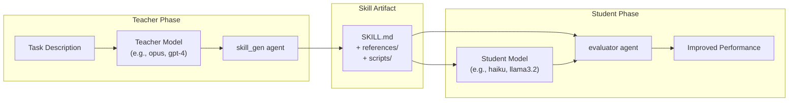
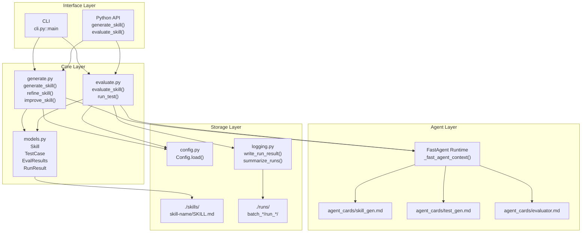
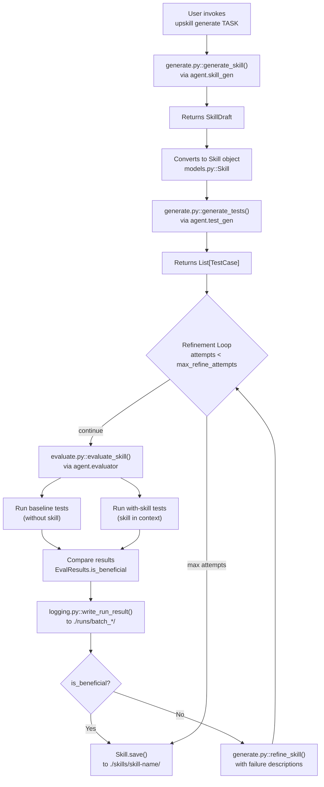
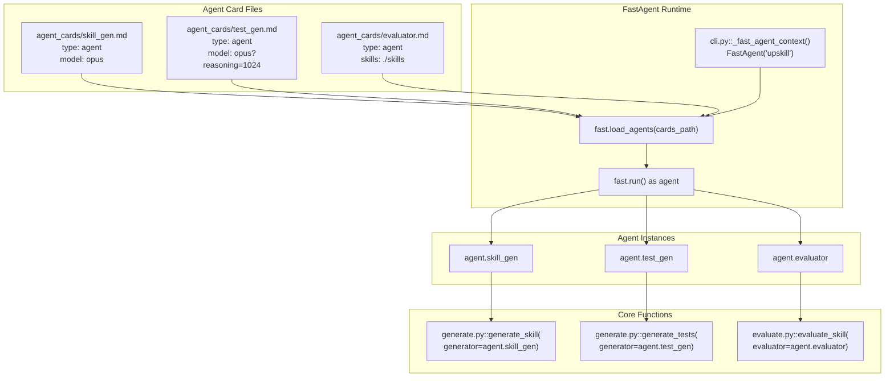
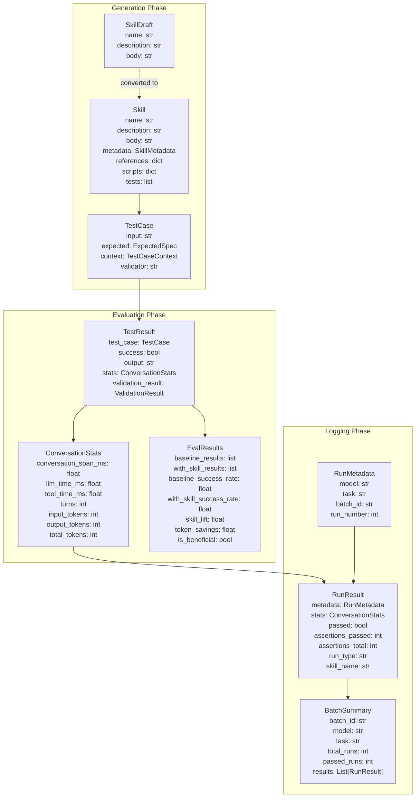
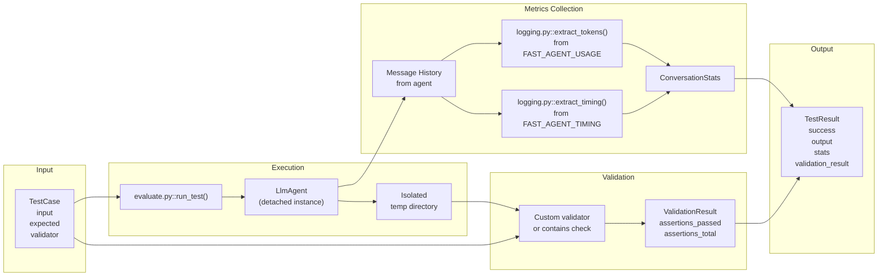
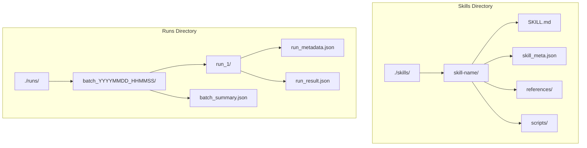
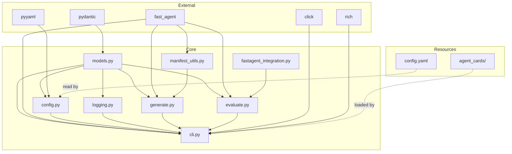

<!-- source: DeepWiki mcp.deepwiki.com · repo huggingface/upskill · page 1 Overview · fetched 2026-10-26 -->

# Overview

<details>
<summary>Relevant source files</summary>

The following files were used as context for generating this wiki page:

- [README.md](README.md)
- [pyproject.toml](pyproject.toml)
- [src/upskill/cli.py](src/upskill/cli.py)
- [tests/test_smoke.py](tests/test_smoke.py)
- [uv.lock](uv.lock)

</details>


## Purpose and Scope

This document provides a high-level introduction to the **upskill** system, a framework for automatically generating and evaluating agent skills using large language models. The system implements a teacher-student paradigm where powerful "teacher models" (e.g., Claude Opus, GPT-4) generate structured skill documents that less capable "student models" (e.g., Claude Haiku, smaller local models) can use to improve their performance on specific tasks.

Upskill enables:
- **Automated skill generation** from task descriptions, examples, or agent traces
- **Systematic evaluation** with baseline comparison and statistical metrics
- **Iterative refinement** through feedback loops
- **Cross-model testing** to validate skill effectiveness on different models
- **Comprehensive logging** for performance analysis and debugging

For detailed information on specific subsystems, see:
- Installation and configuration: [Getting Started](#2)
- Core concepts and terminology: [Core Concepts](#3)
- CLI command reference: [CLI Reference](#4)
- Skill lifecycle workflows: [Skill Lifecycle](#5)
- Data structures: [Data Models Reference](#7)

**Sources**: [README.md:1-514](), [src/upskill/cli.py:1-43](), Diagram 1 and 2 from context

---

## Teacher-Student Model Paradigm

The upskill system is built around the concept that expensive, high-capability models can teach cheaper, faster models to perform specific tasks more effectively. A **teacher model** analyzes a task and generates a skill document (SKILL.md) containing instructions, examples, and guidance. A **student model** then loads this skill into its context when executing tasks, improving success rates and often reducing token usage.



The evaluation system measures skill effectiveness using two key metrics:
- **Skill lift**: percentage improvement in success rate (must exceed 5% for acceptance)
- **Token savings**: reduction in token usage (must exceed 20% if success rate doesn't improve significantly)

A skill is considered **beneficial** if `lift > 5%` OR `(lift >= 0 AND token_savings > 20%)`.

**Sources**: [README.md:5-6](), [src/upskill/models.py:270-307](), Diagram 2 from context

---

## System Architecture

### Component Overview

The upskill system has a layered architecture with four main layers:



**Sources**: [src/upskill/cli.py:49-66](), [src/upskill/generate.py](), [src/upskill/evaluate.py](), [src/upskill/models.py](), Diagram 1 from context

### Key Code Entities

| Layer | Component | Primary Code Entities | Purpose |
|-------|-----------|----------------------|---------|
| **Interface** | CLI | `cli.py::main()`, `cli.py::generate()`, `cli.py::eval_cmd()` | Command-line interface |
| | Python API | `generate.py::generate_skill()`, `evaluate.py::evaluate_skill()` | Programmatic access |
| **Core** | Generation | `generate.py::generate_skill()`, `generate.py::refine_skill()` | Skill creation and improvement |
| | Evaluation | `evaluate.py::evaluate_skill()`, `evaluate.py::run_test()` | Performance testing |
| | Data Models | `models.py::Skill`, `models.py::TestCase`, `models.py::EvalResults` | Data structures |
| **Agent** | FastAgent | `cli.py::_fast_agent_context()`, `fast.run()` | Agent orchestration |
| | Agent Cards | `agent_cards/skill_gen.md`, `agent_cards/test_gen.md`, `agent_cards/evaluator.md` | Agent definitions |
| **Storage** | Configuration | `config.py::Config`, `Config.load()` | System settings |
| | Logging | `logging.py::create_batch_folder()`, `logging.py::write_run_result()` | Run tracking |
| | Persistence | `Skill.save()`, `Skill.load()` | Skill storage |

**Sources**: [src/upskill/cli.py:162-254](), [src/upskill/generate.py](), [src/upskill/evaluate.py](), [src/upskill/models.py](), [src/upskill/config.py](), [src/upskill/logging.py]()

---

## Main Workflows

### Skill Generation and Evaluation Flow



**Sources**: [src/upskill/cli.py:256-536](), [src/upskill/generate.py:60-134](), [src/upskill/evaluate.py:140-204](), Diagram 2 from context

### Agent Card System

The system uses declarative YAML-frontmatter markdown files to define specialized agents:



**Sources**: [src/upskill/cli.py:49-66](), [src/upskill/generate.py](), [src/upskill/evaluate.py](), Diagram 3 from context

---

## Data Models

### Core Data Structures

The system defines several Pydantic models in `models.py` that represent the data flowing through the system:



**Sources**: [src/upskill/models.py:1-307](), Diagram 4 from context

### Key Model Relationships

| Model | Purpose | Key Fields | Created By |
|-------|---------|------------|------------|
| `Skill` | Complete skill artifact | `name`, `body`, `references`, `scripts` | `generate.py::generate_skill()` |
| `TestCase` | Individual test specification | `input`, `expected`, `validator` | `generate.py::generate_tests()` |
| `EvalResults` | Comparison of baseline vs with-skill | `skill_lift`, `token_savings`, `is_beneficial` | `evaluate.py::evaluate_skill()` |
| `ConversationStats` | Detailed execution metrics | `llm_time_ms`, `total_tokens`, `tool_calls` | `logging.py::extract_stats()` |
| `RunResult` | Single evaluation run record | `metadata`, `stats`, `passed` | CLI during evaluation |
| `BatchSummary` | Aggregated batch results | `total_runs`, `passed_runs`, `results` | `logging.py::write_batch_summary()` |

**Sources**: [src/upskill/models.py:31-307](), [src/upskill/logging.py:96-270]()

---

## Evaluation and Metrics System

### Test Execution Pipeline



**Sources**: [src/upskill/evaluate.py:50-204](), [src/upskill/logging.py:96-216](), Diagram 6 from context

### Metrics Calculation

The system tracks comprehensive metrics during evaluation:

| Metric | Calculation | Purpose |
|--------|-------------|---------|
| **conversation_span_ms** | Total time from first to last message | Overall execution time |
| **llm_time_ms** | Sum of LLM call durations | Time spent in model inference |
| **tool_time_ms** | Sum of tool execution durations | Time spent in tool/MCP calls |
| **turns** | Count of conversation turns | Interaction complexity |
| **input_tokens** | Sum from FAST_AGENT_USAGE | Input cost estimation |
| **output_tokens** | Sum from FAST_AGENT_USAGE | Output cost estimation |
| **total_tokens** | input_tokens + output_tokens | Total cost estimation |
| **skill_lift** | `(with_skill_rate - baseline_rate) / baseline_rate` | Performance improvement |
| **token_savings** | `(baseline_tokens - with_skill_tokens) / baseline_tokens` | Efficiency gain |

The **is_beneficial** decision logic is implemented in [src/upskill/models.py:297-307]():

```python
@property
def is_beneficial(self) -> bool:
    """Skill is beneficial if it improves success rate by >5% OR maintains/improves 
    success while saving >20% tokens."""
    lift = self.skill_lift
    savings = self.token_savings
    
    # Significant success improvement
    if lift > 0.05:
        return True
    
    # Maintains success with significant token savings
    if lift >= 0 and savings > 0.20:
        return True
    
    return False
```

**Sources**: [src/upskill/models.py:212-307](), [src/upskill/logging.py:96-216](), Diagram 6 from context

---

## Storage and Persistence

### Directory Structure



Skills are saved using `Skill.save()` [src/upskill/models.py:100-139]() and loaded using `Skill.load()` [src/upskill/models.py:141-186]().

Run results are logged using functions in `logging.py`:
- `create_batch_folder()` [src/upskill/logging.py:27-47]() creates timestamped batch directories
- `create_run_folder()` [src/upskill/logging.py:50-60]() creates individual run directories
- `write_run_result()` [src/upskill/logging.py:80-93]() writes JSON result files
- `write_batch_summary()` [src/upskill/logging.py:273-282]() writes aggregate batch statistics

**Sources**: [src/upskill/models.py:100-186](), [src/upskill/logging.py:27-282](), [README.md:356-370](), Diagram 4 from context

---

## Dependencies and External Systems

### Core Dependencies

| Dependency | Purpose | Usage |
|------------|---------|-------|
| **fast-agent-mcp** | Agent orchestration, LLM providers, MCP support | Core runtime for executing agents |
| **pydantic** | Data validation and serialization | All data models in `models.py` |
| **click** | CLI framework | Command definitions in `cli.py` |
| **rich** | Terminal output formatting | Progress display, tables, panels |
| **pyyaml** | Configuration parsing | `config.yaml` and agent card frontmatter |

### Module Dependency Graph



The system integrates with FastAgent through:
1. **Context manager**: `_fast_agent_context()` [src/upskill/cli.py:49-66]() initializes FastAgent and loads agent cards
2. **Agent instances**: Accessed via `agent.skill_gen`, `agent.test_gen`, `agent.evaluator`
3. **Skill composition**: `compose_instruction()` in `fastagent_integration.py` formats skills for agent consumption
4. **Message channels**: Uses `FAST_AGENT_USAGE` and `FAST_AGENT_TIMING` for metrics extraction

**Sources**: [pyproject.toml:1-38](), [src/upskill/cli.py:49-66](), Diagram 5 from context

---

## Configuration System

The system uses two configuration files:

### upskill Configuration

`~/.config/upskill/config.yaml` or `./upskill.config.yaml`:

```yaml
model: sonnet                    # Default generation model
eval_model: haiku               # Default evaluation model (optional)
skills_dir: ./skills            # Where to save skills
runs_dir: ./runs                # Where to save run logs
max_refine_attempts: 3          # Refinement iterations
```

Loaded via `Config.load()` [src/upskill/config.py:21-58]()

### FastAgent Configuration

`./fastagent.config.yaml`:

```yaml
default_model: sonnet

logger:
  progress_display: true
  show_chat: false
  streaming: markdown

# MCP servers (optional)
mcp:
  servers:
    fetch:
      command: "uvx"
      args: ["mcp-server-fetch"]
```

FastAgent automatically loads this configuration when initialized.

**Sources**: [src/upskill/config.py:1-70](), [README.md:374-423]()

---

## Summary

The upskill system provides a complete framework for automatically generating, evaluating, and refining agent skills. Its architecture separates concerns across four layers (interface, core, agent, storage) while maintaining clear data flow through well-defined Pydantic models. The teacher-student paradigm enables powerful models to create skills that improve the performance of less capable models, with comprehensive evaluation metrics ensuring skills provide measurable benefits.

Key architectural patterns:
- **Agent card declarative configuration** for flexible model substitution
- **Detached agent instances** for isolated test execution
- **Comprehensive metrics extraction** from FastAgent message channels
- **Iterative refinement loops** with plateau detection
- **Structured persistence** with both skill artifacts and evaluation logs

The system's modular design supports both CLI and programmatic usage, making it suitable for interactive development as well as automated pipelines.

**Sources**: All diagrams and sections above

---

