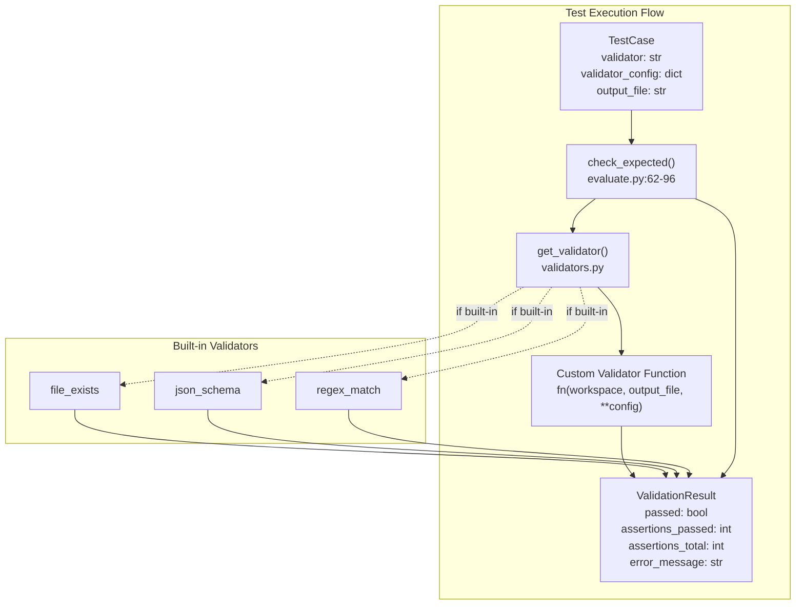
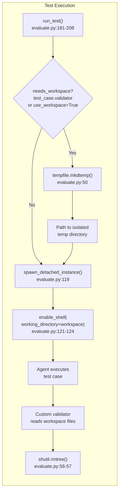
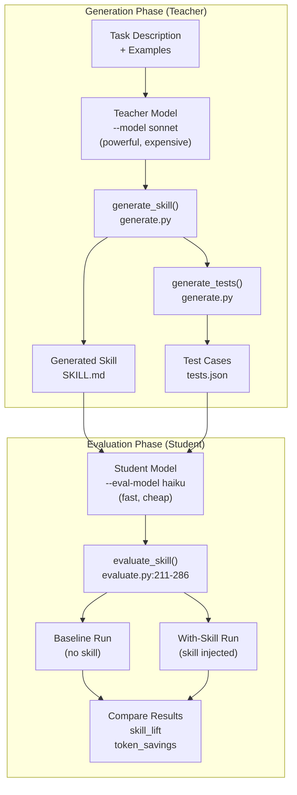
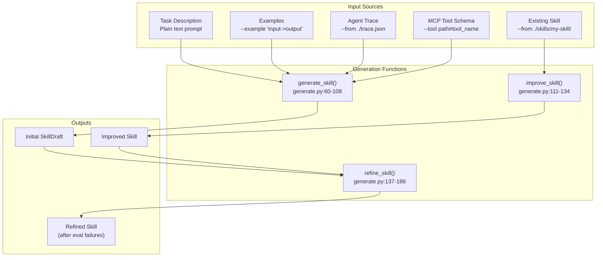
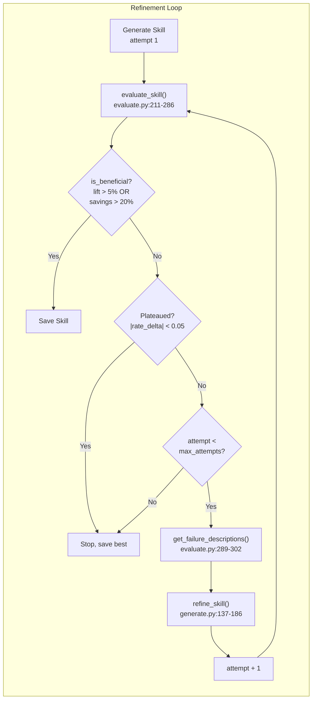

<!-- source: DeepWiki mcp.deepwiki.com · repo huggingface/upskill · page 10 Advanced Topics · fetched 2026-10-26 -->

# Advanced Topics

<details>
<summary>Relevant source files</summary>

The following files were used as context for generating this wiki page:

- [README.md](README.md)
- [src/upskill/cli.py](src/upskill/cli.py)
- [src/upskill/evaluate.py](src/upskill/evaluate.py)
- [tests/test_smoke.py](tests/test_smoke.py)

</details>


This page covers advanced features and techniques for maximizing the effectiveness of upskill. These topics build on the core concepts and workflows described in earlier sections.

**Scope:** This page focuses on four advanced capabilities:
1. Creating custom validation functions for complex test scenarios
2. Understanding workspace isolation for file-based operations
3. Evaluating skills across different models (teacher/student paradigm)
4. Strategies for generating more effective skills through refinement

For basic skill generation and evaluation workflows, see [Skill Lifecycle](#5). For the Python API, see [Python API](#9).

---

## Custom Validators

Custom validators enable complex validation logic beyond simple string matching. They are useful for file-based outputs, structured data validation, or domain-specific checks.

### Validator Architecture



**Sources:** [src/upskill/evaluate.py:62-96](), [src/upskill/evaluate.py:79-89](), [src/upskill/models.py:98-107]()

### Validator Function Signature

A custom validator must accept these parameters:

| Parameter | Type | Description |
|-----------|------|-------------|
| `workspace` | `Path` | Isolated temporary directory for the test run |
| `output_file` | `str` | Expected output file name (from `TestCase.output_file`) |
| `**config` | `dict` | Additional configuration from `TestCase.validator_config` |

And return a `ValidationResult`:

```python
ValidationResult(
    passed: bool,
    assertions_passed: int,
    assertions_total: int,
    error_message: str | None = None
)
```

### Example: File Content Validator

```python
from pathlib import Path
from upskill.models import ValidationResult

def validate_file_content(
    workspace: Path,
    output_file: str,
    expected_lines: int = None,
    required_text: list[str] = None,
    **kwargs
) -> ValidationResult:
    """Validate that output file exists and contains expected content."""
    file_path = workspace / output_file
    
    if not file_path.exists():
        return ValidationResult(
            passed=False,
            assertions_passed=0,
            assertions_total=2 if required_text else 1,
            error_message=f"File {output_file} not found in workspace"
        )
    
    content = file_path.read_text()
    assertions_passed = 1  # File exists
    assertions_total = 1
    
    # Check line count
    if expected_lines is not None:
        assertions_total += 1
        if len(content.splitlines()) >= expected_lines:
            assertions_passed += 1
    
    # Check required text
    if required_text:
        assertions_total += len(required_text)
        for text in required_text:
            if text in content:
                assertions_passed += 1
    
    passed = assertions_passed == assertions_total
    return ValidationResult(
        passed=passed,
        assertions_passed=assertions_passed,
        assertions_total=assertions_total,
        error_message=None if passed else "Content validation failed"
    )
```

### Test Case Configuration

```json
{
  "input": "Generate a report on sales data",
  "expected": {"contains": ["report", "generated"]},
  "validator": "validate_file_content",
  "output_file": "sales_report.txt",
  "validator_config": {
    "expected_lines": 10,
    "required_text": ["Total Sales", "Summary"]
  }
}
```

**Sources:** [src/upskill/models.py:47-72](), [src/upskill/evaluate.py:79-89]()

---

## Workspace Isolation

Workspace isolation provides each test execution with an isolated temporary directory, preventing interference between tests and enabling file-based operations.

### Workspace Lifecycle



**Sources:** [src/upskill/evaluate.py:39-60](), [src/upskill/evaluate.py:99-178]()

### Workspace Features

#### Automatic Activation

The workspace is automatically created when:
- A `TestCase` specifies a custom `validator` field
- The `use_workspace=True` parameter is explicitly passed to `run_test()`

```python
# Workspace automatically enabled for custom validators
test_case = TestCase(
    input="Create a data file",
    expected={"contains": ["created"]},
    validator="file_exists",  # Triggers workspace
    output_file="data.json"
)
```

#### Shell Runtime Integration

When a workspace is active, the agent's shell runtime (if enabled) is configured to use the workspace as its working directory:

```python
# From evaluate.py:121-124
if workspace is not None:
    enable_shell = getattr(clone, "enable_shell", None)
    shell_enabled = getattr(clone, "shell_runtime_enabled", False)
    if shell_enabled and callable(enable_shell):
        enable_shell(working_directory=workspace)
```

This means any file operations performed by the agent (shell commands, script execution) happen in the isolated workspace.

**Sources:** [src/upskill/evaluate.py:114-124]()

#### Cleanup Behavior

By default, workspaces are cleaned up after test execution:

```python
# From isolated_workspace context manager
@contextmanager
def isolated_workspace(
    base_dir: Path | None = None,
    cleanup: bool = True  # Default: cleanup
) -> Generator[Path]:
    workspace = tempfile.mkdtemp(dir=base_dir, prefix="upskill_run_")
    workspace_path = Path(workspace)
    try:
        yield workspace_path
    finally:
        if cleanup:
            shutil.rmtree(workspace_path, ignore_errors=True)
```

Set `cleanup=False` during debugging to inspect workspace contents after test execution.

**Sources:** [src/upskill/evaluate.py:39-59]()

### Workspace Directory Structure

Each workspace is a unique temporary directory:

```
/tmp/upskill_run_<random>/
├── <files created by agent>
├── <files from test_case.context.files>
└── <output_file validated by custom validator>
```

**Sources:** [src/upskill/evaluate.py:50]()

---

## Cross-Model Evaluation

Cross-model evaluation enables the teacher/student paradigm: use a powerful model to generate skills, then evaluate how well those skills work on less capable (cheaper/faster) models.

### Teacher-Student Architecture



**Sources:** [src/upskill/cli.py:256-536](), [src/upskill/evaluate.py:211-286]()

### CLI Usage

```bash
# Generate with teacher model, evaluate on student model
upskill generate "write git commits" \
    --model sonnet \
    --eval-model haiku

# Multiple student models
upskill generate "parse JSON" \
    --model opus \
    --eval-model haiku

# Then benchmark across models
upskill eval ./skills/json-parsing/ \
    -m haiku \
    -m sonnet \
    -m gpt-4o
```

### Implementation Details

The cross-model evaluation flow occurs in two phases within the `generate` command:

#### Phase 1: Generation and Initial Evaluation (Teacher Model)

```python
# From cli.py:305-331
skill = await generate_skill(
    task=task,
    examples=examples,
    generator=agent.skill_gen,
    model=model,  # Teacher model
)

test_cases = await generate_tests(
    task, 
    generator=agent.test_gen, 
    model=model  # Teacher model
)

# Initial evaluation on teacher model
results = await evaluate_skill(
    skill,
    test_cases=test_cases,
    evaluator=agent.evaluator,
    model=gen_model,  # Teacher model
)
```

**Sources:** [src/upskill/cli.py:305-368]()

#### Phase 2: Cross-Model Evaluation (Student Model)

```python
# From cli.py:441-513
if eval_model:
    console.print(f"Evaluating on {eval_model}...", style="dim")
    
    eval_results = await evaluate_skill(
        skill,
        test_cases,
        evaluator=agent.evaluator,
        model=eval_model,  # Student model
    )
    
    # Compare performance
    lift = eval_results.skill_lift
    console.print(
        f"  {eval_results.baseline_success_rate:.0%} -> "
        f"{eval_results.with_skill_success_rate:.0%} ({lift_str})"
    )
```

**Sources:** [src/upskill/cli.py:441-513]()

### Run Logging for Cross-Model Evaluation

Each evaluation creates separate run folders in the batch:

```
./runs/batch_20250121_153045/
├── run_1/          # Teacher baseline
├── run_2/          # Teacher with-skill
├── run_3/          # Student baseline (if --eval-model)
└── run_4/          # Student with-skill (if --eval-model)
```

The `RunMetadata` and `RunResult` for each run record the model used:

```json
{
  "model": "haiku",
  "task": "write git commits",
  "run_number": 3
}
```

**Sources:** [src/upskill/cli.py:469-506](), [src/upskill/models.py:252-268]()

### Metric Comparison

| Metric | Description | Interpretation |
|--------|-------------|----------------|
| `skill_lift` | `(with_skill_rate - baseline_rate) / baseline_rate` | Percentage improvement in success rate |
| `token_savings` | `(baseline_tokens - with_skill_tokens) / baseline_tokens` | Percentage reduction in token usage |
| `is_beneficial` | `lift > 5% OR (lift >= 0 AND savings > 20%)` | Whether skill is worth keeping |

A skill is considered beneficial if it either:
- Improves success rate by more than 5%, OR
- Maintains success rate while reducing tokens by more than 20%

**Sources:** [src/upskill/models.py:270-307]()

---

## Skill Improvement Strategies

Effective skills require thoughtful generation and iterative refinement. This section covers best practices for creating high-quality skills.

### Input Sources for Skill Generation



**Sources:** [src/upskill/generate.py:60-186](), [src/upskill/cli.py:230-303]()

### Strategy 1: Task Descriptions with Examples

Provide concrete input/output examples to guide skill generation:

```bash
upskill generate "write git commit messages" \
    -e "add login button -> feat(ui): add login button to header" \
    -e "fix null pointer -> fix(api): handle null response in user service" \
    -e "update docs -> docs: clarify authentication requirements"
```

The examples are formatted and passed to the skill generator:

```python
# From cli.py:326-331
skill = await generate_skill(
    task=task,
    examples=examples,  # List of example strings
    generator=agent.skill_gen,
    model=model,
)
```

**Sources:** [src/upskill/cli.py:169-170](), [src/upskill/generate.py:60-108]()

### Strategy 2: Learning from Agent Traces

Generate skills from successful agent execution traces:

```bash
# Capture agent trace (JSON or markdown)
./my_agent > trace.json

# Generate skill from trace
upskill generate "document the problem-solving approach" \
    --from ./trace.json
```

The trace content is automatically detected and parsed:

```python
# From cli.py:286-303
if from_trace:
    trace_path = Path(from_trace)
    with open(trace_path, encoding="utf-8") as f:
        trace_content = f.read()
    
    # Parse JSON if possible
    if trace_path.suffix.lower() == ".json":
        try:
            trace_data = json.loads(trace_content)
            trace_context = json.dumps(trace_data, indent=2)[:4000]
        except json.JSONDecodeError:
            trace_context = trace_content[:4000]
    
    # Append to task
    task = f"{task}\n\nBased on this agent trace:\n\n{trace_context}"
```

**Sources:** [src/upskill/cli.py:286-303]()

### Strategy 3: Iterative Refinement

Skills are automatically refined based on evaluation failures:



**Sources:** [src/upskill/cli.py:339-439](), [src/upskill/generate.py:137-186]()

The refinement loop implementation:

```python
# From cli.py:339-439
prev_success_rate = 0.0
attempts = max(1, config.max_refine_attempts)

for attempt in range(attempts):
    results = await evaluate_skill(
        skill,
        test_cases=test_cases,
        evaluator=agent.evaluator,
        model=gen_model,
    )
    
    if results.is_beneficial:
        # Success!
        break
    
    # Check for plateau
    if abs(results.with_skill_success_rate - prev_success_rate) < 0.05:
        console.print("Plateaued, stopping")
        break
    
    prev_success_rate = results.with_skill_success_rate
    
    if attempt < attempts - 1:
        # Extract failure descriptions
        failures = get_failure_descriptions(results)
        
        # Refine skill based on failures
        skill = await refine_skill(
            skill,
            failures,
            generator=agent.skill_gen,
            model=model,
        )
```

**Sources:** [src/upskill/cli.py:339-439]()

### Strategy 4: Improving Existing Skills

Enhance existing skills with new requirements:

```bash
# Add error handling examples
upskill generate "add more error cases" \
    --from ./skills/api-client/

# Make more concise
upskill generate "reduce to essential points only" \
    --from ./skills/my-skill/ \
    -o ./skills/my-skill-v2/
```

The `improve_skill` function preserves the skill structure while incorporating new instructions:

```python
# From generate.py:111-134
async def improve_skill(
    existing_skill: Skill,
    instructions: str,
    generator: LlmAgent,
    model: str | None = None,
) -> Skill:
    """Improve an existing skill based on instructions."""
    if model is not None:
        await generator.set_model(model)
    
    prompt = f"""Improve this skill based on these instructions: {instructions}

Existing skill:
{existing_skill.to_manifest_text()}

Return an improved version of the skill that incorporates the instructions while preserving what works."""
    
    response = await generator.send(prompt)
    # ... parse and return improved skill
```

**Sources:** [src/upskill/generate.py:111-134](), [src/upskill/cli.py:312-323]()

### Configuration Parameters

| Parameter | Default | Purpose |
|-----------|---------|---------|
| `max_refine_attempts` | 3 | Maximum refinement iterations |
| `plateau_threshold` | 0.05 | Success rate change to detect plateau |
| `min_skill_lift` | 0.05 | Minimum lift for "beneficial" (5%) |
| `min_token_savings` | 0.20 | Minimum savings for "beneficial" (20%) |

Configure in `~/.config/upskill/config.yaml`:

```yaml
max_refine_attempts: 5  # More refinement attempts
```

**Sources:** [src/upskill/config.py:1-57](), [src/upskill/models.py:270-307]()

---

## Performance Optimization Tips

### 1. Parallel Test Execution

Tests within a single evaluation run execute in parallel:

```python
# From evaluate.py:235-250
async def _run_batch(instruction: str | None, label: str) -> list[TestResult]:
    tasks = []
    for index, tc in enumerate(test_cases, start=1):
        instance_name = f"{evaluator.name}[{label}-{index}]"
        tasks.append(
            _run_test_with_evaluator(
                tc, evaluator, instruction, instance_name=instance_name
            )
        )
    return await asyncio.gather(*tasks)  # Parallel execution
```

**Sources:** [src/upskill/evaluate.py:235-250]()

### 2. Detached Agent Instances

Each test runs in a detached agent instance to prevent interference:

```python
# From evaluate.py:119
clone = await evaluator.spawn_detached_instance(name=instance_name)
```

This ensures tests don't share message history or state.

**Sources:** [src/upskill/evaluate.py:119]()

### 3. Workspace Cleanup

Disable cleanup during debugging to inspect workspace contents:

```python
from upskill.evaluate import isolated_workspace

with isolated_workspace(cleanup=False) as workspace:
    # Test execution
    print(f"Workspace: {workspace}")
    # Directory persists after test
```

**Sources:** [src/upskill/evaluate.py:39-59]()

### 4. Selective Baseline Runs

Skip baseline comparison when benchmarking:

```bash
# Faster evaluation, no baseline
upskill eval ./skills/my-skill/ --no-baseline
```

**Sources:** [src/upskill/cli.py:636](), [src/upskill/evaluate.py:216]()

---

## Advanced Example: File Processing Skill

Combining multiple advanced features:

```bash
# 1. Generate from trace with examples
upskill generate "process CSV files" \
    --from ./trace_csv_processing.json \
    -e "parse users.csv -> extract email addresses" \
    -e "validate data.csv -> check all required columns"

# 2. Evaluate with custom validator and workspace
upskill eval ./skills/process-csv/ \
    --tests ./csv_tests.json \
    --model sonnet \
    --eval-model haiku

# 3. Benchmark across models
upskill benchmark ./skills/process-csv/ \
    -m haiku \
    -m sonnet \
    -m gpt-4o \
    --runs 5
```

Test case with custom validator:

```json
{
  "input": "Process the sales data and generate a summary report",
  "expected": {"contains": ["processing", "complete"]},
  "validator": "validate_csv_output",
  "output_file": "summary.csv",
  "validator_config": {
    "expected_columns": ["Date", "Total", "Count"],
    "min_rows": 1
  },
  "context": {
    "files": {
      "sales.csv": "Date,Product,Amount\n2025-01-01,Widget,100\n2025-01-02,Gadget,150"
    }
  }
}
```

**Sources:** [src/upskill/models.py:47-72](), [src/upskill/evaluate.py:62-96]()

---

