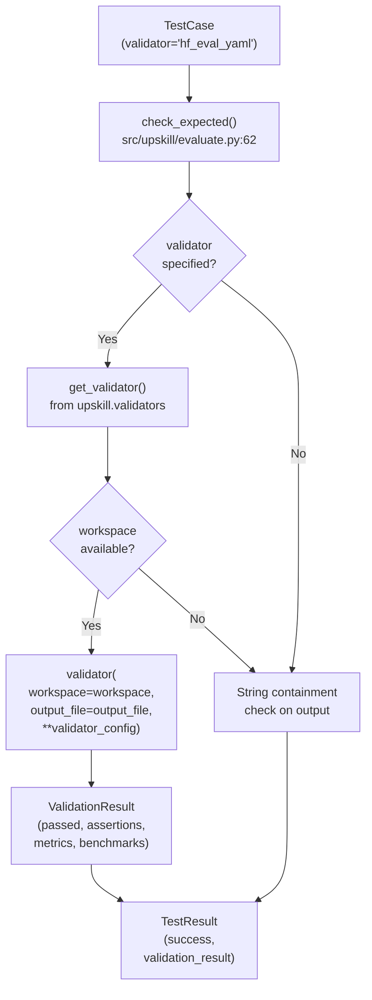
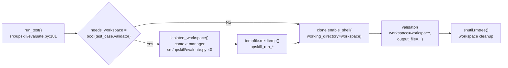
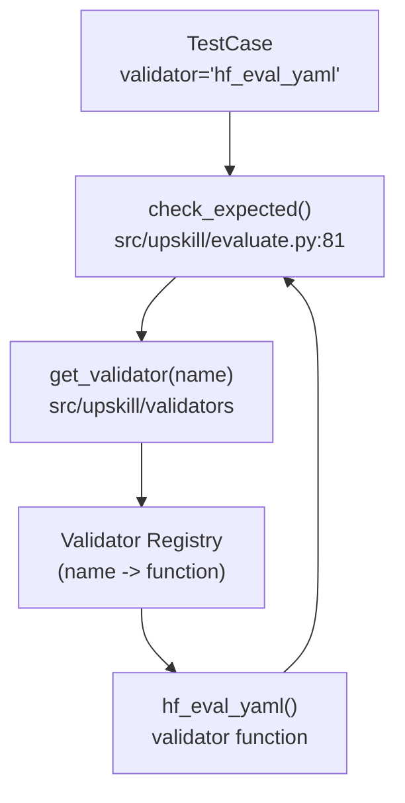
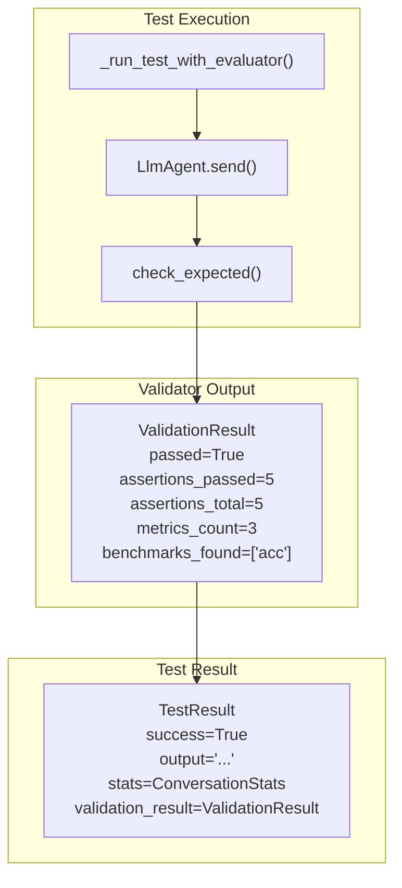

<!-- source: DeepWiki mcp.deepwiki.com · repo huggingface/upskill · page 10.1 Custom Validators · fetched 2026-10-26 -->

# Custom Validators

<details>
<summary>Relevant source files</summary>

The following files were used as context for generating this wiki page:

- [src/upskill/evaluate.py](src/upskill/evaluate.py)
- [src/upskill/models.py](src/upskill/models.py)

</details>


Custom validators provide a mechanism for defining complex validation logic beyond simple string containment checks. They enable file-based validation, assertion counting, metrics extraction, and benchmark detection for test cases that require domain-specific evaluation criteria. For information about basic test case validation using string containment, see [Test Cases and Validation](#3.2). For details on workspace isolation used with validators, see [Workspace Isolation](#10.2).

---

## Purpose and Use Cases

The default validation mechanism checks if the agent's text output contains specific substrings (via `ExpectedSpec.contains`). Custom validators extend this by:

- **File-based validation**: Validating agent-generated files rather than terminal output
- **Structured assertions**: Counting passed/failed assertions with detailed reporting
- **Metrics extraction**: Extracting numeric metrics from output files (e.g., benchmark scores)
- **Format validation**: Checking YAML structure, JSON schemas, or other file formats
- **Multi-file validation**: Validating relationships between multiple generated files

Custom validators are essential when evaluating skills that produce structured artifacts rather than simple text responses.

**Sources:** [src/upskill/models.py:59-72](), [src/upskill/evaluate.py:62-96]()

---

## Validator Function Interface

Custom validators are Python functions registered by name through the `get_validator` lookup system. Each validator follows a standardized interface that receives workspace context and returns structured results.

### Function Signature

```python
def my_validator(
    workspace: Path,
    output_file: str,
    **config: str | int | float | bool
) -> ValidationResult:
    """
    Args:
        workspace: Path to isolated workspace directory
        output_file: Relative path to file being validated
        **config: Validator-specific configuration parameters
    
    Returns:
        ValidationResult with pass/fail status and metrics
    """
```

### Core Components

| Component | Type | Purpose |
|-----------|------|---------|
| `workspace` | `Path` | Isolated temporary directory for test execution |
| `output_file` | `str` | Path to primary file for validation (relative to workspace) |
| `**config` | `dict` | Custom parameters from `TestCase.validator_config` |
| Returns | `ValidationResult` | Structured validation outcome with metrics |

### ValidationResult Structure

The return type encapsulates all validation outcomes:

```python
class ValidationResult(BaseModel):
    passed: bool                        # Overall pass/fail status
    assertions_passed: int              # Number of successful assertions
    assertions_total: int               # Total assertions evaluated
    metrics_count: int = 0              # Number of metrics extracted
    benchmarks_found: list[str] = []    # Detected benchmark names
    error_message: str | None = None    # Failure explanation
```

**Sources:** [src/upskill/models.py:25-33](), [src/upskill/evaluate.py:79-89]()

---

## Validator Execution Flow



**Validator Execution Flow**: Shows how custom validators are invoked during test case evaluation with workspace isolation.

**Sources:** [src/upskill/evaluate.py:62-96](), [src/upskill/evaluate.py:142-155]()

---

## Specifying Validators in Test Cases

Test cases reference validators by name and provide configuration through three dedicated fields:

### TestCase Validator Fields

```python
class TestCase(BaseModel):
    input: str
    expected: ExpectedSpec
    
    # Custom validator configuration
    validator: str | None = None            # Validator name lookup key
    output_file: str | None = None          # File path to validate
    validator_config: dict[...] | None = None  # Validator parameters
```

### Example: YAML Validation Test Case

```json
{
  "input": "Generate eval.yaml with accuracy metric",
  "expected": {"contains": ["accuracy"]},
  "validator": "hf_eval_yaml",
  "output_file": "eval.yaml",
  "validator_config": {
    "min_metrics": 3,
    "require_benchmarks": true
  }
}
```

### Field Usage Patterns

| Field | Purpose | Example |
|-------|---------|---------|
| `validator` | Identifies validator function | `"hf_eval_yaml"`, `"json_schema"` |
| `output_file` | Specifies validation target | `"results.json"`, `"config.yaml"` |
| `validator_config` | Passes custom parameters | `{"min_score": 0.8}` |

The `output_file` path is always relative to the isolated workspace directory created for the test execution.

**Sources:** [src/upskill/models.py:59-72](), [src/upskill/evaluate.py:84-88]()

---

## Workspace Integration

Custom validators automatically trigger workspace isolation to ensure file operations don't interfere with the system:

### Automatic Workspace Creation



**Workspace Isolation for Validators**: Shows automatic workspace creation when validators are specified.

### Workspace Lifecycle

1. **Detection**: Workspace isolation enabled when `test_case.validator` is set [src/upskill/evaluate.py:114]()
2. **Creation**: Temporary directory created via `isolated_workspace()` context manager [src/upskill/evaluate.py:40-59]()
3. **Shell Configuration**: Agent's shell runtime pointed to workspace directory [src/upskill/evaluate.py:120-124]()
4. **Validator Execution**: Validator receives workspace `Path` object [src/upskill/evaluate.py:84-88]()
5. **Cleanup**: Workspace deleted after test completion [src/upskill/evaluate.py:55-59]()

### Accessing Generated Files

Validators use the workspace path to construct full file paths:

```python
def my_validator(workspace: Path, output_file: str, **config) -> ValidationResult:
    # Resolve output file relative to workspace
    file_path = workspace / output_file
    
    if not file_path.exists():
        return ValidationResult(
            passed=False,
            assertions_passed=0,
            assertions_total=1,
            error_message=f"Output file not found: {output_file}"
        )
    
    content = file_path.read_text()
    # Perform validation...
```

**Sources:** [src/upskill/evaluate.py:114-124](), [src/upskill/evaluate.py:40-59](), [src/upskill/evaluate.py:175-178]()

---

## Writing Custom Validators

### Basic Validator Structure

A well-structured validator follows this pattern:

```python
from pathlib import Path
from upskill.models import ValidationResult

def example_validator(
    workspace: Path,
    output_file: str,
    min_lines: int = 10,
    **config
) -> ValidationResult:
    """
    Validates that output file meets minimum line count.
    
    Args:
        workspace: Isolated workspace directory
        output_file: File to validate (relative path)
        min_lines: Minimum required lines (default 10)
    """
    assertions_total = 2
    assertions_passed = 0
    
    # Assertion 1: File exists
    file_path = workspace / output_file
    if not file_path.exists():
        return ValidationResult(
            passed=False,
            assertions_passed=0,
            assertions_total=assertions_total,
            error_message=f"File not found: {output_file}"
        )
    assertions_passed += 1
    
    # Assertion 2: Line count threshold
    lines = file_path.read_text().splitlines()
    if len(lines) >= min_lines:
        assertions_passed += 1
    
    return ValidationResult(
        passed=(assertions_passed == assertions_total),
        assertions_passed=assertions_passed,
        assertions_total=assertions_total,
        metrics_count=1,  # Line count is a metric
        error_message=None if assertions_passed == assertions_total else 
                     f"Expected {min_lines}+ lines, got {len(lines)}"
    )
```

### Error Handling Best Practices

| Scenario | Handling Strategy |
|----------|-------------------|
| Missing file | Return `ValidationResult` with `passed=False` and descriptive `error_message` |
| Invalid format | Catch parsing exceptions, count as failed assertion |
| Config errors | Validate config parameters early, fail gracefully |
| Workspace issues | Check `workspace.exists()` and handle `PermissionError` |

### Assertion Counting

Track assertions to provide detailed feedback:

```python
assertions = []

# Check 1: File existence
assertions.append(file_path.exists())

# Check 2: Valid JSON
try:
    data = json.loads(file_path.read_text())
    assertions.append(True)
except json.JSONDecodeError:
    assertions.append(False)

# Check 3: Required fields
assertions.append("metrics" in data)

passed = all(assertions)
return ValidationResult(
    passed=passed,
    assertions_passed=sum(assertions),
    assertions_total=len(assertions),
    error_message=None if passed else "Validation checks failed"
)
```

**Sources:** [src/upskill/models.py:25-33]()

---

## Validator Registration

Validators must be registered with the `get_validator` lookup function to be accessible by name:



**Validator Lookup System**: Shows how validator names are resolved to functions.

The registration mechanism is implemented in the `upskill.validators` module (imported at [src/upskill/evaluate.py:29]()). While the specific implementation isn't visible in the provided sources, validators are looked up by string name and must return callable functions matching the validator interface.

**Sources:** [src/upskill/evaluate.py:29](), [src/upskill/evaluate.py:81]()

---

## Integration with Test Results

Custom validators produce enhanced test results with detailed validation metrics:

### TestResult with Validation Data



**Validation Results in Test Execution**: Shows how ValidationResult integrates into TestResult.

### TestResult Structure

```python
class TestResult(BaseModel):
    test_case: TestCase
    success: bool                                    # Overall test success
    output: str | None                               # Agent's text output
    tokens_used: int                                 # Token consumption
    turns: int                                       # Conversation turns
    error: str | None                                # Error message if failed
    stats: ConversationStats                         # Detailed metrics
    validation_result: ValidationResult | None       # Custom validator results
```

The `success` field is set to `validation_result.passed` when a custom validator is used [src/upskill/evaluate.py:143-159](). This ensures that custom validation logic determines test success rather than simple string matching.

**Sources:** [src/upskill/models.py:314-327](), [src/upskill/evaluate.py:157-165]()

---

## Validator Examples and Patterns

### Pattern 1: YAML Structure Validation

```python
def yaml_structure_validator(
    workspace: Path,
    output_file: str,
    required_keys: list[str] = None,
    **config
) -> ValidationResult:
    """Validates YAML file structure and required keys."""
    import yaml
    
    required_keys = required_keys or []
    file_path = workspace / output_file
    
    assertions = []
    
    # File existence
    assertions.append(file_path.exists())
    if not file_path.exists():
        return ValidationResult(
            passed=False,
            assertions_passed=0,
            assertions_total=len(required_keys) + 1,
            error_message=f"YAML file not found: {output_file}"
        )
    
    # Valid YAML
    try:
        data = yaml.safe_load(file_path.read_text())
        assertions.append(True)
    except yaml.YAMLError as e:
        return ValidationResult(
            passed=False,
            assertions_passed=1,
            assertions_total=len(required_keys) + 2,
            error_message=f"Invalid YAML: {e}"
        )
    
    # Required keys
    for key in required_keys:
        assertions.append(key in data)
    
    passed = all(assertions)
    return ValidationResult(
        passed=passed,
        assertions_passed=sum(assertions),
        assertions_total=len(assertions),
        metrics_count=len(data),
        error_message=None if passed else f"Missing keys: {required_keys}"
    )
```

### Pattern 2: Multi-File Validation

```python
def multi_file_validator(
    workspace: Path,
    output_file: str,
    additional_files: list[str] = None,
    **config
) -> ValidationResult:
    """Validates multiple related files."""
    additional_files = additional_files or []
    all_files = [output_file] + additional_files
    
    assertions = []
    
    # Check all files exist
    for fname in all_files:
        assertions.append((workspace / fname).exists())
    
    # Example: Check consistency between files
    if all(assertions):
        main_content = (workspace / output_file).read_text()
        # Perform cross-file validation...
        assertions.append(True)  # Consistency check
    
    passed = all(assertions)
    return ValidationResult(
        passed=passed,
        assertions_passed=sum(assertions),
        assertions_total=len(assertions),
        metrics_count=len(all_files)
    )
```

### Pattern 3: Benchmark Extraction

```python
def benchmark_extractor_validator(
    workspace: Path,
    output_file: str,
    min_score: float = 0.0,
    **config
) -> ValidationResult:
    """Extracts and validates benchmark scores."""
    import json
    
    file_path = workspace / output_file
    
    if not file_path.exists():
        return ValidationResult(
            passed=False,
            assertions_passed=0,
            assertions_total=1,
            error_message="Benchmark file not found"
        )
    
    data = json.loads(file_path.read_text())
    
    benchmarks_found = []
    assertions = [True]  # File exists
    
    # Extract benchmarks
    for key, value in data.items():
        if isinstance(value, (int, float)):
            benchmarks_found.append(key)
            if value >= min_score:
                assertions.append(True)
            else:
                assertions.append(False)
    
    passed = all(assertions)
    return ValidationResult(
        passed=passed,
        assertions_passed=sum(assertions),
        assertions_total=len(assertions),
        metrics_count=len(benchmarks_found),
        benchmarks_found=benchmarks_found,
        error_message=None if passed else f"Some scores below {min_score}"
    )
```

**Sources:** [src/upskill/models.py:25-33]()

---

## Best Practices Summary

| Practice | Rationale |
|----------|-----------|
| **Use workspace-relative paths** | Ensures portability across test environments |
| **Count all assertions** | Provides granular failure diagnostics |
| **Return descriptive error messages** | Aids in skill refinement and debugging |
| **Handle missing files gracefully** | Prevents validator crashes |
| **Extract metrics when possible** | Enables quantitative analysis of results |
| **Validate config parameters** | Prevents runtime errors from malformed configs |
| **Use type hints** | Improves code documentation and IDE support |
| **Document expected file formats** | Helps test case authors understand requirements |

Custom validators transform test evaluation from simple output matching into comprehensive artifact validation, enabling sophisticated skill evaluation scenarios that go far beyond text output comparison.

**Sources:** [src/upskill/evaluate.py:62-96](), [src/upskill/models.py:25-33](), [src/upskill/models.py:59-72]()

---

