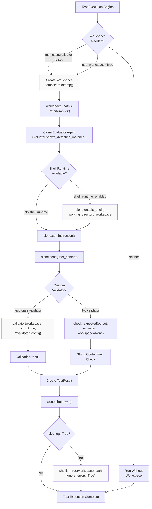
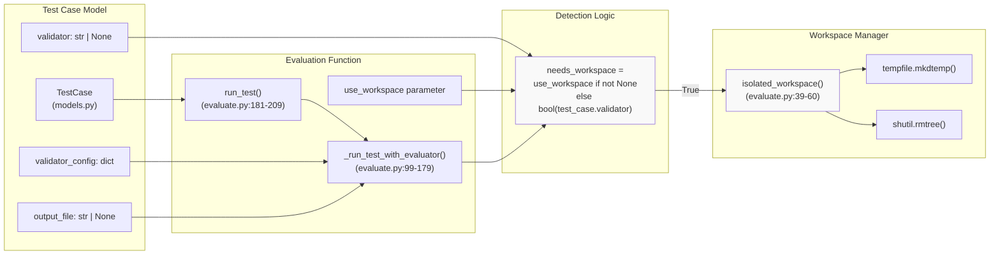
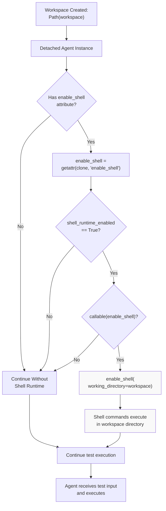
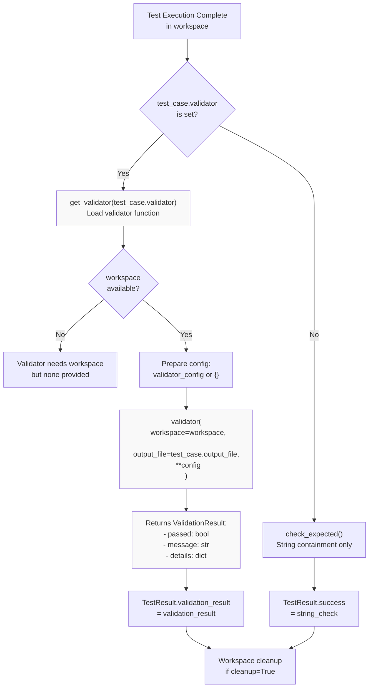
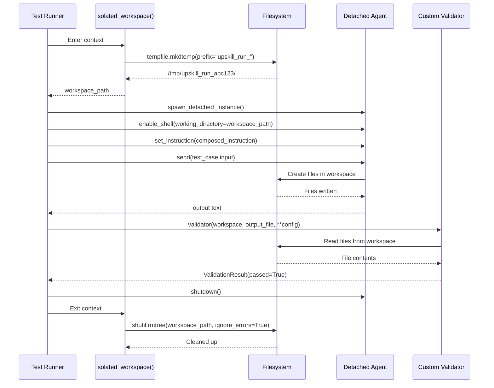
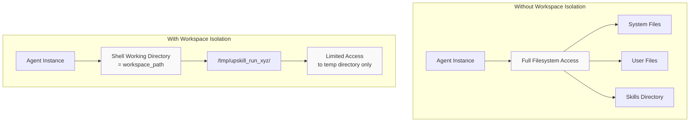
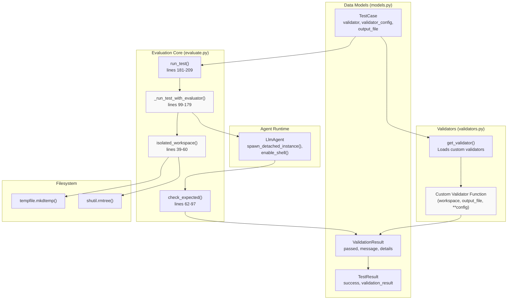

<!-- source: DeepWiki mcp.deepwiki.com · repo huggingface/upskill · page 10.2 Workspace Isolation · fetched 2026-10-26 -->

# Workspace Isolation

<details>
<summary>Relevant source files</summary>

The following files were used as context for generating this wiki page:

- [src/upskill/evaluate.py](src/upskill/evaluate.py)

</details>


## Purpose and Scope

This document explains how the upskill system uses isolated temporary workspaces to ensure reproducible and secure test execution. Workspace isolation is automatically applied when test cases require file-based operations or custom validators that need to interact with the filesystem.

For information about custom validators themselves, see [Custom Validators](#10.1). For details on test case structure and validation, see [Test Cases and Validation](#3.2). For the overall evaluation process, see [Skill Evaluation](#5.3).

---

## Overview

Workspace isolation provides each test execution with its own temporary directory, ensuring that:
- File operations from different tests don't interfere with each other
- Tests run in a clean environment without residual state
- Security boundaries prevent unintended filesystem access
- Test results are reproducible across multiple runs

The system automatically detects when workspace isolation is needed and creates/manages temporary directories with optional cleanup.

**Sources:** [src/upskill/evaluate.py:39-60]()

---

## The `isolated_workspace()` Context Manager

The core of workspace isolation is the `isolated_workspace()` context manager, which handles the entire lifecycle of temporary workspaces.

### Function Signature and Behavior

```python
@contextmanager
def isolated_workspace(base_dir: Path | None = None, cleanup: bool = True) -> Generator[Path]
```

| Parameter | Type | Default | Purpose |
|-----------|------|---------|---------|
| `base_dir` | `Path \| None` | `None` | Parent directory for workspace creation (uses system temp if None) |
| `cleanup` | `bool` | `True` | Whether to remove workspace after use |

The context manager:
1. Creates a temporary directory using `tempfile.mkdtemp()` with prefix `upskill_run_`
2. Yields the workspace path for use within the context
3. Cleans up the workspace on exit if `cleanup=True`
4. Ignores cleanup errors to prevent test failures from filesystem issues

**Sources:** [src/upskill/evaluate.py:39-60]()

---

## Workspace Lifecycle

The following diagram illustrates the complete lifecycle of an isolated workspace during test execution:

### Workspace Lifecycle Diagram



**Sources:** [src/upskill/evaluate.py:99-179]()

---

## Automatic Workspace Detection

The system automatically determines when workspace isolation is needed based on test case configuration. The detection logic is implemented in the `_run_test_with_evaluator()` function.

### Detection Logic

```python
needs_workspace = use_workspace if use_workspace is not None else bool(test_case.validator)
```

| Condition | Workspace Created | Reason |
|-----------|------------------|---------|
| `use_workspace=True` | Yes | Explicit override |
| `use_workspace=False` | No | Explicit override |
| `use_workspace=None` and `test_case.validator` is set | Yes | Custom validator likely needs filesystem access |
| `use_workspace=None` and no validator | No | Simple string-based validation sufficient |

### Code Entity Mapping



**Sources:** [src/upskill/evaluate.py:113-114](), [src/upskill/models.py]()

---

## Shell Runtime Integration

When a workspace is created and the evaluator agent has shell runtime capabilities, the workspace is configured as the working directory for shell commands. This enables test cases to perform file operations naturally.

### Shell Enablement Process

The following code segment from `_run_test_with_evaluator()` shows the integration:

```python
if workspace is not None:
    enable_shell = getattr(clone, "enable_shell", None)
    shell_enabled = getattr(clone, "shell_runtime_enabled", False)
    if shell_enabled and callable(enable_shell):
        enable_shell(working_directory=workspace)
```

### Shell Integration Flow



**Sources:** [src/upskill/evaluate.py:120-124]()

---

## Custom Validator Integration

Custom validators receive the workspace path as a parameter, enabling them to inspect files created during test execution. This is the primary use case for workspace isolation.

### Validator Function Contract

Custom validators must accept the following parameters:

| Parameter | Type | Purpose |
|-----------|------|---------|
| `workspace` | `Path` | Directory where test execution occurred |
| `output_file` | `str` | Expected output filename (from `test_case.output_file`) |
| `**config` | `dict` | Additional configuration from `test_case.validator_config` |

### Validation Flow with Workspace



**Sources:** [src/upskill/evaluate.py:79-90](), [src/upskill/evaluate.py:142-155]()

---

## Example: File-Based Test Execution

This diagram shows how a test case that creates files is executed with workspace isolation:



**Sources:** [src/upskill/evaluate.py:116-178]()

---

## Security and Isolation Benefits

Workspace isolation provides several important guarantees for test execution:

### Isolation Guarantees

| Aspect | Without Isolation | With Isolation |
|--------|------------------|----------------|
| **File Conflicts** | Tests may read/write same files | Each test has unique directory |
| **State Pollution** | Previous test artifacts affect current test | Clean environment per test |
| **Parallel Execution** | Race conditions on shared files | Safe concurrent execution |
| **Security Boundaries** | Agent can access entire filesystem | Agent confined to workspace directory |
| **Reproducibility** | Results depend on prior test state | Consistent results across runs |

### Security Model



**Note:** The isolation is enforced through shell working directory configuration. Agents with explicit filesystem tools may still access paths outside the workspace if not properly constrained.

**Sources:** [src/upskill/evaluate.py:39-60](), [src/upskill/evaluate.py:120-124]()

---

## Configuration and Control

### Explicit Workspace Control

You can override the automatic detection by specifying `use_workspace` in the `run_test()` function:

```python
# Force workspace creation even without validator
result = await run_test(
    test_case=test_case,
    evaluator=agent,
    skill=skill,
    use_workspace=True  # Explicit override
)

# Disable workspace even with validator (not recommended)
result = await run_test(
    test_case=test_case,
    evaluator=agent,
    skill=skill,
    use_workspace=False  # Explicit override
)
```

### Cleanup Control

The `isolated_workspace()` context manager accepts a `cleanup` parameter:

```python
with isolated_workspace(cleanup=False) as workspace:
    # Workspace persists after context exit for debugging
    result = await _run_in_workspace(workspace)
    print(f"Workspace retained at: {workspace}")
```

This is useful for:
- Debugging test failures by inspecting workspace contents
- Development and troubleshooting
- Capturing test artifacts

### Custom Base Directory

You can specify a custom parent directory for workspaces:

```python
with isolated_workspace(base_dir=Path("/custom/temp")) as workspace:
    # Creates /custom/temp/upskill_run_xxx/
    result = await _run_in_workspace(workspace)
```

**Sources:** [src/upskill/evaluate.py:39-60](), [src/upskill/evaluate.py:181-209]()

---

## Integration Points

### Code Entities Involved in Workspace Isolation



**Sources:** [src/upskill/evaluate.py](), [src/upskill/models.py](), [src/upskill/validators.py]()

---

## Best Practices

### When to Use Workspace Isolation

| Scenario | Use Workspace | Reason |
|----------|---------------|--------|
| **File output validation** | Yes | Validator needs to inspect created files |
| **Multi-file operations** | Yes | Agent creates/modifies multiple files |
| **Shell command execution** | Yes | Confine shell operations to isolated directory |
| **Simple text output** | No | String containment check sufficient |
| **Parallel test execution** | Yes | Prevent race conditions |
| **Development/debugging** | Yes (with `cleanup=False`) | Inspect workspace after test |

### Custom Validator Design

When designing custom validators that use workspaces:

1. **Always accept workspace parameter**: Your validator signature should include `workspace: Path`
2. **Handle missing files gracefully**: Check if expected files exist before reading
3. **Return meaningful ValidationResult**: Include details about what was checked
4. **Don't modify workspace**: Validators should be read-only
5. **Use relative paths**: Construct file paths relative to workspace

Example validator signature:
```python
def my_validator(
    workspace: Path,
    output_file: str,
    expected_lines: int = 0,
    **kwargs
) -> ValidationResult:
    file_path = workspace / output_file
    if not file_path.exists():
        return ValidationResult(
            passed=False,
            message=f"Expected file {output_file} not found",
            details={"workspace": str(workspace)}
        )
    # ... validation logic
```

### Error Handling

The workspace cleanup is wrapped in try-except to prevent cleanup failures from affecting test results:

```python
if cleanup:
    try:
        shutil.rmtree(workspace_path, ignore_errors=True)
    except Exception:
        pass  # Ignore cleanup errors
```

This ensures that:
- Test results are recorded even if cleanup fails
- Filesystem permission errors don't cause test failures
- Temporary files may persist on cleanup failure (OS will eventually clean up)

**Sources:** [src/upskill/evaluate.py:54-59](), [src/upskill/evaluate.py:79-90]()

---

## Summary

Workspace isolation is a critical feature that ensures test execution reliability and security. The system automatically creates isolated temporary directories when needed, configures agent shell runtimes to use these workspaces, and enables custom validators to inspect file-based outputs. The cleanup mechanism ensures resources are freed while gracefully handling errors to maintain test result integrity.

Key takeaways:
- Workspace isolation is automatic when `test_case.validator` is set
- Each workspace is a unique temporary directory with prefix `upskill_run_`
- Shell runtime working directory is set to workspace when available
- Custom validators receive workspace path for file inspection
- Cleanup is automatic but can be disabled for debugging
- Parallel test execution is safe with workspace isolation

**Sources:** [src/upskill/evaluate.py:39-209]()

---

