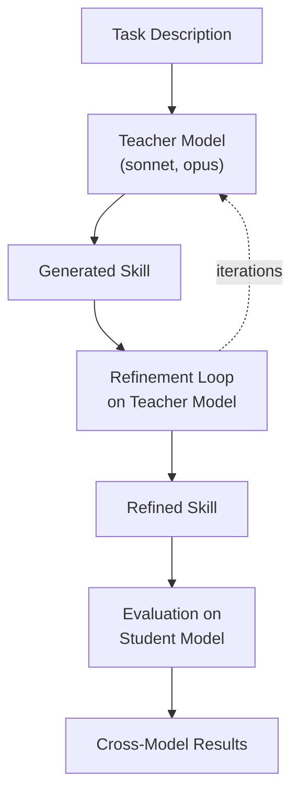
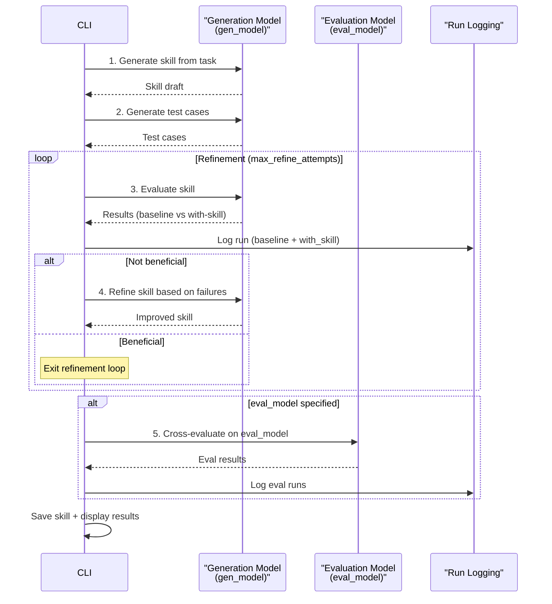
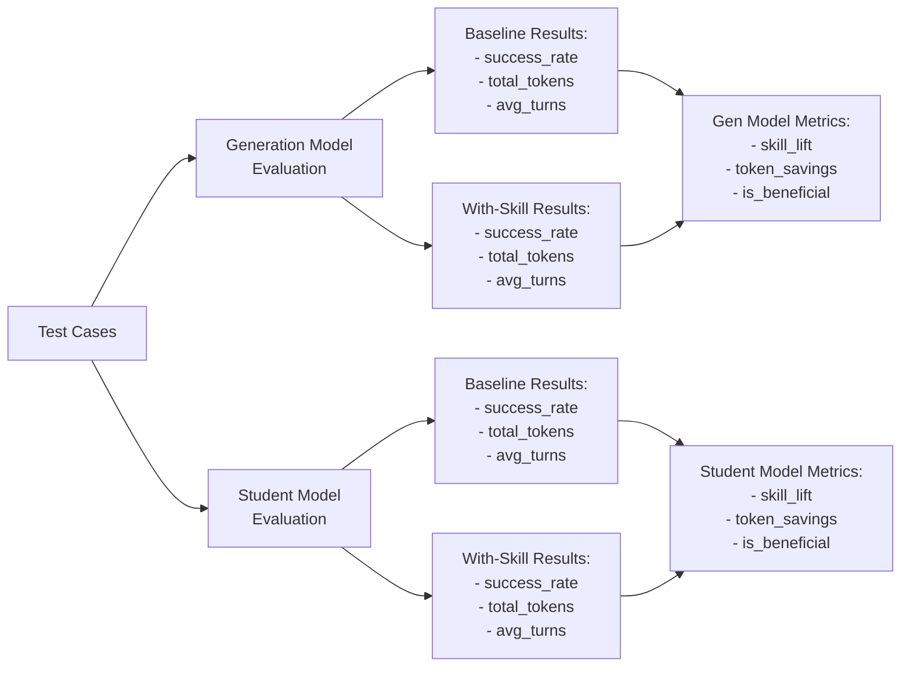
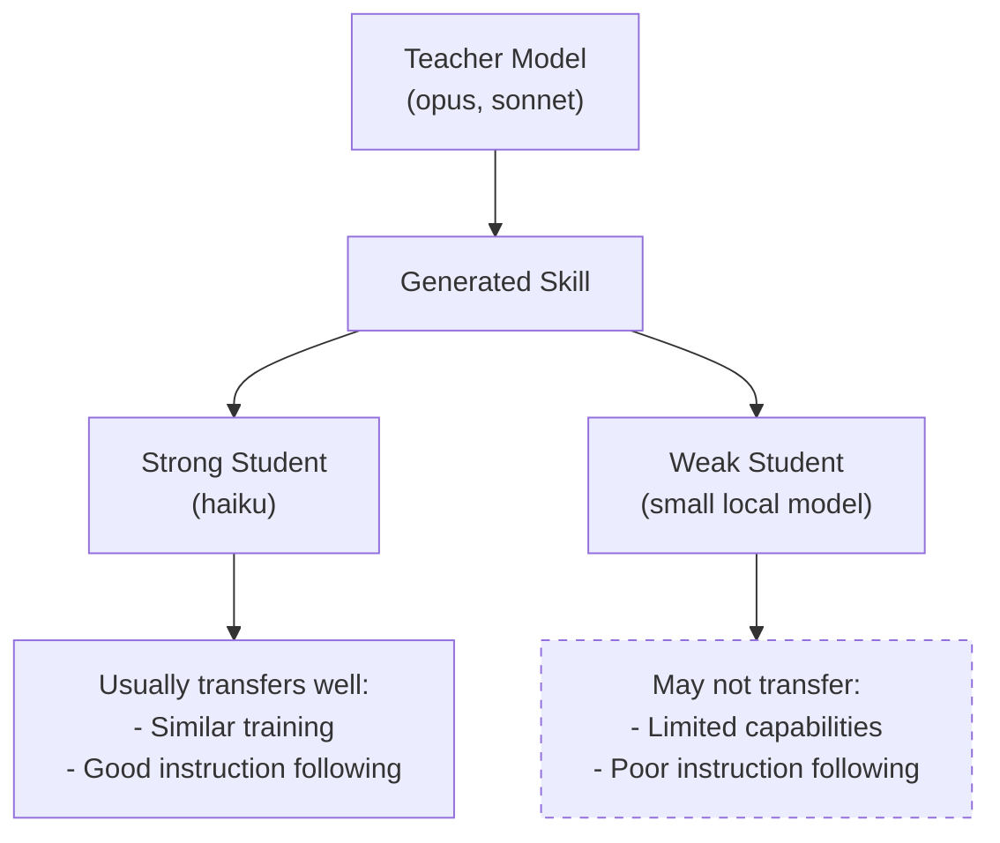

<!-- source: DeepWiki mcp.deepwiki.com · repo huggingface/upskill · page 10.3 Cross-Model Evaluation · fetched 2026-10-26 -->

# Cross-Model Evaluation

<details>
<summary>Relevant source files</summary>

The following files were used as context for generating this wiki page:

- [README.md](README.md)
- [src/upskill/cli.py](src/upskill/cli.py)
- [src/upskill/config.py](src/upskill/config.py)
- [tests/test_smoke.py](tests/test_smoke.py)

</details>


## Purpose and Scope

This page describes the cross-model evaluation feature, which allows skills to be generated with one model and evaluated on a different model. This enables a "teacher-student" workflow where powerful models create skills that less capable models can use to improve their performance.

For general skill evaluation concepts and metrics, see [Evaluation Metrics](#3.3). For the `upskill eval` command which also supports multi-model evaluation, see [upskill eval](#4.2). For the overall evaluation process, see [Skill Evaluation](#5.3).

---

## Overview

Cross-model evaluation enables testing whether skills generated by one model can successfully improve the performance of a different model. This is implemented through the `--eval-model` option in the `upskill generate` command, which triggers an additional evaluation phase after skill generation and refinement.

**Key Concept**: A skill generated by a "teacher" model (expensive, powerful) is evaluated on a "student" model (cheap, fast) to verify that the skill transfers and provides measurable benefit.

**Sources**: [src/upskill/cli.py:186](), [src/upskill/cli.py:441-513](), [README.md:26-29]()

---

## Teacher-Student Model Paradigm

The cross-model evaluation feature implements the teacher-student paradigm where:

| Role | Characteristics | Examples |
|------|----------------|----------|
| **Teacher Model** | Expensive, powerful, used for skill generation | `opus`, `sonnet`, `gpt-4o` |
| **Student Model** | Cheap, fast, consumes generated skills | `haiku`, `gpt-4o-mini`, local models |

### Workflow Pattern



**Diagram**: Teacher-student workflow with cross-model evaluation

The teacher model generates and refines the skill until it meets quality criteria, then the skill is evaluated on the student model to verify transferability.

**Sources**: [src/upskill/cli.py:256-536](), [README.md:1-5]()

---

## Using Cross-Model Evaluation

### Command Line Usage

The `--eval-model` option triggers cross-model evaluation during skill generation:

```bash
# Generate with sonnet, evaluate on haiku
upskill generate "parse JSON files" --model sonnet --eval-model haiku

# Generate with opus, evaluate on local model
upskill generate "write git commits" --model opus \
    --eval-model llama3.2:latest \
    --eval-base-url http://localhost:11434/v1

# Using default generation model from config
upskill generate "handle API errors" --eval-model haiku
```

### Option Details

| Option | Description | Example |
|--------|-------------|---------|
| `--model` | Model for skill generation | `sonnet`, `opus` |
| `--eval-model` | Model for cross-evaluation | `haiku`, `gpt-4o-mini` |
| `--eval-provider` | API provider for eval model | `anthropic`, `openai`, `generic` |
| `--eval-base-url` | Custom endpoint for eval model | `http://localhost:11434/v1` |

**Sources**: [src/upskill/cli.py:168-188](), [README.md:58-90]()

---

## Evaluation Workflow

### Generation and Refinement Phase



**Diagram**: Cross-model evaluation sequence in generate command

### Implementation Details

The cross-model evaluation workflow is implemented in [src/upskill/cli.py:256-536]():

1. **Generation Phase** (lines 283-331): Skill is generated using `gen_model`
2. **Refinement Loop** (lines 339-440): Skill is evaluated and refined on `gen_model` until beneficial or plateau detected
3. **Cross-Evaluation Phase** (lines 441-513): If `eval_model` is specified, skill is evaluated on the different model
4. **Result Logging** (lines 469-506): Separate run results are logged for the eval model

**Sources**: [src/upskill/cli.py:256-536](), [src/upskill/cli.py:441-513]()

---

## Run Logging and Results

### Run Directory Structure

Cross-model evaluation creates separate run folders for each model:

```
./runs/batch_20250121_153045/
├── run_1/                          # Baseline (generation model, attempt 1)
│   ├── run_metadata.json
│   └── run_result.json
├── run_2/                          # With skill (generation model, attempt 1)
│   ├── run_metadata.json
│   └── run_result.json
├── run_3/                          # Baseline (generation model, attempt 2)
│   └── ...
├── run_4/                          # With skill (generation model, attempt 2)
│   └── ...
├── run_5/                          # Baseline (evaluation model)
│   ├── run_metadata.json
│   └── run_result.json
├── run_6/                          # With skill (evaluation model)
│   ├── run_metadata.json
│   └── run_result.json
└── batch_summary.json              # Aggregate results
```

### Run Metadata Structure

Each run folder contains metadata identifying the model used:

```json
{
  "model": "haiku",              // eval_model
  "task": "parse JSON files",
  "batch_id": "batch_20250121_153045",
  "run_number": 5
}
```

The `run_type` field in `run_result.json` indicates whether it's a "baseline" or "with_skill" run.

**Sources**: [src/upskill/cli.py:446-459](), [src/upskill/cli.py:469-506](), [src/upskill/logging.py:1-102]()

---

## Results Display

### Terminal Output

When cross-model evaluation is enabled, the terminal displays results for both models:

```
Generating skill with sonnet...
Generating test cases...
Evaluating on sonnet... (attempt 1)
  60% -> 100% (+40%) OK

Evaluating on haiku...
  60% -> 80% (+20%)

  parse-json-files
  Parse JSON files safely with proper error handling.

  SKILL.md              ~450 tokens

  sonnet
    baseline   ████████████░░░░░░░░   60%
    with skill ████████████████████  100%  (+40%)

  haiku
    baseline   ████████████░░░░░░░░   60%
    with skill ████████████████░░░░   80%  (+20%)

Saved to ./skills/parse-json-files
```

The output shows:
- Success rates for baseline and with-skill on each model
- Skill lift percentage for each model
- Token metrics (when available)

**Sources**: [src/upskill/cli.py:541-619](), [src/upskill/cli.py:574-590]()

---

## Evaluation Models and Configuration

### Model Specification

Cross-model evaluation supports multiple model types through FastAgent's model format:

| Model Type | Format | Example |
|------------|--------|---------|
| Anthropic alias | `<alias>` | `sonnet`, `haiku`, `opus` |
| Full model name | `<provider>.<model>` | `anthropic.claude-sonnet-4-20250514` |
| OpenAI models | `openai.<model>` | `openai.gpt-4o-mini` |
| Local models | `generic.<model>` | `generic.llama3.2:latest` |

### Configuration Priority

The evaluation model is determined by:

1. Command line `--eval-model` option (highest priority)
2. `config.yaml` `eval_model` setting
3. Command line `--model` option
4. `config.yaml` `model` setting (lowest priority)

```yaml
# ~/.config/upskill/config.yaml
model: sonnet                    # Default generation model
eval_model: haiku               # Default evaluation model
```

**Sources**: [src/upskill/cli.py:269-270](), [src/upskill/config.py:38-94](), [README.md:376-384]()

---

## Cross-Model Evaluation Metrics

### Per-Model Metrics

Cross-model evaluation collects independent metrics for each model:



**Diagram**: Independent metric collection for each model

### Comparative Analysis

The system evaluates whether a skill generated for one model successfully transfers to another:

| Metric | Description | Formula |
|--------|-------------|---------|
| **Gen Model Lift** | Success improvement on generation model | `(with_skill_rate - baseline_rate)` |
| **Student Model Lift** | Success improvement on evaluation model | `(with_skill_rate - baseline_rate)` |
| **Transfer Success** | Whether skill benefits both models | `both models show lift > 0` |

**Sources**: [src/upskill/cli.py:461-513](), [src/upskill/models.py:270-307]()

---

## Use Cases and Best Practices

### When to Use Cross-Model Evaluation

**Recommended scenarios**:
1. **Production Deployment**: Generate with `opus`/`sonnet`, deploy on `haiku` for cost savings
2. **Local Model Optimization**: Generate with API models, evaluate on local models for privacy/latency
3. **Model Migration**: Test if skills from old models work on new models
4. **Skill Portability Testing**: Verify skills generalize across model families

### Example Workflows

**Cost Optimization Workflow**:
```bash
# Generate expensive, high-quality skill with opus
# Verify it works on cheap, fast haiku
upskill generate "complex data extraction" \
    --model opus \
    --eval-model haiku

# If successful, deploy evaluator agent with haiku using this skill
```

**Local Deployment Workflow**:
```bash
# Generate with cloud model
# Test on local model before full deployment
upskill generate "code documentation" \
    --model sonnet \
    --eval-model llama3.2:latest \
    --eval-base-url http://localhost:11434/v1
```

**Sources**: [README.md:26-30](), [README.md:86-90](), [README.md:485-513]()

---

## Limitations and Considerations

### Model Capability Gaps

Skills generated by more capable models may not always transfer to less capable models:



**Diagram**: Skill transfer success depends on student model capability

### Evaluation Considerations

| Factor | Impact | Mitigation |
|--------|--------|-----------|
| **Test Case Complexity** | Complex tests may fail on weaker models regardless of skill | Use graduated test difficulty |
| **Token Budget** | Weaker models may need shorter skills | Monitor token usage per model |
| **Skill Format** | Some models better at following structured instructions | Test skill format variations |
| **Baseline Performance** | Low baseline may indicate task is too hard for student model | Choose appropriate student models |

**Sources**: [src/upskill/cli.py:441-513](), [src/upskill/evaluate.py:140-204]()

---

## Python API Usage

Cross-model evaluation can also be performed programmatically:

```python
from upskill import generate_skill, generate_tests, evaluate_skill, Config

config = Config.load()

# Generate skill with teacher model
skill = await generate_skill(
    task="parse JSON Schema files",
    generator=agent.skill_gen,
    model="sonnet",  # Teacher model
)

# Generate test cases
test_cases = await generate_tests(
    task="parse JSON Schema files",
    generator=agent.test_gen,
    model="sonnet",
)

# Evaluate on teacher model
teacher_results = await evaluate_skill(
    skill,
    test_cases=test_cases,
    evaluator=agent.evaluator,
    model="sonnet",
)

# Cross-evaluate on student model
student_results = await evaluate_skill(
    skill,
    test_cases=test_cases,
    evaluator=agent.evaluator,
    model="haiku",  # Student model
)

# Compare results
print(f"Teacher lift: {teacher_results.skill_lift:.0%}")
print(f"Student lift: {student_results.skill_lift:.0%}")
print(f"Transfer successful: {student_results.is_beneficial}")
```

**Sources**: [src/upskill/cli.py:256-536](), [README.md:424-465]()

---

## Configuration Options Reference

### Command Line Options

| Option | Type | Description | Example |
|--------|------|-------------|---------|
| `--model` | string | Generation model | `--model sonnet` |
| `--eval-model` | string | Cross-evaluation model | `--eval-model haiku` |
| `--eval-provider` | choice | API provider | `--eval-provider anthropic` |
| `--eval-base-url` | url | Custom API endpoint | `--eval-base-url http://localhost:11434/v1` |
| `--no-eval` | flag | Skip all evaluation | `--no-eval` |
| `--log-runs` | flag | Enable run logging (default: on) | `--log-runs` |
| `--runs-dir` | path | Custom runs directory | `--runs-dir ./my-runs` |

### Configuration File Options

```yaml
# ~/.config/upskill/config.yaml
model: sonnet                    # Default generation model
eval_model: haiku               # Default cross-evaluation model
max_refine_attempts: 2          # Refinement iterations before cross-eval
runs_dir: ./runs                # Where to save run logs
```

**Sources**: [src/upskill/cli.py:168-200](), [src/upskill/config.py:38-102](), [README.md:374-384]()

---

