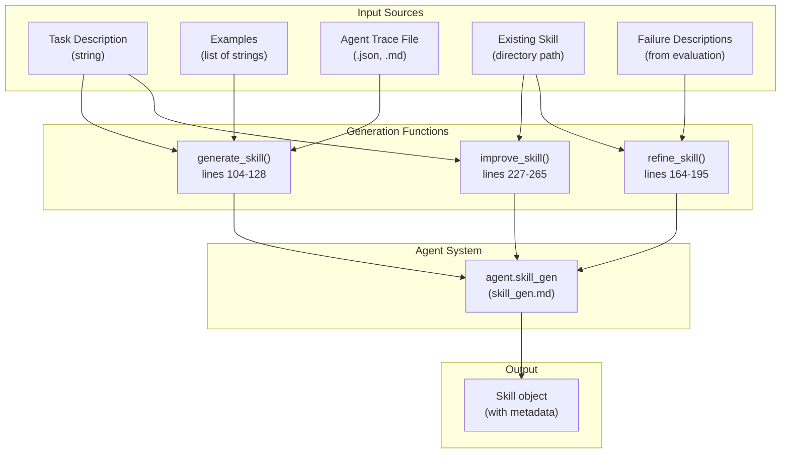
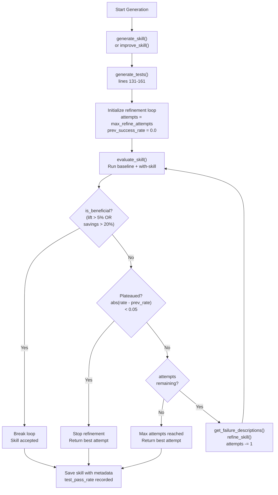
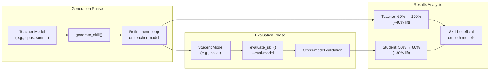

<!-- source: DeepWiki mcp.deepwiki.com · repo huggingface/upskill · page 10.4 Skill Improvement Strategies · fetched 2026-10-26 -->

# Skill Improvement Strategies

<details>
<summary>Relevant source files</summary>

The following files were used as context for generating this wiki page:

- [README.md](README.md)
- [src/upskill/cli.py](src/upskill/cli.py)
- [src/upskill/generate.py](src/upskill/generate.py)
- [tests/test_smoke.py](tests/test_smoke.py)

</details>


This page covers best practices for generating effective skills that demonstrably improve agent performance. It explains the different input strategies for skill generation (task descriptions, examples, traces, existing skills), the iterative refinement loop, and techniques for maximizing skill quality.

For information on the technical evaluation process and metrics calculation, see [Evaluation Metrics](#3.3). For details on the skill generation API, see [Generation API](#9.1). For the complete skill lifecycle, see [Skill Lifecycle](#5).

---

## Overview

The upskill system supports multiple strategies for creating skills, each optimized for different use cases. The most effective approach depends on your starting point and goals:

| Strategy | Use Case | Input Type | Code Entry Point |
|----------|----------|------------|------------------|
| **Task Description** | Creating new skills from scratch | Plain text task description | `generate_skill()` |
| **With Examples** | Providing concrete input/output pairs | Task + example strings | `generate_skill(examples=...)` |
| **From Trace** | Extracting patterns from agent behavior | Agent trace file (JSON/MD) | CLI: `--from trace.json` |
| **Improvement** | Enhancing existing skills | Skill directory + instructions | `improve_skill()` |
| **Refinement** | Fixing evaluation failures | Skill + failure descriptions | `refine_skill()` |

The system automatically applies iterative refinement during generation unless disabled with `--no-eval`, testing the skill against generated test cases and improving it based on failures.

**Sources:** [src/upskill/cli.py:169-253](), [src/upskill/generate.py:104-265](), [README.md:47-112]()

---

## Skill Generation Input Strategies



**Diagram: Skill Generation Input Pathways**

**Sources:** [src/upskill/generate.py:104-265](), [src/upskill/cli.py:230-253]()

---

### Task Description Only

The simplest approach uses only a task description. The `skill_gen` agent generates skill content based on understanding the task requirements.

```bash
upskill generate "write good git commit messages"
```

Implementation uses `generate_skill()` with a formatted prompt:

```python
prompt = f"Create a skill document that teaches an AI agent how to: {task}"
skill_text = await generator.send(prompt)
```

This approach works well for:
- Well-defined tasks with established conventions
- Tasks the teacher model has strong training data for
- Initial skill drafts that will be refined

**Sources:** [src/upskill/generate.py:104-128](), [src/upskill/cli.py:325-331]()

---

### Using Examples

Providing input/output examples significantly improves skill quality by giving concrete demonstrations of desired behavior:

```bash
upskill generate "write git commits" \
    -e "Added login feature -> feat(auth): add password reset functionality" \
    -e "Fixed crash in API -> fix(api): handle null response from user service"
```

Examples are appended to the generation prompt:

```python
if examples:
    prompt += "\n\nExample input/output pairs for this task:\n" + "\n".join(
        f"- {ex}" for ex in examples
    )
```

The `skill_gen` agent uses these examples to:
- Understand the expected format and style
- Extract implicit patterns and conventions
- Generate similar examples in the skill body

**Best practices for examples:**
- Provide 3-5 diverse examples covering different scenarios
- Use actual input/output pairs from your domain
- Include edge cases and common pitfalls
- Format as `"input -> output"` for clarity

**Sources:** [src/upskill/generate.py:112-117](), [src/upskill/cli.py:170]()

---

### Generating from Agent Traces

Agent traces capture real task execution and provide rich context for skill generation:

```bash
upskill generate "document the pattern" --from ./trace.json
```

The CLI auto-detects file vs directory for the `--from` parameter:

```python
source_path = Path(from_source)
if source_path.is_dir():
    from_skill = from_source  # Existing skill to improve
else:
    from_trace = from_source  # Trace file to learn from
```

Trace processing extracts relevant content (truncated to 4000 chars to fit context):

```python
# Try JSON parsing first
if trace_path.suffix.lower() == ".json":
    try:
        trace_data = json.loads(trace_content)
        trace_context = json.dumps(trace_data, indent=2)[:4000]
    except json.JSONDecodeError:
        trace_context = trace_content[:4000]
else:
    # Plain text, markdown, etc.
    trace_context = trace_content[:4000]

task = f"{task}\n\nBased on this agent trace:\n\n{trace_context}"
```

**What makes a good trace:**
- Contains successful task completions with reasoning
- Includes tool calls and their results
- Shows error handling and recovery patterns
- Demonstrates decision-making process
- Has clear input → reasoning → output flow

**Trace formats supported:**
- JSON (parsed and pretty-printed)
- Markdown (used as-is)
- Plain text logs
- FastAgent conversation exports

**Sources:** [src/upskill/cli.py:230-304]()

---

### Improving Existing Skills

The `improve_skill()` function enhances existing skills based on specific improvement instructions:

```bash
upskill generate "add more error handling examples" --from ./skills/api-errors/
upskill generate "make it more concise" -f ./skills/my-skill/
```

Implementation loads the existing skill and applies improvement instructions:

```python
existing_skill = Skill.load(Path(from_skill))
skill = await improve_skill(
    existing_skill,
    instructions=task,
    generator=agent.skill_gen,
    model=model,
)
```

The improvement prompt preserves existing skill structure while addressing specific requests:

```python
IMPROVE_PROMPT = """You are improving an existing skill document for AI agents.

Given the current skill and improvement instructions, create an enhanced version.

## Current Skill

Name: {name}
Description: {description}

Body:
{body}

## Improvement Instructions

{instructions}

## Guidelines

1. Preserve what works well in the original skill
2. Address the specific improvement requests
3. Maintain the same general structure and format
4. Add new examples or sections as needed
5. Keep the skill focused and actionable
"""
```

**Effective improvement instructions:**
- Be specific about what to change: "add 3 examples of handling 429 rate limits"
- Request structural changes: "reorganize into beginner and advanced sections"
- Ask for elaboration: "expand the error handling section with edge cases"
- Request simplification: "make more concise, focus on core concepts"
- Add missing content: "include examples for async operations"

**Sources:** [src/upskill/generate.py:198-265](), [src/upskill/cli.py:312-323]()

---

## Iterative Refinement Loop



**Diagram: Refinement Loop Flow with Code Functions**

The refinement loop automatically improves skills by analyzing evaluation failures and regenerating the skill. This process runs during `upskill generate` unless `--no-eval` is specified.

**Sources:** [src/upskill/cli.py:339-440](), [src/upskill/evaluate.py:215-234]()

---

### Loop Configuration

The refinement loop is controlled by configuration and command-line flags:

| Parameter | Default | Description |
|-----------|---------|-------------|
| `max_refine_attempts` | 3 | Maximum refinement iterations (from config.yaml) |
| `--no-eval` | False | Skip evaluation and refinement entirely |
| Plateau threshold | 0.05 | Success rate change below 5% triggers stop |

Configuration is loaded from `config.yaml`:

```yaml
max_refine_attempts: 3  # Number of refinement iterations
```

The loop tracks state across attempts:

```python
prev_success_rate = 0.0
results = None
attempts = max(1, config.max_refine_attempts)

for attempt in range(attempts):
    console.print(f"Evaluating on {gen_model}... (attempt {attempt + 1})", style="dim")
    
    results = await evaluate_skill(
        skill,
        test_cases=test_cases,
        evaluator=agent.evaluator,
        model=gen_model,
    )
    
    if results.is_beneficial:
        console.print(f"  {results.baseline_success_rate:.0%} -> "
                     f"{results.with_skill_success_rate:.0%} (+{results.skill_lift:.0%}) OK")
        break
```

**Sources:** [src/upskill/cli.py:342-418](), [src/upskill/config.py:1-57]()

---

### Plateau Detection

The system stops refining when successive attempts show minimal improvement, indicating the skill has reached its effectiveness ceiling for the current approach:

```python
if abs(results.with_skill_success_rate - prev_success_rate) < 0.05:
    console.print("  [yellow]Plateaued, stopping[/yellow]")
    break

prev_success_rate = results.with_skill_success_rate
```

**Why plateau detection matters:**
- Prevents wasting tokens on marginal improvements
- Avoids infinite loops on difficult tasks
- Signals when a different strategy is needed (e.g., better examples, different task framing)

When plateau is detected, the system returns the best attempt so far rather than failing completely.

**Sources:** [src/upskill/cli.py:425-429]()

---

### Failure Analysis and Refinement

When a skill fails evaluation, `get_failure_descriptions()` extracts actionable failure information:

```python
failures = get_failure_descriptions(results)
skill = await refine_skill(
    skill,
    failures,
    generator=agent.skill_gen,
    model=model,
)
```

The `refine_skill()` function creates a targeted improvement prompt:

```python
prompt = f"""Improve this skill based on failures:

Name: {skill.name}
Description: {skill.description}
Body: {skill.body[:500]}...

Failures:
{chr(10).join(f"- {f}" for f in failures[:3])}

Output a complete SKILL.md document with YAML frontmatter (name, description) and a markdown body.
Do not wrap the output in code fences.
"""
```

The prompt includes:
- First 500 characters of skill body for context
- Up to 3 failure descriptions (most relevant)
- Instruction to output complete SKILL.md format

**Sources:** [src/upskill/generate.py:164-195](), [src/upskill/evaluate.py:215-234](), [src/upskill/cli.py:432-439]()

---

## Test Case Quality Impact

High-quality test cases are essential for effective skill refinement. The `generate_tests()` function creates test cases using few-shot examples:

```python
TEST_EXAMPLES = """
## Example Test Cases

Task: "Write good git commit messages"

Output:
```json
{
  "cases": [
    {
      "input": "Write a commit message for adding a new login feature",
      "expected": {"contains": ["feat", "login"]}
    },
    {
      "input": "Write a commit message for fixing a null pointer bug in the user service",
      "expected": {"contains": ["fix", "bug"]}
    }
  ]
}
```
"""
```

The system validates test quality:

```python
invalid_expected = 0
for tc in cases:
    expected_values = [value.strip() for value in tc.expected.contains if value.strip()]
    if len(expected_values) < 2:
        invalid_expected += 1

print(f"Generated test cases: total={len(cases)}, invalid_expected={invalid_expected}")
```

**Test case quality requirements:**
- Each test must have at least 2 expected strings (validation requirement)
- Tests should cover diverse scenarios (not just variations of the same pattern)
- Inputs should be realistic and representative
- Expected outputs should be specific enough to validate correctness

**Improving test quality:**
- Review generated tests with `-v` verbose flag
- Provide custom test files with `-t tests.json`
- Ensure test cases actually test the skill's purpose
- Include edge cases and failure scenarios

**Sources:** [src/upskill/generate.py:14-161](), [src/upskill/cli.py:747-758]()

---

## Cross-Model Evaluation Strategy



**Diagram: Teacher-Student Evaluation Strategy**

Using different models for generation and evaluation validates that skills transfer to less capable models:

```bash
upskill generate "write git commits" --model opus --eval-model haiku
```

This strategy is implemented in the CLI's generate flow:

```python
# Generate and refine on teacher model (opus)
skill = await generate_skill(task=task, generator=agent.skill_gen, model=model)

# Eval loop with refinement on generation model
results = await evaluate_skill(skill, test_cases, evaluator=agent.evaluator, model=gen_model)

# If eval_model specified, also eval on that model (student)
if eval_model:
    eval_results = await evaluate_skill(
        skill, test_cases, evaluator=agent.evaluator, model=eval_model
    )
```

**Benefits of cross-model evaluation:**
- Validates skill generalization to cheaper/faster models
- Identifies over-fitting to teacher model capabilities
- Enables cost optimization (generate with opus, deploy with haiku)
- Tests skill robustness across model families

**When to use cross-model evaluation:**
- Production deployment uses different model than generation
- Cost constraints require cheaper inference models
- Validating skills work across model providers
- Testing skill portability

**Sources:** [src/upskill/cli.py:441-513](), [README.md:26-30]()

---

## Best Practices Summary

### Skill Generation Strategy Selection

| Scenario | Recommended Strategy | Example |
|----------|---------------------|---------|
| New skill from scratch | Task + Examples | `upskill generate "parse JSON" -e "..." -e "..."` |
| Learning from traces | Trace-based generation | `upskill generate "..." --from trace.json` |
| Fixing specific issues | Targeted improvement | `upskill generate "add error cases" -f ./skill/` |
| Skill not passing eval | Let refinement loop run | Default behavior (no --no-eval) |
| Initial exploration | Task description only | `upskill generate "task description"` |

### Example Quality Guidelines

Effective examples should:
1. **Be concrete**: Show actual inputs and outputs, not descriptions
2. **Cover diversity**: Different scenarios, not variations of one case
3. **Include edge cases**: Common pitfalls and failure modes
4. **Match format**: Use consistent format like `"input -> output"`
5. **Be realistic**: Represent actual usage, not toy examples

Example of good vs poor examples:

**Good:**
```bash
-e "Added login feature -> feat(auth): add password reset functionality"
-e "Fixed API crash -> fix(api): handle null response from user service"
-e "Updated docs -> docs(readme): add installation instructions"
```

**Poor:**
```bash
-e "Write a commit message for a feature"
-e "Write a commit message for a bug fix"
-e "Write a commit message for documentation"
```

### Refinement Loop Optimization

To maximize refinement effectiveness:
1. **Set appropriate max_refine_attempts**: Default 3 is good for most tasks, increase to 5 for complex skills
2. **Monitor plateau detection**: If consistently plateauing at attempt 1, revisit task description or examples
3. **Review test quality**: Poor tests lead to poor refinement (check with `-v`)
4. **Use cross-model eval**: Validate skills transfer to target deployment model

### Trace-Based Generation Tips

When generating from traces:
1. **Capture complete interactions**: Include inputs, reasoning, tool calls, outputs
2. **Focus on successes**: Use traces where the agent performed well
3. **Provide context**: Add task description explaining what pattern to extract
4. **Truncate appropriately**: System limits to 4000 chars, prioritize key steps
5. **Format for clarity**: JSON for structured data, Markdown for narratives

### Iterative Development Workflow

Recommended workflow for developing high-quality skills:

```bash
# 1. Start with task + examples
upskill generate "task description" -e "example1" -e "example2"

# 2. Review results, identify issues
upskill eval ./skills/task-name/ -v

# 3. Improve based on specific needs
upskill generate "add more error handling" --from ./skills/task-name/

# 4. Validate on target model
upskill eval ./skills/task-name/ --model haiku

# 5. Benchmark across models if needed
upskill benchmark ./skills/task-name/ -m haiku -m sonnet --runs 5
```

### Debugging Poor Skills

If skills consistently fail to improve:
1. **Check test case quality**: Use `-v` to see what tests are checking
2. **Verify task clarity**: Ambiguous tasks lead to inconsistent skills
3. **Review examples**: Ensure they demonstrate the actual pattern
4. **Try trace-based**: Capture a successful execution and generate from it
5. **Adjust target model**: Some tasks require more capable models
6. **Inspect refinement prompts**: Add logging to see what failures are reported

**Sources:** [src/upskill/cli.py:189-253](), [src/upskill/generate.py:104-265](), [README.md:47-112]()

---

