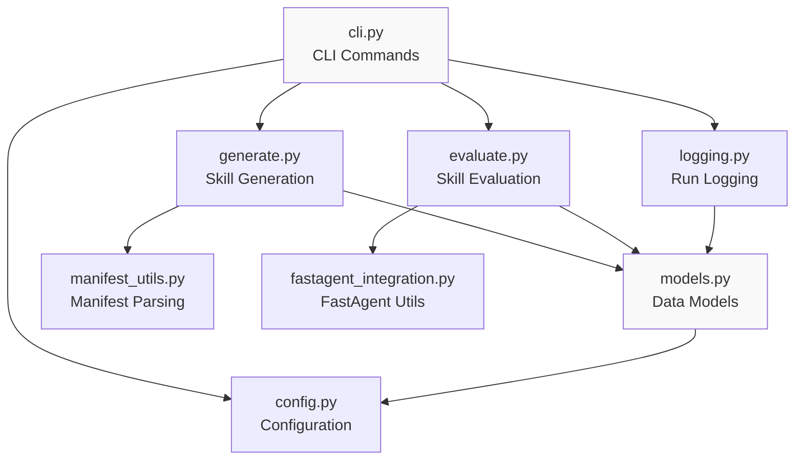
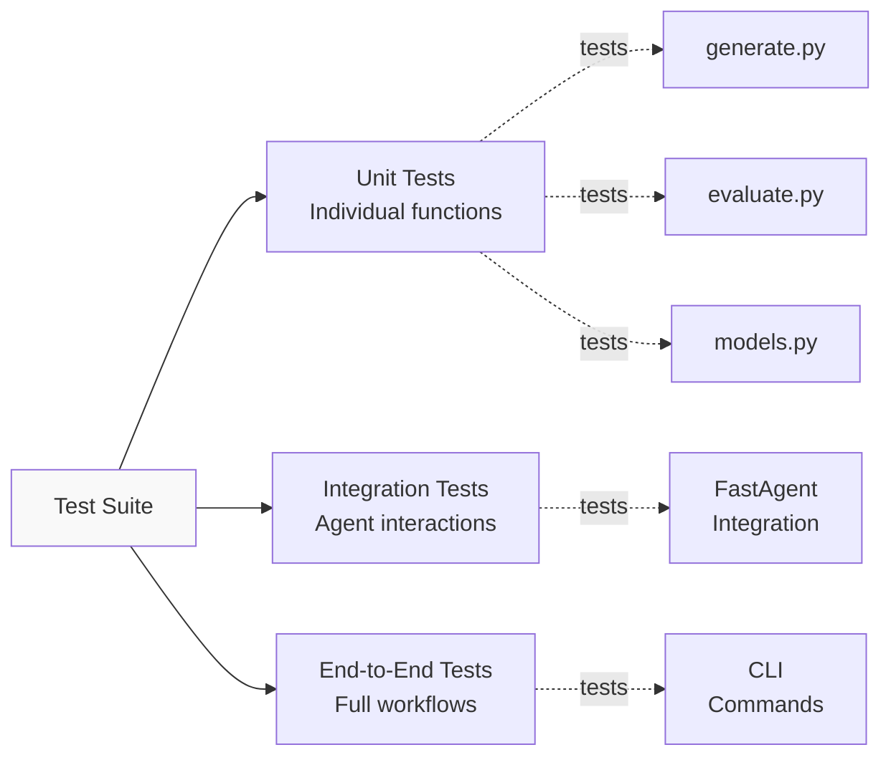
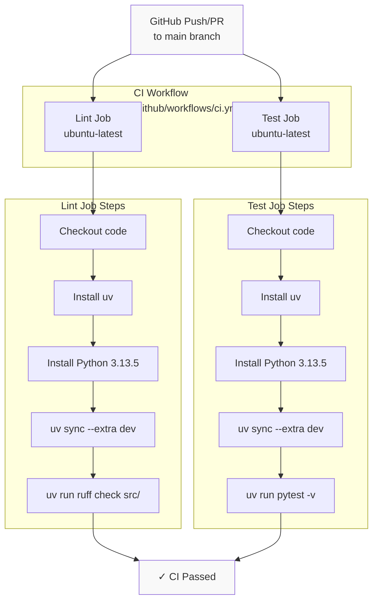
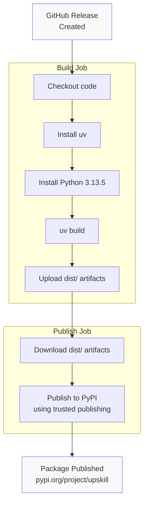
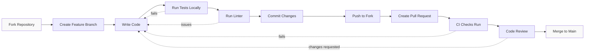

<!-- source: DeepWiki mcp.deepwiki.com · repo huggingface/upskill · page 11 Development and Contributing · fetched 2026-10-26 -->

# Development and Contributing

<details>
<summary>Relevant source files</summary>

The following files were used as context for generating this wiki page:

- [.github/workflows/ci.yml](.github/workflows/ci.yml)
- [.github/workflows/publish.yml](.github/workflows/publish.yml)
- [pyproject.toml](pyproject.toml)
- [uv.lock](uv.lock)

</details>


This page provides technical guidance for developers contributing to the upskill codebase. It covers development environment setup, testing procedures, code quality standards, and continuous integration workflows.

For information about the overall system architecture and module organization, see [Overview](#1). For usage examples of the Python API, see [Python API](#9).

---

## Overview

The upskill project uses modern Python tooling with a focus on reproducibility and developer experience. Key technologies include:

- **Python 3.13.5** - Required version for development
- **uv** - Fast Python package manager for dependency management
- **pytest** - Testing framework with async support
- **ruff** - Fast Python linter and formatter
- **GitHub Actions** - Continuous integration and deployment

The codebase follows a standard Python package structure with source code in `src/upskill/`, tests alongside the code, and development configurations defined in `pyproject.toml`.

**Sources:** [pyproject.toml:1-38](), [.github/workflows/ci.yml:1-43]()

---

## Project Structure

### Directory Layout

```
upskill/
├── src/upskill/          # Main package source code
│   ├── cli.py            # CLI commands (generate, eval, list, etc.)
│   ├── generate.py       # Skill generation logic
│   ├── evaluate.py       # Skill evaluation logic
│   ├── models.py         # Pydantic data models
│   ├── config.py         # Configuration management
│   ├── logging.py        # Run logging utilities
│   ├── manifest_utils.py # Skill manifest parsing
│   └── fastagent_integration.py  # FastAgent utilities
├── agent_cards/          # Agent card definitions
│   ├── skill_gen.md      # Skill generation agent
│   ├── test_gen.md       # Test case generation agent
│   └── evaluator.md      # Evaluation agent
├── pyproject.toml        # Package metadata and dependencies
├── uv.lock               # Locked dependency versions
├── fastagent.config.yaml # FastAgent configuration
└── .github/workflows/    # CI/CD pipeline definitions
    ├── ci.yml            # Lint and test workflow
    └── publish.yml       # PyPI publishing workflow
```

### Module Dependency Structure



**Diagram:** Core module dependencies showing the layered architecture with `models.py` as the foundation and `cli.py` as the entry point.

**Sources:** [pyproject.toml:29-30]()

---

## Development Environment Setup

### Prerequisites

1. **Python 3.13.5**: The project requires Python 3.13.5 specifically (not 3.14+)
2. **uv package manager**: Install from https://github.com/astral-sh/uv

### Installation Steps

```bash
# Clone the repository
git clone https://github.com/huggingface/upskill
cd upskill

# Install uv (if not already installed)
curl -LsSf https://astral.sh/uv/install.sh | sh

# Install Python 3.13.5
uv python install 3.13.5

# Install dependencies including dev tools
uv sync --extra dev

# Verify installation
uv run upskill --help
```

### Development Dependencies

The following tools are installed via the `dev` extra:

| Package | Version | Purpose |
|---------|---------|---------|
| `pytest` | >=8.0 | Unit testing framework |
| `pytest-asyncio` | >=0.23 | Async test support |
| `ruff` | >=0.4 | Linting and formatting |

**Sources:** [pyproject.toml:15-20](), [.github/workflows/ci.yml:17-22]()

---

## Testing and Quality Assurance

### Running Tests

The test suite uses `pytest` with async support:

```bash
# Run all tests with verbose output
uv run pytest -v

# Run specific test file
uv run pytest tests/test_generate.py -v

# Run tests matching a pattern
uv run pytest -k "test_skill_generation" -v

# Run with coverage report
uv run pytest --cov=upskill --cov-report=term-missing
```

### Test Organization



**Diagram:** Test organization strategy showing unit, integration, and end-to-end test layers.

### Async Test Support

Tests that interact with async functions use `pytest-asyncio`:

```python
import pytest

@pytest.mark.asyncio
async def test_async_skill_generation():
    # Test async operations
    result = await generate_skill(...)
    assert result is not None
```

**Sources:** [pyproject.toml:18](), [.github/workflows/ci.yml:41-42]()

---

## Code Quality Standards

### Linting with Ruff

The project uses `ruff` for fast Python linting with the following configuration:

| Setting | Value | Description |
|---------|-------|-------------|
| `line-length` | 100 | Maximum line length |
| `target-version` | py313 | Target Python version |
| `select` | E, F, I, UP | Enabled rule categories |

**Rule Categories:**
- **E**: pycodestyle errors
- **F**: Pyflakes errors (unused imports, variables)
- **I**: isort (import sorting)
- **UP**: pyupgrade (modern Python idioms)

### Running the Linter

```bash
# Check all source files
uv run ruff check src/

# Check and auto-fix issues
uv run ruff check src/ --fix

# Format code
uv run ruff format src/

# Check specific file
uv run ruff check src/upskill/cli.py
```

### Pre-commit Workflow

Before committing code, ensure it passes linting:

```bash
# 1. Format code
uv run ruff format src/

# 2. Fix auto-fixable issues
uv run ruff check src/ --fix

# 3. Check for remaining issues
uv run ruff check src/

# 4. Run tests
uv run pytest -v
```

**Sources:** [pyproject.toml:32-37](), [.github/workflows/ci.yml:24-25]()

---

## Continuous Integration

### CI Pipeline Architecture



**Diagram:** CI pipeline showing parallel lint and test jobs that run on every push/PR.

### CI Job Configuration

#### Lint Job
The lint job ensures code quality standards:

```yaml
lint:
  runs-on: ubuntu-latest
  steps:
    - uses: actions/checkout@v4
    - name: Install uv
      uses: astral-sh/setup-uv@v5
    - name: Set up Python
      run: uv python install 3.13.5
    - name: Install dependencies
      run: uv sync --extra dev
    - name: Lint with ruff
      run: uv run ruff check src/
```

#### Test Job
The test job runs the full test suite:

```yaml
test:
  runs-on: ubuntu-latest
  steps:
    - uses: actions/checkout@v4
    - name: Install uv
      uses: astral-sh/setup-uv@v5
    - name: Set up Python
      run: uv python install 3.13.5
    - name: Install dependencies
      run: uv sync --extra dev
    - name: Run tests
      run: uv run pytest -v
```

Both jobs run in parallel and must pass for CI to succeed.

**Sources:** [.github/workflows/ci.yml:1-43]()

---

## Publishing to PyPI

### Release Workflow



**Diagram:** PyPI publishing workflow triggered by GitHub releases.

### Build Process

The build job creates distribution packages:

```bash
# Build creates:
# - dist/upskill-X.Y.Z.tar.gz (source distribution)
# - dist/upskill-X.Y.Z-py3-none-any.whl (wheel)
uv build
```

Build configuration from `pyproject.toml`:

```toml
[build-system]
requires = ["hatchling"]
build-backend = "hatchling.build"

[tool.hatch.build.targets.wheel]
packages = ["src/upskill"]
```

### Trusted Publishing

The publish job uses PyPI's trusted publishing mechanism (no API tokens required):

```yaml
publish:
  needs: build
  runs-on: ubuntu-latest
  environment: pypi
  permissions:
    id-token: write  # Required for trusted publishing
```

This requires configuring the GitHub repository as a trusted publisher in PyPI settings.

### Manual Release Process

To create a new release:

1. **Update version** in `pyproject.toml`:
   ```toml
   [project]
   version = "0.2.2"  # Increment version
   ```

2. **Commit and tag**:
   ```bash
   git add pyproject.toml
   git commit -m "Bump version to 0.2.2"
   git tag v0.2.2
   git push origin main --tags
   ```

3. **Create GitHub release**: Go to GitHub Releases and create a new release with tag `v0.2.2`

4. **Workflow triggers**: The publish workflow automatically builds and uploads to PyPI

**Sources:** [.github/workflows/publish.yml:1-44](), [pyproject.toml:1-4](), [pyproject.toml:25-30]()

---

## Package Metadata

### Package Configuration

The package is configured in `pyproject.toml`:

```toml
[project]
name = "upskill"
version = "0.2.1"
description = "Generate and evaluate agent skills"
requires-python = ">=3.13.5,<3.14"
```

### CLI Entry Point

The CLI is registered as a script entry point:

```toml
[project.scripts]
upskill = "upskill.cli:main"
```

This creates the `upskill` command that calls the `main()` function in [src/upskill/cli.py]().

### Production Dependencies

Core runtime dependencies:

| Package | Version | Purpose |
|---------|---------|---------|
| `click` | >=8.1 | CLI framework |
| `fast-agent-mcp` | >=0.4.41 | FastAgent runtime |
| `pydantic` | >=2.0 | Data validation |
| `python-dotenv` | >=1.0 | Environment variables |
| `pyyaml` | >=6.0 | YAML parsing |
| `rich` | >=13.0 | Terminal formatting |

**Sources:** [pyproject.toml:1-23]()

---

## Contributing Guidelines

### Code Style

1. **Line length**: Maximum 100 characters
2. **Imports**: Sorted using isort rules (E, F, I groups)
3. **Type hints**: Use modern Python 3.13 type hints
4. **Async functions**: Use `async`/`await` for I/O operations

### Pull Request Process



**Diagram:** Pull request workflow from fork to merge showing feedback loops.

### Local Development Checklist

Before pushing changes:

- [ ] Code passes `uv run ruff check src/`
- [ ] Code passes `uv run ruff format src/ --check`
- [ ] All tests pass with `uv run pytest -v`
- [ ] New features have accompanying tests
- [ ] Documentation updated if public API changed
- [ ] Commit messages are descriptive

### Testing New Features

When adding new functionality:

1. **Write tests first**: Create test cases in the appropriate test file
2. **Implement feature**: Write the minimal code to pass tests
3. **Verify integration**: Ensure feature works with existing code
4. **Update docs**: Add examples to docstrings and README if needed

**Sources:** [pyproject.toml:32-37](), [.github/workflows/ci.yml:1-43]()

---

## Common Development Tasks

### Adding a New CLI Command

1. **Define command** in [src/upskill/cli.py]():
   ```python
   @cli.command()
   @click.option("--option", help="Description")
   def new_command(option):
       """Command description."""
       # Implementation
   ```

2. **Add tests** for the command
3. **Run linter** to ensure code quality
4. **Update documentation** if needed

### Adding a New Data Model

1. **Define model** in [src/upskill/models.py]():
   ```python
   class NewModel(BaseModel):
       field: str
       optional: Optional[int] = None
   ```

2. **Add serialization** methods if needed
3. **Write tests** for validation logic
4. **Update dependent modules** that use the model

### Debugging CI Failures

If CI fails:

1. **Check lint errors**: Run `uv run ruff check src/` locally
2. **Check test failures**: Run `uv run pytest -v` locally
3. **Review CI logs**: Check GitHub Actions logs for details
4. **Fix issues**: Address errors and push fixes

**Sources:** [src/upskill/cli.py](), [src/upskill/models.py]()

---

