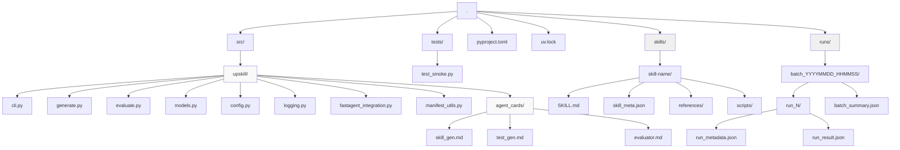
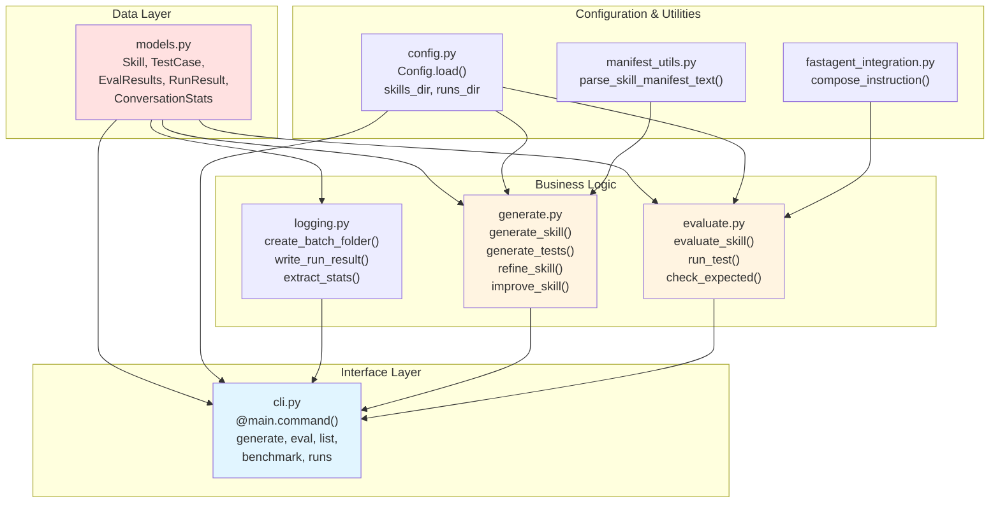
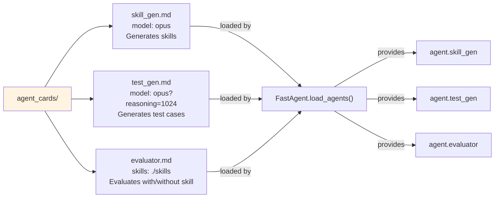
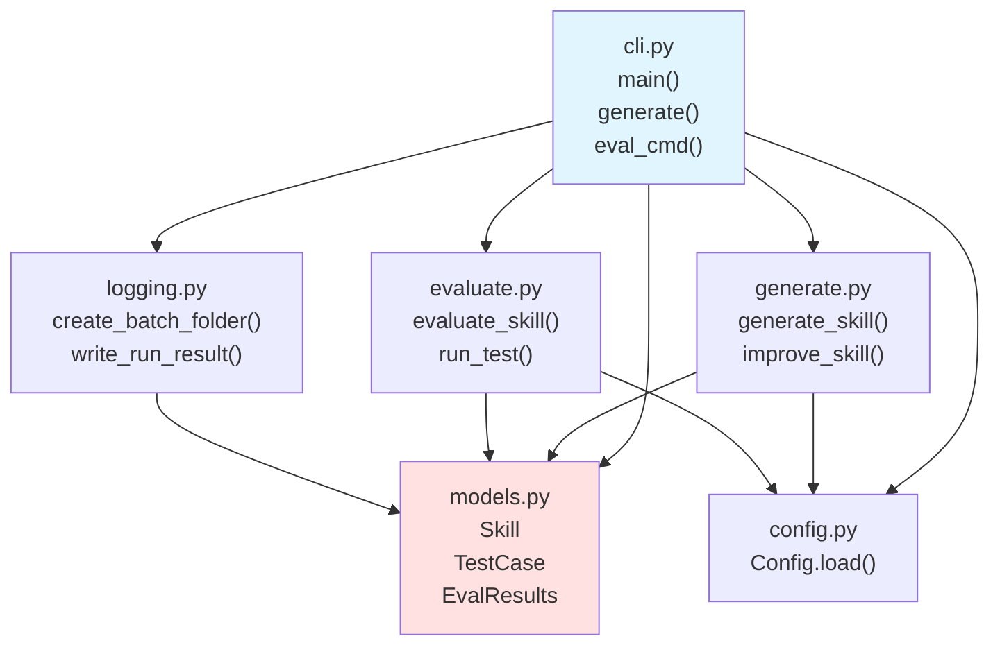

<!-- source: DeepWiki mcp.deepwiki.com · repo huggingface/upskill · page 11.1 Project Structure · fetched 2026-10-26 -->

# Project Structure

<details>
<summary>Relevant source files</summary>

The following files were used as context for generating this wiki page:

- [pyproject.toml](pyproject.toml)
- [src/upskill/cli.py](src/upskill/cli.py)
- [tests/test_smoke.py](tests/test_smoke.py)
- [uv.lock](uv.lock)

</details>


This page provides an overview of the upskill codebase organization, including directory layout, module hierarchy, key files, and how the code is structured. For information about setting up a development environment, see [Development Setup](#11.2). For details on testing and code quality, see [Testing and Quality](#11.3).

---

## Directory Layout

The upskill project follows a standard Python package structure with source code in `src/`, configuration at the root, and resources bundled with the package.



**Sources:** [pyproject.toml:29-30](), [src/upskill/cli.py:1-43]()

---

## Source Code Organization

The main application code resides in `src/upskill/`, organized into focused modules with clear separation of concerns.

### Core Module Hierarchy



**Sources:** [src/upskill/cli.py:21-42]()

---

## Module Responsibilities

### cli.py - Command-Line Interface

The main entry point providing five commands through the Click framework.

| Command | Function | Purpose |
|---------|----------|---------|
| `generate` | `generate()` [189-253]() | Generate or improve skills with optional evaluation |
| `eval` | `eval_cmd()` [640-691]() | Evaluate existing skills with baseline comparison |
| `list` | `list_cmd()` [1042-1118]() | List skills in directory with tree view |
| `benchmark` | `benchmark_cmd()` [1120-1153]() | Run skills across multiple models/runs |
| `runs` | `runs_cmd()` [1285-1391]() | Visualize evaluation history and export CSV |

Key internal functions:
- `_fast_agent_context()` [49-66](): AsyncContextManager that loads agent cards from `agent_cards/` directory
- `_render_bar()` [68-75](): Renders ASCII progress bars for success rates
- `_load_eval_results()` [111-159](): Loads evaluation data from `runs/` directory structure

**Sources:** [src/upskill/cli.py:162-1391]()

### models.py - Data Models

Defines all Pydantic models used throughout the system. Core classes include:

- `Skill`: Represents a skill with `name`, `description`, `body`, `metadata`, `references`, `scripts`, `tests`
- `SkillDraft`: Intermediate representation during generation
- `SkillMetadata`: Metadata including `test_pass_rate`, `created_at`, etc.
- `TestCase`: Test input/output specification with `input`, `expected`, `validator`, `context`
- `TestResult`: Individual test execution result with `success`, `output`, `stats`, `validation_result`
- `EvalResults`: Comparison between baseline and with-skill runs
- `ConversationStats`: Detailed metrics including `conversation_span_ms`, `llm_time_ms`, `tool_time_ms`, `input_tokens`, `output_tokens`, `tool_call_map`
- `RunMetadata`: Execution context with `model`, `task`, `batch_id`, `run_number`
- `RunResult`: Complete run information combining metadata, stats, and outcomes
- `BatchSummary`: Aggregated results across multiple runs

**Sources:** Diagram 4 and Module Dependency Graph (Diagram 5)

### generate.py - Skill Generation

Orchestrates skill generation workflows using FastAgent:

- `generate_skill()`: Creates new skill from task description and examples
- `generate_tests()`: Generates test cases for a skill
- `improve_skill()`: Improves existing skill based on instructions
- `refine_skill()`: Refines skill based on test failures
- Internal helper functions for prompt construction and result parsing

**Sources:** Diagram 2 (Complete Skill Lifecycle Workflow)

### evaluate.py - Skill Evaluation

Handles test execution and performance comparison:

- `evaluate_skill()`: Runs full evaluation comparing baseline vs with-skill
- `run_test()`: Executes single test case in isolated workspace
- `check_expected()`: Validates test output against expected results
- `get_failure_descriptions()`: Extracts failure information for refinement

**Sources:** Diagram 6 (Evaluation and Metrics System)

### logging.py - Run Logging

Manages persistence of evaluation results:

- `create_batch_folder()`: Creates timestamped batch directory
- `create_run_folder()`: Creates numbered run subdirectory
- `write_run_metadata()`: Persists `RunMetadata` to JSON
- `write_run_result()`: Persists `RunResult` to JSON
- `write_batch_summary()`: Persists `BatchSummary` aggregating all runs
- `extract_tokens()`: Extracts token usage from FastAgent message channels
- `extract_timing()`: Extracts timing data from FastAgent message channels
- `aggregate_conversation_stats()`: Combines stats across multiple test results
- `summarize_runs_to_csv()`: Exports run data to CSV with 24+ metric columns

**Sources:** Diagram 4 (Data Flow and Persistence Architecture), [src/upskill/cli.py:24-34]()

### config.py - Configuration Management

Loads and manages configuration from `config.yaml`:

- `Config.load()`: Loads configuration from file or creates defaults
- Properties: `skills_dir`, `runs_dir`, `model`, `eval_model`, `max_refine_attempts`

**Sources:** [src/upskill/cli.py:21]()

### fastagent_integration.py - FastAgent Integration

Provides integration utilities for FastAgent runtime:

- `compose_instruction()`: Formats skill content for agent consumption by injecting skill into agent instructions

**Sources:** Diagram 3 (Agent Card System and FastAgent Integration)

### manifest_utils.py - Skill Manifest Parsing

Utilities for parsing FastAgent skill manifest format:

- `parse_skill_manifest_text()`: Parses skill manifest YAML/markdown structure

**Sources:** Module Dependency Graph (Diagram 5)

---

## Resource Files

### Agent Cards Directory

The `src/upskill/agent_cards/` directory contains markdown files defining specialized AI agents using FastAgent's declarative agent card format.



These cards are loaded at runtime via [src/upskill/cli.py:60-62]():

```python
cards = resources.files("upskill").joinpath("agent_cards")
with resources.as_file(cards) as cards_path:
    fast.load_agents(cards_path)
```

**Sources:** [src/upskill/cli.py:49-66]()

---

## Data Directories

### Skills Directory Structure

Generated skills are saved to `./skills/` (configurable via `config.yaml`) with the following structure:

```
skills/
└── skill-name/
    ├── SKILL.md              # Main skill content
    ├── skill_meta.json       # Metadata (test_pass_rate, created_at, etc.)
    ├── references/           # Supporting reference documents
    │   └── example.txt
    └── scripts/              # Executable scripts
        └── helper.py
```

The `Skill` class provides:
- `Skill.save(path)`: Persists skill to directory
- `Skill.load(path)`: Loads skill from directory

**Sources:** Diagram 4 (Data Flow and Persistence Architecture)

### Runs Directory Structure

Evaluation results are logged to `./runs/` (configurable) with timestamped batches:

```
runs/
└── batch_20260125_143022/
    ├── run_1/
    │   ├── run_metadata.json
    │   └── run_result.json
    ├── run_2/
    │   ├── run_metadata.json
    │   └── run_result.json
    └── batch_summary.json
```

Each run folder contains:
- `run_metadata.json`: `RunMetadata` (model, task, batch_id, run_number)
- `run_result.json`: `RunResult` (metadata + stats + passed + assertions)

The batch folder contains:
- `batch_summary.json`: `BatchSummary` (aggregated results across all runs)

Created via [src/upskill/cli.py:279]():
```python
batch_id, batch_folder = create_batch_folder(runs_path)
```

**Sources:** [src/upskill/cli.py:272-280](), Diagram 4

---

## Dependency Management

### External Dependencies

The project uses modern Python tooling with dependencies specified in [pyproject.toml:6-13]():

| Dependency | Purpose |
|------------|---------|
| `click>=8.1` | CLI framework for command-line interface |
| `fast-agent-mcp>=0.4.41` | Agent runtime and LLM integration |
| `pydantic>=2.0` | Data validation and serialization |
| `python-dotenv>=1.0` | Environment variable management |
| `pyyaml>=6.0` | YAML configuration parsing |
| `rich>=13.0` | Terminal output formatting |

Development dependencies [pyproject.toml:15-20]():
- `pytest>=8.0`: Testing framework
- `pytest-asyncio>=0.23`: Async test support
- `ruff>=0.4`: Linting and formatting

**Sources:** [pyproject.toml:1-38]()

### Internal Module Dependencies



The dependency flow is bottom-up:
1. `models.py` has no internal dependencies (data layer)
2. `config.py` and `logging.py` depend only on `models.py`
3. `generate.py` and `evaluate.py` depend on `models.py` and `config.py`
4. `cli.py` depends on all modules (top-level orchestration)

**Sources:** Module Dependency Graph (Diagram 5)

---

## Build and Configuration Files

### pyproject.toml

Standard Python package configuration using modern `pyproject.toml` format:

- **Project metadata** [pyproject.toml:1-13](): name, version, description, dependencies
- **Entry point** [pyproject.toml:22-23](): `upskill` command maps to `upskill.cli:main`
- **Build system** [pyproject.toml:25-27](): Uses `hatchling` backend
- **Package structure** [pyproject.toml:29-30](): Sources in `src/upskill`
- **Ruff configuration** [pyproject.toml:32-37](): Linter settings (line length 100, Python 3.13, E/F/I/UP rules)

**Sources:** [pyproject.toml:1-38]()

### uv.lock

Dependency lock file managed by `uv` package manager, ensuring reproducible builds. Contains pinned versions and hashes for all direct and transitive dependencies.

**Sources:** [uv.lock:1-3]()

---

## Test Structure

Tests are located in the `tests/` directory. Currently includes:

- `test_smoke.py`: Basic smoke test to verify import and setup

The test suite uses `pytest` as the test runner with `pytest-asyncio` for async test support.

**Sources:** [tests/test_smoke.py:1-3](), [pyproject.toml:16-18]()

---

## Key File Paths Reference

For quick reference, here are the most important files in the codebase:

| Path | Purpose | Key Entities |
|------|---------|--------------|
| `src/upskill/cli.py` | CLI commands | `main()`, `generate()`, `eval_cmd()`, `list_cmd()`, `benchmark_cmd()`, `runs_cmd()` |
| `src/upskill/models.py` | Data models | `Skill`, `TestCase`, `EvalResults`, `RunResult`, `ConversationStats` |
| `src/upskill/generate.py` | Skill generation | `generate_skill()`, `generate_tests()`, `refine_skill()`, `improve_skill()` |
| `src/upskill/evaluate.py` | Skill evaluation | `evaluate_skill()`, `run_test()`, `check_expected()` |
| `src/upskill/logging.py` | Run logging | `create_batch_folder()`, `write_run_result()`, `extract_stats()` |
| `src/upskill/config.py` | Configuration | `Config.load()`, `Config.skills_dir`, `Config.runs_dir` |
| `src/upskill/agent_cards/` | Agent definitions | `skill_gen.md`, `test_gen.md`, `evaluator.md` |
| `pyproject.toml` | Package config | Dependencies, entry points, build settings |

**Sources:** [src/upskill/cli.py:1](), [pyproject.toml:1]()

---

