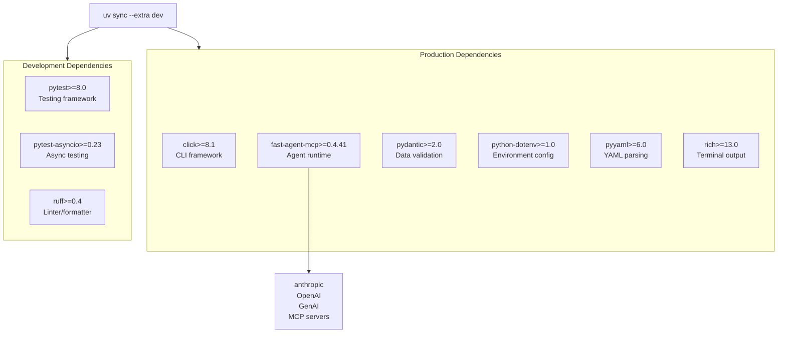
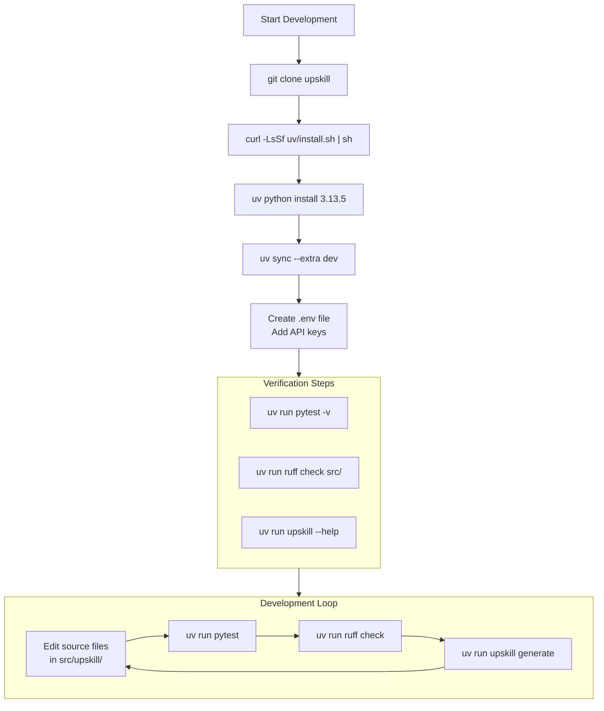

<!-- source: DeepWiki mcp.deepwiki.com · repo huggingface/upskill · page 11.2 Development Setup · fetched 2026-10-26 -->

# Development Setup

<details>
<summary>Relevant source files</summary>

The following files were used as context for generating this wiki page:

- [.github/workflows/ci.yml](.github/workflows/ci.yml)
- [.github/workflows/publish.yml](.github/workflows/publish.yml)
- [pyproject.toml](pyproject.toml)
- [uv.lock](uv.lock)

</details>


This document provides instructions for setting up a local development environment for contributing to the upskill project. This includes installing dependencies, configuring the environment, and verifying the installation.

For information about the project's code organization, see [Project Structure](#11.1). For details on running tests and code quality checks, see [Testing and Quality](#11.3).

---

## Prerequisites

The upskill project has specific requirements for Python version and dependency management tools.

### Python Version

The project requires **Python 3.13.5** or higher, but less than 3.14. This constraint is defined in [pyproject.toml:5]() as `requires-python = ">=3.13.5,<3.14"`.

You can verify your Python version with:
```bash
python --version
```

### uv Package Manager

The project uses [uv](https://github.com/astral-sh/uv) as its package manager. `uv` is a fast Python package installer and resolver that replaces pip and pip-tools.

Install `uv` following the official instructions:
```bash
curl -LsSf https://astral.sh/uv/install.sh | sh
```

Or on Windows:
```powershell
powershell -c "irm https://astral.sh/uv/install.ps1 | iex"
```

**Sources:** [pyproject.toml:1-38](), [.github/workflows/ci.yml:1-43]()

---

## Development Environment Setup

### Clone the Repository

```bash
git clone https://github.com/huggingface/upskill.git
cd upskill
```

### Install Python 3.13.5

Use `uv` to install the required Python version:

```bash
uv python install 3.13.5
```

This command ensures you have the exact Python version needed for development.

### Install Dependencies

Install all project dependencies, including development dependencies:

```bash
uv sync --extra dev
```

This command:
- Creates a virtual environment (`.venv/`)
- Installs all production dependencies from [pyproject.toml:6-13]()
- Installs development dependencies from [pyproject.toml:16-20]()
- Locks all dependencies to exact versions from [uv.lock]()

**Sources:** [pyproject.toml:1-38](), [.github/workflows/ci.yml:22](), [uv.lock:1-10]()

---

## Dependency Overview

The following diagram shows the categories of dependencies installed during setup:



**Sources:** [pyproject.toml:6-20](), [uv.lock:1-100]()

---

## Environment Configuration

### Environment Variables

The upskill system requires API keys for LLM providers. Create a `.env` file in the project root:

```bash
# Required for Anthropic models (default)
ANTHROPIC_API_KEY=sk-ant-...

# Optional: for OpenAI models
OPENAI_API_KEY=sk-...

# Optional: for Google GenAI models
GOOGLE_API_KEY=...
```

The [python-dotenv]() dependency automatically loads these variables when the CLI starts.

### Configuration Files

Two configuration files are used by the system:

| File | Purpose | Location |
|------|---------|----------|
| `config.yaml` | Upskill-specific settings (skills directory, runs directory) | Project root |
| `fastagent.config.yaml` | FastAgent runtime configuration (model providers, agent cards) | Project root |

These files are typically auto-generated on first run, but you can create them manually following the examples in the repository.

For detailed configuration options, see [Configuration](#2.2).

**Sources:** [pyproject.toml:10]()

---

## Running in Development Mode

### Using uv run

The recommended way to run commands during development is with `uv run`, which automatically uses the virtual environment:

```bash
# Run the CLI
uv run upskill --help

# Generate a skill
uv run upskill generate --task "Your task description"

# Run tests
uv run pytest

# Run linter
uv run ruff check src/
```

### Editable Installation

Alternatively, you can activate the virtual environment and install the package in editable mode:

```bash
# Activate virtual environment
source .venv/bin/activate  # On Unix/macOS
# or
.venv\Scripts\activate     # On Windows

# The package is already installed in editable mode by uv sync
# You can now run commands directly:
upskill --help
pytest
ruff check src/
```

The editable installation means changes to source files are immediately reflected without reinstalling.

**Sources:** [pyproject.toml:22-23](), [.github/workflows/ci.yml:25-42]()

---

## Development Workflow

The following diagram illustrates the typical development workflow from setup to verification:



**Sources:** [.github/workflows/ci.yml:1-43]()

---

## Verifying the Installation

### Run the Test Suite

Verify that all tests pass:

```bash
uv run pytest -v
```

This executes the test suite with verbose output. The tests are discovered automatically from the project structure.

Expected output:
```
============================= test session starts ==============================
platform linux -- Python 3.13.5, pytest-8.0.0, pluggy-1.5.0
collected X items

tests/test_module.py::test_case PASSED                                   [ XX%]
...
============================== X passed in X.XXs ===============================
```

### Run the Linter

Check that code follows style guidelines:

```bash
uv run ruff check src/
```

Ruff is configured in [pyproject.toml:32-37]() with:
- Line length: 100 characters
- Target version: Python 3.13
- Selected rules: E (pycodestyle errors), F (pyflakes), I (isort), UP (pyupgrade)

### Run the CLI

Verify the CLI is working:

```bash
uv run upskill --help
```

This should display the help message with available commands: `generate`, `eval`, `list`, `benchmark`, `runs`.

### Test Skill Generation (Requires API Key)

If you have an API key configured, test end-to-end functionality:

```bash
uv run upskill generate --task "Format JSON data consistently"
```

This will attempt to generate a skill using the configured LLM provider.

**Sources:** [.github/workflows/ci.yml:24-42](), [pyproject.toml:22-23]()

---

## Build System

The project uses [hatchling]() as its build backend, configured in [pyproject.toml:25-30]():

```toml
[build-system]
requires = ["hatchling"]
build-backend = "hatchling.build"

[tool.hatch.build.targets.wheel]
packages = ["src/upskill"]
```

To build distribution packages:

```bash
uv build
```

This creates:
- `dist/upskill-{version}.tar.gz` (source distribution)
- `dist/upskill-{version}-py3-none-any.whl` (wheel distribution)

These artifacts are used for PyPI publishing via the CI/CD pipeline (see [CI/CD Pipelines](#11.4)).

**Sources:** [pyproject.toml:25-30](), [.github/workflows/publish.yml:20-27]()

---

## Common Development Tasks

### Running Specific Tests

Run tests matching a pattern:
```bash
uv run pytest -v -k "test_generate"
```

Run tests in a specific file:
```bash
uv run pytest tests/test_specific.py
```

### Auto-fixing Code Style

Ruff can automatically fix some issues:
```bash
uv run ruff check --fix src/
```

### Updating Dependencies

Update all dependencies to their latest compatible versions:
```bash
uv lock --upgrade
uv sync --extra dev
```

### Adding New Dependencies

Add a production dependency:
```bash
uv add package-name
```

Add a development dependency:
```bash
uv add --dev package-name
```

Both commands update [pyproject.toml]() and [uv.lock]() automatically.

**Sources:** [pyproject.toml:1-38](), [.github/workflows/ci.yml:1-43]()

---

## IDE Configuration

### VS Code

Recommended settings for VS Code (`.vscode/settings.json`):

```json
{
  "python.defaultInterpreterPath": ".venv/bin/python",
  "python.linting.enabled": false,
  "ruff.path": [".venv/bin/ruff"],
  "[python]": {
    "editor.formatOnSave": true,
    "editor.defaultFormatter": "charliermarsh.ruff"
  }
}
```

Install the [Ruff VS Code extension](https://marketplace.visualstudio.com/items?itemName=charliermarsh.ruff) for integrated linting and formatting.

### PyCharm

1. Set project interpreter to `.venv/bin/python`
2. Enable Ruff as external tool:
   - Program: `.venv/bin/ruff`
   - Arguments: `check $FilePath$`
3. Configure pytest as the default test runner

**Sources:** [pyproject.toml:32-37]()

---

## Troubleshooting

### Python Version Mismatch

**Error:** `RequiresPythonError: The requested Python version (3.12) is not compatible with the project's requirement (>=3.13.5,<3.14)`

**Solution:** Install Python 3.13.5 with `uv python install 3.13.5`

### Missing API Keys

**Error:** `Error: ANTHROPIC_API_KEY not found`

**Solution:** Create a `.env` file with your API key or set the environment variable:
```bash
export ANTHROPIC_API_KEY=sk-ant-...
```

### Import Errors in Development

**Error:** `ModuleNotFoundError: No module named 'upskill'`

**Solution:** Ensure you're using `uv run` or have activated the virtual environment:
```bash
source .venv/bin/activate  # Then run your command
```

### Dependency Conflicts

**Error:** Dependency resolution fails during `uv sync`

**Solution:** Try removing the lock file and re-syncing:
```bash
rm uv.lock
uv sync --extra dev
```

**Sources:** [pyproject.toml:5](), [.github/workflows/ci.yml:1-43]()

---

