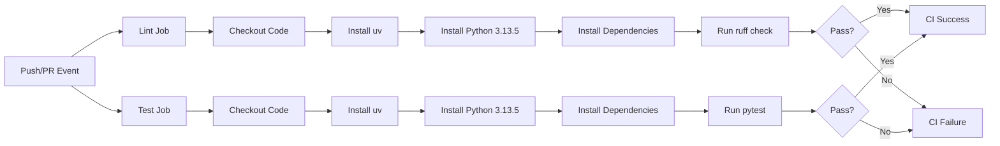
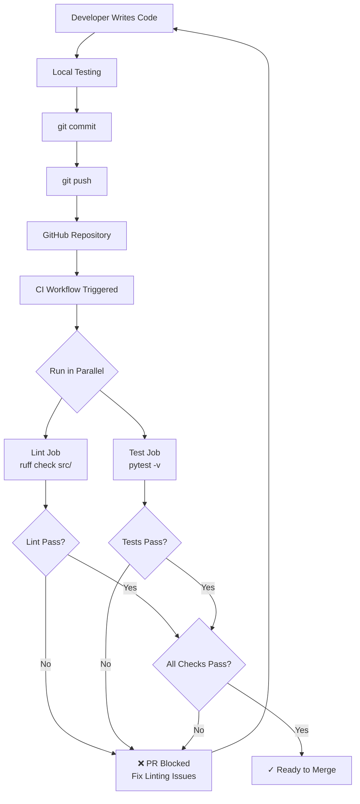

<!-- source: DeepWiki mcp.deepwiki.com · repo huggingface/upskill · page 11.3 Testing and Quality · fetched 2026-10-26 -->

# Testing and Quality

<details>
<summary>Relevant source files</summary>

The following files were used as context for generating this wiki page:

- [.github/workflows/ci.yml](.github/workflows/ci.yml)
- [.github/workflows/publish.yml](.github/workflows/publish.yml)
- [pyproject.toml](pyproject.toml)
- [uv.lock](uv.lock)

</details>


This page describes the testing infrastructure, code quality standards, and linting tools used in the upskill codebase. It covers how to run tests locally, use ruff for code quality checks, and understand the automated CI/CD pipelines that enforce quality standards.

For information about setting up your development environment, see [Development Setup](#11.2). For details about the CI/CD publishing pipeline, see [CI/CD Pipelines](#11.4).

---

## Test Framework

The upskill project uses `pytest` as its test framework with async support through `pytest-asyncio`. Tests validate the core functionality of skill generation, evaluation, and data model integrity.

### Test Dependencies

| Dependency | Version | Purpose |
|------------|---------|---------|
| pytest | >=8.0 | Core test framework |
| pytest-asyncio | >=0.23 | Async test support for FastAgent integration |

**Sources:** [pyproject.toml:15-20]()

---

## Running Tests Locally

### Basic Test Execution

To run all tests in the test suite:

```bash
uv run pytest
```

For verbose output with detailed test information:

```bash
uv run pytest -v
```

### Running Specific Tests

Run tests in a specific file:

```bash
uv run pytest tests/test_models.py
```

Run tests matching a pattern:

```bash
uv run pytest -k "test_skill_generation"
```

### Test Output Options

Show local variables in tracebacks:

```bash
uv run pytest -l
```

Stop on first failure:

```bash
uv run pytest -x
```

Show test coverage:

```bash
uv run pytest --cov=src/upskill
```

**Note:** The project uses `uv` as the package manager, which automatically manages the virtual environment and dependencies when using `uv run`.

**Sources:** [pyproject.toml:15-20](), [.github/workflows/ci.yml:41-42]()

---

## Code Linting with Ruff

The project uses `ruff` as its linter and code formatter. Ruff is a fast Python linter that combines the functionality of multiple tools including Flake8, isort, and more.

### Ruff Configuration

The ruff configuration is defined in `pyproject.toml`:

```toml
[tool.ruff]
line-length = 100
target-version = "py313"

[tool.ruff.lint]
select = ["E", "F", "I", "UP"]
```

| Setting | Value | Description |
|---------|-------|-------------|
| `line-length` | 100 | Maximum characters per line |
| `target-version` | py313 | Target Python 3.13 syntax |
| `select` | E, F, I, UP | Enabled rule categories |

**Sources:** [pyproject.toml:32-37]()

### Enabled Rule Categories

The following rule categories are enforced:

- **E (pycodestyle errors)**: PEP 8 error violations
- **F (pyflakes)**: Logical errors like unused imports and undefined variables
- **I (isort)**: Import statement organization and sorting
- **UP (pyupgrade)**: Syntax upgrades for modern Python versions

### Running Ruff Locally

Check for linting issues without fixing:

```bash
uv run ruff check src/
```

Check all Python files including tests:

```bash
uv run ruff check .
```

Automatically fix issues where possible:

```bash
uv run ruff check --fix src/
```

Format code according to ruff standards:

```bash
uv run ruff format src/
```

**Sources:** [pyproject.toml:32-37](), [.github/workflows/ci.yml:24-25]()

---

## Code Quality Standards

### Import Organization

Ruff enforces import sorting through the `I` (isort) rules. Imports should be organized in three groups:

1. Standard library imports
2. Third-party library imports (e.g., `pydantic`, `fast_agent`)
3. Local application imports (e.g., `upskill.models`)

Example from the codebase pattern:

```python
# Standard library
import json
from pathlib import Path

# Third-party
from pydantic import BaseModel
from fast_agent import LlmAgent

# Local
from upskill.models import Skill
from upskill.config import Config
```

### Modern Python Syntax

The `UP` (pyupgrade) rules ensure code uses Python 3.13 features:

- Type hints use modern syntax (`list[str]` instead of `List[str]`)
- f-strings preferred over `.format()` or `%` formatting
- Simplified dictionary merging with `|` operator
- Union types use `|` instead of `Union[]`

### Line Length

Code must not exceed 100 characters per line. This applies to:

- Code statements
- Comments (including docstrings)
- Import statements

Long lines should be split using implicit line continuation (parentheses, brackets) rather than backslashes.

**Sources:** [pyproject.toml:32-37]()

---

## Continuous Integration

### CI Workflow Overview

The CI pipeline runs on every push to `main` and on all pull requests. It consists of two parallel jobs: linting and testing.



**Sources:** [.github/workflows/ci.yml:1-43]()

### Lint Job

The lint job validates code quality using ruff:

```yaml
lint:
  runs-on: ubuntu-latest
  steps:
    - uses: actions/checkout@v4
    - name: Install uv
      uses: astral-sh/setup-uv@v5
    - name: Set up Python
      run: uv python install 3.13.5
    - name: Install dependencies
      run: uv sync --extra dev
    - name: Lint with ruff
      run: uv run ruff check src/
```

**Checks performed:**
- PEP 8 style compliance (E rules)
- Logical errors and code smells (F rules)
- Import sorting (I rules)
- Modern Python syntax (UP rules)

**Sources:** [.github/workflows/ci.yml:10-26]()

### Test Job

The test job executes the test suite:

```yaml
test:
  runs-on: ubuntu-latest
  steps:
    - uses: actions/checkout@v4
    - name: Install uv
      uses: astral-sh/setup-uv@v5
    - name: Set up Python
      run: uv python install 3.13.5
    - name: Install dependencies
      run: uv sync --extra dev
    - name: Run tests
      run: uv run pytest -v
```

**Checks performed:**
- All unit tests pass
- Async tests execute correctly
- Model validation works as expected

**Sources:** [.github/workflows/ci.yml:27-43]()

### Triggering CI

CI runs automatically on:

- Pushes to the `main` branch
- All pull requests targeting `main`

```yaml
on:
  push:
    branches: [main]
  pull_request:
    branches: [main]
```

**Sources:** [.github/workflows/ci.yml:3-7]()

---

## Development Workflow

### Pre-Commit Checklist

Before committing code, run these commands locally:

```bash
# 1. Run linter
uv run ruff check src/

# 2. Format code
uv run ruff format src/

# 3. Run tests
uv run pytest -v
```

### CI Pipeline Integration



**Sources:** [.github/workflows/ci.yml:1-43]()

### Quality Gate Requirements

All of the following must pass for code to be merged:

| Check | Tool | Command | Requirement |
|-------|------|---------|-------------|
| Linting | ruff | `ruff check src/` | Zero errors |
| Testing | pytest | `pytest -v` | 100% pass rate |
| Python Version | uv | Python 3.13.5 | Exact match |

**Sources:** [.github/workflows/ci.yml:10-43](), [pyproject.toml:5]()

---

## Test Structure

While test files are not included in the provided code, the project follows standard pytest conventions:

### Expected Directory Layout

```
upskill/
├── src/
│   └── upskill/
│       ├── cli.py
│       ├── generate.py
│       ├── evaluate.py
│       └── models.py
├── tests/
│   ├── __init__.py
│   ├── test_cli.py
│   ├── test_generate.py
│   ├── test_evaluate.py
│   └── test_models.py
└── pyproject.toml
```

### Test Naming Conventions

- Test files: `test_*.py`
- Test functions: `def test_*():`
- Test classes: `class Test*:`
- Async tests: `async def test_*():` with `@pytest.mark.asyncio`

### Test Categories

Based on the codebase structure, tests likely cover:

1. **Unit Tests**: Individual function testing
   - Model validation (Skill, TestCase, EvalResults)
   - Utility functions (manifest parsing, instruction composition)
   - Configuration loading

2. **Integration Tests**: Component interaction
   - Skill generation with agent cards
   - Evaluation with test cases
   - File system operations (skill saving/loading)

3. **Async Tests**: FastAgent interaction
   - Agent execution
   - LLM API calls
   - MCP tool invocation

**Sources:** [pyproject.toml:15-20]()

---

## Debugging Test Failures

### Common Test Issues

**Import Errors:**
```bash
# Ensure development dependencies are installed
uv sync --extra dev
```

**Async Test Failures:**
```bash
# Verify pytest-asyncio is installed and configured
uv run pytest --asyncio-mode=auto
```

**Environment Variables:**
```bash
# Tests may require API keys or configuration
export ANTHROPIC_API_KEY="your-key"
uv run pytest
```

### Verbose Output

For detailed test failure information:

```bash
# Show full diff for assertion failures
uv run pytest -vv

# Show print statements
uv run pytest -s

# Show local variables in tracebacks
uv run pytest -l --tb=long
```

**Sources:** [pyproject.toml:15-20](), [.github/workflows/ci.yml:41-42]()

---

## Dependency Management

### Development Dependencies

The `dev` extra includes all testing and quality tools:

```bash
# Install all dev dependencies
uv sync --extra dev
```

This installs:
- pytest (>=8.0)
- pytest-asyncio (>=0.23)
- ruff (>=0.4)

### Python Version Requirement

The project strictly requires Python 3.13.5:

```toml
requires-python = ">=3.13.5,<3.14"
```

CI enforces this exact version:

```bash
uv python install 3.13.5
```

**Sources:** [pyproject.toml:5](), [pyproject.toml:15-20](), [.github/workflows/ci.yml:18-19]()

---

## Quality Metrics

### Linting Coverage

Ruff checks are applied to:
- `src/upskill/` (primary codebase)
- All Python files in the repository when running locally

### Test Coverage

While specific coverage metrics are not configured in the provided files, best practices suggest:
- Unit test coverage for core functions
- Integration tests for main workflows
- Async test coverage for agent interactions

To measure coverage locally:

```bash
# Install pytest-cov
uv pip install pytest-cov

# Run with coverage report
uv run pytest --cov=src/upskill --cov-report=html
```

This generates an HTML report in `htmlcov/index.html`.

**Sources:** [.github/workflows/ci.yml:24-25](), [pyproject.toml:32-37]()

---

