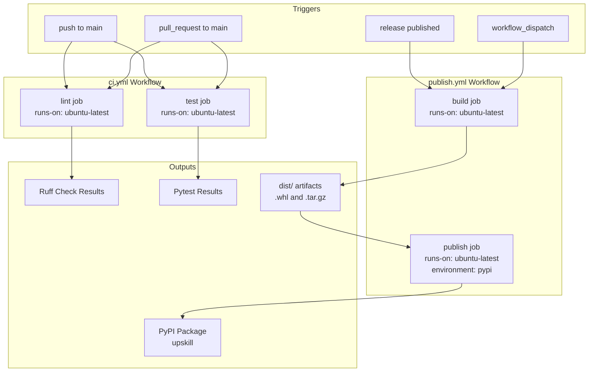
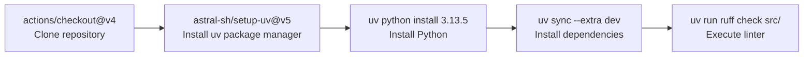
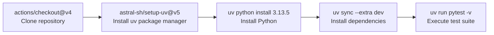
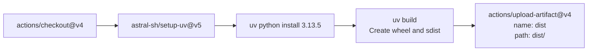
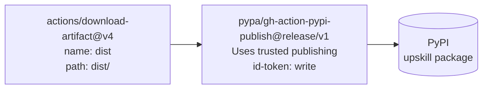
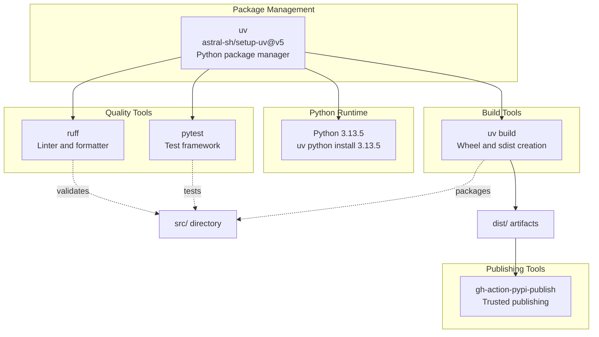
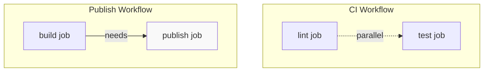

<!-- source: DeepWiki mcp.deepwiki.com · repo huggingface/upskill · page 11.4 CI/CD Pipelines · fetched 2026-10-26 -->

# CI/CD Pipelines

<details>
<summary>Relevant source files</summary>

The following files were used as context for generating this wiki page:

- [.github/workflows/ci.yml](.github/workflows/ci.yml)
- [.github/workflows/publish.yml](.github/workflows/publish.yml)

</details>


## Purpose and Scope

This document describes the continuous integration and continuous deployment (CI/CD) infrastructure for the upskill project. It covers the GitHub Actions workflows that automate code quality checks, testing, and PyPI package publishing. For information about running tests and linting locally during development, see [Testing and Quality](#11.3). For general development setup, see [Development Setup](#11.2).

---

## CI/CD Architecture Overview

The upskill project uses two GitHub Actions workflows to automate quality assurance and package distribution:

**CI/CD Pipeline Architecture**



**Sources:** [.github/workflows/ci.yml:1-43](), [.github/workflows/publish.yml:1-44]()

---

## Continuous Integration Pipeline

The CI pipeline defined in `.github/workflows/ci.yml` runs code quality and correctness checks on every push to `main` and every pull request targeting `main`.

### Trigger Configuration

The CI workflow triggers on two events:

```yaml
on:
  push:
    branches: [main]
  pull_request:
    branches: [main]
```

This ensures all code merged to `main` and all proposed changes undergo automated validation.

**Sources:** [.github/workflows/ci.yml:3-7]()

### Job Architecture

The CI workflow consists of two independent jobs that run in parallel:

| Job | Purpose | Command | Exit Criteria |
|-----|---------|---------|---------------|
| `lint` | Code quality and style checks | `uv run ruff check src/` | Ruff reports no violations |
| `test` | Run test suite | `uv run pytest -v` | All tests pass |

Both jobs share identical setup steps but execute different validation commands.

**Sources:** [.github/workflows/ci.yml:9-43]()

### Lint Job Workflow

**Lint Job Execution Flow**



The lint job performs the following steps:

1. **Checkout Code** [.github/workflows/ci.yml:13](): Uses `actions/checkout@v4` to clone the repository
2. **Install UV** [.github/workflows/ci.yml:15-16](): Installs the `uv` package manager using `astral-sh/setup-uv@v5`
3. **Setup Python** [.github/workflows/ci.yml:18-19](): Installs Python 3.13.5 via `uv python install`
4. **Install Dependencies** [.github/workflows/ci.yml:21-22](): Runs `uv sync --extra dev` to install development dependencies including `ruff`
5. **Run Linter** [.github/workflows/ci.yml:24-25](): Executes `ruff check src/` to validate code style and quality

The linter checks the `src/` directory for:
- Code style violations (PEP 8 compliance)
- Common programming errors
- Import organization
- Unused imports and variables

**Sources:** [.github/workflows/ci.yml:10-26]()

### Test Job Workflow

**Test Job Execution Flow**



The test job follows an identical setup process but concludes with test execution:

1. **Checkout Code** [.github/workflows/ci.yml:30](): Uses `actions/checkout@v4`
2. **Install UV** [.github/workflows/ci.yml:32-33](): Installs `uv` package manager
3. **Setup Python** [.github/workflows/ci.yml:35-36](): Installs Python 3.13.5
4. **Install Dependencies** [.github/workflows/ci.yml:38-39](): Runs `uv sync --extra dev` to install test dependencies including `pytest`
5. **Run Tests** [.github/workflows/ci.yml:41-42](): Executes `pytest -v` with verbose output

The `-v` flag provides detailed test output, showing each test function executed and its result.

**Sources:** [.github/workflows/ci.yml:27-43]()

---

## Publishing Pipeline

The publishing pipeline defined in `.github/workflows/publish.yml` automates package building and distribution to PyPI using trusted publishing.

### Trigger Configuration

The publish workflow supports two trigger mechanisms:

```yaml
on:
  release:
    types: [published]
  workflow_dispatch:
```

- **Release Trigger** [.github/workflows/publish.yml:4-5](): Automatically runs when a GitHub release is published
- **Manual Trigger** [.github/workflows/publish.yml:6](): Allows manual execution via `workflow_dispatch` for testing or emergency releases

**Sources:** [.github/workflows/publish.yml:3-6]()

### Build Job

**Build Job Process**



The build job creates distribution packages:

1. **Checkout Code** [.github/workflows/publish.yml:12](): Clones the repository to access source code
2. **Install UV** [.github/workflows/publish.yml:14-15](): Sets up the `uv` package manager
3. **Setup Python** [.github/workflows/publish.yml:17-18](): Installs Python 3.13.5
4. **Build Package** [.github/workflows/publish.yml:20-21](): Runs `uv build` to create:
   - Wheel distribution (`.whl`)
   - Source distribution (`.tar.gz`)
5. **Upload Artifacts** [.github/workflows/publish.yml:23-27](): Stores built packages as workflow artifacts for the publish job

The artifacts are stored with name `dist` and include all files from the `dist/` directory.

**Sources:** [.github/workflows/publish.yml:9-27]()

### Publish Job

**Publish Job Process**



The publish job uploads packages to PyPI:

1. **Download Artifacts** [.github/workflows/publish.yml:36-40](): Retrieves the `dist` artifacts created by the build job
2. **Publish to PyPI** [.github/workflows/publish.yml:42-43](): Uses `pypa/gh-action-pypi-publish@release/v1` to upload packages

The publish job includes important configuration:

| Configuration | Value | Purpose |
|--------------|-------|---------|
| `needs` | `build` | Job dependency - waits for build job to complete |
| `environment` | `pypi` | GitHub environment for deployment protection |
| `permissions.id-token` | `write` | Required for trusted publishing authentication |

**Sources:** [.github/workflows/publish.yml:29-43]()

### Trusted Publishing

The publishing workflow uses **PyPI Trusted Publishing**, which eliminates the need for long-lived API tokens. Key features:

- **Token-less Authentication** [.github/workflows/publish.yml:34](): Uses OpenID Connect (OIDC) for authentication
- **Permission Requirement** [.github/workflows/publish.yml:33-34](): Requires `id-token: write` permission
- **Environment Protection** [.github/workflows/publish.yml:32](): Uses `pypi` environment for access control

This approach provides enhanced security by:
1. Eliminating stored credentials
2. Using short-lived tokens generated per-run
3. Requiring GitHub repository authentication
4. Allowing PyPI-side permission configuration

**Sources:** [.github/workflows/publish.yml:29-43]()

---

## Pipeline Dependencies and Tools

Both pipelines rely on the same toolchain:

**Pipeline Toolchain**



### Tool Versions and Configuration

| Tool | Version/Action | Purpose | Configuration Source |
|------|----------------|---------|---------------------|
| `uv` | `astral-sh/setup-uv@v5` | Package management and builds | [pyproject.toml]() |
| Python | `3.13.5` | Runtime environment | [.github/workflows/ci.yml:18]() |
| `ruff` | Latest (via dev extras) | Code linting | [pyproject.toml]() dev dependencies |
| `pytest` | Latest (via dev extras) | Test execution | [pyproject.toml]() dev dependencies |
| PyPI Publish | `release/v1` | Package publishing | [.github/workflows/publish.yml:43]() |

**Sources:** [.github/workflows/ci.yml:1-43](), [.github/workflows/publish.yml:1-44]()

---

## Running and Monitoring Pipelines

### Automatic Execution

Pipelines run automatically based on their triggers:

- **CI Pipeline**: Runs on every push to `main` and every pull request targeting `main`
- **Publish Pipeline**: Runs when a GitHub release is published

### Manual Execution

The publish pipeline can be triggered manually:

1. Navigate to **Actions** tab in the GitHub repository
2. Select **Publish to PyPI** workflow
3. Click **Run workflow** button
4. Confirm execution

This manual trigger is useful for:
- Testing the publishing process
- Emergency releases
- Republishing after PyPI issues

### Viewing Results

Pipeline execution results are visible in the GitHub Actions UI:

- **Status Badges**: Show pass/fail status for latest runs
- **Workflow Runs**: List all historical executions with logs
- **Job Logs**: Detailed output from each job step
- **Artifacts**: Built packages available for download (publish workflow)

### Failure Scenarios

Common failure scenarios and resolutions:

| Scenario | Job | Resolution |
|----------|-----|------------|
| Linting violations | `lint` | Fix code style issues locally using `ruff check src/` |
| Test failures | `test` | Debug failing tests locally using `pytest -v` |
| Build errors | `build` | Verify package metadata in `pyproject.toml` |
| Publishing failures | `publish` | Check PyPI trusted publishing configuration |

**Sources:** [.github/workflows/ci.yml:1-43](), [.github/workflows/publish.yml:1-44]()

---

## Pipeline Job Dependencies

**Cross-Job Dependencies**



The workflows have different dependency patterns:

- **CI Workflow**: `lint` and `test` jobs run in parallel with no dependencies between them
- **Publish Workflow**: `publish` job declares `needs: build` [.github/workflows/publish.yml:30](), creating a sequential dependency

This design ensures:
1. Fast feedback for CI checks (parallel execution)
2. Reliable publishing (build must succeed before publish)
3. Efficient artifact transfer (build creates, publish consumes)

**Sources:** [.github/workflows/ci.yml:9-43](), [.github/workflows/publish.yml:29-30]()