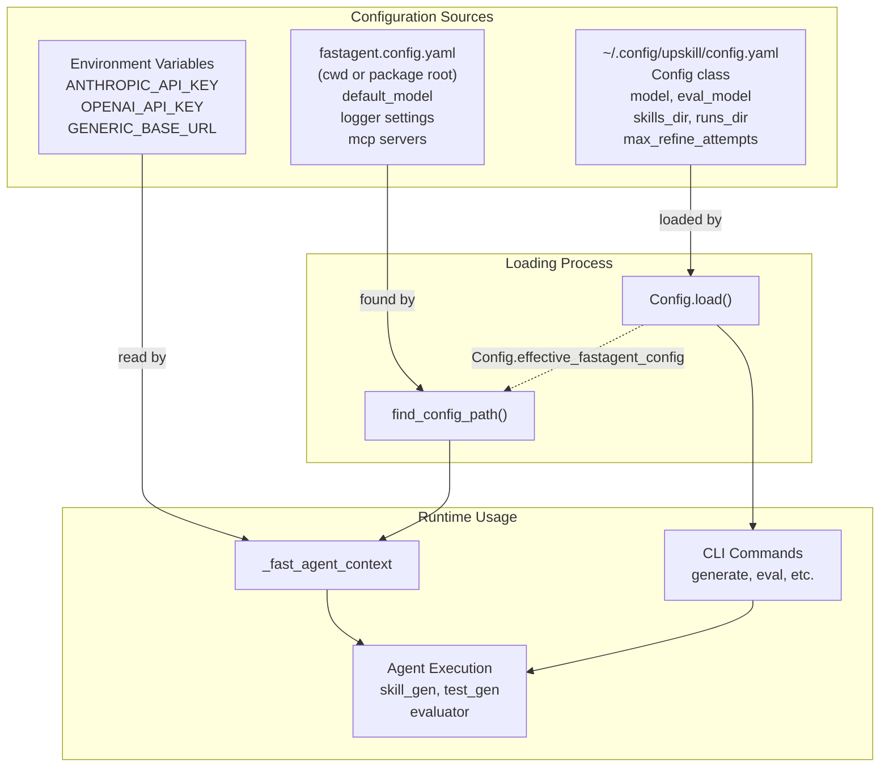
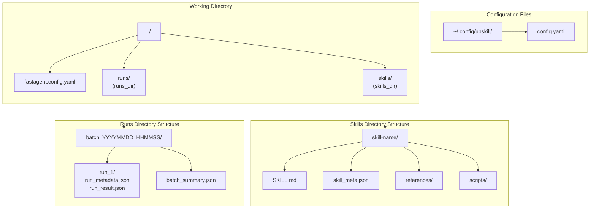
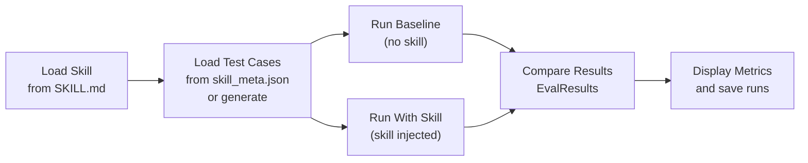
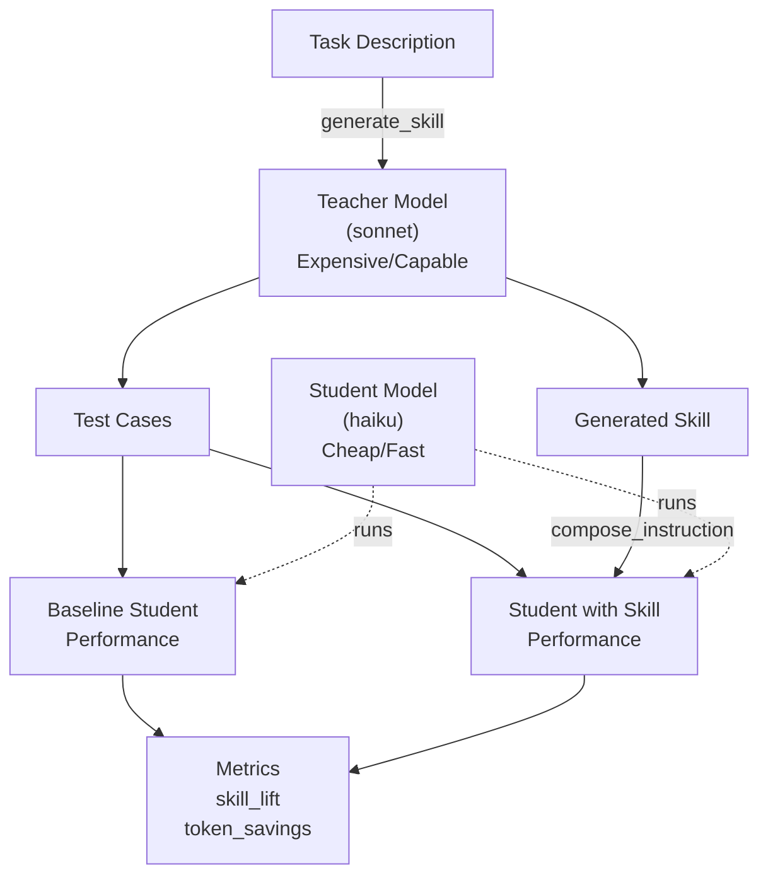

<!-- source: DeepWiki mcp.deepwiki.com · repo huggingface/upskill · page 2 Getting Started · fetched 2026-10-26 -->

# Getting Started

<details>
<summary>Relevant source files</summary>

The following files were used as context for generating this wiki page:

- [README.md](README.md)
- [fastagent.config.yaml](fastagent.config.yaml)
- [pyproject.toml](pyproject.toml)
- [src/upskill/config.py](src/upskill/config.py)
- [uv.lock](uv.lock)

</details>


This section guides you through installing upskill, configuring it for your environment, and generating your first skill. By the end of this guide, you will have upskill installed, configured with API keys for your model provider, and will have generated and evaluated a working skill.

**Scope**: This page covers installation, configuration, and a basic tutorial. For detailed information about core concepts like skills and test cases, see [Core Concepts](#3). For comprehensive CLI command reference, see [CLI Reference](#4). For programmatic usage, see [Python API](#9).

---

## Installation

upskill requires Python 3.13.5 or higher and can be installed via pip or run directly with uvx.

### Python Version Requirements

```
Python: >=3.13.5, <3.14
```

**Sources**: [pyproject.toml:5]()

### Installation Methods

#### Method 1: pip Install

```bash
pip install upskill
```

After installation, the `upskill` command will be available in your shell.

#### Method 2: uvx (No Installation)

```bash
uvx upskill
```

This runs upskill directly without installing it to your environment. Useful for trying upskill or running it in CI/CD pipelines.

**Verification**:

```bash
upskill --help
```

If successful, you should see the CLI help output with available commands: `generate`, `eval`, `list`, `benchmark`, `runs`.

### Dependencies

upskill automatically installs these core dependencies:

| Package | Purpose |
|---------|---------|
| `fast-agent-mcp>=0.4.41` | Agent runtime and MCP server integration |
| `click>=8.1` | CLI framework |
| `pydantic>=2.0` | Data validation and models |
| `pyyaml>=6.0` | Configuration file parsing |
| `rich>=13.0` | Terminal output formatting |
| `python-dotenv>=1.0` | Environment variable loading |

**Sources**: [pyproject.toml:6-13](), [README.md:9-15]()

---

## Configuration

upskill uses two configuration files and environment variables to control its behavior:

1. **`config.yaml`**: upskill-specific settings (model, directories, refinement)
2. **`fastagent.config.yaml`**: FastAgent runtime settings (logging, MCP servers, providers)
3. **Environment variables**: API keys and custom endpoints

### Configuration Architecture



**Sources**: [src/upskill/config.py:11-102](), [fastagent.config.yaml:1-33]()

### upskill Configuration (`config.yaml`)

The `Config` class defines upskill's settings. The configuration file is optional and defaults are used if not present.

**Location**: `~/.config/upskill/config.yaml`

**Structure**:

```yaml
# Model settings
model: sonnet                    # Default generation model (FastAgent format)
eval_model: haiku               # Optional: different model for evaluation

# Directory settings
skills_dir: ./skills            # Where to save generated skills
runs_dir: ./runs                # Where to save run logs

# Generation settings
auto_eval: true                 # Run evaluation after generation
max_refine_attempts: 2          # Max refinement iterations

# FastAgent settings (optional)
fastagent_config: ./fastagent.config.yaml  # Custom FastAgent config path
```

**Configuration Loading**:

| Method | Description |
|--------|-------------|
| `Config.load()` | Loads from `~/.config/upskill/config.yaml` or returns defaults |
| `Config.save()` | Saves current config to `~/.config/upskill/config.yaml` |
| `Config.effective_eval_model` | Returns `eval_model` if set, otherwise `model` |
| `Config.effective_fastagent_config` | Returns `fastagent_config` if set, otherwise finds config via `find_config_path()` |

**Sources**: [src/upskill/config.py:38-102](), [README.md:376-384]()

### FastAgent Configuration (`fastagent.config.yaml`)

FastAgent runtime configuration controls agent behavior, logging, and model providers.

**Location**: Searched in order:
1. `./fastagent.config.yaml` (current working directory)
2. `<package_root>/fastagent.config.yaml` (bundled with upskill)

**Structure**:

```yaml
# Default model for agents
default_model: sonnet

# Logging configuration
logger:
  progress_display: false       # Show progress bars
  show_chat: false             # Display agent conversations
  show_tools: false            # Show tool calls
  truncate_tools: true         # Truncate long tool outputs
  streaming: none              # Streaming mode: none, markdown, json

# Generic provider for local models
generic:
  api_key: "local"             # API key for generic provider
  base_url: "http://localhost:11434/v1"  # OpenAI-compatible endpoint

# MCP timeline display
mcp_timeline:
  steps: 20                    # Number of timeline steps
  step_seconds: 15             # Seconds per step

# Shell execution settings
shell_execution:
  show_bash: true              # Show bash commands
```

**Model Format**: upskill uses FastAgent's model format: `<provider>.<model>.<reasoning_effort?>`.

Examples:
- `sonnet` - Anthropic Claude Sonnet (alias)
- `haiku` - Anthropic Claude Haiku (alias)
- `anthropic.claude-sonnet-4-20250514` - Full model name
- `openai.gpt-4o` - OpenAI GPT-4o
- `generic.llama3.2:latest` - Local model via Ollama

**Sources**: [fastagent.config.yaml:1-33](), [src/upskill/config.py:26-36](), [README.md:386-404](), [README.md:467-484]()

### Environment Variables

Environment variables provide API keys and custom endpoints for model providers.

```bash
# Anthropic (required for Claude models)
export ANTHROPIC_API_KEY=sk-ant-...

# OpenAI (required for GPT models)
export OPENAI_API_KEY=sk-...

# Optional: Custom endpoints
export ANTHROPIC_BASE_URL=http://localhost:8080
export OPENAI_API_BASE=http://localhost:11434/v1

# Generic provider (for local models)
export GENERIC_BASE_URL=http://localhost:8080/v1
export GENERIC_API_KEY=local  # Optional, defaults to "local"
```

**Provider Configuration Table**:

| Provider | Required Env Var | Optional Env Var | Model Examples |
|----------|-----------------|------------------|----------------|
| Anthropic | `ANTHROPIC_API_KEY` | `ANTHROPIC_BASE_URL` | `sonnet`, `haiku`, `opus` |
| OpenAI | `OPENAI_API_KEY` | `OPENAI_API_BASE` | `openai.gpt-4o`, `openai.o3-mini` |
| Generic | None (defaults to `"local"`) | `GENERIC_BASE_URL`, `GENERIC_API_KEY` | `generic.llama3.2:latest` |

**Sources**: [README.md:407-422](), [fastagent.config.yaml:11-15]()

### Directory Structure After Configuration



**Sources**: [README.md:302-312](), [README.md:357-372](), [src/upskill/config.py:11-24]()

---

## Quick Start Tutorial

This tutorial walks through generating and evaluating your first skill using the CLI.

### Prerequisites

1. upskill installed (see Installation above)
2. API key configured for your model provider (e.g., `ANTHROPIC_API_KEY`)

### Step 1: Generate a Simple Skill

Generate a skill from a task description:

```bash
upskill generate "write good git commit messages"
```

**What happens**:

```mermaid
sequenceDiagram
    participant User
    participant CLI["CLI (generate command)"]
    participant SkillGen["agent.skill_gen<br/>(FastAgent)"]
    participant TestGen["agent.test_gen<br/>(FastAgent)"]
    participant Evaluator["agent.evaluator<br/>(FastAgent)"]
    participant Disk["File System"]
    
    User->>CLI: upskill generate "task"
    CLI->>SkillGen: generate_skill(task, model)
    SkillGen->>SkillGen: Create SkillDraft
    SkillGen-->>CLI: Skill object
    
    CLI->>TestGen: generate_tests(task)
    TestGen->>TestGen: Create TestCase list
    TestGen-->>CLI: TestCase[]
    
    CLI->>Evaluator: evaluate_skill(skill, tests)
    Evaluator->>Evaluator: Run baseline (no skill)
    Evaluator->>Evaluator: Run with skill
    Evaluator->>Evaluator: Calculate metrics
    Evaluator-->>CLI: EvalResults
    
    alt Skill is beneficial
        CLI->>Disk: Save to skills/skill-name/
        CLI->>Disk: Save runs to runs/batch_*/
        CLI-->>User: Success + metrics
    else Not beneficial & attempts < max
        CLI->>SkillGen: refine_skill(failures)
        Note over CLI,SkillGen: Loop until beneficial or max attempts
    end
```

**Expected Output**:

```
Generating skill with sonnet...
Generating test cases...
Evaluating on sonnet... (attempt 1)
  60% -> 100% (+40%) OK

  git-commit-messages
  Write clear, conventional commit messages that follow best practices.

  SKILL.md              ~450 tokens

  baseline   ████████████░░░░░░░░   60%
  with skill ████████████████████  100%  (+40%)

  tokens: 1200 → 800  (-33%)

Saved to ./skills/git-commit-messages
```

**Generated Files**:

```
./skills/git-commit-messages/
├── SKILL.md              # Main skill instructions
├── skill_meta.json       # Metadata (created_at, description, etc.)
├── references/           # Supporting documents (if any)
└── scripts/              # Executable scripts (if any)
```

**Sources**: [README.md:17-24](), [README.md:92-111](), [src/upskill/cli.py:112-329]()

### Step 2: Examine the Generated Skill

View the skill content:

```bash
cat ./skills/git-commit-messages/SKILL.md
```

Example content:

```markdown
# git-commit-messages

Write clear, conventional commit messages that follow best practices.

## Instructions

This skill teaches how to write effective git commit messages
following the Conventional Commits specification.

## Format

Commit messages should follow this structure:

<type>(<scope>): <subject>

<body>

<footer>

## Types

- `feat`: New feature
- `fix`: Bug fix
- `docs`: Documentation changes
...

## Examples

### Simple feature commit
feat(auth): add password reset functionality

### Bug fix with explanation
fix(api): handle null response from user service

The user service can return null when not found.
Added proper null checking to prevent crashes.

Closes #123
```

**Sources**: [README.md:313-354]()

### Step 3: List Generated Skills

View all skills in the skills directory:

```bash
upskill list
```

**Output**:

```
./skills
├── git-commit-messages
│   ├── Write clear, conventional commit messages...
│   └── files
│       └── SKILL.md
```

With verbose mode to see skill contents preview:

```bash
upskill list -v
```

**Sources**: [README.md:197-240]()

### Step 4: Evaluate an Existing Skill

Evaluate the skill on a different model:

```bash
upskill eval ./skills/git-commit-messages/ -m haiku
```

**What happens**:



**Expected Output**:

```
Evaluating git-commit-messages on haiku

  baseline   ████████████░░░░░░░░   60%
  with skill ████████████████░░░░   80%  (+20%)

  tokens: 1200 → 950  (-21%)
```

**Key Metrics**:

| Metric | Description | Beneficial Threshold |
|--------|-------------|---------------------|
| `skill_lift` | Success rate improvement | > 5% |
| `token_savings` | Percentage of tokens saved | > 20% (if lift >= 0) |
| `is_beneficial` | Overall skill utility | `lift > 5%` OR `(lift >= 0 AND savings > 20%)` |

**Sources**: [README.md:113-166](), [src/upskill/evaluate.py:140-204]()

### Step 5: View Run History

View all evaluation runs:

```bash
upskill runs
```

**Output**:

```
skill: git-commit-messages

sonnet
  baseline   ████████████░░░░░░░░   60%
  with skill ████████████████████  100%  (+40%)

haiku
  baseline   ████████████░░░░░░░░   60%
  with skill ████████████████░░░░   80%  (+20%)
```

Filter by skill and models:

```bash
upskill runs -s git-commit-messages -m haiku -m sonnet
```

Export to CSV for analysis:

```bash
upskill runs --csv results.csv
```

**CSV Columns**: Contains 24+ metrics including:
- `model`, `skill_name`, `run_type` (baseline/with_skill)
- `passed`, `total_assertions`
- `conversation_span_ms`, `llm_time_ms`, `tool_time_ms`
- `input_tokens`, `output_tokens`, `total_tokens`
- `turns`, `tool_calls`, `mcp_calls`, `execute_calls`

**Sources**: [README.md:242-300](), [src/upskill/logging.py:96-216]()

### Step 6: Advanced - Teacher/Student Model Workflow

Generate a skill with a powerful "teacher" model and evaluate it on a less capable "student" model:

```bash
upskill generate "write good git commit messages" \
    --model sonnet \
    --eval-model haiku
```

**Workflow**:



This pattern allows expensive models to create knowledge that cheaper models can leverage, improving their performance without the cost of using the expensive model at inference time.

**Sources**: [README.md:26-30](), [README.md:76-79]()

---

## Next Steps

Now that you have upskill installed and running, explore:

- **[Core Concepts](#3)**: Understand skills, test cases, and evaluation metrics in depth
- **[CLI Reference](#4)**: Complete documentation of all CLI commands and options
- **[Skill Lifecycle](#5)**: Learn about generation, evaluation, and refinement workflows
- **[Agent System](#6)**: Understand agent cards and FastAgent integration
- **[Python API](#9)**: Use upskill programmatically in your own code

**Sources**: [README.md:1-514](), [src/upskill/config.py:1-102](), [fastagent.config.yaml:1-33](), [pyproject.toml:1-38]()

---

