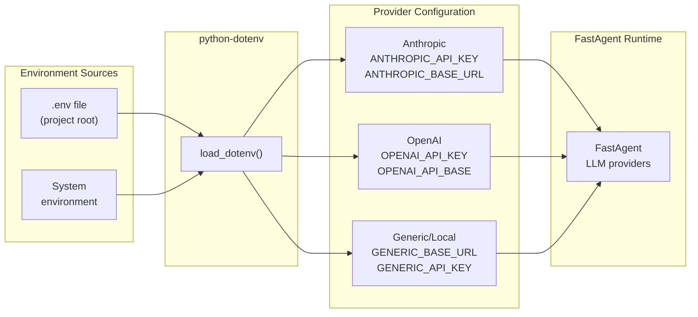

<!-- source: DeepWiki mcp.deepwiki.com · repo huggingface/upskill · page 2.1 Installation · fetched 2026-10-26 -->

# Installation

<details>
<summary>Relevant source files</summary>

The following files were used as context for generating this wiki page:

- [README.md](README.md)
- [pyproject.toml](pyproject.toml)
- [uv.lock](uv.lock)

</details>


This page covers the system requirements, installation process, and environment setup for upskill. For configuration of model providers and system settings, see [Configuration](#2.2).

## System Requirements

upskill requires Python 3.13.5 or higher (but below 3.14). The Python version constraint is defined in [pyproject.toml:5]().

```
requires-python = ">=3.13.5,<3.14"
```

**Sources:** [pyproject.toml:5]()

## Installation Methods

### Using pip

Install the latest stable release from PyPI:

```bash
pip install upskill
```

### Using uv (Recommended)

For direct execution without installation:

```bash
uvx upskill
```

This command downloads and executes upskill in an isolated environment, avoiding conflicts with system packages.

**Sources:** [README.md:11-14]()

## Dependency Architecture

The following diagram shows upskill's core dependencies and their roles in the system:

```mermaid
graph TB
    upskill["upskill<br/>(src/upskill)"]
    
    subgraph "CLI & UI"
        click["click>=8.1<br/>Command-line interface"]
        rich["rich>=13.0<br/>Terminal output formatting"]
    end
    
    subgraph "Agent Runtime"
        fastagent["fast-agent-mcp>=0.4.41<br/>Agent execution & MCP"]
    end
    
    subgraph "Data & Configuration"
        pydantic["pydantic>=2.0<br/>Data validation & models"]
        pyyaml["pyyaml>=6.0<br/>Config file parsing"]
        dotenv["python-dotenv>=1.0<br/>Environment variables"]
    end
    
    subgraph "Development (Optional)"
        pytest["pytest>=8.0"]
        pytestasync["pytest-asyncio>=0.23"]
        ruff["ruff>=0.4<br/>Linting"]
    end
    
    upskill --> click
    upskill --> rich
    upskill --> fastagent
    upskill --> pydantic
    upskill --> pyyaml
    upskill --> dotenv
    
    upskill -.->|dev only| pytest
    upskill -.->|dev only| pytestasync
    upskill -.->|dev only| ruff
```

### Core Dependencies

| Dependency | Version | Purpose |
|------------|---------|---------|
| `click` | ≥8.1 | CLI framework for command parsing and option handling |
| `fast-agent-mcp` | ≥0.4.41 | FastAgent runtime for agent execution and MCP server integration |
| `pydantic` | ≥2.0 | Data models for Skill, TestCase, EvalResults, and other structures |
| `python-dotenv` | ≥1.0 | Loading API keys and configuration from `.env` files |
| `pyyaml` | ≥6.0 | Parsing `config.yaml` and `fastagent.config.yaml` |
| `rich` | ≥13.0 | Formatted terminal output with progress bars and tables |

### Development Dependencies

Development dependencies are installed with:

```bash
pip install upskill[dev]
```

| Dependency | Version | Purpose |
|------------|---------|---------|
| `pytest` | ≥8.0 | Test framework |
| `pytest-asyncio` | ≥0.23 | Async test support |
| `ruff` | ≥0.4 | Linting and code formatting |

**Sources:** [pyproject.toml:6-20]()

## Entry Point Configuration

After installation, the `upskill` command becomes available in your shell. This is configured via the `project.scripts` section:

```toml
[project.scripts]
upskill = "upskill.cli:main"
```

The entry point maps to the `main()` function in [src/upskill/cli.py]().

**Sources:** [pyproject.toml:22-23]()

## Environment Setup

upskill requires API keys for model providers. The system loads environment variables using `python-dotenv` from `.env` files or system environment.

### Environment Variable Flow



### Required Environment Variables

At minimum, one model provider must be configured:

| Variable | Required For | Default | Description |
|----------|-------------|---------|-------------|
| `ANTHROPIC_API_KEY` | Anthropic models | None | API key for Claude models (sonnet, haiku, opus) |
| `OPENAI_API_KEY` | OpenAI models | None | API key for GPT models |
| `GENERIC_API_KEY` | Local models | `"local"` | API key for generic OpenAI-compatible endpoints |

### Optional Environment Variables

| Variable | Purpose | Default |
|----------|---------|---------|
| `ANTHROPIC_BASE_URL` | Custom Anthropic endpoint | Official API |
| `OPENAI_API_BASE` | Custom OpenAI endpoint | Official API |
| `GENERIC_BASE_URL` | Base URL for local models | None |

### Example .env File

Create a `.env` file in your project root:

```bash
# For Claude models
ANTHROPIC_API_KEY=sk-ant-api03-...

# For OpenAI models
OPENAI_API_KEY=sk-proj-...

# For local models (Ollama, llama.cpp, etc.)
GENERIC_BASE_URL=http://localhost:8080/v1
GENERIC_API_KEY=local
```

**Sources:** [README.md:408-422]()

## Verification

After installation, verify the setup:

```bash
# Check version
upskill --version

# List available commands
upskill --help

# Verify model access (requires API keys)
upskill generate "test task" --no-eval
```

If the installation is successful, the `upskill` command will be available and the help output will show available commands: `generate`, `eval`, `list`, `benchmark`, and `runs`.

**Sources:** [README.md:11-14](), [pyproject.toml:22-23]()

## Build Configuration

upskill uses Hatchling as its build backend. The package structure maps source files as follows:

```
src/upskill/  →  upskill/  (in installed package)
```

The build configuration is defined in [pyproject.toml:25-30]():

```toml
[build-system]
requires = ["hatchling"]
build-backend = "hatchling.build"

[tool.hatch.build.targets.wheel]
packages = ["src/upskill"]
```

This configuration is relevant for developers building from source or contributing to the project. For development setup, see [Development Setup](#11.2).

**Sources:** [pyproject.toml:25-30]()

---

