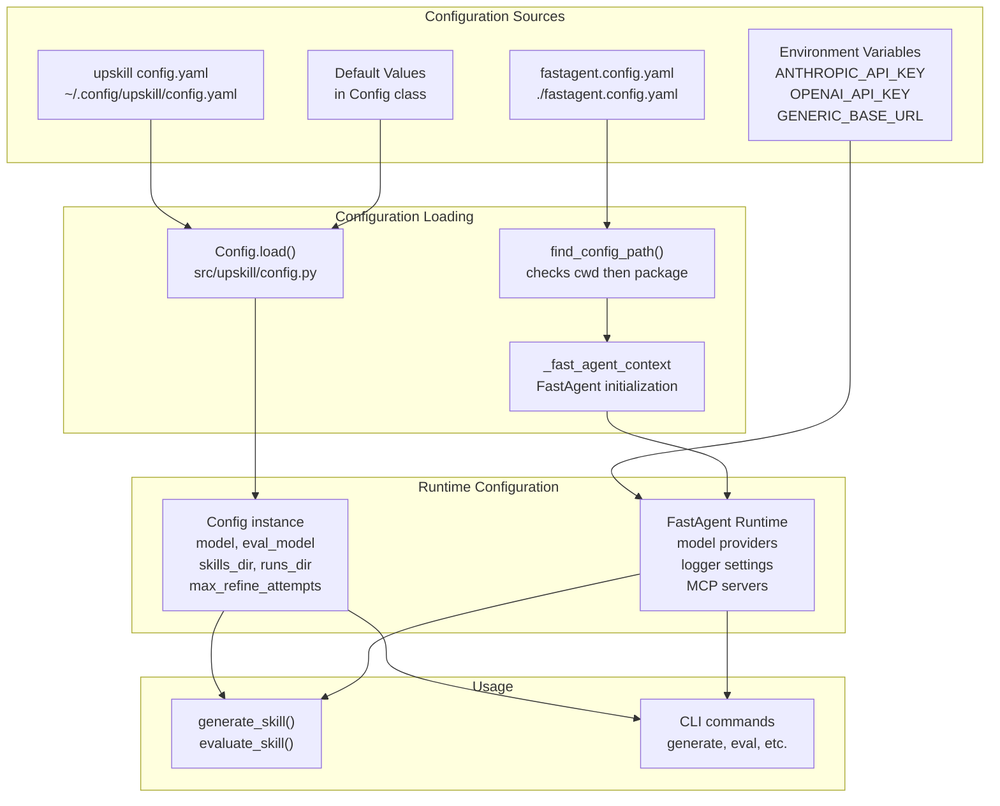
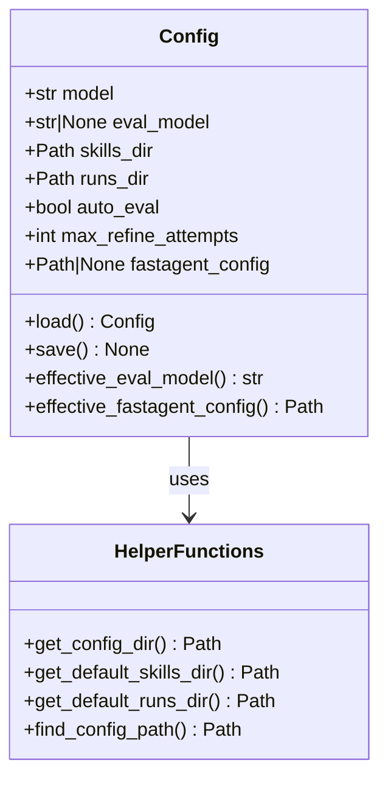
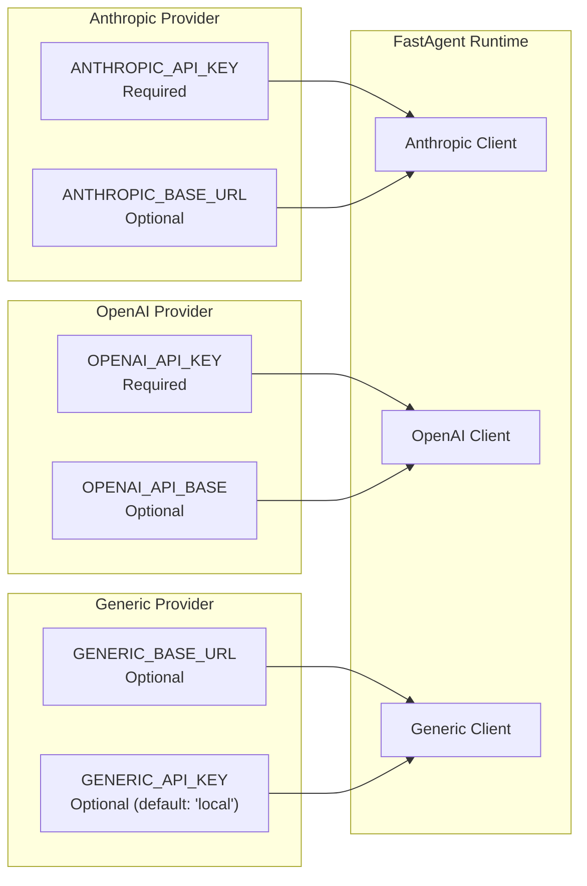
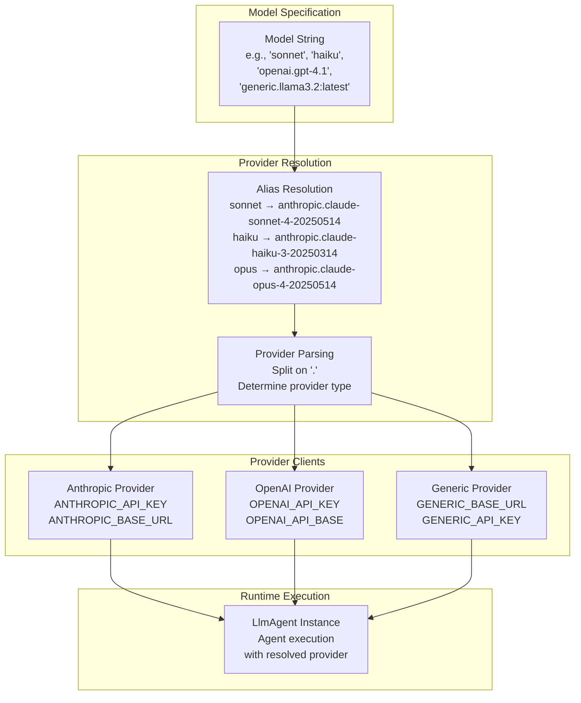
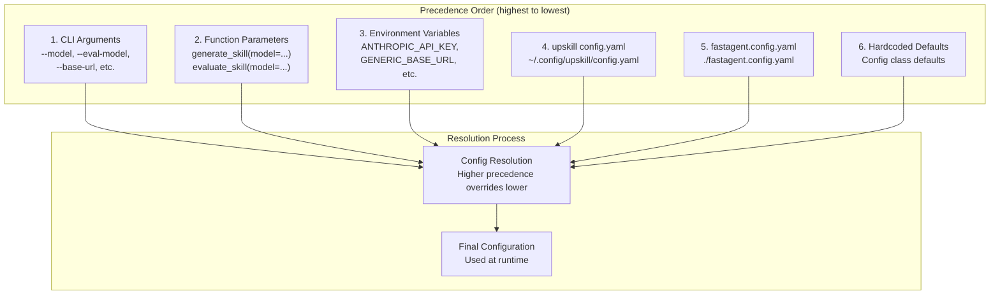
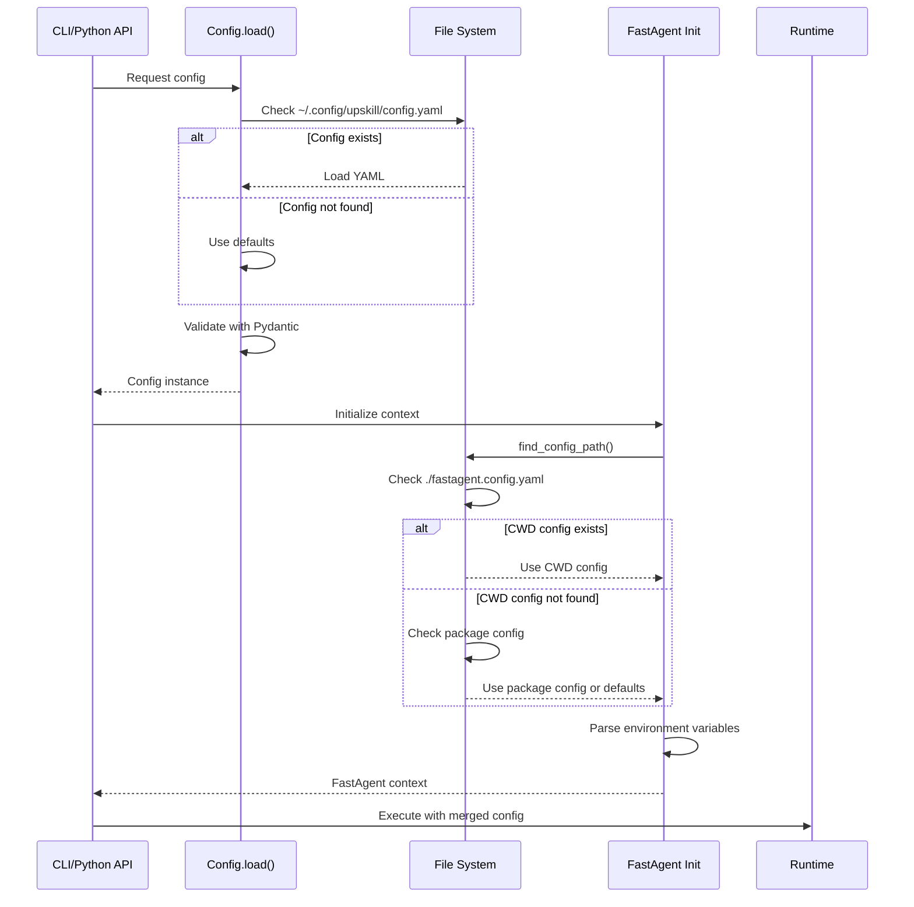
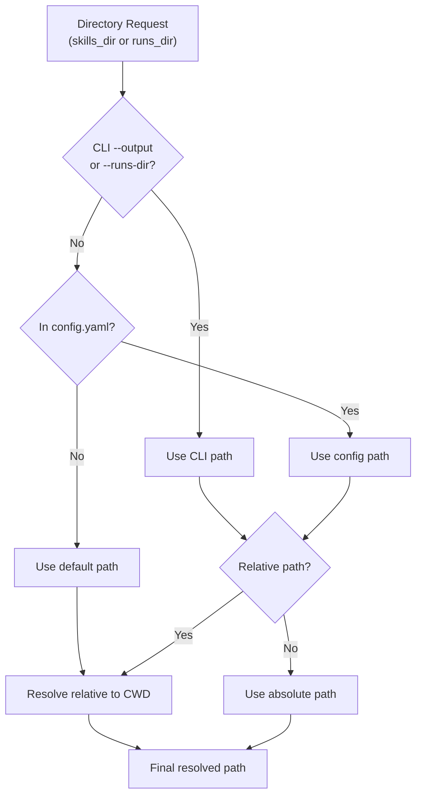

<!-- source: DeepWiki mcp.deepwiki.com · repo huggingface/upskill · page 2.2 Configuration · fetched 2026-10-26 -->

# Configuration

<details>
<summary>Relevant source files</summary>

The following files were used as context for generating this wiki page:

- [README.md](README.md)
- [fastagent.config.yaml](fastagent.config.yaml)
- [src/upskill/config.py](src/upskill/config.py)

</details>


## Purpose and Scope

This document covers all configuration aspects of the upskill system, including the upskill-specific configuration file (`config.yaml`), the FastAgent runtime configuration file (`fastagent.config.yaml`), environment variables for API keys and endpoints, and model provider setup. For details on programmatically manipulating configuration objects, see [Configuration API](#9.3). For information about agent card configuration (which defines agent behavior), see [Agent Cards](#6.1).

---

## Configuration Architecture

The upskill system uses a layered configuration approach with three sources that are merged at runtime:



**Sources:** [src/upskill/config.py:1-102](), [README.md:374-423](), [fastagent.config.yaml:1-33]()

---

## upskill Configuration

The upskill configuration file (`config.yaml`) controls generation and evaluation behavior. It is located at `~/.config/upskill/config.yaml` by default.

### Configuration Options

| Field | Type | Default | Description |
|-------|------|---------|-------------|
| `model` | string | `"sonnet"` | Default model for skill generation |
| `eval_model` | string | `null` | Default model for evaluation (uses `model` if not set) |
| `skills_dir` | path | `./skills` | Directory for saving generated skills |
| `runs_dir` | path | `./runs` | Directory for saving run logs |
| `auto_eval` | boolean | `true` | Whether to run evaluation after generation |
| `max_refine_attempts` | integer | `2` | Maximum number of refinement iterations |
| `fastagent_config` | path | `null` | Override path to fastagent.config.yaml |

### Example Configuration

```yaml
# ~/.config/upskill/config.yaml
model: sonnet                    # Default generation model
eval_model: haiku                # Default evaluation model (optional)
skills_dir: ./skills             # Where to save skills
runs_dir: ./runs                 # Where to save run logs
max_refine_attempts: 3           # Refinement iterations
auto_eval: true                  # Auto-evaluate after generation
```

### Config Class Structure

The `Config` class in [src/upskill/config.py:38-102]() uses Pydantic to validate and manage configuration:



**Key methods:**

- `Config.load()` - Loads config from file or returns defaults [src/upskill/config.py:61-75]()
- `Config.save()` - Saves config to file [src/upskill/config.py:77-89]()
- `effective_eval_model` - Returns `eval_model` if set, otherwise `model` [src/upskill/config.py:92-94]()
- `effective_fastagent_config` - Resolves the FastAgent config path [src/upskill/config.py:97-101]()

**Sources:** [src/upskill/config.py:38-102](), [README.md:376-384]()

---

## FastAgent Configuration

The FastAgent configuration file (`fastagent.config.yaml`) controls the agent runtime, including model providers, logging, and MCP servers. The system searches for this file in the current working directory first, then falls back to the package-bundled version [src/upskill/config.py:26-35]().

### Configuration Sections

#### Default Model

```yaml
default_model: sonnet
```

Specifies the default model when not overridden by command-line arguments or upskill config. Supports the FastAgent model format: `<provider>.<model>.<reasoning_effort?>`.

#### Generic Provider (Local Models)

```yaml
generic:
  api_key: "local"
  base_url: "http://localhost:11434/v1"
```

Configures the generic provider for OpenAI-compatible endpoints (Ollama, llama.cpp, vLLM, etc.). Can be overridden by `GENERIC_BASE_URL` and `GENERIC_API_KEY` environment variables.

#### MCP Timeline Display

```yaml
mcp_timeline:
  steps: 20
  step_seconds: 15
```

Controls the visual display of MCP (Model Context Protocol) server operations in the terminal.

#### Shell Execution

```yaml
shell_execution:
  show_bash: true
```

Controls whether bash commands executed by agents are displayed.

#### Logger Settings

```yaml
logger:
  progress_display: false
  show_chat: false
  show_tools: false
  truncate_tools: true
  streaming: none
```

Controls FastAgent's terminal output verbosity:

| Setting | Values | Description |
|---------|--------|-------------|
| `progress_display` | boolean | Show agent execution progress |
| `show_chat` | boolean | Display agent chat messages |
| `show_tools` | boolean | Display tool calls |
| `truncate_tools` | boolean | Truncate long tool outputs |
| `streaming` | `none`, `markdown`, `text` | Agent response streaming mode |

### Complete Example

```yaml
# FastAgent Configuration for upskill
default_model: sonnet

# Generic provider for local models
generic:
  api_key: "local"
  base_url: "http://localhost:11434/v1"

# MCP timeline display
mcp_timeline:
  steps: 20
  step_seconds: 15

# Shell execution
shell_execution:
  show_bash: true

# Logging and console output
logger:
  progress_display: false
  show_chat: false
  show_tools: false
  truncate_tools: true
  streaming: none

# Optional: MCP servers
mcp:
  servers:
    fetch:
      command: "uvx"
      args: ["mcp-server-fetch"]
```

**Sources:** [fastagent.config.yaml:1-33](), [README.md:386-404]()

---

## Environment Variables

Environment variables configure API credentials and endpoints, primarily for FastAgent's model providers.

### Environment Variable Reference



### Variable Details

| Variable | Required | Default | Purpose |
|----------|----------|---------|---------|
| `ANTHROPIC_API_KEY` | Yes (for Anthropic) | - | Anthropic API authentication |
| `ANTHROPIC_BASE_URL` | No | Anthropic default | Custom Anthropic endpoint |
| `OPENAI_API_KEY` | Yes (for OpenAI) | - | OpenAI API authentication |
| `OPENAI_API_BASE` | No | OpenAI default | Custom OpenAI endpoint |
| `GENERIC_BASE_URL` | No | `http://localhost:11434/v1` | Local/custom OpenAI-compatible endpoint |
| `GENERIC_API_KEY` | No | `"local"` | API key for generic provider |

### Example Setup

```bash
# Anthropic models (required for sonnet, haiku, opus aliases)
export ANTHROPIC_API_KEY=sk-ant-api03-...

# OpenAI models
export OPENAI_API_KEY=sk-...

# Custom Anthropic endpoint (optional)
export ANTHROPIC_BASE_URL=http://localhost:8080

# Ollama for local models (optional)
export GENERIC_BASE_URL=http://localhost:11434/v1
export GENERIC_API_KEY=local
```

**Sources:** [README.md:406-422]()

---

## Model Provider Setup

The upskill system supports three model provider types through FastAgent: Anthropic, OpenAI, and generic (for local/custom endpoints).

### Model Format

All models use the FastAgent format:

```
<provider>.<model>.<reasoning_effort?>
```

**Components:**
- `provider` - `anthropic`, `openai`, or `generic`
- `model` - Model identifier (e.g., `claude-sonnet-4-20250514`, `gpt-4.1`, `llama3.2:latest`)
- `reasoning_effort` - Optional reasoning parameter (e.g., `low`, `medium`, `high`, or token count)

### Provider Configuration Mapping



### Anthropic Provider

**Model Aliases:**
- `sonnet` → `anthropic.claude-sonnet-4-20250514`
- `haiku` → `anthropic.claude-haiku-3-20250314`
- `opus` → `anthropic.claude-opus-4-20250514`

**Configuration:**
```bash
export ANTHROPIC_API_KEY=sk-ant-api03-...
# Optional: custom endpoint
export ANTHROPIC_BASE_URL=http://localhost:8080
```

**Usage examples:**
```bash
# Using alias
upskill generate "task description" --model sonnet

# Using full model name
upskill generate "task description" --model anthropic.claude-sonnet-4-20250514

# With reasoning effort
upskill generate "task description" --model anthropic.opus.1024
```

### OpenAI Provider

**Model Aliases:**
- `gpt-4.1` → `openai.gpt-4.1`
- `o3-mini` → `openai.o3-mini`

**Configuration:**
```bash
export OPENAI_API_KEY=sk-...
# Optional: custom endpoint
export OPENAI_API_BASE=http://localhost:11434/v1
```

**Usage examples:**
```bash
# Using alias
upskill generate "task description" --model gpt-4.1

# Using full model name
upskill generate "task description" --model openai.gpt-4.1

# With reasoning effort
upskill generate "task description" --model openai.o3-mini.low
```

### Generic Provider (Local Models)

The generic provider enables local model usage through any OpenAI-compatible API (Ollama, llama.cpp, vLLM, etc.).

**Configuration:**
```bash
export GENERIC_BASE_URL=http://localhost:11434/v1
export GENERIC_API_KEY=local  # Optional
```

Or in `fastagent.config.yaml`:
```yaml
generic:
  api_key: "local"
  base_url: "http://localhost:11434/v1"
```

**Usage examples:**

**With Ollama:**
```bash
# Start Ollama
ollama serve

# Use Ollama model
upskill generate "task" --model generic.llama3.2:latest \
    --base-url http://localhost:11434/v1
```

**With llama.cpp:**
```bash
# Start llama.cpp server
./llama-server -m model.gguf --port 8080

# Use local model
upskill generate "task" --model generic.my-model \
    --base-url http://localhost:8080/v1
```

**Auto-detection:** When `--base-url` is provided without `--provider`, the provider is automatically set to `generic`.

**Sources:** [README.md:467-513](), [fastagent.config.yaml:11-15]()

---

## Configuration Loading and Precedence

The configuration system uses a specific precedence order when merging settings from multiple sources:



### Precedence Rules

1. **CLI Arguments** - Highest priority, always overrides other sources
2. **Function Parameters** - When using Python API, explicit parameters override config
3. **Environment Variables** - API keys and endpoints from environment
4. **upskill config.yaml** - User-specific upskill settings
5. **fastagent.config.yaml** - Project-specific FastAgent settings
6. **Hardcoded Defaults** - Lowest priority, used when no other source provides value

### Loading Flow



**Sources:** [src/upskill/config.py:26-102](), [README.md:374-423]()

---

## Default Values

When no configuration is provided, the system uses these defaults:

### upskill Defaults

| Setting | Default Value | Source |
|---------|--------------|--------|
| `model` | `"sonnet"` | [src/upskill/config.py:42]() |
| `eval_model` | `None` (uses `model`) | [src/upskill/config.py:43]() |
| `skills_dir` | `./skills` | [src/upskill/config.py:16-18]() |
| `runs_dir` | `./runs` | [src/upskill/config.py:21-23]() |
| `auto_eval` | `true` | [src/upskill/config.py:54]() |
| `max_refine_attempts` | `2` | [src/upskill/config.py:55]() |
| `fastagent_config` | `None` (auto-detected) | [src/upskill/config.py:58]() |

### FastAgent Defaults

| Setting | Default Value | Source |
|---------|--------------|--------|
| `default_model` | `"kimi"` | [fastagent.config.yaml:9]() |
| `generic.api_key` | `"local"` | [fastagent.config.yaml:14]() |
| `generic.base_url` | `"http://localhost:11434/v1"` | [fastagent.config.yaml:15]() |
| `logger.progress_display` | `false` | [fastagent.config.yaml:28]() |
| `logger.show_chat` | `false` | [fastagent.config.yaml:29]() |
| `logger.streaming` | `"none"` | [fastagent.config.yaml:32]() |

### Directory Resolution

The system resolves directory paths in this order:



**Example:**
- Default `skills_dir` → `./skills` → resolved to `{CWD}/skills`
- Config `skills_dir: /absolute/path` → used as-is
- CLI `--output ./custom` → `{CWD}/custom`

**Sources:** [src/upskill/config.py:16-24](), [src/upskill/config.py:38-56](), [fastagent.config.yaml:1-33]()

---

