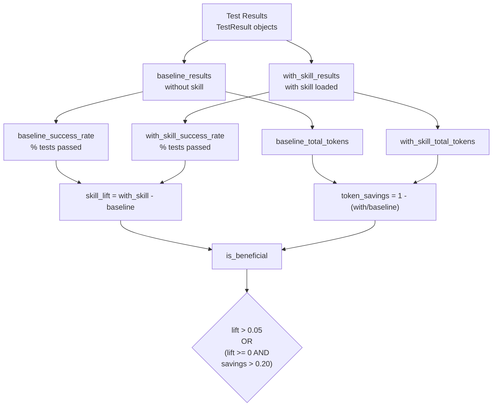
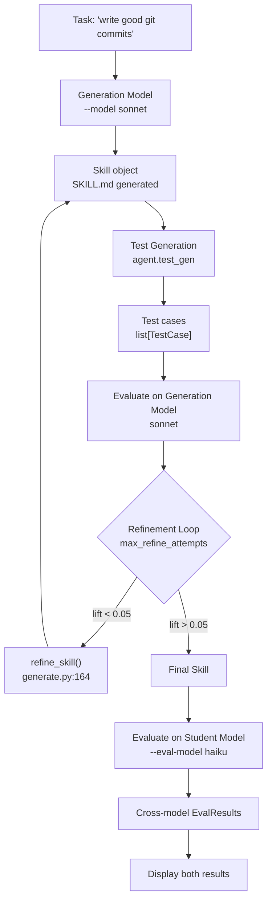
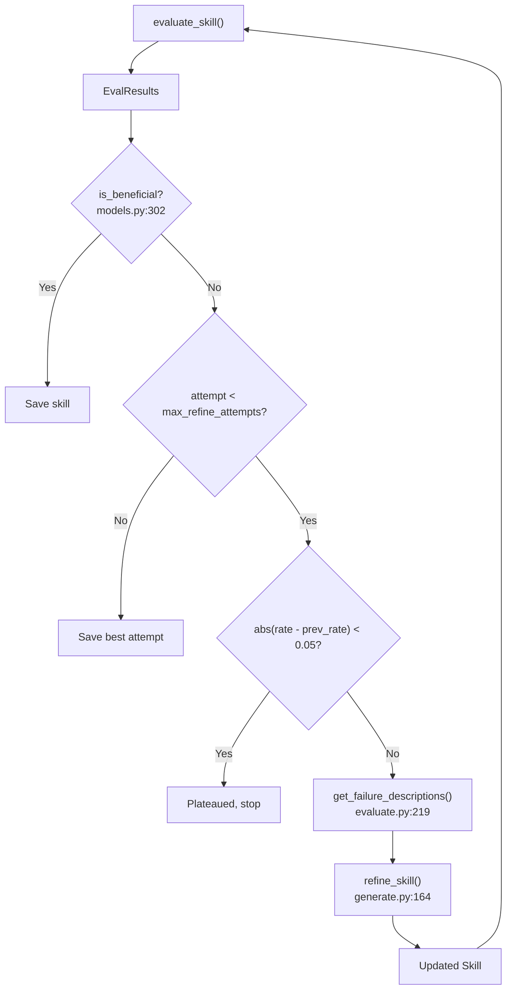

<!-- source: DeepWiki mcp.deepwiki.com · repo huggingface/upskill · page 2.3 Quick Start Tutorial · fetched 2026-10-26 -->

# Quick Start Tutorial

<details>
<summary>Relevant source files</summary>

The following files were used as context for generating this wiki page:

- [README.md](README.md)
- [src/upskill/cli.py](src/upskill/cli.py)
- [src/upskill/generate.py](src/upskill/generate.py)
- [tests/test_smoke.py](tests/test_smoke.py)

</details>


## Purpose and Scope

This tutorial walks you through generating and evaluating your first skill using upskill's CLI. You will learn how to create a skill from a task description, understand the automatic evaluation process, and interpret the results. This tutorial assumes you have already completed installation ([2.1](#2.1)) and configuration ([2.2](#2.2)).

For programmatic usage of upskill, see the Python API documentation ([9](#9)). For detailed information about the skill lifecycle, see [5](#5).

---

## Prerequisites

Before starting, verify your setup:

```bash
# Check upskill is installed
upskill --version

# Verify API keys are configured
echo $ANTHROPIC_API_KEY  # or $OPENAI_API_KEY
```

Ensure you have a `fastagent.config.yaml` in your working directory or have configured the default model in `~/.config/upskill/config.yaml`.

**Sources:** [src/upskill/cli.py:14](), [src/upskill/config.py]()

---

## Step 1: Generate Your First Skill

Let's create a skill that teaches an AI agent how to write git commit messages:

```bash
upskill generate "write good git commit messages"
```

### What Happens During Generation

```mermaid
graph LR
    User["User provides task"] --> CLI["upskill generate command<br/>cli.py:189"]
    CLI --> GenSkill["generate_skill()<br/>generate.py:104"]
    GenSkill --> SkillGenAgent["agent.skill_gen<br/>agent_cards/skill_gen.md"]
    SkillGenAgent --> ParseManifest["parse_skill_manifest_text()<br/>manifest_utils.py"]
    ParseManifest --> SkillObj["Skill object<br/>models.py:72"]
    SkillObj --> GenTests["generate_tests()<br/>generate.py:131"]
    GenTests --> TestGenAgent["agent.test_gen<br/>agent_cards/test_gen.md"]
    TestGenAgent --> TestCases["list[TestCase]<br/>models.py:16"]
    TestCases --> Eval["evaluate_skill()<br/>evaluate.py:140"]
    Eval --> Results["EvalResults<br/>models.py:270"]
    Results --> Decision{"is_beneficial?"}
    Decision -->|Yes| Save["Save to ./skills/"]
    Decision -->|No| Refine["refine_skill()<br/>generate.py:164"]
    Refine --> GenTests
```



**Sources:** [src/upskill/cli.py:189-253](), [src/upskill/generate.py:104-128](), [src/upskill/generate.py:131-161]()

### Understanding the Console Output

The command will display progress through several phases:

```
Generating skill with sonnet...
Generating test cases...
Evaluating on sonnet... (attempt 1)
  60% -> 100% (+40%) OK

  git-commit-messages
  Write clear, conventional commit messages that follow best practices.

  SKILL.md              ~450 tokens

  baseline   ████████████░░░░░░░░   60%
  with skill ████████████████████  100%  (+40%)

  tokens: 1200 → 800  (-33%)

Saved to ./skills/git-commit-messages
```

| Phase | Description | Implementation |
|-------|-------------|----------------|
| **Skill Generation** | Creates SKILL.md with instructions | [generate.py:104-128]() |
| **Test Generation** | Creates 3-5 test cases automatically | [generate.py:131-161]() |
| **Baseline Evaluation** | Runs tests without the skill | [evaluate.py:140-204]() |
| **With-Skill Evaluation** | Runs tests with the skill loaded | [evaluate.py:140-204]() |
| **Comparison** | Calculates `skill_lift` and `token_savings` | [models.py:294-307]() |
| **Decision** | Checks if `is_beneficial` criteria met | [models.py:302-307]() |

**Sources:** [src/upskill/cli.py:256-536](), [src/upskill/generate.py](), [src/upskill/evaluate.py:140-204]()

---

## Step 2: Examine the Generated Skill

Navigate to the skill directory:

```bash
cd ./skills/git-commit-messages
ls -la
```

You'll see:

```
./skills/git-commit-messages/
├── SKILL.md           # Main skill document
├── skill_meta.json    # Metadata (model, timestamp, metrics)
└── tests.json         # Generated test cases (optional)
```

### Skill Structure

The `SKILL.md` file contains YAML frontmatter and markdown body:

```markdown
---
name: git-commit-messages
description: Write clear, conventional commit messages
---

# Git Commit Messages Skill

## Format

Commit messages should follow: <type>(<scope>): <subject>

## Types
- feat: New feature
- fix: Bug fix
...
```

The `skill_meta.json` contains:

```json
{
  "generated_by": "anthropic.claude-sonnet-4-20250514",
  "generated_at": "2025-01-21T15:30:00Z",
  "source_task": "write good git commit messages",
  "test_pass_rate": 1.0
}
```

**Sources:** [src/upskill/models.py:72-137](), [src/upskill/models.py:49-69](), [README.md:302-354]()

---

## Step 3: Understanding Evaluation Metrics

### Key Metrics



The `is_beneficial` property in [models.py:302-307]() implements this logic:

```python
@property
def is_beneficial(self) -> bool:
    """True if skill improves success rate >5% OR saves >20% tokens."""
    return self.skill_lift > 0.05 or (
        self.skill_lift >= 0 and self.token_savings > 0.20
    )
```

**Sources:** [src/upskill/models.py:270-307](), [src/upskill/evaluate.py:140-204]()

### Test Case Format

Test cases in `tests.json` follow the `TestCase` structure:

```json
[
  {
    "input": "Write a commit message for adding login feature",
    "expected": {
      "contains": ["feat", "login"]
    }
  },
  {
    "input": "Write a commit for fixing null pointer bug",
    "expected": {
      "contains": ["fix", "bug", "null"]
    }
  }
]
```

Each test case is validated using the `ExpectedSpec` which checks if the agent's output contains all required strings.

**Sources:** [src/upskill/models.py:16-48](), [src/upskill/generate.py:14-78]()

---

## Step 4: Evaluate on a Different Model

You can generate a skill with one model (teacher) and evaluate it on another (student):

```bash
upskill generate "write good git commit messages" \
    --model sonnet \
    --eval-model haiku
```

### Teacher-Student Flow



The console output will show both evaluations:

```
Evaluating on sonnet... (attempt 1)
  60% -> 100% (+40%) OK

Evaluating on haiku...
  60% -> 80% (+20%)

  sonnet
    baseline   ████████████░░░░░░░░   60%
    with skill ████████████████████  100%  (+40%)

  haiku
    baseline   ████████████░░░░░░░░   60%
    with skill ████████████████░░░░   80%  (+20%)
```

**Sources:** [src/upskill/cli.py:256-536](), [src/upskill/generate.py:164-195]()

---

## Step 5: Review Run Logs

By default, all evaluation runs are logged to `./runs/`:

```bash
ls -la ./runs/
```

### Run Directory Structure

```
./runs/
└── batch_20250121_153000/
    ├── run_1/
    │   ├── run_metadata.json
    │   └── run_result.json
    ├── run_2/
    │   ├── run_metadata.json
    │   └── run_result.json
    └── batch_summary.json
```

| File | Data Structure | Purpose |
|------|----------------|---------|
| `run_metadata.json` | `RunMetadata` | Model, task, batch_id, run_number |
| `run_result.json` | `RunResult` | Pass/fail, assertions, ConversationStats |
| `batch_summary.json` | `BatchSummary` | Aggregated results for all runs |

**Sources:** [src/upskill/logging.py:24-94](), [src/upskill/models.py:252-332]()

### ConversationStats Details

Each run captures detailed metrics in the `ConversationStats` object:

```json
{
  "conversation_span_ms": 1234,
  "llm_time_ms": 890,
  "tool_time_ms": 234,
  "turns": 3,
  "tool_calls": 5,
  "mcp_calls": 2,
  "execute_calls": 3,
  "input_tokens": 450,
  "output_tokens": 350,
  "total_tokens": 800,
  "tool_call_map": {"read_file": 2, "write_file": 3},
  "tool_error_map": {}
}
```

**Sources:** [src/upskill/models.py:212-249](), [src/upskill/logging.py:96-216]()

---

## Step 6: View Results Later

Use the `runs` command to visualize logged results:

```bash
upskill runs --skill git-commit-messages
```

Output:

```
skill: git-commit-messages

sonnet
  baseline   ████████████░░░░░░░░   60%
  with skill ████████████████████  100%  (+40%)

haiku
  baseline   ████████████░░░░░░░░   60%
  with skill ████████████████░░░░   80%  (+20%)
```

Export to CSV for analysis:

```bash
upskill runs --csv ./results.csv
```

The CSV contains 24+ metrics columns including all `ConversationStats` fields, success rates, and token usage.

**Sources:** [src/upskill/cli.py:111-159](), [src/upskill/logging.py:218-343]()

---

## Common Workflows

### Workflow 1: Generate from Examples

```bash
upskill generate "parse JSON files" \
    -e "Input: {\"name\": \"test\"} -> Output: parsed successfully" \
    -e "Input: invalid json -> Output: error: invalid syntax"
```

The `--example` flag passes input/output pairs to [generate.py:112-116]() which includes them in the generation prompt.

**Sources:** [src/upskill/cli.py:169-171](), [src/upskill/generate.py:104-128]()

### Workflow 2: Improve Existing Skill

```bash
upskill generate "add more error handling examples" \
    --from ./skills/api-errors/
```

When `--from` points to a directory, [cli.py:230-238]() detects it as a skill directory and calls `improve_skill()` instead of `generate_skill()`.

**Sources:** [src/upskill/cli.py:230-238](), [src/upskill/generate.py:227-265]()

### Workflow 3: Generate from Agent Trace

```bash
upskill generate "document this pattern" --from ./trace.json
```

When `--from` points to a file, [cli.py:286-303]() loads the trace content and includes it in the generation prompt as context.

**Sources:** [src/upskill/cli.py:286-303]()

### Workflow 4: Skip Evaluation

```bash
upskill generate "quick prototype skill" --no-eval
```

The `--no-eval` flag skips test generation and evaluation, immediately saving the skill to disk.

**Sources:** [src/upskill/cli.py:185](), [src/upskill/cli.py:332-334]()

---

## Understanding the Refinement Loop

When a skill doesn't meet the `is_beneficial` criteria, upskill automatically refines it:



The refinement logic is in [cli.py:339-439]():

```python
for attempt in range(attempts):
    results = await evaluate_skill(...)
    
    if results.is_beneficial:
        break
    
    if abs(results.with_skill_success_rate - prev_success_rate) < 0.05:
        console.print("Plateaued, stopping")
        break
    
    if attempt < attempts - 1:
        failures = get_failure_descriptions(results)
        skill = await refine_skill(skill, failures, ...)
```

**Sources:** [src/upskill/cli.py:339-439](), [src/upskill/generate.py:164-195](), [src/upskill/evaluate.py:219-232]()

---

## Next Steps

Now that you've generated and evaluated your first skill, you can:

1. **Evaluate existing skills** - Use `upskill eval` to test skills on new models ([4.2](#4.2))
2. **List all skills** - Use `upskill list -v` to see your skill collection ([4.3](#4.3))
3. **Benchmark skills** - Compare multiple models with `upskill benchmark` ([4.4](#4.4))
4. **Use the Python API** - Integrate upskill into your own code ([9](#9))
5. **Understand skill structure** - Learn about SKILL.md format and references ([3.1](#3.1))
6. **Explore evaluation metrics** - Deep dive into success rates and token savings ([3.3](#3.3))

**Sources:** [README.md:1-514](), [src/upskill/cli.py]()

---

