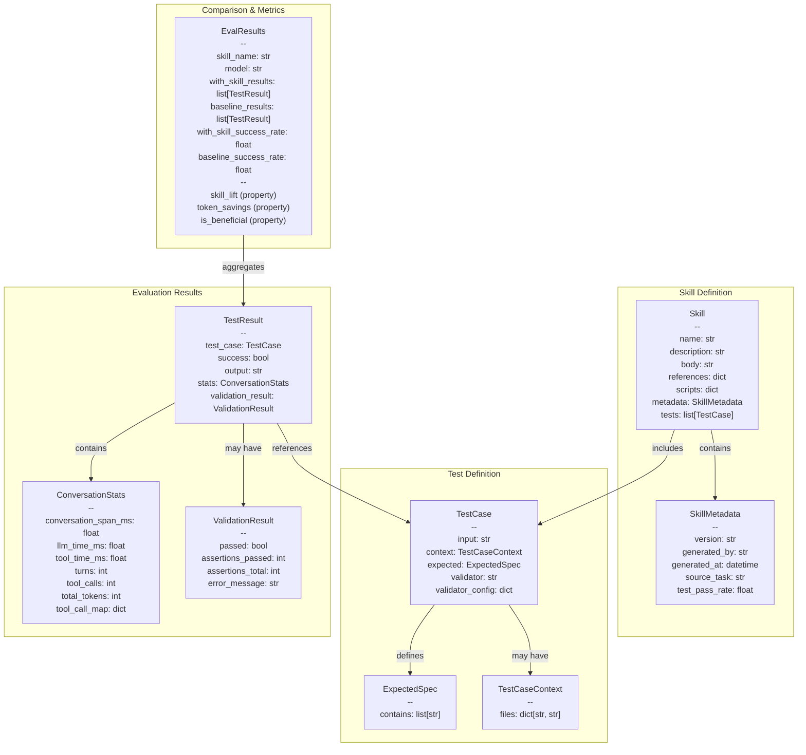
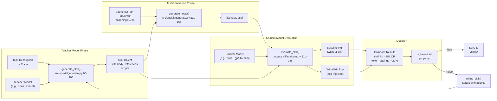
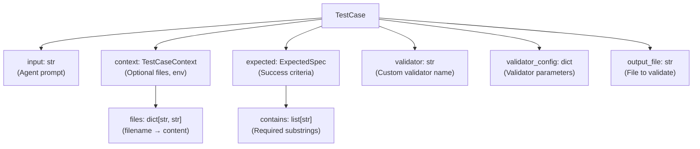
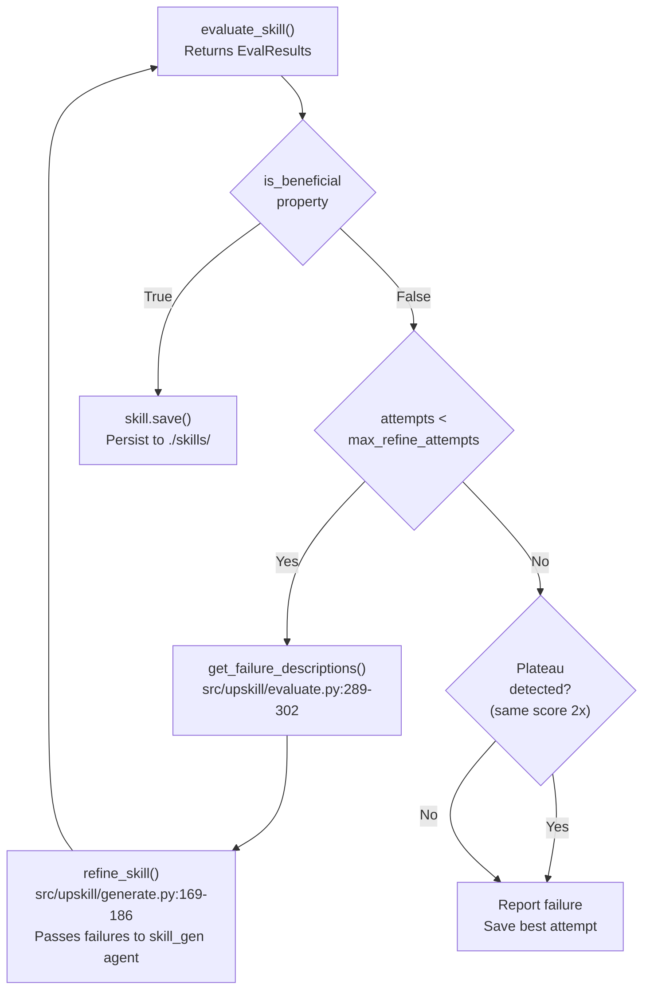

<!-- source: DeepWiki mcp.deepwiki.com · repo huggingface/upskill · page 3 Core Concepts · fetched 2026-10-26 -->

# Core Concepts

<details>
<summary>Relevant source files</summary>

The following files were used as context for generating this wiki page:

- [README.md](README.md)
- [src/upskill/evaluate.py](src/upskill/evaluate.py)
- [src/upskill/models.py](src/upskill/models.py)

</details>


This page introduces the fundamental concepts and data models in the upskill system. These building blocks enable the teacher-student model paradigm where powerful AI models generate reusable skills that less capable models can use to improve their performance. For detailed information about generating skills, see [Skill Generation](#5.1). For evaluation workflows, see [Skill Evaluation](#5.3). For CLI usage, see [CLI Reference](#4).

## Core Data Model Architecture

The upskill system is built around four primary Pydantic models that represent the complete lifecycle from skill creation to evaluation:



**Sources:** [src/upskill/models.py:1-426]()

## The Teacher-Student Paradigm

The upskill system implements a teacher-student model approach where expensive, high-capability models (teachers) generate skills that cheaper, faster models (students) can use to improve performance on complex tasks.



**Key principle:** Teachers are used for generation (creating skill content), while students are used for evaluation (testing if the skill actually helps). This allows organizations to use expensive models sparingly for skill creation, then deploy skills to cheaper models in production.

**Sources:** [README.md:1-514](), [src/upskill/generate.py:60-186](), [src/upskill/evaluate.py:211-286]()

## Skill Object Structure

A `Skill` is the central data model representing an agent skill. It follows the Claude Code `SKILL.md` specification with additional upskill-specific metadata.

### Skill Fields

| Field | Type | Purpose |
|-------|------|---------|
| `name` | `str` | Kebab-case identifier (e.g., `git-commit-messages`) |
| `description` | `str` | Short summary (max 1024 chars) |
| `body` | `str` | Main instruction content (markdown) |
| `references` | `dict[str, str]` | Supporting documents (filename → content) |
| `scripts` | `dict[str, str]` | Executable code (filename → code) |
| `metadata` | `SkillMetadata` | Generation provenance and statistics |
| `tests` | `list[TestCase]` | Evaluation test cases |
| `allowed_tools` | `list[str] \| None` | Tool restrictions |
| `user_invocable` | `bool` | Whether users can invoke directly |

### Skill Persistence Format

Skills are saved as directories with a standardized structure:

```
./skills/{skill-name}/
├── SKILL.md              # Claude Code format with YAML frontmatter
├── skill_meta.json       # SkillMetadata + tests
├── references/           # Supporting documents (optional)
│   └── *.md
└── scripts/              # Executable scripts (optional)
    └── *.py
```

The `Skill.save()` method at [src/upskill/models.py:148-183]() handles serialization, while `Skill.load()` at [src/upskill/models.py:184-273]() handles deserialization.

**Sources:** [src/upskill/models.py:94-273]()

## Test Cases and Validation

### TestCase Structure

A `TestCase` defines a single evaluation scenario:



### Validation Flow

The `check_expected()` function at [src/upskill/evaluate.py:62-97]() implements a two-tier validation system:

1. **Custom Validators**: If `test_case.validator` is set, the system loads a custom validator function via `get_validator()` and executes it with workspace isolation
2. **String Containment**: Falls back to checking if all strings in `expected.contains` appear in the agent's output

Custom validators return a `ValidationResult` with detailed metrics:

```python
ValidationResult(
    passed=True,
    assertions_passed=5,
    assertions_total=5,
    metrics_count=3,
    benchmarks_found=["accuracy", "f1_score"]
)
```

**Sources:** [src/upskill/models.py:25-72](), [src/upskill/evaluate.py:62-97]()

## Evaluation Metrics

### Core Metrics

The `EvalResults` model at [src/upskill/models.py:329-364]() captures comprehensive evaluation data:

| Metric | Calculation | Purpose |
|--------|-------------|---------|
| `with_skill_success_rate` | `successes / total_tests` | How often the skill succeeds |
| `baseline_success_rate` | `successes / total_tests` | How often without skill succeeds |
| `skill_lift` | `with_skill_rate - baseline_rate` | Improvement in success rate |
| `with_skill_total_tokens` | `sum(test.stats.total_tokens)` | Token usage with skill |
| `baseline_total_tokens` | `sum(test.stats.total_tokens)` | Token usage without skill |
| `token_savings` | `1 - (with_skill / baseline)` | Percentage tokens saved |

### Derived Properties

Three computed properties determine skill value:

```python
# From src/upskill/models.py:347-363

@property
def skill_lift(self) -> float:
    """Improvement in success rate from using skill."""
    return self.with_skill_success_rate - self.baseline_success_rate

@property
def token_savings(self) -> float:
    """Percentage of tokens saved (negative means more tokens used)."""
    if self.baseline_total_tokens == 0:
        return 0.0
    return 1 - (self.with_skill_total_tokens / self.baseline_total_tokens)

@property
def is_beneficial(self) -> bool:
    """Skill provides net benefit."""
    return self.skill_lift > 0.05 or (self.skill_lift >= 0 and self.token_savings > 0.2)
```

### The is_beneficial Decision Logic

A skill is considered beneficial if **either** condition is met:

1. **Significant improvement**: `skill_lift > 5%` (more than 5 percentage point increase in success rate)
2. **Efficiency gain**: `skill_lift >= 0` AND `token_savings > 20%` (maintains success while saving >20% tokens)

This dual-criteria approach values both:
- **Capability improvement**: Skills that enable new behaviors
- **Efficiency improvement**: Skills that reduce computational cost

**Sources:** [src/upskill/models.py:329-364]()

## ConversationStats: Detailed Performance Tracking

Every test execution captures comprehensive statistics via the `ConversationStats` model:

```mermaid
graph TB
    subgraph "Timing Metrics"
        ConvSpan["conversation_span_ms<br/>(Total wall time)"]
        LLMTime["llm_time_ms<br/>(LLM API time)"]
        ToolTime["tool_time_ms<br/>(Tool execution time)"]
    end
    
    subgraph "Interaction Metrics"
        Turns["turns: int<br/>(Conversation rounds)"]
        ToolCalls["tool_calls: int<br/>(Total tool invocations)"]
        ToolErrors["tool_errors: int<br/>(Failed tool calls)"]
    end
    
    subgraph "Tool Categorization"
        MCPCalls["mcp_calls: int<br/>(Tools with '__')"]
        ExecuteCalls["execute_calls: int<br/>(Built-in tools)"]
    end
    
    subgraph "Per-Tool Tracking"
        CallMap["tool_call_map: dict<br/>(tool → count)"]
        ErrorMap["tool_error_map: dict<br/>(tool → errors)"]
    end
    
    subgraph "Token Usage"
        InputTokens["input_tokens: int"]
        OutputTokens["output_tokens: int"]
        TotalTokens["total_tokens: int"]
    end
    
    ConversationStats["ConversationStats"] --> ConvSpan
    ConversationStats --> LLMTime
    ConversationStats --> ToolTime
    ConversationStats --> Turns
    ConversationStats --> ToolCalls
    ConversationStats --> ToolErrors
    ConversationStats --> MCPCalls
    ConversationStats --> ExecuteCalls
    ConversationStats --> CallMap
    ConversationStats --> ErrorMap
    ConversationStats --> InputTokens
    ConversationStats --> OutputTokens
    ConversationStats --> TotalTokens
```



The `extract_stats_from_summary()` function at [src/upskill/logging.py:96-216]() parses FastAgent's `FAST_AGENT_USAGE` and `FAST_AGENT_TIMING` message channels to populate these fields.

**Tool categorization logic:** Tools with `__` in their name (e.g., `fetch__get`) are MCP server tools; others are built-in execute commands. This distinction helps identify which skills rely on external tool integrations vs. shell operations.

**Sources:** [src/upskill/models.py:277-312](), [src/upskill/logging.py:96-216]()

## Skill Benefits and Refinement Loop

When a skill is not initially beneficial, the system enters a refinement loop:



The `get_failure_descriptions()` function extracts diagnostic information from failed tests:

```python
# From src/upskill/evaluate.py:289-302

def get_failure_descriptions(results: EvalResults) -> list[str]:
    """Extract descriptions of failed tests for refinement."""
    failures = []
    for result in results.with_skill_results:
        if not result.success:
            desc = f"Input: {result.test_case.input}"
            if result.error:
                desc += f" | Error: {result.error}"
            elif result.output:
                desc += f" | Output: {result.output[:200]}..."
            if result.test_case.expected:
                desc += f" | Expected: {result.test_case.expected}"
            failures.append(desc)
    return failures
```

These failure descriptions are passed to the skill generation agent to guide improvement.

**Sources:** [src/upskill/generate.py:169-186](), [src/upskill/evaluate.py:289-302]()

## Workspace Isolation

Test execution uses the `isolated_workspace()` context manager at [src/upskill/evaluate.py:39-60]() to provide clean, temporary directories for file-based tests:

```python
@contextmanager
def isolated_workspace(base_dir: Path | None = None, cleanup: bool = True) -> Generator[Path]:
    """Create an isolated workspace for a test run."""
    workspace = tempfile.mkdtemp(dir=base_dir, prefix="upskill_run_")
    workspace_path = Path(workspace)
    try:
        yield workspace_path
    finally:
        if cleanup:
            try:
                shutil.rmtree(workspace_path, ignore_errors=True)
            except Exception:
                pass
```

This isolation ensures:
- Each test runs in a clean environment
- File-based validators can inspect generated artifacts
- Tests don't interfere with each other
- Shell tools operate in a safe sandbox

Workspace isolation is automatically enabled when `test_case.validator` is set, or can be forced via the `use_workspace` parameter in `run_test()`.

**Sources:** [src/upskill/evaluate.py:39-60](), [src/upskill/evaluate.py:99-179]()

---

