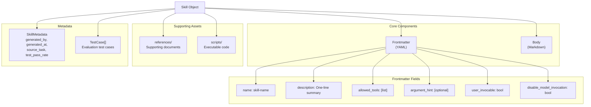
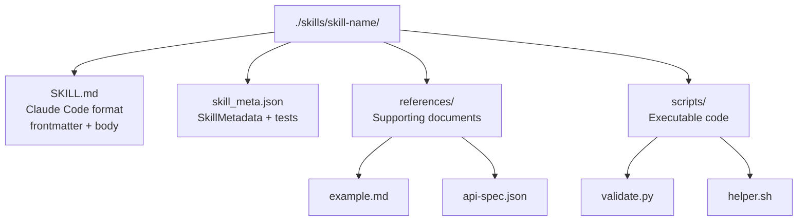
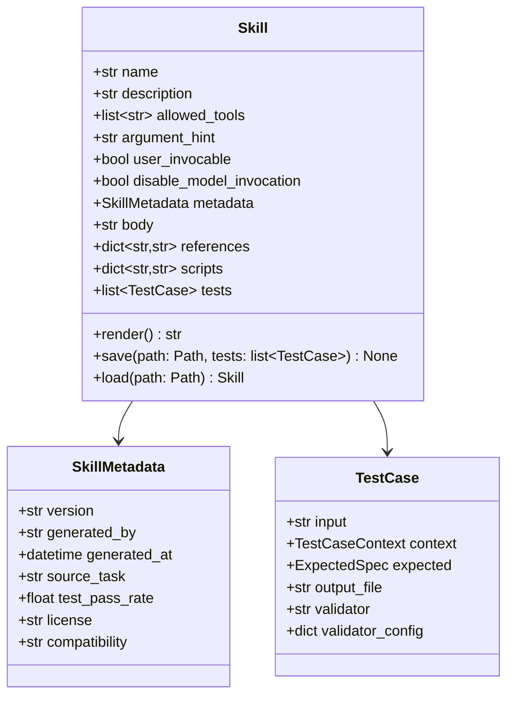
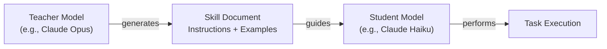

<!-- source: DeepWiki mcp.deepwiki.com · repo huggingface/upskill · page 3.1 Skills · fetched 2026-10-26 -->

# Skills

<details>
<summary>Relevant source files</summary>

The following files were used as context for generating this wiki page:

- [README.md](README.md)
- [src/upskill/agent_cards/skill_gen.md](src/upskill/agent_cards/skill_gen.md)
- [src/upskill/manifest_utils.py](src/upskill/manifest_utils.py)
- [src/upskill/models.py](src/upskill/models.py)

</details>


This page explains what skills are, their structure and format, and how they improve agent performance. Skills are the core artifact of the upskill system—instruction documents that teach AI agents how to perform tasks reliably.

For information about how skills are generated from task descriptions, see [Skill Generation](#5.1). For details on how skills are saved and loaded from disk, see [Skill Persistence](#5.5). For the complete data model reference, see [Skill Models](#7.1).

---

## Purpose

Skills are structured instruction documents designed to teach AI coding agents how to perform specific tasks. They serve as reusable knowledge that can be generated by powerful "teacher" models (like Claude Opus or Sonnet) and then used by less capable "student" models (like Claude Haiku or local models) to achieve better performance on tasks they would otherwise struggle with.

A skill captures best practices, step-by-step instructions, code examples, and common pitfalls for a specific task domain (e.g., writing git commit messages, handling API errors, parsing YAML files). When an agent is given access to a skill, it can reference the instructions to improve its task completion rate and reduce token usage.

**Sources:** [README.md:1-6](), [src/upskill/models.py:94-115](), [src/upskill/agent_cards/skill_gen.md:1-10]()

---

## Skill Anatomy

A skill consists of several components that work together to provide comprehensive guidance to an agent:



**Diagram: Skill Components and Structure**

**Sources:** [src/upskill/models.py:94-115](), [README.md:302-354]()

---

## SKILL.md Format

Skills follow the Claude Code SKILL.md specification, which uses YAML frontmatter followed by markdown instructions. This format is compatible with Claude's native skill system while being extensible for upskill-specific features.

### Frontmatter Fields

| Field | Type | Required | Description |
|-------|------|----------|-------------|
| `name` | `str` | Yes | Kebab-case identifier (e.g., `git-commit-messages`) |
| `description` | `str` | Yes | One-line summary under 1024 characters |
| `allowed-tools` | `list[str]` | No | Tools the skill is permitted to use |
| `argument-hint` | `str` | No | Hint for skill invocation arguments (e.g., `[issue-number]`) |
| `user-invocable` | `bool` | No | Whether users can invoke the skill directly (default: `true`) |
| `disable-model-invocation` | `bool` | No | Prevent model from auto-invoking (default: `false`) |

### Example SKILL.md

```markdown
---
name: git-commit-messages
description: Write clear, conventional commit messages that follow best practices.
---

# Git Commit Messages

## Overview

This guide explains how to write effective git commit messages that follow 
the Conventional Commits specification.

## Format

Commit messages should follow this structure:

```
<type>(<scope>): <subject>

<body>

<footer>
```

## Types

- `feat` – New feature  
- `fix` – Bug fix  
- `docs` – Documentation changes  
...
```

**Sources:** [src/upskill/models.py:123-146](), [README.md:313-354](), [src/upskill/agent_cards/skill_gen.md:17-83]()

---

## Skill Directory Structure

Skills are persisted as directories containing multiple files:



**Diagram: Skill Directory Layout on Disk**

### Files

- **SKILL.md**: The main skill document in Claude Code format. Generated by `Skill.render()` method.
- **skill_meta.json**: Contains `SkillMetadata` (generation provenance) and test cases. Generated by `Skill.save()` method.
- **references/**: Optional directory for supporting documents (e.g., API specifications, style guides, example data).
- **scripts/**: Optional directory for executable scripts referenced in the skill instructions.

**Sources:** [src/upskill/models.py:148-183](), [README.md:304-311]()

---

## Skill Data Model

The `Skill` class in [src/upskill/models.py:94-273]() is the primary data model for skills:



**Diagram: Skill Class Model with Key Methods**

### Key Methods

- **`render() -> str`** [src/upskill/models.py:123-146](): Generates Claude Code compatible SKILL.md with YAML frontmatter
- **`save(path: Path, tests: list[TestCase] | None = None) -> None`** [src/upskill/models.py:148-183](): Writes skill directory with SKILL.md, skill_meta.json, references/, and scripts/
- **`load(path: Path) -> Skill`** [src/upskill/models.py:184-273](): Loads a skill from a directory, parsing frontmatter and reconstructing the skill object

### Name Validation

Skill names must match the pattern `^[a-z0-9]+(-[a-z0-9]+)*$` (lowercase alphanumeric with hyphens). This is enforced by the `validate_name` field validator at [src/upskill/models.py:116-121]().

**Sources:** [src/upskill/models.py:94-273]()

---

## SkillMetadata

The `SkillMetadata` class [src/upskill/models.py:13-22]() tracks provenance and performance information:

| Field | Type | Description |
|-------|------|-------------|
| `version` | `str` | Schema version (currently "1.0") |
| `generated_by` | `str \| None` | Model that generated the skill (e.g., "anthropic.claude-sonnet-4") |
| `generated_at` | `datetime \| None` | Timestamp of generation |
| `source_task` | `str \| None` | Original task description provided by user |
| `test_pass_rate` | `float \| None` | Success rate during final evaluation |
| `license` | `str \| None` | License information for the skill |
| `compatibility` | `str \| None` | Compatibility notes (e.g., required tools/APIs) |

This metadata is persisted to `skill_meta.json` alongside test cases and can be used to track which model generated which skills, when they were created, and how well they performed during evaluation.

**Sources:** [src/upskill/models.py:13-22](), [src/upskill/models.py:160-168]()

---

## Supporting Files

### References

The `references` dictionary maps filenames to content for supporting documents. These files are saved to the `references/` subdirectory and can include:

- API specifications (JSON, YAML)
- Style guides (Markdown)
- Example data files
- Documentation excerpts

Example:
```python
skill.references = {
    "error-codes.md": "# API Error Codes\n\n- 400: Bad Request\n...",
    "api-spec.json": '{"openapi": "3.0.0", ...}'
}
```

### Scripts

The `scripts` dictionary maps filenames to executable code. These files are saved to the `scripts/` subdirectory and can include:

- Python scripts for validation or data processing
- Shell scripts for automation
- Helper utilities referenced in skill instructions

Example:
```python
skill.scripts = {
    "validate.py": "#!/usr/bin/env python3\nimport sys\n...",
    "setup.sh": "#!/bin/bash\necho 'Setting up environment'\n..."
}
```

**Sources:** [src/upskill/models.py:110-111](), [src/upskill/models.py:171-182]()

---

## How Skills Improve Agent Performance

Skills improve agent performance through two primary mechanisms:

### 1. Knowledge Transfer

Skills encode expert knowledge that would otherwise require extensive prompting or fine-tuning. By providing structured instructions, examples, and best practices, skills enable less capable models to perform tasks they would otherwise fail at.



**Diagram: Knowledge Flow from Teacher to Student via Skills**

### 2. Context Optimization

Skills provide targeted context for specific tasks, reducing the need for lengthy system prompts or examples in every request. This leads to:

- **Higher success rates**: Skills provide structured guidance that helps models avoid common mistakes
- **Lower token usage**: Concise, task-specific instructions replace verbose prompting
- **Faster execution**: Fewer tokens means faster processing and lower latency

### Evaluation Metrics

The system measures skill effectiveness using two key metrics (see [Evaluation Metrics](#3.3) for details):

- **Skill Lift**: Improvement in success rate (must exceed 5% for beneficial classification)
- **Token Savings**: Percentage reduction in tokens used (must exceed 20% if success rate doesn't improve)

A skill is considered beneficial if:
```python
skill_lift > 0.05 or (skill_lift >= 0 and token_savings > 0.2)
```

This is implemented in the `is_beneficial` property at [src/upskill/models.py:360-363]().

**Sources:** [README.md:1-6](), [src/upskill/models.py:347-363]()

---

## Skill Lifecycle Overview

```mermaid
graph LR
    TaskDesc["Task Description<br/>or Examples"]
    Generation["Skill Generation<br/>skill_gen agent"]
    SkillDraft["SkillDraft<br/>intermediate format"]
    SkillObj["Skill Object<br/>validated model"]
    TestGen["Test Generation<br/>test_gen agent"]
    Evaluation["Skill Evaluation<br/>baseline comparison"]
    Persistence["save()<br/>to disk"]
    Loading["load()<br/>from disk"]
    Usage["Agent Execution<br/>with skill enabled"]
    
    TaskDesc --> Generation
    Generation --> SkillDraft
    SkillDraft --> SkillObj
    SkillObj --> TestGen
    TestGen --> Evaluation
    Evaluation --> Persistence
    Persistence --> Loading
    Loading --> Usage
```



**Diagram: Skill Lifecycle from Task Description to Agent Usage**

The lifecycle progresses through several stages:

1. **Generation**: A teacher model creates a `SkillDraft` from a task description
2. **Validation**: The draft is validated and converted to a `Skill` object
3. **Test Generation**: Test cases are automatically generated for the skill
4. **Evaluation**: The skill is evaluated against baseline performance
5. **Persistence**: If beneficial, the skill is saved using `Skill.save()`
6. **Loading**: Later, skills can be loaded using `Skill.load()`
7. **Usage**: The loaded skill is provided to agents for task execution

For detailed information about each stage, see:
- [Skill Generation](#5.1)
- [Test Case Generation](#5.2)
- [Skill Evaluation](#5.3)
- [Skill Persistence](#5.5)

**Sources:** [src/upskill/models.py:84-273]()

---

## Integration with FastAgent

Skills are compatible with FastAgent's native skill system through the `SkillManifest` format. The `parse_skill_manifest_text()` utility at [src/upskill/manifest_utils.py:10-24]() converts skill text into FastAgent's `SkillManifest` type:

```python
from upskill.manifest_utils import parse_skill_manifest_text

skill_text = skill.render()
manifest, error = parse_skill_manifest_text(skill_text, path=skill_path)
```

This allows skills generated by upskill to be used directly with FastAgent's `SkillRegistry` and agent execution system.

**Sources:** [src/upskill/manifest_utils.py:1-24]()

---

## SkillDraft vs Skill

During generation, the skill_gen agent produces a `SkillDraft` [src/upskill/models.py:84-92](), which is a simplified intermediate format:

```python
class SkillDraft(BaseModel):
    name: str
    description: str
    body: str
    references: dict[str, str] | None = None
    scripts: dict[str, str] | None = None
```

The draft is then converted to a full `Skill` object with metadata, validation, and Claude Code compatibility. This separation allows the generation agent to focus on content while the system handles validation and formatting.

**Sources:** [src/upskill/models.py:84-92]()

---

## Example: Complete Skill

Here's a complete example of a skill as it would appear in memory and on disk:

### In Memory (Skill Object)

```python
from upskill.models import Skill, SkillMetadata
from datetime import datetime

skill = Skill(
    name="git-commit-messages",
    description="Write clear, conventional commit messages that follow best practices.",
    metadata=SkillMetadata(
        generated_by="anthropic.claude-sonnet-4-20250514",
        generated_at=datetime.now(),
        source_task="write good git commit messages",
        test_pass_rate=0.95
    ),
    body="""# Git Commit Messages

## Format

Commit messages should follow this structure:
...
""",
    references={
        "conventions.md": "# Conventional Commits Spec\n..."
    },
    tests=[...]
)
```

### On Disk (Directory Structure)

```
./skills/git-commit-messages/
├── SKILL.md                    # Generated by skill.render()
├── skill_meta.json             # Metadata + tests
└── references/
    └── conventions.md          # Supporting document
```

**Sources:** [src/upskill/models.py:94-183](), [README.md:304-354]()

---

