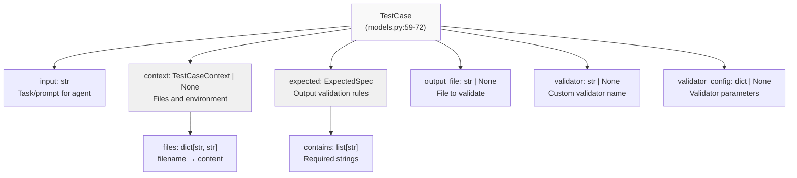
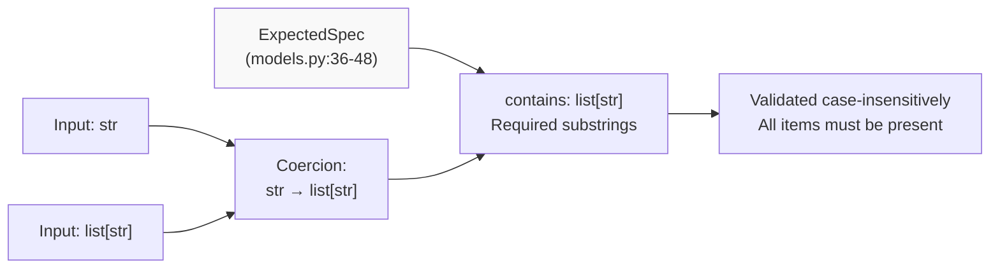
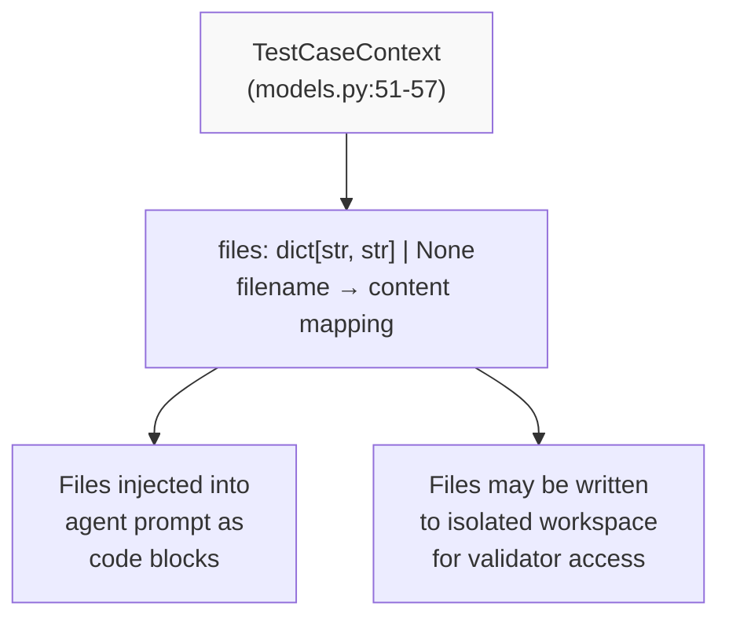
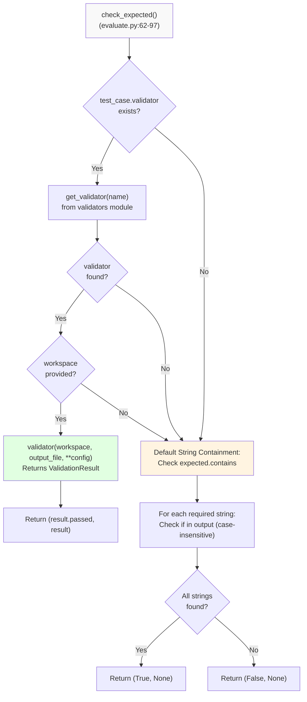
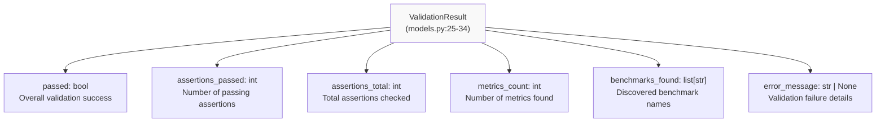
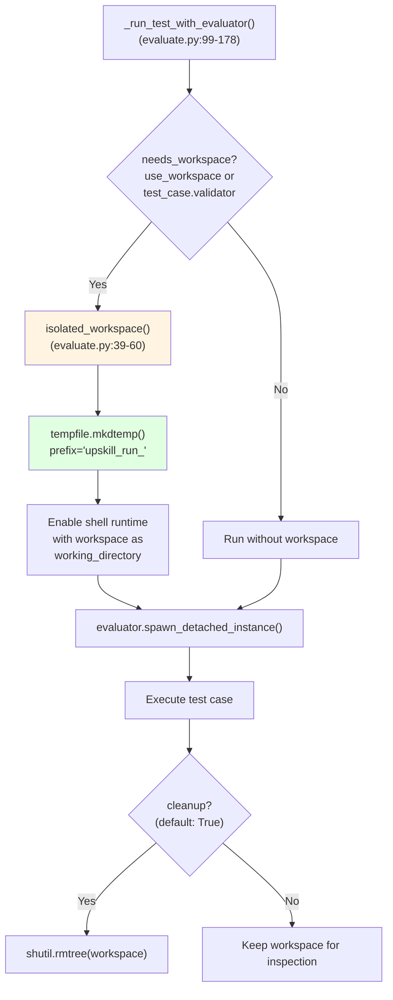

<!-- source: DeepWiki mcp.deepwiki.com · repo huggingface/upskill · page 3.2 Test Cases and Validation · fetched 2026-10-26 -->

# Test Cases and Validation

<details>
<summary>Relevant source files</summary>

The following files were used as context for generating this wiki page:

- [src/upskill/agent_cards/test_gen.md](src/upskill/agent_cards/test_gen.md)
- [src/upskill/evaluate.py](src/upskill/evaluate.py)
- [src/upskill/models.py](src/upskill/models.py)

</details>


## Purpose and Scope

This page describes how test cases are structured and validated in the upskill system. It covers the `TestCase` data model, expected output specifications, validation mechanisms (both simple string containment and custom validators), and how validation results are represented.

For information about how test cases are automatically generated, see [Test Case Generation](#5.2). For the broader evaluation workflow that uses test cases, see [Skill Evaluation](#5.3). For metrics like skill lift and token savings that determine skill benefit, see [Evaluation Metrics](#3.3).

---

## Test Case Data Model

Test cases in upskill are represented by the `TestCase` Pydantic model, which defines what the agent should do and what output is expected.



**Sources:** [src/upskill/models.py:59-72](), [src/upskill/models.py:36-57]()

### Core Fields

| Field | Type | Description |
|-------|------|-------------|
| `input` | `str` | The task or prompt given to the agent to execute |
| `context` | `TestCaseContext \| None` | Optional context including files to provide |
| `expected` | `ExpectedSpec` | Validation rules for the agent's output |
| `output_file` | `str \| None` | Path to a file to validate (for file-based validators) |
| `validator` | `str \| None` | Name of a custom validator function (e.g., `"hf_eval_yaml"`) |
| `validator_config` | `dict \| None` | Configuration parameters passed to the custom validator |

### Test Case Suite

Multiple test cases are organized using `TestCaseSuite`, which provides a structured container:

```python
class TestCaseSuite(BaseModel):
    cases: list[TestCase] = Field(default_factory=list)
```

**Sources:** [src/upskill/models.py:76-82]()

---

## Expected Output Specification

The `ExpectedSpec` model defines what conditions the agent's output must satisfy. Currently, it supports string containment validation with automatic coercion.



**Sources:** [src/upskill/models.py:36-48]()

### Field Coercion

The `contains` field accepts either a string or list of strings. Single strings are automatically coerced to single-element lists:

```python
@field_validator("contains", mode="before")
@classmethod
def coerce_contains(cls, value: str | list[str]) -> list[str]:
    if isinstance(value, str):
        return [value]
    return value
```

This allows test cases to be defined with simple string expectations:

```json
{
  "input": "Calculate 2 + 2",
  "expected": {
    "contains": "4"
  }
}
```

Or multiple required substrings:

```json
{
  "input": "List files in current directory",
  "expected": {
    "contains": ["file1.txt", "file2.txt"]
  }
}
```

**Sources:** [src/upskill/models.py:43-48]()

---

## Test Case Context

The `TestCaseContext` model provides additional resources to the agent during test execution, such as files that should be available in the workspace.



**Sources:** [src/upskill/models.py:51-57]()

### File Injection

When a test case includes context files, they are appended to the agent's input as markdown code blocks:

```python
user_content = test_case.input
if test_case.context and test_case.context.files:
    for filename, content in test_case.context.files.items():
        user_content += f"\n\n```{filename}\n{content}\n```"
```

This makes files visible to the agent for tasks like code review, analysis, or processing.

**Sources:** [src/upskill/evaluate.py:108-111]()

---

## Validation Process

Validation determines whether an agent's output meets the expected criteria. The upskill system supports two validation modes: simple string containment and custom validators.



**Sources:** [src/upskill/evaluate.py:62-97]()

### Simple String Containment Validation

The default validation mode checks that all required strings in `expected.contains` appear in the agent's output. The comparison is case-insensitive:

```python
required = expected.contains
output_lower = output.lower()
if any(item.lower() not in output_lower for item in required):
    return False, None

return True, None
```

This validation mode returns a tuple of `(success: bool, validation_result: None)` where the second element is always `None` because no detailed validation result is produced.

**Sources:** [src/upskill/evaluate.py:91-96]()

### Custom Validator Support

Custom validators enable more sophisticated validation logic, such as:
- Validating structured output files (JSON, YAML, CSV)
- Running assertions against generated code
- Checking file system state
- Comparing metrics or benchmarks

To use a custom validator, specify the `validator` field in the test case:

| TestCase Field | Purpose |
|----------------|---------|
| `validator` | Name of the validator function (e.g., `"hf_eval_yaml"`) |
| `output_file` | Path to the file to validate (relative to workspace) |
| `validator_config` | Dictionary of parameters passed to the validator |

The custom validator is loaded using `get_validator()` from the validators module and receives:

```python
validator = get_validator(test_case.validator)
if validator and workspace:
    config = test_case.validator_config or {}
    result = validator(
        workspace=workspace,
        output_file=test_case.output_file or "",
        **config,
    )
    return result.passed, result
```

Custom validators return a `ValidationResult` object containing detailed information about the validation outcome.

**Sources:** [src/upskill/evaluate.py:79-89](), [src/upskill/models.py:68-71]()

---

## Validation Results

The `ValidationResult` model represents structured output from custom validators, providing detailed metrics and diagnostics.



**Sources:** [src/upskill/models.py:25-34]()

### Fields

| Field | Type | Description |
|-------|------|-------------|
| `passed` | `bool` | Whether validation succeeded overall |
| `assertions_passed` | `int` | Number of assertions that passed |
| `assertions_total` | `int` | Total number of assertions checked |
| `metrics_count` | `int` | Count of metrics discovered (for metric-based validators) |
| `benchmarks_found` | `list[str]` | Names of benchmarks found in output |
| `error_message` | `str \| None` | Description of validation failure, if any |

### Usage in Test Results

When a test case is executed, the validation result (if produced by a custom validator) is stored in the `TestResult` object:

```python
class TestResult(BaseModel):
    test_case: TestCase
    success: bool
    output: str | None = None
    tokens_used: int = 0
    turns: int = 0
    error: str | None = None
    stats: ConversationStats = Field(default_factory=ConversationStats)
    validation_result: ValidationResult | None = None  # Detailed validation info
```

The `validation_result` field is `None` for simple string containment validation and populated for custom validators.

**Sources:** [src/upskill/models.py:314-327]()

---

## Workspace Isolation

Test cases that use custom validators or file-based validation run in isolated temporary workspaces to prevent interference between tests and ensure clean environments.



**Sources:** [src/upskill/evaluate.py:39-60](), [src/upskill/evaluate.py:114-124](), [src/upskill/evaluate.py:175-178]()

### Context Manager Pattern

The `isolated_workspace()` function is a context manager that creates a temporary directory, yields it for use, and cleans it up afterward:

```python
@contextmanager
def isolated_workspace(base_dir: Path | None = None, cleanup: bool = True) -> Generator[Path]:
    workspace = tempfile.mkdtemp(dir=base_dir, prefix="upskill_run_")
    workspace_path = Path(workspace)
    try:
        yield workspace_path
    finally:
        if cleanup:
            try:
                shutil.rmtree(workspace_path, ignore_errors=True)
            except Exception:
                pass  # Ignore cleanup errors
```

**Sources:** [src/upskill/evaluate.py:39-60]()

### Shell Runtime Integration

When a workspace is created, the agent's shell runtime (if enabled) is configured to use the workspace as its working directory:

```python
if workspace is not None:
    enable_shell = getattr(clone, "enable_shell", None)
    shell_enabled = getattr(clone, "shell_runtime_enabled", False)
    if shell_enabled and callable(enable_shell):
        enable_shell(working_directory=workspace)
```

This ensures that any file operations performed by the agent or validator operate within the isolated environment.

**Sources:** [src/upskill/evaluate.py:120-124]()

### Automatic Workspace Detection

Workspace isolation is automatically enabled when a test case specifies a custom validator:

```python
needs_workspace = use_workspace if use_workspace is not None else bool(test_case.validator)
```

This can be overridden by explicitly passing `use_workspace=True` or `use_workspace=False` to the test execution function.

**Sources:** [src/upskill/evaluate.py:114]()

---

