<!-- source: DeepWiki mcp.deepwiki.com · repo huggingface/upskill · page 3.3 Evaluation Metrics · fetched 2026-10-26 -->

# Evaluation Metrics

<details>
<summary>Relevant source files</summary>

The following files were used as context for generating this wiki page:

- [README.md](README.md)
- [src/upskill/evaluate.py](src/upskill/evaluate.py)
- [src/upskill/models.py](src/upskill/models.py)

</details>


## Purpose and Scope

This document explains the metrics system used to evaluate skill performance in upskill. It covers how success rates, token usage, and timing data are collected, the derived metrics that determine skill effectiveness (skill lift and token savings), and the decision logic for whether a skill is beneficial.

For information about how test cases are structured and validated, see [Test Cases and Validation](#3.2). For the complete evaluation workflow including baseline comparison, see [Skill Evaluation](#5.3). For how metrics are logged and visualized, see [Run Logging and Metrics](#8).

---

## Metrics Architecture

The metrics system operates at three levels: per-test metrics captured in `TestResult`, aggregate comparison metrics in `EvalResults`, and detailed conversation statistics in `ConversationStats`.

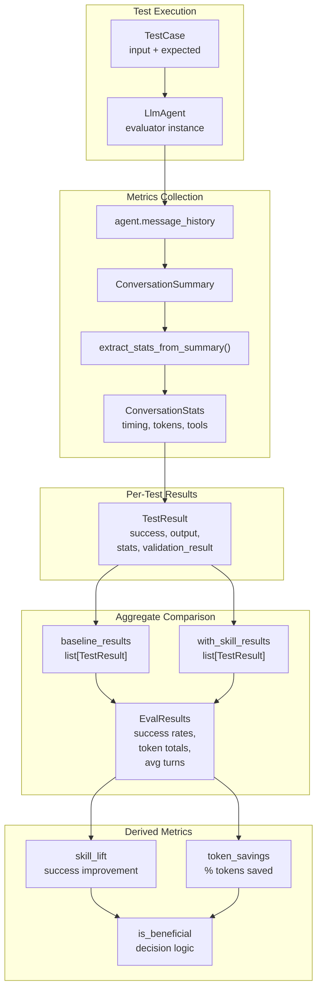

**Sources:** [src/upskill/evaluate.py:99-209](), [src/upskill/models.py:277-364]()

---

## Core Metrics

### Success Rate

Success rate is the percentage of test cases that pass validation. Each test is run with either the baseline agent (no skill) or with the skill injected into the agent's instruction.

**Calculation:** `passed_tests / total_tests`

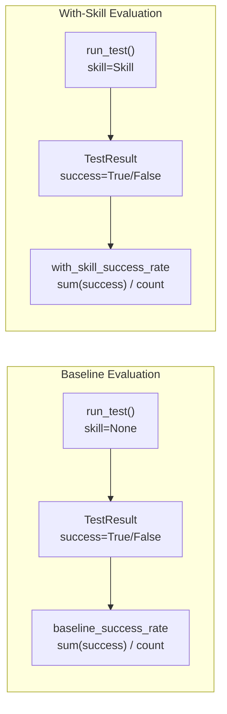

Success is determined by the `check_expected` function, which validates output against expected conditions:

| Validation Type | Source | Implementation |
|----------------|--------|----------------|
| String containment | `ExpectedSpec.contains` | [src/upskill/evaluate.py:91-94]() |
| Custom validator | `TestCase.validator` | [src/upskill/evaluate.py:80-89]() |
| File-based validation | `TestCase.output_file` | [src/upskill/evaluate.py:86]() |

**Sources:** [src/upskill/evaluate.py:62-97](), [src/upskill/evaluate.py:256-284](), [src/upskill/models.py:336-345]()

### Token Usage

Token usage tracks input, output, and total tokens consumed during test execution. This is extracted from FastAgent's `FAST_AGENT_USAGE` message channel.

**Fields in ConversationStats:**

```python
input_tokens: int      # Tokens in prompts/inputs
output_tokens: int     # Tokens in LLM responses
total_tokens: int      # input + output
```

**Aggregation in EvalResults:**

| Metric | Calculation | Location |
|--------|-------------|----------|
| `baseline_total_tokens` | sum of all baseline test tokens | [src/upskill/models.py:344]() |
| `with_skill_total_tokens` | sum of all with-skill test tokens | [src/upskill/models.py:338]() |

The metrics are collected in `evaluate_skill` after running each batch of tests:

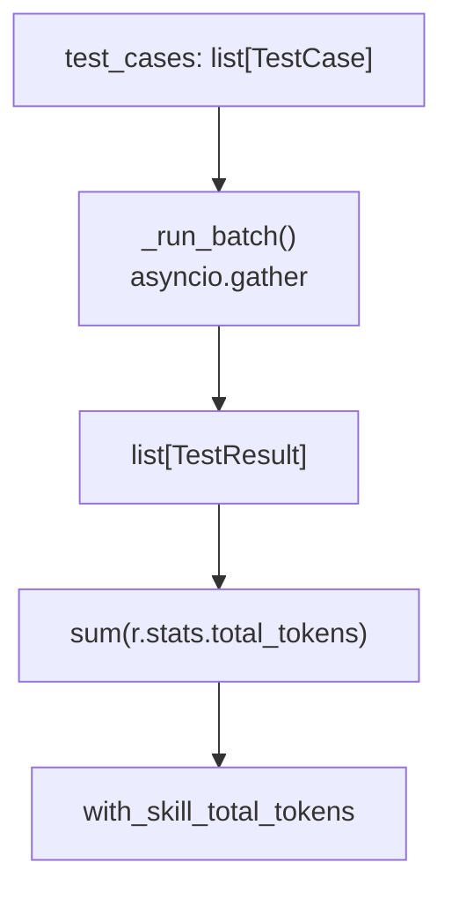

**Sources:** [src/upskill/evaluate.py:256-269](), [src/upskill/models.py:298-301]()

### Conversation Turns

A turn represents one complete user-assistant exchange. The `turns` metric counts how many rounds of interaction were needed to complete a task.

**Calculation:** Count of user messages in `agent.message_history`

**Aggregation:**

| Metric | Formula | Location |
|--------|---------|----------|
| `baseline_avg_turns` | `sum(turns) / test_count` | [src/upskill/models.py:345]() |
| `with_skill_avg_turns` | `sum(turns) / test_count` | [src/upskill/models.py:339]() |

**Sources:** [src/upskill/evaluate.py:265-269](), [src/upskill/models.py:286]()

---

## Derived Metrics

### Skill Lift

Skill lift measures the improvement in success rate when using the skill compared to baseline. It is computed as a simple difference, not a percentage increase.

**Formula:**

```python
skill_lift = with_skill_success_rate - baseline_success_rate
```

**Example:**
- Baseline: 60% (0.6)
- With skill: 100% (1.0)
- Skill lift: **+40%** (0.4)

**Implementation:** Property method in `EvalResults` class

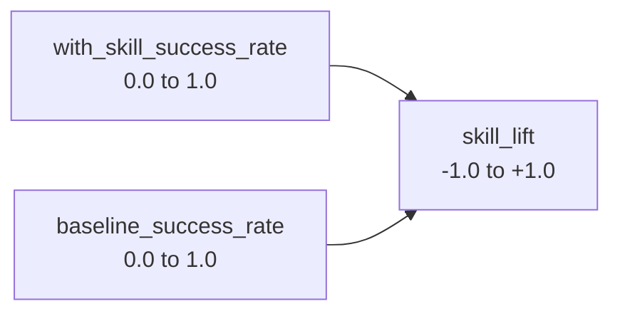

**Interpretation:**

| Lift Value | Meaning |
|------------|---------|
| > 0.05 | Significant improvement (>5%) |
| 0 to 0.05 | Marginal improvement |
| < 0 | Performance degradation |

**Sources:** [src/upskill/models.py:347-350]()

### Token Savings

Token savings measures the percentage reduction in token usage when using the skill. A positive value indicates savings; a negative value indicates the skill uses more tokens.

**Formula:**

```python
token_savings = 1 - (with_skill_total_tokens / baseline_total_tokens)
```

**Example:**
- Baseline: 1200 tokens
- With skill: 800 tokens
- Token savings: **33.3%** (0.333)

**Implementation:** Property method in `EvalResults` class

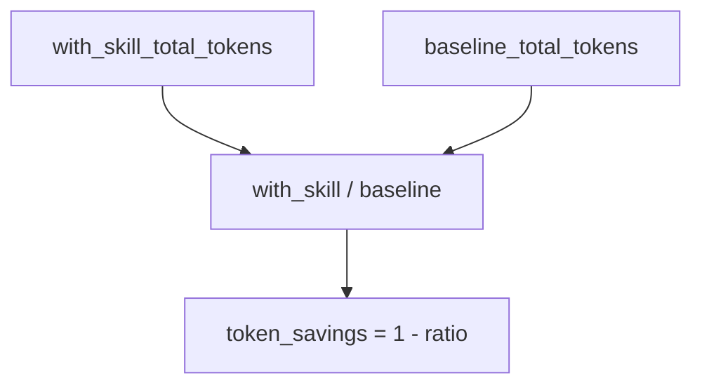

**Interpretation:**

| Savings Value | Meaning |
|---------------|---------|
| > 0.20 | Significant savings (>20%) |
| 0 to 0.20 | Marginal savings |
| < 0 | Uses more tokens than baseline |

**Edge case:** If `baseline_total_tokens == 0`, returns `0.0` to avoid division by zero.

**Sources:** [src/upskill/models.py:352-357]()

---

## Beneficial Skill Criteria

The `is_beneficial` property implements the decision logic for whether a skill provides net value. It uses a two-path evaluation:

**Path 1: Success Improvement**
- Skill lift > 5% → **Beneficial**

**Path 2: Token Efficiency**
- Skill lift ≥ 0% AND token savings > 20% → **Beneficial**

**Formula:**

```python
is_beneficial = (skill_lift > 0.05) or (skill_lift >= 0 and token_savings > 0.2)
```

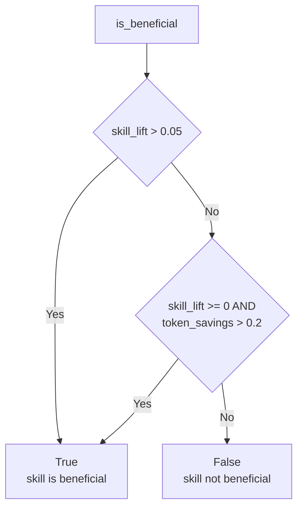

**Rationale:**

| Scenario | Lift | Savings | Beneficial? | Why |
|----------|------|---------|-------------|-----|
| Accuracy gain | +10% | -10% | ✓ | Improved success justifies token cost |
| Efficiency gain | +2% | +25% | ✓ | Same success with much fewer tokens |
| Neutral improvement | +2% | +10% | ✗ | Neither metric meets threshold |
| Degradation | -5% | +30% | ✗ | Lower success not acceptable |
| Neutral efficiency | +2% | +0% | ✗ | No token savings, insufficient lift |

This design prioritizes accuracy improvements while allowing pure efficiency gains if the skill maintains performance.

**Sources:** [src/upskill/models.py:359-363]()

---

## ConversationStats Breakdown

The `ConversationStats` class captures detailed metrics from agent execution, including timing, tool usage, and token breakdown. This data is extracted from FastAgent's message channels.

### Timing Metrics

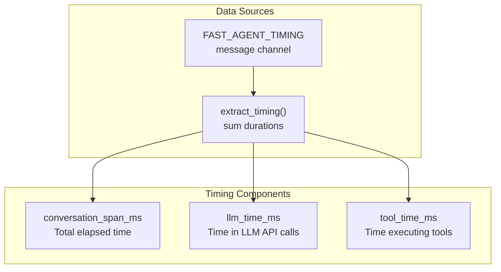

| Field | Description | Unit |
|-------|-------------|------|
| `conversation_span_ms` | Total conversation duration | milliseconds |
| `llm_time_ms` | Time spent waiting for LLM responses | milliseconds |
| `tool_time_ms` | Time spent executing tools | milliseconds |

**Sources:** [src/upskill/models.py:280-283](), [src/upskill/logging.py:96-216]()

### Tool Call Metrics

Tool calls are categorized as MCP (Model Context Protocol) or execute (built-in) based on naming convention:

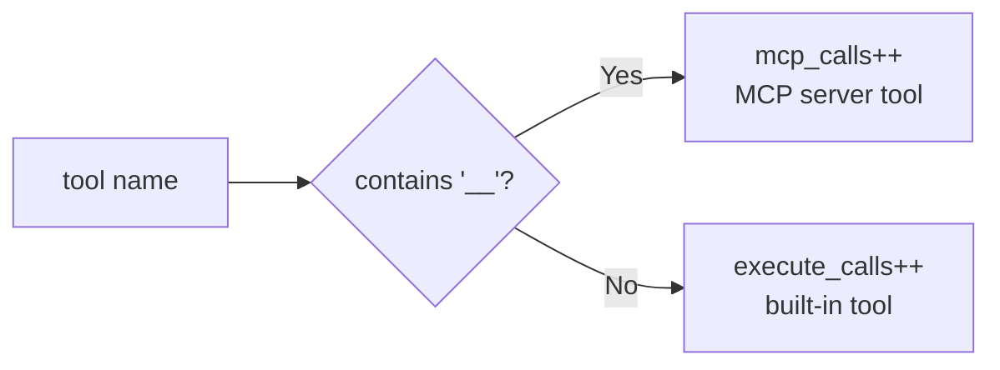

**Fields:**

| Field | Type | Description |
|-------|------|-------------|
| `tool_calls` | int | Total tool invocations |
| `tool_errors` | int | Failed tool invocations |
| `mcp_calls` | int | MCP server tool calls |
| `execute_calls` | int | Built-in execute calls |
| `tool_call_map` | dict[str, int] | Per-tool call counts |
| `tool_error_map` | dict[str, int] | Per-tool error counts |

**Example:**

```python
ConversationStats(
    tool_calls=5,
    tool_errors=1,
    mcp_calls=3,           # fetch__get, filesystem__read, mcp_tools__search
    execute_calls=2,        # execute, execute
    tool_call_map={
        "fetch__get": 2,
        "filesystem__read": 1,
        "execute": 2
    },
    tool_error_map={
        "fetch__get": 1
    }
)
```

**Sources:** [src/upskill/models.py:285-296]()

### Token Breakdown

Token metrics are extracted from the `FAST_AGENT_USAGE` channel and aggregated across all turns:

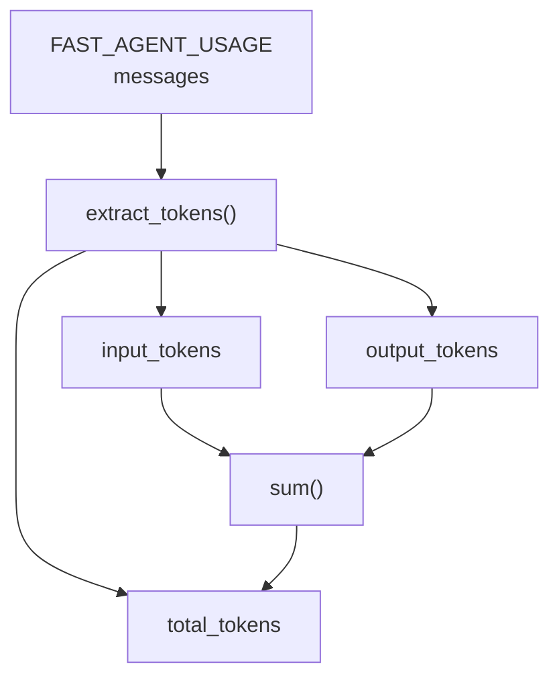

**Sources:** [src/upskill/models.py:298-301](), [src/upskill/logging.py:96-216]()

---

## Per-Test Result Structure

Each test execution produces a `TestResult` object containing success status, output, and detailed statistics:

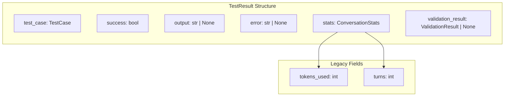

**Field Reference:**

| Field | Type | Source | Purpose |
|-------|------|--------|---------|
| `test_case` | TestCase | Input | Original test case |
| `success` | bool | `check_expected()` | Whether test passed |
| `output` | str \| None | `agent.send()` | Agent's response |
| `error` | str \| None | Exception handler | Error message if failed |
| `stats` | ConversationStats | `extract_stats_from_summary()` | Detailed metrics |
| `validation_result` | ValidationResult \| None | Custom validator | Structured validation data |
| `tokens_used` | int | `stats.total_tokens` | Legacy field |
| `turns` | int | `stats.turns` | Legacy field |

**Sources:** [src/upskill/models.py:314-327](), [src/upskill/evaluate.py:157-165]()

---

## Metrics Extraction Pipeline

The metrics extraction process converts FastAgent's message history into structured statistics:

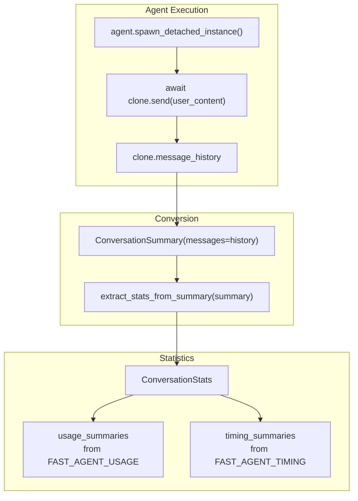

**Function:** `extract_stats_from_summary(summary: ConversationSummary) -> ConversationStats`

**Process:**

1. Extract token usage from `FAST_AGENT_USAGE` messages
2. Extract timing data from `FAST_AGENT_TIMING` messages
3. Count turns, tool calls, and errors
4. Categorize tools as MCP vs execute
5. Build per-tool call and error maps

**Sources:** [src/upskill/evaluate.py:133-139](), [src/upskill/logging.py:96-216]()

---

## Metrics in Evaluation Workflow

The evaluation workflow collects metrics at multiple stages:

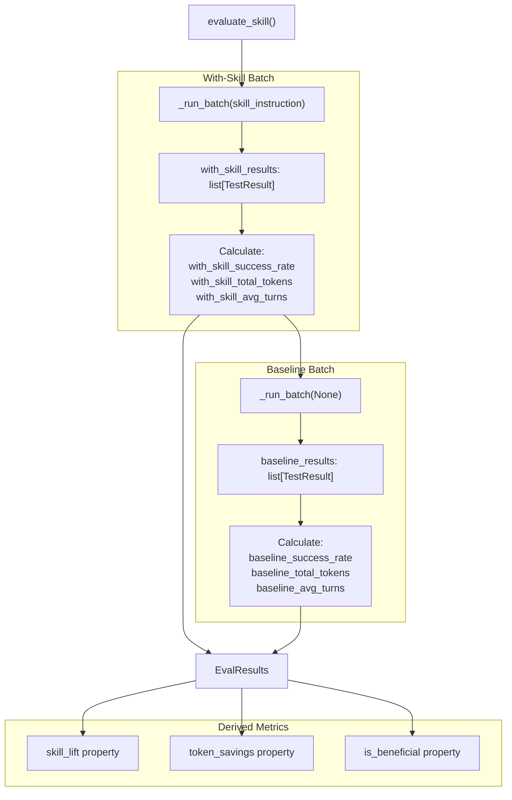

**Implementation:** The `_run_batch` helper runs all test cases concurrently using `asyncio.gather`, then aggregates results:

```python
# From evaluate_skill
successes = sum(1 for r in results.with_skill_results if r.success)
results.with_skill_success_rate = successes / len(test_cases) if test_cases else 0
results.with_skill_total_tokens = sum(r.stats.total_tokens for r in results.with_skill_results)
results.with_skill_avg_turns = (
    sum(r.stats.turns for r in results.with_skill_results) / len(test_cases)
    if test_cases else 0
)
```

**Sources:** [src/upskill/evaluate.py:211-286](), [src/upskill/evaluate.py:235-250]()

---

## Usage in Refinement Loop

Metrics drive the skill refinement process. When a skill is not beneficial, failure descriptions are generated for the skill generator to improve upon:

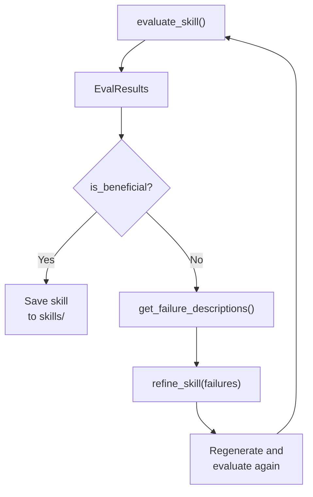

**Failure Description Format:**

```
Input: {test_case.input}
Error: {result.error}  (if error)
Output: {result.output[:200]}...  (if no error)
Expected: {test_case.expected}
```

This structured feedback allows the skill generator to understand why tests failed and improve the skill accordingly.

**Sources:** [src/upskill/evaluate.py:289-302](), [src/upskill/generate.py:109-134]()

---

