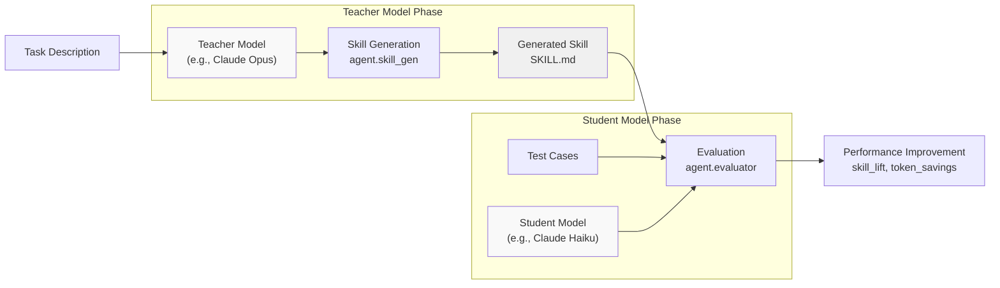
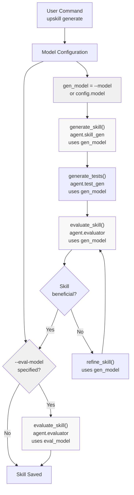
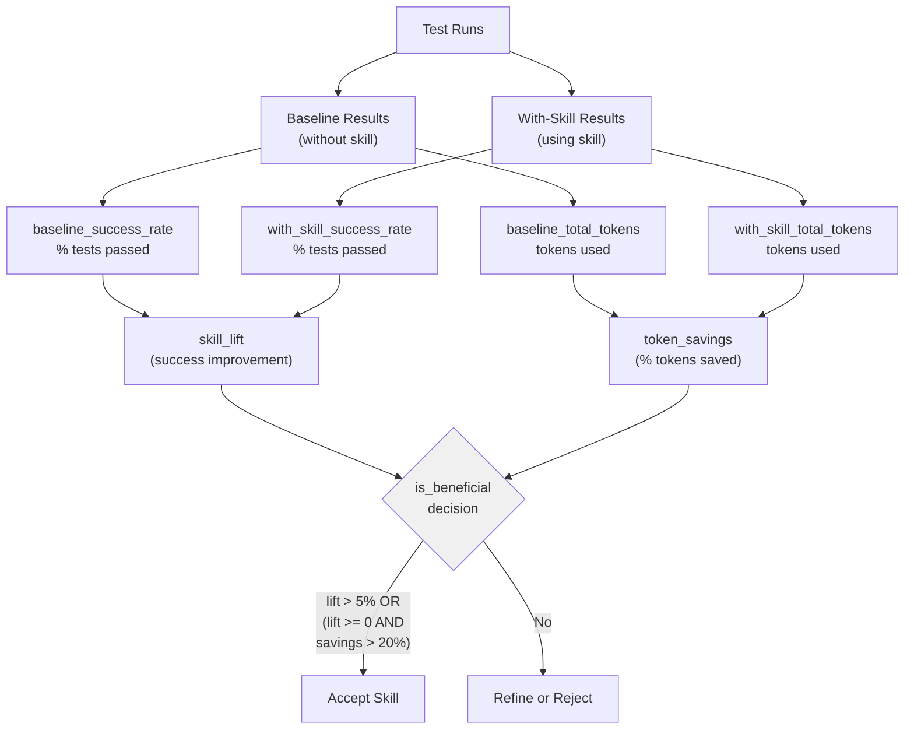
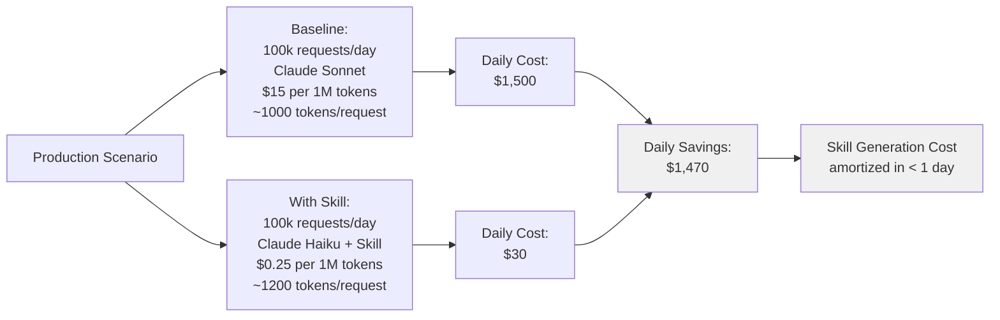
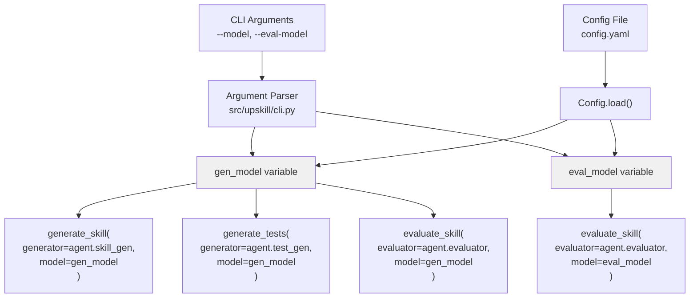

<!-- source: DeepWiki mcp.deepwiki.com · repo huggingface/upskill · page 3.4 Teacher and Student Models · fetched 2026-10-26 -->

# Teacher and Student Models

<details>
<summary>Relevant source files</summary>

The following files were used as context for generating this wiki page:

- [README.md](README.md)
- [fastagent.config.yaml](fastagent.config.yaml)
- [src/upskill/cli.py](src/upskill/cli.py)
- [tests/test_smoke.py](tests/test_smoke.py)

</details>


## Purpose and Scope

This page explains the teacher-student model paradigm in upskill: how powerful "teacher" models generate skills that less capable "student" models can use to improve their performance. This document covers model roles, cross-model evaluation, and strategies for optimizing skill generation for specific target models.

For information about the skill generation process itself, see [Skill Generation](#5.1). For evaluation mechanics and metrics, see [Evaluation Metrics](#3.3).

---

## The Teacher-Student Paradigm

The upskill system implements a knowledge distillation pattern where expensive, powerful models create reusable knowledge artifacts (skills) that cheaper, faster models can leverage to perform better on complex tasks.

### Core Concept



**Sources:** [README.md:1-5](), [README.md:26-30]()

### Why This Matters

| Aspect | Teacher Model | Student Model |
|--------|--------------|---------------|
| **Cost** | High (e.g., $15/1M tokens) | Low (e.g., $0.25/1M tokens) |
| **Speed** | Slow (10-30s/request) | Fast (1-5s/request) |
| **Capability** | Complex reasoning, nuanced understanding | Limited reasoning, needs guidance |
| **Use Case** | One-time skill generation | Repeated production use |
| **ROI** | Amortized across many uses | Per-request savings |

A skill generated by a $15 teacher model that improves a $0.25 student model pays for itself after ~60 production uses (assuming similar token counts).

**Sources:** [README.md:5](), [README.md:78]()

---

## Model Roles in the Generation Pipeline

### Teacher Model (Generation)

The teacher model is responsible for creating the skill document. It is used by:

- **`agent.skill_gen`**: Generates skill content from task descriptions, examples, or traces
- **`agent.test_gen`**: Creates test cases for evaluating the skill

Specified via:
- CLI: `--model <model_name>` (e.g., `upskill generate "task" --model sonnet`)
- Python API: `model` parameter in `generate_skill()` and `generate_tests()`
- Config: `model` field in `config.yaml`

**Code Location:** [src/upskill/cli.py:269-270]()

```python
gen_model = model or config.model
```

The teacher model is called during skill generation:

[src/upskill/cli.py:305-310]()

**Sources:** [src/upskill/cli.py:256-331](), [README.md:62]()

### Student Model (Evaluation)

The student model is the target audience for the skill. It uses the skill to perform tasks during evaluation.

Specified via:
- CLI: `--eval-model <model_name>` (e.g., `upskill generate "task" --eval-model haiku`)
- Python API: `model` parameter in `evaluate_skill()`
- Config: `eval_model` field in `config.yaml`

**Code Location:** [src/upskill/cli.py:442-466]()

```python
if eval_model:
    console.print(f"Evaluating on {eval_model}...", style="dim")
    eval_results = await evaluate_skill(
        skill,
        test_cases,
        evaluator=agent.evaluator,
        model=eval_model,
    )
```

**Sources:** [src/upskill/cli.py:186](), [src/upskill/cli.py:442-513]()

### Model Flow Diagram



**Sources:** [src/upskill/cli.py:256-536]()

---

## Cross-Model Evaluation Workflow

Cross-model evaluation allows you to generate a skill with a teacher model and immediately test whether it improves a specific student model's performance.

### Execution Flow

1. **Generation Phase** (uses `gen_model`):
   - Skill generated by teacher model
   - Test cases generated by teacher model
   - Initial evaluation on teacher model
   - Refinement loop (if needed) on teacher model

2. **Cross-Evaluation Phase** (uses `eval_model`):
   - Same skill evaluated on student model
   - Same test cases used
   - Baseline vs with-skill comparison for student model

### Implementation

The cross-evaluation is implemented in [src/upskill/cli.py:442-513]():

```python
# If eval_model specified, also eval on that model
eval_results = None
if eval_model:
    console.print(f"Evaluating on {eval_model}...", style="dim")
    
    # Create run folder for eval model
    run_folder = None
    if log_runs and batch_folder:
        run_number = attempts + 1
        run_folder = create_run_folder(batch_folder, run_number)
        write_run_metadata(
            run_folder,
            RunMetadata(
                model=eval_model,
                task=task,
                batch_id=batch_id or "",
                run_number=run_number,
            ),
        )
    
    eval_results = await evaluate_skill(
        skill,
        test_cases,
        evaluator=agent.evaluator,
        model=eval_model,
    )
```

Both results are displayed side-by-side for comparison [src/upskill/cli.py:574-590]().

**Sources:** [src/upskill/cli.py:442-513](), [src/upskill/cli.py:574-590]()

### CLI Examples

```bash
# Generate with Opus, evaluate on Haiku
upskill generate "parse complex JSON" --model opus --eval-model haiku

# Generate with Sonnet, evaluate on local Llama
upskill generate "write SQL queries" \
    --model sonnet \
    --eval-model llama3.2:latest \
    --eval-base-url http://localhost:11434/v1
```

**Sources:** [README.md:26-30](), [README.md:77-89]()

---

## Model Configuration

### CLI Options

| Option | Purpose | Example |
|--------|---------|---------|
| `--model` | Teacher model for generation | `--model sonnet` |
| `--eval-model` | Student model for evaluation | `--eval-model haiku` |
| `--base-url` | Custom endpoint (for local models) | `--base-url http://localhost:8080/v1` |
| `--provider` | API provider override | `--provider generic` |

**Sources:** [src/upskill/cli.py:180-187](), [README.md:58-69]()

### Configuration Files

#### `config.yaml`

```yaml
model: sonnet                    # Default teacher model
eval_model: haiku               # Default student model (optional)
skills_dir: ./skills
runs_dir: ./runs
max_refine_attempts: 3
```

**Location:** `~/.config/upskill/config.yaml`

**Sources:** [README.md:376-384]()

#### `fastagent.config.yaml`

```yaml
default_model: sonnet

# For local models (Ollama, llama.cpp, etc.)
generic:
  api_key: "local"
  base_url: "http://localhost:11434/v1"
```

**Location:** Project directory

**Sources:** [fastagent.config.yaml:1-16](), [README.md:386-404]()

### Model Format

upskill uses FastAgent's model format: `<provider>.<model>.<reasoning_effort?>`

| Format | Example | Use Case |
|--------|---------|----------|
| Alias | `sonnet`, `haiku`, `opus` | Anthropic models |
| Full name | `anthropic.claude-sonnet-4-20250514` | Explicit model version |
| OpenAI | `openai.gpt-4.1` | OpenAI models |
| Local | `generic.llama3.2:latest` | Ollama models |

**Sources:** [README.md:467-483](), [fastagent.config.yaml:4-8]()

---

## Evaluation Metrics for Student Models

When evaluating how well a skill helps a student model, upskill tracks several key metrics:

### Core Metrics



**Sources:** [src/upskill/models.py:270-307]()

### Calculation Details

| Metric | Formula | Threshold |
|--------|---------|-----------|
| **skill_lift** | `with_skill_rate - baseline_rate` | `> 5%` for acceptance |
| **token_savings** | `(baseline_tokens - with_skill_tokens) / baseline_tokens` | `> 20%` with neutral lift |
| **is_beneficial** | `lift > 0.05 OR (lift >= 0 AND savings > 0.20)` | Boolean |

A skill is considered beneficial if it either:
1. Improves success rate by more than 5%, OR
2. Maintains success rate while saving more than 20% of tokens

**Sources:** [src/upskill/models.py:270-307](), [README.md:456-458]()

### Cross-Model Comparison

The system logs separate run results for each model, allowing comparison:

[src/upskill/cli.py:471-506]()

```python
# Log baseline result for eval_model
baseline_result = RunResult(
    metadata=RunMetadata(
        model=eval_model,
        task=task,
        batch_id=batch_id or "",
        run_number=run_number,
    ),
    stats=aggregate_conversation_stats(eval_results.baseline_results),
    passed=eval_results.baseline_success_rate > 0.5,
    assertions_passed=int(eval_results.baseline_success_rate * len(test_cases)),
    assertions_total=len(test_cases),
    run_type="baseline",
    skill_name=skill.name,
)
```

**Sources:** [src/upskill/cli.py:468-506]()

---

## Use Cases and Patterns

### Pattern 1: Optimize for Production Model

Generate a skill specifically targeting a production model:

```bash
# You use Haiku in production
upskill generate "extract entities from text" \
    --model opus \
    --eval-model haiku
```

**Outcome:** Skill is refined until it demonstrably helps Haiku, even if Opus doesn't need it.

### Pattern 2: Multi-Tier Evaluation

Test a skill across multiple student models:

```bash
# Generate with Sonnet
upskill generate "validate JSON schemas" --model sonnet

# Then evaluate on multiple models
upskill eval ./skills/validate-json-schemas/ \
    -m haiku \
    -m gpt-4o-mini \
    -m llama3.2:latest \
    --runs 5
```

**Outcome:** Understand which models benefit most from the skill.

**Sources:** [README.md:150-154]()

### Pattern 3: Local Student Models

Generate skills for local models:

```bash
# Generate with cloud model, evaluate on local
upskill generate "write SQL queries" \
    --model sonnet \
    --eval-model llama3.2:latest \
    --eval-base-url http://localhost:11434/v1
```

**Outcome:** Create skills that make local models competitive with cloud models on specific tasks.

**Sources:** [README.md:223-227](), [README.md:486-513]()

### Pattern 4: Cost Optimization



**Assumptions:**
- Teacher model (Sonnet) costs ~$100 to generate and refine skill (one-time)
- Student model (Haiku) is 60x cheaper
- Skill adds 20% tokens but maintains quality
- Break-even: ~7,000 requests

**Sources:** [README.md:1-5]()

---

## Technical Implementation Details

### Model Parameter Flow



**Sources:** [src/upskill/cli.py:269-270](), [src/upskill/cli.py:305-340](), [src/upskill/cli.py:461-466]()

### Agent Card Model Override

Agent cards define default models, but these can be overridden:

```yaml
# agent_cards/skill_gen.md frontmatter
type: agent
model: opus
```

When `model` parameter is passed to the agent function, it overrides the card's default. The model parameter is passed through the FastAgent runtime.

**Sources:** [fastagent.config.yaml:4-9]()

### Run Metadata Storage

Each run stores its model information in `RunMetadata`:

[src/upskill/cli.py:352-358]()

```python
RunMetadata(
    model=gen_model,
    task=task,
    batch_id=batch_id or "",
    run_number=baseline_run_num,
)
```

This enables filtering and comparison by model in the `upskill runs` command.

**Sources:** [src/upskill/cli.py:352-358](), [src/upskill/cli.py:845-857]()

---

## Best Practices

### 1. Choose Teacher Models Strategically

- **For complex reasoning tasks**: Use `opus` or `sonnet`
- **For structured output**: Use `sonnet` with extended thinking
- **For code generation**: Use `sonnet` or `gpt-4`

### 2. Validate Student Model Performance

Always test on the actual target model:

```bash
# Don't just generate and save
upskill generate "task" --model opus --no-eval

# Do test on target model
upskill generate "task" --model opus --eval-model haiku
```

### 3. Iterate on Student Failures

If a skill doesn't help the student model, the refinement loop will analyze student-specific failures and improve the skill accordingly.

### 4. Consider Token Overhead

Skills add tokens to the context. Monitor `token_savings` metric:
- Positive savings: Skill makes model more efficient
- Negative savings: Skill adds overhead but may still improve quality

### 5. Benchmark Across Models

Use `upskill eval` with multiple models to understand skill portability:

```bash
upskill eval ./skills/my-skill/ \
    -m haiku -m sonnet -m gpt-4o-mini \
    --runs 3
```

**Sources:** [README.md:144-166](), [README.md:606-615]()

---

