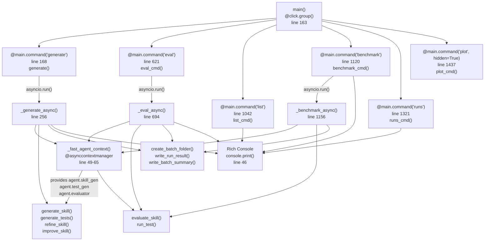
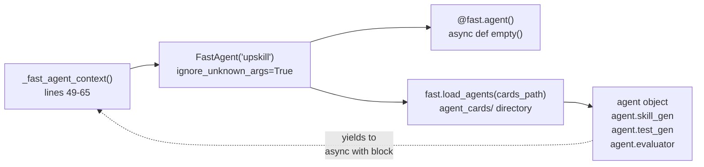
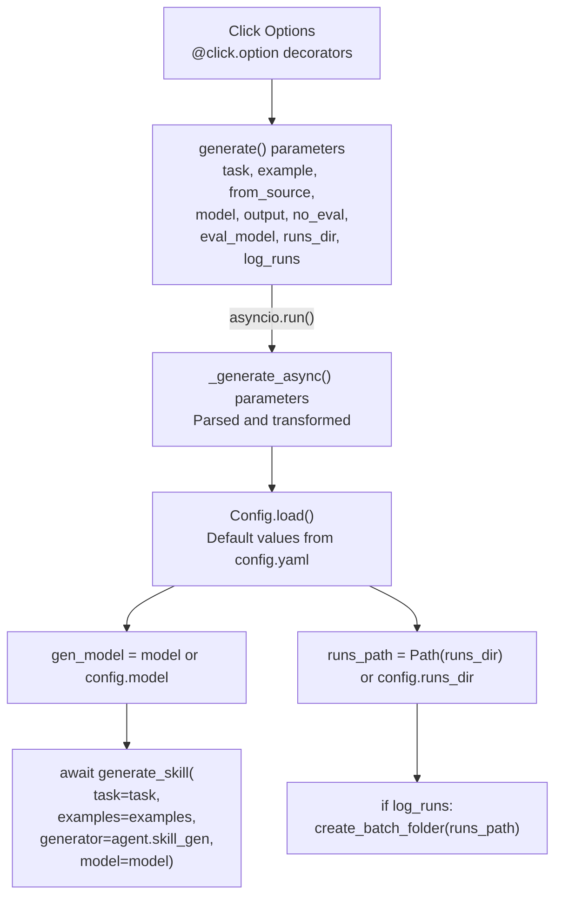
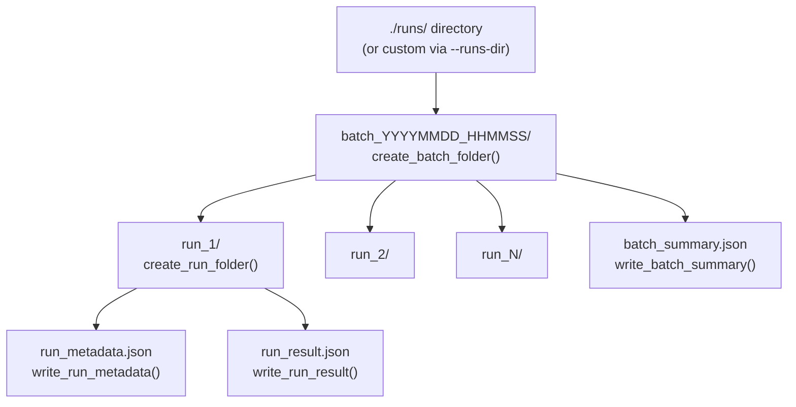

<!-- source: DeepWiki mcp.deepwiki.com · repo huggingface/upskill · page 4 CLI Reference · fetched 2026-10-26 -->

# CLI Reference

<details>
<summary>Relevant source files</summary>

The following files were used as context for generating this wiki page:

- [README.md](README.md)
- [src/upskill/cli.py](src/upskill/cli.py)
- [tests/test_smoke.py](tests/test_smoke.py)

</details>


This page provides a comprehensive reference for all `upskill` command-line interface (CLI) commands, their options, and usage patterns. The CLI is the primary interface for generating, evaluating, and managing agent skills. For programmatic usage, see [Python API](#9). For detailed workflow documentation, see [Skill Lifecycle](#5).

## Overview

The upskill CLI is built using the Click framework and provides five main commands for skill management. All commands support both synchronous invocation (via CLI) and asynchronous execution (internally). The CLI integrates with FastAgent to provide agent capabilities and supports multiple model providers through a unified interface.

**Command Structure:**

```
upskill [OPTIONS] COMMAND [ARGS]...
```

The CLI implements a consistent pattern across all commands:
- Commands accept model specifications in FastAgent format (e.g., `sonnet`, `anthropic.claude-sonnet-4-20250514`, `generic.llama3.2:latest`)
- Most commands support run logging to `./runs/` by default (controllable via `--log-runs/--no-log-runs`)
- Rich console output with progress indicators, bars, and formatted tables
- Async execution using `asyncio.run()` for concurrent operations

Sources: [src/upskill/cli.py:1-165]()

## CLI Architecture



The architecture separates command parsing (synchronous Click functions) from execution (asynchronous implementations). Each command follows this pattern:

1. **Command Function** - Decorated with `@main.command()`, parses CLI options
2. **Async Implementation** - Prefixed with `_`, performs actual work with `async/await`
3. **FastAgent Context** - Provides agent instances via `_fast_agent_context()`
4. **Core Functions** - Domain logic from `generate.py` and `evaluate.py`
5. **Logging Layer** - Tracks runs and results via `logging.py` functions

Sources: [src/upskill/cli.py:49-65](), [src/upskill/cli.py:163-167](), [src/upskill/cli.py:168-253]()

## Command Summary

| Command | Purpose | Key Options | Detailed Docs |
|---------|---------|-------------|---------------|
| `generate` | Generate or improve skills with automatic evaluation | `-m/--model`, `--eval-model`, `-f/--from`, `--no-eval` | [4.1](#4.1) |
| `eval` | Evaluate skills with baseline comparison | `-m/--model` (repeatable), `--runs`, `--no-baseline`, `-v/--verbose` | [4.2](#4.2) |
| `list` | Display skills in tree view | `-d/--dir`, `-v/--verbose` | [4.3](#4.3) |
| `benchmark` | Multi-model/multi-run evaluation | `-m/--model` (required, repeatable), `--runs`, `-t/--tests` | [4.4](#4.4) |
| `runs` | View evaluation history or export CSV | `-s/--skill`, `-m/--model`, `--metric`, `--csv` | [4.5](#4.5) |

Sources: [src/upskill/cli.py:168-1465]()

## FastAgent Context Manager

All async commands use the `_fast_agent_context()` context manager to initialize FastAgent and load agent cards:



**Usage Pattern:**

```python
async with _fast_agent_context() as agent:
    # agent.skill_gen, agent.test_gen, agent.evaluator available
    skill = await generate_skill(task, generator=agent.skill_gen, model=model)
    results = await evaluate_skill(skill, test_cases, evaluator=agent.evaluator, model=model)
```

The context manager:
1. Creates a `FastAgent` instance with name "upskill" [line 51-54]()
2. Registers an empty agent to satisfy FastAgent requirements [line 56-58]()
3. Loads agent cards from `upskill/agent_cards/` directory [line 60-62]()
4. Yields the agent object to the calling context [line 64-65]()
5. Automatically cleans up FastAgent resources on exit

Sources: [src/upskill/cli.py:49-65]()

## Common Options

Several options appear across multiple commands with consistent behavior:

### Model Specification

```
-m, --model MODEL
```

Specifies the model to use for generation or evaluation. Accepts FastAgent model format:
- **Aliases**: `sonnet`, `haiku`, `opus`
- **Full names**: `anthropic.claude-sonnet-4-20250514`, `openai.gpt-4o`
- **Reasoning effort**: `openai.o3-mini.low`, `anthropic.claude-opus?reasoning=1024`
- **Local models**: `generic.llama3.2:latest`, `generic.my-model`

For `eval` and `benchmark`, this option is repeatable to test multiple models.

**Examples:**
```bash
upskill generate "task" -m sonnet
upskill eval ./skills/my-skill/ -m haiku -m sonnet  # Multi-model
upskill benchmark ./skills/my-skill/ -m gpt-4o -m claude-sonnet
```

Sources: [src/upskill/cli.py:180-183](), [src/upskill/cli.py:625-626]()

### Run Logging

```
--log-runs / --no-log-runs     # Default: enabled
--runs-dir PATH                # Default: ./runs
```

Controls whether evaluation runs are logged to disk. When enabled:
- Creates timestamped batch folders in `./runs/` (or custom directory)
- Logs `run_metadata.json` and `run_result.json` for each run
- Writes `batch_summary.json` aggregating all runs
- Prints batch folder path: `Logging runs to: ./runs/batch_YYYYMMDD_HHMMSS`

Disable logging with `--no-log-runs` for ephemeral evaluations or testing.

**Examples:**
```bash
upskill generate "task" --no-log-runs           # Skip logging
upskill eval ./skills/my-skill/ --runs-dir ./my-logs/  # Custom location
```

Sources: [src/upskill/cli.py:188-189](), [src/upskill/cli.py:638-639](), [src/upskill/cli.py:273-280]()

### Local Model Configuration

```
--provider [anthropic|openai|generic]
--base-url URL
```

For local models via Ollama, llama.cpp, or other OpenAI-compatible servers:
- When `--base-url` is provided, `--provider` defaults to `generic`
- Model name should match the local model identifier
- API key defaults to "local" for generic provider

**Examples:**
```bash
# Ollama
upskill eval ./skills/my-skill/ \
    -m llama3.2:latest \
    --base-url http://localhost:11434/v1

# llama.cpp server
upskill generate "task" \
    --eval-model my-model \
    --base-url http://localhost:8080/v1
```

Sources: [src/upskill/cli.py:629-635](), [README.md:486-513]()

## Console Output Patterns

The CLI uses `rich` library for formatted output. Key patterns:

### Progress Indicators

```python
console.print("Generating skill with sonnet...", style="dim")  # Status message
console.print("[dim]Starting evaluation run...[/dim]")          # Subdued info
```

Sources: [src/upskill/cli.py:304](), [src/upskill/cli.py:361]()

### Success/Failure Display

```python
# Inline status
f"{results.baseline_success_rate:.0%} -> "
f"{results.with_skill_success_rate:.0%} ({lift_str}) [green]OK[/green]"

# Conditional styling
status = "[green]PASS[/green]" if all_passed else "[red]FAIL[/red]"
```

Sources: [src/upskill/cli.py:414-417](), [src/upskill/cli.py:867]()

### Bar Rendering

The `_render_bar()` helper creates text-based progress bars:

```python
def _render_bar(value: float, width: int = 20) -> str:
    """Render a simple text bar for a 0-1 value."""
    # Returns: "████████████░░░░░░░░" (filled + empty blocks)
```

**Usage:**
```python
baseline_bar = _render_bar(results.baseline_success_rate)
# Output: "baseline   ████████████░░░░░░░░   60%"
```

Sources: [src/upskill/cli.py:68-76](), [src/upskill/cli.py:579-590]()

## Command Execution Flow

```mermaid
sequenceDiagram
    participant User
    participant ClickCmd["Click Command<br/>(generate, eval, etc.)"]
    participant AsyncImpl["Async Implementation<br/>(_generate_async, etc.)"]
    participant FAContext["_fast_agent_context()"]
    participant FastAgent["FastAgent Runtime"]
    participant CoreLogic["Core Functions<br/>(generate_skill, evaluate_skill)"]
    participant Logging["Logging Functions"]
    participant Console["Rich Console"]
    
    User->>ClickCmd: upskill generate "task" -m sonnet
    ClickCmd->>ClickCmd: Parse arguments
    ClickCmd->>AsyncImpl: asyncio.run(_generate_async(...))
    AsyncImpl->>FAContext: async with _fast_agent_context()
    FAContext->>FastAgent: Initialize FastAgent('upskill')
    FAContext->>FastAgent: Load agent cards
    FastAgent-->>FAContext: agent object
    FAContext-->>AsyncImpl: yield agent
    
    AsyncImpl->>Logging: create_batch_folder(runs_path)
    Logging-->>AsyncImpl: batch_id, batch_folder
    AsyncImpl->>Console: print("Logging runs to: ...")
    
    AsyncImpl->>CoreLogic: await generate_skill(task, agent.skill_gen)
    CoreLogic->>FastAgent: Execute skill_gen agent
    FastAgent-->>CoreLogic: Skill object
    CoreLogic-->>AsyncImpl: skill
    
    AsyncImpl->>CoreLogic: await generate_tests(task, agent.test_gen)
    CoreLogic-->>AsyncImpl: test_cases
    
    AsyncImpl->>CoreLogic: await evaluate_skill(skill, test_cases, agent.evaluator)
    CoreLogic-->>AsyncImpl: EvalResults
    
    AsyncImpl->>Logging: write_run_result(run_folder, run_result)
    AsyncImpl->>Logging: write_batch_summary(batch_folder, summary)
    
    AsyncImpl->>Console: print(formatted results)
    AsyncImpl->>AsyncImpl: skill.save(output_path)
    
    AsyncImpl-->>ClickCmd: return
    ClickCmd-->>User: exit
```

Sources: [src/upskill/cli.py:240-253](), [src/upskill/cli.py:256-536]()

## Option Parsing and Data Flow



**Pattern Overview:**

1. Click decorators define CLI options with types, defaults, and help text
2. Command functions receive parsed arguments as parameters
3. Arguments are transformed (e.g., `tuple[str, ...]` to `list[str]`)
4. `Config.load()` provides system defaults
5. Option values override config defaults: `model or config.model`
6. Transformed values passed to async implementation

Sources: [src/upskill/cli.py:168-189](), [src/upskill/cli.py:256-270]()

## Error Handling and Exit Codes

The CLI uses `sys.exit()` for error conditions:

```python
# File not found
if not path.exists():
    console.print(f"[red]No skills directory found at {path}[/red]")
    sys.exit(1)

# Invalid skill directory
try:
    skill = Skill.load(skill_dir)
except FileNotFoundError:
    console.print(f"[red]No SKILL.md found in {skill_dir}[/red]")
    sys.exit(1)
```

**Exit Codes:**
- `0` - Success
- `1` - Error (file not found, invalid configuration, etc.)

Sources: [src/upskill/cli.py:712-716](), [src/upskill/cli.py:1358-1359]()

## Verbose Mode

Commands with `-v/--verbose` flag show detailed execution information:

### In `eval` command:
```python
if verbose:
    console.print(f"  Running test {tc_idx}/{len(test_cases)}...", style="dim")
    # Shows validation errors
    if result.validation_result.error_message:
        console.print(f"    Validation: {result.validation_result.error_message}", style="dim")
```

### In `benchmark` command:
```python
if verbose:
    console.print(f"  Run {run_num}: {status} ({total_assertions_passed}/{total_assertions} assertions passed)")
```

Sources: [src/upskill/cli.py:804-828](), [src/upskill/cli.py:1280-1284]()

## Batch and Run Management

Commands that perform evaluations create structured output in the runs directory:



**Batch ID Format:** `batch_YYYYMMDD_HHMMSS` (timestamp-based)

**Run Numbering:**
- For `generate` with refinement: baseline=1, with_skill=2, baseline=3, with_skill=4, ...
- For `eval`: baseline=1, with_skill=2 (single pair)
- For `benchmark`: sequential numbering across all models and runs

Sources: [src/upskill/cli.py:273-280](), [src/upskill/cli.py:347-408](), [src/upskill/cli.py:760-766]()

## Command-Specific Details

For comprehensive documentation of each command, see the dedicated sub-pages:

- **[4.1 upskill generate](#4.1)** - Generate new skills or improve existing ones with automatic evaluation and refinement
- **[4.2 upskill eval](#4.2)** - Evaluate skills against test cases with baseline comparison and multi-model benchmarking
- **[4.3 upskill list](#4.3)** - List generated skills with tree view and verbose file structure display
- **[4.4 upskill benchmark](#4.4)** - Run comprehensive benchmarks across multiple models with statistical analysis
- **[4.5 upskill runs](#4.5)** - View evaluation history with visual plots, filtering, and CSV export

Sources: [src/upskill/cli.py:168-1593]()

---

