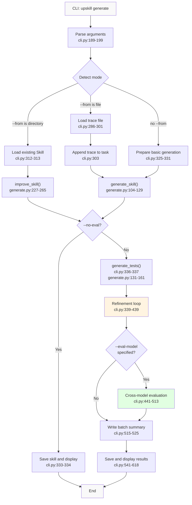
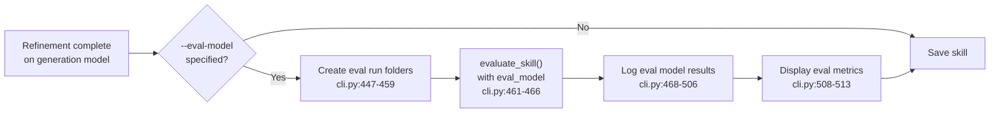
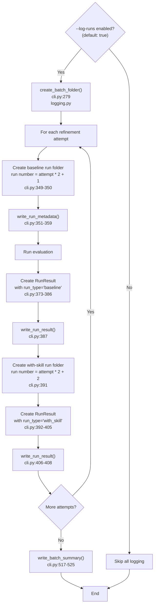
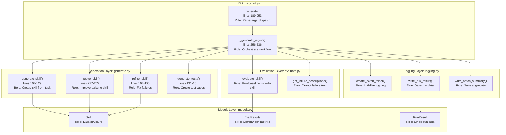
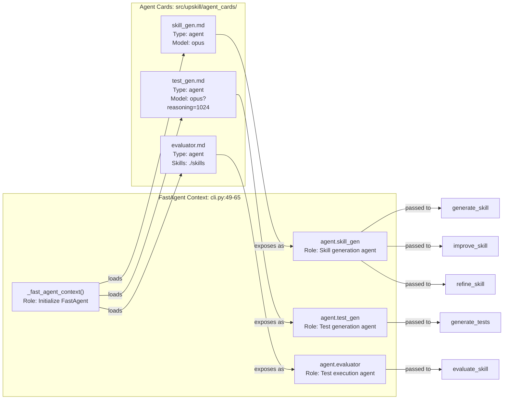

<!-- source: DeepWiki mcp.deepwiki.com · repo huggingface/upskill · page 4.1 upskill generate · fetched 2026-10-26 -->

# upskill generate

<details>
<summary>Relevant source files</summary>

The following files were used as context for generating this wiki page:

- [README.md](README.md)
- [src/upskill/cli.py](src/upskill/cli.py)
- [src/upskill/generate.py](src/upskill/generate.py)
- [tests/test_smoke.py](tests/test_smoke.py)

</details>


## Purpose and Scope

The `upskill generate` command creates new agent skills from task descriptions or improves existing skills. It orchestrates the complete skill generation lifecycle: creating the skill document, generating test cases, evaluating performance, and iteratively refining the skill until it demonstrates measurable benefit. This command serves as the primary entry point for skill creation in the upskill system.

For evaluating existing skills without generating new ones, see [upskill eval](#4.2). For viewing generated skill directories, see [upskill list](#4.3). For detailed information about the skill generation process itself, see [Skill Generation](#5.1) and [Skill Refinement](#5.4).

**Sources:** [src/upskill/cli.py:168-253](), [README.md:47-111]()

---

## Command Syntax

```bash
upskill generate TASK [OPTIONS]
```

The `TASK` argument is a natural language description of what the skill should teach an AI agent to do.

**Sources:** [src/upskill/cli.py:168-169]()

---

## Arguments and Options

| Argument/Option | Type | Description |
|----------------|------|-------------|
| `TASK` | string (required) | Natural language description of the skill to generate |
| `-e, --example` | string (repeatable) | Input → output example pair for the task |
| `--tool` | string | Generate from MCP tool schema (format: `path#tool_name`) |
| `-f, --from` | path | Improve existing skill (directory) or generate from trace (file) |
| `-m, --model` | string | Model for generation (e.g., `sonnet`, `anthropic.claude-sonnet-4-20250514`) |
| `-o, --output` | path | Output directory for the generated skill |
| `--no-eval` | flag | Skip evaluation and refinement phases |
| `--eval-model` | string | Model to evaluate skill on (different from generation model) |
| `--runs-dir` | path | Directory for run logs (default: `./runs`) |
| `--log-runs / --no-log-runs` | flag | Enable/disable run data logging (default: enabled) |

**Sources:** [src/upskill/cli.py:170-188](), [README.md:56-69]()

---

## Execution Modes

The `generate` command operates in three distinct modes, automatically detected based on the options provided:

### Basic Generation Mode

Generates a new skill from scratch using only the task description and optional examples.

```bash
upskill generate "parse JSON Schema files"
upskill generate "write git commits" -e "Added login → feat(auth): add login feature"
```

**Detection:** No `--from` option provided.

### Improvement Mode

Improves an existing skill based on new instructions.

```bash
upskill generate "add more error handling examples" --from ./skills/api-errors/
```

**Detection:** `--from` points to a directory containing `SKILL.md`.

**Implementation:** Uses `improve_skill()` function instead of `generate_skill()`, preserving the existing skill's references and scripts while applying the improvement instructions.

### Trace-Based Generation Mode

Generates a skill by analyzing an agent trace file.

```bash
upskill generate "document the pattern" --from ./trace.json
```

**Detection:** `--from` points to a file (not a directory).

**Implementation:** Reads the trace file content (JSON or plain text), truncates to 4000 characters, and appends it to the task description as context for the `generate_skill()` function.

**Sources:** [src/upskill/cli.py:230-303](), [src/upskill/generate.py:104-129](), [src/upskill/generate.py:227-265]()

---

## Execution Flow



**Sources:** [src/upskill/cli.py:256-536]()

---

## Evaluation and Refinement Loop

When `--no-eval` is not specified, the command automatically evaluates the generated skill and refines it until it becomes beneficial.

### Refinement Loop Details

```mermaid
graph TB
    StartLoop["Start refinement loop<br/>cli.py:342"]
    StartLoop --> CreateRunFolder["Create run folder for logging<br/>cli.py:347-359"]
    CreateRunFolder --> Evaluate["evaluate_skill()<br/>cli.py:363-368<br/>evaluate.py"]
    
    Evaluate --> LogResults["Log baseline and with-skill results<br/>cli.py:371-408"]
    LogResults --> CheckBeneficial{"results.is_beneficial?"}
    
    CheckBeneficial -->|Yes: "lift > 5% OR<br/>lift >= 0 AND<br/>savings > 20%"| Success["Display success<br/>Break loop<br/>cli.py:413-418"]
    
    CheckBeneficial -->|No| DisplayFailure["Display metrics<br/>cli.py:420-423"]
    DisplayFailure --> CheckPlateau{"Success rate<br/>changed < 5%?"}
    
    CheckPlateau -->|Yes| Plateau["Display 'Plateaued'<br/>Break loop<br/>cli.py:425-427"]
    CheckPlateau -->|No| UpdateRate["Update prev_success_rate<br/>cli.py:429"]
    
    UpdateRate --> CheckAttempts{"attempt <<br/>max_refine_attempts?"}
    CheckAttempts -->|No| EndLoop["End loop"]
    CheckAttempts -->|Yes| GetFailures["get_failure_descriptions()<br/>cli.py:433"]
    
    GetFailures --> RefineSkill["refine_skill()<br/>cli.py:434-439<br/>generate.py:164-195"]
    RefineSkill --> StartLoop
    
    Success --> EndLoop
    Plateau --> EndLoop
```

### Evaluation Metrics

Each iteration evaluates the skill by running test cases both with and without the skill, measuring:

- **Baseline success rate:** Percentage of test cases passed without the skill
- **With-skill success rate:** Percentage of test cases passed with the skill
- **Skill lift:** `(with_skill_rate - baseline_rate)`
- **Token savings:** `(baseline_tokens - with_skill_tokens) / baseline_tokens`

### Acceptance Criteria

A skill is considered beneficial if:
```
skill_lift > 0.05  OR  (skill_lift >= 0 AND token_savings > 0.20)
```

This means: either improve success rate by >5%, OR maintain success rate while saving >20% of tokens.

### Plateau Detection

The loop exits early if the success rate improves by less than 5% between consecutive attempts, preventing infinite refinement when no progress is being made.

**Sources:** [src/upskill/cli.py:339-439](), [src/upskill/evaluate.py:140-204](), [src/upskill/models.py:270-307]()

---

## Cross-Model Evaluation

The `--eval-model` option enables teacher-student model paradigm: a powerful model generates the skill, and a less capable model evaluates it.

```bash
upskill generate "write git commits" --model sonnet --eval-model haiku
```

### Flow with Cross-Model Evaluation

1. **Generation Phase:** Uses `--model` (or default) to generate skill and run refinement loop
2. **Cross-Evaluation Phase:** After refinement succeeds, runs an additional evaluation with `--eval-model`
3. **Logging:** Creates separate run folders for each model's evaluation
4. **Display:** Shows comparison bars for both models

### Implementation



The evaluation results for both models are displayed side-by-side in the final output with horizontal bars showing success rates and lift percentages.

**Sources:** [src/upskill/cli.py:441-513](), [README.md:26-30]()

---

## Run Logging

By default, every evaluation run is logged to the runs directory for later analysis.

### Logging Structure

```
./runs/
└── batch_YYYYMMDD_HHMMSS/          # Created by create_batch_folder()
    ├── run_1/                       # Baseline run
    │   ├── run_metadata.json
    │   └── run_result.json
    ├── run_2/                       # With-skill run
    │   ├── run_metadata.json
    │   └── run_result.json
    ├── run_3/                       # Refinement attempt 2 baseline
    │   └── ...
    └── batch_summary.json           # Aggregated results
```

### Logging During Generate



### RunResult Data Model

Each run logs comprehensive metrics including:

- **RunMetadata:** Model name, task, batch ID, run number
- **ConversationStats:** Tokens (input/output/total), turns, tool calls, timing (LLM time, tool time)
- **Assertions:** Passed count, total count
- **Run type:** `"baseline"` or `"with_skill"`

### Disabling Logging

```bash
upskill generate "task description" --no-log-runs
```

**Sources:** [src/upskill/cli.py:272-280](), [src/upskill/cli.py:347-408](), [src/upskill/logging.py:24-48](), [src/upskill/models.py:308-329]()

---

## Code Entity Mapping

### Key Functions and Their Roles



### Agent Integration Points



**Sources:** [src/upskill/cli.py:49-65](), [src/upskill/cli.py:283-331](), [src/upskill/generate.py:1-266](), [src/upskill/evaluate.py:1-220]()

---

## Examples

### Basic Generation

Generate a simple skill from a task description:

```bash
upskill generate "parse JSON Schema files"
```

Output:
```
Generating skill with sonnet...
Generating test cases...
Evaluating on sonnet... (attempt 1)
  60% -> 80% (+20%) OK

  json-schema-parser
  Parse and validate JSON Schema documents with proper error handling.

  SKILL.md              ~420 tokens

  baseline   ████████████░░░░░░░░   60%
  with skill ████████████████░░░░   80%  (+20%)

  tokens: 1400 → 950  (-32%)

Saved to ./skills/json-schema-parser
```

### Generation with Examples

Provide input/output examples to guide generation:

```bash
upskill generate "write git commits" \
  -e "Added login → feat(auth): add login feature" \
  -e "Fixed bug → fix(api): handle null response" \
  -e "Updated docs → docs(readme): update installation guide"
```

### Improvement from Existing Skill

Improve an existing skill with new requirements:

```bash
upskill generate "add more error handling examples" \
  --from ./skills/api-errors/
```

### Generation from Trace File

Extract patterns from an agent trace:

```bash
upskill generate "document the pattern" --from ./trace.json
```

### Teacher-Student Model Generation

Use a powerful model to generate, evaluate on a less capable model:

```bash
upskill generate "write git commits" \
  --model sonnet \
  --eval-model haiku
```

Output includes evaluation on both models:
```
  sonnet
    baseline   ████████████░░░░░░░░   60%
    with skill ████████████████████  100%  (+40%)

  haiku
    baseline   ████████████░░░░░░░░   60%
    with skill ████████████████░░░░   80%  (+20%)
```

### Local Model Evaluation

Generate with cloud model, evaluate on local model:

```bash
upskill generate "parse YAML" \
  --model sonnet \
  --eval-model llama3.2:latest \
  --eval-base-url http://localhost:11434/v1
```

### Custom Output Directory

Save to a specific location:

```bash
upskill generate "validate forms" -o ./my-skills/validation
```

### Skip Evaluation

Generate without evaluation or refinement:

```bash
upskill generate "document code" --no-eval
```

### Disable Run Logging

Generate without creating run logs:

```bash
upskill generate "handle errors" --no-log-runs
```

**Sources:** [README.md:72-90](), [src/upskill/cli.py:201-228]()

---

## Output Format

### Generated Files

The command creates a skill directory containing:

```
./skills/{skill-name}/
├── SKILL.md                 # Main skill document with YAML frontmatter
├── skill_meta.json          # Metadata (generated_by, generated_at, source_task, test_pass_rate)
├── references/              # Optional: supporting documents (preserved from base skill)
└── scripts/                 # Optional: executable scripts (preserved from base skill)
```

### SKILL.md Structure

```markdown
---
name: json-schema-parser
description: Parse and validate JSON Schema documents
---

# JSON Schema Parser

This skill teaches how to parse and validate JSON Schema documents
with proper error handling.

## Core Concepts

- JSON Schema validation
- Error handling patterns
- Schema draft versions

## Examples

### Basic Validation
...
```

### skill_meta.json

```json
{
  "generated_by": "sonnet",
  "generated_at": "2025-01-21T15:30:00Z",
  "source_task": "parse JSON Schema files",
  "test_pass_rate": 0.8
}
```

### Accessing Generated Skills

Load a generated skill programmatically:

```python
from pathlib import Path
from upskill.models import Skill

skill = Skill.load(Path("./skills/json-schema-parser"))
print(f"Name: {skill.name}")
print(f"Description: {skill.description}")
print(f"Test pass rate: {skill.metadata.test_pass_rate}")
```

**Sources:** [src/upskill/models.py:51-102](), [src/upskill/models.py:125-180](), [README.md:302-354]()

---

## Configuration

### Model Selection

Models can be specified via:
1. `--model` option (highest priority)
2. `config.yaml` `model` field
3. FastAgent default model
4. Fallback: `"sonnet"`

### Configuration Files

The command respects configuration from:

- **upskill config:** `~/.config/upskill/config.yaml`
  ```yaml
  model: sonnet
  eval_model: haiku
  skills_dir: ./skills
  runs_dir: ./runs
  max_refine_attempts: 3
  ```

- **FastAgent config:** `./fastagent.config.yaml` (in working directory)
  ```yaml
  default_model: sonnet
  logger:
    progress_display: true
    show_chat: false
  ```

### Max Refinement Attempts

Control the number of refinement iterations:

```yaml
# config.yaml
max_refine_attempts: 5  # Default: 3
```

**Sources:** [src/upskill/config.py:1-62](), [src/upskill/cli.py:269-270](), [README.md:375-404]()

---

