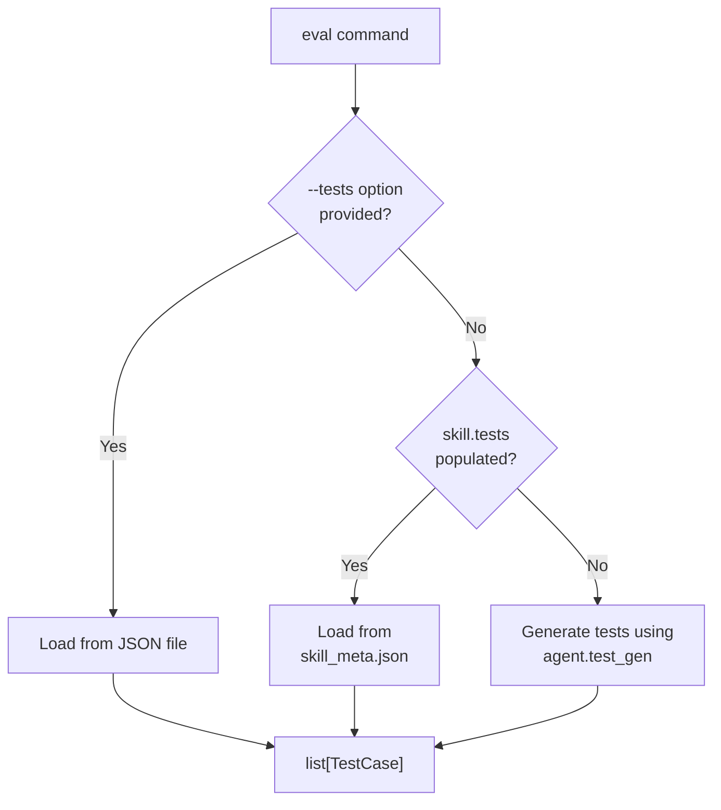
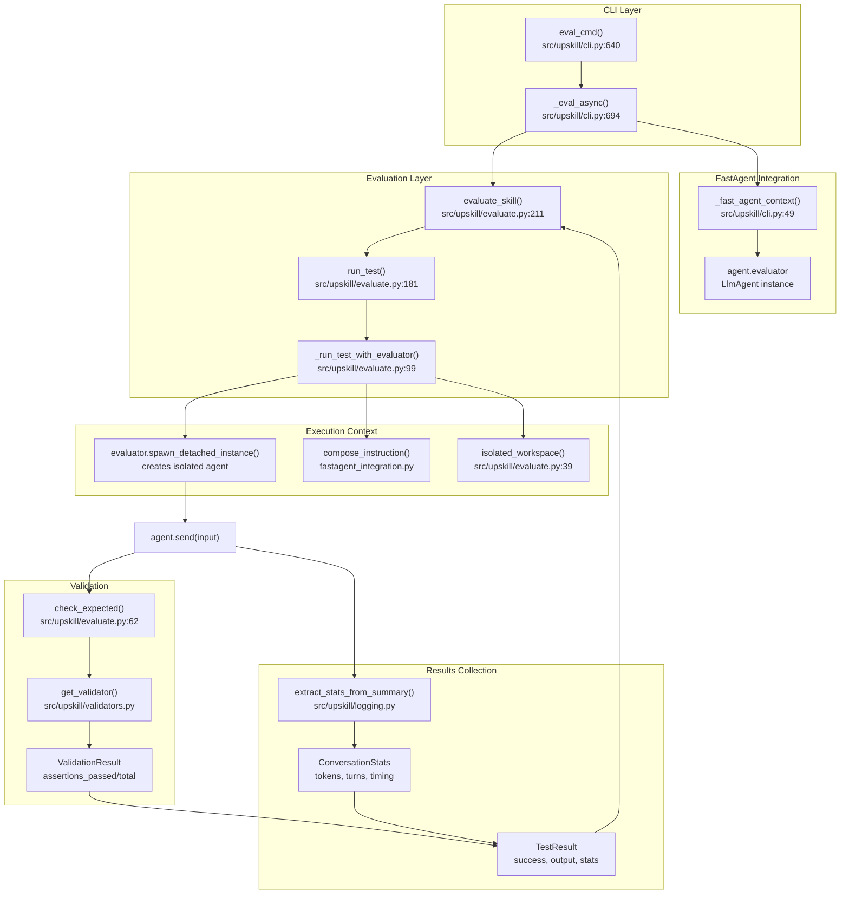
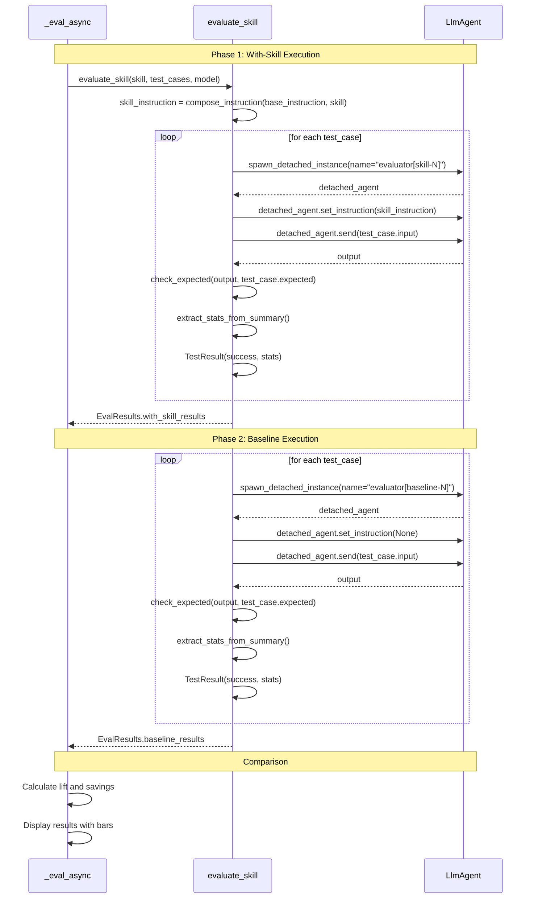
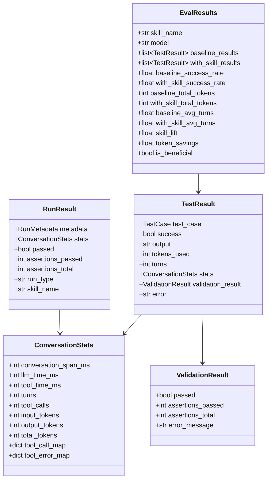
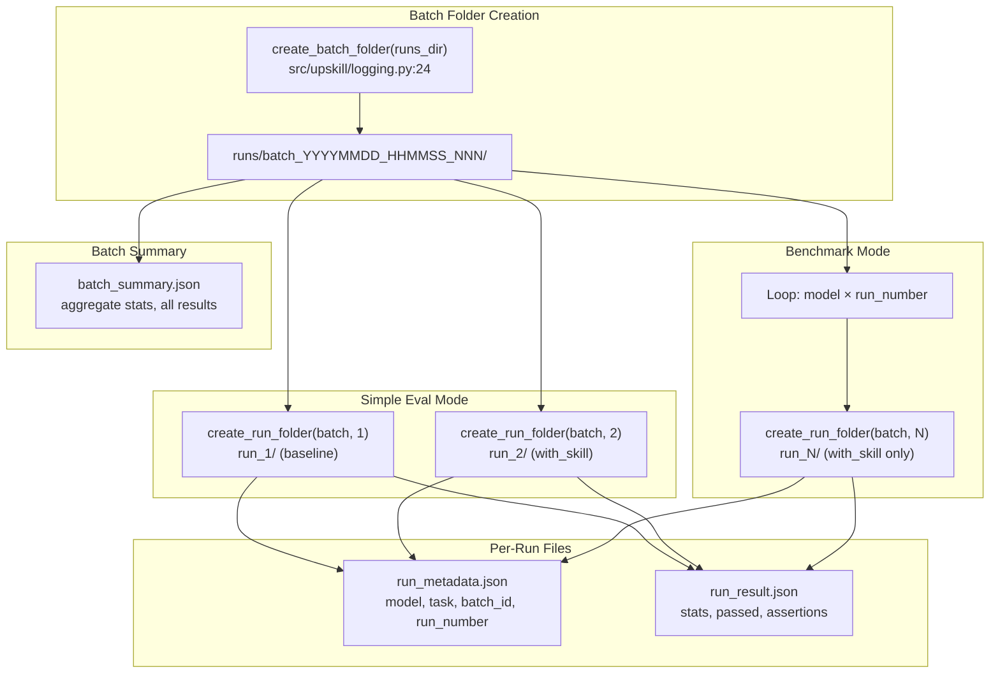

<!-- source: DeepWiki mcp.deepwiki.com · repo huggingface/upskill · page 4.2 upskill eval · fetched 2026-10-26 -->

# upskill eval

<details>
<summary>Relevant source files</summary>

The following files were used as context for generating this wiki page:

- [README.md](README.md)
- [src/upskill/cli.py](src/upskill/cli.py)
- [src/upskill/evaluate.py](src/upskill/evaluate.py)
- [tests/test_smoke.py](tests/test_smoke.py)

</details>


## Purpose and Scope

The `upskill eval` command evaluates an existing skill against test cases by comparing agent performance with and without the skill. It provides baseline comparison, multi-model benchmarking, detailed metrics collection, and run logging capabilities. This command focuses on skill assessment and validation rather than skill creation or refinement.

For skill generation with automatic evaluation, see [upskill generate](#4.1). For viewing historical evaluation results, see [upskill runs](#4.5). For multi-model statistical comparisons, see [upskill benchmark](#4.4).

**Sources:** [src/upskill/cli.py:621-651](), [README.md:113-196]()

---

## Command Syntax

```bash
upskill eval SKILL_PATH [OPTIONS]
```

### Arguments

| Argument | Description |
|----------|-------------|
| `SKILL_PATH` | Path to skill directory containing SKILL.md |

### Options

| Option | Type | Default | Description |
|--------|------|---------|-------------|
| `-t, --tests` | Path | Auto-generated | Test cases JSON file |
| `-m, --model` | String(s) | config.eval_model | Model(s) to evaluate (repeatable) |
| `--runs` | Integer | 1 | Number of runs per model |
| `--provider` | Choice | Auto-detected | API provider: anthropic, openai, generic |
| `--base-url` | URL | - | Custom API endpoint for local models |
| `--no-baseline` | Flag | False | Skip baseline comparison |
| `-v, --verbose` | Flag | False | Show per-test results |
| `--log-runs` | Flag | True | Enable run data logging |
| `--runs-dir` | Path | ./runs | Directory for run logs |

**Sources:** [src/upskill/cli.py:621-651](), [README.md:117-134]()

---

## Execution Modes

The command operates in two distinct modes based on the provided options:

### Simple Evaluation Mode

**Trigger:** Single model with `--runs 1` (default)

**Behavior:**
- Loads skill and test cases
- Runs baseline tests (without skill) unless `--no-baseline` is specified
- Runs tests with skill enabled
- Compares performance metrics
- Displays results with horizontal progress bars
- Logs 2 runs (baseline + with_skill) when logging is enabled

**Code path:** [src/upskill/cli.py:918-1040]()

### Benchmark Mode

**Trigger:** Multiple models specified or `--runs > 1`

**Behavior:**
- Evaluates across all model/run combinations
- Runs only with skill enabled (no baseline comparison)
- Aggregates statistics per model
- Displays summary table with pass rates and averages
- Logs N × M runs where N = number of models, M = runs per model

**Code path:** [src/upskill/cli.py:774-916]()

**Sources:** [src/upskill/cli.py:694-722](), [src/upskill/cli.py:774-916](), [src/upskill/cli.py:918-1040]()

---

## Test Case Loading

The command loads test cases in the following priority order:



**Test case validation:** The command checks for invalid test cases missing expected values and warns the user.

**Sources:** [src/upskill/cli.py:725-758]()

---

## Evaluation Process

### Execution Pipeline



**Sources:** [src/upskill/cli.py:694-1040](), [src/upskill/evaluate.py:99-209](), [src/upskill/evaluate.py:211-286]()

---

## Baseline Comparison

### Comparison Workflow

When `--no-baseline` is not specified (default behavior), the evaluation performs A/B testing:



**Key implementation details:**
- Tests run in parallel using `asyncio.gather()` for each phase: [src/upskill/evaluate.py:235-250]()
- Each test gets a detached agent instance to ensure isolation: [src/upskill/evaluate.py:119]()
- Baseline instruction is `None`, which clears the agent's instruction: [src/upskill/evaluate.py:126-129]()
- With-skill instruction is composed using `compose_instruction()`: [src/upskill/evaluate.py:200](), [src/upskill/evaluate.py:256]()

**Sources:** [src/upskill/evaluate.py:211-286](), [src/upskill/cli.py:922-928](), [src/upskill/cli.py:987-1040]()

---

## Metrics and Results

### Result Data Structures



### Derived Metrics

The `EvalResults` class computes comparison metrics:

| Metric | Formula | Meaning |
|--------|---------|---------|
| `skill_lift` | `with_skill_success_rate - baseline_success_rate` | Success rate improvement |
| `token_savings` | `1 - (with_skill_total_tokens / baseline_total_tokens)` | Token usage reduction percentage |
| `is_beneficial` | `lift > 0.05 OR (lift >= 0 AND savings > 0.20)` | Whether skill meets benefit criteria |

**Computation location:** [src/upskill/models.py:270-307]()

**Sources:** [src/upskill/models.py:160-210](), [src/upskill/models.py:212-249](), [src/upskill/models.py:251-268](), [src/upskill/models.py:270-307](), [src/upskill/models.py:317-337]()

---

## Run Logging

### Logging Workflow

When `--log-runs` is enabled (default), the evaluation creates detailed logs:



### Logged Data

**Per-run metadata** (`run_metadata.json`):
```json
{
  "model": "sonnet",
  "task": "Parse JSON Schema files",
  "batch_id": "20250121_153045_001",
  "run_number": 1
}
```

**Per-run result** (`run_result.json`):
```json
{
  "metadata": {...},
  "stats": {
    "conversation_span_ms": 12450,
    "llm_time_ms": 8200,
    "tool_time_ms": 3100,
    "turns": 5,
    "tool_calls": 8,
    "input_tokens": 2300,
    "output_tokens": 850,
    "total_tokens": 3150,
    "tool_call_map": {"read_file": 3, "write_file": 2},
    "tool_error_map": {}
  },
  "passed": true,
  "assertions_passed": 8,
  "assertions_total": 10,
  "run_type": "with_skill",
  "skill_name": "json-schema-parser"
}
```

**Batch summary** (`batch_summary.json`):
```json
{
  "batch_id": "20250121_153045_001",
  "model": "sonnet",
  "task": "Parse JSON Schema files",
  "total_runs": 2,
  "passed_runs": 2,
  "results": [...]
}
```

**Sources:** [src/upskill/cli.py:760-767](), [src/upskill/cli.py:859-861](), [src/upskill/logging.py:24-43](), [src/upskill/logging.py:46-58](), [src/upskill/logging.py:61-75](), [src/upskill/logging.py:78-93](), [src/upskill/logging.py:219-236]()

---

## Output Formats

### Simple Evaluation Output

```
Running 5 test cases...

  baseline   ████████████░░░░░░░░   60%
  with skill ████████████████░░░░   80%  (+20%)

  tokens: 1200 → 950  (-21%)

Recommendation: keep skill
```

**Display logic:** [src/upskill/cli.py:998-1040]()

**Bar rendering:** [src/upskill/cli.py:68-76]()

### Verbose Mode Output

With `-v` flag, displays per-test comparison:

```
  1. Parse simple schema  OK base  OK skill
  2. Handle nested objects  FAIL base  OK skill
  3. Validate array types  OK base  OK skill
  4. Complex union types  FAIL base  FAIL skill
  5. Optional properties  OK base  OK skill
```

**Display logic:** [src/upskill/cli.py:987-996]()

### Benchmark Mode Output

```
Evaluating json-schema-parser across 2 model(s)
  5 test case(s), 3 run(s) per model

haiku
  Run 1: PASS (4/5 assertions passed)
  Run 2: PASS (5/5 assertions passed)
  Run 3: PASS (4/5 assertions passed)

sonnet
  Run 1: PASS (5/5 assertions passed)
  Run 2: PASS (5/5 assertions passed)
  Run 3: PASS (5/5 assertions passed)

Summary

haiku
  Runs: 3 | Passed: 3 (100%)
  Avg tokens: 1250 | Avg turns: 4.3

sonnet
  Runs: 3 | Passed: 3 (100%)
  Avg tokens: 1890 | Avg turns: 3.7
```

**Display logic:** [src/upskill/cli.py:876-903]()

**Sources:** [src/upskill/cli.py:68-76](), [src/upskill/cli.py:876-903](), [src/upskill/cli.py:987-1040]()

---

## Usage Examples

### Basic Evaluation

```bash
# Evaluate with baseline comparison
upskill eval ./skills/my-skill/

# Skip baseline (faster, just tests with skill)
upskill eval ./skills/my-skill/ --no-baseline

# Verbose output showing per-test results
upskill eval ./skills/my-skill/ -v
```

### Custom Test Cases

```bash
# Use external test file
upskill eval ./skills/my-skill/ --tests ./tests.json

# Test JSON format
cat tests.json
[
  {
    "input": "Parse this schema: {...}",
    "expected": {"contains": ["valid", "parsed"]}
  }
]
```

### Multi-Model Evaluation

```bash
# Compare two models
upskill eval ./skills/my-skill/ -m haiku -m sonnet

# Multiple runs per model for statistical significance
upskill eval ./skills/my-skill/ -m haiku -m sonnet --runs 5

# Benchmark across three models with 10 runs each
upskill eval ./skills/my-skill/ -m haiku -m sonnet -m opus --runs 10
```

### Local Model Evaluation

```bash
# Ollama
upskill eval ./skills/my-skill/ \
    -m llama3.2:latest \
    --base-url http://localhost:11434/v1

# llama.cpp server
upskill eval ./skills/my-skill/ \
    -m "unsloth/GLM-4.7-Flash-GGUF:Q4_0" \
    --base-url http://localhost:8080/v1

# Custom provider with API key
export GENERIC_API_KEY=my-secret-key
upskill eval ./skills/my-skill/ \
    -m custom-model \
    --provider generic \
    --base-url http://localhost:9000/v1
```

### Controlling Logging

```bash
# Disable run logging (no disk writes)
upskill eval ./skills/my-skill/ --no-log-runs

# Custom runs directory
upskill eval ./skills/my-skill/ --runs-dir ./my-experiments/

# Default behavior (logging enabled to ./runs/)
upskill eval ./skills/my-skill/
```

**Sources:** [README.md:136-166](), [src/upskill/cli.py:652-677]()

---

## Integration with Evaluation API

The CLI command is a thin wrapper around the programmatic evaluation API. For direct Python usage:

```python
from upskill import evaluate_skill
from upskill.models import Skill, TestCase

# Load skill
skill = Skill.load(Path("./skills/my-skill/"))

# Define test cases
test_cases = [
    TestCase(
        input="Parse this schema",
        expected={"contains": ["valid", "schema"]}
    )
]

# Evaluate (requires FastAgent context)
async with _fast_agent_context() as agent:
    results = await evaluate_skill(
        skill,
        test_cases,
        evaluator=agent.evaluator,
        model="haiku",
        run_baseline=True
    )
    
    print(f"Baseline: {results.baseline_success_rate:.0%}")
    print(f"With skill: {results.with_skill_success_rate:.0%}")
    print(f"Lift: {results.skill_lift:+.0%}")
    print(f"Beneficial: {results.is_beneficial}")
```

**Key differences:**
- CLI handles configuration loading, logging setup, and output formatting
- API requires manual FastAgent context management
- CLI supports benchmark mode with aggregation; API runs single evaluations
- CLI creates batch folders and writes results; API returns in-memory objects

For API details, see [Evaluation API](#9.2).

**Sources:** [src/upskill/cli.py:694-1040](), [src/upskill/evaluate.py:211-286]()

---

