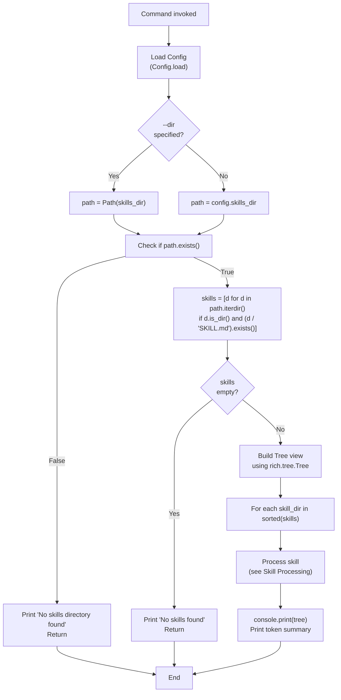
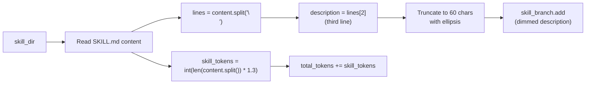
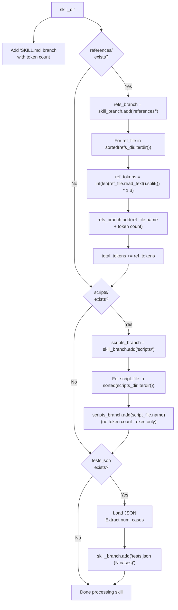
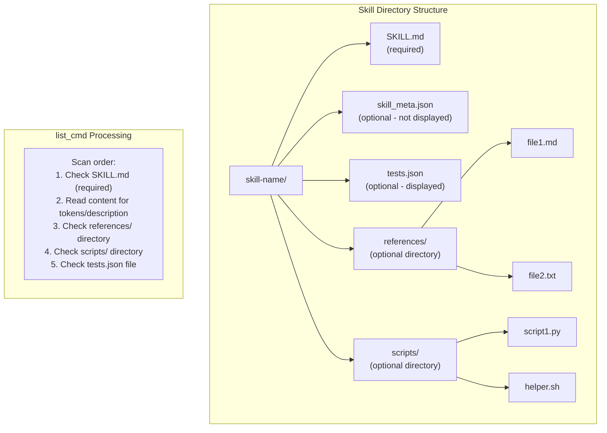
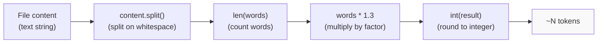
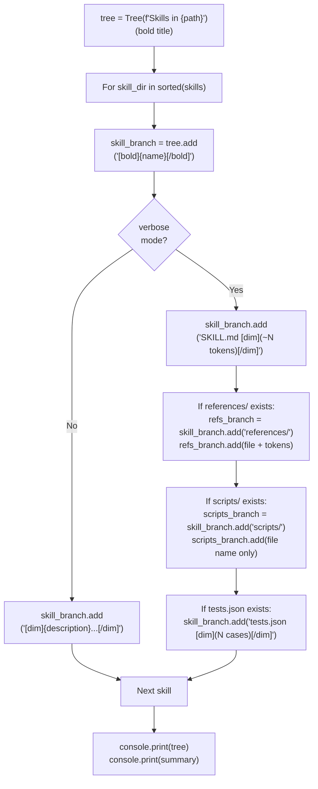
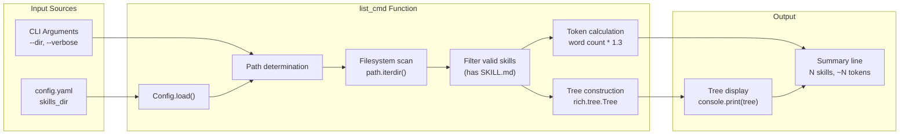
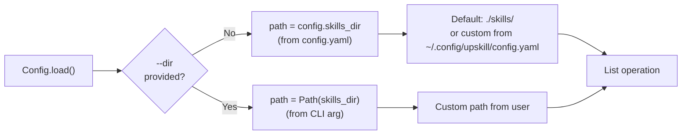

<!-- source: DeepWiki mcp.deepwiki.com · repo huggingface/upskill · page 4.3 upskill list · fetched 2026-10-26 -->

# upskill list

<details>
<summary>Relevant source files</summary>

The following files were used as context for generating this wiki page:

- [README.md](README.md)
- [src/upskill/cli.py](src/upskill/cli.py)
- [tests/test_smoke.py](tests/test_smoke.py)

</details>


## Purpose and Scope

The `upskill list` command provides a visual directory listing of generated skills with optional detailed structure inspection. It displays skills in a tree format showing their contents and estimated token counts. This command is primarily used for skill inventory management and quick inspection of skill artifacts.

For generating new skills, see [upskill generate](#4.1). For evaluating skills, see [upskill eval](#4.2). For viewing evaluation history, see [upskill runs](#4.5).

---

## Command Signature

```bash
upskill list [OPTIONS]
```

The command scans a skills directory (default: `./skills/`) and displays all valid skill directories that contain a `SKILL.md` file.

**Sources:** [src/upskill/cli.py:1042-1118]()

---

## Options

| Option | Short | Type | Default | Description |
|--------|-------|------|---------|-------------|
| `--dir` | `-d` | Path | `config.skills_dir` | Skills directory to list |
| `--verbose` | `-v` | Flag | `False` | Show detailed skill structure with file listings |

**Sources:** [src/upskill/cli.py:1043-1044]()

---

## Skill Discovery Process

The command follows a specific process to identify and display skills:



**Validation criteria:**
- Directory must exist and be a directory (`d.is_dir()`)
- Must contain a `SKILL.md` file (`(d / "SKILL.md").exists()`)

**Sources:** [src/upskill/cli.py:1047-1061]()

---

## Skill Processing and Display Modes

### Simple Mode (Default)

When `--verbose` is not specified, the command shows a condensed view:



**Output format:**
```
Skills in ./skills
├── skill-name-1
│   └── Brief description from line 3...
└── skill-name-2
    └── Another brief description...
```

**Sources:** [src/upskill/cli.py:1108-1112]()

### Verbose Mode (`-v` flag)

When `--verbose` is specified, the command displays detailed file structure:



**Output format:**
```
Skills in ./skills
└── skill-name
    ├── SKILL.md (~450 tokens)
    ├── references/
    │   ├── example.md (~120 tokens)
    │   └── guide.txt (~85 tokens)
    ├── scripts/
    │   └── helper.py
    └── tests.json (5 cases)
```

**Sources:** [src/upskill/cli.py:1079-1107]()

---

## File Structure Recognition

The command recognizes the standard skill directory structure:



**Required files:**
- `SKILL.md` - Main skill document (must exist for directory to be recognized as a skill)

**Optional components (shown in verbose mode):**
- `references/` - Supporting documentation files (token counts displayed)
- `scripts/` - Executable scripts (no token counts)
- `tests.json` - Test case definitions (case count displayed)

**Not displayed:**
- `skill_meta.json` - Metadata file (internal use only)

**Sources:** [src/upskill/cli.py:1068-1107](), [README.md:303-311]()

---

## Token Estimation Algorithm

The command estimates token counts using a word-based heuristic:



**Formula:** `tokens = int(len(content.split()) * 1.3)`

**Rationale:**
- Word count provides a baseline
- Multiplier of 1.3 accounts for tokenization overhead (punctuation, subwords)
- Result is an approximation, not exact token count

**Applied to:**
- `SKILL.md` files
- All files in `references/` directory
- **Not** applied to `scripts/` (marked as "exec only")

**Total calculation:**
```python
total_tokens = 0
for skill in skills:
    total_tokens += skill_md_tokens
    total_tokens += sum(reference_tokens for each reference)
```

**Sources:** [src/upskill/cli.py:1074, 1089]()

---

## Tree Rendering

The command uses `rich.tree.Tree` for hierarchical display:



**Rich markup used:**
- `[bold]text[/bold]` - Skill names
- `[dim]text[/dim]` - Descriptions, token counts, metadata
- Tree structure with `├──`, `│`, and `└──` characters

**Sources:** [src/upskill/cli.py:1064-1115]()

---

## Data Flow



**Sources:** [src/upskill/cli.py:1042-1118]()

---

## Usage Examples

### Basic Listing

```bash
upskill list
```

**Output:**
```
Skills in ./skills
├── git-commit-messages
│   └── Write clear, conventional commit messages...
└── json-parser
    └── Parse and validate JSON Schema files with error...

2 skills, ~1,250 total tokens
```

**Sources:** [README.md:212-214]()

---

### Verbose Listing

```bash
upskill list -v
```

**Output:**
```
Skills in ./skills
└── git-commit-messages
    ├── SKILL.md (~450 tokens)
    ├── references/
    │   ├── conventional-commits.md (~200 tokens)
    │   └── examples.md (~150 tokens)
    ├── scripts/
    │   └── validate_commit.py
    └── tests.json (8 cases)

1 skills, ~800 total tokens
```

**Shows:**
- All files with token estimates
- Test case counts
- Directory structure

**Sources:** [README.md:218-220](), [src/upskill/cli.py:1079-1107]()

---

### Custom Directory

```bash
upskill list --dir ./my-skills/
```

**Behavior:**
- Overrides `config.skills_dir`
- Scans specified directory instead of default
- Same validation and display logic applies

**Sources:** [README.md:215-216](), [src/upskill/cli.py:1048-1051]()

---

## Summary Display

After the tree, the command prints a summary line:

```python
console.print(f"[dim]{len(skills)} skills, ~{total_tokens:,} total tokens[/dim]")
```

**Format:**
- Skill count: Number of valid skill directories found
- Token count: Sum of all SKILL.md and references/ files
- Thousand separators: e.g., `~1,250 total tokens`
- Dimmed styling for visual hierarchy

**Sources:** [src/upskill/cli.py:1117]()

---

## Error Handling

The command handles various edge cases:

| Condition | Behavior | Output |
|-----------|----------|--------|
| Directory doesn't exist | Early return | `"No skills directory found at {path}"` |
| Directory is empty | Early return | `"No skills found in {path}"` |
| No SKILL.md in directory | Skip directory | Directory not listed |
| Invalid JSON in tests.json | Silent skip | tests.json not shown |
| Unreadable file | Continue | File skipped from tree |

**No exceptions raised** - command is designed for graceful degradation.

**Sources:** [src/upskill/cli.py:1053-1061]()

---

## Integration with Config System

The command integrates with the upskill configuration:



**Configuration file location:** `~/.config/upskill/config.yaml`

**Relevant config key:**
```yaml
skills_dir: ./skills  # Default skills directory
```

**Sources:** [src/upskill/cli.py:1047-1051](), [README.md:376-384]()

---

## Related Commands

- **[upskill generate](#4.1)** - Creates skills that will appear in this listing
- **[upskill eval](#4.2)** - Evaluates skills shown in this listing
- **[upskill benchmark](#4.4)** - Benchmarks skills across models
- **Skill directory structure** - See [Skill Persistence](#5.5) for details on how skills are stored

---

