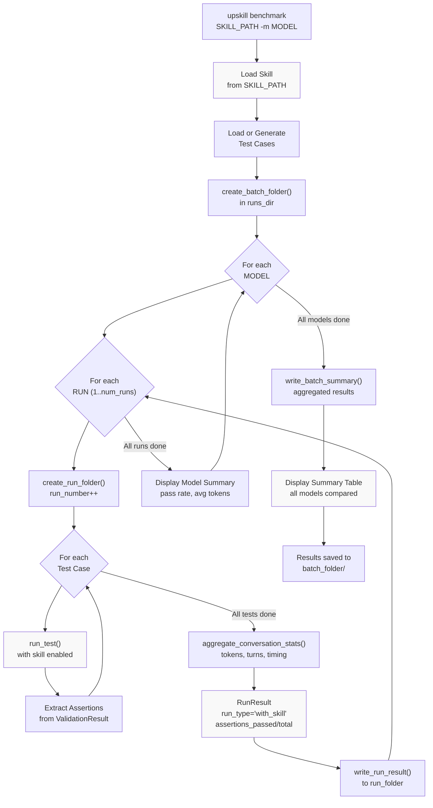
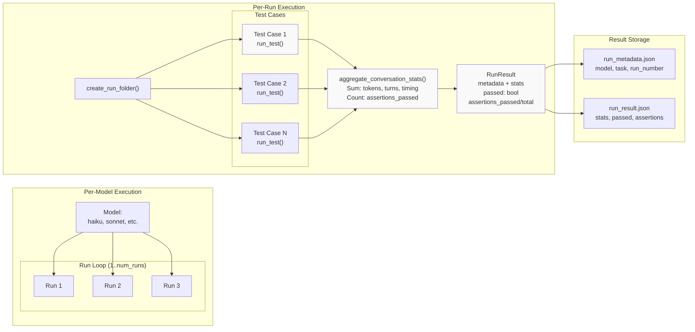
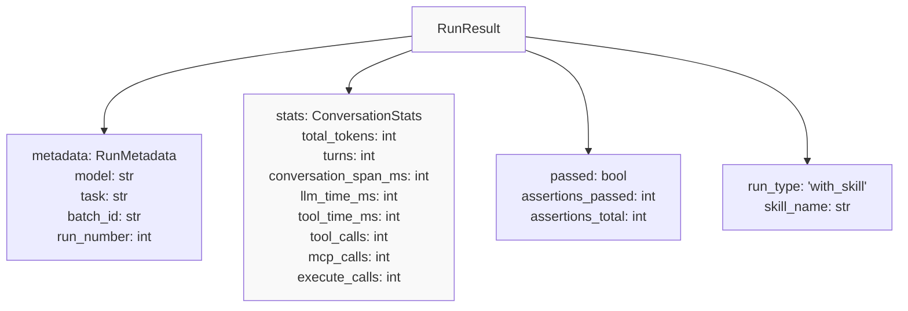
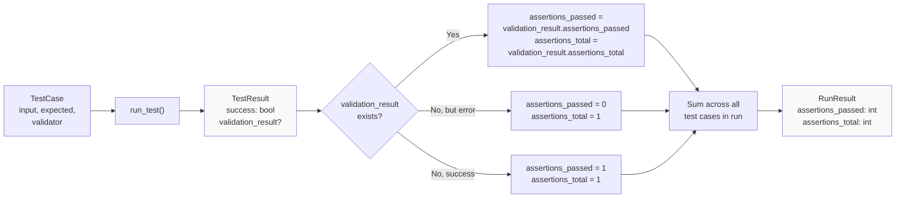

<!-- source: DeepWiki mcp.deepwiki.com · repo huggingface/upskill · page 4.4 upskill benchmark · fetched 2026-10-26 -->

# upskill benchmark

<details>
<summary>Relevant source files</summary>

The following files were used as context for generating this wiki page:

- [README.md](README.md)
- [src/upskill/cli.py](src/upskill/cli.py)
- [src/upskill/evaluate.py](src/upskill/evaluate.py)
- [tests/test_smoke.py](tests/test_smoke.py)

</details>


The `upskill benchmark` command evaluates a skill across multiple models and/or multiple runs to establish statistical significance. Unlike `upskill eval` which compares baseline vs with-skill performance, `benchmark` focuses on measuring consistent performance of a skill across different models or runs, making it ideal for model comparison and reliability testing.

For simple skill evaluation with baseline comparison, see [upskill eval](#4.2). For viewing historical benchmark results, see [upskill runs](#4.5).

## Command Syntax

```bash
upskill benchmark SKILL_PATH -m MODEL [OPTIONS]
```

## Arguments and Options

| Argument/Option | Type | Required | Default | Description |
|----------------|------|----------|---------|-------------|
| `SKILL_PATH` | Path | Yes | - | Path to skill directory containing `SKILL.md` |
| `-m, --model` | String | Yes | - | Model to benchmark (repeatable for multiple models) |
| `--runs` | Integer | No | 3 | Number of runs per model |
| `-t, --tests` | Path | No | - | Test cases JSON file (auto-generated if not provided) |
| `-o, --output` | Path | No | `./runs/` | Output directory for results |
| `-v, --verbose` | Flag | No | False | Show per-run and per-test details |

**Sources:** [src/upskill/cli.py:1120-1148]()

## Workflow Overview



**Sources:** [src/upskill/cli.py:1156-1282]()

## Test Execution Details



**Sources:** [src/upskill/cli.py:1207-1263](), [src/upskill/evaluate.py:181-209]()

## Output Format

### Terminal Output

When benchmarking completes, the command displays a summary for each model:

```
Benchmarking my-skill across 2 model(s)
  3 test case(s), 5 run(s) per model

haiku
  Run 1: PASS (3/3 assertions passed)
  Run 2: PASS (3/3 assertions passed)
  Run 3: FAIL (2/3 assertions passed)
  Run 4: PASS (3/3 assertions passed)
  Run 5: PASS (3/3 assertions passed)

sonnet
  Run 1: PASS (3/3 assertions passed)
  Run 2: PASS (3/3 assertions passed)
  Run 3: PASS (3/3 assertions passed)
  Run 4: PASS (3/3 assertions passed)
  Run 5: PASS (3/3 assertions passed)

Summary

haiku
  Runs: 5 | Passed: 4 (80%)
  Avg tokens: 1250 | Avg turns: 3.2

sonnet
  Runs: 5 | Passed: 5 (100%)
  Avg tokens: 1890 | Avg turns: 2.8
```

**Sources:** [src/upskill/cli.py:1264-1282]()

### Logged Data Structure

Benchmark results are written to a batch folder in the runs directory:

```
./runs/batch_YYYYMMDD_HHMMSS/
├── run_1/
│   ├── run_metadata.json    # model: haiku, run_number: 1
│   └── run_result.json      # stats, assertions, passed: true
├── run_2/
│   ├── run_metadata.json    # model: haiku, run_number: 2
│   └── run_result.json
├── run_3/
│   ├── run_metadata.json    # model: haiku, run_number: 3
│   └── run_result.json
├── run_4/
│   ├── run_metadata.json    # model: sonnet, run_number: 1
│   └── run_result.json
├── run_5/
│   ├── run_metadata.json    # model: sonnet, run_number: 2
│   └── run_result.json
└── batch_summary.json       # aggregated results across all runs
```

**Sources:** [src/upskill/cli.py:1194-1198](), [src/upskill/logging.py:30-50]()

## RunResult Structure

Each benchmark run generates a `RunResult` object with detailed metrics:



**Sources:** [src/upskill/models.py:310-328](), [src/upskill/cli.py:1242-1257]()

## Assertion Counting Logic

The benchmark command extracts assertion counts from test validation results:



**Sources:** [src/upskill/cli.py:1230-1241]()

## Examples

### Basic Benchmark Across Models

```bash
upskill benchmark ./skills/my-skill/ -m haiku -m sonnet
```

Runs the skill's test cases once per model and compares performance.

**Sources:** [README.md:142-145]()

### Statistical Significance Testing

```bash
upskill benchmark ./skills/my-skill/ -m gpt-4o -m claude-sonnet --runs 5
```

Runs each model 5 times to establish confidence in the results. This is useful when:
- Test cases have non-deterministic behavior
- You need to measure consistency across runs
- You're comparing models with similar performance

**Sources:** [README.md:145]()

### Custom Test Cases

```bash
upskill benchmark ./skills/my-skill/ -m haiku -t ./custom_tests.json
```

Uses custom test cases instead of auto-generating from the skill description.

**Sources:** [src/upskill/cli.py:1172-1178]()

### Verbose Output

```bash
upskill benchmark ./skills/my-skill/ -m haiku -m sonnet --runs 3 -v
```

Shows per-test progress during execution:

```
haiku
  Running test 1/3...
  Running test 2/3...
  Running test 3/3...
  Run 1: PASS (3/3 assertions passed)
```

**Sources:** [src/upskill/cli.py:1217-1218]()

## Key Differences from `upskill eval`

| Feature | `upskill benchmark` | `upskill eval` |
|---------|-------------------|----------------|
| **Primary Purpose** | Compare models or measure consistency | Compare baseline vs with-skill |
| **Baseline Runs** | No | Yes (unless `--no-baseline`) |
| **Run Type** | Always `"with_skill"` | Both `"baseline"` and `"with_skill"` |
| **Multi-model Support** | Primary mode (required) | Optional via multiple `-m` flags |
| **Default Runs** | 3 per model | 1 |
| **Metrics Displayed** | Pass rate, avg assertions | Skill lift, token savings |
| **is_beneficial Check** | Not performed | Computed and reported |

**Sources:** [src/upskill/cli.py:1120-1282](), [src/upskill/cli.py:694-1040]()

## When to Use Benchmark

Use `upskill benchmark` when you want to:

1. **Compare model performance**: Evaluate which model executes a skill most reliably
   ```bash
   upskill benchmark ./skills/api-handler/ -m haiku -m sonnet -m opus --runs 5
   ```

2. **Measure consistency**: Determine if a skill produces consistent results across runs
   ```bash
   upskill benchmark ./skills/parser/ -m haiku --runs 10
   ```

3. **Statistical confidence**: Establish confidence intervals for skill performance
   ```bash
   upskill benchmark ./skills/validator/ -m sonnet --runs 20
   ```

4. **Regression testing**: Verify a skill still works after modifications
   ```bash
   upskill benchmark ./skills/my-skill/ -m haiku --runs 3
   ```

Use `upskill eval` instead when you want to:
- Determine if a skill is beneficial (baseline comparison)
- Calculate skill lift and token savings
- Evaluate a single model once

**Sources:** [README.md:32-36](), [src/upskill/cli.py:1135-1148]()

## Integration with Run Logging

All benchmark results are automatically logged to the runs directory and can be viewed later:

```bash
# Run benchmark
upskill benchmark ./skills/my-skill/ -m haiku -m sonnet --runs 5

# View results later
upskill runs --skill my-skill

# Export to CSV for analysis
upskill runs --skill my-skill --csv ./results.csv
```

The batch summary includes all run results for aggregation and visualization.

**Sources:** [src/upskill/cli.py:1194-1198](), [src/upskill/cli.py:1271-1282](), [src/upskill/logging.py:229-269]()

## Implementation Details

### FastAgent Context

Benchmark uses the same FastAgent context as other commands, loading agent cards for the evaluator:

```python
async with _fast_agent_context() as agent:
    # agent.evaluator is loaded from agent_cards/evaluator.md
    result = await run_test(tc, evaluator=agent.evaluator, skill=skill)
```

**Sources:** [src/upskill/cli.py:49-65](), [src/upskill/cli.py:1170]()

### Test Case Loading Priority

The benchmark command loads test cases in this order:

1. Custom test file specified via `-t/--tests`
2. Embedded test cases in `skill.tests` (from `skill_meta.json`)
3. Auto-generated test cases using `agent.test_gen`

**Sources:** [src/upskill/cli.py:1172-1186]()

### Aggregation of Conversation Stats

Each run aggregates statistics across all test cases:

```python
run_results: list[TestResult] = []
# ... run all test cases ...
aggregated_stats = aggregate_conversation_stats(run_results)
```

The `aggregate_conversation_stats` function sums tokens, timing, and tool calls across all test results.

**Sources:** [src/upskill/cli.py:1242](), [src/upskill/logging.py:118-139]()

### Batch Summary Structure

After all runs complete, a batch summary is written containing:

```python
BatchSummary(
    batch_id=batch_id,
    model=", ".join(models),  # Comma-separated list
    task=skill.description,
    total_runs=len(all_run_results),
    passed_runs=sum(1 for r in all_run_results if r.passed),
    results=all_run_results,  # List[RunResult]
)
```

**Sources:** [src/upskill/cli.py:1271-1282](), [src/upskill/models.py:331-344]()

---

