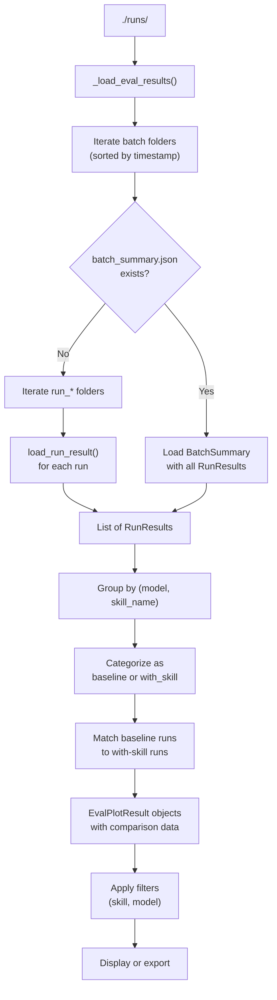
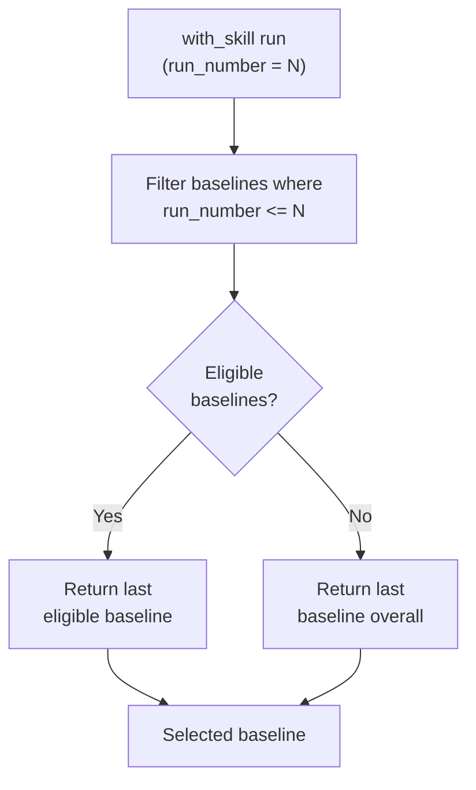
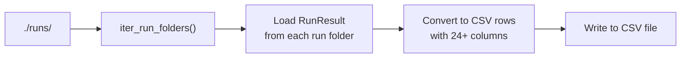
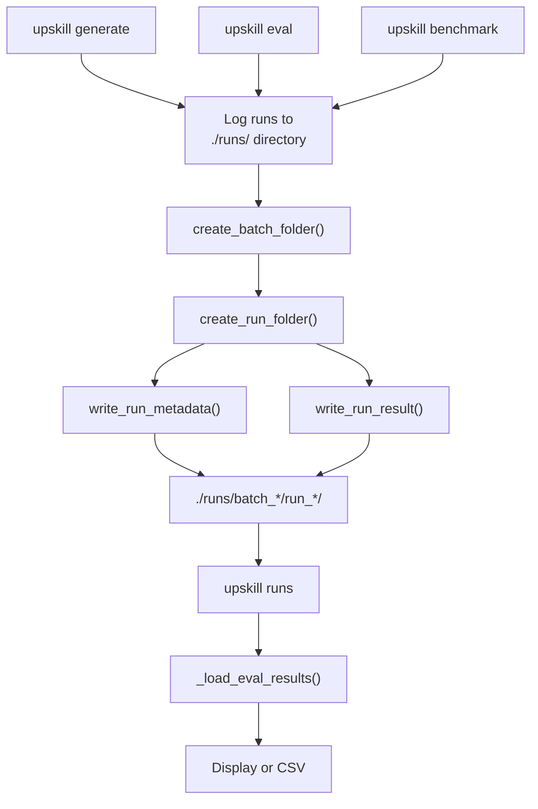

<!-- source: DeepWiki mcp.deepwiki.com · repo huggingface/upskill · page 4.5 upskill runs · fetched 2026-10-26 -->

# upskill runs

<details>
<summary>Relevant source files</summary>

The following files were used as context for generating this wiki page:

- [README.md](README.md)
- [src/upskill/cli.py](src/upskill/cli.py)
- [src/upskill/logging.py](src/upskill/logging.py)
- [tests/test_smoke.py](tests/test_smoke.py)

</details>


**Purpose**: The `upskill runs` command provides tools for viewing, analyzing, and exporting evaluation history. It reads run results from the `./runs/` directory and displays them in various formats including visual comparison bars, matrix tables, and CSV exports. This command enables retrospective analysis of skill performance across different models and evaluation sessions.

**Scope**: This page covers the runs command functionality for viewing historical evaluation data. For information about how run data is initially logged during evaluation, see [Run Directory Structure](#8.1). For details about the metrics collected, see [Conversation Statistics](#8.2). For the evaluation process itself, see [upskill eval](#4.2).

---

## Overview

The `upskill runs` command serves as the primary interface for viewing evaluation history. Every time you run `upskill generate` or `upskill eval` with logging enabled (default), the system creates timestamped batch folders containing detailed run results. The `runs` command loads this historical data and presents it in formats optimized for different analysis needs.

**Sources:** [src/upskill/cli.py:1242-1375](), [README.md:242-300]()

---

## Command Syntax and Options

```bash
upskill runs [OPTIONS]
```

### Options

| Option | Type | Description |
|--------|------|-------------|
| `-d, --dir PATH` | Path | Runs directory to read from (default: `./runs/`) |
| `-s, --skill TEXT` | Text (repeatable) | Filter by skill name(s) |
| `-m, --model TEXT` | Text (repeatable) | Filter by model(s) |
| `--metric [success\|tokens]` | Choice | Metric to display (default: `success`) |
| `--csv PATH` | Path | Export to CSV file instead of displaying plot |

### Example Usage

```bash
# View all results with default settings
upskill runs

# Filter by specific skill
upskill runs -s git-commit-messages

# Filter by multiple models
upskill runs -m haiku -m sonnet

# Show token usage instead of success rate
upskill runs --metric tokens

# Export all data to CSV
upskill runs --csv ./results.csv

# Combine filters and custom directory
upskill runs -d ./my-runs/ -s my-skill -m haiku --csv output.csv
```

**Sources:** [src/upskill/cli.py:1242-1288](), [README.md:257-274]()

---

## Run Directory Structure

The command reads evaluation data from a hierarchical directory structure created by the logging system:

```
./runs/
├── batch_20250121_143022/
│   ├── run_1/
│   │   ├── run_metadata.json
│   │   └── run_result.json
│   ├── run_2/
│   │   ├── run_metadata.json
│   │   └── run_result.json
│   └── batch_summary.json
├── batch_20250121_150515/
│   └── ...
└── results.csv (generated by --csv option)
```

### Data Files

- **`run_metadata.json`**: Contains `RunMetadata` with model, task, batch_id, run_number, and timestamp
- **`run_result.json`**: Contains complete `RunResult` including metadata, stats, assertions, and run type
- **`batch_summary.json`**: Contains `BatchSummary` aggregating all runs in a batch (optional, used for faster loading)

**Sources:** [README.md:356-372](), [src/upskill/logging.py:48-108]()

---

## Data Loading Flow



### Loading Logic

The `_load_eval_results` function [src/upskill/cli.py:111-159]() implements the data loading pipeline:

1. **Batch Discovery**: Scans for all batch folders (directories with names like `batch_YYYYMMDD_HHMMSS`)
2. **Result Loading**: For each batch, tries to load `batch_summary.json` first for efficiency, falls back to loading individual run folders
3. **Grouping**: Groups results by `(model, skill_name)` tuple
4. **Categorization**: Separates runs into `baseline` and `with_skill` based on `run_type` field
5. **Baseline Matching**: For each with-skill run, selects the most recent baseline run with `run_number <= with_skill_run_number`
6. **Comparison**: Creates `EvalPlotResult` objects containing both baseline and with-skill metrics

**Sources:** [src/upskill/cli.py:111-159](), [src/upskill/logging.py:98-108](), [src/upskill/logging.py:418-427]()

---

## Visualization Modes

### Plot View (Default)

When no `--csv` option is provided, the command displays a visual plot with horizontal bars comparing baseline and with-skill performance.

#### Single Skill View

```
skill: git-commit-messages

haiku
  baseline   ████████████░░░░░░░░   60%
  with skill ████████████████░░░░   80%  (+20%)

sonnet
  baseline   ████████████░░░░░░░░   60%
  with skill ████████████████████  100%  (+40%)
```

The bars are rendered using the `_render_bar` function [src/upskill/cli.py:68-75]() which creates filled blocks (`█`) and empty blocks (`░`) based on a 0-1 value.

#### Matrix View (Multiple Skills/Models)

When results contain multiple skills and models, the command automatically switches to a matrix table format:

```
┏━━━━━━━━━━━━━━━━━━━━━┳━━━━━━━━━━━━━━┳━━━━━━━━━━━━━━┓
┃ skill               ┃ haiku        ┃ sonnet       ┃
┡━━━━━━━━━━━━━━━━━━━━━╇━━━━━━━━━━━━━━╇━━━━━━━━━━━━━━┩
│ git-commit-messages │ 60%→80%      │ 60%→100%     │
│ api-error-handling  │ 40%→70%      │ 50%→90%      │
│ yaml-parsing        │ 70%→90%      │ 80%→100%     │
└─────────────────────┴──────────────┴──────────────┘
```

**Sources:** [src/upskill/cli.py:1289-1375](), [README.md:276-300]()

### Metric Selection

The `--metric` option controls which metric is displayed:

- **`success`** (default): Shows success rates as percentages
- **`tokens`**: Shows token usage counts

For token metrics, the display shows actual token counts instead of percentages:

```
haiku
  baseline   1200 tokens
  with skill  800 tokens  (-33%)
```

**Sources:** [src/upskill/cli.py:1315-1328]()

---

## Baseline Run Selection

A critical aspect of the visualization is matching with-skill runs to appropriate baseline runs. The `_select_baseline_run` function [src/upskill/cli.py:97-108]() implements this logic:



This ensures that each with-skill run is compared against the most recent baseline that preceded or coincided with it, which is important when multiple refinement iterations occur in a single batch.

**Sources:** [src/upskill/cli.py:97-108](), [src/upskill/cli.py:144-157]()

---

## Filtering and Selection

### Skill Filtering

The `-s, --skill` option filters results to only include runs for specific skills. This option is repeatable:

```bash
upskill runs -s skill1 -s skill2
```

The filtering is implemented in `_runs_async` [src/upskill/cli.py:1289-1375]() by checking each `EvalPlotResult.skill_name` against the provided list.

### Model Filtering

The `-m, --model` option filters results to only include runs for specific models:

```bash
upskill runs -m haiku -m sonnet
```

Similar to skill filtering, this checks `EvalPlotResult.model` against the provided list.

### Combined Filtering

Filters can be combined to create precise queries:

```bash
upskill runs -s my-skill -m haiku --metric tokens
```

This shows only token usage for `my-skill` evaluated on `haiku`.

**Sources:** [src/upskill/cli.py:1289-1375]()

---

## CSV Export

The `--csv` option bypasses visualization and exports all data to a CSV file for external analysis.

### Export Process



The `summarize_runs_to_csv` function [src/upskill/logging.py:336-408]() handles the export:

1. Iterates through all run folders using `iter_run_folders` [src/upskill/logging.py:319-333]()
2. Loads `RunResult` from each `run_result.json` file
3. Extracts all metrics into a flat dictionary
4. Writes to CSV using predefined `FIELDNAMES` [src/upskill/logging.py:17-45]()

### CSV Columns

The CSV export includes 24+ columns defined in `FIELDNAMES`:

| Category | Columns |
|----------|---------|
| **Metadata** | `batch_id`, `run_number`, `model`, `task`, `timestamp` |
| **Results** | `passed`, `assertions_passed`, `assertions_total` |
| **Tokens** | `input_tokens`, `output_tokens`, `total_tokens` |
| **Timing** | `conversation_span_ms`, `llm_time_ms`, `tool_time_ms` |
| **Conversation** | `turns`, `tool_calls`, `tool_errors` |
| **Tool Types** | `mcp_calls`, `execute_calls` |
| **Session** | `error_message`, `session_id`, `session_history_file` |

### Example CSV Usage

```bash
# Export all runs
upskill runs --csv results.csv

# Export filtered subset
upskill runs -s my-skill -m haiku -m sonnet --csv filtered.csv

# Then analyze with external tools
python analyze.py results.csv
# or
import pandas as pd
df = pd.read_csv("results.csv")
```

**Sources:** [src/upskill/logging.py:336-408](), [src/upskill/logging.py:16-45]()

---

## Data Models

The runs command works with several Pydantic data models that structure the evaluation history:

### EvalPlotResult

A TypedDict [src/upskill/cli.py:78-88]() used internally for visualization:

```python
class EvalPlotResult(TypedDict):
    model: str
    skill_name: str
    with_skill_rate: float
    with_skill_tokens: int
    baseline_rate: float
    baseline_tokens: int
    has_baseline: bool
```

This structure is created by `_load_eval_results` and contains the comparison data needed for display.

### RunResult

The primary data model [src/upskill/models.py]() representing a single run:

- `metadata`: RunMetadata with model, task, batch_id, run_number, timestamp
- `stats`: ConversationStats with tokens, timing, tool calls
- `passed`: Boolean indicating if assertions passed
- `assertions_passed`: Number of assertions that passed
- `assertions_total`: Total number of assertions
- `run_type`: Either `"baseline"` or `"with_skill"`
- `skill_name`: Name of the skill being evaluated

### BatchSummary

An aggregation model [src/upskill/models.py]() containing:

- `batch_id`: Timestamp-based identifier
- `model`: Model(s) used in the batch
- `task`: Task description
- `total_runs`: Count of runs in batch
- `passed_runs`: Count of passing runs
- `results`: List of all `RunResult` objects

**Sources:** [src/upskill/cli.py:78-88](), [src/upskill/models.py](), [src/upskill/logging.py:35-42]()

---

## Success Rate Calculation

The `_success_rate` helper function [src/upskill/cli.py:90-94]() computes success rates from `RunResult` objects:

```python
def _success_rate(run: RunResult) -> float:
    if run.assertions_total == 0:
        return 0.0
    return run.assertions_passed / run.assertions_total
```

This is used throughout the visualization logic to convert assertion counts to percentages for display.

**Sources:** [src/upskill/cli.py:90-94]()

---

## Integration with Other Commands



The runs command is the read-side of the evaluation logging system:

- **Write side**: `upskill generate` [src/upskill/cli.py:189-537](), `upskill eval` [src/upskill/cli.py:621-1040](), and `upskill benchmark` [src/upskill/cli.py:1120-1240]() write run data
- **Read side**: `upskill runs` reads and displays the logged data

This separation allows you to perform evaluations at any time and review results later without re-running expensive evaluations.

**Sources:** [src/upskill/cli.py:272-280](), [src/upskill/cli.py:760-766](), [src/upskill/cli.py:1194-1195]()

---

## Example Workflows

### Workflow 1: Track Improvement Over Time

```bash
# Generate a skill (creates runs in ./runs/)
upskill generate "parse JSON files" --model sonnet

# Improve it later
upskill generate "handle edge cases better" --from ./skills/parse-json-files/

# View all attempts to see progression
upskill runs -s parse-json-files
```

### Workflow 2: Compare Models

```bash
# Evaluate a skill on multiple models
upskill eval ./skills/my-skill/ -m haiku -m sonnet -m gpt-4o

# View comparison
upskill runs -s my-skill
```

### Workflow 3: Statistical Analysis

```bash
# Run multiple evaluations for statistical significance
upskill benchmark ./skills/my-skill/ -m haiku -m sonnet --runs 10

# Export to CSV for analysis
upskill runs --csv benchmark_results.csv

# Analyze in Python/R/Excel
python -c "
import pandas as pd
df = pd.read_csv('benchmark_results.csv')
print(df.groupby('model')['assertions_passed'].describe())
"
```

**Sources:** [README.md:257-274](), [src/upskill/cli.py:1242-1375]()

---

## Performance Considerations

### Batch Summary Optimization

The loading logic prefers `batch_summary.json` files when available [src/upskill/cli.py:120-122]():

```python
summary = load_batch_summary(batch_folder)
if summary:
    run_results = summary.results
else:
    # Fallback to loading individual run folders
```

This optimization significantly speeds up loading when evaluating batches with many runs, as it reads one file instead of N×2 files per batch.

### Lazy Loading

The command only loads runs from batches that exist, scanning the directory structure on demand rather than maintaining an index. This keeps the implementation simple but may be slow for very large run histories (thousands of batches).

**Sources:** [src/upskill/cli.py:117-132](), [src/upskill/logging.py:418-427]()

---

## Error Handling

The command gracefully handles missing or corrupted data:

- Missing `batch_summary.json`: Falls back to individual run files
- Missing `run_result.json`: Attempts to load `run_metadata.json` and creates minimal `RunResult`
- Empty runs directory: Displays message "No runs found"
- Corrupted JSON: Skips the affected run and continues loading others

**Sources:** [src/upskill/cli.py:111-159](), [src/upskill/logging.py:98-108](), [src/upskill/logging.py:360-375]()

---

