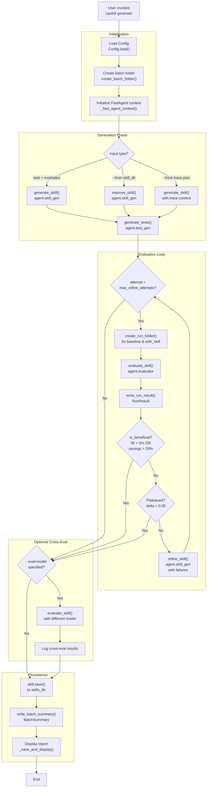
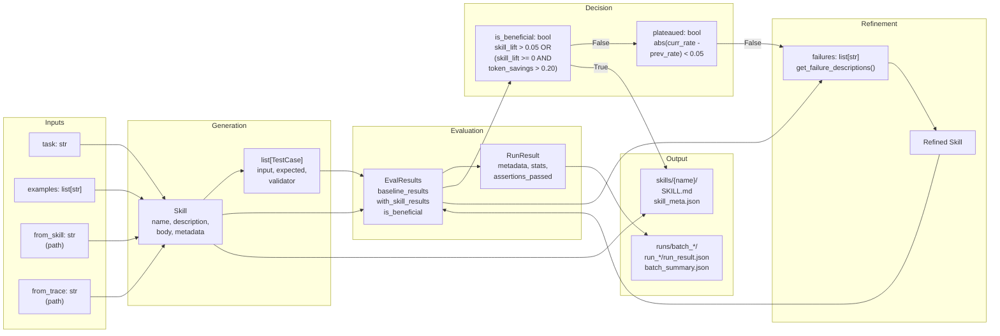

<!-- source: DeepWiki mcp.deepwiki.com · repo huggingface/upskill · page 5 Skill Lifecycle · fetched 2026-10-26 -->

# Skill Lifecycle

<details>
<summary>Relevant source files</summary>

The following files were used as context for generating this wiki page:

- [README.md](README.md)
- [src/upskill/cli.py](src/upskill/cli.py)
- [src/upskill/evaluate.py](src/upskill/evaluate.py)
- [src/upskill/generate.py](src/upskill/generate.py)
- [tests/test_smoke.py](tests/test_smoke.py)

</details>


## Purpose and Scope

This document describes the complete lifecycle of a skill in upskill: from initial generation through evaluation, refinement, and persistence. It covers the orchestration logic that coordinates the skill_gen, test_gen, and evaluator agents, the iterative refinement loop, and the decision criteria for determining when a skill is beneficial.

For detailed information about individual phases, see:
- Skill generation mechanics: [5.1](#5.1)
- Test case generation: [5.2](#5.2)
- Evaluation implementation: [5.3](#5.3)
- Refinement strategies: [5.4](#5.4)
- Persistence formats: [5.5](#5.5)

---

## Lifecycle Phases

The skill lifecycle consists of five main phases executed in sequence, with an optional refinement loop:

| Phase | Function | Agent | Output |
|-------|----------|-------|--------|
| **Generation** | `generate_skill()` | skill_gen | `Skill` object |
| **Test Creation** | `generate_tests()` | test_gen | `list[TestCase]` |
| **Evaluation** | `evaluate_skill()` | evaluator | `EvalResults` |
| **Decision** | `EvalResults.is_beneficial` | - | Boolean |
| **Refinement** | `refine_skill()` | skill_gen | Improved `Skill` |
| **Persistence** | `Skill.save()` | - | Directory structure |

The lifecycle is orchestrated by the `_generate_async()` function in [src/upskill/cli.py:256-536](), which implements the control flow and logging.

**Sources:** [src/upskill/cli.py:256-536](), [src/upskill/generate.py:104-266](), [src/upskill/evaluate.py:211-286]()

---

## Complete Lifecycle Flow



**Lifecycle Orchestration with Code Entities**

This diagram maps the conceptual flow to actual function calls and data structures used in the implementation.

**Sources:** [src/upskill/cli.py:256-536](), [src/upskill/generate.py:104-266](), [src/upskill/evaluate.py:211-286]()

---

## Data Flow Through Lifecycle



**Data Transformations and Storage**

This diagram shows how data structures flow through the lifecycle and where they are persisted.

**Sources:** [src/upskill/models.py:1-350](), [src/upskill/cli.py:256-536](), [src/upskill/evaluate.py:289-302]()

---

## Lifecycle Control Flow

The main lifecycle loop is implemented in [src/upskill/cli.py:339-439](). Key control variables:

| Variable | Type | Purpose | Default |
|----------|------|---------|---------|
| `attempts` | `int` | Maximum refinement iterations | `config.max_refine_attempts` (3) |
| `attempt` | `int` | Current iteration counter | 0 to `attempts - 1` |
| `prev_success_rate` | `float` | Previous iteration's success rate | 0.0 |
| `results.is_beneficial` | `bool` | Whether skill meets acceptance criteria | Computed |
| `no_eval` | `bool` | Skip evaluation entirely | CLI flag |

### Refinement Loop Logic

```python
for attempt in range(attempts):
    # 1. Evaluate skill
    results = await evaluate_skill(skill, test_cases, evaluator, model)
    
    # 2. Check if beneficial
    if results.is_beneficial:
        break  # Success - exit loop
    
    # 3. Check for plateau
    if abs(results.with_skill_success_rate - prev_success_rate) < 0.05:
        break  # Plateaued - exit loop
    
    # 4. Refine if more attempts available
    if attempt < attempts - 1:
        failures = get_failure_descriptions(results)
        skill = await refine_skill(skill, failures, generator, model)
    
    prev_success_rate = results.with_skill_success_rate
```

**Sources:** [src/upskill/cli.py:339-439](), [src/upskill/config.py:1-50]()

---

## Benefit Determination

The `is_beneficial` property of `EvalResults` determines whether a skill is accepted. It is computed in [src/upskill/models.py:297-307]():

```python
@property
def is_beneficial(self) -> bool:
    """Whether the skill provides measurable benefit."""
    if self.skill_lift > 0.05:  # >5% improvement in success rate
        return True
    if self.skill_lift >= 0 and self.token_savings > 0.20:  # No harm + >20% token savings
        return True
    return False
```

### Acceptance Criteria

| Metric | Threshold | Condition |
|--------|-----------|-----------|
| **Skill Lift** | `> 0.05` | Success rate improves by more than 5% |
| **Token Savings** | `> 0.20` | Tokens reduced by more than 20% (with non-negative lift) |
| **Combined** | - | Either condition satisfied |

### Metric Calculations

```python
# Success rate lift
skill_lift = with_skill_success_rate - baseline_success_rate

# Token savings (percentage reduction)
if baseline_total_tokens > 0:
    token_savings = 1 - (with_skill_total_tokens / baseline_total_tokens)
else:
    token_savings = 0
```

**Sources:** [src/upskill/models.py:270-307]()

---

## Entry Points and Variations

The lifecycle supports multiple entry points based on input type:

### 1. Task Description (Standard)

```bash
upskill generate "write good git commit messages"
```

Flow: `task` → `generate_skill()` → `generate_tests()` → evaluation loop

Implementation: [src/upskill/cli.py:324-331]()

### 2. Task with Examples

```bash
upskill generate "format dates" -e "2024-01-01 → Jan 1, 2024" -e "2024-12-31 → Dec 31, 2024"
```

Flow: `task` + `examples` → `generate_skill()` → tests → evaluation

Implementation: [src/upskill/generate.py:104-128]()

### 3. Improve Existing Skill

```bash
upskill generate "add error handling" --from ./skills/my-skill/
```

Flow: Load existing `Skill` → `improve_skill()` → tests → evaluation

Implementation: [src/upskill/cli.py:312-323]()

### 4. Generate from Trace

```bash
upskill generate "document the pattern" --from ./trace.json
```

Flow: Read trace file → augment `task` with trace context → `generate_skill()` → tests → evaluation

Implementation: [src/upskill/cli.py:286-310]()

**Sources:** [src/upskill/cli.py:189-253](), [src/upskill/generate.py:104-266]()

---

## Run Logging During Lifecycle

Each evaluation creates two run folders within a batch:

```
runs/batch_20250121_153045/
├── run_1/                      # Baseline (attempt 1)
│   ├── run_metadata.json       # RunMetadata
│   └── run_result.json         # RunResult (run_type="baseline")
├── run_2/                      # With skill (attempt 1)
│   ├── run_metadata.json
│   └── run_result.json         # RunResult (run_type="with_skill")
├── run_3/                      # Baseline (attempt 2, if refined)
├── run_4/                      # With skill (attempt 2)
└── batch_summary.json          # BatchSummary (all runs)
```

### Run Numbering

| Phase | Run Type | Run Number Formula |
|-------|----------|--------------------|
| Baseline | `"baseline"` | `attempt * 2 + 1` |
| With Skill | `"with_skill"` | `attempt * 2 + 2` |
| Cross-eval Baseline | `"baseline"` | `attempts + 1` |
| Cross-eval With Skill | `"with_skill"` | `attempts + 2` |

Implementation: [src/upskill/cli.py:347-408]()

### Logged Data Structures

**RunMetadata** (per run):
```python
RunMetadata(
    model=str,           # e.g., "sonnet"
    task=str,            # Task description
    batch_id=str,        # Timestamp-based batch ID
    run_number=int,      # Sequential run number
)
```

**RunResult** (per run):
```python
RunResult(
    metadata=RunMetadata,
    stats=ConversationStats,    # Aggregated from all test cases
    passed=bool,                # Overall pass/fail
    assertions_passed=int,      # Total passed assertions
    assertions_total=int,       # Total assertions
    run_type=str,              # "baseline" or "with_skill"
    skill_name=str,            # Skill being evaluated
)
```

**BatchSummary** (per batch):
```python
BatchSummary(
    batch_id=str,
    model=str,
    task=str,
    total_runs=int,
    passed_runs=int,
    results=list[RunResult],   # All runs in this batch
)
```

**Sources:** [src/upskill/models.py:251-324](), [src/upskill/logging.py:1-100](), [src/upskill/cli.py:274-526]()

---

## Lifecycle Exit Conditions

The lifecycle can terminate in three ways:

### 1. Success: Beneficial Skill

**Condition:** `results.is_beneficial == True`

**Actions:**
1. Exit refinement loop immediately
2. Run optional cross-model evaluation (if `--eval-model` specified)
3. Save skill to `skills_dir / skill.name`
4. Write batch summary
5. Display report with metrics

**Code:** [src/upskill/cli.py:413-418]()

### 2. Plateau Detection

**Condition:** `abs(with_skill_success_rate - prev_success_rate) < 0.05`

**Actions:**
1. Print "Plateaued, stopping" message
2. Exit refinement loop
3. Save best attempt (even if not beneficial)
4. Write batch summary
5. Display report

**Code:** [src/upskill/cli.py:425-427]()

### 3. Max Attempts Exhausted

**Condition:** `attempt == attempts - 1` and not beneficial

**Actions:**
1. Exit refinement loop naturally
2. Save last attempt
3. Write batch summary
4. Display report (may show negative lift)

**Code:** [src/upskill/cli.py:431-439]()

**Sources:** [src/upskill/cli.py:339-536]()

---

## Cross-Model Evaluation

After the refinement loop completes (regardless of outcome), the lifecycle can optionally evaluate the final skill on a different model:

```bash
upskill generate "task" --model sonnet --eval-model haiku
```

**Purpose:** Test if a skill generated by a powerful model (teacher) is useful for a less capable model (student).

**Implementation:**
1. Check if `eval_model` parameter is provided ([src/upskill/cli.py:442-443]())
2. Run `evaluate_skill()` with the eval model ([src/upskill/cli.py:461-466]())
3. Log results as separate runs with run type "baseline" and "with_skill" ([src/upskill/cli.py:469-506]())
4. Display comparison for both models ([src/upskill/cli.py:574-590]())

Cross-evaluation results are included in the batch summary but do not affect whether the skill is saved.

**Sources:** [src/upskill/cli.py:442-513](), [src/upskill/evaluate.py:211-286]()

---

## Lifecycle Configuration

The lifecycle behavior is controlled by `Config` and CLI parameters:

| Config Field | CLI Parameter | Purpose | Default |
|--------------|---------------|---------|---------|
| `model` | `--model` | Generation model | `"sonnet"` |
| `eval_model` | `--eval-model` | Cross-eval model | `None` |
| `skills_dir` | `--output` | Skill output directory | `./skills` |
| `runs_dir` | `--runs-dir` | Run logs directory | `./runs` |
| `max_refine_attempts` | - | Refinement iterations | `3` |
| - | `--no-eval` | Skip evaluation | `False` |
| - | `--log-runs` | Enable run logging | `True` |

**Config Loading:** [src/upskill/config.py:21-48]()

**CLI Parameter Processing:** [src/upskill/cli.py:189-253]()

**Sources:** [src/upskill/config.py:1-50](), [src/upskill/cli.py:168-253]()

---

## Lifecycle Timing

Typical execution times for each phase (varies by model and complexity):

| Phase | Agent | Typical Duration |
|-------|-------|------------------|
| Skill Generation | skill_gen | 10-30 seconds |
| Test Generation | test_gen | 5-15 seconds |
| Single Test Evaluation | evaluator | 2-10 seconds |
| Full Evaluation (5 tests) | evaluator | 10-50 seconds (parallel) |
| Refinement | skill_gen | 10-30 seconds |

Total lifecycle for a simple skill with 2 refinement attempts: **~2-5 minutes**

**Note:** The evaluator runs test cases in parallel using `asyncio.gather()` ([src/upskill/evaluate.py:239-250]()), significantly reducing evaluation time compared to sequential execution.

**Sources:** [src/upskill/evaluate.py:211-286](), [src/upskill/models.py:212-249]()

---

