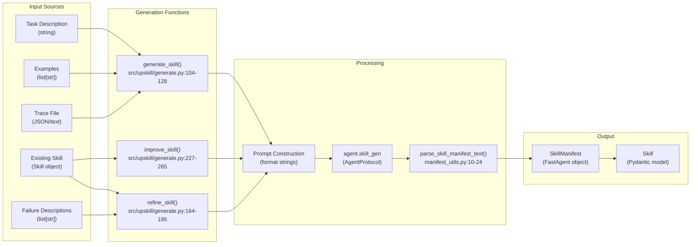
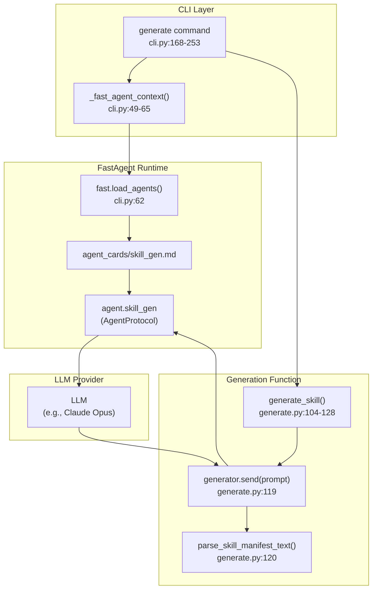
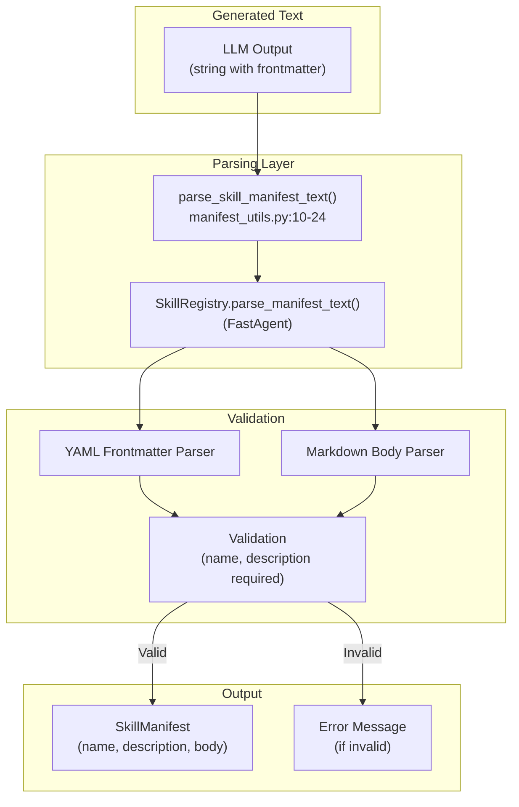
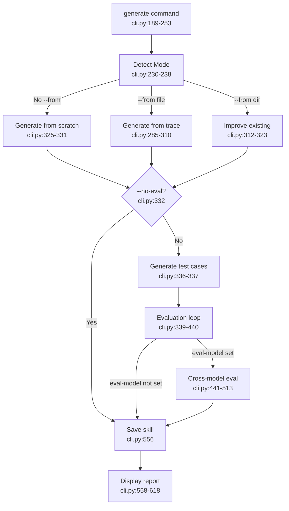

<!-- source: DeepWiki mcp.deepwiki.com · repo huggingface/upskill · page 5.1 Skill Generation · fetched 2026-10-26 -->

# Skill Generation

<details>
<summary>Relevant source files</summary>

The following files were used as context for generating this wiki page:

- [src/upskill/agent_cards/skill_gen.md](src/upskill/agent_cards/skill_gen.md)
- [src/upskill/cli.py](src/upskill/cli.py)
- [src/upskill/generate.py](src/upskill/generate.py)
- [src/upskill/manifest_utils.py](src/upskill/manifest_utils.py)
- [tests/test_smoke.py](tests/test_smoke.py)

</details>


This page documents how skills are generated from task descriptions, input/output examples, agent traces, or existing skills using the `skill_gen` agent. It covers the core generation functions (`generate_skill`, `improve_skill`, `refine_skill`), input processing, prompt construction, and skill manifest parsing.

For test case generation, see [Test Case Generation](#5.2). For the iterative refinement loop that improves skills based on evaluation failures, see [Skill Refinement](#5.4). For details on the `skill_gen` agent card definition, see [Agent Cards](#6.1).

---

## Generation Overview

Skill generation transforms high-level task descriptions into structured instruction documents that teach AI agents how to perform specific tasks. The system supports four generation modes:

| Generation Mode | Input Type | Function | Use Case |
|----------------|------------|----------|----------|
| **From scratch** | Task description + optional examples | `generate_skill` | Creating new skills |
| **From trace** | Task description + agent execution trace | `generate_skill` | Learning from successful agent runs |
| **Improvement** | Existing skill + improvement instructions | `improve_skill` | Enhancing existing skills |
| **Refinement** | Existing skill + failure descriptions | `refine_skill` | Fixing skills that fail evaluation |

All generation modes use the `skill_gen` agent, which is a FastAgent agent configured via [agent_cards/skill_gen.md:1-268](). The agent receives a structured prompt and returns a SKILL.md document with YAML frontmatter and markdown body.

**Generation Data Flow**



**Sources:** [src/upskill/generate.py:1-266](), [src/upskill/cli.py:256-336](), [Diagram 2 and Diagram 4 from high-level architecture]()

---

## Generation Inputs

### Task Descriptions

The primary input for skill generation is a task description string that specifies what the skill should teach the agent to do. Task descriptions should be clear, specific, and action-oriented.

Examples from CLI usage:
- `"parse JSON Schema files"`
- `"write git commits"`
- `"handle API errors gracefully"`

Task descriptions are passed to [generate_skill:112]() where they are formatted into a prompt: `"Create a skill document that teaches an AI agent how to: {task}"`.

**Sources:** [src/upskill/cli.py:169-229](), [src/upskill/generate.py:104-128]()

### Input/Output Examples

Optional examples provide concrete input/output pairs that demonstrate the task. Examples are appended to the generation prompt to guide the `skill_gen` agent toward practical, well-grounded instructions.

Example format from CLI:
```bash
upskill generate "parse YAML" -e "input: config.yaml" -e "output: dict"
```

Examples are processed in [generate_skill:113-116]():
```python
if examples:
    prompt += "\n\nExample input/output pairs for this task:\n" + "\n".join(
        f"- {ex}" for ex in examples
    )
```

**Sources:** [src/upskill/cli.py:170](), [src/upskill/generate.py:113-116]()

### Agent Traces

Traces are execution logs from agent runs that can be used to generate skills from successful patterns. Traces can be JSON or plain text files containing agent message history, tool calls, and outputs.

Trace processing in CLI [cli.py:285-303]():
1. Read trace file from path
2. Parse as JSON if `.json` extension, otherwise use as text
3. Truncate to 4000 characters
4. Append to task description with context

The trace is integrated into the task prompt:
```python
task = f"{task}\n\nBased on this agent trace:\n\n{trace_context}"
```

**Sources:** [src/upskill/cli.py:285-303]()

### Existing Skills

Existing skills can be improved or refined. The system distinguishes between:

- **Improvement** (`--from <directory>`): User-directed changes with custom instructions
- **Refinement** (automatic): Changes based on evaluation failures

When improving, the CLI auto-detects directories [cli.py:230-238]():
```python
if from_source:
    source_path = Path(from_source)
    if source_path.is_dir():
        from_skill = from_source
    else:
        from_trace = from_source
```

The existing skill is loaded via `Skill.load(Path(from_skill))` [cli.py:313]() and passed to `improve_skill` with user instructions.

**Sources:** [src/upskill/cli.py:230-238,312-323](), [src/upskill/generate.py:227-265]()

---

## The skill_gen Agent

The `skill_gen` agent is defined in [agent_cards/skill_gen.md:1-268]() and loaded by FastAgent at runtime. The agent card specifies:

**Agent Card Structure**

```yaml
type: agent
description: Generate skill documents from task descriptions.
```

The agent is trained via few-shot examples embedded in the card [skill_gen.md:9-237](). Three complete examples are provided:

1. **Git Commit Messages** - Shows conventional commit format
2. **API Error Handling** - Demonstrates error handling patterns
3. **Form Input Validation** - Covers validation and sanitization

Each example includes:
- Task description
- Complete SKILL.md output with frontmatter
- Practical code examples
- Best practices

**Agent Invocation Flow**



The agent is accessed through the FastAgent context manager [cli.py:49-65](), which loads all agent cards from the `agent_cards/` directory and exposes them as attributes (e.g., `agent.skill_gen`).

**Sources:** [src/upskill/agent_cards/skill_gen.md:1-268](), [src/upskill/cli.py:49-65]()

---

## Generation Functions

### generate_skill

**Function Signature:** [generate.py:104-128]()

```python
async def generate_skill(
    task: str,
    generator: AgentProtocol,
    examples: list[str] | None = None,
    model: str | None = None,
) -> Skill
```

Generates a new skill from scratch using a task description and optional examples.

**Process:**

1. **Prompt Construction** [generate.py:112-116]():
   - Base prompt: `"Create a skill document that teaches an AI agent how to: {task}"`
   - Append examples if provided
   
2. **Agent Invocation** [generate.py:119]():
   ```python
   skill_text = await generator.send(prompt)
   ```
   
3. **Manifest Parsing** [generate.py:120-122]():
   ```python
   manifest, error = parse_skill_manifest_text(skill_text)
   if manifest is None:
       raise ValueError(f"Skill generator did not return valid SKILL.md: {error}")
   ```
   
4. **Skill Object Construction** [generate.py:124-128]():
   - Calls `_build_skill_from_manifest` helper
   - Creates `Skill` object with metadata

**Return Value:** `Skill` object with `name`, `description`, `body`, and `metadata` populated.

**Sources:** [src/upskill/generate.py:104-128]()

### improve_skill

**Function Signature:** [generate.py:227-265]()

```python
async def improve_skill(
    skill: Skill,
    instructions: str,
    generator: AgentProtocol,
    model: str | None = None,
) -> Skill
```

Improves an existing skill based on user-provided instructions. Used for manual skill enhancement (e.g., "add more error handling examples", "make it more concise").

**Prompt Template:** [generate.py:198-224]()

The `IMPROVE_PROMPT` constant contains a structured template:
- Current skill (name, description, body)
- Improvement instructions
- Guidelines for preserving what works while addressing requests

**Process:**

1. Format prompt with skill details and instructions [generate.py:247-252]()
2. Send to generator agent [generate.py:255]()
3. Parse returned SKILL.md [generate.py:256-258]()
4. Build improved `Skill` object with updated `source_task` metadata [generate.py:260-265]()

**Metadata Tracking:** The new skill's `source_task` is set to `f"Improved from {skill.name}: {instructions}"` [generate.py:263]() to track provenance.

**Sources:** [src/upskill/generate.py:198-265]()

### refine_skill

**Function Signature:** [generate.py:164-195]()

```python
async def refine_skill(
    skill: Skill,
    failures: list[str],
    generator: AgentProtocol,
    model: str | None = None,
) -> Skill
```

Refines a skill based on evaluation failures. This function is called automatically during the evaluation/refinement loop (see [Skill Refinement](#5.4)).

**Prompt Construction:** [generate.py:172-183]()

The prompt includes:
- Skill name, description, and truncated body (first 500 chars)
- Up to 3 failure descriptions
- Instruction to output complete SKILL.md with frontmatter

Example structure:
```
Improve this skill based on failures:

Name: {skill.name}
Description: {skill.description}
Body: {skill.body[:500]}...

Failures:
- {failure_1}
- {failure_2}
- {failure_3}

Output a complete SKILL.md document...
```

**Failure Descriptions:** Generated by `get_failure_descriptions()` in [evaluate.py:217-246](), which extracts test case failures from evaluation results.

**Sources:** [src/upskill/generate.py:164-195](), [src/upskill/evaluate.py:217-246]()

---

## Skill Manifest Format

Skills are represented as markdown documents with YAML frontmatter, following the FastAgent `SkillManifest` format.

**Structure:**

```markdown
---
name: skill-name
description: One-sentence description
---

# Skill Title

## Section 1
Content with examples...

## Section 2
More content...
```

**Field Requirements** (from [skill_gen.md:253-262]()):

| Field | Format | Requirements |
|-------|--------|--------------|
| `name` | String | Lowercase alphanumeric with hyphens (e.g., `"parse-yaml-files"`) |
| `description` | String | One sentence under 100 characters |
| `body` | Markdown | 200-400 word guide with overview, instructions, 2-3 code examples, best practices |

**Manifest Parsing Flow**



**Parsing Implementation:** [manifest_utils.py:10-24]()

```python
def parse_skill_manifest_text(
    manifest_text: str,
    *,
    path: Path | None = None,
) -> tuple[SkillManifest | None, str | None]:
    """Parse a SkillManifest from raw SKILL.md content."""
    return SkillRegistry.parse_manifest_text(manifest_text, path=path)
```

The function returns a tuple: `(SkillManifest | None, error message | None)`. If parsing fails, the manifest is `None` and an error message is provided.

**Error Handling:** All generation functions validate the parsed manifest and raise `ValueError` if parsing fails [generate.py:121-122,187-188,257-258]():

```python
manifest, error = parse_skill_manifest_text(skill_text)
if manifest is None:
    raise ValueError(f"Skill generator did not return valid SKILL.md: {error}")
```

**Sources:** [src/upskill/manifest_utils.py:10-24](), [src/upskill/generate.py:120-122](), [src/upskill/agent_cards/skill_gen.md:240-262]()

---

## Building Skill Objects

After parsing the manifest, the system converts the FastAgent `SkillManifest` to an upskill `Skill` object using the helper function `_build_skill_from_manifest`.

**Function:** [generate.py:80-101]()

```python
def _build_skill_from_manifest(
    manifest: SkillManifest,
    *,
    model: str | None,
    source_task: str,
    base_skill: Skill | None = None,
) -> Skill:
    references = base_skill.references if base_skill else {}
    scripts = base_skill.scripts if base_skill else {}
    return Skill(
        name=manifest.name,
        description=manifest.description,
        body=manifest.body,
        references=references,
        scripts=scripts,
        metadata=SkillMetadata(
            generated_by=model,
            generated_at=datetime.now(UTC),
            source_task=source_task,
        ),
    )
```

**Key Behaviors:**

1. **Extracts Core Fields:** Maps `manifest.name`, `manifest.description`, `manifest.body` to `Skill` fields
2. **Preserves Artifacts:** If `base_skill` is provided (for improvement/refinement), preserves existing `references` and `scripts` [generate.py:87-88]()
3. **Tracks Metadata:** Records `generated_by` (model), `generated_at` (timestamp), and `source_task` for provenance

**Metadata Fields:** [models.py:52-66]()

```python
class SkillMetadata(BaseModel):
    generated_by: str | None = None         # Model used for generation
    generated_at: datetime | None = None    # Generation timestamp
    source_task: str | None = None          # Original task description
    test_pass_rate: float | None = None     # Evaluation success rate
```

The `test_pass_rate` is populated later during evaluation [cli.py:529]().

**Sources:** [src/upskill/generate.py:80-101](), [src/upskill/models.py:52-66]()

---

## CLI Integration

The `generate` command in [cli.py:168-253]() provides the primary interface for skill generation.

**Command Signature:**

```bash
upskill generate TASK [OPTIONS]
```

**Key Options:**

| Option | Type | Description |
|--------|------|-------------|
| `-e, --example` | Multiple | Input/output example pairs |
| `--tool` | String | Generate from MCP tool schema |
| `-f, --from` | Path | Improve existing skill (dir) or generate from trace (file) |
| `-m, --model` | String | Model for generation |
| `-o, --output` | Path | Output directory |
| `--no-eval` | Flag | Skip evaluation and refinement |
| `--eval-model` | String | Model for evaluation (different from generation) |
| `--runs-dir` | Path | Directory for run logs |
| `--log-runs/--no-log-runs` | Boolean | Enable/disable run logging |

**Generation Workflow in CLI:**



**Mode Detection:** [cli.py:230-238]()

The CLI auto-detects generation mode based on the `--from` option:
- If `--from` points to a directory: Load as existing skill and call `improve_skill`
- If `--from` points to a file: Read as trace and pass to `generate_skill`
- If no `--from`: Generate from task description

**Async Implementation:** The command delegates to `_generate_async` [cli.py:256-536](), which:
1. Loads config and resolves model [cli.py:269-270]()
2. Sets up run logging if enabled [cli.py:277-280]()
3. Enters FastAgent context manager [cli.py:283]()
4. Executes generation based on detected mode [cli.py:285-331]()
5. Optionally runs evaluation and refinement loops [cli.py:332-440]()
6. Saves and displays results [cli.py:527-536]()

**Sources:** [src/upskill/cli.py:168-536]()

---

## Summary

Skill generation is the entry point to the skill lifecycle, transforming task descriptions into structured instruction documents. The process leverages:

- **Input Flexibility:** Task descriptions, examples, traces, or existing skills
- **Few-Shot Learning:** The `skill_gen` agent card contains detailed examples
- **Structured Output:** YAML frontmatter + Markdown body validated through `SkillManifest`
- **Metadata Tracking:** Records model, timestamp, and source task for provenance
- **Multiple Modes:** From-scratch generation, improvement, and refinement

Generated skills proceed to [Test Case Generation](#5.2) and [Skill Evaluation](#5.3) in the full lifecycle.

**Sources:** [src/upskill/generate.py:1-266](), [src/upskill/cli.py:168-536](), [src/upskill/agent_cards/skill_gen.md:1-268]()

---

