<!-- source: DeepWiki mcp.deepwiki.com · repo huggingface/upskill · page 5.2 Test Case Generation · fetched 2026-10-26 -->

# Test Case Generation

<details>
<summary>Relevant source files</summary>

The following files were used as context for generating this wiki page:

- [src/upskill/agent_cards/test_gen.md](src/upskill/agent_cards/test_gen.md)
- [src/upskill/generate.py](src/upskill/generate.py)
- [src/upskill/models.py](src/upskill/models.py)

</details>


## Purpose and Scope

This page documents the automatic test case generation system in upskill. Test cases are used to evaluate whether generated skills actually improve agent performance on specific tasks. For information about how skills are initially generated, see [Skill Generation](#5.1). For details on how these test cases are executed during evaluation, see [Skill Evaluation](#5.3).

Test case generation transforms a task description into a set of concrete input/output test scenarios that validate skill effectiveness. The system uses a specialized `test_gen` agent with few-shot prompting to create realistic test cases that exercise the skill's core concepts.

---

## Test Generation Workflow

The test generation process takes a task description and produces a validated list of test cases suitable for skill evaluation:

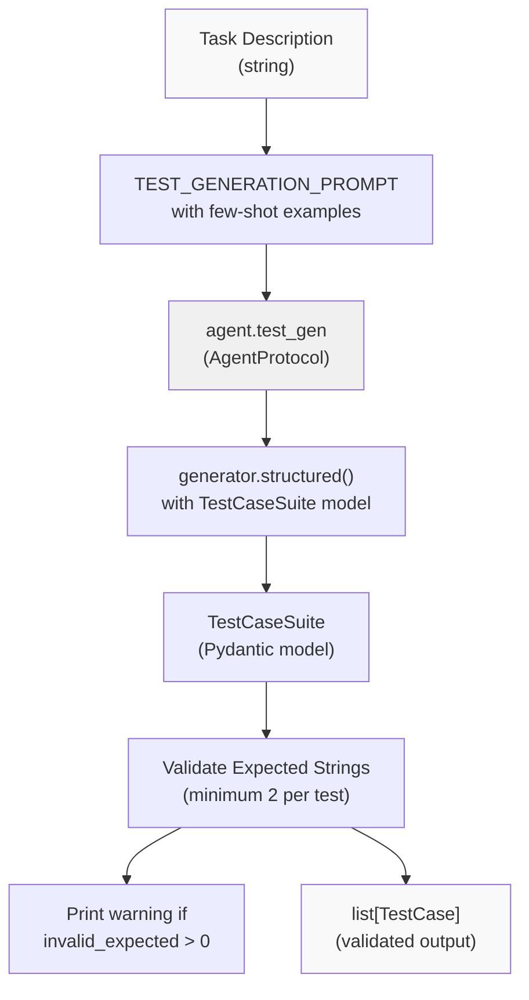

**Sources:** [src/upskill/generate.py:131-161]()

---

## Core Function: `generate_tests()`

The primary entry point for test case generation is the `generate_tests()` function:

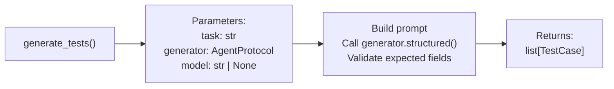

| Parameter | Type | Purpose |
|-----------|------|---------|
| `task` | `str` | The task description to generate tests for |
| `generator` | `AgentProtocol` | The test_gen agent instance from FastAgent |
| `model` | `str \| None` | Model identifier (for metadata tracking) |

The function performs these steps:

1. **Prompt Construction**: Replaces `TASK_PLACEHOLDER` in the template with the actual task description
2. **Structured Generation**: Calls `await generator.structured(prompt, TestCaseSuite)` to get type-safe output
3. **Validation**: Checks that each test case has at least 2 expected strings
4. **Quality Reporting**: Prints statistics about generated tests and warnings for invalid cases

**Sources:** [src/upskill/generate.py:131-161]()

---

## Test Generation Prompt Template

The system uses a carefully crafted prompt with few-shot examples to guide test generation:

### Prompt Structure

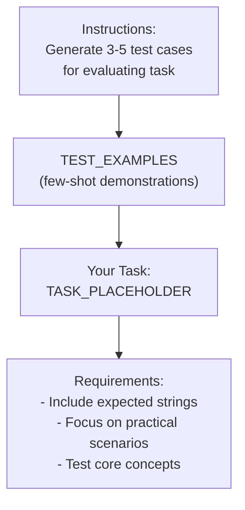

### Few-Shot Examples

The prompt includes two complete examples showing how to generate test cases:

| Example Task | Test Case Pattern | Key Features |
|-------------|-------------------|--------------|
| "Write good git commit messages" | 4 test cases covering feat, fix, docs, BREAKING changes | Each test expects specific keywords like `["feat", "login"]` |
| "Handle API errors gracefully in Python" | 3 test cases covering retry logic, 500 errors, exception handling | Tests verify presence of implementation keywords |

The prompt template is defined at [src/upskill/generate.py:69-78]() and uses the constant `TEST_EXAMPLES` from [src/upskill/generate.py:14-64]().

**Sources:** [src/upskill/generate.py:14-78]()

---

## Data Structures

### TestCase Model

The `TestCase` model represents a single evaluation scenario:

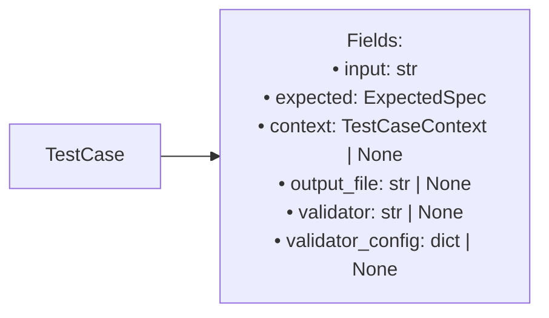

| Field | Type | Required | Purpose |
|-------|------|----------|---------|
| `input` | `str` | Yes | Task/prompt to give the agent |
| `expected` | `ExpectedSpec` | Yes | Expected output checks (contains strings) |
| `context` | `TestCaseContext \| None` | No | Files, environment variables for the test |
| `output_file` | `str \| None` | No | File to validate instead of agent output |
| `validator` | `str \| None` | No | Custom validator name (e.g., "hf_eval_yaml") |
| `validator_config` | `dict \| None` | No | Configuration for custom validator |

**Sources:** [src/upskill/models.py:59-72]()

### ExpectedSpec Model

Defines what strings must appear in the agent's output:

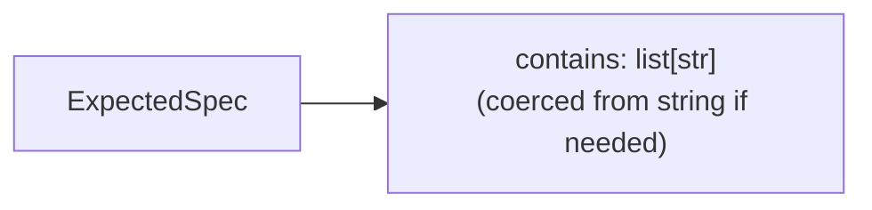

The `contains` field uses a Pydantic validator to accept either a single string or a list, automatically coercing single strings into lists. During test generation, the system validates that at least 2 strings are present.

**Sources:** [src/upskill/models.py:36-48]()

### TestCaseSuite Model

Container model for structured output generation:

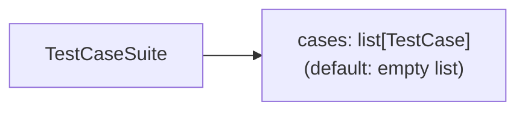

This model is used as the type parameter to `generator.structured()` to ensure type-safe JSON output from the LLM.

**Sources:** [src/upskill/models.py:76-82]()

### TestCaseContext Model

Provides additional context for test execution:

| Field | Type | Purpose |
|-------|------|---------|
| `files` | `dict[str, str] \| None` | File name to content mappings created in workspace |

This allows test cases to include file-based scenarios where the evaluator needs specific files present during execution.

**Sources:** [src/upskill/models.py:51-57]()

---

## Agent Configuration

Test generation uses the `test_gen` agent card, which configures the LLM for optimal test creation:

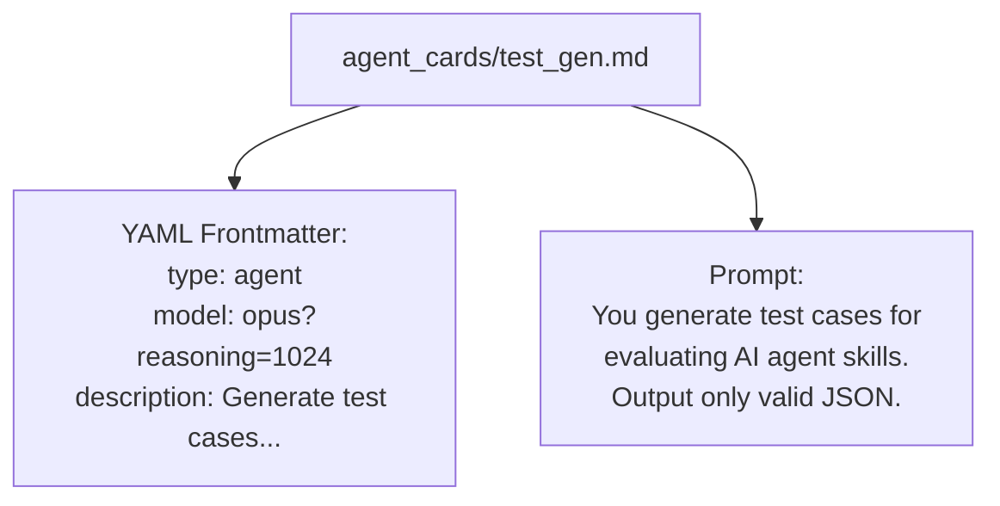

### Key Configuration Details

| Setting | Value | Rationale |
|---------|-------|-----------|
| `type` | `agent` | Defines this as an agent card |
| `model` | `opus?reasoning=1024` | Uses Claude Opus with 1024 extended thinking tokens |
| Output format | JSON | Required for structured output parsing |

The extended thinking budget (`reasoning=1024`) allows the model to carefully consider test case design before generating the final JSON structure. This leads to higher quality test cases that better cover edge cases and core concepts.

**Sources:** [src/upskill/agent_cards/test_gen.md:1-9]()

---

## Validation and Quality Checks

After generating test cases, the system performs validation to ensure quality:

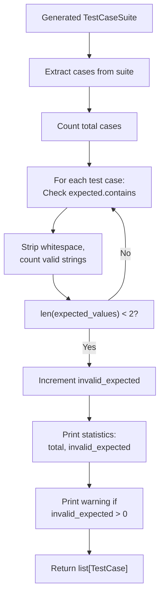

### Validation Logic

The validation code at [src/upskill/generate.py:145-160]() implements the following checks:

1. **Expected String Validation**: Each test case's `expected.contains` list must have at least 2 non-empty strings after stripping whitespace
2. **Warning Generation**: If any test cases fail validation, prints: `"Warning: some test cases are missing at least two expected strings; review generated tests."`
3. **Statistics Reporting**: Always prints `total=N invalid_expected=M` for transparency

### Example Output

```
Generated test cases: total=4 invalid_expected=0
```

or

```
Generated test cases: total=5 invalid_expected=2
Warning: some test cases are missing at least two expected strings; review generated tests.
```

**Sources:** [src/upskill/generate.py:145-160]()

---

## Integration with Skill Lifecycle

Test case generation occurs at specific points in the skill development workflow:

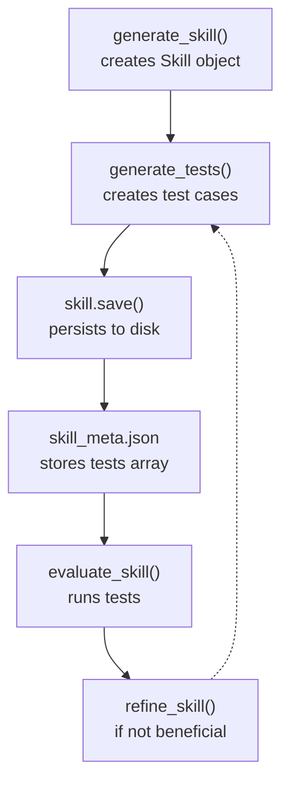

### Persistence

Test cases are persisted in two ways:

1. **In-Memory**: The `Skill` object has a `tests` field ([src/upskill/models.py:114]()) that holds the list of test cases
2. **On-Disk**: The `skill.save()` method writes test cases to `skill_meta.json` under the `"tests"` key ([src/upskill/models.py:161-168]())

### Loading

When loading a skill from disk, `Skill.load()` reads the test cases back from `skill_meta.json` ([src/upskill/models.py:242-243]()):

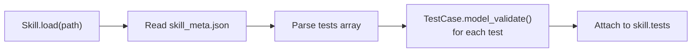

### Refinement Loop

If a skill is not beneficial after evaluation, the refinement loop ([Skill Refinement](#5.4)) may regenerate test cases to better capture failure modes. The `refine_skill()` function can be followed by another call to `generate_tests()` with an updated task description that incorporates failure analysis.

**Sources:** [src/upskill/models.py:114](), [src/upskill/models.py:148-168](), [src/upskill/models.py:238-243]()

---

## Structured Output Generation

The test generation system uses FastAgent's structured output capability to ensure type-safe results:

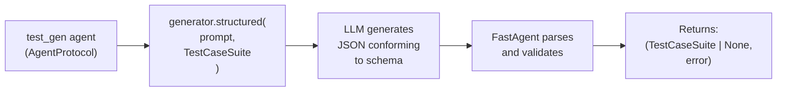

### Error Handling

The structured generation can fail if the LLM does not produce valid JSON:

```python
result, _ = await generator.structured(prompt, TestCaseSuite)
if result is None:
    raise ValueError("Test generator did not return structured test cases.")
```

This ensures that test generation either succeeds with valid test cases or fails explicitly rather than silently producing malformed data.

**Sources:** [src/upskill/generate.py:140-142]()

---

## Test Case Examples

Based on the few-shot examples in the prompt, here are typical test case patterns:

### Git Commit Messages

```json
{
  "input": "Write a commit message for adding a new login feature",
  "expected": {"contains": ["feat", "login"]}
}
```

### API Error Handling

```json
{
  "input": "Write code to fetch data from an API with retry logic",
  "expected": {"contains": ["retry", "error"]}
}
```

### Custom Validator Test Case

```json
{
  "input": "Create a YAML evaluation file for the upskill project",
  "expected": {"contains": ["upskill", "evaluation"]},
  "output_file": "eval.yaml",
  "validator": "hf_eval_yaml",
  "validator_config": {"required_keys": ["project", "metrics"]}
}
```

The third example shows advanced features like custom validators and output file validation, which are supported by the `TestCase` model but typically not generated automatically (see [Custom Validators](#10.1) for details).

**Sources:** [src/upskill/generate.py:14-64](), [src/upskill/models.py:59-72]()

---

