<!-- source: DeepWiki mcp.deepwiki.com · repo huggingface/upskill · page 5.3 Skill Evaluation · fetched 2026-10-26 -->

# Skill Evaluation

<details>
<summary>Relevant source files</summary>

The following files were used as context for generating this wiki page:

- [src/upskill/agent_cards/evaluator.md](src/upskill/agent_cards/evaluator.md)
- [src/upskill/evaluate.py](src/upskill/evaluate.py)
- [src/upskill/models.py](src/upskill/models.py)

</details>


## Purpose and Scope

This page documents the skill evaluation system, which compares agent performance with and without skills using an A/B testing methodology. Evaluation runs test cases in isolated environments, collects comprehensive metrics, and determines whether a skill provides measurable benefit.

For information about generating test cases, see [Test Case Generation](#5.2). For the iterative refinement process that uses evaluation results, see [Skill Refinement](#5.4). For viewing evaluation history and results, see [upskill runs](#4.5) and [Run Logging and Metrics](#8).

**Sources:** [src/upskill/evaluate.py:1-303]()

## Evaluation Architecture

The evaluation system implements A/B testing by running test cases both with and without the skill, then comparing success rates, token usage, and execution metrics. The `evaluate_skill` function orchestrates this comparison, while `run_test` executes individual test cases.

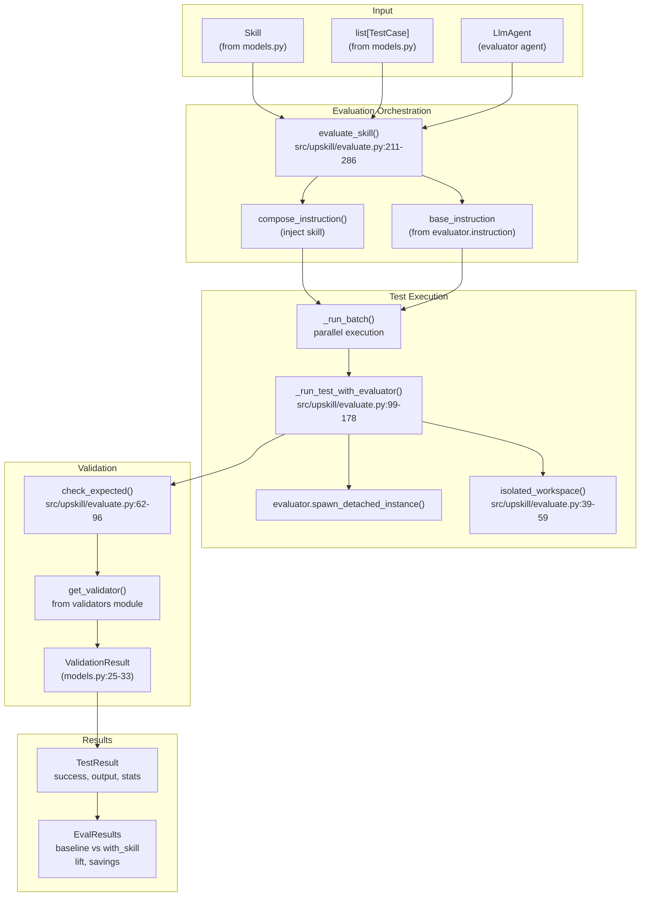

**Sources:** [src/upskill/evaluate.py:211-286](), [src/upskill/models.py:314-364]()

## Evaluation Workflow

The evaluation process follows a structured workflow that ensures reproducible, isolated test execution with comprehensive metrics collection.

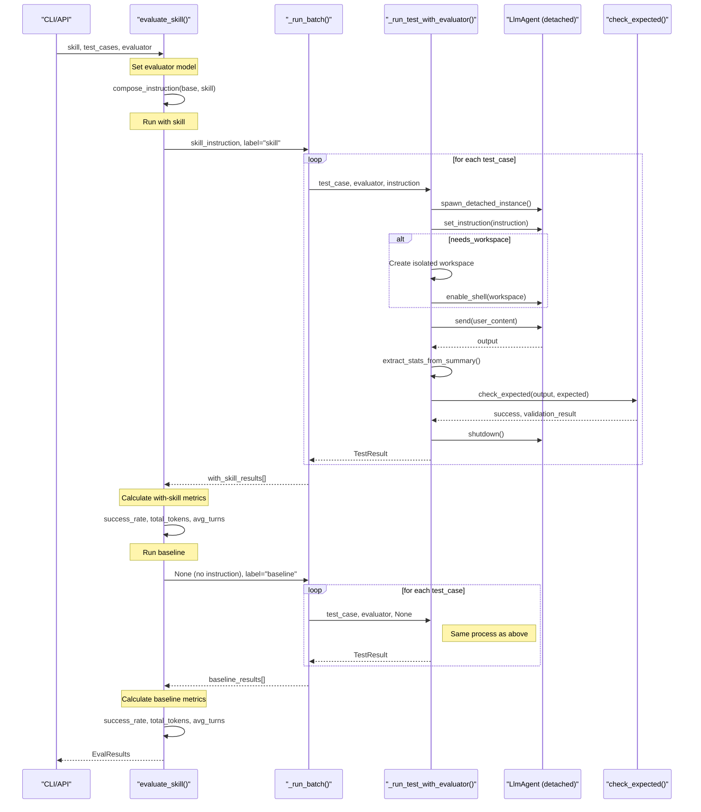

**Sources:** [src/upskill/evaluate.py:211-286](), [src/upskill/evaluate.py:99-178]()

## Test Execution with Detached Instances

Each test case runs in a detached agent instance to ensure isolation. The `_run_test_with_evaluator` function manages the lifecycle of these instances.

### Detached Instance Pattern

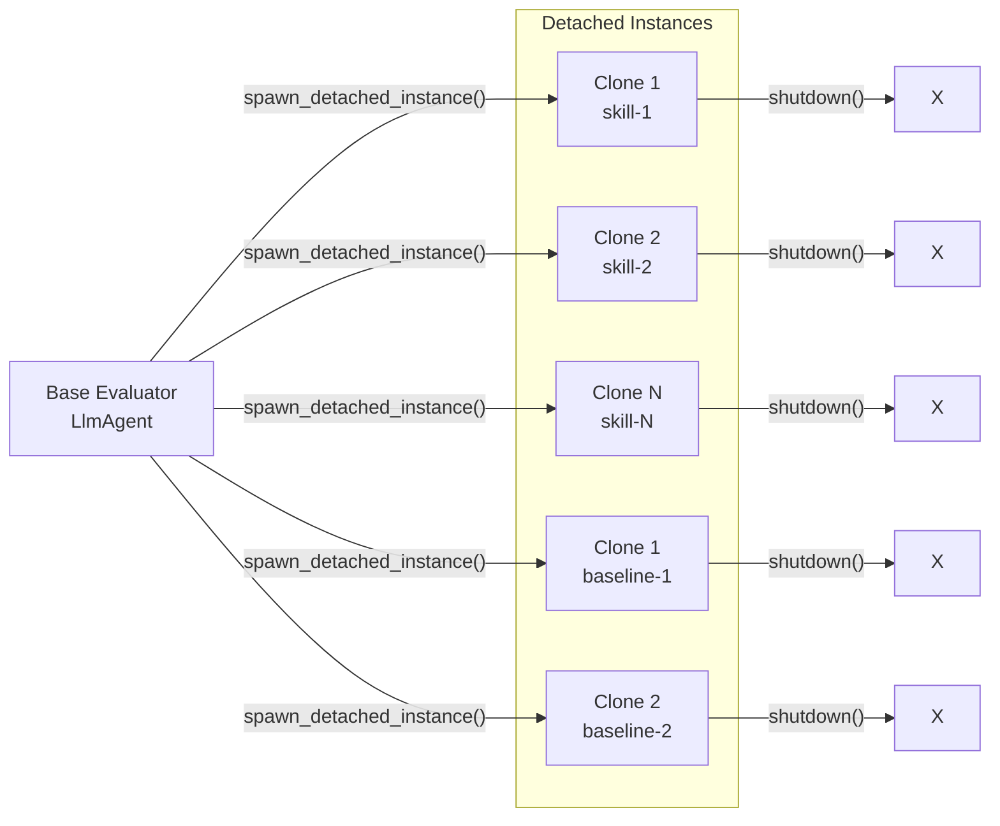

Each detached instance:
1. Gets a unique name: `evaluator[skill-1]`, `evaluator[baseline-1]`, etc.
2. Has its own message history
3. Receives a custom instruction (with or without skill)
4. Executes independently
5. Is shut down after completion

**Sources:** [src/upskill/evaluate.py:119-173]()

### Instance Naming Convention

| Label | Instance Name Format | Purpose |
|-------|---------------------|---------|
| `"skill"` | `evaluator[skill-1]`, `evaluator[skill-2]`, ... | Tests with skill injected |
| `"baseline"` | `evaluator[baseline-1]`, `evaluator[baseline-2]`, ... | Tests without skill |

**Sources:** [src/upskill/evaluate.py:241-242]()

## Isolated Workspace Management

The `isolated_workspace` context manager creates temporary directories for test execution, enabling file-based operations and custom validators that require workspace access.

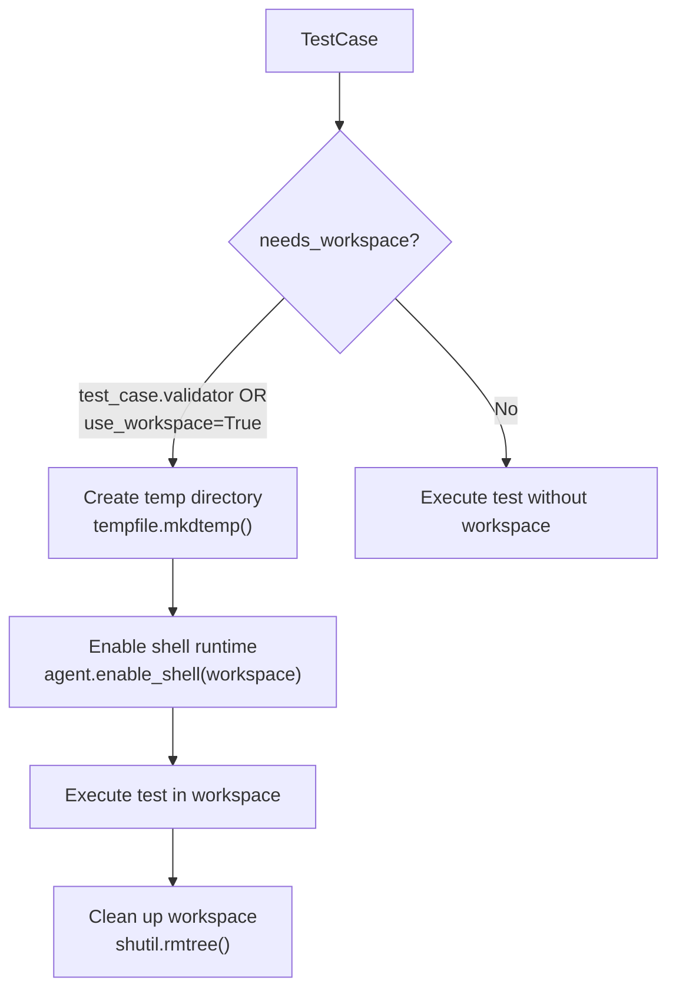

### Workspace Creation Logic

```python
# From src/upskill/evaluate.py:114
needs_workspace = use_workspace if use_workspace is not None else bool(test_case.validator)
```

Workspaces are created when:
- `use_workspace=True` is explicitly passed
- `test_case.validator` is set (auto-detection)

**Sources:** [src/upskill/evaluate.py:39-59](), [src/upskill/evaluate.py:114-124]()

### Workspace Configuration

The workspace context manager accepts two parameters:

| Parameter | Type | Purpose |
|-----------|------|---------|
| `base_dir` | `Path \| None` | Parent directory for workspace (default: system temp) |
| `cleanup` | `bool` | Whether to delete workspace after (default: `True`) |

**Sources:** [src/upskill/evaluate.py:40-49]()

## Validation System

The `check_expected` function validates test outputs using either default string containment checks or custom validators.

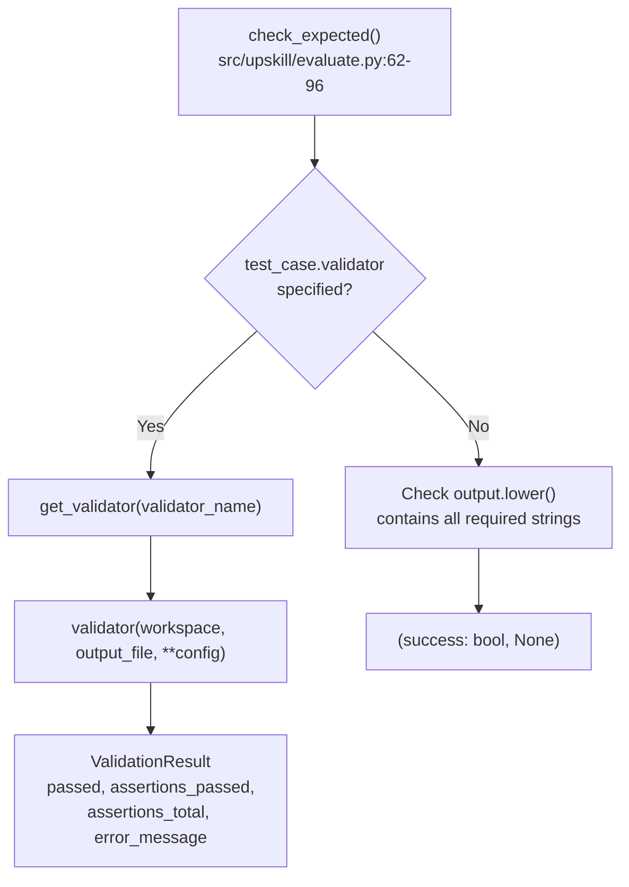

### Default Validation: String Containment

When no custom validator is specified, the system checks if the agent's output contains all required strings:

```python
# From ExpectedSpec model (models.py:36-48)
class ExpectedSpec(BaseModel):
    contains: list[str]  # All strings must appear in output (case-insensitive)
```

Example validation logic:
```python
required = expected.contains  # ["created file", "success"]
output_lower = output.lower()
if any(item.lower() not in output_lower for item in required):
    return False, None  # Validation failed
return True, None  # All strings found
```

**Sources:** [src/upskill/evaluate.py:91-96](), [src/upskill/models.py:36-48]()

### Custom Validators

Custom validators provide structured validation with detailed metrics:

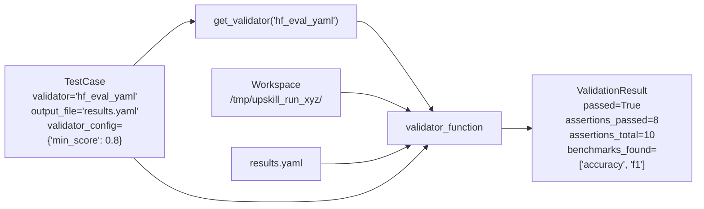

Custom validators receive:
- `workspace`: `Path` to the temporary directory
- `output_file`: `str` filename to validate (relative to workspace)
- `**config`: Additional validator-specific configuration

**Sources:** [src/upskill/evaluate.py:79-89](), [src/upskill/models.py:25-33](), [src/upskill/models.py:68-71]()

### TestCase Validator Fields

| Field | Type | Purpose |
|-------|------|---------|
| `validator` | `str \| None` | Validator name (e.g., `"hf_eval_yaml"`) |
| `output_file` | `str \| None` | File to validate instead of agent output |
| `validator_config` | `dict \| None` | Configuration passed to validator function |

**Sources:** [src/upskill/models.py:68-71]()

## Metrics Collection

The evaluation system collects detailed conversation statistics by extracting data from the agent's message history after each test run.

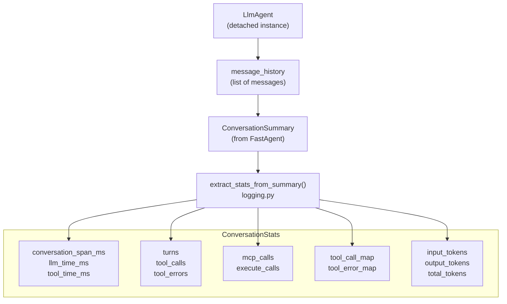

**Sources:** [src/upskill/evaluate.py:133-139](), [src/upskill/models.py:277-312]()

### ConversationStats Structure

The `ConversationStats` model captures comprehensive metrics from each test execution:

```python
class ConversationStats(BaseModel):
    # Timing metrics (milliseconds)
    conversation_span_ms: float = 0.0  # Total duration
    llm_time_ms: float = 0.0           # Time in LLM calls
    tool_time_ms: float = 0.0          # Time in tool execution
    
    # Conversation metrics
    turns: int = 0                      # Number of agent turns
    tool_calls: int = 0                 # Total tool invocations
    tool_errors: int = 0                # Failed tool calls
    
    # Tool categorization
    mcp_calls: int = 0                  # Tools with "__" (MCP servers)
    execute_calls: int = 0              # Tools without "__" (built-in)
    
    # Per-tool breakdown
    tool_call_map: dict[str, int]       # tool_name -> call count
    tool_error_map: dict[str, int]      # tool_name -> error count
    
    # Token usage
    input_tokens: int = 0
    output_tokens: int = 0
    total_tokens: int = 0
```

**Sources:** [src/upskill/models.py:277-312]()

### MCP vs Execute Categorization

Tool calls are categorized based on naming conventions:

| Category | Pattern | Examples |
|----------|---------|----------|
| `mcp_calls` | Contains `"__"` | `filesystem__read_file`, `browser__navigate` |
| `execute_calls` | No `"__"` | `execute`, `read_file`, `write_file` |

**Sources:** [src/upskill/models.py:291-292]()

## TestResult Structure

The `TestResult` model aggregates all information from a single test execution:

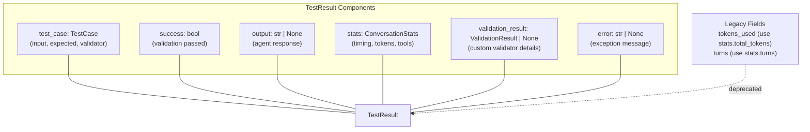

**Sources:** [src/upskill/models.py:314-327]()

### Creating TestResult Instances

```python
# Success case (from evaluate.py:157-165)
return TestResult(
    test_case=test_case,
    success=success,
    output=output,
    tokens_used=stats.total_tokens,  # Legacy field
    turns=stats.turns,               # Legacy field
    stats=stats,                     # Detailed metrics
    validation_result=validation_result,  # From custom validator
)

# Error case (from evaluate.py:167)
return TestResult(test_case=test_case, success=False, error=str(exc))
```

**Sources:** [src/upskill/evaluate.py:157-167]()

## EvalResults: Baseline Comparison

The `EvalResults` model compares performance with and without the skill, providing derived metrics for decision-making.

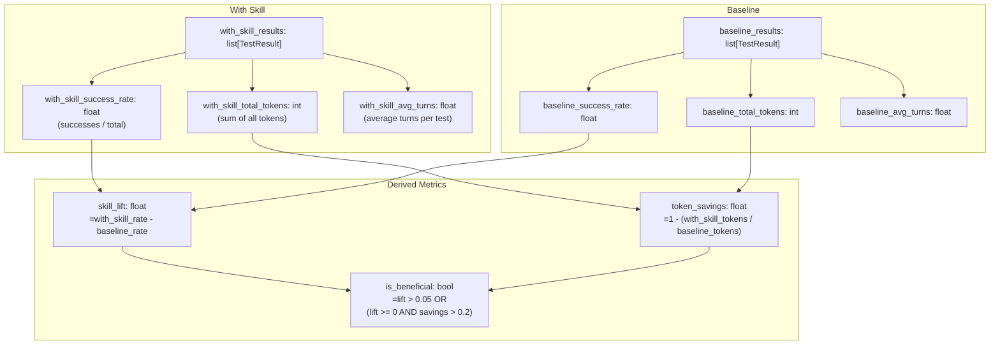

**Sources:** [src/upskill/models.py:329-364]()

### Derived Metrics Calculation

The `EvalResults` class provides three computed properties:

#### 1. skill_lift

```python
@property
def skill_lift(self) -> float:
    """Improvement in success rate from using skill."""
    return self.with_skill_success_rate - self.baseline_success_rate
```

Interpretation:
- Positive: Skill improves success rate
- Zero: No change in success rate
- Negative: Skill decreases success rate

**Sources:** [src/upskill/models.py:347-350]()

#### 2. token_savings

```python
@property
def token_savings(self) -> float:
    """Percentage of tokens saved (negative means more tokens used)."""
    if self.baseline_total_tokens == 0:
        return 0.0
    return 1 - (self.with_skill_total_tokens / self.baseline_total_tokens)
```

Interpretation:
- `0.2`: 20% fewer tokens used
- `0.0`: Same tokens used
- `-0.5`: 50% more tokens used

**Sources:** [src/upskill/models.py:352-357]()

#### 3. is_beneficial

```python
@property
def is_beneficial(self) -> bool:
    """Skill provides net benefit."""
    # Beneficial if: better success, OR same success with fewer tokens
    return self.skill_lift > 0.05 or (self.skill_lift >= 0 and self.token_savings > 0.2)
```

A skill is considered beneficial if:
- **Primary criterion**: Success rate improves by >5%, OR
- **Efficiency criterion**: Success rate maintained (≥0) AND tokens reduced by >20%

**Sources:** [src/upskill/models.py:359-363]()

### Benefit Decision Matrix

| skill_lift | token_savings | is_beneficial | Reason |
|------------|--------------|---------------|---------|
| `0.10` (10%) | `-0.1` (-10% more) | ✅ `True` | Success improvement >5% |
| `0.03` (3%) | `0.25` (25% less) | ✅ `True` | Efficiency gain >20% |
| `0.02` (2%) | `0.15` (15% less) | ❌ `False` | Neither criterion met |
| `-0.02` (-2%) | `0.30` (30% less) | ❌ `False` | Success decreased |
| `0.00` (0%) | `0.25` (25% less) | ✅ `True` | Efficiency gain with no loss |

**Sources:** [src/upskill/models.py:359-363]()

## Parallel Test Execution

The evaluation system uses `asyncio.gather` to run test cases in parallel, significantly reducing evaluation time.

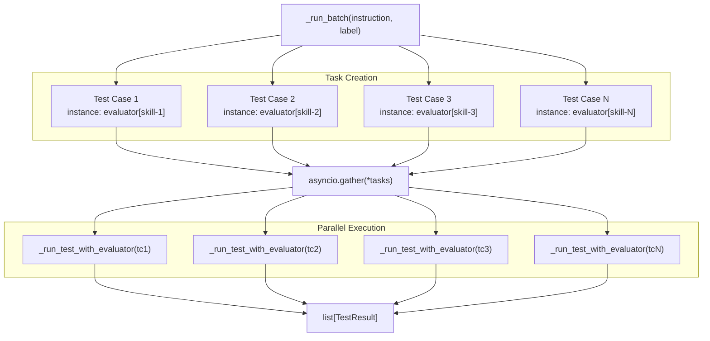

**Sources:** [src/upskill/evaluate.py:235-250]()

### _run_batch Implementation

```python
# From src/upskill/evaluate.py:235-250
async def _run_batch(
    instruction: str | None,
    label: str,
) -> list[TestResult]:
    tasks = []
    for index, tc in enumerate(test_cases, start=1):
        instance_name = f"{evaluator.name}[{label}-{index}]"
        tasks.append(
            _run_test_with_evaluator(
                tc,
                evaluator,
                instruction,
                instance_name=instance_name,
            )
        )
    return await asyncio.gather(*tasks)
```

Each test case gets a unique instance name for debugging and tracing purposes.

**Sources:** [src/upskill/evaluate.py:235-250]()

## API Functions

The evaluation module exports two primary functions for public use:

### evaluate_skill()

Main evaluation function that performs A/B testing:

```python
async def evaluate_skill(
    skill: Skill,
    test_cases: list[TestCase],
    evaluator: LlmAgent,
    model: str | None = None,
    run_baseline: bool = True,
) -> EvalResults
```

| Parameter | Type | Purpose |
|-----------|------|---------|
| `skill` | `Skill` | Skill to evaluate |
| `test_cases` | `list[TestCase]` | Test cases to run |
| `evaluator` | `LlmAgent` | Agent instance for execution |
| `model` | `str \| None` | Model override (defaults to evaluator's model) |
| `run_baseline` | `bool` | Whether to run baseline comparison (default: `True`) |

Returns: `EvalResults` with complete comparison metrics

**Sources:** [src/upskill/evaluate.py:211-286]()

### run_test()

Run a single test case with optional skill injection:

```python
async def run_test(
    test_case: TestCase,
    evaluator: LlmAgent,
    skill: Skill | None,
    use_workspace: bool | None = None,
    model: str | None = None,
) -> TestResult
```

| Parameter | Type | Purpose |
|-----------|------|---------|
| `test_case` | `TestCase` | Single test to run |
| `evaluator` | `LlmAgent` | Agent instance for execution |
| `skill` | `Skill \| None` | Skill to inject (None for baseline) |
| `use_workspace` | `bool \| None` | Force workspace isolation |
| `model` | `str \| None` | Model override |

Returns: `TestResult` with execution details

**Sources:** [src/upskill/evaluate.py:181-208]()

### get_failure_descriptions()

Extract failure information for refinement:

```python
def get_failure_descriptions(results: EvalResults) -> list[str]
```

Returns a list of formatted failure descriptions including:
- Test input
- Error message (if exception occurred)
- Agent output (first 200 characters)
- Expected output

Used by the refinement loop to generate improved skills based on failure patterns.

**Sources:** [src/upskill/evaluate.py:289-302]()

## Evaluator Agent Card

The evaluator agent is defined by a markdown agent card at [src/upskill/agent_cards/evaluator.md]():

```yaml
---
description: Evaluate skill performance against test cases.
skills: ["./skills"]
---
You are an evaluator of skills. You are given a skill and a test case. 
You need to evaluate the skill on the test case and return a score.

{{agentSkills}}
```

Key configuration:
- **skills**: `["./skills"]` - Skills directory for evaluation
- **agentSkills placeholder**: Expands to skill content when injected via `compose_instruction()`
- Can be extended with MCP servers if needed

**Sources:** [src/upskill/agent_cards/evaluator.md:1-8]()

## Integration with Skill Lifecycle

The evaluation system integrates with other lifecycle components:

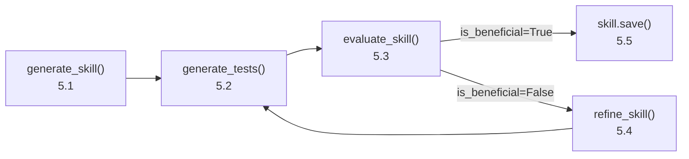

1. After [Skill Generation](#5.1) and [Test Case Generation](#5.2), `evaluate_skill()` runs A/B tests
2. If `is_beneficial=True`, skill proceeds to [Skill Persistence](#5.5)
3. If `is_beneficial=False`, skill enters [Skill Refinement](#5.4) loop
4. `get_failure_descriptions()` provides feedback for refinement

**Sources:** [src/upskill/evaluate.py:1-303]()

---

