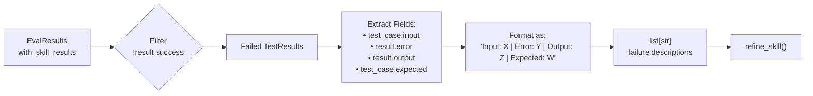
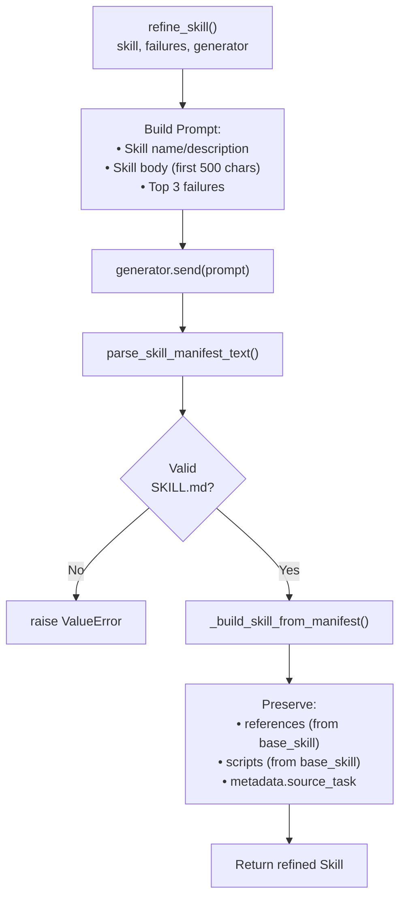
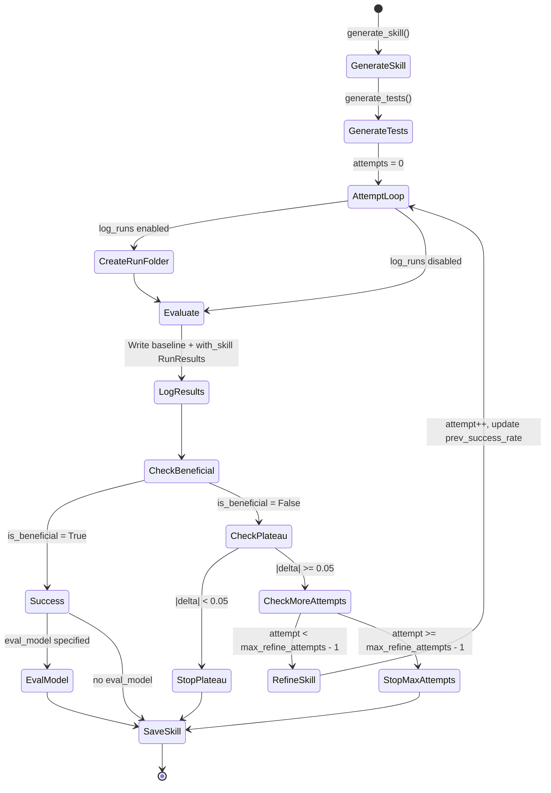
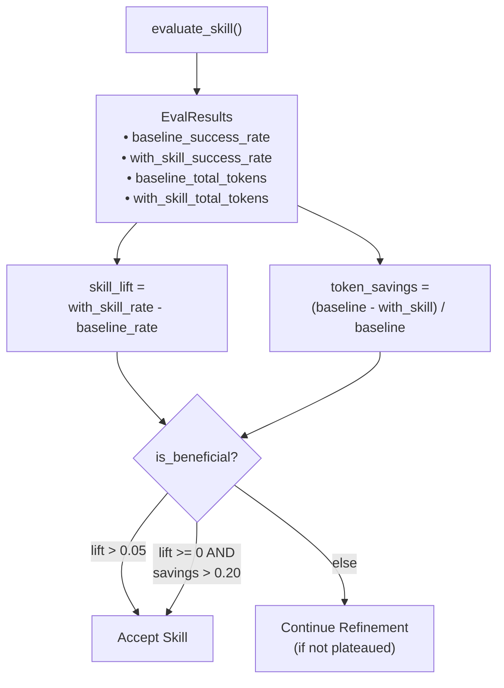

<!-- source: DeepWiki mcp.deepwiki.com · repo huggingface/upskill · page 5.4 Skill Refinement · fetched 2026-10-26 -->

# Skill Refinement

<details>
<summary>Relevant source files</summary>

The following files were used as context for generating this wiki page:

- [src/upskill/cli.py](src/upskill/cli.py)
- [src/upskill/evaluate.py](src/upskill/evaluate.py)
- [src/upskill/generate.py](src/upskill/generate.py)
- [tests/test_smoke.py](tests/test_smoke.py)

</details>


This page describes the iterative refinement loop that automatically improves skills based on evaluation failures. Skill refinement is triggered when a generated skill does not meet the beneficial criteria during evaluation, and continues until the skill demonstrates measurable improvement or plateau is detected.

For information about the initial skill generation process, see [Skill Generation](#5.1). For details on how skills are evaluated, see [Skill Evaluation](#5.3). For information about manually improving existing skills with instructions, see [Python API - Generation](#9.1).

---

## Overview

Skill refinement is an automatic feedback loop integrated into the `upskill generate` command. When a skill is initially generated and evaluated, the system checks whether it meets the **beneficial criteria**. If not, the system enters a refinement loop where:

1. Failed test cases are analyzed to extract failure descriptions
2. The skill is regenerated using the failure information as feedback
3. The refined skill is re-evaluated against the same test cases
4. This process repeats until the skill becomes beneficial or plateau is detected

The refinement loop is controlled by the `max_refine_attempts` configuration parameter and automatically terminates when improvement stagnates.

**Sources:** [src/upskill/cli.py:339-440](), [src/upskill/generate.py:164-195]()

---

## Beneficial Criteria

A skill is considered **beneficial** when it meets one of two conditions defined in the `EvalResults.is_beneficial` property:

| Criterion | Threshold | Rationale |
|-----------|-----------|-----------|
| **Success Rate Lift** | `> 5%` | Skill meaningfully improves task success |
| **Token Savings** | `> 20%` | Skill maintains success while reducing cost |

The second criterion is only checked if `skill_lift >= 0` (non-negative lift), allowing skills that don't hurt performance but significantly reduce tokens to be considered beneficial.

```python
# From models.py
@property
def is_beneficial(self) -> bool:
    """Check if skill provides meaningful improvement."""
    if self.skill_lift > 0.05:  # >5% improvement
        return True
    if self.skill_lift >= 0 and self.token_savings > 0.20:  # maintains + saves >20%
        return True
    return False
```

**Sources:** [src/upskill/models.py:293-307]()

---

## Refinement Loop Architecture

```mermaid
graph TB
    Start["generate_skill()"] --> GenTests["generate_tests()"]
    GenTests --> Loop{Refinement Loop<br/>attempt < max_refine_attempts}
    
    Loop --> Eval["evaluate_skill()<br/>(baseline + with_skill)"]
    Eval --> CheckBeneficial{is_beneficial?}
    
    CheckBeneficial -->|Yes| Success["Save Skill<br/>skill.save()"]
    
    CheckBeneficial -->|No| CheckPlateau{Plateau<br/>Detection<br/>abs(rate - prev_rate) < 0.05?}
    
    CheckPlateau -->|Yes| StopPlateau["Stop: Plateaued<br/>Save best attempt"]
    CheckPlateau -->|No| CheckAttempts{attempt + 1 <<br/>max_refine_attempts?}
    
    CheckAttempts -->|Yes| StopMax["Stop: Max attempts<br/>Save current skill"]
    CheckAttempts -->|No| Refine["get_failure_descriptions()<br/>refine_skill()"]
    
    Refine --> UpdatePrev["prev_success_rate =<br/>current_success_rate"]
    UpdatePrev --> Loop
    
    Success --> End([Skill Ready])
    StopPlateau --> End
    StopMax --> End
    
    style Eval fill:#f9f9f9
    style CheckBeneficial fill:#f9f9f9
    style Refine fill:#f9f9f9
```

**Refinement Loop Process Diagram** - Shows the complete refinement flow from initial generation through iterative improvement to final skill persistence.

**Sources:** [src/upskill/cli.py:339-440]()

---

## Failure Analysis and Extraction

When a skill fails to meet the beneficial criteria, the system extracts detailed failure information from the `EvalResults` object to inform the refinement process.

### Failure Description Extraction

The `get_failure_descriptions()` function analyzes failed test results and creates human-readable descriptions:



**Failure Extraction Pipeline** - Shows how test failures are converted into actionable feedback for skill refinement.

**Sources:** [src/upskill/evaluate.py:289-302]()

### Failure Information Structure

Each failure description includes:

| Component | Source | Purpose |
|-----------|--------|---------|
| **Input** | `test_case.input` | The task that failed |
| **Error** | `result.error` | Exception message if test errored |
| **Output** | `result.output[:200]` | Truncated agent output (first 200 chars) |
| **Expected** | `test_case.expected` | What the test expected to find |

Only the first 3 failures are passed to `refine_skill()` to keep the refinement prompt focused:

```python
# From generate.py refine_skill prompt
Failures:
{chr(10).join(f"- {f}" for f in failures[:3])}
```

**Sources:** [src/upskill/evaluate.py:289-302](), [src/upskill/generate.py:172-183]()

---

## The Refinement Function

The `refine_skill()` function regenerates the skill using failure information as context:



**Skill Refinement Function Flow** - Maps the `refine_skill()` function implementation showing how failures inform skill regeneration.

### Refinement Prompt Structure

The prompt sent to the skill generation agent includes:

```
Improve this skill based on failures:

Name: {skill.name}
Description: {skill.description}
Body: {skill.body[:500]}...

Failures:
- Input: ... | Error: ... | Output: ... | Expected: ...
- Input: ... | Error: ... | Output: ... | Expected: ...
- Input: ... | Error: ... | Output: ... | Expected: ...

Output a complete SKILL.md document with YAML frontmatter (name, description) and a markdown body.
Do not wrap the output in code fences.
```

The skill body is truncated to 500 characters to keep the prompt focused on the core skill content while leaving room for failure details.

**Sources:** [src/upskill/generate.py:164-195]()

---

## Plateau Detection

Plateau detection prevents infinite refinement loops when the skill stops improving. The system considers improvement to have plateaued when the success rate change between consecutive attempts is less than **5%**.

### Plateau Detection Logic

```python
# From cli.py _generate_async function
if abs(results.with_skill_success_rate - prev_success_rate) < 0.05:
    console.print("  [yellow]Plateaued, stopping[/yellow]")
    break

prev_success_rate = results.with_skill_success_rate
```

| Variable | Purpose |
|----------|---------|
| `prev_success_rate` | Success rate from previous refinement attempt |
| `results.with_skill_success_rate` | Success rate from current attempt |
| Threshold | `0.05` (5% absolute change) |

### Plateau Detection Example

Consider a skill being refined over multiple attempts:

| Attempt | Success Rate | Change from Previous | Action |
|---------|--------------|---------------------|--------|
| 1 | 0.40 (40%) | - | Continue (not beneficial) |
| 2 | 0.55 (55%) | +0.15 | Continue (not beneficial) |
| 3 | 0.58 (58%) | +0.03 | **Plateau detected** - Stop |

In this example, even though the skill improved from attempt 2 to 3, the improvement was only 3%, which is below the 5% threshold. The system recognizes that further refinement is unlikely to yield significant improvement.

**Sources:** [src/upskill/cli.py:425-427]()

---

## Refinement Loop in the Generate Command

The complete refinement loop is implemented in the `_generate_async()` function within the `generate` command:



**Generate Command State Machine** - Shows the complete state flow including refinement, plateau detection, and optional cross-model evaluation.

### Key Variables in the Loop

| Variable | Type | Purpose | Initial Value |
|----------|------|---------|---------------|
| `attempts` | `int` | Maximum refinement attempts | `max(1, config.max_refine_attempts)` |
| `prev_success_rate` | `float` | Previous attempt's success rate | `0.0` |
| `results` | `EvalResults \| None` | Current evaluation results | `None` |
| `skill` | `Skill` | Current skill being refined | From `generate_skill()` |

**Sources:** [src/upskill/cli.py:256-536]()

---

## Configuration

The refinement behavior is controlled by configuration settings:

| Configuration | Location | Default | Description |
|--------------|----------|---------|-------------|
| `max_refine_attempts` | `config.yaml` | `3` | Maximum number of refinement iterations |

### Setting Max Refine Attempts

Edit your `config.yaml`:

```yaml
max_refine_attempts: 5  # Allow up to 5 refinement attempts
```

Or set to 0 to disable refinement entirely (equivalent to `--no-eval` flag):

```yaml
max_refine_attempts: 0  # No refinement, just generate and save
```

**Sources:** [src/upskill/cli.py:342](), [src/upskill/config.py]()

---

## Run Logging During Refinement

During refinement, each evaluation produces **two run results** that are logged:

1. **Baseline run** - Agent performance without the skill
2. **With-skill run** - Agent performance with the current skill version

### Run Numbering Scheme

```
Attempt 0 (initial):
  run_1: baseline
  run_2: with_skill

Attempt 1 (first refinement):
  run_3: baseline
  run_4: with_skill

Attempt 2 (second refinement):
  run_5: baseline
  run_6: with_skill
```

The run number calculation:
- Baseline: `attempt * 2 + 1`
- With-skill: `attempt * 2 + 2`

Each run is stored in its own folder within the batch directory:

```
runs/batch_YYYYMMDD_HHMMSS/
├── run_1/          # Baseline for attempt 0
├── run_2/          # With-skill for attempt 0
├── run_3/          # Baseline for attempt 1
├── run_4/          # With-skill for attempt 1
└── batch_summary.json
```

**Sources:** [src/upskill/cli.py:346-408]()

---

## Refinement vs. Improvement

The system provides two distinct functions for modifying skills:

| Function | Purpose | When to Use | Input |
|----------|---------|-------------|-------|
| `refine_skill()` | Automatic refinement based on failures | During `generate` command evaluation loop | Failure descriptions from tests |
| `improve_skill()` | Manual improvement with instructions | Explicit skill enhancement via `--from` flag | User-provided improvement instructions |

### Refinement Example

```python
# Automatic refinement during evaluation
failures = get_failure_descriptions(results)
skill = await refine_skill(
    skill,
    failures,
    generator=agent.skill_gen,
    model=model,
)
```

### Improvement Example

```python
# Manual improvement with instructions
skill = await improve_skill(
    existing_skill,
    instructions="add more error handling examples",
    generator=agent.skill_gen,
    model=model,
)
```

The key difference:
- **Refinement** is data-driven (failures) and automatic
- **Improvement** is instruction-driven and manual

**Sources:** [src/upskill/generate.py:164-195](), [src/upskill/generate.py:227-265](), [src/upskill/cli.py:312-323]()

---

## Complete Refinement Flow Example

Here's a complete example of how refinement works in practice:

### Initial Generation

```bash
$ upskill generate "parse JSON Schema files"
Generating skill with sonnet...
Generating test cases...
Evaluating on sonnet... (attempt 1)
  40% -> 55% (+15%) not good enough
```

### First Refinement

The system extracts failures:
```
- Input: Parse this schema: {"type": "object"} | Output: Invalid format... | Expected: ["type", "object"]
- Input: Extract all properties from schema | Error: KeyError: 'properties' | Expected: ["properties", "list"]
```

And generates a refined skill focusing on these failure patterns.

```bash
Refining...
Evaluating on sonnet... (attempt 2)
  40% -> 70% (+30%) not good enough
```

### Second Refinement

More failures extracted, skill refined again:

```bash
Refining...
Evaluating on sonnet... (attempt 3)
  40% -> 73% (+33%) not good enough
  Plateaued, stopping
```

The improvement from 70% to 73% (3%) is below the 5% threshold, so refinement stops even though the skill isn't beneficial yet.

**Sources:** [src/upskill/cli.py:339-440]()

---

## Integration with Evaluation Metrics

Refinement decisions are based on the metrics collected during evaluation:



**Refinement Decision Logic** - Shows how evaluation metrics determine whether to accept the skill or continue refining.

For detailed information about these metrics and how they're calculated, see [Evaluation Metrics](#3.3).

**Sources:** [src/upskill/models.py:270-307](), [src/upskill/cli.py:410-427]()

---

## Summary

Skill refinement is an automatic iterative process that:

1. **Triggers** when a skill doesn't meet beneficial criteria (lift > 5% OR savings > 20% with non-negative lift)
2. **Extracts** failure information from test results (input, error, output, expected)
3. **Refines** the skill by sending failures to the generation agent
4. **Re-evaluates** the refined skill against the same test cases
5. **Terminates** when the skill becomes beneficial, plateau is detected (<5% improvement), or max attempts reached

The refinement loop is configured via `max_refine_attempts` and logs detailed run data for each iteration, enabling analysis of how skills improve over multiple refinement cycles.

**Sources:** [src/upskill/cli.py:256-536](), [src/upskill/generate.py:164-195](), [src/upskill/evaluate.py:289-302](), [src/upskill/models.py:270-307]()

---

