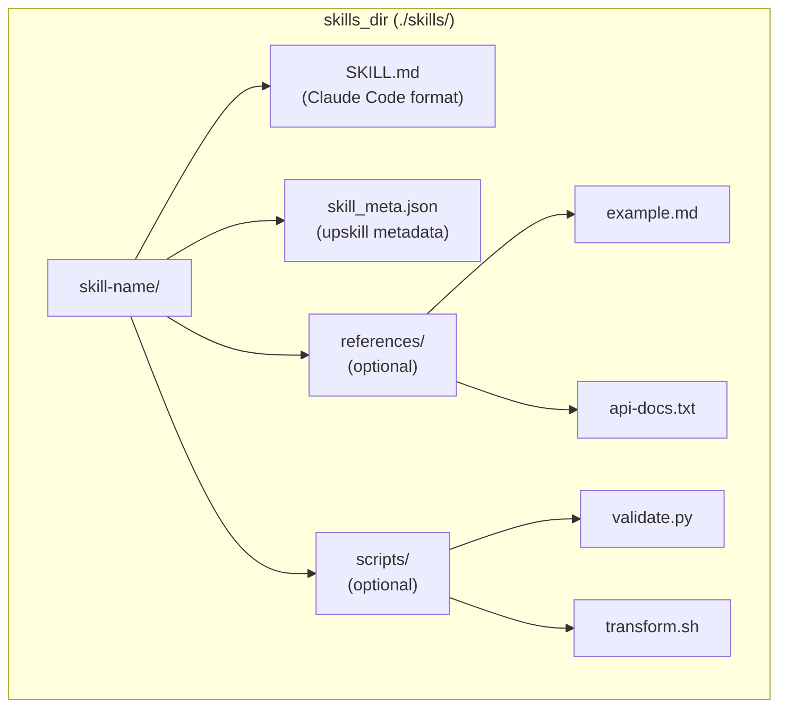
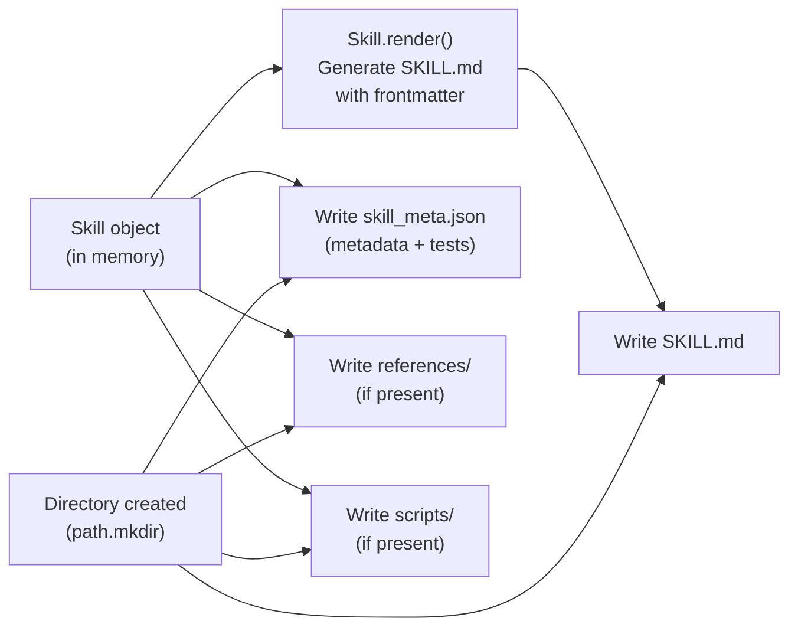
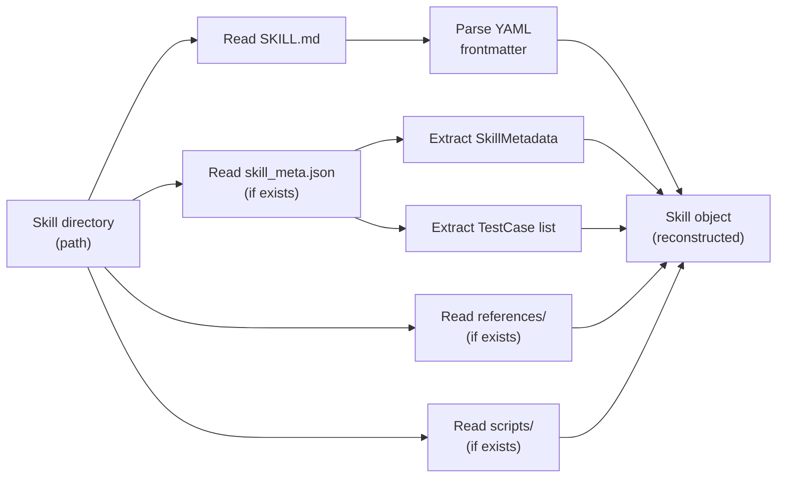
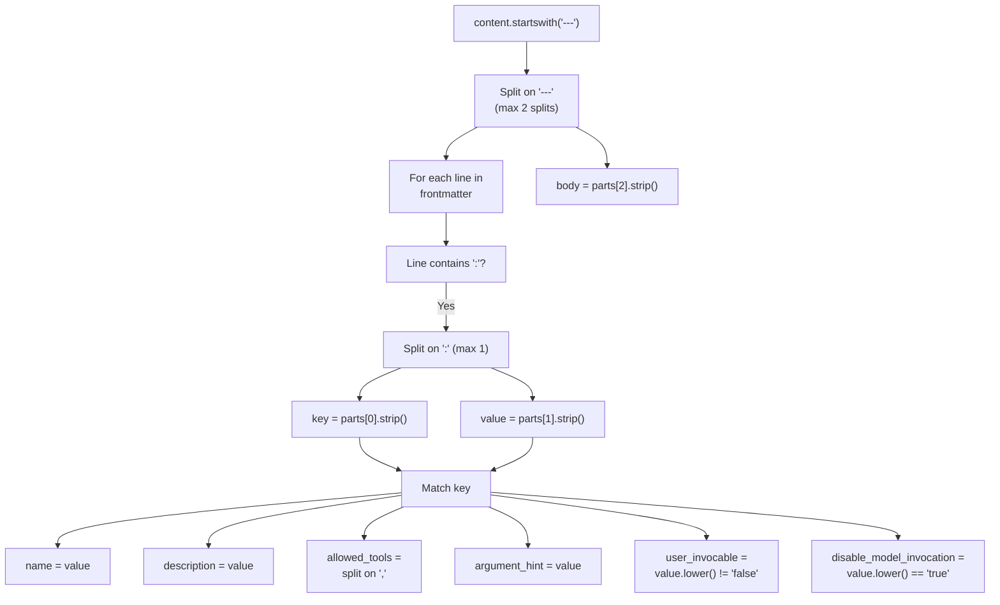
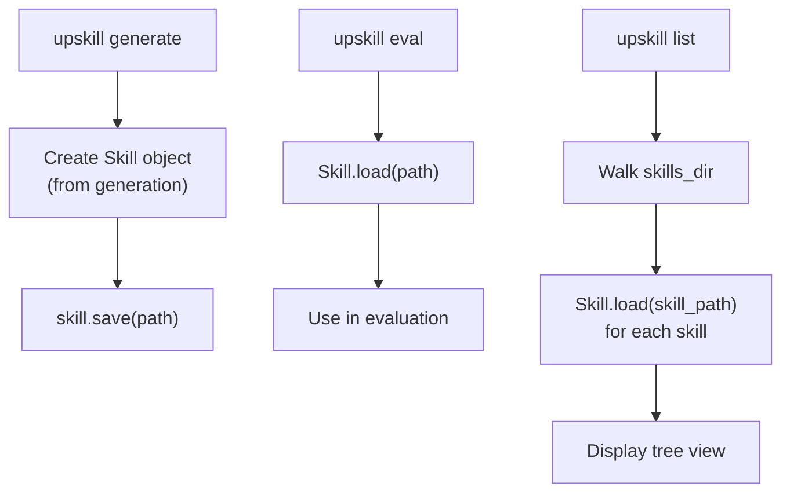

<!-- source: DeepWiki mcp.deepwiki.com · repo huggingface/upskill · page 5.5 Skill Persistence · fetched 2026-10-26 -->

# Skill Persistence

<details>
<summary>Relevant source files</summary>

The following files were used as context for generating this wiki page:

- [README.md](README.md)
- [src/upskill/models.py](src/upskill/models.py)

</details>


This document describes how skills are persisted to disk and loaded back into memory. It covers the directory structure, file formats, and the `Skill.save()` and `Skill.load()` methods that handle serialization and deserialization.

For information about how skills are generated before persistence, see [Skill Generation](#5.1). For information about the skill data models themselves, see [Skill Models](#7.1).

---

## Overview

Skills are persisted to a standardized directory structure on disk, with each skill occupying its own directory under the configured `skills_dir` (default: `./skills/`). The persistence layer maintains compatibility with the Claude Code SKILL.md specification while storing upskill-specific metadata and test cases separately.

**Key Components:**
- **SKILL.md**: Claude Code compatible skill document with YAML frontmatter
- **skill_meta.json**: upskill-specific metadata and test cases
- **references/**: Supporting documents referenced by the skill
- **scripts/**: Executable scripts used by the skill

**Sources:** [src/upskill/models.py:148-183](), [README.md:302-354]()

---

## Directory Structure

Each skill is saved as a self-contained directory with a predictable layout:



**Directory Layout:**
```
./skills/git-commit-messages/
├── SKILL.md               # Main skill document (required)
├── skill_meta.json        # Metadata + test cases (required)
├── references/            # Supporting documents (optional)
│   ├── conventions.md
│   └── examples.txt
└── scripts/               # Executable scripts (optional)
    └── validate-commit.py
```

The skill directory name must match the skill's `name` field and follow the naming convention: lowercase alphanumeric with hyphens (validated by regex `^[a-z0-9]+(-[a-z0-9]+)*$`).

**Sources:** [src/upskill/models.py:116-121](), [README.md:306-311]()

---

## File Formats

### SKILL.md Format

The `SKILL.md` file follows the Claude Code specification with YAML frontmatter:

```markdown
---
name: git-commit-messages
description: Write clear, conventional commit messages
allowed-tools: execute
argument-hint: [commit-message]
user-invocable: true
---

# Instructions

This skill teaches how to write effective git commit messages...

## Format

<type>(<scope>): <subject>
...
```

**Frontmatter Fields:**
| Field | Type | Required | Description |
|-------|------|----------|-------------|
| `name` | string | Yes | Skill identifier (kebab-case) |
| `description` | string | Yes | Brief description (max 1024 chars) |
| `allowed-tools` | string | No | Comma-separated tool names |
| `argument-hint` | string | No | Usage hint (e.g., "[file-path]") |
| `user-invocable` | boolean | No | Whether users can invoke directly (default: true) |
| `disable-model-invocation` | boolean | No | Prevent model from invoking (default: false) |

The `Skill.render()` method generates this format by building frontmatter from the model fields and appending the `body` content.

**Sources:** [src/upskill/models.py:123-146](), [README.md:313-354]()

### skill_meta.json Format

The `skill_meta.json` file stores upskill-specific data that isn't part of the Claude Code spec:

```json
{
  "metadata": {
    "version": "1.0",
    "generated_by": "anthropic.claude-sonnet-4-20250514",
    "generated_at": "2025-01-21T15:30:00Z",
    "source_task": "write good git commit messages",
    "test_pass_rate": 1.0,
    "license": null,
    "compatibility": null
  },
  "tests": [
    {
      "input": "Write a commit for adding login",
      "expected": {
        "contains": ["feat", "login"]
      },
      "context": null,
      "output_file": null,
      "validator": null,
      "validator_config": null
    }
  ]
}
```

**Metadata Fields (SkillMetadata):**
| Field | Type | Description |
|-------|------|-------------|
| `version` | string | Schema version (currently "1.0") |
| `generated_by` | string | Model name that created the skill |
| `generated_at` | datetime | Timestamp of generation |
| `source_task` | string | Original task description |
| `test_pass_rate` | float | Success rate from evaluation |
| `license` | string | License information (optional) |
| `compatibility` | string | Compatibility notes (optional) |

**Sources:** [src/upskill/models.py:13-23](), [src/upskill/models.py:160-168]()

---

## Save Operation

The `Skill.save()` method persists a skill to disk. It creates the directory structure and writes all files atomically.



**Method Signature:**
```python
def save(self, path: Path, tests: list[TestCase] | None = None) -> None
```

**Save Process:**

1. **Create Directory** - Creates the skill directory with `path.mkdir(parents=True, exist_ok=True)`

2. **Write SKILL.md** - Calls `self.render()` to generate Claude Code format and writes to `path / "SKILL.md"`

3. **Write skill_meta.json** - Serializes metadata and tests to JSON:
   ```python
   meta_dict = {
       "metadata": self.metadata.model_dump(mode="json"),
       "tests": [t.model_dump(mode="json") for t in tests_to_save],
   }
   ```

4. **Write References** - If `self.references` is non-empty, creates `references/` directory and writes each file

5. **Write Scripts** - If `self.scripts` is non-empty, creates `scripts/` directory and writes each file

**Test Handling:**
The `tests` parameter allows overriding `self.tests` at save time. This is used during skill generation when tests are created separately from the skill object.

**Sources:** [src/upskill/models.py:148-183]()

---

## Load Operation

The `Skill.load()` class method deserializes a skill from disk. It reads all files in the skill directory and reconstructs the `Skill` object.



**Method Signature:**
```python
@classmethod
def load(cls, path: Path) -> Skill
```

**Load Process:**

1. **Validate Path** - Checks that `path / "SKILL.md"` exists, raises `FileNotFoundError` if not

2. **Parse SKILL.md** - Reads file and parses YAML frontmatter:
   - Splits content on `---` delimiters
   - Parses frontmatter line-by-line (simple key-value parser)
   - Extracts: `name`, `description`, `allowed-tools`, `argument-hint`, `user-invocable`, `disable-model-invocation`
   - Remaining content becomes `body`

3. **Load Metadata and Tests** - If `skill_meta.json` exists:
   - Reads JSON file
   - Validates `metadata` as `SkillMetadata`
   - Validates `tests` as list of `TestCase`

4. **Load References** - If `references/` directory exists:
   - Iterates all files in directory
   - Loads each file's content into `references` dict (filename → content)

5. **Load Scripts** - If `scripts/` directory exists:
   - Iterates all files in directory
   - Loads each file's content into `scripts` dict (filename → content)

6. **Construct Skill** - Creates `Skill` instance with all loaded data

**Default Values:**
- If `skill_meta.json` is missing, uses default `SkillMetadata()` and empty tests list
- If `references/` or `scripts/` are missing, uses empty dicts

**Sources:** [src/upskill/models.py:184-273]()

---

## Frontmatter Parsing

The frontmatter parser in `Skill.load()` is a simple line-by-line parser that handles the YAML subset used by Claude Code:



**Implementation Notes:**
- Uses simple string splitting, not a full YAML parser
- Boolean fields use string comparison (`value.lower() != "false"`)
- `allowed-tools` are split on commas and stripped
- If frontmatter is missing, falls back to directory name for `name` field

**Sources:** [src/upskill/models.py:209-232]()

---

## Persistence Flow in CLI

The CLI commands use `Skill.save()` and `Skill.load()` at specific points in their workflows:



**Generate Command:**
- Creates `Skill` object from `SkillDraft` output
- Calls `skill.save(output_path, tests=test_cases)` after successful evaluation
- Output path is `skills_dir / skill.name` by default

**Eval Command:**
- Calls `Skill.load(skill_path)` to load skill from directory
- Uses loaded skill for evaluation

**List Command:**
- Walks `skills_dir` to find all subdirectories
- Calls `Skill.load(skill_dir)` for each directory
- Displays skill name, description, and file tree

**Sources:** [README.md:47-110](), [README.md:113-166](), [README.md:197-240]()

---

## Separation of Concerns

The persistence layer maintains a clear separation between Claude Code compatibility and upskill-specific features:

| Concern | File | Purpose |
|---------|------|---------|
| **Claude Code Spec** | `SKILL.md` | Agent-facing skill instructions and metadata |
| **upskill Metadata** | `skill_meta.json` | Generation context and test cases |
| **Supporting Files** | `references/`, `scripts/` | Additional resources referenced by skill |

**Design Rationale:**

1. **Interoperability** - `SKILL.md` can be used by any Claude Code compatible agent without upskill
2. **Metadata Isolation** - upskill-specific data doesn't pollute the skill document
3. **Test Persistence** - Test cases can be regenerated or modified without changing the skill
4. **Version Evolution** - `skill_meta.json` schema can evolve independently of Claude Code spec

**Sources:** [src/upskill/models.py:157-168]()

---

## Data Model Mapping

The following table shows how `Skill` model fields map to persisted files:

| Skill Field | File | Format |
|-------------|------|--------|
| `name` | `SKILL.md` frontmatter | YAML: `name: skill-name` |
| `description` | `SKILL.md` frontmatter | YAML: `description: Description text` |
| `allowed_tools` | `SKILL.md` frontmatter | YAML: `allowed-tools: tool1, tool2` |
| `argument_hint` | `SKILL.md` frontmatter | YAML: `argument-hint: [hint]` |
| `user_invocable` | `SKILL.md` frontmatter | YAML: `user-invocable: false` (if false) |
| `disable_model_invocation` | `SKILL.md` frontmatter | YAML: `disable-model-invocation: true` (if true) |
| `body` | `SKILL.md` content | Markdown after frontmatter |
| `metadata` | `skill_meta.json` | JSON: `metadata` object |
| `tests` | `skill_meta.json` | JSON: `tests` array |
| `references` | `references/*.{md,txt,...}` | Files in references/ directory |
| `scripts` | `scripts/*.{py,sh,...}` | Files in scripts/ directory |

**Sources:** [src/upskill/models.py:94-115](), [src/upskill/models.py:123-146](), [src/upskill/models.py:160-168]()

---

## Error Handling

The persistence layer handles several error conditions:

**Load Errors:**
- `FileNotFoundError` if `SKILL.md` doesn't exist at path
- Pydantic validation errors if `skill_meta.json` has invalid format
- Missing `skill_meta.json` is not an error (uses defaults)

**Save Errors:**
- `ValueError` if skill name doesn't match validation regex
- File system errors propagate (permissions, disk full, etc.)

**Validation:**
- Skill name validated with regex: `^[a-z0-9]+(-[a-z0-9]+)*$`
- String length constraints: `name` ≤ 64 chars, `description` ≤ 1024 chars
- All validation done by Pydantic during model construction

**Sources:** [src/upskill/models.py:116-121](), [src/upskill/models.py:194-196]()

---

## Configuration

Skill persistence is controlled by the `Config` object:

```python
class Config(BaseModel):
    skills_dir: Path = Path("./skills")  # Where skills are saved/loaded
    # ... other fields
```

**Default Skills Directory:**
- Default: `./skills/` (relative to current working directory)
- Can be overridden via `config.yaml` or `--output` CLI flag
- Created automatically if it doesn't exist (via `mkdir(parents=True, exist_ok=True)`)

**Sources:** [src/upskill/models.py:148](), [README.md:376-384]()

---

