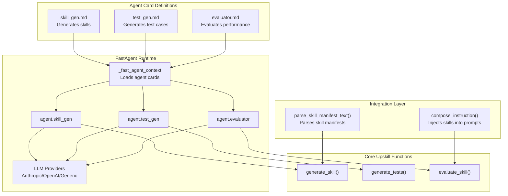
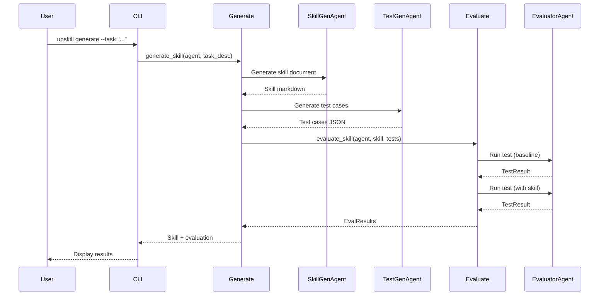
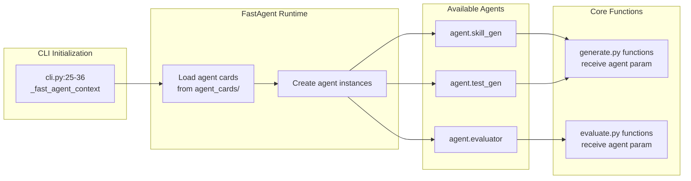
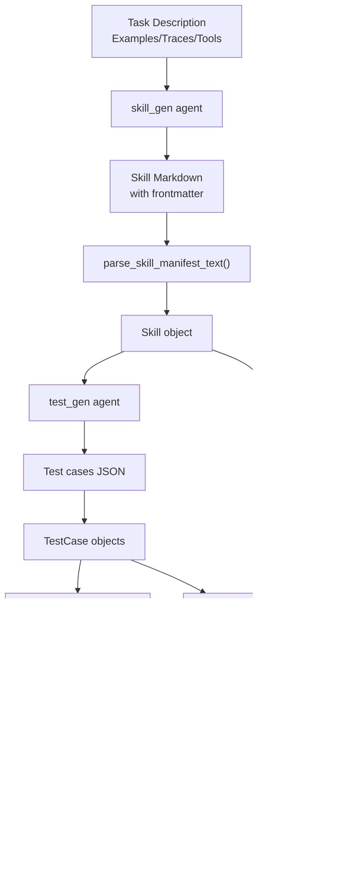

<!-- source: DeepWiki mcp.deepwiki.com · repo huggingface/upskill · page 6 Agent System · fetched 2026-10-26 -->

# Agent System

<details>
<summary>Relevant source files</summary>

The following files were used as context for generating this wiki page:

- [src/upskill/agent_cards/evaluator.md](src/upskill/agent_cards/evaluator.md)
- [src/upskill/agent_cards/skill_gen.md](src/upskill/agent_cards/skill_gen.md)
- [src/upskill/agent_cards/test_gen.md](src/upskill/agent_cards/test_gen.md)
- [src/upskill/fastagent_integration.py](src/upskill/fastagent_integration.py)
- [src/upskill/manifest_utils.py](src/upskill/manifest_utils.py)

</details>


## Purpose and Scope

The agent system in upskill provides an abstraction layer for leveraging Large Language Models (LLMs) to perform skill generation, test case creation, and evaluation tasks. This system uses a declarative agent card pattern where agents are defined in markdown files with YAML frontmatter, and the FastAgent runtime orchestrates their execution. This document covers the overall agent system architecture and how it integrates with the core upskill workflows.

For details on individual agent card definitions, see [Agent Cards](#6.1). For FastAgent runtime integration specifics, see [FastAgent Integration](#6.2). For configuring LLM providers, see [Model Providers](#6.3).

**Sources:** Diagram 3 from high-level architecture diagrams

---

## System Architecture

The agent system consists of three layers: declarative agent card definitions, the FastAgent runtime, and an integration layer that connects agents to upskill's core functionality.

### Agent System Component Diagram



**Sources:** [src/upskill/agent_cards/skill_gen.md:1-268](), [src/upskill/agent_cards/test_gen.md:1-9](), [src/upskill/agent_cards/evaluator.md:1-8](), [src/upskill/fastagent_integration.py:1-17]()

---

## The Three Core Agents

The upskill system uses three specialized agents, each defined by an agent card and optimized for a specific task in the skill lifecycle.

| Agent | Agent Card | Primary Function | Model Configuration |
|-------|-----------|------------------|---------------------|
| **skill_gen** | `skill_gen.md` | Generates skill documents from task descriptions, examples, traces, or MCP tool schemas | Configurable via CLI or card frontmatter |
| **test_gen** | `test_gen.md` | Generates test cases with inputs, expected outputs, and validators | `opus?reasoning=1024` by default |
| **evaluator** | `evaluator.md` | Executes test cases and evaluates skill performance | Has access to skills directory |

### Agent Invocation Flow



**Sources:** [src/upskill/agent_cards/skill_gen.md:1-268](), [src/upskill/agent_cards/test_gen.md:1-9](), [src/upskill/agent_cards/evaluator.md:1-8](), Diagram 2 from high-level architecture diagrams

---

## Agent Card Structure

Agent cards are markdown files with YAML frontmatter that define agent behavior. They are stored in the `agent_cards/` directory and loaded by the FastAgent runtime.

### Agent Card Anatomy

```
---
type: agent                          # Agent type declaration
model: opus?reasoning=1024           # Model configuration (optional)
description: Agent purpose           # Human-readable description
skills: ["./skills"]                 # Skills directory path (optional)
---
System prompt content

Instructions for the agent

{{agentSkills}}                      # Placeholder for skills (optional)
```

### skill_gen Agent Card

The `skill_gen` agent generates skill documents from task descriptions. It includes detailed examples showing the expected output format, field requirements, and best practices.

**Key Frontmatter:**
- `type: agent`
- `description: Generate skill documents from task descriptions.`

**Prompt Structure:**
- Role definition: "You generate 'skills' - instruction documents..."
- Three complete examples (git commit, API error handling, form validation)
- Output format specification with field requirements
- Clear instructions on what NOT to do

**Sources:** [src/upskill/agent_cards/skill_gen.md:1-268]()

### test_gen Agent Card

The `test_gen` agent generates test cases for evaluating skills. It is configured with extended reasoning capabilities.

**Key Frontmatter:**
- `type: agent`
- `model: opus?reasoning=1024` (enables extended reasoning, overrides CLI settings)
- `description: Generate test cases for evaluating skills.`

**Prompt Structure:**
- Brief role definition
- Output constraint: "Output only valid JSON."

**Sources:** [src/upskill/agent_cards/test_gen.md:1-9]()

### evaluator Agent Card

The `evaluator` agent executes test cases and evaluates skill performance. It is configured with access to the skills directory.

**Key Frontmatter:**
- `description: Evaluate skill performance against test cases.`
- `skills: ["./skills"]` (enables skill loading from directory)

**Prompt Structure:**
- Role definition
- `{{agentSkills}}` placeholder for dynamic skill injection

**Sources:** [src/upskill/agent_cards/evaluator.md:1-8]()

---

## FastAgent Runtime Integration

The FastAgent runtime loads agent cards and provides agent instances that upskill's core functions use to perform generation and evaluation tasks.

### Agent Loading Pattern



The agent instances are passed as parameters to core functions, maintaining decoupling between FastAgent and upskill's domain logic. This pattern allows functions to work with any agent implementation, not just FastAgent.

**Sources:** Diagram 5 from high-level architecture diagrams

---

## Integration Layer

The integration layer provides utilities for working with agent-generated content and formatting prompts for agent consumption.

### compose_instruction Function

The `compose_instruction` function injects skill content into agent instructions when evaluating with skills enabled.

**Function Signature:**
```python
def compose_instruction(instruction: str, skill: Skill | None) -> str
```

**Behavior:**
- If `skill` is `None`, returns the instruction unchanged
- If `skill` is provided, appends the skill to the instruction in this format:
  ```
  {instruction}
  
  ## Skill: {skill.name}
  
  {skill.body}
  ```

This function is used during evaluation to ensure the evaluator agent has access to the skill being tested.

**Sources:** [src/upskill/fastagent_integration.py:11-16]()

### parse_skill_manifest_text Function

The `parse_skill_manifest_text` function parses skill manifest content (SKILL.md with frontmatter) into a `SkillManifest` object from FastAgent's skill registry.

**Function Signature:**
```python
def parse_skill_manifest_text(
    manifest_text: str,
    *,
    path: Path | None = None,
) -> tuple[SkillManifest | None, str | None]
```

**Returns:**
- Tuple of `(SkillManifest | None, error message | None)`
- Used to validate skill format after generation

**Sources:** [src/upskill/manifest_utils.py:10-24]()

---

## Agent Execution Data Flow

The following diagram shows how data flows through the agent system during a typical skill generation and evaluation workflow.

### Generation and Evaluation Data Flow



**Sources:** [src/upskill/fastagent_integration.py:11-16](), [src/upskill/manifest_utils.py:10-24](), Diagram 4 from high-level architecture diagrams

---

## Agent Configuration and Model Selection

Agent behavior and model selection can be configured at multiple levels with the following precedence (highest to lowest):

| Configuration Level | Location | Example |
|---------------------|----------|---------|
| **Agent Card Frontmatter** | `model:` field in agent card YAML | `model: opus?reasoning=1024` in test_gen.md |
| **CLI Arguments** | `--model` flag | `upskill generate --model claude-3-5-sonnet-20241022` |
| **Environment Variables** | FastAgent config | Model provider API keys and base URLs |

### Model String Format

Model strings support query parameters for advanced configuration:

- `opus?reasoning=1024` - Enable extended reasoning with 1024 tokens
- `opus?structured=tool_use` - Use structured output mode
- Model provider prefixes are resolved by FastAgent configuration

**Sources:** [src/upskill/agent_cards/test_gen.md:4-5]()

---

## Extending the Agent System

The agent system is designed for extensibility:

1. **Adding new agents:** Create a new markdown file in `agent_cards/` with appropriate frontmatter
2. **Customizing agent behavior:** Modify agent card prompts or add examples
3. **Switching models:** Update the `model:` field in agent card frontmatter or use CLI flags
4. **Provider configuration:** See [Model Providers](#6.3) for LLM provider setup

The declarative agent card pattern separates agent definition from implementation, allowing rapid iteration on agent behavior without code changes.

**Sources:** [src/upskill/agent_cards/skill_gen.md:1-268](), [src/upskill/agent_cards/test_gen.md:1-9](), [src/upskill/agent_cards/evaluator.md:1-8]()

---

