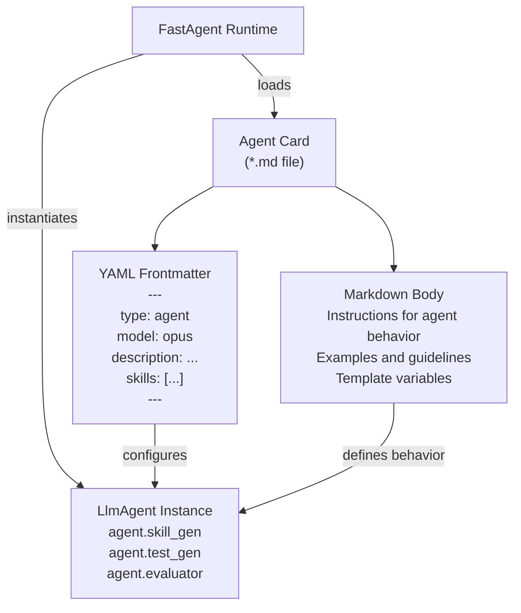
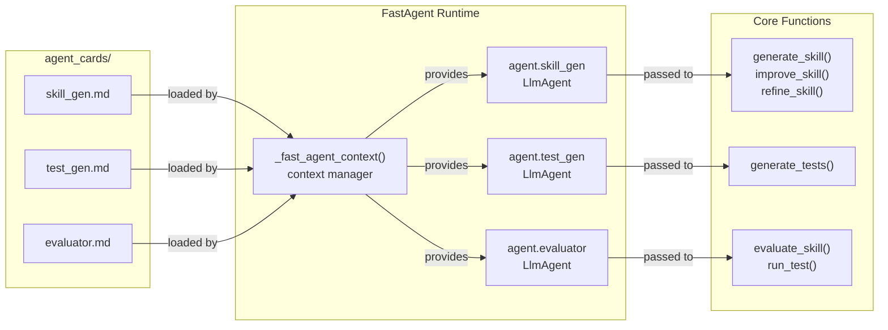
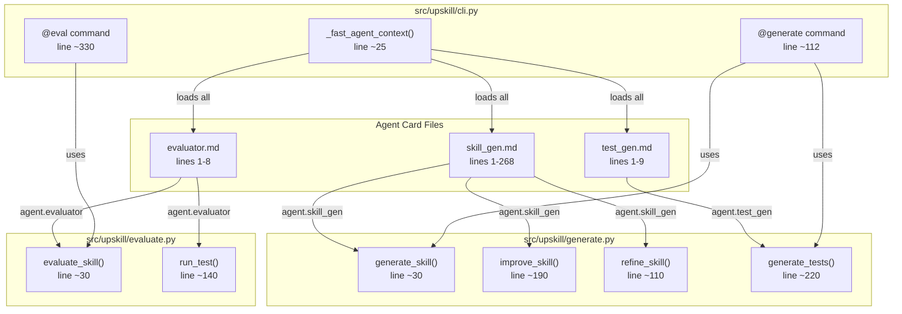

<!-- source: DeepWiki mcp.deepwiki.com · repo huggingface/upskill · page 6.1 Agent Cards · fetched 2026-10-26 -->

# Agent Cards

<details>
<summary>Relevant source files</summary>

The following files were used as context for generating this wiki page:

- [src/upskill/agent_cards/evaluator.md](src/upskill/agent_cards/evaluator.md)
- [src/upskill/agent_cards/skill_gen.md](src/upskill/agent_cards/skill_gen.md)
- [src/upskill/agent_cards/test_gen.md](src/upskill/agent_cards/test_gen.md)
- [src/upskill/manifest_utils.py](src/upskill/manifest_utils.py)

</details>


## Purpose and Scope

This page documents the **agent card system** in upskill, which defines the behavior and configuration of the three specialized AI agents used throughout the skill lifecycle: `skill_gen`, `test_gen`, and `evaluator`. Agent cards are declarative markdown files with YAML frontmatter that FastAgent loads to instantiate agent instances.

For information about how FastAgent integrates these agents into the upskill runtime, see [FastAgent Integration](#6.2). For details on the skill generation and evaluation workflows that use these agents, see [Skill Generation](#5.1), [Test Case Generation](#5.2), and [Skill Evaluation](#5.3).

---

## Agent Card Overview

Agent cards are markdown files located in `src/upskill/agent_cards/` that define agent behavior through a combination of YAML frontmatter (configuration) and markdown body (instructions). Each agent card specifies:

- **Agent identity**: Type, description, and capabilities
- **Model configuration**: Which LLM to use and model-specific parameters
- **Skill access**: Which skills the agent can load and use
- **Behavioral instructions**: Natural language directives that guide agent behavior

The three agent cards in the system serve distinct roles:

| Agent Card | File | Primary Purpose |
|------------|------|-----------------|
| **skill_gen** | `skill_gen.md` | Generate skill documents from task descriptions |
| **test_gen** | `test_gen.md` | Generate test cases for evaluating skills |
| **evaluator** | `evaluator.md` | Execute test cases and evaluate skill performance |

**Sources:** [src/upskill/agent_cards/skill_gen.md](), [src/upskill/agent_cards/test_gen.md](), [src/upskill/agent_cards/evaluator.md]()

---

## Agent Card Structure

Each agent card follows a standard structure with YAML frontmatter followed by markdown instructions:



**Sources:** [src/upskill/agent_cards/skill_gen.md:1-9](), [src/upskill/agent_cards/test_gen.md:1-9](), [src/upskill/agent_cards/evaluator.md:1-8]()

---

## YAML Frontmatter Configuration

The YAML frontmatter section defines agent metadata and configuration. Available fields:

### Core Fields

| Field | Type | Description | Example |
|-------|------|-------------|---------|
| `type` | string | Agent type (usually `"agent"`) | `type: agent` |
| `model` | string | Model identifier with optional parameters | `model: opus?reasoning=1024` |
| `description` | string | Human-readable description of agent purpose | `description: Generate skill documents` |
| `skills` | list[string] | Paths to skill directories the agent can access | `skills: ["./skills"]` |

### Model String Format

The `model` field supports a flexible parameter syntax:

```
model: <model_name>?<param1>=<value1>&<param2>=<value2>
```

Examples:
- `opus` - Base Anthropic Claude Opus model
- `opus?reasoning=1024` - Enable extended thinking with 1024 tokens
- `opus?structured=tool_use` - Enable structured output mode
- `sonnet` - Anthropic Claude Sonnet model

**Note:** The model string in the frontmatter takes precedence over CLI model switches like `--model`.

**Sources:** [src/upskill/agent_cards/test_gen.md:3-5](), [src/upskill/agent_cards/skill_gen.md:2-3]()

---

## The skill_gen Agent Card

The `skill_gen` agent generates skill documents from task descriptions. It acts as the "teacher model" that creates instructional content.

### Configuration

[src/upskill/agent_cards/skill_gen.md:1-4]()
```yaml
---
type: agent
description: Generate skill documents from task descriptions.
---
```

### Key Responsibilities

1. **Convert task descriptions into skill documents** with proper frontmatter and structured content
2. **Follow skill formatting conventions**: lowercase-hyphenated names, concise descriptions
3. **Provide practical examples**: 2-3 code examples with real implementations
4. **Include best practices**: Guidelines, common pitfalls, security notes

### Instruction Strategy

The agent card provides three complete example skills ([src/upskill/agent_cards/skill_gen.md:9-237]()):

1. **Git Commit Messages** - Demonstrates conventional commits format
2. **API Error Handling** - Shows retry logic and exception handling patterns
3. **Form Input Validation** - Illustrates validation layers and sanitization

These examples teach the agent the expected structure, tone, and level of detail through demonstration rather than abstract rules.

### Output Format Requirements

[src/upskill/agent_cards/skill_gen.md:240-267]()

The agent must output only markdown with frontmatter:
- **name**: lowercase-alphanumeric-with-hyphens
- **description**: one sentence under 100 characters
- **body**: 200-400 word guide with overview, instructions, examples, and best practices

**Sources:** [src/upskill/agent_cards/skill_gen.md:1-268]()

---

## The test_gen Agent Card

The `test_gen` agent generates test cases for evaluating skills. It creates diverse, realistic test scenarios that measure skill effectiveness.

### Configuration

[src/upskill/agent_cards/test_gen.md:1-7]()
```yaml
---
type: agent
model: opus?reasoning=1024
description: Generate test cases for evaluating skills.
---
```

### Model Configuration

The `test_gen` agent uses extended reasoning (`reasoning=1024`) to think through test case generation more carefully. This enables:
- More thorough consideration of edge cases
- Better coverage of skill capabilities
- More realistic and varied test scenarios

### Output Format

[src/upskill/agent_cards/test_gen.md:8]()
```
You generate test cases for evaluating AI agent skills. Output only valid JSON.
```

The agent outputs JSON conforming to the `TestCaseSuite` schema (see [Test Models](#7.2)), typically containing:
- Multiple test cases with varying complexity
- Input strings that trigger skill usage
- Expected outputs or validation criteria
- Contextual information for test execution

**Sources:** [src/upskill/agent_cards/test_gen.md:1-9]()

---

## The evaluator Agent Card

The `evaluator` agent executes test cases and evaluates skill performance. Unlike the other agents, it has access to the skills directory.

### Configuration

[src/upskill/agent_cards/evaluator.md:1-5]()
```yaml
---
description: Evaluate skill performance against test cases.
skills: ["./skills"]
---
```

### Skills Access

The `skills: ["./skills"]` directive enables the evaluator to:
- Load skills from the `./skills` directory
- Execute test cases both with and without skills enabled
- Compare baseline performance against with-skill performance

### Template Variables

[src/upskill/agent_cards/evaluator.md:8]()
```
{{agentSkills}}
```

The `{{agentSkills}}` placeholder is replaced at runtime with the agent's available skills, formatted according to FastAgent's skill injection mechanism (see [compose_instruction](#6.2)).

### Behavioral Instructions

[src/upskill/agent_cards/evaluator.md:6-7]()
```
You are an evaluator of skills. You are given a skill and a test case. 
You need to evaluate the skill on the test case and return a score.
```

The evaluator receives test inputs and must produce outputs that can be validated against expected results. The evaluation framework (see [Skill Evaluation](#5.3)) handles the comparison and metrics calculation.

**Sources:** [src/upskill/agent_cards/evaluator.md:1-8]()

---

## Agent Card Loading and Usage

The following diagram shows how agent cards flow from filesystem to runtime usage:



### Loading Process

Agent cards are loaded through FastAgent's context manager pattern. The upskill CLI establishes this context:

1. **Context Manager Initialization**: Creates `_fast_agent_context()` with configuration from `fastagent.config.yaml`
2. **Agent Card Discovery**: FastAgent scans `agent_cards/` directory for `*.md` files
3. **Frontmatter Parsing**: Extracts YAML configuration (model, skills, etc.)
4. **Agent Instantiation**: Creates `LlmAgent` instances with parsed configuration
5. **Namespace Injection**: Makes agents available as `agent.skill_gen`, `agent.test_gen`, `agent.evaluator`

### Usage in Core Functions

Core functions receive agent instances as parameters:

```python
# Example from generate.py
def generate_skill(
    task: str,
    agent: AgentProtocol,  # Typically agent.skill_gen
    ...
) -> tuple[Skill | None, SkillDraft | None]:
    # Uses agent to generate skill content
    ...
```

This dependency injection pattern:
- Decouples core logic from FastAgent implementation
- Enables testing with mock agents
- Allows runtime agent configuration without code changes

**Sources:** High-level architecture diagrams (Diagram 3), [src/upskill/agent_cards/]() directory structure

---

## Agent Card to Code Entity Mapping

The following diagram maps agent card files to their usage in core functions:



### Function Signatures with Agent Parameters

**Skill Generation:**
- `generate_skill(task: str, agent: AgentProtocol, ...)` - Receives `agent.skill_gen`
- `improve_skill(skill: Skill, failures: list[str], agent: AgentProtocol, ...)` - Receives `agent.skill_gen`
- `refine_skill(skill: Skill, failures: list[str], agent: AgentProtocol, ...)` - Receives `agent.skill_gen`

**Test Generation:**
- `generate_tests(skill: Skill, agent: AgentProtocol, ...)` - Receives `agent.test_gen`

**Evaluation:**
- `evaluate_skill(skill: Skill, test_cases: list[TestCase], agent: AgentProtocol, ...)` - Receives `agent.evaluator`
- `run_test(test_case: TestCase, agent: AgentProtocol, ...)` - Receives `agent.evaluator`

**Sources:** High-level architecture diagrams (Diagram 3), [src/upskill/generate.py](), [src/upskill/evaluate.py](), [src/upskill/cli.py:25-36]()

---

## Skill Manifest Parsing

While agent cards define agent behavior, the skills they generate follow the `SkillManifest` format from FastAgent. The `manifest_utils.py` module provides utilities for parsing skill content:

### parse_skill_manifest_text Function

[src/upskill/manifest_utils.py:10-24]()

```python
def parse_skill_manifest_text(
    manifest_text: str,
    *,
    path: Path | None = None,
) -> tuple[SkillManifest | None, str | None]:
    """Parse a SkillManifest from raw SKILL.md content."""
    return SkillRegistry.parse_manifest_text(manifest_text, path=path)
```

This function:
- Parses the YAML frontmatter and markdown body from `SKILL.md` content
- Returns a `SkillManifest` object or an error message
- Delegates to FastAgent's `SkillRegistry.parse_manifest_text()`

The `SkillManifest` format produced by `skill_gen` agent must conform to this parsing logic, ensuring generated skills can be loaded by FastAgent's skill system.

**Sources:** [src/upskill/manifest_utils.py:1-25]()

---

## Agent Card Customization

Agent cards can be customized by editing the markdown files directly. Common customizations include:

### Changing Models

Edit the `model` field in frontmatter:

```yaml
# Use a different model for test generation
model: sonnet?reasoning=512

# Use OpenAI instead
model: gpt-4?structured=tool_use
```

### Adding MCP Servers

The evaluator card can reference MCP servers defined in `fastagent.config.yaml`:

```yaml
# Add MCP server access (referenced from config file)
# mcp_servers: ["filesystem", "database"]
```

### Modifying Instructions

The markdown body can be edited to change agent behavior:
- Add more examples to `skill_gen.md` for different skill types
- Adjust test generation criteria in `test_gen.md`
- Modify evaluator instructions for custom validation logic

### Template Variables

Agent cards can use template variables that FastAgent replaces at runtime:
- `{{agentSkills}}` - Replaced with formatted skill content
- Custom variables can be defined in FastAgent configuration

**Sources:** [src/upskill/agent_cards/evaluator.md:4-8](), [src/upskill/agent_cards/test_gen.md:3-5]()

---

## Summary

Agent cards provide a declarative, file-based approach to defining AI agent behavior in upskill. The three agent cards (`skill_gen`, `test_gen`, `evaluator`) serve distinct roles in the skill lifecycle:

- **skill_gen** creates instructional skill documents from task descriptions
- **test_gen** generates comprehensive test cases with extended reasoning
- **evaluator** executes tests with access to the skills directory

By combining YAML frontmatter (configuration) with markdown bodies (instructions), agent cards enable model substitution, behavioral customization, and clear separation between agent orchestration and domain logic. FastAgent loads these cards at runtime and provides agent instances to core upskill functions through dependency injection.

**Sources:** All agent card files in [src/upskill/agent_cards/](), high-level architecture diagrams (Diagram 3)

---

