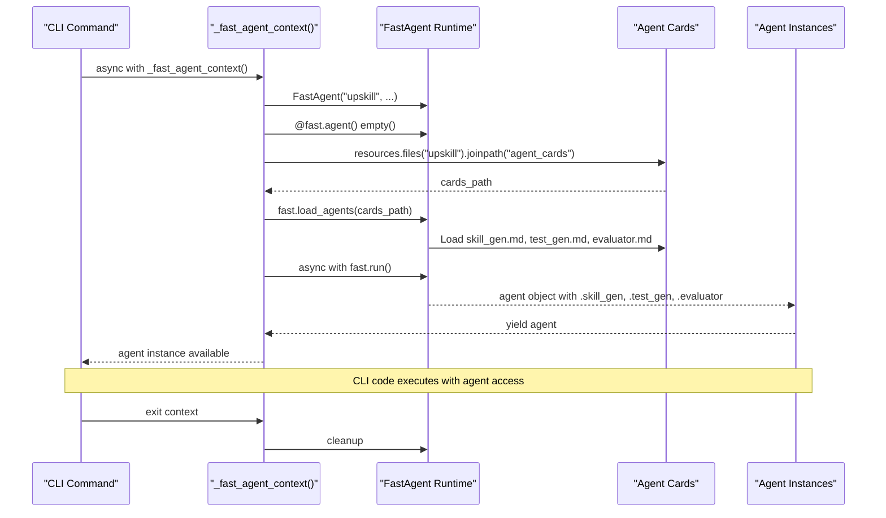
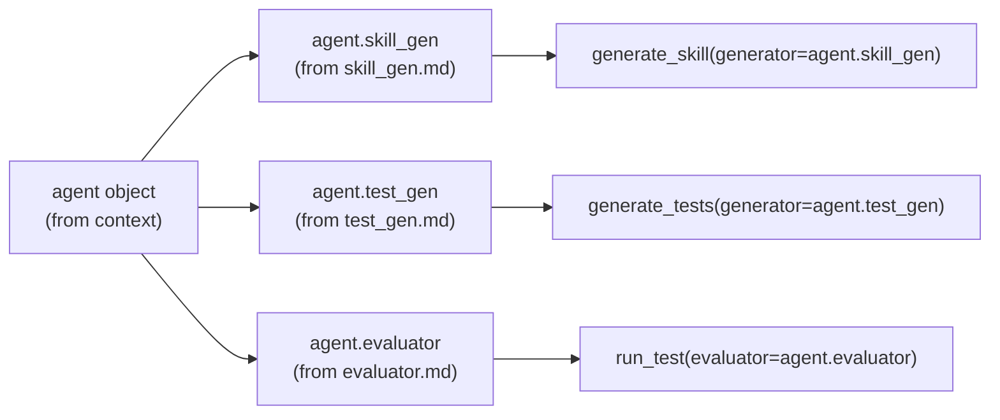
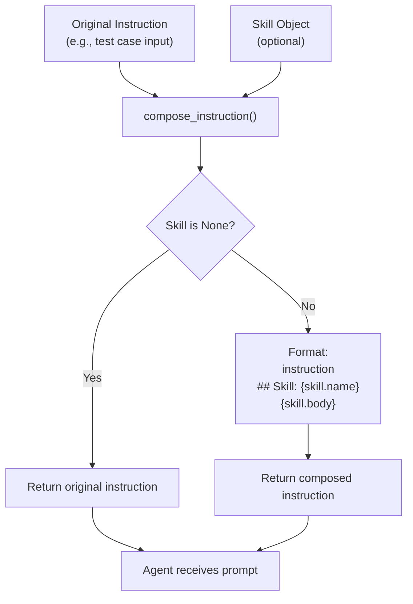
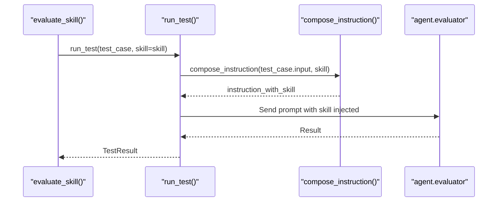
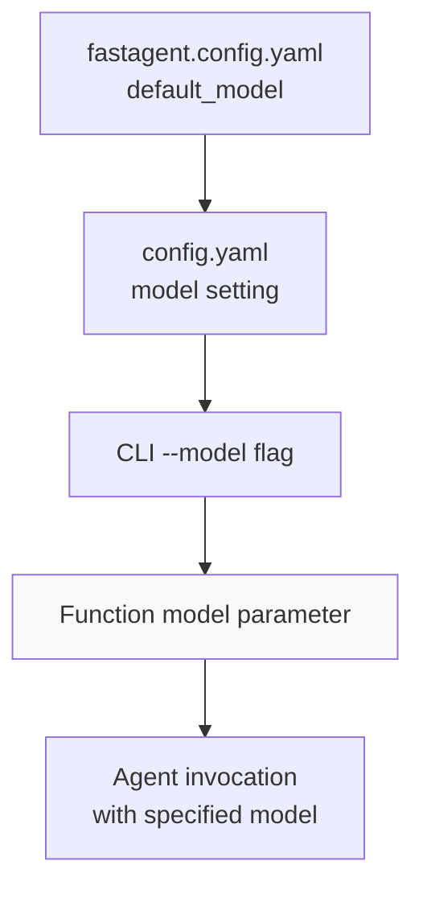
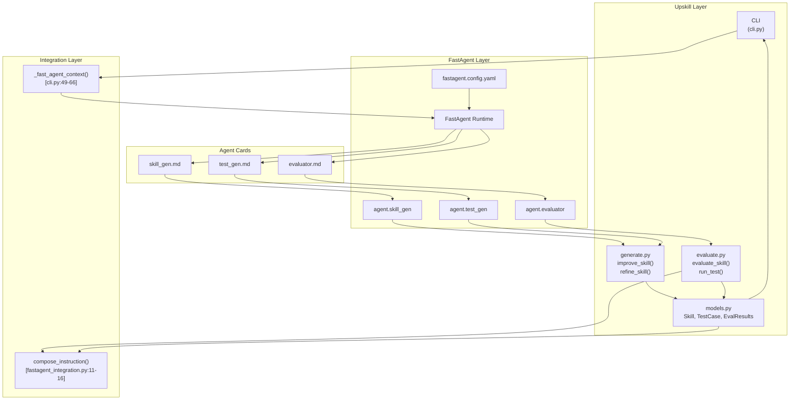

<!-- source: DeepWiki mcp.deepwiki.com · repo huggingface/upskill · page 6.2 FastAgent Integration · fetched 2026-10-26 -->

# FastAgent Integration

<details>
<summary>Relevant source files</summary>

The following files were used as context for generating this wiki page:

- [fastagent.config.yaml](fastagent.config.yaml)
- [src/upskill/cli.py](src/upskill/cli.py)
- [src/upskill/fastagent_integration.py](src/upskill/fastagent_integration.py)
- [tests/test_smoke.py](tests/test_smoke.py)

</details>


This document explains how upskill integrates with the FastAgent runtime to execute AI agents for skill generation, test case creation, and evaluation. It covers the context manager pattern used to manage agent lifecycle, the `compose_instruction` utility for injecting skills into prompts, and how agent instances are accessed throughout the codebase.

For information about the agent card definitions themselves (skill_gen, test_gen, evaluator), see [Agent Cards](#6.1). For details on model provider configuration, see [Model Providers](#6.3).

---

## Overview

The upskill system delegates all LLM interactions to the FastAgent framework. Rather than making direct API calls, upskill:

1. Initializes a FastAgent runtime using an async context manager
2. Loads agent cards from the `agent_cards/` directory
3. Accesses typed agent instances (e.g., `agent.skill_gen`, `agent.evaluator`)
4. Uses a helper function to inject skills into agent instructions

This abstraction allows upskill to remain decoupled from specific LLM providers and agent implementation details.

**Sources:** [src/upskill/cli.py:49-66](), [src/upskill/fastagent_integration.py]()

---

## FastAgent Context Manager

### The _fast_agent_context Pattern

All agent interactions in upskill occur within an async context manager that manages the FastAgent runtime lifecycle:

```python
async with _fast_agent_context() as agent:
    # agent.skill_gen, agent.test_gen, agent.evaluator are now available
    skill = await generate_skill(task, generator=agent.skill_gen, model=model)
```

#### Context Manager Lifecycle



**Sources:** [src/upskill/cli.py:49-66]()

### Implementation Details

The context manager is implemented in [src/upskill/cli.py:49-66]():

| Step | Code | Purpose |
|------|------|---------|
| **Initialize FastAgent** | `FastAgent("upskill", ignore_unknown_args=True)` | Creates the runtime with project name "upskill" |
| **Register Empty Agent** | `@fast.agent() async def empty()` | Required placeholder to initialize the decorator system |
| **Locate Agent Cards** | `resources.files("upskill").joinpath("agent_cards")` | Uses importlib.resources to find the packaged agent_cards directory |
| **Load Agent Cards** | `fast.load_agents(cards_path)` | Parses all `.md` files in agent_cards/ and registers them as agents |
| **Enter Runtime** | `async with fast.run() as agent` | Starts the FastAgent runtime and yields the agent container object |

**Sources:** [src/upskill/cli.py:49-66]()

---

## Agent Instance Access

### Agent Container Object

The `agent` object yielded by the context manager exposes agent instances as attributes based on their agent card filenames:



### Usage Pattern in Core Functions

Core upskill functions accept agent instances as parameters, maintaining separation from the FastAgent initialization:

| Function | Agent Parameter | Agent Used | File Location |
|----------|----------------|------------|---------------|
| `generate_skill()` | `generator` | `agent.skill_gen` | [src/upskill/generate.py]() |
| `improve_skill()` | `generator` | `agent.skill_gen` | [src/upskill/generate.py]() |
| `refine_skill()` | `generator` | `agent.skill_gen` | [src/upskill/generate.py]() |
| `generate_tests()` | `generator` | `agent.test_gen` | [src/upskill/generate.py]() |
| `evaluate_skill()` | `evaluator` | `agent.evaluator` | [src/upskill/evaluate.py]() |
| `run_test()` | `evaluator` | `agent.evaluator` | [src/upskill/evaluate.py]() |

**Example from generate command:**

```python
async with _fast_agent_context() as agent:
    skill = await generate_skill(
        task=task,
        examples=examples,
        generator=agent.skill_gen,  # Pass agent instance
        model=model,
    )
    
    test_cases = await generate_tests(
        task,
        generator=agent.test_gen,  # Different agent for different task
        model=model,
    )
    
    results = await evaluate_skill(
        skill,
        test_cases=test_cases,
        evaluator=agent.evaluator,  # Yet another agent
        model=model,
    )
```

**Sources:** [src/upskill/cli.py:283-368](), [src/upskill/cli.py:724-928]()

---

## Skill Injection with compose_instruction

### Purpose

The `compose_instruction()` function is the integration point where skills are injected into agent prompts. When evaluating an agent with a skill, the skill content must be prepended to the agent's instruction so the agent can reference it.

### Function Signature

```python
def compose_instruction(instruction: str, skill: Skill | None) -> str:
    """Inject the skill content into an instruction when provided."""
```

**Sources:** [src/upskill/fastagent_integration.py:11-16]()

### How It Works



### Implementation

The function performs a simple string composition:

```python
if not skill:
    return instruction
return f"{instruction}\n\n## Skill: {skill.name}\n\n{skill.body}"
```

**Key aspects:**
- If no skill is provided, the instruction is returned unchanged (baseline evaluation)
- If a skill is provided, it's appended with a markdown header format
- Only `skill.body` is injected, not references or scripts (those are loaded separately via FastAgent's skill manifest system)

**Sources:** [src/upskill/fastagent_integration.py:11-16]()

### Usage in Evaluation

The function is used within the evaluation system when running tests with skills:



**Sources:** [src/upskill/evaluate.py](), [src/upskill/fastagent_integration.py:11-16]()

---

## Configuration

### FastAgent Configuration File

FastAgent is configured via `fastagent.config.yaml` in the project root:

```yaml
# Default model for agent execution
default_model: kimi

# Generic provider for local OpenAI-compatible endpoints
generic:
  api_key: "local"
  base_url: "http://localhost:11434/v1"

# Logging and display settings
logger:
  progress_display: false
  show_chat: false
  show_tools: false
  truncate_tools: true
  streaming: none
```

**Key configuration sections:**

| Section | Purpose | Example |
|---------|---------|---------|
| `default_model` | Default LLM to use if not specified | `kimi`, `sonnet`, `gpt-4.1` |
| `generic` | Configuration for local/generic OpenAI-compatible APIs | Ollama, llama.cpp endpoints |
| `logger` | Console output and streaming behavior | Chat display, tool logging |
| `mcp_timeline` | MCP server timeline display settings | Step count, intervals |
| `shell_execution` | Shell tool execution settings | Bash command display |

**Sources:** [fastagent.config.yaml]()

### Model Override Pattern

While `fastagent.config.yaml` sets defaults, models can be overridden at multiple levels:



**Sources:** [fastagent.config.yaml](), [src/upskill/cli.py:269-270]()

---

## Integration Points

### Where FastAgent Integration Occurs

The following table maps upskill subsystems to their FastAgent integration points:

| Subsystem | Integration Point | FastAgent Component | Purpose |
|-----------|-------------------|---------------------|---------|
| **CLI Commands** | [src/upskill/cli.py:49-66]() | `_fast_agent_context()` | Initialize runtime for all CLI operations |
| **Skill Generation** | [src/upskill/generate.py]() | `agent.skill_gen` | Generate skill content from task descriptions |
| **Test Generation** | [src/upskill/generate.py]() | `agent.test_gen` | Create test cases for skills |
| **Skill Evaluation** | [src/upskill/evaluate.py]() | `agent.evaluator` | Execute tests with/without skills |
| **Skill Injection** | [src/upskill/fastagent_integration.py]() | `compose_instruction()` | Format prompts with skill content |

### Data Flow Through Integration Layer



**Sources:** [src/upskill/cli.py:49-66](), [src/upskill/fastagent_integration.py](), [src/upskill/generate.py](), [src/upskill/evaluate.py]()

---

## Summary

The FastAgent integration provides a clean abstraction layer between upskill's domain logic and LLM execution:

- **Context Manager Pattern**: `_fast_agent_context()` manages the FastAgent lifecycle and exposes agent instances
- **Agent Card Loading**: Agent definitions are loaded from `agent_cards/` at runtime
- **Typed Agent Access**: Agents are accessed as `agent.skill_gen`, `agent.test_gen`, `agent.evaluator`
- **Skill Injection**: `compose_instruction()` formats prompts to include skill content when needed
- **Configuration**: `fastagent.config.yaml` controls runtime behavior, model defaults, and logging

This design allows upskill to treat agents as injectable dependencies, supporting multiple model providers and enabling easy testing and model substitution.

**Sources:** [src/upskill/cli.py:49-66](), [src/upskill/fastagent_integration.py:11-16](), [fastagent.config.yaml]()

---

