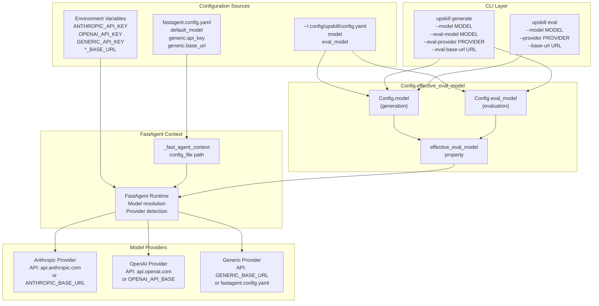
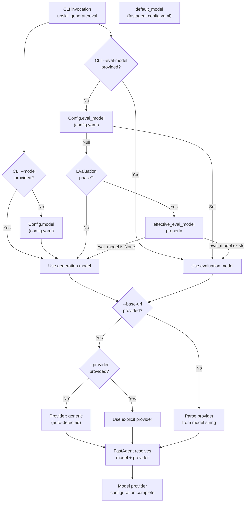
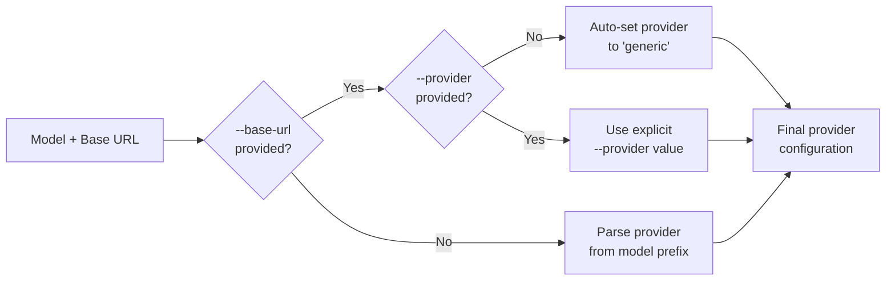
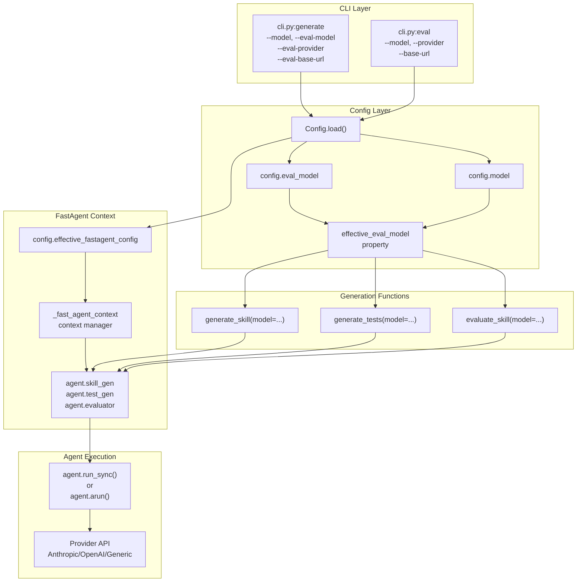

<!-- source: DeepWiki mcp.deepwiki.com · repo huggingface/upskill · page 6.3 Model Providers · fetched 2026-10-26 -->

# Model Providers

<details>
<summary>Relevant source files</summary>

The following files were used as context for generating this wiki page:

- [README.md](README.md)
- [fastagent.config.yaml](fastagent.config.yaml)
- [src/upskill/config.py](src/upskill/config.py)

</details>


This page explains how upskill configures and uses different model providers (Anthropic, OpenAI, and local/generic providers) for skill generation and evaluation. For information about how models are integrated into the agent system, see [FastAgent Integration](#6.2). For details on how agent cards specify models, see [Agent Cards](#6.1).

## Provider Types

upskill supports three model provider types, each designed for different use cases and deployment scenarios:

| Provider | Purpose | Primary Use Case | API Compatibility |
|----------|---------|------------------|-------------------|
| `anthropic` | Anthropic's Claude models | Production skill generation with Claude Opus/Sonnet | Anthropic API |
| `openai` | OpenAI models | Production skill generation with GPT-4, o-series | OpenAI API |
| `generic` | Local or custom endpoints | Development, testing, custom deployments | OpenAI-compatible API |

**Sources:** [README.md:408-422](), [README.md:467-513](), [fastagent.config.yaml:1-33]()

## Model Format

Models are specified using FastAgent's hierarchical naming convention:

```
<provider>.<model_string>.<reasoning_effort?>
```

### Format Components

**Provider prefix** - Identifies the API provider and authentication method
- `anthropic` - Uses `ANTHROPIC_API_KEY` and Anthropic API
- `openai` - Uses `OPENAI_API_KEY` and OpenAI API  
- `generic` - Uses `GENERIC_API_KEY` (or `GENERIC_BASE_URL` environment variables)

**Model string** - The model identifier
- Full model names: `claude-sonnet-4-20250514`, `gpt-4.1`
- Model aliases: `sonnet`, `haiku`, `opus`, `gpt-4.1`, `o3-mini`
- Local model names: `llama3.2:latest`, `my-model`

**Reasoning effort** (optional) - For reasoning-capable models
- `low`, `medium`, `high` - Controls reasoning budget
- Only applicable to models like `o3-mini`, `o1`, etc.

### Model Format Examples

```bash
# Anthropic models
anthropic.claude-sonnet-4-20250514  # Full model name
sonnet                               # Alias for Anthropic Sonnet
haiku                                # Alias for Anthropic Haiku
opus                                 # Alias for Anthropic Opus

# OpenAI models
openai.gpt-4.1                      # Full model name
openai.o3-mini.low                  # With reasoning effort
gpt-4.1                             # Alias for OpenAI GPT-4.1
o3-mini                             # Alias for OpenAI o3-mini

# Local/generic models
generic.llama3.2:latest             # Ollama model
generic.my-model                    # Custom local model
llama3.2:latest                     # Alias (provider inferred from context)
```

**Sources:** [README.md:467-483](), [fastagent.config.yaml:4-8]()

## Provider Configuration Architecture



**Sources:** [src/upskill/config.py:38-102](), [README.md:374-422](), [fastagent.config.yaml:1-33]()

## Anthropic Provider

The Anthropic provider connects to Claude models through the Anthropic API.

### Configuration

**API Key** (required)
```bash
export ANTHROPIC_API_KEY=sk-ant-...
```

**Base URL** (optional, for proxies or custom endpoints)
```bash
export ANTHROPIC_BASE_URL=http://localhost:8080
```

### Model Aliases

| Alias | Full Model Name | Typical Use |
|-------|-----------------|-------------|
| `haiku` | `claude-3-5-haiku-*` | Fast evaluation, student model |
| `sonnet` | `claude-sonnet-4-*` | Balanced generation and evaluation |
| `opus` | `claude-opus-4-*` | Complex skill generation, teacher model |

### Usage Examples

```bash
# Using alias (default provider is Anthropic)
upskill generate "parse JSON" --model sonnet

# Using full model name
upskill generate "parse JSON" --model anthropic.claude-sonnet-4-20250514

# Cross-model evaluation: Opus generates, Haiku evaluates
upskill generate "parse JSON" --model opus --eval-model haiku
```

**Sources:** [README.md:408-410](), [README.md:475-479]()

## OpenAI Provider

The OpenAI provider connects to GPT and reasoning models through the OpenAI API.

### Configuration

**API Key** (required)
```bash
export OPENAI_API_KEY=sk-...
```

**Base URL** (optional, for proxies or Azure OpenAI)
```bash
export OPENAI_API_BASE=https://your-azure-endpoint.openai.azure.com
```

### Model Aliases

| Alias | Full Model Name | Typical Use |
|-------|-----------------|-------------|
| `gpt-4.1` | `openai.gpt-4.1` | General-purpose generation |
| `o3-mini` | `openai.o3-mini` | Reasoning-capable evaluation |

### Reasoning Models

OpenAI's reasoning models support effort parameters:

```bash
# Low reasoning effort (faster, cheaper)
upskill eval ./skills/my-skill/ --model openai.o3-mini.low

# Medium reasoning effort (default)
upskill eval ./skills/my-skill/ --model openai.o3-mini

# High reasoning effort (thorough, expensive)
upskill eval ./skills/my-skill/ --model openai.o3-mini.high
```

**Sources:** [README.md:412-414](), [README.md:480-481]()

## Generic Provider

The generic provider enables integration with local models and OpenAI-compatible endpoints, including Ollama, llama.cpp, vLLM, and other inference servers.

### Configuration Methods

#### Environment Variables

```bash
# Base URL (required for local models)
export GENERIC_BASE_URL=http://localhost:11434/v1

# API key (optional, defaults to "local")
export GENERIC_API_KEY=local
```

#### fastagent.config.yaml

```yaml
generic:
  api_key: "local"
  base_url: "http://localhost:11434/v1"
```

### Supported Endpoints

| Endpoint Type | Default Port | Base URL Format | Example Model |
|--------------|--------------|-----------------|---------------|
| Ollama | 11434 | `http://localhost:11434/v1` | `llama3.2:latest` |
| llama.cpp | 8080 | `http://localhost:8080/v1` | `my-model` |
| vLLM | 8000 | `http://localhost:8000/v1` | `meta-llama/Llama-3.2-8B` |
| LM Studio | 1234 | `http://localhost:1234/v1` | `local-model` |

### Usage Examples

**Ollama**

```bash
# Start Ollama server
ollama serve

# Evaluate with Ollama model
upskill eval ./skills/my-skill/ \
    --model llama3.2:latest \
    --base-url http://localhost:11434/v1
```

**llama.cpp**

```bash
# Start llama.cpp server
./llama-server -m model.gguf --port 8080

# Evaluate with llama.cpp model
upskill eval ./skills/my-skill/ \
    --model my-model \
    --base-url http://localhost:8080/v1
```

**Explicit generic prefix**

```bash
# Using generic prefix explicitly
upskill generate "parse YAML" \
    --eval-model generic.llama3.2:latest \
    --eval-base-url http://localhost:11434/v1
```

**Sources:** [README.md:486-513](), [fastagent.config.yaml:11-15]()

## Model Selection Flow



**Sources:** [src/upskill/config.py:91-94](), [src/upskill/config.py:42-43]()

## Base URL Configuration

Base URLs allow connecting to custom endpoints, proxies, or local inference servers. When a base URL is provided, the system automatically selects the appropriate provider.

### Auto-Detection Rules



### Configuration Hierarchy

The system resolves base URLs using the following precedence:

1. **CLI arguments** (highest priority)
   ```bash
   --base-url http://localhost:8080/v1
   ```

2. **Environment variables**
   - `ANTHROPIC_BASE_URL` for Anthropic provider
   - `OPENAI_API_BASE` for OpenAI provider
   - `GENERIC_BASE_URL` for generic provider

3. **fastagent.config.yaml**
   ```yaml
   generic:
     base_url: "http://localhost:11434/v1"
   ```

### Provider-Specific Base URLs

**Anthropic with custom proxy**

```bash
upskill generate "parse JSON" \
    --model sonnet \
    --eval-provider anthropic \
    --eval-base-url http://my-proxy.com/anthropic
```

**OpenAI with Azure endpoint**

```bash
upskill eval ./skills/my-skill/ \
    --model gpt-4.1 \
    --provider openai \
    --base-url https://my-azure.openai.azure.com
```

**Generic with local server**

```bash
# Auto-detected as generic when --base-url provided
upskill eval ./skills/my-skill/ \
    --model my-local-model \
    --base-url http://localhost:8080/v1

# Explicit generic provider
upskill eval ./skills/my-skill/ \
    --model my-local-model \
    --provider generic \
    --base-url http://localhost:8080/v1
```

**Sources:** [README.md:128-129](), [README.md:415-421](), [README.md:513]()

## Environment Variable Reference

Complete list of environment variables used for model provider configuration:

```bash
# Anthropic Configuration
ANTHROPIC_API_KEY=sk-ant-...              # Required for Anthropic models
ANTHROPIC_BASE_URL=http://localhost:8080  # Optional: custom endpoint

# OpenAI Configuration
OPENAI_API_KEY=sk-...                     # Required for OpenAI models
OPENAI_API_BASE=http://localhost:11434/v1 # Optional: custom endpoint

# Generic Provider Configuration
GENERIC_BASE_URL=http://localhost:8080/v1 # Required for local models
GENERIC_API_KEY=local                     # Optional: defaults to "local"
```

### Environment Variable Precedence

CLI arguments override environment variables, which override configuration file values:

```
CLI flags > Environment Variables > fastagent.config.yaml > Built-in defaults
```

**Sources:** [README.md:407-422]()

## Configuration File Integration

### upskill Configuration

The upskill configuration file `~/.config/upskill/config.yaml` specifies default models:

```yaml
model: sonnet                    # Default generation model
eval_model: haiku                # Default evaluation model (optional)
```

These are accessed through the `Config` class:

- [src/upskill/config.py:42]() - `model` field (generation)
- [src/upskill/config.py:43]() - `eval_model` field (evaluation)
- [src/upskill/config.py:91-94]() - `effective_eval_model` property

### FastAgent Configuration

The FastAgent configuration file `fastagent.config.yaml` specifies provider details:

```yaml
default_model: sonnet

generic:
  api_key: "local"
  base_url: "http://localhost:11434/v1"
```

This configuration is loaded by FastAgent when upskill creates its context manager at [src/upskill/cli.py:25-36]().

**Sources:** [src/upskill/config.py:38-102](), [fastagent.config.yaml:1-33]()

## Model Provider Selection in Code



**Sources:** [src/upskill/config.py:91-101](), [README.md:25-36]()

## Common Configuration Patterns

### Pattern 1: Single Model for Everything

Use the same model for generation and evaluation:

```bash
# In config.yaml
model: sonnet

# No eval_model specified, so sonnet is used for both
upskill generate "parse JSON"
```

### Pattern 2: Teacher-Student Paradigm

Use a powerful model to generate skills and a weaker model to evaluate:

```bash
# In config.yaml
model: opus          # Expensive teacher model
eval_model: haiku    # Cheap student model

# Opus generates, Haiku evaluates
upskill generate "parse JSON"
```

### Pattern 3: Cloud Generation, Local Evaluation

Generate skills with cloud models, evaluate on local models:

```bash
# Generate with Anthropic Opus
upskill generate "parse JSON" --model opus

# Evaluate on local Llama
upskill eval ./skills/parse-json/ \
    --model llama3.2:latest \
    --base-url http://localhost:11434/v1
```

### Pattern 4: Multi-Model Benchmarking

Compare multiple models' performance with a skill:

```bash
# Test skill on multiple providers
upskill eval ./skills/my-skill/ \
    -m haiku \
    -m sonnet \
    -m gpt-4.1 \
    -m generic.llama3.2:latest \
    --base-url http://localhost:11434/v1 \
    --runs 5
```

**Sources:** [README.md:26-30](), [README.md:150-186]()

---

