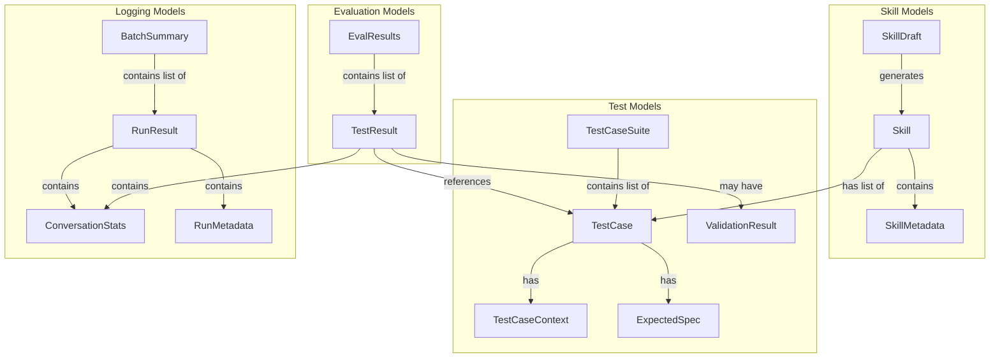
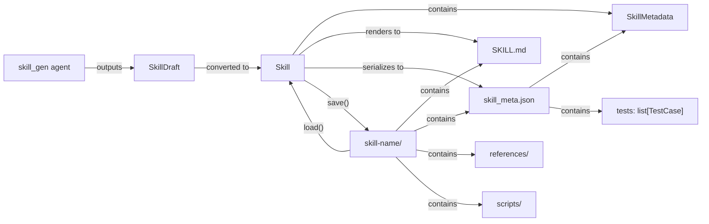
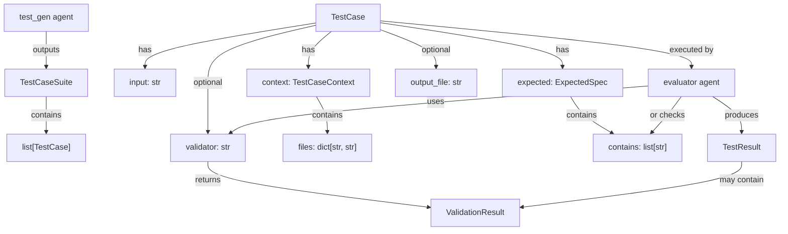
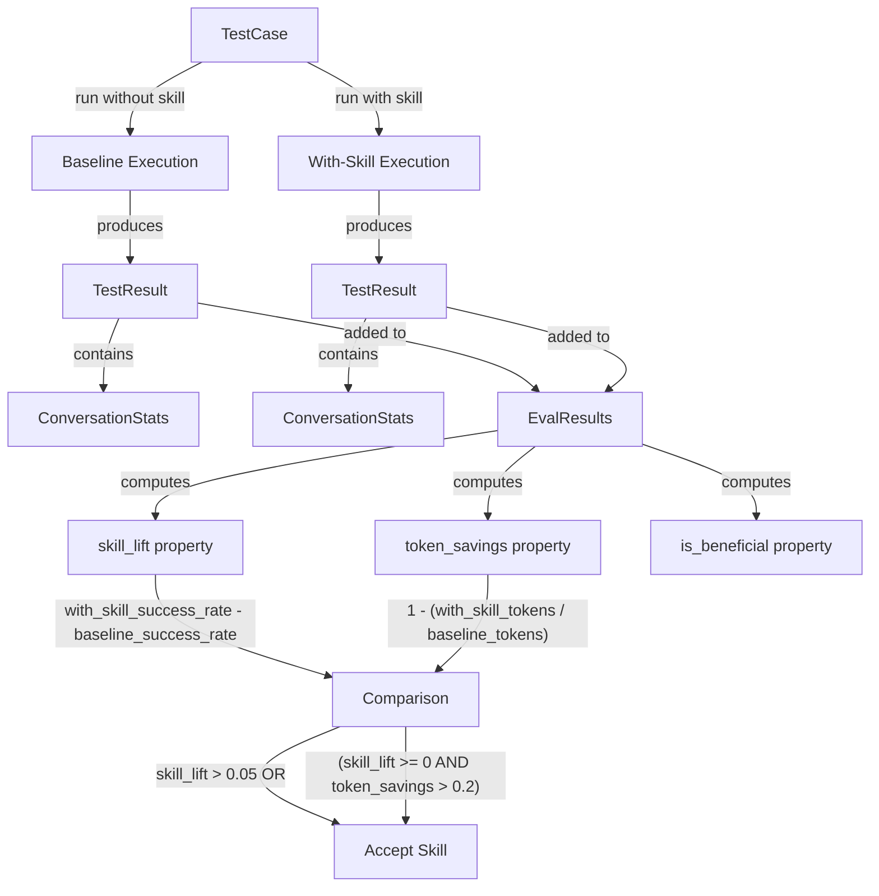
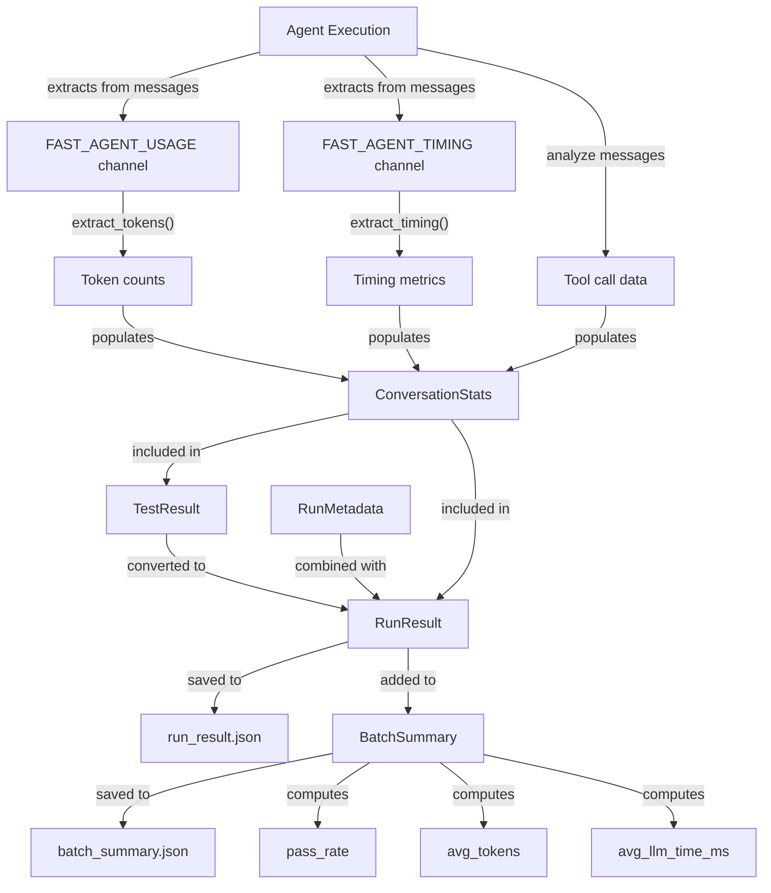
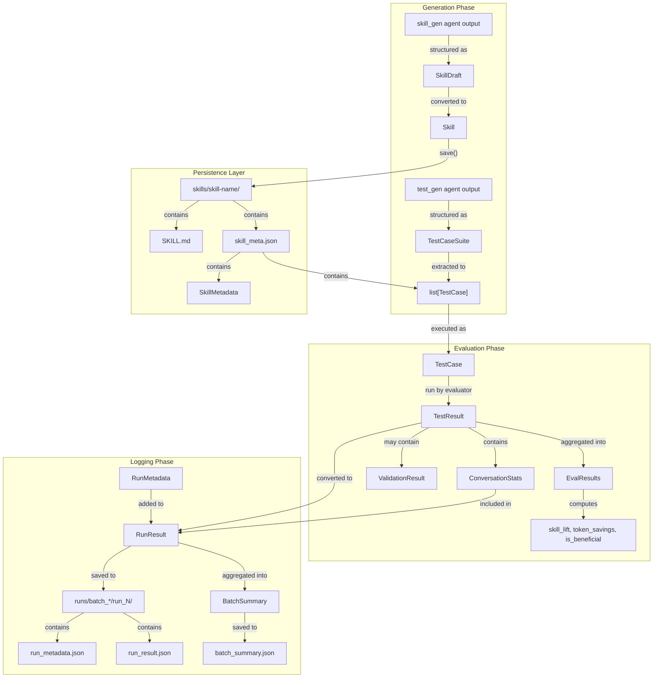

<!-- source: DeepWiki mcp.deepwiki.com · repo huggingface/upskill · page 7 Data Models Reference · fetched 2026-10-26 -->

# Data Models Reference

<details>
<summary>Relevant source files</summary>

The following files were used as context for generating this wiki page:

- [src/upskill/models.py](src/upskill/models.py)

</details>


This document provides a comprehensive reference for all Pydantic data models defined in [src/upskill/models.py](). These models form the type-safe data layer for the entire upskill system, defining the structure of skills, test cases, evaluation results, and run logging. 

For guidance on using these models through the Python API, see [Python API](#9). For details on how skills are persisted to disk, see [Skill Persistence](#5.5). For information on how evaluation metrics are calculated, see [Evaluation Metrics](#3.3).

**Sources:** [src/upskill/models.py:1-426]()

---

## Overview

The upskill data models are organized into four primary categories:

| Category | Purpose | Key Models |
|----------|---------|------------|
| **Skill Models** | Define skill structure and metadata | `Skill`, `SkillDraft`, `SkillMetadata` |
| **Test Models** | Define test cases and validation | `TestCase`, `TestCaseContext`, `ExpectedSpec`, `ValidationResult`, `TestCaseSuite` |
| **Evaluation Models** | Capture test execution and comparison results | `TestResult`, `EvalResults` |
| **Logging Models** | Track performance metrics and run history | `ConversationStats`, `RunMetadata`, `RunResult`, `BatchSummary` |

All models inherit from `pydantic.BaseModel` and provide type validation, JSON serialization, and structured data access throughout the system.

### Model Relationships Overview



**Sources:** [src/upskill/models.py:1-426]()

---

## Skill Models

Skill models define the structure of agent skills, including their Claude Code-compatible frontmatter, instructional content, and associated metadata.

### Skill

The `Skill` class represents a complete agent skill following the Claude Code SKILL.md specification. It combines Claude Code frontmatter fields with upskill-specific metadata and content.

**Key Fields:**

| Field | Type | Description |
|-------|------|-------------|
| `name` | `str` | Skill identifier (lowercase, alphanumeric with hyphens) |
| `description` | `str` | Brief description (1-1024 chars) |
| `allowed_tools` | `list[str] \| None` | Tools the skill is permitted to use |
| `argument_hint` | `str \| None` | Hint for skill invocation (e.g., `"[issue-number]"`) |
| `user_invocable` | `bool` | Whether users can explicitly invoke the skill |
| `disable_model_invocation` | `bool` | Prevent LLM from auto-invoking the skill |
| `metadata` | `SkillMetadata` | Generation metadata and provenance |
| `body` | `str` | Main instructional markdown content |
| `references` | `dict[str, str]` | Reference files (filename → content) |
| `scripts` | `dict[str, str]` | Script files (filename → code) |
| `tests` | `list[TestCase]` | Test cases for evaluation |

**Key Methods:**

| Method | Returns | Description |
|--------|---------|-------------|
| `render()` | `str` | Generate Claude Code compatible SKILL.md with YAML frontmatter |
| `save(path: Path, tests: list[TestCase] \| None)` | `None` | Write skill directory with SKILL.md, skill_meta.json, references/, scripts/ |
| `load(path: Path)` | `Skill` | Load skill from directory containing SKILL.md |

**Name Validation:** The `name` field must match the pattern `^[a-z0-9]+(-[a-z0-9]+)*$` as enforced by the validator at [src/upskill/models.py:116-121]().

**Persistence Structure:**

```
skill-name/
├── SKILL.md           # Claude Code compatible, with YAML frontmatter + body
├── skill_meta.json    # {metadata: {...}, tests: [...]}
├── references/        # Optional reference files
│   └── example.txt
└── scripts/          # Optional script files
    └── helper.py
```

**Sources:** [src/upskill/models.py:94-273]()

---

### SkillDraft

The `SkillDraft` class is the structured output model returned by the `skill_gen` agent during skill generation. It contains the raw components that are then assembled into a full `Skill` object.

**Fields:**

| Field | Type | Description |
|-------|------|-------------|
| `name` | `str` | Skill name |
| `description` | `str` | Brief description |
| `body` | `str` | Main instructional content |
| `references` | `dict[str, str] \| None` | Optional reference files |
| `scripts` | `dict[str, str] \| None` | Optional scripts |

**Usage:** The `skill_gen` agent outputs this structured format, which is then converted to a `Skill` object with additional metadata populated by the generation process.

**Sources:** [src/upskill/models.py:84-92]()

---

### SkillMetadata

The `SkillMetadata` class captures provenance and generation information about a skill. This metadata is persisted to `skill_meta.json` alongside the skill.

**Fields:**

| Field | Type | Description |
|-------|------|-------------|
| `version` | `str` | Metadata schema version (default: `"1.0"`) |
| `generated_by` | `str \| None` | Model that created the skill |
| `generated_at` | `datetime \| None` | Timestamp of generation |
| `source_task` | `str \| None` | Original task description |
| `test_pass_rate` | `float \| None` | Pass rate during evaluation |
| `license` | `str \| None` | License information |
| `compatibility` | `str \| None` | Compatibility notes |

**Sources:** [src/upskill/models.py:13-22]()

---

### Skill Model Relationships



**Sources:** [src/upskill/models.py:84-273]()

---

## Test Models

Test models define the structure of test cases used to evaluate skills, including input specifications, context payloads, expected outputs, and validation results.

### TestCase

The `TestCase` class represents a single test case for skill evaluation.

**Fields:**

| Field | Type | Description |
|-------|------|-------------|
| `input` | `str` | Task/prompt to give the agent |
| `context` | `TestCaseContext \| None` | Files, environment variables, etc. |
| `expected` | `ExpectedSpec` | Expected output checks |
| `output_file` | `str \| None` | File to validate instead of agent output |
| `validator` | `str \| None` | Custom validator name (e.g., `"hf_eval_yaml"`) |
| `validator_config` | `dict[str, str \| int \| float \| bool] \| None` | Configuration for custom validator |

**Extra Fields:** The model uses `ConfigDict(extra="forbid")`, meaning any additional fields will raise validation errors.

**Custom Validation:** When `validator` is specified, the evaluation system uses a custom validation function instead of simple string containment checks. See [Custom Validators](#10.1) for details.

**Sources:** [src/upskill/models.py:59-72]()

---

### TestCaseContext

The `TestCaseContext` class defines additional context provided to the evaluator agent during test execution.

**Fields:**

| Field | Type | Description |
|-------|------|-------------|
| `files` | `dict[str, str] \| None` | Files to create in workspace (filename → content) |

**Workspace Isolation:** Files specified in context are created in an isolated temporary workspace before test execution. See [Workspace Isolation](#10.2) for details.

**Sources:** [src/upskill/models.py:51-57]()

---

### ExpectedSpec

The `ExpectedSpec` class defines expected output checks for a test case.

**Fields:**

| Field | Type | Description |
|-------|------|-------------|
| `contains` | `list[str]` | Strings that must appear in the output |

**Coercion:** The field validator at [src/upskill/models.py:43-48]() automatically converts a single string to a list, allowing both `contains: "text"` and `contains: ["text1", "text2"]` formats.

**Sources:** [src/upskill/models.py:36-48]()

---

### ValidationResult

The `ValidationResult` class represents structured output from custom validators.

**Fields:**

| Field | Type | Description |
|-------|------|-------------|
| `passed` | `bool` | Whether validation passed |
| `assertions_passed` | `int` | Number of assertions that passed |
| `assertions_total` | `int` | Total number of assertions |
| `metrics_count` | `int` | Number of metrics collected |
| `benchmarks_found` | `list[str]` | Benchmarks discovered during validation |
| `error_message` | `str \| None` | Error message if validation failed |

**Usage:** Custom validators return this structured result, which is then stored in `TestResult.validation_result`.

**Sources:** [src/upskill/models.py:25-33]()

---

### TestCaseSuite

The `TestCaseSuite` class is a structured container for a list of test cases.

**Fields:**

| Field | Type | Description |
|-------|------|-------------|
| `cases` | `list[TestCase]` | List of test cases |

**Usage:** The `test_gen` agent outputs this structured format when generating multiple test cases.

**Sources:** [src/upskill/models.py:76-82]()

---

### Test Model Workflow



**Sources:** [src/upskill/models.py:25-82]()

---

## Evaluation Models

Evaluation models capture the results of test execution and comparison between baseline and with-skill performance.

### TestResult

The `TestResult` class represents the outcome of running a single test case against the evaluator agent.

**Fields:**

| Field | Type | Description |
|-------|------|-------------|
| `test_case` | `TestCase` | The test case that was executed |
| `success` | `bool` | Whether the test passed |
| `output` | `str \| None` | Agent's final output |
| `tokens_used` | `int` | Legacy field, use `stats.total_tokens` |
| `turns` | `int` | Legacy field, use `stats.turns` |
| `error` | `str \| None` | Error message if test failed |
| `stats` | `ConversationStats` | Detailed conversation metrics |
| `validation_result` | `ValidationResult \| None` | Structured validation result from custom validator |

**Legacy Fields:** The `tokens_used` and `turns` fields are maintained for backwards compatibility but should not be used in new code. Use `stats.total_tokens` and `stats.turns` instead.

**Sources:** [src/upskill/models.py:314-327]()

---

### EvalResults

The `EvalResults` class compares baseline performance (without skill) against with-skill performance across multiple test cases.

**Fields:**

| Field | Type | Description |
|-------|------|-------------|
| `skill_name` | `str` | Name of the skill being evaluated |
| `model` | `str` | Model used for evaluation |
| `with_skill_results` | `list[TestResult]` | Results with skill enabled |
| `with_skill_success_rate` | `float` | Success rate with skill (0.0-1.0) |
| `with_skill_total_tokens` | `int` | Total tokens used with skill |
| `with_skill_avg_turns` | `float` | Average turns with skill |
| `baseline_results` | `list[TestResult]` | Results without skill |
| `baseline_success_rate` | `float` | Success rate without skill (0.0-1.0) |
| `baseline_total_tokens` | `int` | Total tokens used without skill |
| `baseline_avg_turns` | `float` | Average turns without skill |

**Computed Properties:**

| Property | Returns | Formula | Description |
|----------|---------|---------|-------------|
| `skill_lift` | `float` | `with_skill_success_rate - baseline_success_rate` | Improvement in success rate |
| `token_savings` | `float` | `1 - (with_skill_total_tokens / baseline_total_tokens)` | Percentage of tokens saved |
| `is_beneficial` | `bool` | `skill_lift > 0.05 OR (skill_lift >= 0 AND token_savings > 0.2)` | Whether skill provides net benefit |

**Decision Logic:** A skill is considered beneficial if it either:
1. Improves success rate by more than 5%, OR
2. Maintains or improves success rate while saving more than 20% of tokens

See [Evaluation Metrics](#3.3) for detailed explanation of these criteria.

**Sources:** [src/upskill/models.py:329-364]()

---

### Evaluation Model Flow



**Sources:** [src/upskill/models.py:314-364]()

---

## Logging Models

Logging models track performance metrics and run history for observability and analysis. These models enable batch evaluation, statistical analysis, and CSV export.

### ConversationStats

The `ConversationStats` class aggregates detailed metrics from agent execution, including timing, token usage, and tool call breakdown.

**Timing Metrics:**

| Field | Type | Description |
|-------|------|-------------|
| `conversation_span_ms` | `float` | Total elapsed time for conversation |
| `llm_time_ms` | `float` | Time spent in LLM calls |
| `tool_time_ms` | `float` | Time spent executing tools |

**Conversation Metrics:**

| Field | Type | Description |
|-------|------|-------------|
| `turns` | `int` | Number of conversation turns |
| `tool_calls` | `int` | Total tool calls |
| `tool_errors` | `int` | Number of tool execution errors |

**Tool Categorization:**

| Field | Type | Description |
|-------|------|-------------|
| `mcp_calls` | `int` | Tools with `"__"` in name (MCP server tools) |
| `execute_calls` | `int` | Tools without `"__"` (built-in execute) |
| `tool_call_map` | `dict[str, int]` | Tool name → call count |
| `tool_error_map` | `dict[str, int]` | Tool name → error count |

**Token Metrics:**

| Field | Type | Description |
|-------|------|-------------|
| `input_tokens` | `int` | Total input tokens |
| `output_tokens` | `int` | Total output tokens |
| `total_tokens` | `int` | Total tokens used |

**Raw Data:**

| Field | Type | Description |
|-------|------|-------------|
| `usage_summaries` | `list[dict[str, object]]` | Raw usage data from FastAgent |
| `timing_summaries` | `list[dict[str, object]]` | Raw timing data from FastAgent |

**Legacy Property:** The `tokens` property at [src/upskill/models.py:308-311]() returns `total_tokens` for backwards compatibility.

**Sources:** [src/upskill/models.py:277-312]()

---

### RunMetadata

The `RunMetadata` class captures contextual information about a test run execution.

**Fields:**

| Field | Type | Description |
|-------|------|-------------|
| `model` | `str` | Model identifier used for evaluation |
| `task` | `str` | Task description or test case input |
| `batch_id` | `str` | Unique batch identifier (timestamp-based) |
| `run_number` | `int` | Run number within the batch |
| `timestamp` | `datetime` | Execution timestamp |

**Sources:** [src/upskill/models.py:369-377]()

---

### RunResult

The `RunResult` class combines metadata, statistics, and validation results for a complete test execution record.

**Fields:**

| Field | Type | Description |
|-------|------|-------------|
| `metadata` | `RunMetadata` | Execution context |
| `stats` | `ConversationStats` | Performance metrics |
| `passed` | `bool` | Whether the run passed |
| `assertions_passed` | `int` | Number of passing assertions |
| `assertions_total` | `int` | Total assertions checked |
| `error_message` | `str \| None` | Error message if run failed |
| `session_id` | `str \| None` | Agent session identifier |
| `session_history_file` | `str \| None` | Path to session history file |
| `run_type` | `str` | `"with_skill"` or `"baseline"` |
| `skill_name` | `str \| None` | Name of skill being evaluated |

**Run Type:** The `run_type` field distinguishes between baseline runs (without skill) and with-skill runs, enabling comparison visualizations in the `upskill runs` command.

**Persistence:** Each `RunResult` is serialized to JSON at `runs/batch_YYYYMMDD_HHMMSS/run_N/run_result.json`.

**Sources:** [src/upskill/models.py:379-394]()

---

### BatchSummary

The `BatchSummary` class aggregates results across multiple runs within a batch.

**Fields:**

| Field | Type | Description |
|-------|------|-------------|
| `batch_id` | `str` | Unique batch identifier |
| `model` | `str` | Model used for all runs |
| `task` | `str` | Task description |
| `total_runs` | `int` | Total number of runs |
| `passed_runs` | `int` | Number of passing runs |
| `results` | `list[RunResult]` | All run results |

**Computed Properties:**

| Property | Returns | Formula | Description |
|----------|---------|---------|-------------|
| `pass_rate` | `float` | `passed_runs / total_runs` | Success rate across batch |
| `avg_tokens` | `float` | `sum(r.stats.total_tokens) / len(results)` | Average token usage |
| `avg_llm_time_ms` | `float` | `sum(r.stats.llm_time_ms) / len(results)` | Average LLM time |

**Persistence:** The `BatchSummary` is serialized to `runs/batch_YYYYMMDD_HHMMSS/batch_summary.json`.

**Sources:** [src/upskill/models.py:396-426]()

---

### Logging Model Data Flow



**Sources:** [src/upskill/models.py:277-426]()

---

## Model Lifecycle and Persistence

This diagram shows how data models flow through the complete skill generation, evaluation, and logging lifecycle, mapping to their on-disk representations.



**Sources:** [src/upskill/models.py:1-426]()

---

## Field Validation and Constraints

Several models implement custom validation logic and field constraints:

### Name Validation (Skill)

The `Skill.name` field must match the pattern `^[a-z0-9]+(-[a-z0-9]+)*$`:
- Lowercase alphanumeric characters only
- Hyphens allowed as separators (but not at start/end)
- Examples: `"code-review"`, `"api-testing"`, `"data-analysis"`

Enforced by `@field_validator` at [src/upskill/models.py:116-121]()

### Contains Coercion (ExpectedSpec)

The `ExpectedSpec.contains` field accepts either a string or list of strings and automatically normalizes to a list:

```python
# Both formats are valid:
expected = ExpectedSpec(contains="hello")          # → contains=["hello"]
expected = ExpectedSpec(contains=["a", "b", "c"])  # → contains=["a", "b", "c"]
```

Enforced by `@field_validator` at [src/upskill/models.py:43-48]()

### Extra Field Forbidding

Models with `ConfigDict(extra="forbid")` reject unknown fields during validation:
- `ExpectedSpec` [src/upskill/models.py:39]()
- `TestCaseContext` [src/upskill/models.py:54]()
- `TestCase` [src/upskill/models.py:62]()
- `TestCaseSuite` [src/upskill/models.py:79]()

This ensures strict schema compliance and prevents typos in test case definitions.

**Sources:** [src/upskill/models.py:39-121]()

---

## JSON Serialization

All models support JSON serialization through Pydantic's `model_dump()` method with `mode="json"`:

```python
# Example: Serialize a Skill to JSON
skill_dict = skill.model_dump(mode="json")
json_str = json.dumps(skill_dict, indent=2, default=str)

# Example: Deserialize from JSON
skill_dict = json.loads(json_str)
skill = Skill.model_validate(skill_dict)
```

**Date/Time Handling:** The `default=str` parameter in `json.dumps()` ensures `datetime` objects are serialized as ISO 8601 strings.

**Persistence Methods:** The `Skill.save()` method uses this pattern to write `skill_meta.json` at [src/upskill/models.py:166-168]().

**Sources:** [src/upskill/models.py:148-273]()

---

