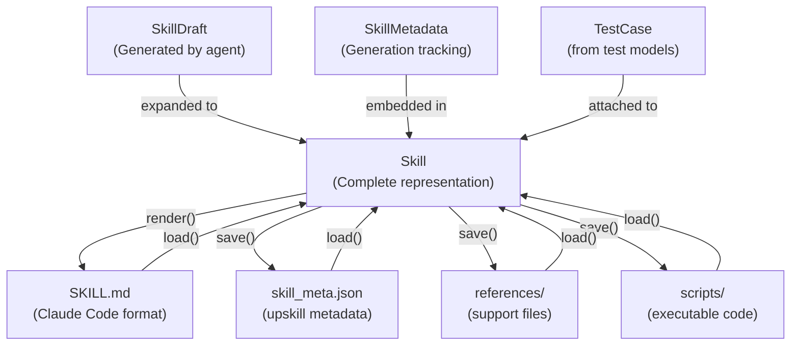
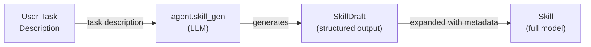
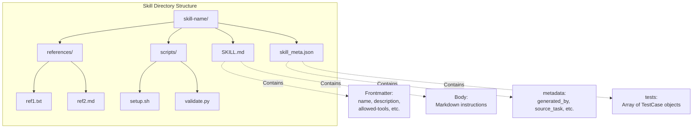
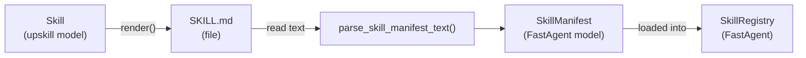
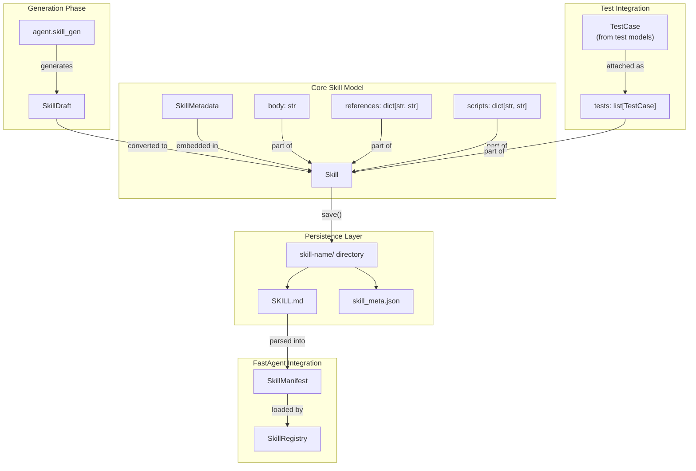

<!-- source: DeepWiki mcp.deepwiki.com · repo huggingface/upskill · page 7.1 Skill Models · fetched 2026-10-26 -->

# Skill Models

<details>
<summary>Relevant source files</summary>

The following files were used as context for generating this wiki page:

- [src/upskill/agent_cards/skill_gen.md](src/upskill/agent_cards/skill_gen.md)
- [src/upskill/manifest_utils.py](src/upskill/manifest_utils.py)
- [src/upskill/models.py](src/upskill/models.py)

</details>


This page documents the core Pydantic data models that represent skills in the upskill system. These models define the structure, metadata, and persistence format for generated skills.

For test-related data models, see [Test Models](#7.2). For evaluation results and metrics, see [Evaluation Models](#7.3). For run logging and statistics, see [Logging Models](#7.4).

---

## Overview

The skill models in upskill provide a structured representation of agent skills that is compatible with FastAgent's skill system while adding upskill-specific metadata for generation tracking and evaluation. The three core models are:

- **`Skill`** - The primary model representing a complete skill with frontmatter, body, references, scripts, and metadata
- **`SkillDraft`** - A simplified intermediate model produced by the `skill_gen` agent during generation
- **`SkillMetadata`** - Metadata about how and when a skill was generated

**Sources:** [src/upskill/models.py:1-426]()

---

## Skill Model Hierarchy



**Sources:** [src/upskill/models.py:13-273]()

---

## SkillMetadata

The `SkillMetadata` class tracks generation provenance and evaluation results.

### Fields

| Field | Type | Description |
|-------|------|-------------|
| `version` | `str` | Schema version (default: "1.0") |
| `generated_by` | `str \| None` | Model identifier that created the skill (e.g., "claude-opus-4") |
| `generated_at` | `datetime \| None` | Timestamp of skill generation |
| `source_task` | `str \| None` | Original task description provided by user |
| `test_pass_rate` | `float \| None` | Final test pass rate after evaluation (0.0-1.0) |
| `license` | `str \| None` | License information for the skill |
| `compatibility` | `str \| None` | Compatible agent versions or systems |

### Usage

```python
from upskill.models import SkillMetadata
from datetime import datetime

metadata = SkillMetadata(
    generated_by="claude-opus-4",
    generated_at=datetime.now(),
    source_task="Handle API errors gracefully in Python",
    test_pass_rate=0.85
)
```

The metadata is persisted to `skill_meta.json` alongside the skill and loaded automatically when a skill is read from disk.

**Sources:** [src/upskill/models.py:13-22]()

---

## SkillDraft

The `SkillDraft` class represents the structured output from the `skill_gen` agent before it is expanded into a full `Skill` object.

### Fields

| Field | Type | Description |
|-------|------|-------------|
| `name` | `str` | Skill name (lowercase-with-hyphens format) |
| `description` | `str` | Brief description of what the skill teaches |
| `body` | `str` | Main instruction content in markdown |
| `references` | `dict[str, str] \| None` | Optional reference files (filename → content) |
| `scripts` | `dict[str, str] \| None` | Optional script files (filename → code) |

### Generation Flow



The agent generates a `SkillDraft` with structured fields, which is then converted to a full `Skill` object by adding metadata, test cases, and Claude Code frontmatter fields.

**Sources:** [src/upskill/models.py:84-92](), [src/upskill/agent_cards/skill_gen.md:1-268]()

---

## Skill

The `Skill` class is the primary data model representing a complete agent skill. It combines Claude Code compatibility (frontmatter format) with upskill-specific metadata and test cases.

### Claude Code Frontmatter Fields

These fields are rendered into the YAML frontmatter of `SKILL.md` for FastAgent compatibility:

| Field | Type | Default | Description |
|-------|------|---------|-------------|
| `name` | `str` | Required | Lowercase alphanumeric with hyphens (e.g., "git-commit-messages") |
| `description` | `str` | Required | Brief description (1-1024 chars) |
| `allowed_tools` | `list[str] \| None` | `None` | List of tool names this skill can use |
| `argument_hint` | `str \| None` | `None` | Hint for arguments (e.g., "[issue-number]") |
| `user_invocable` | `bool` | `True` | Whether users can explicitly invoke this skill |
| `disable_model_invocation` | `bool` | `False` | Prevent LLM from auto-invoking this skill |

### upskill-Specific Fields

These fields are stored in `skill_meta.json` and not in the frontmatter:

| Field | Type | Description |
|-------|------|-------------|
| `metadata` | `SkillMetadata` | Generation provenance and evaluation results |
| `tests` | `list[TestCase]` | Test cases for evaluating this skill |

### Content Fields

| Field | Type | Description |
|-------|------|-------------|
| `body` | `str` | Main instruction markdown content |
| `references` | `dict[str, str]` | Reference files (filename → content) |
| `scripts` | `dict[str, str]` | Executable scripts (filename → code) |

### Name Validation

The skill name must match the pattern `^[a-z0-9]+(-[a-z0-9]+)*$`:

```python
@field_validator("name")
@classmethod
def validate_name(cls, v: str) -> str:
    if not re.match(r"^[a-z0-9]+(-[a-z0-9]+)*$", v):
        raise ValueError("name must be lowercase alphanumeric with hyphens")
    return v
```

**Sources:** [src/upskill/models.py:94-121]()

---

## Skill Persistence Format



### SKILL.md Format

The `SKILL.md` file follows the Claude Code specification with YAML frontmatter:

```markdown
---
name: git-commit-messages
description: Write clear, conventional commit messages
allowed-tools: git, write_file
user-invocable: true
---

# Git Commit Messages

## Overview
This guide explains how to write effective git commit messages...
```

### skill_meta.json Format

```json
{
  "metadata": {
    "version": "1.0",
    "generated_by": "claude-opus-4",
    "generated_at": "2024-01-15T10:30:00",
    "source_task": "Write good git commit messages",
    "test_pass_rate": 0.9
  },
  "tests": [
    {
      "input": "Create a commit message for adding a new feature",
      "expected": {
        "contains": ["feat", "add"]
      }
    }
  ]
}
```

**Sources:** [src/upskill/models.py:148-183]()

---

## Skill Methods

### render()

Generates a Claude Code-compatible `SKILL.md` string with YAML frontmatter:

```python
def render(self) -> str:
    """Generate Claude Code compatible SKILL.md with YAML frontmatter."""
```

The method:
1. Builds YAML frontmatter with all required and optional fields
2. Appends the skill body after a blank line
3. Returns the complete markdown document

**Example:**

```python
skill = Skill(
    name="git-commit-messages",
    description="Write clear commit messages",
    body="# Git Commit Messages\n\n..."
)

markdown = skill.render()
# Output:
# ---
# name: git-commit-messages
# description: Write clear commit messages
# ---
# 
# # Git Commit Messages
# ...
```

**Sources:** [src/upskill/models.py:123-146]()

---

### save()

Writes the skill to a directory with all associated files:

```python
def save(self, path: Path, tests: list[TestCase] | None = None) -> None:
    """Write skill directory with all files."""
```

The method creates:
- `SKILL.md` - Claude Code-compatible skill document
- `skill_meta.json` - upskill metadata and test cases
- `references/` - Directory with reference files (if any)
- `scripts/` - Directory with script files (if any)

**Example:**

```python
from pathlib import Path

skill.save(Path("./skills/git-commit-messages"))
```

This creates:
```
skills/git-commit-messages/
├── SKILL.md
├── skill_meta.json
├── references/
│   └── conventional-commits.md
└── scripts/
    └── validate-commit.sh
```

**Sources:** [src/upskill/models.py:148-183]()

---

### load()

Loads a skill from a directory:

```python
@classmethod
def load(cls, path: Path) -> Skill:
    """Load a skill from a directory."""
```

The method:
1. Reads and parses `SKILL.md` frontmatter and body
2. Loads metadata and tests from `skill_meta.json` (if present)
3. Loads all files from `references/` directory (if present)
4. Loads all files from `scripts/` directory (if present)
5. Returns a fully-populated `Skill` instance

**Example:**

```python
from pathlib import Path
from upskill.models import Skill

skill = Skill.load(Path("./skills/git-commit-messages"))
print(skill.name)  # "git-commit-messages"
print(skill.metadata.generated_by)  # "claude-opus-4"
print(len(skill.tests))  # 5
```

**Sources:** [src/upskill/models.py:184-273]()

---

## Integration with FastAgent



The `manifest_utils.py` module provides a bridge between upskill's `Skill` model and FastAgent's `SkillManifest`:

```python
from fast_agent.skills.registry import SkillManifest, SkillRegistry

def parse_skill_manifest_text(
    manifest_text: str,
    *,
    path: Path | None = None,
) -> tuple[SkillManifest | None, str | None]:
    """Parse a SkillManifest from raw SKILL.md content."""
    return SkillRegistry.parse_manifest_text(manifest_text, path=path)
```

This allows upskill to:
1. Generate skills as `Skill` objects with rich metadata
2. Render them to `SKILL.md` files compatible with FastAgent
3. Parse them back into FastAgent's `SkillManifest` for execution

**Sources:** [src/upskill/manifest_utils.py:1-24]()

---

## Model Relationships



**Sources:** [src/upskill/models.py:1-426](), [src/upskill/manifest_utils.py:1-24]()

---

## Complete Field Reference

### Skill Model

```python
class Skill(BaseModel):
    # Claude Code frontmatter (rendered to SKILL.md)
    name: str
    description: str
    allowed_tools: list[str] | None = None
    argument_hint: str | None = None
    user_invocable: bool = True
    disable_model_invocation: bool = False
    
    # upskill metadata (stored in skill_meta.json)
    metadata: SkillMetadata
    tests: list[TestCase]
    
    # Content (body in SKILL.md, others in subdirectories)
    body: str
    references: dict[str, str]
    scripts: dict[str, str]
```

### SkillMetadata Model

```python
class SkillMetadata(BaseModel):
    version: str = "1.0"
    generated_by: str | None = None
    generated_at: datetime | None = None
    source_task: str | None = None
    test_pass_rate: float | None = None
    license: str | None = None
    compatibility: str | None = None
```

### SkillDraft Model

```python
class SkillDraft(BaseModel):
    name: str
    description: str
    body: str
    references: dict[str, str] | None = None
    scripts: dict[str, str] | None = None
```

**Sources:** [src/upskill/models.py:13-114]()

---

